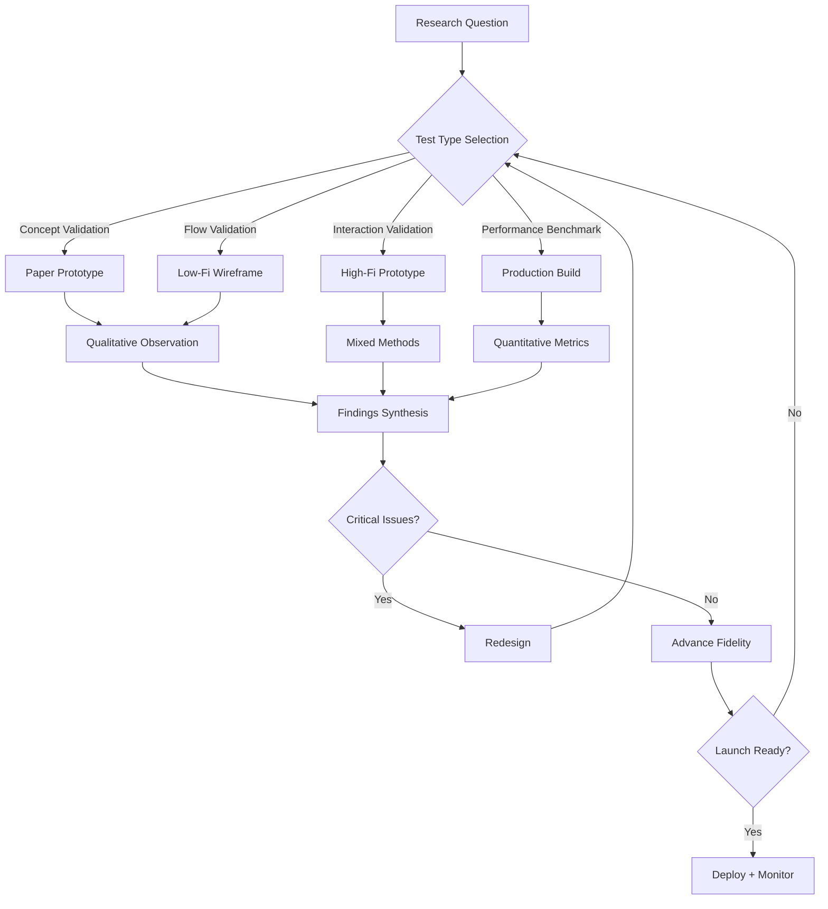

# Lesson 4: Usability Testing, Validation Methods, and Iterative Design Frameworks

## 1. First-Principles Intuition & Invariants

The fundamental paradox of user experience design emerges not from the complexity of creating interfaces, but from the cognitive dissonance between designer intent and user perception. A designer who has invested hundreds of hours conceptualizing interaction flows, refining visual hierarchies, and optimizing information architecture becomes psychologically incapable of experiencing their own product as a naive user would. This inevitable blindness forms the foundational rationale for systematic usability testing: the designer's mental model and the user's mental model exist in separate phenomenological spaces, and only empirical observation can bridge this gap.

Usability testing operates on a core invariant borrowed from experimental psychology: human behavior under observation reveals more truth than self-reported preferences or designer assumptions. When a user hesitates for three seconds before tapping a button, that cognitive load manifests as measurable friction regardless of whether the user consciously registers the confusion. When a participant's gaze pattern reveals five fixations on a navigation menu before locating the desired option, that search cost quantifies directly into task completion time and cognitive overhead. These behavioral signals constitute the ground truth of user experience, and any design validation methodology that ignores direct observation in favor of theoretical reasoning or personal preference commits a category error equivalent to a designer relying purely on measurement specs and analytics dashboards without ever visually examining the actual interface in front of real users.

The iterative design framework rests on a second invariant: incremental refinement through rapid feedback cycles produces superior outcomes compared to monolithic development followed by single-point validation. This principle mirrors the working methods of studio recording engineers who continuously A/B reference mixes rather than committing to a final master after a single blind pass. A UX designer who builds a complete high-fidelity prototype before conducting any usability testing accumulates design debt exponentially—every untested assumption compounds upon previous untested assumptions until the entire system requires fundamental restructuring rather than targeted refinement. The optimal strategy inverts this risk distribution by injecting validation checkpoints at progressive fidelity stages: paper prototype testing validates information architecture before visual design begins, low-fidelity wireframe testing validates interaction patterns before committing to component libraries, and high-fidelity prototype testing validates micro-interactions and transition choreography before engineering handoff.

A third foundational principle distinguishes formative testing from summative testing, a dichotomy that parallels the difference between rehearsal critique and final performance evaluation. Formative testing occurs during the design process with the explicit goal of identifying problems and generating solutions—the designer actively seeks failure modes to eliminate them before launch. Summative testing occurs after design stabilization to validate that predetermined success metrics have been achieved—the goal shifts from discovery to verification. Confusing these two modes produces methodological errors: conducting summative benchmark testing on an incomplete prototype wastes resources measuring metrics that will inevitably change, while treating post-launch analytics as formative feedback introduces confirmation bias since major structural changes become politically and economically infeasible after deployment.

The concept of ecological validity imposes a critical constraint on test design. A usability test conducted in an artificial environment using contrived tasks with a facilitator hovering nearby generates behavioral data contaminated by demand characteristics and environmental confounders. The participant who knows they are being evaluated performs differently than the casual user browsing autonomously at midnight on their personal device. The ideal testing methodology minimizes this observer effect by approximating authentic usage contexts as closely as feasible—remote unmoderated testing for consumer applications, contextual field studies for enterprise tools, and diary studies for intermittent-use products. The trade-off space between experimental control and ecological validity requires calibration based on the specific research question: understanding whether users can successfully complete a critical task under ideal conditions justifies a moderated lab environment, while measuring adoption rates and long-term engagement patterns demands longitudinal field observation.

## 2. Core Architecture & Mechanics

The architecture of a comprehensive usability testing program consists of nested validation layers operating at different fidelity stages throughout the design lifecycle. This multi-stage validation pyramid ensures that foundational structural decisions receive scrutiny before detail-level refinement begins, preventing the scenario where a designer perfects the visual polish of an interaction model that fundamentally misaligns with user mental models.

At the foundation of this pyramid sits concept testing, conducted using paper prototypes, storyboards, or verbal walkthroughs before any digital artifacts exist. The facilitator presents participants with hand-drawn sketches representing key screens or interaction moments and observes whether users can articulate the purpose of each interface element and predict system behavior in response to their actions. A participant examining a paper sketch of an image editing interface who cannot distinguish which control adjusts opacity versus saturation reveals a visual hierarchy failure that would persist regardless of how beautifully the final interface renders. The low production cost of paper prototypes—measured in hours rather than days—enables rapid iteration cycles where the designer can sketch alternative layouts between test sessions and immediately validate whether the revised structure resolves the identified confusion points.

The mechanics of conducting effective paper prototype tests require careful attention to facilitation technique. The designer places paper interface elements on a table and instructs the participant to "interact" by pointing, describing intended actions, or physically moving paper components. When the participant attempts to tap a button, the facilitator manually swaps the current screen for the next screen in the sequence, simulating system response. This wizard-of-oz technique allows testing of complex state transitions and conditional logic without writing a single line of code. The facilitator's verbal prompts must remain neutral and task-focused: "Please show me how you would create a new project" rather than leading questions like "Would you tap this button here to create a project?" The former reveals whether the affordance communicates its purpose clearly, while the latter telegraphs the answer and invalidates the observation.



As design fidelity advances to digital wireframes, the testing methodology shifts to accommodate richer interaction possibilities while maintaining focus on structural validation rather than visual refinement. Low-fidelity wireframes rendered in tools like Figma, Sketch, or Adobe XD enable click-through prototyping where participants navigate between screens using interactive hotspots without requiring functional code. The absence of final typography, color palettes, iconography, and micro-animations prevents participants from fixating on surface aesthetics that remain intentionally unresolved. A participant who hesitates when confronted with three unlabeled navigation icons in a low-fidelity wireframe reveals an information architecture problem that transcends visual design—adding colors and gradients will not resolve the fundamental ambiguity about which icon leads to which destination.

The testing protocol for wireframe evaluation combines task-based observation with think-aloud methodology. The facilitator assigns specific goal-oriented tasks—"Find the settings screen and change your notification preferences"—and instructs participants to narrate their thought process continuously as they navigate the prototype. The verbal stream provides direct access to the participant's mental model: statements like "I'm looking for a settings icon, probably in the top corner" reveal schema-based expectations, while expressions of surprise—"Oh, I didn't expect that to happen"—flag violations of convention. The facilitator records both task completion success rates and qualitative observations about points of hesitation, incorrect navigation paths, and verbal expressions of confusion. A participant who successfully completes a task but expresses uncertainty throughout the process has revealed a usability problem despite the successful outcome—the cognitive load required to puzzle through ambiguous affordances will deter less persistent users.

High-fidelity prototype testing introduces the full visual design system, animation choreography, and interaction micro-details that approximate the production experience. At this stage, the validation focus shifts from structural soundness to interaction fluency and emotional response. Participants can now evaluate whether transitions feel responsive or sluggish, whether visual feedback adequately confirms actions, and whether the overall aesthetic quality meets their category expectations. A design software interface participant who comments that timeline scrubbing feels "laggy" despite objectively fast frame rates may be reacting to easing curve selection—linear interpolation creates perceptually stiff motion compared to ease-out curves that accelerate quickly and decelerate gradually, matching human kinesthetic expectations.

The evaluation framework for high-fidelity prototypes incorporates both qualitative observation and quantitative performance metrics. Time-on-task measurements reveal efficiency: a participant who requires ninety seconds to complete a routine action that should take fifteen seconds has encountered unnecessary friction regardless of whether they eventually succeed. Error rates quantify reliability: if thirty percent of participants attempt an incorrect interaction before finding the correct path, the interface has failed to adequately afford the intended behavior. The System Usability Scale (SUS)—a standardized ten-item questionnaire yielding scores from zero to one hundred—provides a summative usability index that enables comparison across design iterations and competitive benchmarking against category norms. Enterprise software typically achieves SUS scores between sixty-five and seventy-five, while consumer applications with excellent usability exceed eighty-five.

Remote unmoderated testing platforms automate test administration by recording participant screen activity, audio narration, and webcam footage without requiring real-time facilitator presence. Services like UserTesting, Lookback, and Maze enable designers to recruit participants matching specific demographic criteria, deploy prototypes with embedded task instructions, and receive recorded sessions for asynchronous analysis. This methodology trades the facilitator's ability to ask spontaneous follow-up questions for scalability—a designer can observe fifty participants completing tasks over a weekend rather than scheduling individual hour-long sessions across weeks. The quantitative dashboard synthesizes metrics across all sessions, surfacing patterns like "sixty percent of users failed to locate the export function within three minutes" that would require manual tallying in moderated sessions.

Heuristic evaluation represents an expert-based inspection method that complements user testing by systematically auditing interface elements against established usability principles. Jakob Nielsen's ten heuristics codify decades of interface design research into actionable criteria: visibility of system status, match between system and real world, user control and freedom, consistency and standards, error prevention, recognition rather than recall, flexibility and efficiency of use, aesthetic and minimalist design, help users recognize and recover from errors, and help and documentation. An evaluator systematically examines each interface screen, identifying violations of these principles and assigning severity ratings from cosmetic annoyances to catastrophic usability disasters. A design tool interface that provides no visual feedback when users apply a filter to a layer violates the visibility of system status heuristic with high severity—users cannot confidently proceed without confirmation that their action registered successfully.

The cognitive walkthrough method structures expert evaluation around specific user tasks by simulating the cognitive processes of a first-time user attempting to achieve defined goals. The evaluator sequences through each interface step required to complete the task and answers four questions at each action point: Will users know what to do? Can users see how to do it? Will users understand from feedback whether their action succeeded? Will users understand how to proceed to the next step? A cognitive walkthrough of a design tool's component system might reveal that while experienced users instantly recognize the components panel, first-time users lack the conceptual framework to distinguish components from instances and local styles—the interface assumes domain knowledge that novices do not possess.

The practical mechanics of conducting moderated usability tests require preparation protocols that maximize session productivity. The test plan document specifies participant recruiting criteria, task scenarios with success criteria, observation metrics to collect, and post-task questionnaires. The physical or virtual testing environment eliminates distractions—quiet room, minimal visual clutter, recording equipment positioned non-intrusively. The facilitator script structures the session flow: opening briefing explaining informed consent and think-aloud expectations, warmup task to acclimate participants to verbal narration, core task sequence, post-task subjective preference surveys, and closing debrief allowing open-ended feedback. Audio and screen recordings capture evidence for later analysis and enable team members who did not attend live sessions to observe participant behavior directly.

```text
MODERATED TEST SESSION STRUCTURE
================================

00:00-00:05  Welcome & Consent
             - Explain observation purpose
             - Clarify thinking-aloud protocol
             - Obtain consent for recording

00:05-00:10  Context Briefing
             - Describe product category (no leading details)
             - Confirm participant fits target persona
             - Set task context without revealing solutions

00:10-00:15  Warmup Task
             - Simple exploratory navigation
             - Practice think-aloud narration
             - Build participant comfort with protocol

00:15-00:45  Core Task Battery (3-4 tasks × 7-10 min each)
             - Present task scenario
             - Observe without intervention
             - Record completion time, errors, verbalizations
             - Note hesitation points and search patterns

00:45-00:55  Post-Task Questionnaires
             - System Usability Scale (SUS)
             - Single Ease Question (SEQ) per task
             - Subjective preference ratings

00:55-01:00  Open Debrief
             - Solicit unprompted observations
             - Probe specific confusion points
             - Thank and compensate participant
```

Analyzing qualitative session recordings requires systematic coding of observed behaviors and verbalizations. The analyst reviews each session multiple times, first for holistic impressions, then for detailed annotation of critical incidents: moments where users expressed confusion, attempted incorrect actions, recovered from errors, or exhibited emotional reactions. These incidents cluster into thematic patterns across multiple participants—if six out of eight users attempt to drag-and-drop an item that does not support dragging, the interface has violated convention-based expectations through inadequate affordance signaling. Affinity diagramming organizes these observation fragments by grouping related incidents, surfacing systemic issues that transcend individual task contexts.

Quantitative metrics require sufficient sample sizes to achieve statistical validity, with minimum thresholds varying by measurement type. Task completion rates achieve reasonable confidence intervals with fifteen to twenty participants per condition when measuring binary success/failure outcomes. Time-on-task measurements require larger samples—typically thirty to fifty participants—to account for high variance in individual performance speeds. A/B comparison testing that evaluates two alternative designs against each other demands sample sizes calculated using power analysis based on expected effect magnitude and desired confidence levels. A designer comparing two navigation structures who expects a twenty-percent improvement in task completion time requires approximately forty participants per condition to detect that difference with ninety-percent statistical power at ninety-five-percent confidence.

## 3. High-Performance Optimization & Failure Modes

The efficiency of iterative design workflows depends critically on minimizing the temporal and resource costs of validation cycles. A testing protocol that requires three weeks to recruit participants, schedule sessions, conduct observations, analyze results, and synthesize findings creates a feedback loop too slow to support rapid iteration. Designers operating under such constraints resort to intuition-driven design decisions to maintain project velocity, undermining the entire rationale for empirical validation. High-performance usability testing optimizes cycle time through strategic sampling decisions, automated recruitment pipelines, asynchronous remote methodologies, and just-in-time synthesis techniques.

Participant recruiting represents a frequent bottleneck, particularly when targeting specialized user populations like UX designers, graphic designers, or design educators. Professional recruiting agencies provide vetted participant pools matching specific criteria but introduce multi-day scheduling delays and per-participant costs ranging from seventy-five to two hundred dollars depending on demographic rarity. Guerrilla testing techniques reduce this overhead by recruiting opportunistically from accessible populations: intercepting users in public spaces, soliciting volunteers from online communities, or incentivizing existing customers through loyalty programs. A designer developing design software can conduct rapid hallway testing by recruiting five participants from a local design agency, compensating them with thirty-dollar gift cards and completing all sessions within a single afternoon. The sampling bias introduced by convenience recruiting—participants may differ systematically from the broader target population—becomes acceptable when the goal is identifying major usability disasters rather than generating representative benchmark metrics.

Remote unmoderated platforms collapse the temporal overhead of synchronous scheduling by enabling participants to complete tasks independently at their convenience. A designer uploads a prototype on Monday morning, defines task instructions and screening criteria, and receives twenty completed session recordings by Wednesday evening without any real-time coordination. This asynchronous model scales participant throughput linearly—recruiting fifty participants requires no additional facilitator time compared to recruiting five. The methodological trade-off sacrifices the facilitator's ability to ask spontaneous follow-up questions or clarify task misunderstandings, occasionally resulting in sessions where participants misinterpret instructions and generate invalid data. Careful task wording and pilot testing with colleagues minimize this risk but cannot eliminate it entirely.

Analyzing session recordings consumes substantial time when conducted manually—a one-hour participant session typically requires two to three hours of analyst review time to annotate critical incidents, transcribe verbalizations, and extract quantitative metrics. Automated analysis tools applying computer vision and natural language processing techniques reduce this burden by algorithmically detecting behavioral patterns. Gaze-tracking heatmaps aggregate fixation patterns across multiple participants, revealing which interface regions captured attention and which elements users overlooked entirely. Sentiment analysis algorithms score verbal think-aloud transcripts for emotional valence, flagging moments of frustration or confusion for detailed manual review. These automated preprocessing steps filter the most critical segments for human analysis, enabling a single researcher to process ten times more session volume compared to fully manual workflows.

The synthesis phase transforms raw observational data into actionable design recommendations, but poorly structured synthesis creates ambiguity about prioritization and implementation. A findings document that lists forty discrete usability issues without severity ranking or context leaves the design team paralyzed by decision fatigue—which problems demand immediate resolution versus which represent minor polish opportunities? The critical/high/medium/low severity taxonomy borrowed from software bug tracking provides a structured prioritization framework: critical issues prevent task completion for most users, high-severity issues cause significant frustration or inefficiency, medium-severity issues create minor annoyances, and low-severity issues represent incremental polish opportunities. A critical-severity finding like "seventy-five percent of users cannot locate the save function" demands immediate architectural revision, while a low-severity observation like "two users suggested slightly larger font size for secondary labels" enters the backlog for consideration during visual refinement.

Effective findings documentation pairs each identified problem with specific design implications and proposed solutions rather than dumping raw observations onto designers without interpretation. An observation like "users hesitated for five seconds when asked to export their project" fails to communicate actionable insight. Reframing the finding with causal analysis and recommendation clarifies the path forward: "Users hesitated when prompted to export because the export button uses an unfamiliar icon (upward arrow) instead of conventional language. Recommendation: Replace icon with 'Export' text label and add keyboard shortcut ⌘E for experienced users." This structure respects the distinct cognitive labor division between researchers who identify problems and designers who generate solutions while providing sufficient context to inform creative problem-solving.

The iterative refinement process risks introducing new problems while solving identified issues, particularly when designers make localized fixes without considering systemic implications. A designer who relocates a frequently-missed navigation button from bottom-right to top-left may inadvertently violate consistency by creating positional asymmetry with other screens in the flow. Regression testing validates that implemented changes resolved targeted problems without generating secondary issues. The test protocol re-evaluates previously validated flows to confirm that behavior remains stable, while adding targeted tests for the modified components. A regression test battery for the navigation relocation change would verify that users now locate the button successfully (validating the fix) while also confirming that other navigation patterns remain unaffected (detecting regressions).

Sample size limitations constrain the generalizability of usability findings, particularly when working with tight budget or timeline constraints. Nielsen's research suggests that testing with five participants uncovers approximately eighty-five percent of usability problems, but this heuristic assumes homogeneous user populations and typical interface complexity. Testing design software with five professional designers may miss critical issues affecting novice users who lack technical vocabulary and domain expertise. The optimal sampling strategy balances thoroughness against resource constraints by conducting initial small-sample rounds to identify severe issues, implementing design revisions, then validating with larger samples once major problems have been eliminated. This staged approach prevents wasting resources conducting large-scale tests on fundamentally broken prototypes while ensuring that near-final designs receive adequate validation across user diversity.

Confirmation bias threatens the integrity of usability research when designers cherry-pick observations that validate preexisting design preferences while dismissing contradictory evidence. A designer emotionally invested in an innovative navigation pattern may unconsciously discount participant confusion as "user learning curve" while interpreting even minor positive reactions as validation of the approach. Rigorous research protocols mitigate this risk through pre-registered analysis plans that specify evaluation criteria before data collection begins, preventing post-hoc rationalization. Involving team members not directly responsible for the interface design in analysis and synthesis activities introduces checks against motivated reasoning—an outside observer lacks emotional attachment to specific design decisions and evaluates evidence more objectively.

The boundary between acceptable learning curves and unacceptable usability failures requires calibration based on product category and usage frequency. Professional creative tools like 3D modeling software, vector graphics applications, and video editing systems inherently demand substantial learning investment—users accept multi-hour tutorial commitments because the tools enable capabilities impossible through simpler interfaces. Testing such applications must distinguish initial acclimation friction from persistent usability problems that impede expert workflows. A participant who struggles with layer organization after fifteen minutes of exposure may be experiencing normal learning curve steepness, but a participant who still exhibits confusion after three hours of practice has encountered a fundamental comprehension barrier. Longitudinal testing methodologies that observe users across multiple sessions separated by days or weeks accurately capture learning trajectory and identify whether initial confusion resolves through repeated exposure or persists indefinitely.

False positive error detection creates wasted optimization effort when statistical noise or methodological artifacts masquerade as real usability issues. A single participant who clicks the wrong button due to distraction or misreading instructions does not indicate a design problem, but aggregating that incident with four other unrelated errors across different tasks might superficially suggest a pattern. Proper statistical thresholding prevents this error amplification: a problem must recur across multiple independent participants and contexts before qualifying as a validated issue requiring resolution. Triangulating quantitative metrics with qualitative observations provides additional validation—if users exhibit slow task completion times but verbalize no confusion and express satisfaction with the experience, the interface may be appropriately optimized for accuracy rather than speed.

The political dynamics of design stakeholders introduce organizational failure modes when usability findings contradict the preferences of senior decision-makers or require substantial rework of near-complete implementations. A project manager who has committed to a fixed launch date may pressure the design team to dismiss findings as "edge cases" or implement superficial patches rather than fundamental revisions. Presenting findings with clear severity ratings, video evidence of user struggles, and quantified impact metrics (completion rates, error frequencies, SUS scores) strengthens the empirical foundation and makes dismissal more difficult. When organizational constraints genuinely prevent implementing critical fixes before launch, documenting known issues and committing to post-launch remediation represents a pragmatic compromise that balances quality aspirations against business realities.
