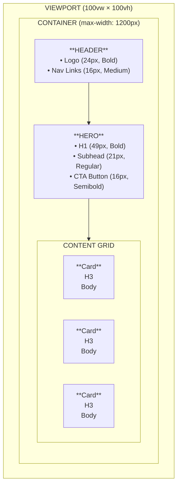

# Lesson 1: Visual Hierarchy, Typography, Color Theory

## 1. First-Principles Intuition & Invariants

The human visual system does not parse information democratically. When the eye scans a composition—whether a printed page, a digital interface, or a concert poster—it constructs a perceptual hierarchy through involuntary biological mechanisms rooted in contrast detection, edge recognition, and pattern matching evolved over millions of years. The designer's fundamental task is to exploit these mechanisms deliberately, creating pathways through information that align with cognitive priority and user intent. Visual hierarchy is not decoration; it is the structural engineering of attention.

At its core, visual hierarchy operates through differential relationships. A headline commands attention not because it possesses inherent authority, but because it exhibits greater scale, weight, or contrast relative to surrounding elements. The eye is drawn to discontinuities: abrupt shifts in size, sudden changes in value, isolated patches of saturated color within a desaturated field. These perceptual triggers are involuntary; the viewer cannot choose to ignore them any more than they can ignore a sudden loud noise. The designer who understands this wields architectural control over the reading sequence, determining not merely what the user sees, but in what order they see it, how long they dwell on each element, and which relationships they mentally construct between disparate pieces of information.

Typography serves as the primary vehicle for hierarchical expression in text-heavy compositions. Every typographic decision—typeface selection, weight variation, size scaling, line spacing, letter spacing—encodes information about semantic structure and relative importance. A well-constructed typographic system functions as a visual grammar, where headings, subheadings, body text, captions, and labels occupy distinct perceptual registers. The designer establishes this system through consistent application of scale ratios, weight contrasts, and spatial rhythms that remain predictable across contexts while retaining flexibility for emphasis and exception.

Color theory provides the third pillar of hierarchical control. Color operates simultaneously on multiple perceptual channels: hue (the wavelength identity of light), saturation (the purity or intensity of the hue), and value (the relative lightness or darkness). Human vision exhibits acute sensitivity to value contrast—the difference between light and dark—which explains why monochromatic designs often achieve greater clarity than poorly managed polychromatic schemes. Hue and saturation function as secondary modulation layers, capable of drawing attention, establishing mood, and encoding categorical distinctions, but only when value relationships remain structurally sound. A common failure mode among novice designers is over-reliance on hue variation while neglecting value contrast, resulting in compositions that collapse into visual noise when converted to grayscale or viewed by individuals with color vision deficiencies.

The invariants of effective visual hierarchy are few but absolute. First, **contrast is prerequisite**: without measurable differences in scale, weight, color, or spatial arrangement, no hierarchy can exist. Second, **consistency breeds legibility**: hierarchical systems gain power through repetition and predictable application across multiple instances. Third, **restraint amplifies impact**: hierarchies collapse when too many elements compete for dominance; effective compositions typically employ three to five discrete hierarchical levels, reserving the most extreme contrasts for the most critical elements. Fourth, **white space is structural, not decorative**: negative space functions as the substrate that allows positive elements to achieve perceptual separation and breathing room.

## 2. Core Architecture & Mechanics

The construction of visual hierarchy begins with the establishment of a modular typographic scale. Rather than selecting arbitrary font sizes through trial and error, the designer defines a proportional system rooted in mathematical relationships that ensure harmonious intervals between hierarchical levels. The most common approach employs ratio-based scaling, where each subsequent size is derived by multiplying the previous size by a fixed ratio. The Major Third ratio (1.250) and Perfect Fourth ratio (1.333) provide gentle, conservative progressions suitable for text-dense interfaces, while the Golden Ratio (1.618) and Major Second ratio (1.125) occupy opposite extremes—the former producing dramatic, poster-like jumps; the latter creating subtle, compressed hierarchies appropriate for data-dense applications.

Consider a base body text size of 16 pixels (the browser default and a comfortable reading size for sustained engagement at typical viewing distances). Applying a Perfect Fourth scale generates the following progression:

```
Level 1 (Body):     16px  × 1.000 = 16px
Level 2 (Small):    16px  × 1.333 = 21.33px  ≈ 21px
Level 3 (Subhead):  21px  × 1.333 = 28px
Level 4 (Heading):  28px  × 1.333 = 37.33px  ≈ 37px
Level 5 (Display):  37px  × 1.333 = 49.33px  ≈ 49px
```

This mathematical foundation ensures that size jumps feel intentional and proportionally balanced rather than arbitrary. The designer may introduce additional intermediate steps or adjust specific sizes for optical compensation (larger type often requires tighter letter spacing to maintain perceived density, while display type benefits from slightly increased tracking), but the underlying ratio provides the structural skeleton.

Weight contrast operates orthogonally to scale. Modern variable fonts expose a continuous weight axis, but practical application typically employs three to four discrete weights: Regular (400), Medium (500), Semibold (600), and Bold (700). The assignment of weights to hierarchical levels follows a predictable pattern: body text uses Regular to minimize eye fatigue during sustained reading; subheadings employ Medium or Semibold to achieve subtle emphasis without overwhelming; primary headings leverage Bold for maximum impact. The critical principle is that weight and scale should reinforce one another rather than compete—a small, bold heading rarely succeeds against a larger, lighter one, creating perceptual ambiguity about which element dominates.

Spatial rhythm introduces the temporal dimension of hierarchy. The eye does not read instantaneously; it saccades across the composition in discrete jumps, pausing at points of interest before moving to the next anchor. The designer controls this reading sequence through strategic deployment of white space, which functions as both separator and connector. Increased spacing above a heading signals the beginning of a new content block, while reduced spacing below the heading binds it to the following paragraph, establishing semantic association. A robust spacing system employs a modular scale analogous to the typographic scale, typically based on multiples of the base line height. If body text is set at 16px with 1.5 line height (24px), the spacing scale might progress: 12px, 24px, 36px, 48px, 72px. These values provide consistent visual rhythm while offering sufficient granularity for fine-tuning relationships between elements.

Color application in hierarchical contexts demands attention to three simultaneous channels. Value (lightness/darkness) provides the primary structural contrast; a dark heading on a light background achieves immediate dominance through sheer luminance differential. Saturation (color intensity) introduces secondary emphasis; a moderately saturated accent color draws attention without overwhelming, particularly when surrounding elements remain desaturated. Hue (color identity) enables categorical distinction; primary navigation links might employ blue, while warning messages use orange, and success confirmations adopt green, provided these hue assignments remain consistent throughout the design system.

The mechanics of color contrast are quantified through the Web Content Accessibility Guidelines (WCAG) contrast ratio formula, which compares the relative luminance of foreground and background colors on a scale from 1:1 (no contrast, white on white) to 21:1 (maximum contrast, black on white). WCAG Level AA requires a minimum 4.5:1 contrast ratio for normal text and 3:1 for large text (18pt or 14pt bold), while Level AAA demands 7:1 and 4.5:1 respectively. These ratios ensure legibility for users with low vision or color blindness, but they also serve as objective guardrails against weak hierarchies even for fully sighted users.

A practical workflow for establishing color hierarchy begins with value structure. Define a grayscale palette first: near-black (#1a1a1a, not pure black #000000, which appears harsh on backlit screens) for primary text, medium gray (#4a4a4a) for secondary text, light gray (#767676) for tertiary text and deemphasized elements, and progressively lighter grays for borders, dividers, and background tints. Once this value hierarchy proves legible and harmonious, introduce hue and saturation selectively for interactive elements, status indicators, and brand accent moments. This sequence prevents the common failure mode of chromatic chaos where bright, saturated colors compete indiscriminately for attention.

The spatial container model provides the final architectural component. Web layouts operate within nested rectangular boxes—the browser window contains the page, the page contains sections, sections contain articles, articles contain paragraphs and images. Each container establishes its own internal hierarchy while simultaneously participating in the larger compositional hierarchy. A card component, for instance, might employ a small thumbnail image, a bold heading, and regular body text, creating an internal reading sequence. That same card, when placed within a grid of similar cards, must compete for attention through external attributes: position within the layout, relative scale compared to neighboring cards, or application of shadow and border treatments that lift it off the background.



This nested hierarchy operates through deliberate compression and expansion of visual density. The hero section occupies maximum vertical space with minimal content, creating breathing room and focus for the primary value proposition. The content grid below compresses information into modular units, increasing density while maintaining legibility through consistent internal structure within each card. The eye moves naturally from large, open areas to denser regions, guided by scale contrasts and spatial rhythms.

## 3. High-Performance Optimization & Failure Modes

The most pervasive failure mode in visual hierarchy manifests as **undifferentiated mass**, where insufficient contrast between elements causes the composition to flatten into uniform gray noise. This occurs most often when designers apply timid scale ratios (1.125 or smaller), use only Regular and Medium weights, or rely exclusively on hue variation without adequate value contrast. The remedy is aggressive differentiation: double the size jump between heading and body text, push primary headings to Bold, and ensure that the dominant element achieves at least 3:1 scale ratio relative to secondary elements.

Conversely, **over-hierarchization** produces visual chaos through excessive variation. When every element demands attention through extreme scale, saturated color, or heavy weight, the hierarchy collapses because nothing dominates. A composition typically supports three to five discrete hierarchical levels; exceeding this threshold fragments attention and increases cognitive load. The optimization strategy is consolidation: group elements into broader categories, apply consistent styling within each category, and reserve extreme treatments for the single most critical element per screen or section.

**Orphaned elements** represent another common pathology. An element orphaned through inadequate spacing appears to float ambiguously between two content blocks, confusing the semantic structure. A subheading might sit equidistant between the preceding paragraph and the following paragraph, leaving the reader uncertain whether it concludes the previous section or introduces the new one. The fix is asymmetric spacing: apply significantly more space above the heading than below, creating a clear binding force that attaches the heading to its associated content.

Typography-specific failures often stem from **insufficient line height** (leading) in body text. Packed lines with 1.2 or lower line height cause ascenders and descenders from adjacent lines to visually collide, destroying the horizontal reading flow and inducing eye fatigue. Optimal body text line height ranges from 1.4 to 1.6 for most typefaces; display type can compress to 1.1–1.2 because larger sizes naturally generate more internal spacing. Related is **excessive line length**, where text columns extend beyond 80 characters per line. The eye struggles to execute the return sweep to the next line when columns grow too wide, losing reading position and breaking concentration. The solution is constraining paragraph width through max-width properties, typically 60–75 characters for sustained reading or 45–50 characters for mobile viewports.

Color contrast failures manifest in multiple forms. **Low-contrast text** falling below WCAG minimums (below 4.5:1 for normal text) reduces legibility for all users and becomes functionally unreadable for users with low vision or in high-glare environments. The optimization path is strict enforcement of contrast ratio minimums through automated tooling during design and development. **Chromatic excess** occurs when designers deploy multiple saturated hues simultaneously, creating perceptual competition and semantic ambiguity—if three different elements use three different bright colors, which is most important? The solution is chromatic restraint: establish one primary brand accent color for interactive elements, one secondary color for supporting actions, and rely on grayscale hierarchy for non-interactive content.

**Inconsistent spacing systems** erode hierarchy through unpredictable rhythms. When margins and padding values are applied arbitrarily (17px here, 23px there, 31px somewhere else), the composition loses its structural skeleton. The eye cannot predict relationships between elements, forcing conscious analytical effort where automatic perceptual grouping should occur. The remedy is a modular spacing scale with defined increments (8px, 16px, 24px, 32px, 48px, 64px) applied systematically throughout the design. This discipline extends to component internals: button padding, card margins, section gutters all draw from the same scale, creating coherent spatial rhythm.

Performance optimization in the technical sense intersects with visual hierarchy through resource prioritization. Critical content—the primary heading, hero image, call-to-action button—must load and render first, establishing the dominant hierarchy immediately while secondary content streams in progressively. This requires deliberate markup structure (DOM order reflecting visual priority), strategic resource hints (preload critical fonts, preconnect to CDN origins), and disciplined asset management (optimized image formats, subset font files containing only necessary glyphs). A visually perfect hierarchy that takes four seconds to render has failed; the user never experiences the intended structure.

Mobile viewport constraints introduce additional failure vectors. Designs that rely solely on scale contrast often collapse on small screens because there is insufficient physical space to express large size differentials—a 49px heading that dominates on desktop becomes merely adequate at 320px viewport width. The adaptation strategy is **multi-modal hierarchy**: combine scale with weight, color, and spacing to maintain differentiation even when absolute sizes compress. A heading that uses Bold weight, increased letter spacing, and a distinct color remains perceptually dominant even at smaller scales.

Accessibility auditing reveals that hierarchy failures disproportionately harm users with disabilities. Screen reader users depend on semantic HTML structure (proper heading tags h1–h6, not just visual styling) to navigate content efficiently. If the visual hierarchy does not map to the document outline hierarchy, these users experience disorienting disconnects between what sighted users see and what they hear announced. Similarly, keyboard navigation users rely on focus indicators that achieve sufficient contrast and visibility; a hierarchy that neglects focus states effectively excludes these users from interactive elements.

The ultimate optimization is **systematic design tokens**: centralized variables defining every hierarchical decision (type scales, weight assignments, color values, spacing increments) in a format that propagates automatically across design tools and code implementations. When the primary heading size needs adjustment, changing a single token updates all instances simultaneously, maintaining consistency and eliminating drift. This approach transforms hierarchy from a collection of ad-hoc decisions into a coherent, maintainable system capable of scaling across products, platforms, and teams. The investment in systematic thinking at the outset yields exponential returns in execution speed, consistency, and quality as the design system matures and complexity increases.
