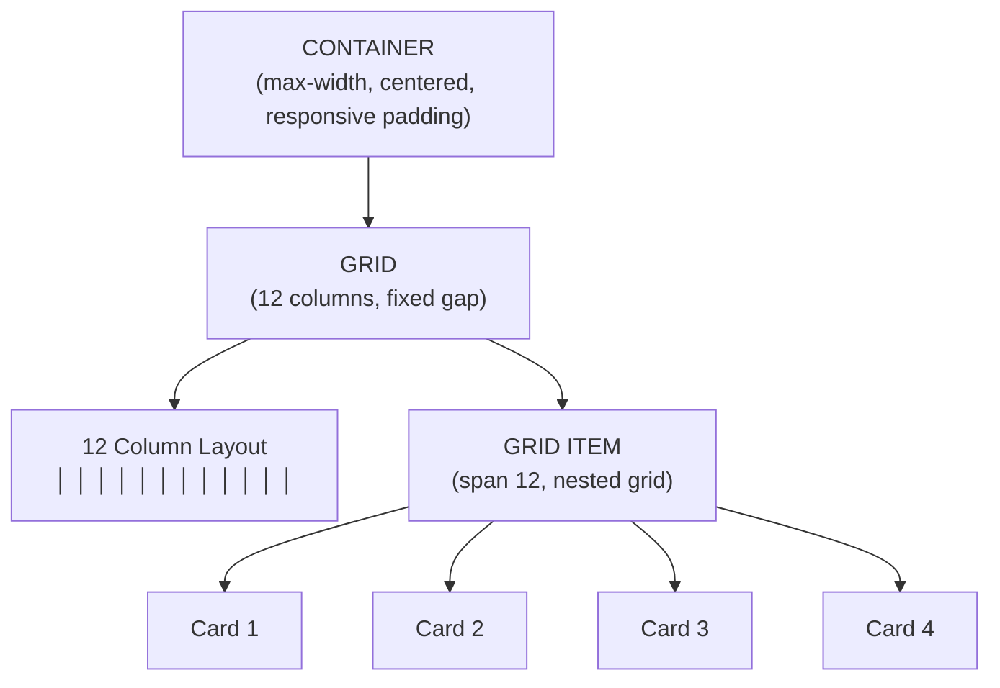

# Lesson 2: Grid Systems, Responsive Layouts, Spatial Reasoning

## 1. First-Principles Intuition & Invariants

The grid is not a constraint—it is a spatial resolution system that transforms arbitrary two-dimensional space into a predictable, modular coordinate field. Every functional design system, from the Gutenberg Bible's text columns to the Swiss International Style posters of Josef Müller-Brockmann, relies on invisible mathematical scaffolding that governs alignment, proportion, and rhythm. When we speak of grids in web design, we are engineering a visual language that must remain coherent across an infinite spectrum of viewport dimensions, pixel densities, and interaction modalities. The grid is the invariant structure that permits content to flow, scale, and recompose without collapsing into chaos.

At its foundation, a grid system divides horizontal space into a fixed number of columns separated by uniform gutters, while vertical rhythm is controlled through a baseline grid that snaps typographic elements to consistent intervals. The twelve-column grid has emerged as the de facto standard in web design not through arbitrary convention, but because twelve is highly divisible: it factors cleanly into halves, thirds, quarters, and sixths, permitting flexible asymmetric and symmetric layouts within a single coordinate system. A twelve-column grid can accommodate a three-column article layout, a four-column card grid, a six-column photo gallery, or a single-column hero section without requiring separate layout definitions. This mathematical flexibility is the grid's primary superpower—it provides enough resolution to express complex spatial relationships while maintaining sufficient constraint to prevent visual disintegration.

The core invariant of responsive grid design is that column count, gutter width, and margin size must adapt to viewport width while preserving proportional relationships between elements. A desktop layout displaying four cards in a row cannot simply shrink linearly on a mobile device; the cards must reflow to two columns or stack vertically, text must re-scale to maintain legibility, and touch targets must expand to meet minimum interaction area requirements. Responsive design is not miniaturization—it is architectural transformation guided by breakpoint thresholds where layout rules fundamentally change. The designer's task is to define these transformation rules explicitly, ensuring that every breakpoint transition preserves hierarchy, maintains visual rhythm, and respects content priority.

Spatial reasoning in grid-based design operates through nested containment hierarchies. The outermost container establishes page margins and maximum content width; within this boundary, a grid container divides horizontal space into columns; individual grid items then span one or more columns based on their content requirements and hierarchical importance. This nesting creates predictable spatial relationships: a sidebar that occupies three columns on desktop can expand to twelve columns (full width) on mobile, while primary content that spans eight columns on desktop can collapse to twelve columns and push the sidebar below the fold. The grid does not dictate these transformations—it provides the coordinate system through which the designer specifies them.

The second invariant is alignment. Grid systems enforce strict vertical alignment across all content blocks, ensuring that elements sharing the same horizontal row align along their top edges, baselines, or center axes. This vertical alignment creates visual cohesion even when individual elements vary in height, color, or typographic treatment. Horizontal alignment is governed by column boundaries: text blocks, images, buttons, and form fields snap to column start and end positions, never drifting arbitrarily into gutter space. This snapping behavior is the visual manifestation of underlying mathematical precision—it signals to the viewer that the design is intentional, structured, and trustworthy.

Proportional scaling introduces a third invariant: aspect ratio preservation. When images, video embeds, or illustration containers scale responsively, they must maintain their original width-to-height ratio to prevent distortion. A 16:9 video frame cannot become 4:3 simply because the viewport narrowed; instead, the container width shrinks while height adjusts proportionally, or the content reflows to a different grid position entirely. This proportional constraint extends to typographic scale as well: fluid typography systems scale font sizes, line heights, and spatial intervals along mathematical curves (often cubic Bézier functions) to maintain optical consistency as viewport dimensions change. The goal is not pixel-perfect reproduction across devices—that is impossible—but rather optical equivalence, where the perceived hierarchy, rhythm, and balance remain constant even as absolute measurements shift.

The grid's relationship to whitespace is paradoxical: the grid creates structure precisely so that strategic violations of that structure become visually meaningful. A full-bleed hero image that breaks the grid margin draws attention through contrast. A pull quote that spans five columns in a twelve-column layout creates asymmetric tension. These departures from the grid are not accidents—they are deliberate compositional choices that gain their power from the underlying order they transgress. Without the grid as reference, these violations would be invisible. The grid provides the silence against which visual accents speak.

Understanding grid mathematics requires recognizing that CSS Grid Layout and Flexbox are not competitors but complementary tools operating at different levels of abstraction. Flexbox excels at one-dimensional layouts—rows or columns where items distribute along a single axis with flexible sizing. CSS Grid operates in two dimensions simultaneously, permitting precise control over both row and column placement. A typical responsive layout uses CSS Grid for the page-level container (defining header, main content, sidebar, and footer regions) and Flexbox within those regions for distributing cards, navigation items, or form fields. The grid provides the architectural skeleton; Flexbox provides the muscular flexibility within that skeleton.

The final invariant is the concept of mobile-first progressive enhancement. Rather than designing for desktop and then attempting to retrofit smaller layouts, the mobile-first approach begins with the most constrained viewport—typically 320px wide—and layers complexity upward through breakpoints as viewport width increases. This inversion is philosophically and technically superior because it forces prioritization of essential content and interaction patterns. A design that functions cleanly on a small screen inherently clarifies information hierarchy and reduces visual noise. As viewport width expands, the designer adds columns, reveals secondary content, and introduces subtle typographic refinements, but the core structure remains intact. This approach prevents the bloat and complexity that emerges when designers attempt to cram desktop-scale information architecture into mobile viewports through brute-force scaling.

## 2. Core Architecture & Mechanics

A production-grade CSS Grid system begins with a semantic HTML structure that separates content semantics from presentational layout. The fundamental container pattern establishes maximum content width, centers the layout horizontally, and applies responsive padding to prevent content from colliding with viewport edges at narrow widths. This outer container typically enforces a maximum width between 1140px and 1280px to prevent line lengths from exceeding optimal readability thresholds on ultra-wide displays, while allowing full-width expansion on smaller devices. The container uses percentage-based padding (typically 5% or a minimum of 20px via `clamp()`) to create breathing room that scales proportionally with viewport width.

```css
.container {
  max-width: 1280px;
  margin-inline: auto;
  padding-inline: clamp(1.25rem, 5vw, 3rem);
}
```

Within this container, the grid itself is defined using CSS Grid's `grid-template-columns` property with either explicit column counts or the `repeat()` function paired with fractional units (`fr`). A twelve-column grid with 20px gutters can be expressed as `repeat(12, 1fr)` with a column gap of 20px, allowing the browser to calculate column widths automatically based on available space after gutter subtraction. This fractional approach is superior to percentage-based widths because it handles gutter math internally—the designer specifies the desired number of equal-width columns, and the layout engine distributes space accordingly.

```css
.grid {
  display: grid;
  grid-template-columns: repeat(12, 1fr);
  gap: 1.25rem;
}
```

Grid items—the child elements within this grid container—span columns using `grid-column` shorthand, which accepts start and end line numbers or span notation. A hero section occupying the full width would span all twelve columns (`grid-column: 1 / -1` or `span 12`), while a sidebar might occupy the first three columns (`grid-column: 1 / 4` or `span 3`), and main content would span columns four through twelve (`grid-column: 4 / -1` or `span 9`). The `-1` value refers to the implicit end line of the grid, eliminating the need to count columns manually when spanning to the edge.

```css
.hero {
  grid-column: 1 / -1;
}

.sidebar {
  grid-column: span 3;
}

.main-content {
  grid-column: span 9;
}
```

Responsive transformation occurs through media query breakpoints where column span rules change to accommodate narrower viewports. A typical three-breakpoint strategy defines rules for mobile (default, no media query), tablet (768px and above), and desktop (1024px and above). On mobile, the sidebar and main content both span the full twelve columns, effectively stacking vertically. At the tablet breakpoint, the sidebar might shrink to four columns with main content spanning eight. At desktop widths, the proportions shift to three and nine columns respectively, optimizing for readability and information density.

```css
.sidebar,
.main-content {
  grid-column: 1 / -1; /* Mobile: full width */
}

@media (min-width: 48rem) { /* Tablet */
  .sidebar {
    grid-column: span 4;
  }
  .main-content {
    grid-column: span 8;
  }
}

@media (min-width: 64rem) { /* Desktop */
  .sidebar {
    grid-column: span 3;
  }
  .main-content {
    grid-column: span 9;
  }
}
```

Nested grids permit modular composition where a grid item itself becomes a grid container for its children. A twelve-column main content area might define an internal four-column grid for displaying product cards, with each card spanning one column on desktop, two columns on tablet, and four columns (full width) on mobile. This nesting avoids the need to define every possible layout combination at the page level—instead, each major content region manages its own internal grid logic.

```css
.product-grid {
  display: grid;
  grid-template-columns: repeat(4, 1fr);
  gap: 1.5rem;
}

.product-card {
  grid-column: span 4; /* Mobile: full width */
}

@media (min-width: 48rem) {
  .product-card {
    grid-column: span 2; /* Tablet: two per row */
  }
}

@media (min-width: 64rem) {
  .product-card {
    grid-column: span 1; /* Desktop: four per row */
  }
}
```

The `auto-fit` and `auto-fill` keywords combined with `minmax()` enable truly fluid grids that add or remove columns dynamically based on available space without explicit media queries. The pattern `repeat(auto-fit, minmax(280px, 1fr))` instructs the browser to fit as many columns as possible into the container, with each column having a minimum width of 280px and expanding equally to fill remaining space. As the viewport narrows, columns automatically reflow to the next row when the minimum width constraint cannot be satisfied. This approach is ideal for card layouts, image galleries, and any content pattern where the number of items per row should adapt fluidly rather than at discrete breakpoints.

```css
.fluid-grid {
  display: grid;
  grid-template-columns: repeat(auto-fit, minmax(280px, 1fr));
  gap: 1.5rem;
}
```

Aspect ratio preservation for grid items requires the `aspect-ratio` CSS property or padding-based hacks for legacy browser support. The modern approach applies `aspect-ratio: 16 / 9` directly to the grid item or its child image container, instructing the browser to maintain that proportional relationship as the item scales. For images, combining `aspect-ratio` with `object-fit: cover` ensures the image fills its container without distortion, cropping edges as necessary while preserving the aspect ratio of the container itself.

```css
.media-item {
  aspect-ratio: 16 / 9;
  overflow: hidden;
}

.media-item img {
  width: 100%;
  height: 100%;
  object-fit: cover;
}
```

Vertical rhythm is controlled through a separate baseline grid system that governs typographic spacing. A baseline grid with an 8px or 16px base unit ensures that all vertical margins, padding, line heights, and element heights snap to multiples of this unit, creating consistent visual rhythm. This vertical grid is orthogonal to the horizontal column grid—it operates independently but reinforces the same principle of mathematical regularity. Implementing this requires discipline: all spacing utilities and typographic scale values must derive from the base unit through multiplication or division, never arbitrary pixel values.

```css
:root {
  --baseline: 0.5rem; /* 8px base unit */
}

h1 {
  margin-block-end: calc(var(--baseline) * 4); /* 32px */
  line-height: calc(var(--baseline) * 7); /* 56px */
}

p {
  margin-block-end: calc(var(--baseline) * 3); /* 24px */
  line-height: calc(var(--baseline) * 4); /* 32px */
}
```

Flexbox integrates with CSS Grid at the component level for distributing navigation links, button groups, form inputs, or any horizontal/vertical sequence where items should space evenly or align along a single axis. A navigation bar uses Flexbox to distribute links with `justify-content: space-between` or center them with `justify-content: center`, while the page-level header container uses CSS Grid to position the logo, navigation, and utility links in a three-column layout. This division of labor is intuitive: Grid handles two-dimensional page architecture; Flexbox handles one-dimensional component-level distribution.

```css
.header {
  display: grid;
  grid-template-columns: auto 1fr auto;
  gap: 2rem;
  align-items: center;
}

.nav {
  display: flex;
  gap: 1.5rem;
  justify-content: center;
}
```

The visual hierarchy diagram of a typical responsive grid system shows three nested layers:



Subgrid, introduced in CSS Grid Level 2, permits nested grids to inherit parent grid tracks rather than defining independent column structures. This ensures perfect alignment between parent and child grid items—sidebar content aligns exactly with main content columns despite being in separate containers. Subgrid is supported in all modern browsers, so it can be used wherever nested alignment with parent tracks is needed, with a fallback only for legacy engines., but where available, it eliminates the need for complex column calculations in nested layouts.

```css
.main-content {
  display: grid;
  grid-template-columns: subgrid;
  grid-column: span 9;
}
```

## 3. High-Performance Optimization & Failure Modes

Grid performance is rarely a bottleneck in modern browsers—CSS Grid Layout is highly optimized at the rendering engine level—but poor implementation patterns can introduce layout thrash, excessive reflows, and accessibility barriers. The most common failure mode is over-nesting: wrapping every element in unnecessary grid containers creates a deeply nested DOM that forces the browser to recalculate layout for every ancestor container when a child element resizes. The solution is semantic restraint: use grids only where genuine two-dimensional layout control is required, and prefer simpler flow layout or Flexbox for linear content sequences.

The second failure mode is breakpoint proliferation. Designers sometimes define media queries for every possible device width—320px, 375px, 414px, 768px, 1024px, 1366px, 1920px—creating a maintenance nightmare where small changes require updating dozens of breakpoint rules. The optimal strategy defines three to four semantic breakpoints based on content needs rather than device dimensions: a mobile-first base, a tablet breakpoint around 768px where multi-column layouts become viable, and a desktop breakpoint around 1024px where full information density is appropriate. Additional breakpoints should only be introduced when content genuinely requires different layout logic, not to target specific devices.

Performance optimization begins with minimizing CSS specificity and avoiding layout-dependent JavaScript. Grid layouts should be defined entirely in CSS through media queries and container queries (where supported), eliminating the need for JavaScript to measure viewport width and apply class-based layout changes. JavaScript-driven layout introduces layout thrash—the browser calculates layout, JavaScript reads dimensions and modifies styles, triggering a second layout pass—doubling rendering cost. The only exception is advanced interaction patterns like drag-and-drop grid rearrangement or dynamically generated column counts based on user input, which legitimately require JavaScript intervention.

Container queries, now widely supported, permit component-level responsive behavior based on parent container width rather than viewport width. This decouples component layout from page-level breakpoints, enabling true modular design where a card component adapts to its container regardless of where it appears on the page. A sidebar card might display in single-column layout when the sidebar is narrow, while the same card in a wide main content area displays in multi-column layout. This inversion of control—components responding to their immediate context rather than global viewport state—is a significant architectural improvement over traditional media queries.

```css
.card-container {
  container-type: inline-size;
}

@container (min-width: 400px) {
  .card {
    display: grid;
    grid-template-columns: 200px 1fr;
  }
}
```

Accessibility failures in grid layouts typically manifest as keyboard navigation traps, incorrect focus order, and screen reader confusion. CSS Grid permits visual reordering through `order` property or explicit grid placement, which can violate source order and confuse assistive technologies. The invariant rule is that visual order must match DOM order for interactive elements—buttons, links, and form inputs must appear in the same sequence in the HTML as they appear visually after grid reordering. If visual design requires reordering, the HTML structure must be reordered to match, not CSS alone. Screen readers traverse the DOM linearly, ignoring CSS visual positioning.

Touch target sizing is critical for mobile grid layouts. Buttons, links, and interactive elements must meet minimum size requirements (44×44px per WCAG 2.1 Level AAA (2.5.5; WCAG 2.2 Level AA asks for at least 24×24px)) with adequate spacing to prevent mis-taps. Grid gap values should reflect this: cards or buttons placed adjacent in a grid need sufficient gap space that fingers do not accidentally activate neighboring elements. The `gap` property is not merely aesthetic—it is a usability requirement on touch devices.

Color contrast failures often emerge in responsive layouts when background colors or overlay patterns change at different breakpoints. A text label with sufficient contrast against a light background on desktop might overlay a dark hero image on mobile, failing contrast requirements. The solution is systematic contrast testing at all breakpoints and using CSS custom properties to enforce consistent foreground/background pairings that adapt together.

```css
.hero {
  background-color: var(--bg-dark);
  color: var(--text-light);
}

@media (min-width: 64rem) {
  .hero {
    background-color: var(--bg-light);
    color: var(--text-dark);
  }
}
```

Fluid typography scaling prevents layout collapse at narrow viewports by scaling font sizes, line heights, and spatial rhythm proportionally. The `clamp()` function establishes minimum, preferred, and maximum values for typographic properties, allowing smooth scaling between breakpoints without discrete jumps. A heading might scale from 1.5rem at 320px viewport width to 3rem at 1280px, with the browser interpolating intermediate values based on viewport width. This eliminates the jarring text size shifts that occur with breakpoint-based font size changes.

```css
h1 {
  font-size: clamp(1.5rem, 4vw + 1rem, 3rem);
  line-height: 1.2;
}
```

Image optimization for responsive grids requires serving multiple image resolutions through `srcset` and `sizes` attributes, allowing the browser to select the appropriate file based on device pixel density and layout width. A card image spanning three columns on desktop and twelve columns on mobile should load a smaller image file on mobile to reduce bandwidth and improve load time. The `sizes` attribute declares the image's display width at various breakpoints, guiding the browser's selection logic.

```html

```

The final optimization is critical CSS inlining for above-the-fold grid layout rules. The browser cannot render the page until it parses CSS defining the grid structure, causing layout shift and delayed first paint. Inlining minimal critical CSS—grid container definitions, mobile-first base styles—directly in the HTML `<head>` permits immediate rendering of the initial viewport while full stylesheets load asynchronously. This technique reduces perceived load time and eliminates cumulative layout shift (CLS), a core web vital metric.

Grid systems are invisible infrastructure. When functioning correctly, they are unnoticed by users—content appears organized, navigation feels intuitive, and visual rhythm feels intentional. The designer's role is to construct this invisible scaffolding with mathematical precision and semantic clarity, ensuring that as viewports shift, content priorities change, and user needs evolve, the underlying structure adapts gracefully without requiring architectural rewrites. The grid is the contract between designer and browser, specifying not just where elements appear, but how they transform across the infinite variability of the web.
