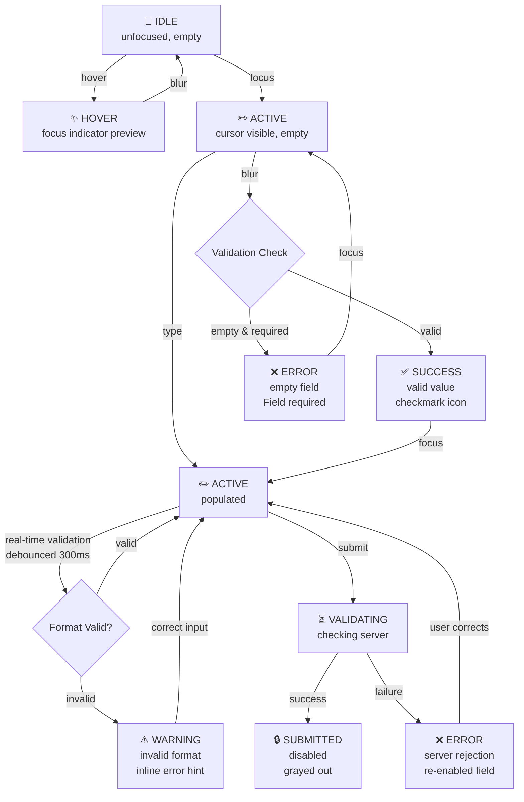

# Lesson 3: Interaction Design, User Experience Patterns, Feedback Mechanisms

## 1. First-Principles Intuition & Invariants

Interaction design exists at the boundary between human intention and machine capability, mediating the translation of cognitive goals into system operations through visual, temporal, and spatial language. Unlike static graphic design, which freezes information into composed layouts, interaction design orchestrates dynamic state transformations across time, responding to user input through feedback mechanisms that continuously communicate system availability, processing status, and outcome confirmation. The designer's task resembles that of a composer arranging temporal events or a choreographer blocking spatial movements: each microinteraction must occupy its precise moment in the user's attention budget, neither arriving too early to confuse causality nor too late to break the perception of responsiveness.

The fundamental invariant governing all interactive systems is the action-perception loop, a closed feedback cycle in which user action triggers visible system response, which in turn informs the user's next action. When this loop operates within human perceptual thresholds—roughly 100 milliseconds for instantaneous feeling, 1 second for flow maintenance, and 10 seconds for attention retention—the interface disappears from conscious awareness and becomes an extension of thought. Break these thresholds and the system announces its presence as an obstacle, forcing the user into explicit deliberation about interface mechanics rather than domain tasks. The interaction designer's primary responsibility is to maintain this transparent coupling, ensuring that every clickable element, every state transition, and every feedback signal reinforces the user's mental model of system behavior rather than contradicting it.

Affordances form the perceptual foundation of this relationship. The term, borrowed from ecological psychology, describes the action possibilities that an object presents to a perceiver through its physical or visual properties. A button affords pressing through its raised surface, its shadowed edges suggesting depth and mechanical travel. A slider affords dragging through its elongated track and movable handle geometry. These visual signals operate below conscious reasoning, triggering motor planning before explicit decision-making. When affordances align with actual system capabilities—when pressable-looking elements actually respond to clicks, when draggable handles actually translate along their rails—users navigate interfaces through intuitive exploration rather than instruction-manual study. Conversely, false affordances that promise interaction but deliver none, or hidden affordances that conceal available actions behind unmarked surfaces, force users into trial-and-error hunting, destroying the perception of system predictability.

The interaction vocabulary that has emerged across web interfaces draws heavily from physical-world metaphors translated into pixel space: buttons that depress when clicked, toggles that slide between binary states, cards that stack and shuffle, modals that overlay and dismiss like paper documents. These skeuomorphic borrowings serve cognitive scaffolding, allowing users to transfer existing motor knowledge from physical artifacts to digital counterparts. Yet the metaphor must not over-constrain the design. Digital interfaces can transcend physical limitations—buttons need not wait for mechanical spring-return, cards can expand and collapse in ways paper never could, spatial layouts can reconfigure themselves responsively. The designer's judgment lies in knowing when metaphor aids recognition and when it becomes nostalgic decoration that impedes efficiency.

State management constitutes the hidden architecture beneath visible interactions. Every interactive element exists in a finite state machine, transitioning between discrete conditions in response to events: a button cycles through default, hover, active, disabled, loading states; a form field progresses through empty, focused, validating, valid, invalid, submitted states; an accordion panel alternates between collapsed and expanded configurations. Users construct mental models of these state machines through observation, inferring transition rules from repeated interaction. The designer's responsibility is to make state transitions visually explicit through immediate feedback—hover effects that confirm target acquisition, active states that acknowledge click registration, loading indicators that signal processing delay, success confirmations that close the action loop. When state changes occur silently without perceptible feedback, users cannot distinguish system responsiveness from system failure, leading to repeated actions, abandoned tasks, and eroded trust.

The principle of least surprise governs interaction pattern selection. Users approach interfaces with expectations shaped by prior experience across thousands of websites and applications. Violating these established patterns—placing navigation in unexpected locations, reversing standard gesture directions, overriding browser behaviors like back-button functionality—imposes cognitive overhead that must be justified by proportional benefit. Innovation for its own sake disrupts learned muscle memory and forces relearning, taxing the user's attention budget for dubious returns. The interaction designer must balance pattern adherence with contextual appropriateness, recognizing when convention serves usability and when domain-specific requirements demand novel solutions.

Feedback timing and modality determine whether interactions feel responsive or sluggish, confident or tentative. Immediate visual feedback—a button changing color on mousedown before the click event fires—creates the perception of zero latency even when backend processing introduces delay. Progress indicators calibrate user expectations, distinguishing brief operations from lengthy processes and providing time estimates that allow users to context-switch productively. Error messaging must arrive at the moment of mistake, collocated spatially with the problematic input rather than buried in toast notifications that fade before being read. Success confirmations close the interaction loop decisively, preventing users from repeating completed actions out of uncertainty. The temporal choreography of these feedback signals requires the same precision as musical rhythmic notation: too sparse and users lose orientation; too dense and the interface becomes visually noisy and distracting.

Microinteractions—those small, contained product moments surrounding a single task—carry outsized impact on perceived quality. The smooth easing curve of a dropdown menu animation, the satisfying snap of a toggle switch settling into position, the contextual appearance of action buttons on card hover—these details accumulate into an impression of craftsmanship and attention. Poor microinteractions, conversely, signal carelessness: buttons that flicker on state change, animations that stutter through dropped frames, hover states that lag perceptibly behind cursor movement. While any single microinteraction occupies milliseconds, users encounter hundreds across a session, and the cumulative effect shapes emotional response to the entire system. The interaction designer must treat these moments with the care of a jeweler finishing fine metalwork, recognizing that perceived quality emerges from consistency across details rather than from any single hero feature.

## 2. Core Architecture & Mechanics

The information architecture underlying interactive experiences organizes content and functionality into hierarchical structures that map to user mental models and task flows. Unlike database schema, which optimizes for storage efficiency and query performance, information architecture prioritizes human findability and conceptual coherence. The designer conducts card sorting exercises and task analysis studies to uncover how users naturally categorize information, then constructs navigation hierarchies that mirror these discovered structures. A music production website might organize around creation workflow stages—recording, editing, mixing, mastering—rather than technical feature lists, because users think in terms of process phases rather than tool inventories. The navigation system must expose this architecture through visual hierarchy: primary sections in persistent global navigation, secondary categories in contextual sidebars, tertiary details in progressive disclosure patterns that reveal complexity only when requested.

The site navigation itself employs a consistent interaction grammar across pages. Global navigation persists in fixed or sticky positions, maintaining orientation as users scroll through long content. Breadcrumb trails trace the path from site root to current page, each segment clickable for efficient backtracking. Active page indicators—underlines, background colors, bold text weight—communicate current location within the hierarchy. Hover states preview interaction possibilities, often revealing nested submenus through dropdowns or mega-menus that expose multiple levels simultaneously. Mobile navigation collapses this structure into hamburger menus or tab bars, trading persistent visibility for screen real estate, with smooth slide-in animations that preserve spatial continuity. The designer must ensure these navigation patterns remain consistent across viewport sizes, avoiding disorienting layout shifts that force users to relearn navigation mechanics when rotating devices or resizing windows.

Form design demands particular attention to interaction flow and validation feedback. Users expect logical tab order that progresses through fields in reading sequence, allowing keyboard-only navigation without mouse intervention. Field focus states must be highly visible—not just a thin browser-default outline, but prominent borders or background color changes that work for users with reduced color perception. Label placement affects completion efficiency: top-aligned labels support vertical scanning and work better for short forms, while left-aligned labels leverage horizontal space for longer forms with fewer fields. Placeholder text should provide format examples rather than label substitutes, since placeholders disappear on focus and cannot serve double duty as persistent labels.



Inline validation provides immediate feedback as users complete each field, catching errors before form submission rather than forcing users to hunt through lengthy forms for problems after clicking submit. Email fields can verify format with regular expressions client-side, then check domain existence and mailbox validity server-side with debounced API calls. Password fields show strength meters that update in real-time, guiding users toward secure choices through progressive disclosure of requirements: minimum length, mixed case, numeric inclusion, special character inclusion. Error messages must be actionable rather than punitive: "Email address must include @ symbol" rather than "Invalid input." Success indicators—green checkmarks, collapsing warning messages—provide positive reinforcement that motivates completion.

Button states communicate availability and processing status through visual transformation. The default state establishes baseline appearance: size, color, border radius, typography. The hover state confirms mouse target acquisition, typically through brightness shift or subtle elevation via box shadow. The active state, triggered on mousedown before mouseup releases the click event, provides tactile feedback through slight downward translation or inset shadow mimicking physical button depression. The loading state replaces button text with an animated spinner, preventing duplicate submissions while backend processing completes. The disabled state grays out buttons and removes pointer-events, visually communicating unavailability for invalid form states or unauthorized actions. Each state must be visually distinct without requiring color perception alone—disabled buttons might reduce opacity and change cursor to not-allowed, while loading buttons might add pulsing animation.

```css
/* Button State Implementation Example */

.btn-primary {
  /* Default state */
  padding: 12px 24px;
  background: #0066cc;
  color: white;
  border: none;
  border-radius: 4px;
  font-weight: 600;
  cursor: pointer;
  transition: background 150ms ease-out, transform 100ms ease-out;
}

.btn-primary:hover:not(:disabled) {
  /* Hover state - 10% darker */
  background: #0052a3;
  box-shadow: 0 2px 8px rgba(0,0,0,0.15);
}

.btn-primary:active:not(:disabled) {
  /* Active state - pressed down */
  background: #004080;
  transform: translateY(1px);
  box-shadow: 0 1px 3px rgba(0,0,0,0.2);
}

.btn-primary:disabled {
  /* Disabled state */
  background: #cccccc;
  color: #666666;
  cursor: not-allowed;
  opacity: 0.6;
}

.btn-primary.loading {
  /* Loading state */
  position: relative;
  color: transparent; /* hide text */
  pointer-events: none;
}

.btn-primary.loading::after {
  content: "";
  position: absolute;
  top: 50%;
  left: 50%;
  transform: translate(-50%, -50%);
  width: 16px;
  height: 16px;
  border: 2px solid white;
  border-radius: 50%;
  border-top-color: transparent;
  animation: spin 600ms linear infinite;
}
```

Modal dialogs and overlays interrupt task flow to demand immediate attention for critical decisions or blocking errors. The pattern employs a layered architecture: the background content dims behind a semi-transparent scrim, visually de-emphasizing it while maintaining context. The modal content centers on screen with higher z-index, often employing subtle entry animation—fade-in combined with slight scale-up from 95% to 100%—that draws eye focus without jarring. Focus trapping ensures keyboard navigation cycles within modal controls rather than escaping to background elements, and pressing Escape key dismisses the modal, providing power-user efficiency. Click-outside-to-close behavior offers mouse-user convenience but must be disabled for modals requiring explicit choice between presented options. Accessibility demands proper ARIA attributes: role="dialog", aria-modal="true", aria-labelledby pointing to the modal's heading for screen reader context.

Accordion patterns organize lengthy content into collapsible sections, allowing users to expand only relevant topics while maintaining page overview. The interaction follows a clear visual grammar: the header acts as clickable trigger, with a chevron icon indicating expandability. Clicking rotates the chevron 90 degrees while the content panel slides open, typically via CSS max-height transition from 0 to calculated height with easing curve. Smooth animation is critical—instant state flips disorient users, while animations exceeding 400 milliseconds feel sluggish. The designer must choose between exclusive expansion, where opening one panel closes others, versus independent expansion allowing multiple open panels. Exclusive suits long-form content where vertical space is constrained; independent suits comparison tasks where users need simultaneous visibility across sections.

Drag-and-drop interactions enable spatial reordering and relationship creation through direct manipulation. The pattern requires careful choreography of visual states: the draggable element must indicate grabbability through cursor change to grab/grabbing, visual elevation on drag-start (lifting shadow, slight scale increase), and ghost representation following cursor during drag. Drop zones provide visual feedback through highlight borders or background color changes when dragged elements enter their bounds, confirming valid drop targets. Invalid drop zones remain visually unchanged, communicating restriction. On successful drop, a brief settling animation—easing into final position rather than snapping instantly—provides satisfying closure. Keyboard alternatives must exist for accessibility: arrow keys to navigate between items, Space to pick up and drop, Escape to cancel drag operation.

Infinite scroll and pagination represent competing approaches to large dataset navigation. Infinite scroll loads additional content automatically as users approach page bottom, eliminating explicit pagination controls for seamless browsing. The pattern demands loading indicators that appear just before content arrives, maintaining flow perception. A subtle "scroll-to-top" button emerges after scrolling beyond first viewport, preventing lengthy back-scroll from deep exploration. Footer content must either remain accessible through alternative navigation or reposition above infinite-loading content. Pagination, conversely, chunks content into discrete pages with explicit navigation controls. The pattern suits goal-oriented searching where users need to bookmark specific locations or estimate total result count. Page numbers should show current page with several neighbors on each side (1 ... 8 9 **10** 11 12 ... 50), preventing overwhelming button sprawl while maintaining orientation.

Toast notifications and snackbars deliver transient system feedback without blocking user workflow. These ephemeral messages slide in from screen corners—typically bottom-right for desktop, bottom-center for mobile—with brief entrance animation. The message persists for duration proportional to reading time, typically 3–5 seconds for single-sentence confirmations, then fades out unless user interaction requests dismissal. Multiple toasts should queue vertically rather than overlapping, with smooth stacking animations. Semantically color-coded backgrounds—green for success, yellow for warnings, red for errors—aid rapid recognition, but icons and text must carry primary meaning for colorblind users. Action links within toasts ("Undo", "View details") must appear with sufficient touch target size and adequate contrast, while close buttons should be optional rather than mandatory since toasts auto-dismiss.

## 3. High-Performance Optimization & Failure Modes

Perceived performance differs fundamentally from measured performance. Users judge responsiveness not by actual server round-trip times but by the presence of immediate feedback acknowledging their actions. Optimistic UI updates provide this feedback by immediately rendering the expected result of user action—adding an item to cart, liking a post, sending a message—while the server request processes asynchronously. If the server confirms success, no further UI update is needed. If the server returns error, the UI rolls back the optimistic change and displays error messaging. This approach reduces perceived latency from server response time to near-zero, since users see instant visual confirmation. The risk lies in rollback jarring: if server failures occur frequently, users will notice and distrust the optimistic feedback. The pattern suits high-reliability operations where failure rates remain below 1%.

Skeleton screens and progressive loading maintain user engagement during content fetch operations. Rather than displaying a blank white page or full-screen spinner while data loads, skeleton screens render placeholder elements matching the expected content layout: gray rectangles for text blocks, circles for avatars, bars for images. These placeholders employ subtle pulsing animations that communicate "loading in progress" without blocking interaction with already-loaded page chrome. As content arrives, placeholders smoothly transition to actual content through crossfade. The technique reduces bounce rate by providing immediate visual structure that communicates page functionality even before data populates. Critical above-the-fold content should load first, allowing users to begin reading or interacting while below-the-fold content continues loading lazily.

Debouncing and throttling control event handler execution rates to prevent performance degradation from high-frequency events. Search-as-you-type inputs fire keyup events on every keystroke, potentially triggering expensive API calls or filter operations 10+ times per second. Debouncing delays handler execution until the event stream pauses, typically 300–500 milliseconds after the last event. Users experience this as "wait until I stop typing, then search." Throttling, conversely, limits handler execution to fixed intervals regardless of event frequency, executing at most once per specified duration (e.g., 16ms for 60fps-synchronized animations). Scroll handlers benefit from throttling: recalculating sticky element positions or triggering lazy image loads every 16ms maintains smooth visuals without executing on every pixel of scroll. The designer must select appropriate thresholds: too short and performance suffers; too long and the interface feels sluggish.

Focus management errors create accessibility barriers and keyboard navigation frustration. When opening modals, focus must shift to the first interactive element within the modal, not remain trapped on the now-hidden button that opened it. Similarly, closing modals must return focus to the triggering element, allowing keyboard users to continue navigation from where they left off. Deleting list items requires focus redistribution to the next item or to a parent container, preventing focus loss to the document body. Single-page applications must manage focus across route transitions, moving focus to main content heading rather than forcing tab-navigation from page top on every navigation. Screen reader announcements via ARIA live regions must communicate dynamic content changes—"Item added to cart," "5 new messages"—without interrupting current reading flow through polite rather than assertive priority levels.

Touch target sizing directly affects mobile interaction success rates. Fingers are imprecise pointers compared to mouse cursors, requiring minimum target dimensions of 44×44 CSS pixels (Apple Human Interface Guidelines) or 48×48dp (Material Design). Smaller targets increase mis-tap rates, especially for users with motor control limitations. Adequate spacing between adjacent touch targets—minimum 8px—prevents accidental activation of neighboring elements. The designer must verify touch target compliance across interactive elements: form fields, buttons, links within body text, icon-only controls, and custom interactive widgets. When visual design demands smaller appearances, clickable regions can extend beyond visible element boundaries through padding or pseudo-element expansion.

Animation performance degrades when effects target expensive CSS properties. Animating width, height, or margin properties triggers layout recalculation across the entire page, causing dropped frames and janky motion. Transform and opacity properties, conversely, utilize GPU-accelerated compositing, achieving smooth 60fps animation without layout thrashing. Designers should implement animations via translateX/translateY rather than left/right position changes, via scale rather than width/height changes. Will-change CSS hints notify browsers to optimize specific elements for upcoming animations, though overuse can consume excess memory. Prefers-reduced-motion media queries respect user system preferences for reduced animation, either disabling decorative animations entirely or substituting instant state changes, accommodating vestibular disorders and motion sensitivity.

Error state recovery patterns determine whether errors derail users or allow graceful continuation. Transient network errors should trigger automatic retry with exponential backoff rather than immediately displaying failure messages for issues that may resolve within seconds. Persistent errors require clear messaging distinguishing user-fixable problems (invalid input format) from system failures (server down). When possible, preserve user input across error recovery attempts—never clear a lengthy form on validation failure. Provide specific remediation instructions: "Check your internet connection and try again" rather than generic "Error occurred." For catastrophic failures preventing task completion, offer alternative paths: contact information, offline fallback, or workaround procedures.

Loading state abuse degrades user experience through ambiguity and excessive visual noise. Not every interaction warrants a loading spinner—instant client-side operations like expanding accordions or changing tabs need none. Conversely, operations exceeding 100ms latency require immediate feedback. Loading indicators must communicate progress scope: full-page overlays for route transitions, inline spinners for component updates, button loading states for form submissions. Multiple simultaneous loading states confuse users about which operation is blocking. Sequential operations should employ progress bars showing completion percentage across multi-step workflows, with step labels communicating current phase. Indeterminate spinners suit operations of unpredictable duration; determinate progress bars suit operations with known endpoints.

Hover state leakage plagues touch interfaces. Desktop patterns that reveal content or controls on hover—dropdown submenus, tooltip explanations, action button overlays—fail on touch devices where hover state does not exist or persists incorrectly after tap. The designer must provide alternative interaction methods: tap-to-reveal for nested content, always-visible primary actions on mobile, or gesture-based alternatives like swipe-to-delete. Touch interfaces benefit from removing hover dependencies entirely, designing for a world where elements are either visible or hidden without intermediate hover preview states. When hover enhancements are valuable on desktop, they should supplement rather than replace accessible interaction paths that work universally.

Scroll hijacking, where websites override native browser scroll behavior with custom animations or section snapping, frequently introduces accessibility problems and performance issues. Smooth-scroll animations that deviate from system scroll physics feel unnatural, especially on platforms with momentum scrolling expectations. Section-based scrolljacking that forces full-height viewport snapping removes user control over scroll position, preventing users from reading content at their own pace. When custom scroll behaviors are necessary for storytelling or parallax effects, they must respect prefers-reduced-motion, maintain standard keyboard scroll bindings (arrow keys, page-up/down, space), and never disable native scroll entirely. The designer must recognize that scroll is fundamental navigation, not decorative space for clever animation experiments.
