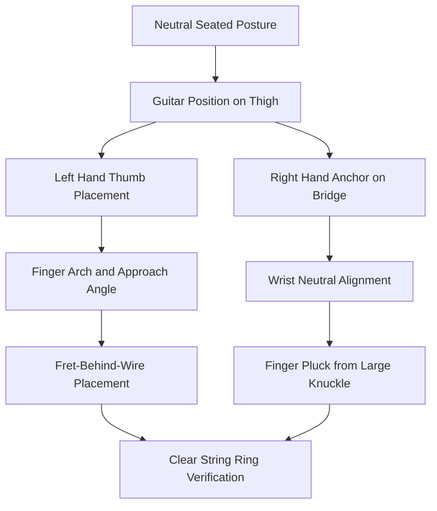
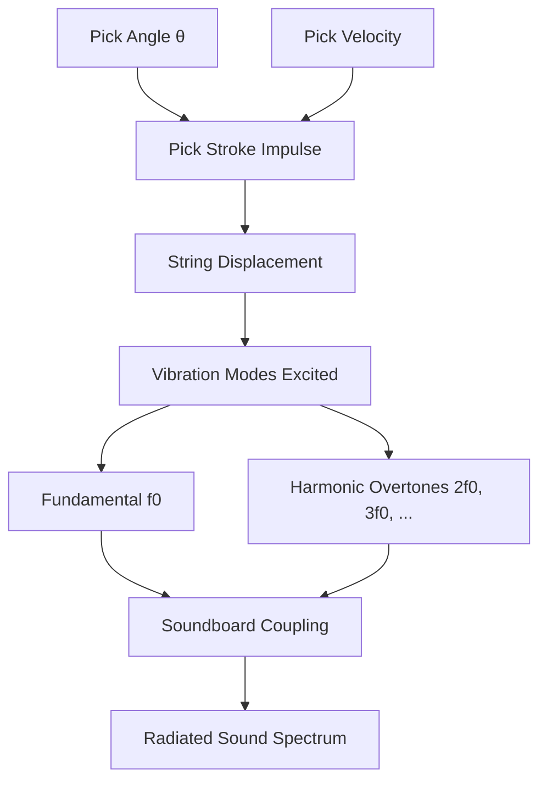
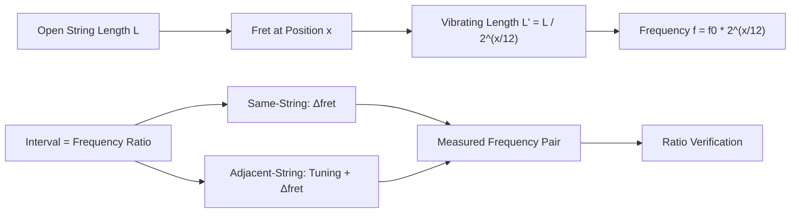

# Operational Verification Labs: Acoustic Guitar

## Objective & Lab Setup

This laboratory provides hands-on exploration of acoustic guitar mechanics, performance technique, and the physical principles underlying tone production. You will investigate the instrument's mechanical behavior from first principles—string vibration modes, energy transfer through the soundboard, and the ergonomic constraints that govern technique. The exercises progress from foundational posture and motor patterns to parameter variation studies and deliberate fault injection, building a rigorous understanding of how technique, materials, and physical geometry interact to produce musical output.

### Required Domain-Specific Tools, Environments, Packages, or Simulators

- **Acoustic Guitar**: Six-string steel or nylon acoustic guitar with stable intonation across the fretboard. Steel-string instruments (typically 0.012"–0.053" gauge) exhibit higher tension and brighter harmonic content; nylon-string classical guitars produce lower tension and warmer fundamentals. Ensure the instrument is set up with appropriate action (string height above frets) and relief (neck curvature under tension).
- **Metronome**: Digital or mechanical metronome with subdivisions. Software metronomes (e.g., Pro Metronome, Soundbrenner) offer visual and haptic feedback modes.
- **Audio Recording Device**: Large-diaphragm condenser microphone (e.g., Audio-Technica AT2020, Rode NT1-A) positioned 12–18 inches from the 12th fret at a 45° angle to the soundboard, capturing both direct string attack and body resonance. DAW software (Audacity, Reaper, Ableton Live) with waveform and spectrogram visualization.
- **Chromatic Tuner**: Digital tuner with cent-precision readout (e.g., Peterson StroboClip, TC Electronic PolyTune). Tuning accuracy should resolve to ±1 cent (1/100th of a semitone).
- **Tablature and Notation Software**: Guitar Pro, MuseScore, or TuxGuitar for score creation, MIDI playback, and tempo-variable practice tracks.
- **Spectral Analysis Tools**: Sonic Visualiser, Spek, or DAW spectrum analyzer plugins for frequency-domain inspection of recorded audio.
- **Graphing and Data Analysis**: Python with matplotlib/numpy, MATLAB, or Excel for plotting response curves and statistical summaries.
- **Force Gauge** (optional): Digital spring scale (0–50 lbs range) for measuring string tension during fault injection exercises.

## Exercise 1: Foundational Practical Implementation

### Step-by-Step Runnable Exercise Demonstrating the Core Concept

#### Part A: Proper Hand Posture and Finger Placement

Seated posture establishes the foundation for motor efficiency and injury prevention. Sit in a chair without armrests, feet flat on the floor, spine neutral. Rest the guitar's waist on your right thigh (for right-handed players) or use a footstool to elevate the left leg 4–6 inches, placing the guitar's lower bout on the elevated thigh and the neck at approximately 45° from horizontal. This raises the fretboard into a more ergonomic plane and reduces wrist flexion.

**Left Hand (Fretting Hand)**: Position the thumb on the back centerline of the neck, opposite the second and third fingers. The thumb acts as a pivot and counterforce to finger pressure, not a clamp. Fingers approach the fretboard from above at approximately 80–90° to the plane of the frets, with fingertips landing just behind (toward the headstock side of) the fret wire. This maximizes pressure efficiency and minimizes buzzing. The first knuckle (proximal interphalangeal joint) should be flexed, creating an arch that allows adjacent strings to ring clearly without muting. Avoid collapsing the first knuckle, which causes the pad of the finger to deaden neighboring strings.

**Right Hand (Picking Hand)**: Anchor the heel of the palm lightly on the bridge or rest the forearm on the upper bout. Fingers extend naturally toward the soundhole, wrist held in a neutral (straight) position relative to the forearm. For fingerstyle, the thumb (p) rests on the 6th, 5th, or 4th string, while fingers i, m, a (index, middle, ring) curve over strings 3, 2, 1 respectively. Plucking motion originates from the large knuckle (metacarpophalangeal joint), not the fingertip, with a follow-through that releases the string perpendicular to the soundboard plane. This vector maximizes energy transfer into the string's fundamental mode and minimizes lateral string deflection.

**Exercise 1A.1**: Form a C major chord (strings 5–1: 3rd fret ring finger on A string, 2nd fret middle finger on D string, 1st fret index finger on B string, open G and E strings). Place each finger sequentially, checking that each string rings clearly. Pluck each string individually (arpeggiate) to verify no muting or buzzing. Remove fingers and repeat the placement 10 times, focusing on minimum motion and consistent finger angles.

**Exercise 1A.2**: Transition between C major, G major (3rd fret middle and ring fingers on low E and high E, 2nd fret index on A string), and D major (2nd fret index, middle, ring on G, E, B strings respectively). Execute each transition at a tempo of 40 BPM (one chord per beat), ensuring all notes ring clearly before moving to the next chord. Record the transition sequence and inspect the waveform for gaps or extraneous noise from finger sliding.



#### Part B: Basic Strumming Patterns

Strumming transfers energy from the arm and wrist into the strings as a coordinated wave. The motion originates from the shoulder and elbow for large-amplitude strums, with the wrist providing rotational follow-through. The pick (or thumb in fingerstyle) contacts the strings at a shallow angle (15–30° from parallel to the soundboard), minimizing resistance and allowing the pick to glide across the string plane.

**Exercise 1B.1**: Set the metronome to 60 BPM. Strum a C major chord downward (toward the floor) on each beat, striking all six strings. Focus on even string contact: the pick should engage the 6th string first and release from the 1st string last, with a smooth sweep that maintains constant velocity across the string plane. The entire downstroke occupies approximately 50–80 ms. Record four measures and inspect the waveform; each stroke should produce a sharp transient (attack) followed by a sustained decay with visible harmonic content.

**Exercise 1B.2**: Introduce upstrokes. At 60 BPM, strum down on beats 1 and 3, up on beats 2 and 4. The upstroke reverses the string engagement order (1st to 6th) and typically involves wrist rotation rather than full forearm motion, producing slightly lower amplitude. Maintain rhythmic symmetry: down and up strokes should occupy equal time divisions. Gradually increase tempo to 80, 100, 120 BPM as precision improves.

**Exercise 1B.3**: Implement a sixteenth-note strumming pattern: D-D-U-U-D-U (down-down-up-up-down-up) within one beat at 80 BPM. This common pattern creates a syncopated feel and requires precise wrist articulation. Record and verify that each stroke is distinct in the waveform, with no double-hits or skipped strings.


## Exercise 2: Parameter Variation & Empirical Analysis

### Testing Different Configurations, Measuring Outputs, and Graphing Responses

#### Part A: Alternate Picking Mechanics

Alternate picking is the disciplined alternation of downstrokes and upstrokes on individual notes, minimizing pick travel distance and enabling high-speed scalar passages. The technique depends on maintaining a consistent pick angle relative to the string and minimizing deviation from the string plane during directional changes.

**Theoretical Basis**: Each pick stroke imparts an impulse force to the string, displacing it perpendicular to its rest position. The string then vibrates in modes determined by its length, tension, and mass per unit length. The fundamental frequency is given by:

$$
f_0 = \frac{1}{2L} \sqrt{\frac{T}{\mu}}
$$

where $L$ is the vibrating string length, $T$ is tension, and $\mu$ is linear mass density. Pick attack characteristics (force, duration, contact point) modulate the amplitudes of harmonic overtones, affecting tonal brightness.

**Exercise 2A.1**: Set the metronome to 100 BPM with sixteenth-note subdivisions (four clicks per beat). Play a single-string chromatic scale on the high E string (frets 0–12) using strict alternate picking: down-up-down-up. Maintain a pick angle of approximately 30° (slight downward slant toward the bridge). Record the passage and export the waveform. Measure the inter-onset interval (IOI) between consecutive note attacks using the DAW's waveform zoom. Compute the mean and standard deviation of IOI across all notes. At 100 BPM sixteenth notes, the target IOI is 150 ms. Standard deviation should be below 10 ms for consistent execution.

**Exercise 2A.2**: Repeat the chromatic scale at 120 BPM (IOI = 125 ms), 140 BPM (IOI ≈ 107 ms), and 160 BPM (IOI ≈ 94 ms). For each tempo, record IOI statistics and note error rate (missed notes, buzzing, or extraneous string noise). Plot mean IOI and error rate against tempo.

**Exercise 2A.3**: Vary pick angle. Perform the 120 BPM chromatic scale with pick angles of 0° (parallel to soundboard), 30°, 60°, and 90° (perpendicular). Record each take and perform spectral analysis on a representative note. Plot the amplitude of the second harmonic (twice the fundamental frequency) relative to the fundamental as a function of pick angle. Steeper pick angles typically increase high-frequency content due to sharper impulse profiles.

```python
import numpy as np
import matplotlib.pyplot as plt

# Example data: pick angle (degrees) vs second harmonic amplitude (dB relative to fundamental)
angles = np.array([0, 30, 60, 90])
harmonic_amplitudes = np.array([-12, -8, -5, -3])  # Example measurements

plt.figure(figsize=(8, 5))
plt.plot(angles, harmonic_amplitudes, marker='o', linewidth=2, markersize=8)
plt.xlabel('Pick Angle (degrees)', fontsize=12)
plt.ylabel('2nd Harmonic Amplitude (dB re: fundamental)', fontsize=12)
plt.title('Harmonic Content vs Pick Angle', fontsize=14)
plt.grid(True, alpha=0.3)
plt.tight_layout()
plt.savefig('pick_angle_harmonics.png', dpi=300)
plt.show()
```



#### Part B: Interval Geometries

The guitar fretboard is a logarithmic lattice: each fret divides the remaining string length by the twelfth root of two ($2^{1/12} \approx 1.05946$), producing equal-tempered semitones. Intervals are geometric relationships between pitches, and each interval has characteristic fingerings that minimize hand motion and maximize intonation accuracy.

**Theoretical Basis**: A musical interval is the ratio of two frequencies. A major third spans four semitones, corresponding to a frequency ratio of $2^{4/12} = 2^{1/3} \approx 1.2599$. On the guitar, a major third can be played on adjacent strings (e.g., G string 0th fret to B string 0th fret is a major third by default tuning geometry) or on the same string separated by four frets.

**Exercise 2B.1**: Construct a diatonic sequence of major thirds in the key of C: C-E, D-F♯, E-G♯, F-A, G-B, A-C♯, B-D♯. Play each interval using the same-string geometry (four frets apart on a single string), then using adjacent-string geometry where applicable. Record each interval and measure the fundamental frequencies of both notes using spectral analysis. Compute the frequency ratio and compare to the theoretical value of 1.2599. Deviations greater than 5 cents indicate intonation error (fret placement or tuning issues).

**Exercise 2B.2**: Repeat the exercise with perfect fourths (five semitones, ratio $2^{5/12} \approx 1.3348$) and perfect fifths (seven semitones, ratio $2^{7/12} \approx 1.4983$). Tabulate measured ratios against theoretical values.

**Exercise 2B.3**: Explore the CAGED system, a geometric framework that maps five basic open-chord shapes (C, A, G, E, D) across the fretboard. Play a C major chord in each of the five CAGED positions, ascending the neck. Record the chord voicings and measure the fundamental frequency of the lowest note in each position. Plot fret position (x-axis) against lowest fundamental frequency (y-axis). The relationship should be approximately exponential, reflecting the logarithmic fret spacing.

```python
import numpy as np
import matplotlib.pyplot as plt

# Example: CAGED C major chord root notes across fret positions
fret_positions = np.array([0, 3, 5, 8, 10, 12])  # Approximate root positions
frequencies = np.array([130.81, 146.83, 164.81, 196.00, 220.00, 261.63])  # Hz (C3, D#3, F3, G3, A3, C4 approximations)

# Fit exponential model: f = f0 * 2^(fret/12)
f0_fit = frequencies[0] / (2 ** (fret_positions[0] / 12))
fret_fit = np.linspace(0, 12, 100)
freq_fit = f0_fit * (2 ** (fret_fit / 12))

plt.figure(figsize=(8, 5))
plt.scatter(fret_positions, frequencies, s=80, label='Measured', zorder=3)
plt.plot(fret_fit, freq_fit, 'r--', linewidth=2, label='Exponential Fit')
plt.xlabel('Fret Position', fontsize=12)
plt.ylabel('Fundamental Frequency (Hz)', fontsize=12)
plt.title('Fretboard Geometry: Frequency vs Position', fontsize=14)
plt.legend()
plt.grid(True, alpha=0.3)
plt.tight_layout()
plt.savefig('fretboard_frequency_response.png', dpi=300)
plt.show()
```



## Exercise 3: Fault Injection & Stress Testing

### Inducing Boundary Failures, Analyzing Error States, and Verifying Recovery

#### Part A: String Breakage Simulation

Steel guitar strings fail under excessive tension through fatigue crack propagation at the ball-end crimp or at the bridge saddle contact point. Understanding failure modes informs string selection, tuning stability, and maintenance practices.

**Theoretical Basis**: A guitar string is a tensioned wire under stress $\sigma = F / A$, where $F$ is tension force and $A$ is cross-sectional area. Yield stress for typical steel alloys ranges from 200–400 MPa. A 0.010" diameter high E string under standard tension (~16 lbs) experiences stress approaching the yield point. Increasing tension beyond the design envelope causes plastic deformation and eventual fracture.

**Safety Note**: Conduct this exercise with eye protection. String breakage releases stored elastic energy suddenly, and broken string ends can recoil at high velocity. Tune upward in small increments (one semitone at a time) and observe the string for signs of unraveling or necking at stress concentration points.

**Exercise 3A.1**: Install a new high E string (0.010" gauge). Tune to standard pitch (329.63 Hz, E4). Using a digital tuner, tune the string upward in semitone steps, recording the pitch and estimated tension at each step. Measure tension by plucking the string and using the formula:

$$
T = (2Lf)^2 \mu
$$

where $L$ is the scale length (typically 25.5" or 0.648 m for steel-string guitars), $f$ is the measured fundamental frequency, and $\mu$ is the linear mass density (manufacturer spec, approximately 0.00004 kg/m for 0.010" strings). Continue tuning upward until the string breaks. Record the breaking tension and frequency.

**Exercise 3A.2**: Repeat with different string materials: phosphor bronze wound strings, 80/20 bronze, and nickel-plated steel. Compare breaking tensions across materials. Phosphor bronze typically exhibits slightly higher tensile strength than 80/20 bronze due to the addition of phosphorus, which increases corrosion resistance and hardness.

**Exercise 3A.3**: Repeat with a string that has been pre-fatigued: install a used string (>20 hours playing time) and compare its breaking tension to a new string of the same gauge and material. Fatigue reduces breaking strength by 10–30% depending on playing style and environmental exposure (humidity, oils from skin).

**Data Collection**: Tabulate string material, gauge, new vs. used condition, breaking frequency, and calculated breaking tension.

```python
import numpy as np
import matplotlib.pyplot as plt

# Example data: breaking tension (lbs) for different materials
materials = ['Steel\n(new)', 'Steel\n(used)', 'Phosphor\nBronze', '80/20\nBronze', 'Nickel']
breaking_tensions = np.array([28.5, 22.1, 30.2, 27.8, 29.0])  # Example measurements in lbs

plt.figure(figsize=(8, 5))
plt.bar(materials, breaking_tensions, color=['#3B6DFF', '#6EE7B7', '#E9A568', '#38BDF8', '#A78BFA'], edgecolor='#0F131C', linewidth=1.5)
plt.ylabel('Breaking Tension (lbs)', fontsize=12)
plt.xlabel('String Material and Condition', fontsize=12)
plt.title('String Breaking Tension Comparison', fontsize=14)
plt.ylim(0, 35)
plt.grid(axis='y', alpha=0.3)
plt.tight_layout()
plt.savefig('string_breaking_tension.png', dpi=300)
plt.show()
```

```mermaid
graph TD
    A["String
