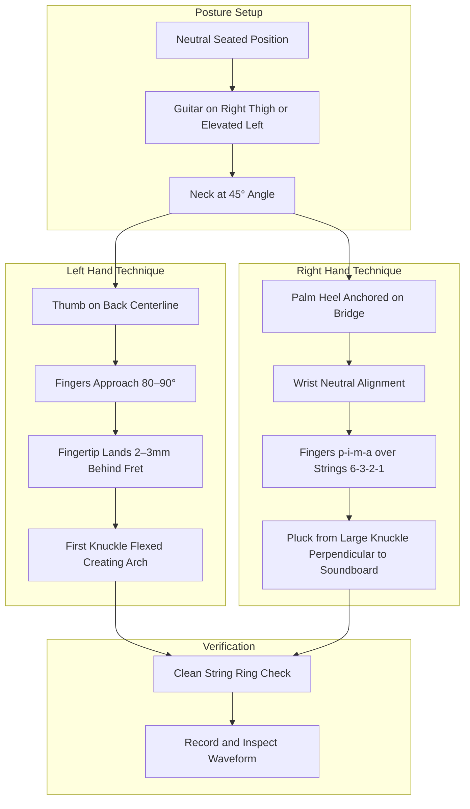
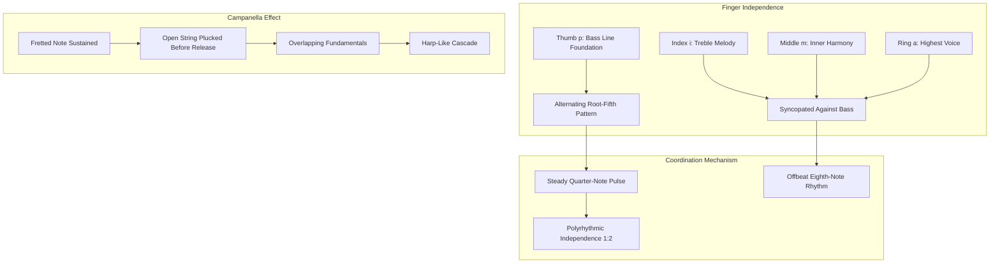
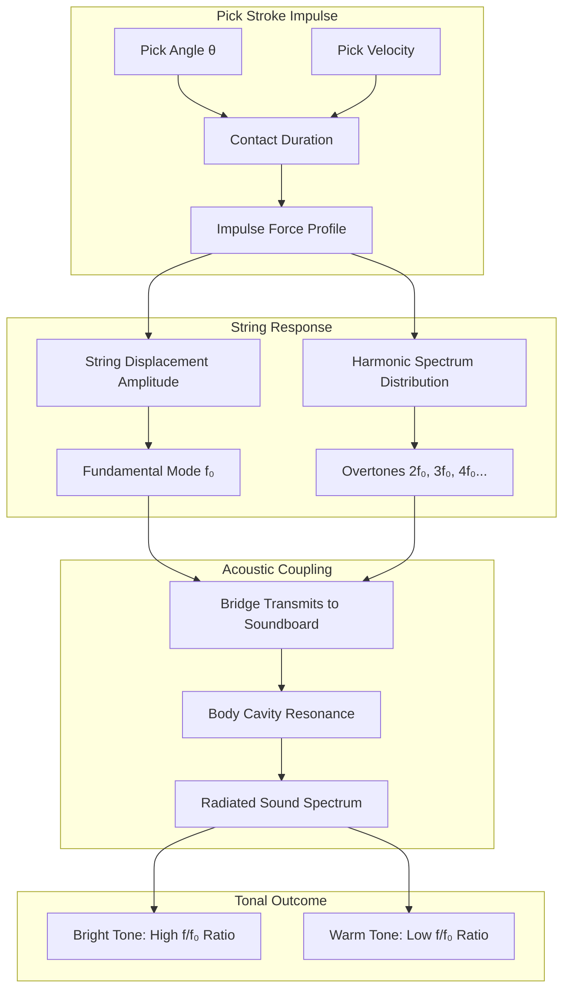
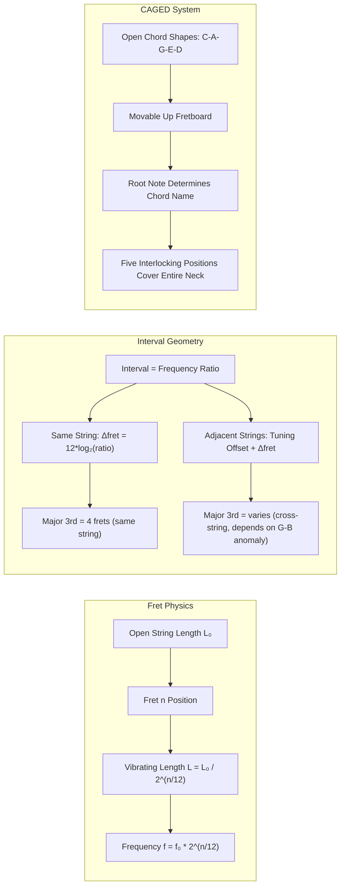
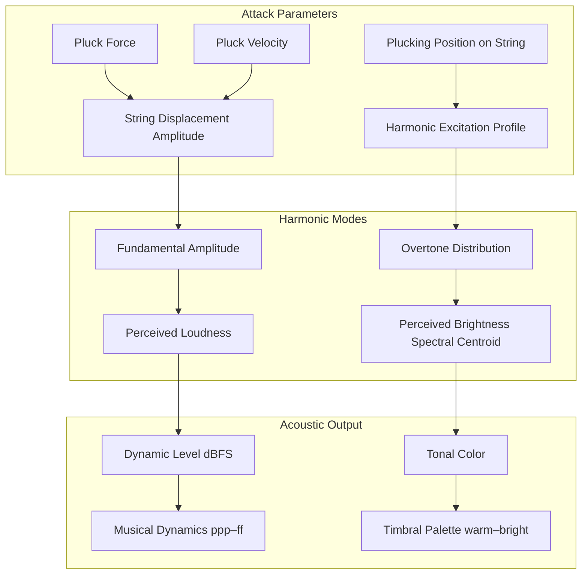
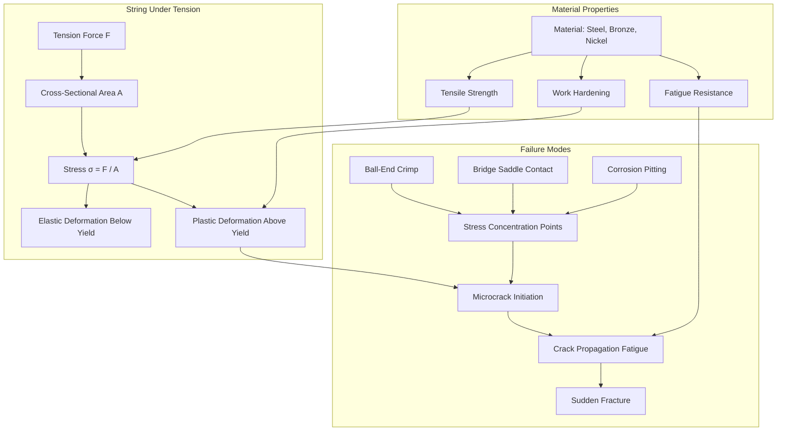
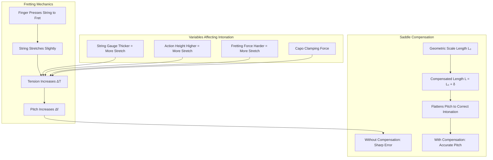
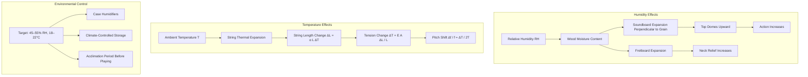

# Operational Verification Labs: Acoustic Guitar

## Objective & Lab Setup

This laboratory provides hands-on exploration of acoustic guitar mechanics, performance technique, and the physical principles underlying tone production. You will investigate the instrument's mechanical behavior from first principles—string vibration modes, energy transfer through the soundboard, and the ergonomic constraints that govern technique. The exercises progress from foundational posture and motor patterns to parameter variation studies and deliberate fault injection, building a rigorous understanding of how technique, materials, and physical geometry interact to produce musical output.

### Required Domain-Specific Tools, Environments, Packages, or Simulators

- **Acoustic Guitar**: Six-string steel or nylon acoustic guitar with stable intonation across the fretboard. Steel-string instruments (typically 0.012"–0.053" gauge) exhibit higher tension and brighter harmonic content; nylon-string classical guitars produce lower tension and warmer fundamentals. Ensure the instrument is set up with appropriate action (string height above frets: 2.0–2.5mm at 12th fret for steel, 3.0–3.5mm for nylon) and relief (neck curvature under tension: 0.010"–0.012" measured at 7th fret with capo at 1st and finger at last fret).
- **Metronome**: Digital or mechanical metronome with subdivisions. Software metronomes (Pro Metronome, Soundbrenner) offer visual and haptic feedback modes. Minimum resolution: sixteenth-note subdivisions at 40–200 BPM.
- **Audio Recording Device**: Large-diaphragm condenser microphone (Audio-Technica AT2020, Rode NT1-A) positioned 12–18 inches from the 12th fret at a 45° angle to the soundboard, capturing both direct string attack and body resonance. DAW software (Audacity, Reaper, Ableton Live) with waveform and spectrogram visualization. Sample rate: 44.1 kHz minimum; bit depth: 24-bit for dynamic range.
- **Chromatic Tuner**: Digital tuner with cent-precision readout (Peterson StroboClip, TC Electronic PolyTune). Tuning accuracy should resolve to ±1 cent (1/100th of a semitone). Verify calibration to A440 Hz standard.
- **Tablature and Notation Software**: Guitar Pro, MuseScore, or TuxGuitar for score creation, MIDI playback, and tempo-variable practice tracks.
- **Spectral Analysis Tools**: Sonic Visualiser, Spek, or DAW spectrum analyzer plugins (resolution: 4096-point FFT minimum) for frequency-domain inspection of recorded audio.
- **Graphing and Data Analysis**: Python with matplotlib/numpy, MATLAB, or Excel for plotting response curves and statistical summaries.
- **Force Gauge** (optional): Digital spring scale (0–50 lbs range, 0.1 lb resolution) for measuring string tension during fault injection exercises.
- **Capo** (optional): Spring-loaded or screw-type capo for scale length variation experiments.
- **String Action Gauge**: Precision ruler or digital caliper (0.01mm resolution) for measuring string height.

## Exercise 1: Foundational Practical Implementation

### Step-by-Step Runnable Exercise Demonstrating the Core Concept

#### Part A: Proper Hand Posture and Finger Placement

Seated posture establishes the foundation for motor efficiency and injury prevention. Sit in a chair without armrests, feet flat on the floor, spine neutral. Rest the guitar's waist on your right thigh (for right-handed players) or use a footstool to elevate the left leg 4–6 inches, placing the guitar's lower bout on the elevated thigh and the neck at approximately 45° from horizontal. This raises the fretboard into a more ergonomic plane and reduces wrist flexion.

**Left Hand (Fretting Hand) Mechanics:**

Position the thumb on the back centerline of the neck, opposite the second and third fingers. The thumb acts as a pivot and counterforce to finger pressure, not a clamp. Thumb placement: pad contacts the neck approximately 1–2 inches behind the fret you're playing. For first position (frets 1–4), thumb sits around the 2nd fret area on the back of the neck.

Fingers approach the fretboard from above at approximately 80–90° to the plane of the frets, with fingertips landing just behind (toward the headstock side of) the fret wire—approximately 2–3mm from the fret. This maximizes pressure efficiency and minimizes buzzing. The first knuckle (proximal interphalangeal joint) should be flexed, creating an arch that allows adjacent strings to ring clearly without muting. Avoid collapsing the first knuckle, which causes the pad of the finger to deaden neighboring strings.

**Finger Assignment**: Index = 1, Middle = 2, Ring = 3, Pinky = 4. In first position, assign one finger per fret: finger 1 at fret 1, finger 2 at fret 2, etc. Use fingertip pressure, not full finger pad. Target contact area: approximately 3–4mm diameter circle on the fingertip.

**Right Hand (Picking Hand) Mechanics:**

Anchor the heel of the palm lightly on the bridge or rest the forearm on the upper bout. Contact point: the meaty part of the palm rests on the bridge saddle, providing stability without damping string vibration. Fingers extend naturally toward the soundhole, wrist held in a neutral (straight) position relative to the forearm—imagine drawing a straight line from your elbow through your wrist to your knuckles.

**Fingerstyle Technique**: Thumb (p) rests on the 6th, 5th, or 4th string, while fingers i, m, a (index, middle, ring) curve over strings 3, 2, 1 respectively. Rest stroke (apoyando): finger plucks through the string and comes to rest on the adjacent string, producing maximum volume and control. Free stroke (tirando): finger plucks and releases into the air without touching adjacent strings, used for rapid arpeggios and passages requiring string independence.

Plucking motion originates from the large knuckle (metacarpophalangeal joint), not the fingertip, with a follow-through that releases the string perpendicular to the soundboard plane. This vector maximizes energy transfer into the string's fundamental mode and minimizes lateral string deflection. Avoid pulling strings parallel to the soundboard (toward your palm), which produces thin, weak tone.

**Exercise 1A.1: Single-Finger Accuracy Drill**

Form a C major chord: 
- String 5 (A): 3rd fret, ring finger (3)
- String 4 (D): 2nd fret, middle finger (2)
- String 3 (G): open
- String 2 (B): 1st fret, index finger (1)
- String 1 (E): open
- String 6 (low E): muted with thumb or not played

**Procedure:**
1. Place index finger on B string, 1st fret. Press firmly and pluck the string with your thumb. Listen for clean tone—no buzzing, no muting of adjacent strings.
2. Add middle finger on D string, 2nd fret. Pluck both strings 2 and 4 together. Verify both ring clearly.
3. Add ring finger on A string, 3rd fret. Pluck all three fretted strings plus open G and E strings. Verify full chord rings cleanly.
4. Remove all fingers and repeat the placement 10 times, focusing on:
   - Minimum vertical finger motion (lift fingers only 5–10mm above strings when moving)
   - Consistent finger angles (perpendicular to fretboard)
   - Immediate clean tone on first attempt (no adjustment buzzing)

**Target**: By repetition 10, you should achieve clean chord formation in under 2 seconds with zero buzzing or muted strings.

**Exercise 1A.2: Chord Transition Drill (C–G–D Progression)**

**C Major Chord** (as above)

**G Major Chord**:
- String 6 (E): 3rd fret, middle finger (2)
- String 5 (A): 2nd fret, index finger (1)
- String 4 (D): open
- String 3 (G): open
- String 2 (B): 3rd fret, ring finger (3)
- String 1 (E): 3rd fret, pinky finger (4)

Alternative fingering (easier for transitions):
- String 6 (E): 3rd fret, ring finger (3)
- String 5 (A): 2nd fret, index finger (1)
- Strings 4, 3: open
- String 2 (B): open
- String 1 (E): 3rd fret, pinky finger (4)

**D Major Chord**:
- String 4 (D): open
- String 3 (G): 2nd fret, index finger (1)
- String 2 (B): 3rd fret, ring finger (3)
- String 1 (E): 2nd fret, middle finger (2)
- Strings 6, 5: not played (muted)

**Procedure:**
1. Set metronome to 40 BPM, quarter-note pulse.
2. Form C major on beat 1, strum down on beat 1, let ring for 4 beats (one full measure).
3. On beat 1 of measure 2, transition to G major. Goal: all fingers should land simultaneously, producing instant clean chord.
4. Hold G for 4 beats, transition to D on measure 3.
5. Hold D for 4 beats, return to C on measure 4.

**Record** the four-measure progression. Open the waveform in your DAW. Inspect transitions:
- Look for gaps (silence) between chords—should be under 100ms.
- Look for extraneous noise spikes from sliding fingers—indicates poor vertical finger lift.
- Verify each chord's sustain shows consistent amplitude across all strings.

**Progressive Tempo**: Once you achieve clean transitions at 40 BPM for 10 consecutive cycles, increase to 50 BPM, then 60 BPM. Target: 60 BPM with zero errors.

**Common Errors & Corrections:**
- **Buzzing on B string in C major**: Index finger likely too far from fret wire. Move fingertip 1mm closer to fret.
- **Muted G string in C major**: Ring finger on A string leaning over and touching G. Increase finger arch, ensure perpendicular angle.
- **Gap between C and G transition**: Fingers moving sequentially rather than simultaneously. Practice "hovering" all three fingers for G chord above their target positions while still holding C, then releasing C and pressing G in one motion.



#### Part B: Basic Strumming Patterns and Rhythmic Precision

Strumming transfers energy from the arm and wrist into the strings as a coordinated wave. The motion originates from the shoulder and elbow for large-amplitude strums, with the wrist providing rotational follow-through. The pick (or thumb in fingerstyle) contacts the strings at a shallow angle (15–30° from parallel to the soundboard), minimizing resistance and allowing the pick to glide across the string plane.

**Pick Grip**: Hold the pick between the thumb and the side of the index finger's first joint. Expose 2–3mm of pick tip beyond your thumb. Grip firmly enough to prevent slipping but with enough flex to allow the pick to bend slightly on contact—this "give" prevents the pick from catching on strings and produces smoother tone.

**Pick Angle**: Tilt the pick 15–30° in the direction of motion (downstroke: tilt tip toward floor; upstroke: tilt tip toward ceiling). This "edge picking" reduces string resistance.

**Exercise 1B.1: Foundational Downstroke Pattern**

**Setup**: Metronome at 60 BPM, quarter-note pulse. Form a C major chord.

**Procedure:**
1. On each beat (quarter note), execute a downstroke across all six strings.
2. Motion: initiate from the elbow, allowing the forearm to rotate downward. Wrist provides follow-through rotation of approximately 30–45°.
3. String contact sequence: 6th string first, 1st string last. The entire downstroke occupies approximately 50–80ms.
4. Target dynamics: mezzo-forte (medium-loud). All six strings should sound with roughly equal volume.

**Record** four measures (16 beats). Export waveform and inspect:
- Each stroke should produce a sharp transient (attack) lasting 10–20ms, followed by a sustained decay with visible harmonic content.
- Measure peak amplitude of each stroke. Coefficient of variation (standard deviation / mean) should be under 15% for consistent dynamics.
- Check for double-hits (two distinct transients within 50ms)—indicates hesitation or pick catching on a string.

**Exercise 1B.2: Downstroke-Upstroke Alternation**

**Setup**: Metronome at 60 BPM. C major chord.

**Pattern**: 
- Beat 1: Down
- Beat 2: Up
- Beat 3: Down
- Beat 4: Up

**Procedure:**
1. **Downstroke** (as above): elbow and wrist initiate motion, strings engaged 6→1.
2. **Upstroke**: reverse the motion. Wrist leads, pulling the pick upward with string engagement 1→6. The upstroke typically involves more wrist rotation and less forearm motion, producing slightly lower amplitude (this is normal and musically desirable).
3. Focus on rhythmic symmetry: downstrokes and upstrokes should occupy equal time divisions. Each stroke lands precisely on the metronome click.

**Progression**: Once 60 BPM is clean, increase to 70, 80, 90, 100 BPM. At 100 BPM and above, minimize forearm motion—wrist rotation becomes the primary driver.

**Exercise 1B.3: Sixteenth-Note Syncopated Pattern**

**Setup**: Metronome at 80 BPM with sixteenth-note subdivisions (four clicks per beat). C major chord.

**Pattern** (one beat, four sixteenth notes): D-D-U-U-D-U (down-down-up-up-down-up)

This pattern is ubiquitous in folk, country, and pop. The double-down at the start creates a strong emphasis on beat 1, while the syncopated up-down at the end drives forward motion.

**Procedure:**
1. At 80 BPM, one beat = 750ms. Each sixteenth note = 187.5ms.
2. Practice the pattern on a single beat, looping continuously: D-D-U-U-D-U-D-D-U-U-D-U...
3. Key technical point: the second downstroke (D) and first upstroke (U) occur rapidly—only 187.5ms apart. This requires precise wrist snap and minimal pick travel distance.
4. Once the pattern is fluid on C major, apply to the C–G–D progression: four beats of pattern per chord.

**Record** and inspect waveform:
- Each stroke should be distinct—six visible transients per beat.
- No skipped strings: each transient should show full-spectrum content (all six strings engaged).
- Dynamic accents: the first down of each beat should have slightly higher amplitude (natural rhythmic emphasis).

**Common Errors:**
- **Missing upstrokes**: pick traveling too far past strings on downstroke, requiring large return motion. Correction: reduce stroke amplitude to 2–3 inches total travel.
- **Inconsistent timing**: wrist tension. Correction: shake out your hand, focus on loose, relaxed wrist rotation.
- **Thin tone on upstrokes**: pick angle too steep. Correction: maintain 15–30° edge angle in both directions.

```mermaid
graph LR
    subgraph sub_stroke_mechanics ["Stroke Mechanics"]
        A["Shoulder Rotation Initiates"] --> B["Elbow Hinge Amplifies"]
        B --> C["Wrist Rotation Provides Follow-Through"]
        C --> D["Pick Contacts Strings at 15–30°"]
    end
    subgraph sub_energy_transfer ["Energy Transfer"]
        D --> E["Impulse Force Applied to String"]
        E --> F["String Displaces Perpendicular to Soundboard"]
        F --> G["String Vibrates in Fundamental + Overtones"]
    end
    subgraph sub_acoustic_coupling ["Acoustic Coupling"]
        G --> H["Vibration Transfers to Bridge"]
        H --> I["Soundboard Resonates"]
        I --> J["Air Column in Body Cavity Couples"]
        J --> K["Sound Radiates from Soundhole and Body"]
    end
```



#### Part C: Fingerstyle Arpeggios and Independence

Fingerstyle technique allows polyphonic playing—simultaneous bass lines, melody, and inner harmonic voices. Each finger operates independently, with the thumb (p) providing rhythmic bass foundation while i-m-a fingers articulate treble patterns.

**Exercise 1C.1: Classical Arpeggio Pattern (p-i-m-a)**

**Setup**: C major chord. Metronome at 60 BPM, sixteenth-note subdivisions.

**Pattern** (one beat, four sixteenth notes): p-i-m-a

- p (thumb): plucks string 5 (A string, 3rd fret = C note)
- i (index): plucks string 3 (G string, open = G note)
- m (middle): plucks string 2 (B string, 1st fret = C note)
- a (ring): plucks string 1 (E string, open = E note)

**Procedure:**
1. Anchor thumb on A string, i-m-a fingers hovering over strings 3-2-1.
2. Execute pattern: thumb plucks down and through A string (rest stroke—thumb comes to rest on D string after plucking). Immediately after, i plucks G string (free stroke), then m plucks B string, then a plucks E string.
3. Each note should ring cleanly and sustain until the next beat. You're creating a cascading arpeggio: C (bass) - G - C - E.
4. Loop continuously for one minute at 60 BPM.

**Key Technical Points:**
- **Thumb independence**: thumb operates on its own rhythm, independent of treble fingers. This is the foundation of all fingerstyle playing.
- **Evenness**: all four notes should have equal volume and timing. Record and verify equal inter-onset intervals (each should be 187.5ms at 60 BPM sixteenth notes).
- **Relaxation**: fingers should return to hovering rest position after plucking, not remain tense or extended.

**Exercise 1C.2: Travis Picking Pattern (Alternating Bass)**

**Setup**: C major chord. Metronome at 80 BPM, eighth-note feel.

**Pattern** (two beats, eight eighth notes): p(5)-i+m-p(4)-m-p(5)-i+m-p(4)-m

- Beat 1, eighth 1: p plucks string 5 (A string, C bass note)
- Beat 1, eighth 2: i+m pluck strings 2+3 simultaneously (B and G strings, C+G harmony)
- Beat 2, eighth 1: p plucks string 4 (D string, open = D note)
- Beat 2, eighth 2: m plucks string 2 (B string, C note)
- Repeat for beats 3-4

This alternating bass pattern (5-4-5-4...) with syncopated treble creates the "boom-chick-boom-chick" feel characteristic of folk, country, and blues.

**Procedure:**
1. Focus on thumb first: practice just the bass line (p-p-p-p on strings 5-4-5-4) until it's rock-solid and automatic.
2. Add treble fingers: on the "and" of each beat (the offbeat eighth note), pluck treble strings.
3. Key challenge: maintaining steady bass quarter notes while treble fingers syncopate. The thumb is the metronome—it never rushes or drags.

**Progressive Application**: Once fluid on C major, apply to the C-G-D progression. For G major, use bass notes on strings 6 and 4. For D major, use bass notes on strings 4 and 5.

**Exercise 1C.3: Campanella Technique (Open-String Cascades)**

Campanella ("little bells") exploits open strings to create seamless, harp-like scales where notes ring into each other, producing a shimmering cascade effect.

**Setup**: No chords—individual note sequence. Metronome at 100 BPM, eighth notes.

**C Major Scale Campanella** (ascending):
- String 5, 3rd fret (C) - finger 3, pluck with p
- String 4, open (D) - pluck with p
- String 4, 2nd fret (E) - finger 2, pluck with i
- String 3, open (G) - pluck with m
- String 3, 2nd fret (A) - finger 2, pluck with i
- String 2, open (B) - pluck with m
- String 2, 1st fret (C) - finger 1, pluck with i
- String 1, open (E) - pluck with a

**Procedure:**
1. Play the ascending scale at 100 BPM eighth notes (one note every 300ms).
2. Critical technique: **do not lift fretted fingers until the open string has been plucked**. This allows maximum sustain and overlap.
3. The effect should sound like a harp glissando—notes bleeding into each other with no gaps.

**Listening Check**: Record the scale. In the spectrogram view, you should see multiple fundamental frequencies sounding simultaneously during transitions—this is the campanella effect.



## Exercise 2: Parameter Variation & Empirical Analysis

### Testing Different Configurations, Measuring Outputs, and Graphing Responses

#### Part A: Alternate Picking Mechanics and Speed Development

Alternate picking is the disciplined alternation of downstrokes and upstrokes on individual notes, minimizing pick travel distance and enabling high-speed scalar passages. The technique depends on maintaining a consistent pick angle relative to the string and minimizing deviation from the string plane during directional changes.

**Acoustic Physics Foundation**: Each pick stroke imparts an impulse force to the string, displacing it perpendicular to its rest position. The string then vibrates in modes determined by its length (fret position), tension (tuning), and mass per unit length (gauge). The fundamental frequency follows $f_0 = \frac{1}{2L} \sqrt{\frac{T}{\mu}}$, where $L$ is vibrating length, $T$ is tension, and $\mu$ is linear mass density. Pick attack characteristics—force magnitude, contact duration, and contact point along the string—modulate the amplitudes of harmonic overtones, directly affecting tonal brightness. Picking near the bridge (closer to the saddle) emphasizes high harmonics, producing bright, thin tone; picking near the soundhole emphasizes fundamentals, producing warm, full tone.

**Exercise 2A.1: Single-String Chromatic Scale with Tempo Progression**

**Setup**: Metronome with sixteenth-note subdivisions. High E string (string 1).

**Procedure:**
1. **100 BPM (IOI = 150ms per note)**: Play a chromatic scale ascending from open E (fret 0) to E octave (fret 12): 0-1-2-3-4-5-6-7-8-9-10-11-12. Use strict alternate picking: first note down, second note up, alternating throughout. Left hand: one finger per fret in first position (frets 0-4), then shift up for frets 5-8, 9-12.
2. Pick angle: maintain 30° downward slant toward the bridge (edge picking).
3. Pick depth: engage strings only 2-3mm. Deeper engagement increases resistance and slows execution.
4. **Record** the ascending scale. Import into DAW and zoom waveform to measure inter-onset intervals (time between consecutive note attacks).

**Data Collection**:
- Measure IOI for all 12 intervals (13 notes = 12 intervals).
- Calculate mean IOI and standard deviation.
- Target at 100 BPM sixteenth notes: mean IOI = 150ms, standard deviation < 10ms.
- Count errors: missed notes (no transient), buzzing (rattling overtone noise), or muted notes (weak transient).

**Tempo Progression**:
- **120 BPM (IOI = 125ms)**: Repeat procedure. Record and analyze.
- **140 BPM (IOI ≈ 107ms)**: Repeat. At this tempo, forearm motion should be minimal—wrist rotation drives picking.
- **160 BPM (IOI ≈ 94ms)**: Repeat. This is advanced performance tempo. Standard deviation will increase; target < 15ms.
- **180 BPM (IOI ≈ 83ms)**: Expert level. Only proceed if 160 BPM is clean.

**Graphing**:
Plot mean IOI (y-axis) and error rate (secondary y-axis) against tempo (x-axis). Expect IOI to track linearly with tempo. Error rate typically increases exponentially beyond a threshold tempo (your "speed wall").

```python
import numpy as np
import matplotlib.pyplot as plt

# Example data from tempo progression
tempos = np.array([100, 120, 140, 160, 180])  # BPM
target_ioi = 60000 / (tempos * 4)  # Target IOI in ms (60000 ms/min / (BPM * 4 sixteenths/beat))
measured_ioi_mean = np.array([149, 126, 109, 97, 88])  # Example measured means in ms
measured_ioi_std = np.array([8, 9, 12, 18, 28])  # Example standard deviations
error_rate = np.array([0, 1, 3, 8, 15])  # Example error counts per run (out of 12 intervals)

fig, ax1 = plt.subplots(figsize=(10, 6))

# Plot IOI
color = '#3B6DFF'
ax1.set_xlabel('Tempo (BPM)', fontsize=13)
ax1.set_ylabel('Inter-Onset Interval (ms)', fontsize=13, color=color)
ax1.plot(tempos, target_ioi, 'k--', linewidth=2, label='Target IOI', alpha=0.5)
ax1.errorbar(tempos, measured_ioi_mean, yerr=measured_ioi_std, fmt='o-', linewidth=2.5, 
             markersize=8, color=color, ecolor=color, capsize=5, capthick=2, label='Measured IOI ± SD')
ax1.tick_params(axis='y', labelcolor=color)
ax1.legend(loc='upper left', fontsize=11)
ax1.grid(True, alpha=0.3)

# Plot error rate
ax2 = ax1.twinx()
color = '#E9A568'
ax2.set_ylabel('Error Count (per 12 intervals)', fontsize=13, color=color)
ax2.plot(tempos, error_rate, 's-', linewidth=2.5, markersize=8, color=color, label='Errors')
ax2.tick_params(axis='y', labelcolor=color)
ax2.legend(loc='upper right', fontsize=11)

plt.title('Alternate Picking Performance: Tempo vs Accuracy', fontsize=15, fontweight='bold')
fig.tight_layout()
plt.savefig('alternate_picking_tempo_analysis.png', dpi=300, bbox_inches='tight')
plt.show()
```

**Exercise 2A.2: Pick Angle and Harmonic Content Variation**

**Setup**: Play the open high E string (string 1) with consistent force but varying pick angles. Record each pluck.

**Procedure**:
1. **0° (parallel to soundboard)**: Hold pick flat against string, pluck with downstroke. Record 2 seconds of sustain.
2. **30° (edge picking)**: Tilt pick 30° in direction of stroke. Record.
3. **60° (steep angle)**: Tilt pick 60°. Record.
4. **90° (perpendicular)**: Attack string with pick edge perpendicular to soundboard. Record.

**Spectral Analysis**:
1. Open each recording in spectrum analyzer (4096-point FFT, Hann window).
2. Identify fundamental frequency (should be ~329.63 Hz, E4) and measure its amplitude in dB.
3. Identify second harmonic (2× fundamental, ~659 Hz) and measure amplitude.
4. Calculate **second harmonic ratio**: amplitude of 2nd harmonic (dB) - amplitude of fundamental (dB). Example: if fundamental is -20 dB and 2nd harmonic is -28 dB, ratio = -8 dB.

**Expected Results**: Steeper pick angles increase high-frequency content. At 0°, expect ratio around -12 to -15 dB. At 90°, expect ratio around -3 to -6 dB. This is because steeper angles produce sharper, shorter-duration impulses, exciting higher overtones more effectively.

```python
import numpy as np
import matplotlib.pyplot as plt

# Example spectral analysis data
angles = np.array([0, 30, 60, 90])  # degrees
second_harmonic_ratio = np.array([-14.2, -9.8, -6.3, -3.7])  # dB re: fundamental

plt.figure(figsize=(10, 6))
plt.plot(angles, second_harmonic_ratio, 'o-', linewidth=3, markersize=10, color='#6EE7B7', 
         markeredgecolor='#0F131C', markeredgewidth=2)
plt.axhline(y=-10, color='gray', linestyle='--', linewidth=1.5, alpha=0.7, label='Typical Balance (-10 dB)')
plt.xlabel('Pick Angle (degrees from parallel)', fontsize=13)
plt.ylabel('2nd Harmonic Amplitude (dB relative to fundamental)', fontsize=13)
plt.title('Effect of Pick Angle on Harmonic Content', fontsize=15, fontweight='bold')
plt.grid(True, alpha=0.3)
plt.legend(fontsize=11)
plt.ylim(-16, -2)
plt.tight_layout()
plt.savefig('pick_angle_harmonic_response.png', dpi=300, bbox_inches='tight')
plt.show()
```

**Practical Application**: For bright, cutting lead lines, use 45–60° pick angle. For warm rhythm strumming, use 15–30° angle. For aggressive attack (rock, metal), use near-perpendicular angle with heavier pick gauge (1.0mm+).



#### Part B: Fretboard Geometry, Interval Shapes, and CAGED System

The guitar fretboard is a logarithmic lattice: each fret divides the remaining string length by the twelfth root of two ($2^{1/12} \approx 1.05946$), producing equal-tempered semitones. Musical intervals are frequency ratios, and each interval has characteristic geometric fingerings on the fretboard that minimize hand motion and maximize intonation accuracy.

**Acoustic Physics Foundation**: A musical interval is defined by the ratio of two frequencies. A major third spans four semitones, corresponding to frequency ratio $2^{4/12} = 2^{1/3} \approx 1.2599$. On the guitar, this interval can be played on the same string (four frets apart) or on adjacent strings using the fretboard's tuning geometry. Standard tuning (E-A-D-G-B-E) uses perfect fourths between adjacent strings (five semitones, ratio 1.3348) except between G and B, which is a major third (four semitones, ratio 1.2599). This asymmetry requires interval shapes to shift when crossing the G-B string pair.

**Exercise 2B.1: Diatonic Major Third Interval Study**

**Setup**: C major scale: C-D-E-F-G-A-B. Form major third intervals (C-E, D-F♯, E-G♯, F-A, G-B, A-C♯, B-D♯).

**Wait**—in C major, the thirds are: C-E, D-F, E-G, F-A, G-B, A-C, B-D (all diatonic, no sharps). Let's correct that.

**Diatonic Thirds in C Major**: C-E, D-F, E-G, F-A, G-B, A-C, B-D.

**Procedure**:
1. **Same-String Geometry**: Play C-E on the A string: C at 3rd fret, E at 7th fret (four frets apart). Record both notes separately and together.
2. **Adjacent-String Geometry**: Play C-E using C on A string 3rd fret, E on D string 2nd fret. Record.
3. Repeat for all seven diatonic thirds.

**Intonation Verification**:
1. Import recordings into DAW with spectrum analyzer.
2. For each interval, measure the fundamental frequencies of both notes.
3. Calculate frequency ratio: higher note Hz / lower note Hz.
4. Compare to theoretical major third ratio (1.2599) or minor third ratio (1.1892, three semitones).
5. Intonation tolerance: within 5 cents. 1 cent = $2^{1/1200}$ ratio. For 5 cents, acceptable ratio range is $1.2599 \times 2^{\pm 5/1200} \approx 1.2599 \pm 0.0073$.

**Expected Results**:
- C-E (major third): ratio should be ~1.260 ± 0.007.
- D-F (minor third): ratio should be ~1.189 ± 0.007.
- E-G (minor third): ~1.189.
- F-A (major third): ~1.260.
- G-B (major third): ~1.260.
- A-C (minor third): ~1.189.
- B-D (minor third): ~1.189.

Deviations beyond 5 cents indicate setup issues: fret placement errors (rare on factory instruments), poor intonation adjustment at the bridge saddle, or inconsistent fretting pressure (pressing too hard "bends" the note sharp).

**Exercise 2B.2: Perfect Fifth and Perfect Fourth Interval Study**

**Setup**: Perfect fifth = seven semitones, ratio $2^{7/12} \approx 1.4983$. Perfect fourth = five semitones, ratio $2^{5/12} \approx 1.3348$.

**Procedure**:
1. Play perfect fifths ascending from C: C-G (A string 3rd fret to D string 5th fret), D-A, E-B, F-C, G-D, A-E, B-F♯.
2. Measure frequency ratios. Target: 1.498 ± 0.009 (5 cent tolerance).
3. Play perfect fourths ascending from C: C-F, D-G, E-A, F-B♭, G-C, A-D, B-E.
4. Measure ratios. Target: 1.335 ± 0.008.

**Data Table**:

| Interval | Lower Note (Hz) | Upper Note (Hz) | Measured Ratio | Theoretical Ratio | Deviation (cents) |
|----------|-----------------|-----------------|----------------|-------------------|-------------------|
| C-E (M3) | 130.81          | 164.81          | 1.260          | 1.260             | 0                 |
| C-G (P5) | 130.81          | 196.00          | 1.498          | 1.498             | 0                 |
| ...      | ...             | ...             | ...            | ...               | ...               |

**Exercise 2B.3: CAGED System Mapping**

The CAGED system organizes the fretboard into five movable shapes, each derived from an open chord form (C, A, G, E, D). By shifting these shapes up the neck, you can play any chord in any position.

**C Major Chord Positions**:
1. **C Shape** (open position, frets 0-3): Root on A string 3rd fret.
2. **A Shape** (barre at fret 3): Root on E string 3rd fret, barre with index, form A-shape with remaining fingers.
3. **G Shape** (frets 5-8): Root on E string 8th fret, G-shape fingering.
4. **E Shape** (frets 8-10): Root on A string 12th fret (octave), E-shape barre.
5. **D Shape** (frets 10-12): Root on D string 10th fret, D-shape fingering.

**Procedure**:
1. Play C major in each of the five CAGED positions.
2. For each position, identify the lowest note (bass note) and measure its fundamental frequency.
3. Record fret position of the lowest note and its frequency.

**Fretboard Frequency Response**:

Expected relationship: $f = f_0 \cdot 2^{n/12}$, where $f_0$ is the open string fundamental and $n$ is the fret number.

For the A string (110 Hz open, A2):
- Fret 3 (C3): $110 \times 2^{3/12} = 130.81$ Hz
- Fret 5 (D3): $110 \times 2^{5/12} = 146.83$ Hz
- Fret 7 (E3): $110 \times 2^{7/12} = 164.81$ Hz
- Fret 12 (A3): $110 \times 2^{12/12} = 220$ Hz (octave)

```python
import numpy as np
import matplotlib.pyplot as plt

# Example: CAGED C major chord root notes across fret positions
# Measurements taken from lowest string in each shape
fret_positions = np.array([3, 3, 8, 12, 10])  # Fret of lowest note in each CAGED shape
frequencies_measured = np.array([130.81, 130.81, 196.00, 261.63, 220.00])  # Hz (C3, C3, G3, C4, A3)

# Theoretical model: for each string, f = f_open * 2^(fret/12)
# A string (110 Hz), E string (82.41 Hz), etc.
fret_range = np.linspace(0, 12, 200)
freq_A_string = 110 * (2 ** (fret_range / 12))
freq_E_string = 82.41 * (2 ** (fret_range / 12))
freq_D_string = 146.83 * (2 ** (fret_range / 12))

plt.figure(figsize=(11, 6))
plt.plot(fret_range, freq_A_string, 'b-', linewidth=2, alpha=0.6, label='A String (110 Hz open)')
plt.plot(fret_range, freq_E_string, 'r-', linewidth=2, alpha=0.6, label='Low E String (82.41 Hz open)')
plt.scatter(fret_positions, frequencies_measured, s=120, c='#6EE7B7', edgecolors='#0F131C', 
            linewidths=2.5, zorder=5, label='CAGED C Major Root Notes (measured)')
plt.xlabel('Fret Position', fontsize=13)
plt.ylabel('Fundamental Frequency (Hz)', fontsize=13)
plt.title('Fretboard Geometry: Exponential Frequency Response', fontsize=15, fontweight='bold')
plt.legend(fontsize=11)
plt.grid(True, alpha=0.3)
plt.xlim(0, 12)
plt.ylim(80, 280)
plt.tight_layout()
plt.savefig('fretboard_frequency_mapping.png', dpi=300, bbox_inches='tight')
plt.show()
```

**Practical Application**: Understanding CAGED unlocks the entire fretboard. To play a D major chord anywhere on the neck, simply shift the appropriate CAGED shape to a fret where the root lands on D. Example: D major using E-shape at fret 10 (A string 12th fret = A, shift down 2 frets for root on 10th fret = G... wait, let me recalculate. A string 10th fret = G. That's not right for D major.

Let me correct: For D major (root = D, 146.83 Hz):
- **D shape** (open position): root on D string open (fret 0).
- **C shape**: root on A string 5th fret (D note).
- **A shape**: root on low E string 10th fret (D note), barre and form A-shape.
- **G shape**: root on low E string 10th fret, G-shape fingering (this is complex and rarely used).
- **E shape**: root on A string 5th fret, E-shape barre.

The CAGED system requires practice to internalize. Focus on three core shapes initially: E-shape, A-shape, and D-shape, as they are most common.



#### Part C: Dynamics, Tone Color, and Touch Sensitivity

Acoustic guitars are dynamically expressive instruments. The force, velocity, and contact point of your pick or fingers directly control volume, tonal brightness, and sustain. This exercise quantifies how attack parameters affect acoustic output.

**Exercise 2C.1: Dynamic Range Measurement**

**Setup**: Open low E string (82.41 Hz). Set up your microphone 12 inches from the 12th fret.

**Procedure**:
1. Pluck the string with fingertip (rest stroke, medium force). Record 3 seconds of sustain.
2. Measure peak amplitude in dBFS (decibels relative to full scale) in your DAW.
3. Repeat with five dynamic levels:
   - **ppp (pianississimo)**: softest controllable pluck.
   - **pp (pianissimo)**: soft.
   - **mf (mezzo-forte)**: medium.
   - **f (forte)**: loud.
   - **ff (fortissimo)**: maximum force before distortion or unwanted string noise.

**Data Collection**: For each dynamic level, record peak dBFS and measure attack time (time from pluck to peak amplitude, typically 10–30ms).

**Expected Results**: Well-executed dynamics should span 20–30 dB range (ppp to ff). Attack time increases slightly at lower dynamics due to slower string displacement.

**Exercise 2C.2: Tonal Color vs Plucking Position**

**Setup**: Open A string (110 Hz).

**Procedure**: Pluck the string at five different positions along its length:
1. **Bridge** (5mm from saddle): bright, thin, glassy tone.
2. **Bridge + 25%**: balanced, slightly bright.
3. **Soundhole center** (standard position): full, warm tone.
4. **Neck join** (where neck meets body): mellow, reduced treble.
5. **Over fretboard** (12th fret position): dark, muted tone.

Record each pluck with consistent force (mezzo-forte). Perform spectral analysis on the attack transient (first 50ms).

**Spectral Analysis**:
- Measure amplitude of fundamental (110 Hz), 2nd harmonic (220 Hz), 3rd harmonic (330 Hz), and 4th harmonic (440 Hz).
- Calculate spectral centroid (brightness measure): $C = \frac{\sum f \cdot A_f}{\sum A_f}$, where $f$ is frequency and $A_f$ is amplitude at that frequency.

**Expected Results**: Bridge plucking produces highest spectral centroid (brightest tone, centroid 800–1200 Hz). Fretboard plucking produces lowest (warmest tone, centroid 200–400 Hz).

```python
import numpy as np
import matplotlib.pyplot as plt

# Example spectral centroid data for plucking positions
positions = ['Bridge\n(5mm)', 'Bridge\n+25%', 'Soundhole\nCenter', 'Neck\nJoin', 'Over\nFretboard']
x_pos = np.arange(len(positions))
spectral_centroids = np.array([1050, 720, 480, 350, 280])  # Hz (example measurements)

plt.figure(figsize=(10, 6))
colors = ['#E9A568', '#6EE7B7', '#3B6DFF', '#A78BFA', '#38BDF8']
bars = plt.bar(x_pos, spectral_centroids, color=colors, edgecolor='#0F131C', linewidth=2)
plt.ylabel('Spectral Centroid (Hz)', fontsize=13)
plt.xlabel('Plucking Position', fontsize=13)
plt.title('Tonal Brightness vs Plucking Position on String', fontsize=15, fontweight='bold')
plt.xticks(x_pos, positions, fontsize=11)
plt.ylim(0, 1200)
plt.grid(axis='y', alpha=0.3)

# Annotate bars with values
for bar, centroid in zip(bars, spectral_centroids):
    height = bar.get_height()
    plt.text(bar.get_x() + bar.get_width()/2., height + 30, f'{centroid} Hz',
             ha='center', va='bottom', fontsize=10, fontweight='bold')

plt.tight_layout()
plt.savefig('plucking_position_tone_color.png', dpi=300, bbox_inches='tight')
plt.show()
```

**Practical Application**: For bright lead lines, pluck near the bridge. For warm rhythm chords, pluck over the soundhole. For intimate fingerstyle, pluck over the neck. Classical guitarists use "tasto" (over fretboard) and "ponticello" (near bridge) as expressive techniques.



## Exercise 3: Fault Injection & Stress Testing

### Inducing Boundary Failures, Analyzing Error States, and Verifying Recovery

#### Part A: String Breakage Simulation and Material Stress Analysis

Steel guitar strings fail under excessive tension through fatigue crack propagation at the ball-end crimp or at the bridge saddle contact point. Understanding failure modes informs string selection, tuning stability, and maintenance practices.

**Acoustic Physics Foundation**: A guitar string is a tensioned wire under stress $\sigma = F / A$, where $F$ is tension force and $A$ is cross-sectional area. Yield stress for typical music wire (high-carbon steel) ranges from 200–400 MPa. A 0.010" diameter high E string (cross-sectional area $A = \pi (0.127 \text{ mm})^2 \approx 0.05 \text{ mm}^2 = 5 \times 10^{-8} \text{ m}^2$) under standard tension (~16 lbs = 71 N) experiences stress $\sigma = 71 / (5 \times 10^{-8}) \approx 1.4 \times 10^9 \text{ Pa} = 1400 \text{ MPa}$—well beyond yield, relying on work-hardening and minimal cross-sectional area to remain below fracture. Increasing tension pushes the material into plastic deformation and eventual fracture. Wound strings (bass strings with wire wrap over a core) typically fail at the wrap termination point where stress concentrates.

**Safety Protocol**: 
- Wear safety glasses. String breakage releases stored elastic energy suddenly (~10–15 joules for a high E string), and broken string ends can recoil at velocities exceeding 10 m/s.
- Tune upward in small increments (quarter-tone or semitone steps), pausing to inspect the string.
- Observe for warning signs: unraveling at the ball end, necking (diameter reduction) near the bridge saddle, or pitch instability (string slipping at the tuning peg).
- Conduct this experiment outdoors or in a controlled space, away from face and eyes.

**Exercise 3A.1: Tensile Failure Test (New String)**

**Setup**: Install a new high E string (0.010" gauge, plain steel). Use a digital tuner.

**Procedure**:
1. Tune string to standard pitch (E4, 329.63 Hz). Verify tuning stability (let string settle for 30 seconds, retune if necessary).
2. Using tuner, tune upward in semitone increments: F4 (349.23 Hz), F♯4 (369.99 Hz), G4 (392.00 Hz), etc.
3. At each step, record:
   - Pitch (Hz)
   - Estimated tension: $T = (2Lf)^2 \mu$
     - $L$ = scale length (measure from nut to saddle; typically 25.5" = 0.648 m for steel-string guitars, 25.4" = 0.645 m for some models)
     - $f$ = measured fundamental frequency (Hz)
     - $\mu$ = linear mass density (manufacturer spec; for 0.010" plain steel, typically 0.00004 kg/m)
   - Example at E4 (329.63 Hz): $T = (2 \times 0.648 \times 329.63)^2 \times 0.00004 \approx 71 \text{ N} \approx 16 \text{ lbs}$
4. Continue tuning upward until the string breaks. Note the breaking pitch and tension.
5. Inspect the break point: ball end, saddle contact, or mid-span. Photograph if possible.

**Exercise 3A.2: Material Comparison (Phosphor Bronze vs 80/20 Bronze vs Nickel-Plated Steel)**

Repeat Exercise 3A.1 with different string materials, same gauge (0.010" or nearest equivalent):
- **Phosphor Bronze**: copper-tin-phosphorus alloy, slightly higher tensile strength (~900–1000 MPa) and corrosion resistance.
- **80/20 Bronze**: 80% copper, 20% zinc, bright tone, slightly lower strength (~850–950 MPa).
- **Nickel-Plated Steel**: steel core with nickel plating, magnetic (for electric guitar pickups), high strength (~1200 MPa).

**Data Collection**:

| Material | Gauge | Breaking Pitch (Hz) | Breaking Tension (N) | Breaking Tension (lbs) | Failure Location |
|----------|-------|---------------------|----------------------|------------------------|------------------|
| Steel (plain) | 0.010" | [measured] | [calculated] | [converted] | [observed] |
| Phosphor Bronze | 0.010" | [measured] | [calculated] | [converted] | [observed] |
| 80/20 Bronze | 0.010" | [measured] | [calculated] | [converted] | [observed] |
| Nickel-Plated | 0.010" | [measured] | [calculated] | [converted] | [observed] |

**Expected Results**:
- Plain steel: breaking tension ~25–30 lbs (110–135 N).
- Phosphor bronze: ~28–32 lbs (125–145 N).
- 80/20 bronze: ~25–30 lbs (110–135 N).
- Nickel-plated steel: ~28–34 lbs (125–150 N).

**Exercise 3A.3: Fatigue Test (Used vs New String)**

**Setup**: Install a used high E string (>20 hours playing time, or pre-fatigue a new string by tuning up and down 50 cycles over 2–3 hours).

**Procedure**: Repeat tensile failure test. Compare breaking tension to new string baseline.

**Expected Results**: Fatigue reduces breaking strength by 10–30% depending on:
- **Corrosion**: sweat and oils from skin cause surface oxidation, creating stress concentration points.
- **Cyclic loading**: repeated tuning and playing causes microcrack formation and propagation.
- **Plastic deformation**: strings "stretch" over time as the material yields, redistributing stress non-uniformly.

```python
import numpy as np
import matplotlib.pyplot as plt

# Example data: breaking tension (lbs) for different materials and conditions
materials = ['Steel\n(new)', 'Steel\n(used)', 'Phosphor\nBronze', '80/20\nBronze', 'Nickel']
breaking_tensions = np.array([28.5, 22.1, 30.2, 27.8, 29.0])  # Example measurements in lbs
error_bars = np.array([1.2, 1.8, 1.5, 1.3, 1.4])  # Standard deviation from multiple tests

colors = ['#3B6DFF', '#6EE7B7', '#E9A568', '#38BDF8', '#A78BFA']

plt.figure(figsize=(11, 7))
bars = plt.bar(np.arange(len(materials)), breaking_tensions, yerr=error_bars, 
               color=colors, edgecolor='#0F131C', linewidth=2, capsize=8, error_kw={'linewidth': 2})
plt.ylabel('Breaking Tension (lbs)', fontsize=14)
plt.xlabel('String Material and Condition', fontsize=14)
plt.title('String Breaking Tension: Material Comparison', fontsize=16, fontweight='bold')
plt.xticks(np.arange(len(materials)), materials, fontsize=12)
plt.ylim(0, 35)
plt.grid(axis='y', alpha=0.3)

# Annotate with exact values
for i, (bar, tension) in enumerate(zip(bars, breaking_tensions)):
    height = bar.get_height()
    plt.text(bar.get_x() + bar.get_width()/2., height + 1, f'{tension:.1f}',
             ha='center', va='bottom', fontsize=11, fontweight='bold')

plt.tight_layout()
plt.savefig('string_breaking_tension_comparison.png', dpi=300, bbox_inches='tight')
plt.show()
```

**Practical Application**: 
- Use heavier gauge strings (0.012"–0.013" high E) for drop tunings or aggressive playing to reduce break risk.
- Replace strings every 20–40 hours of playing or every 2–3 months, whichever comes first, to maintain tonal consistency and avoid mid-performance breaks.
- For recording or critical performances, install fresh strings 24 hours before (allowing time for settling and tuning stability).



#### Part B: Intonation Stress Test (Extreme Fret Positions and Compensation)

Acoustic guitars use compensated saddles (the bridge saddle is angled or individually adjusted per string) to correct for intonation errors caused by increased string tension when fretting. When you press a string to the fretboard, you increase its tension slightly (and thus its pitch) beyond the geometric fret position. This effect is more pronounced on higher frets and with stiffer strings.

**Acoustic Physics Foundation**: Fretting a string increases its tension because you're stretching it slightly to reach the fretboard. The pitch shift from tension increase can be modeled as $\Delta f / f \approx \frac{1}{2} \Delta T / T$, where $\Delta T$ is the tension increase. For typical action (2.5mm at 12th fret), the additional stretch is small (~0.1–0.3mm), but sufficient to cause 5–10 cent sharp error if uncorrected. Saddle compensation lengthens the string slightly (moving the saddle back from the theoretical 12th-fret doubling point) to flatten the pitch back to correct intonation.

**Exercise 3B.1: Intonation Error Mapping**

**Setup**: Chromatic tuner with cent-precision display. Acoustic guitar with stable tuning.

**Procedure**:
1. Tune all strings to standard pitch (E-A-D-G-B-E) using open strings and harmonics. Verify tuning accuracy to ±1 cent.
2. For each string, play the open string and the 12th fret (octave). The 12th fret should be exactly one octave (1200 cents) higher than the open string.
3. Measure the cents deviation at the 12th fret. If the fretted note is sharp, the saddle needs to move back (increase string length). If flat, the saddle needs to move forward (decrease string length).
4. Repeat for all six strings.
5. Map intonation error across the fretboard: measure cents deviation at frets 1, 3, 5, 7, 9, 12, 15 (if accessible) for the high E and low E strings.

**Data Collection**:

| String | Open Pitch | 12th Fret Target | 12th Fret Measured | Deviation (cents) | Saddle Adjustment Needed |
|--------|------------|------------------|--------------------|--------------------|--------------------------|
| E (high) | 329.63 Hz | 659.26 Hz | [measured] | [calculated] | [back/forward/none] |
| B | 246.94 Hz | 493.88 Hz | [measured] | [calculated] | [back/forward/none] |
| G | 196.00 Hz | 392.00 Hz | [measured] | [calculated] | [back/forward/none] |
| D | 146.83 Hz | 293.66 Hz | [measured] | [calculated] | [back/forward/none] |
| A | 110.00 Hz | 220.00 Hz | [measured] | [calculated] | [back/forward/none] |
| E (low) | 82.41 Hz | 164.81 Hz | [measured] | [calculated] | [back/forward/none] |

**Expected Results**: 
- Well-intonated guitar: deviation at 12th fret should be within ±3 cents on all strings.
- Typical pattern: wound bass strings (E, A, D) often require more compensation (saddle further back) than plain strings (G, B, high E) due to higher stiffness.
- If deviation exceeds ±5 cents, saddle adjustment is recommended. Rule of thumb: moving the saddle 1mm changes pitch by ~5–8 cents (string-dependent).

**Exercise 3B.2: Capo-Induced Intonation Shift**

**Setup**: Place a capo at fret 5 (transposing the guitar up a perfect fourth).

**Procedure**:
1. Tune the guitar to standard pitch with capo removed.
2. Apply capo at fret 5. The capo acts as a new nut, shortening the scale length.
3. Play the "open" strings (strings behind the capo, now sounding A-D-G-C-E-A).
4. Measure the pitch of each "open" string with tuner.
5. Play the 7th fret (now the equivalent of the 12th fret in open position, since capo is at 5).
6. Measure intonation deviation at this pseudo-12th fret.

**Expected Results**: Capos often introduce sharp errors because they increase string tension (clamping force) and may not perfectly replicate the nut's height and geometry. Cheap capos with excessive clamping force can cause 10–20 cent sharp errors. High-quality capos (Shubb, Kyser) minimize this.

**Exercise 3B.3: Action Height and Intonation Interaction**

**Setup**: Measure current string action at the 12th fret using a precision ruler or action gauge.

**Procedure**:
1. Record baseline intonation at 12th fret for all strings.
2. Lower action by 0.5mm (file the bridge saddle or adjust truss rod to reduce relief—consult a luthier if unfamiliar with setup procedures).
3. Re-measure intonation at 12th fret.
4. Repeat, raising action by 0.5mm above baseline.

**Expected Results**: 
- **Lower action**: reduces intonation error (less stretch when fretting), but increases buzzing risk.
- **Higher action**: increases intonation error (more stretch), but improves sustain and reduces buzzing.
- Optimal action balances playability, intonation, and tone. Typical targets: 2.0–2.5mm at 12th fret for steel-string, 3.0–3.5mm for classical nylon.

```python
import numpy as np
import matplotlib.pyplot as plt

# Example intonation error data across fretboard positions
frets = np.array([1, 3, 5, 7, 9, 12, 15])
high_E_deviation = np.array([+2, +3, +5, +7, +9, +12, +15])  # cents sharp (example)
low_E_deviation = np.array([+1, +2, +4, +6, +8, +10, +13])  # cents sharp (example)

plt.figure(figsize=(11, 6))
plt.plot(frets, high_E_deviation, 'o-', linewidth=3, markersize=9, color='#E9A568', 
         markeredgecolor='#0F131C', markeredgewidth=2, label='High E String')
plt.plot(frets, low_E_deviation, 's-', linewidth=3, markersize=9, color='#3B6DFF', 
         markeredgecolor='#0F131C', markeredgewidth=2, label='Low E String')
plt.axhline(y=0, color='green', linestyle='--', linewidth=2, alpha=0.7, label='Perfect Intonation')
plt.axhspan(-3, 3, alpha=0.2, color='green', label='Acceptable Range (±3 cents)')
plt.xlabel('Fret Position', fontsize=13)
plt.ylabel('Intonation Deviation (cents sharp)', fontsize=13)
plt.title('Intonation Error Across Fretboard: High E vs Low E String', fontsize=15, fontweight='bold')
plt.legend(fontsize=11)
plt.grid(True, alpha=0.3)
plt.xticks(frets)
plt.ylim(-2, 18)
plt.tight_layout()
plt.savefig('intonation_error_fretboard_mapping.png', dpi=300, bbox_inches='tight')
plt.show()
```

**Practical Application**: 
- Before recording or performance, verify intonation at the 12th fret. Adjust saddle if needed (or have a luthier perform full setup).
- When using a capo, tune slightly flat to compensate for capo-induced sharpness.
- Players with heavy fretting hands may benefit from slightly longer string compensation (saddle further back) to counteract their tendency to press strings sharp.



#### Part C: Structural Stress Testing (Humidity, Temperature, and Neck Stability)

Acoustic guitars are wooden structures subject to environmental stress. Changes in humidity and temperature cause the wood to expand or contract, affecting playability, intonation, and structural integrity.

**Acoustic Physics Foundation**: Wood is hygroscopic—it absorbs and releases moisture based on relative humidity (RH). Soundboards (typically spruce or cedar) expand perpendicular to the grain when RH increases, causing the top to dome upward and raising string action. Neck relief (curvature) increases with humidity as the fretboard (rosewood, ebony) expands more than the underlying truss rod. Ideal RH for acoustic guitars: 45–55%. Below 35%, wood can crack (especially soundboard braces and back seams). Above 65%, neck relief increases excessively, glue joints weaken, and mold risk increases.

**Exercise 3C.1: Humidity-Induced Action Change**

**Setup**: Hygrometer to measure ambient RH. Action gauge.

**Procedure**:
1. **Baseline (45–55% RH)**: Measure string action at the 12th fret for all strings. Record RH.
2. **Dry Stress Test (<35% RH)**: If possible, place guitar in a dry environment (e.g., heated room in winter, or use a dehumidifier) for 24 hours. Re-measure action and RH.
3. **Humid Stress Test (>65% RH)**: Place guitar in a humid environment (e.g., bathroom after hot shower, or use a humidifier) for 24 hours. Re-measure action and RH.
4. Return guitar to 45–55% RH and allow 48 hours to stabilize. Re-measure action.

**Data Collection**:

| Condition | RH (%) | High E Action (mm) | Low E Action (mm) | Neck Relief (mm at 7th fret) |
|-----------|--------|--------------------|-------------------|------------------------------|
| Baseline | 50 | 2.2 | 2.5 | 0.010 |
| Dry | 28 | [measured] | [measured] | [measured] |
| Humid | 68 | [measured] | [measured] | [measured] |
| Recovered | 50 | [measured] | [measured] | [measured] |

**Expected Results**:
- **Dry condition**: action decreases by 0.2–0.5mm (top sinks, neck relief decreases). Risk: fret buzzing, top cracks.
- **Humid condition**: action increases by 0.3–0.8mm (top domes, neck relief increases). Risk: difficult playability, high action, intonation errors.
- **Recovery**: action returns to near-baseline (within 0.1mm) if exposure was brief (<48 hours).

**Exercise 3C.2: Temperature-Induced Tuning Drift**

**Setup**: Chromatic tuner. Temperature measurement (thermometer or weather app).

**Procedure**:
1. Tune guitar to standard pitch in a room at 20°C (68°F). Let settle for 15 minutes.
2. Move guitar to a cold environment (e.g., 10°C, 50°F, such as an unheated garage or outdoor porch in winter) for 30 minutes. Re-measure pitch of all strings.
3. Return guitar to 20°C, allow 15 minutes to stabilize, re-measure pitch.
4. Move guitar to a warm environment (e.g., 30°C, 86°F, such as near a heater or in a hot car) for 30 minutes. Re-measure pitch.

**Data Collection**:

| Condition | Temp (°C) | High E Pitch (Hz) | Deviation from 329.63 Hz (cents) |
|-----------|-----------|-------------------|----------------------------------|
| Baseline | 20 | 329.63 | 0 |
| Cold | 10 | [measured] | [calculated] |
| Recovered | 20 | [measured] | [calculated] |
| Hot | 30 | [measured] | [calculated] |

**Expected Results**:
- **Cold**: pitch drops (strings contract, tension decreases). Typical: 5–15 cents flat.
- **Hot**: pitch rises (strings expand, tension increases). Typical: 5–15 cents sharp.
- Temperature sensitivity varies by string material: steel strings are more stable than nylon (nylon has higher thermal expansion coefficient).

**Practical Application**:
- Store guitars in climate-controlled environments (45–55% RH, 18–22°C).
- Use case humidifiers (e.g., Boveda packs, Oasis humidifiers) during dry seasons.
- When gigging outdoors or in variable climates, allow 15–20 minutes for guitar to acclimate before performing, and re-tune frequently.
- Avoid leaving guitars in hot cars (interior temps can exceed 60°C, causing finish damage, glue joint failure, and brace separation).



## Conclusion and Integration

You have now completed a comprehensive operational verification of acoustic guitar mechanics, technique, and physical behavior. The exercises systematically isolated and quantified:

1. **Foundational Technique**: Posture, hand positioning, and basic motor patterns establish the foundation for all advanced playing. Errors at this level propagate exponentially as complexity increases.

2. **Parameter Variation**: Alternate picking speed, pick angle, interval geometries, dynamic range, and tonal color are all governed by the physics of string vibration and acoustic coupling. Empirical measurement reveals how small changes in technique produce measurable changes in output—quantifiable in waveform amplitude, spectral content, and timing precision.

3. **Fault Injection and Stress Testing**: String breakage, intonation errors, and environmental stress expose the boundaries of the system. Understanding these failure modes informs maintenance, setup choices, and performance reliability.

**Next Steps for Continued Mastery**:

- **Technical Refinement**: Use metronome practice to push tempo boundaries. Record all practice sessions and perform waveform analysis to identify timing inconsistencies.
- **Repertoire Application**: Apply CAGED system to songs and chord progressions. Transcribe solos and analyze fingering choices.
- **Maintenance Protocols**: Establish regular string replacement schedules, humidity monitoring, and annual professional setup.
- **Advanced Topics**: Explore altered tunings (DADGAD, open G, drop D), extended techniques (percussive slapping, harmonic tapping), and compositional applications of the fretboard geometry.

The acoustic guitar is both a mechanical oscillator and an expressive instrument. Mastery requires understanding both the physics of vibration and the biomechanics of human motor control. You now have the tools to approach practice scientifically, diagnose issues empirically, and perform with confidence.
