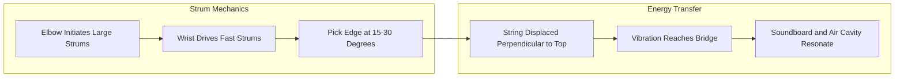
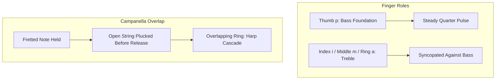
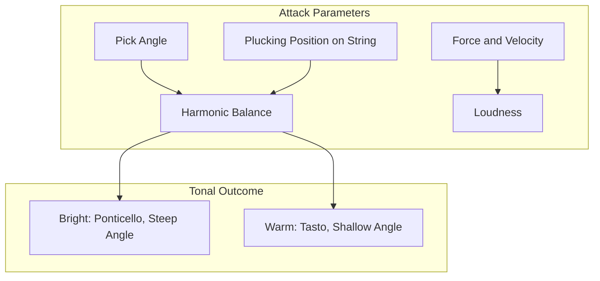
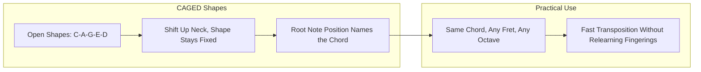
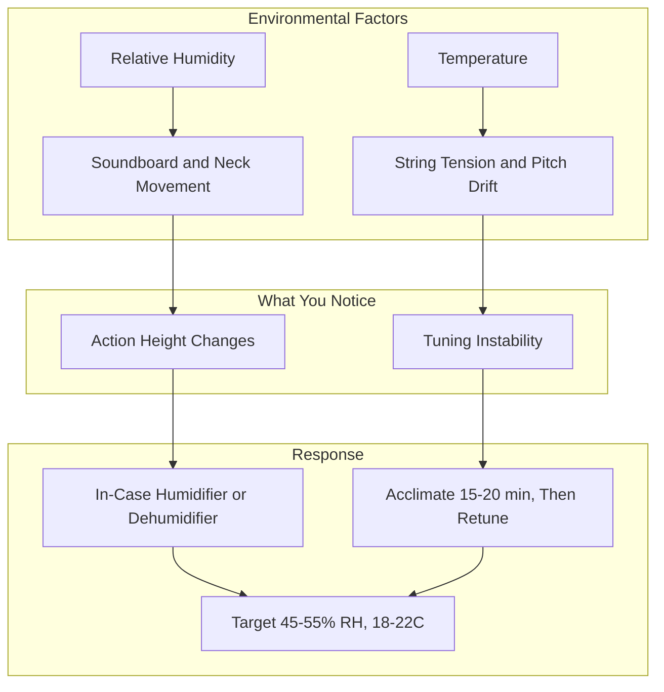

# Acoustic Guitar Masterclass: Technique, Tone, and Troubleshooting

## How to Use This Material

This is a practice-room manual, not a lab report. Every section gives you something to physically do, with a metronome target or a clean/dirty tone check as the pass/fail criterion. The acoustic physics is compressed into short "why it works" paragraphs — enough to make the technique make sense, never enough to replace practicing it. Keep a notebook or voice memo app running; the single biggest predictor of progress is recording yourself and listening back critically.

### What You Need

- **Guitar**: steel-string or nylon-string acoustic, properly set up. Action at the 12th fret: 2.0–2.5mm (steel), 3.0–3.5mm (nylon), measured string-bottom to fret-top. If your action is noticeably higher than this, get a setup before grinding through these drills — you'll be fighting the instrument instead of learning technique.
- **Metronome**: any app with subdivision clicks (Soundbrenner, Pro Metronome, or a $10 Korg). You must be able to hear sixteenth-note subdivisions clearly.
- **Tuner**: clip-on chromatic tuner, cent-accurate (Peterson StroboClip, TC Electronic PolyTune, or the Fender Tune app). Tune to A440 before every session.
- **Recorder**: your phone is fine. For spectral work, any free spectrum analyzer (Spek, or the analyzer in Audacity) at 44.1kHz/16-bit is sufficient.
- **Capo**, spare strings, string winder, and a soft cloth for wiping down strings after playing (sweat corrosion is the #1 cause of premature string death).

---

## Part 1: Posture and Hand Mechanics

Get this right before anything else. Bad posture habits formed in week one take years to unlearn and cause real repetitive strain injuries (tendinitis, De Quervain's) in the fretting wrist.

### Sitting Position

Sit on a chair without arms, feet flat on the floor. Two acceptable setups:

- **Classical position**: footstool under your left foot (4–6 inches high), guitar's waist resting on the raised left thigh, neck angled up at roughly 45°. This is the correct position for nylon-string and serious fingerstyle work because it brings the fretboard to the hand instead of making the wrist reach down.
- **Casual/steel-string position**: guitar waist on the right thigh, neck angled slightly down. Fine for strumming and most steel-string playing, but makes upper-fret fingerstyle work harder.

Either way: the guitar should stay in position with minimal arm clamping. If you have to squeeze your right arm against the body to keep the guitar from sliding, use a strap even while seated.

### Fretting Hand (Left Hand for Right-Handers)

**Thumb**: rides on the back centerline of the neck, roughly opposite your middle finger, acting as a counter-pressure anchor — not a clamp. A thumb that wraps over the top of the neck restricts finger reach and is the #1 cause of weak barre chords. Keep it low and relaxed.

**Finger angle**: approach the strings from above, fingers nearly perpendicular to the fretboard. Fingertip lands just behind the fret wire (toward the headstock), about 2–3mm back — close enough to minimize the pressure needed, far enough that you don't mute the fret's ring. Landing right on top of the fret produces a muted *thud*; landing too far back produces buzz.

**Knuckle arch**: keep the first knuckle (closest to the tip) bowed outward, not collapsed flat. A collapsed knuckle lays the finger pad across neighboring strings and kills their ring — this is the single most common cause of a "muddy" chord in beginners.

**Finger numbering** (standard across all methods): index = 1, middle = 2, ring = 3, pinky = 4.

### Picking/Plucking Hand (Right Hand for Right-Handers)

Rest your forearm on the lower bout, wrist straight — draw an imaginary line from elbow through wrist to knuckles with no kink. A bent wrist here is the fingerstyle equivalent of the fretting-hand clamped thumb: it costs you reach and control and causes strain over long sessions.

For fingerstyle, the plucking motion starts at the big knuckle (where fingers meet the palm), not the fingertip. Pull the string, then release it perpendicular to the soundboard — this drives the string's energy straight into the top, which is what makes it loud and full. If you pull the string parallel to the soundboard (toward your palm), you get a thin, weak "flick" tone because the string's motion doesn't couple efficiently into the top's vibration.

**Rest stroke (apoyando)**: finger plucks through the string and lands on the next string down, stopping there. Maximum volume and control — use for melody lines you want to project.
**Free stroke (tirando)**: finger plucks and swings clear into the air. Required for arpeggios and any passage where the next string also needs to ring.

---

## Drill 1: One-Finger-Per-Fret Accuracy (C Major)

**Chord**: C major, open position.

| String | Fret | Finger |
|---|---|---|
| 6 (low E) | muted (don't play) | — |
| 5 (A) | 3 | 3 (ring) |
| 4 (D) | 2 | 2 (middle) |
| 3 (G) | open | — |
| 2 (B) | 1 | 1 (index) |
| 1 (high E) | open | — |

**Procedure**:
1. Place finger 1 on string 2, fret 1 alone. Pluck. Listen for a clean tone — no buzz, no dead thud.
2. Add finger 2 (string 4, fret 2). Pluck strings 2 and 4 together. Both should ring clearly.
3. Add finger 3 (string 5, fret 3). Strum all five playable strings. Every string should ring — check in particular that the ring finger (3) isn't leaning over and touching string 3 (G), which is the classic error here.
4. Lift all fingers completely, then re-place the whole shape from scratch. Repeat 10 times.

**Target**: by rep 10, the full chord forms and rings clean in under 2 seconds, first attempt, no buzz-and-adjust.

**Fixes**:
- *Buzz on the B string*: fingertip is too far from the fret wire — nudge it 1–2mm closer to the fret.
- *Dead G string*: ring finger arch has collapsed and the pad is touching the adjacent string. Round the knuckle more, come down steeper.

---

## Drill 2: Chord Transitions (C–G–D)

**G major** (easy fingering, best for fast transitions):

| String | Fret | Finger |
|---|---|---|
| 6 | 3 | 3 (ring) |
| 5 | 2 | 1 (index) |
| 4, 3 | open | — |
| 2 | open | — |
| 1 | 3 | 4 (pinky) |

**D major**:

| String | Fret | Finger |
|---|---|---|
| 6, 5 | don't play | — |
| 4 | open | — |
| 3 | 2 | 1 (index) |
| 2 | 3 | 3 (ring) |
| 1 | 2 | 2 (middle) |

**Procedure**:
1. Metronome at 40 BPM, quarter-note click.
2. Strum C on beat 1, let it ring for a full 4-beat measure.
3. On beat 1 of measure 2, land the full G chord in one motion — all three fingers moving and arriving together, not sequentially. This is the key skill: practice "hovering" the G shape in the air above the strings while you're still holding C, then drop all fingers simultaneously when you release C.
4. Hold G for 4 beats, move to D for measure 3, back to C for measure 4.
5. Loop. Once you get 10 clean cycles at 40 BPM, move to 50, then 60 BPM. Target: 60 BPM with zero buzzes and no audible gap between chords.

**Record it.** Pull the take into any recorder with a waveform view and look at the chord boundaries:
- Silence gaps between chords should be under ~100ms (roughly the width of a thin sliver on a zoomed waveform at this tempo).
- Scratchy noise spikes right before a chord lands mean fingers are sliding into place along the string instead of lifting clear and dropping — increase vertical lift (5–10mm is enough, you don't need more).

---

## Part 2: Strumming Mechanics

The strum is a whip, not a push. Big strums are driven from the elbow with wrist follow-through; fast strums are almost entirely wrist.

**Pick grip**: pinch the pick between thumb pad and the side of the index finger's first joint, exposing 2–3mm of tip. Grip firm enough not to slip, loose enough that the pick can flex slightly on contact — a dead-rigid grip catches on strings and sounds clicky.

**Pick angle**: tilt the pick 15–30° in the direction of travel (tip down on a downstroke, tip up on an upstroke). This "edge picking" lets the pick slice through the string instead of slamming flat into it, which is both easier and quieter in the attack transient.

### Drill 3: Quarter-Note Downstrokes

Metronome 60 BPM, quarter notes, C major chord.

Strike all six strings on every click, motion initiating at the elbow with wrist follow-through, moving string 6 to string 1 in roughly 50–80ms. Aim for mezzo-forte, even volume across all six strings. Record four measures; on playback each strum should show one sharp attack followed by a clean decay — watch for **double-hits** (two attacks within ~50ms of each other), which mean the pick is catching and bouncing off a string rather than gliding through.

### Drill 4: Down-Up Alternation

Same setup, pattern: Down (beat 1) – Up (beat 2) – Down (beat 3) – Up (beat 4).

The upstroke is wrist-led, traveling string 1 to string 6, and will naturally come out a bit quieter than the downstroke — that's correct and musical, not a flaw to fix. Progress 60 → 70 → 80 → 90 → 100 BPM. Past 100 BPM, consciously shrink the stroke: minimize forearm travel and let wrist rotation alone drive the motion, or you'll run out of time between clicks.

### Drill 5: Folk/Pop Sixteenth Pattern

Metronome 80 BPM with sixteenth subdivisions (4 clicks per beat). Pattern per beat: **D-D-U-U-D-U**.

This is the most common strum pattern in folk, country, and pop guitar. At 80 BPM each sixteenth is 187.5ms — the tight part is the D-U pair in the middle of the beat, which happens fast and needs a short, controlled stroke (2–3 inches of total pick travel, not a big windmill swing).

Practice it looping on a single held C chord before applying it to the C–G–D progression (four beats of the pattern per chord change).

**Fixes**:
- *Missed upstrokes*: downstroke is traveling too far past the strings, so the return trip is late. Shrink the stroke.
- *Timing wobble*: tense wrist. Shake your hand out between attempts, keep the rotation loose.
- *Thin-sounding upstrokes*: pick angle flattening out on the up motion. Keep the 15–30° edge angle in both directions.

---

## Part 3: Fingerstyle — Building Independence

### Drill 6: Classical p-i-m-a Arpeggio

C major chord, metronome 60 BPM, sixteenth-note pattern p-i-m-a:

- **p** (thumb): string 5, fret 3 (C)
- **i** (index): string 3, open (G)
- **m** (middle): string 2, fret 1 (C)
- **a** (ring): string 1, open (E)

Anchor your thumb's motion as a rest stroke — it plucks through string 5 and comes to rest lightly on string 4. The i-m-a fingers use free strokes, swinging clear after plucking.

The goal is **evenness**: all four notes equal in volume and spaced equally in time (187.5ms apart at this tempo). Record a minute of looping and listen for any note that jumps out louder or lands early/late — usually the ring finger (a), which is naturally the weakest and least independent.

### Drill 7: Travis Picking (Alternating Bass)

C major, metronome 80 BPM, eighth-note feel, two-beat pattern:

- Beat 1, "1": **p** plays string 5 (A, bass note C)
- Beat 1, "and": **i+m** together pluck strings 2+3
- Beat 2, "1": **p** plays string 4 (D, open)
- Beat 2, "and": **m** plucks string 2

This alternating-bass "boom-chick" is the backbone of folk, country, and blues fingerstyle (think Merle Travis, Chet Atkins).

**Learning order matters**: isolate the thumb first. Loop just the bass notes (string 5 – string 4 – string 5 – string 4...) until it's dead steady and you're not thinking about it. Only then layer in the treble fingers on the offbeats. The thumb is your internal metronome; it should never speed up or slow down to accommodate the treble line — that independence is the entire point of the exercise.

Once solid on C, move it through the C–G–D progression: for G, alternate bass on strings 6 and 4; for D, alternate on strings 4 and 5.

### Drill 8: Campanella (Open-String Cascade)

No chord shape — a single ascending C major scale played so that notes overlap and ring into each other like a harp.

| Note | String/Fret | Finger | Plucking finger |
|---|---|---|---|
| C | str 5, fret 3 | 3 | p |
| D | str 4, open | — | p |
| E | str 4, fret 2 | 2 | i |
| G | str 3, open | — | m |
| A | str 3, fret 2 | 2 | i |
| B | str 2, open | — | m |
| C | str 2, fret 1 | 1 | i |
| E | str 1, open | — | a |

Metronome 100 BPM, eighth notes. **Critical rule**: do not lift a fretted finger until the next open string has already been plucked. The overlap is the entire effect — multiple strings ringing together produces the shimmering, harp-like cascade that makes this technique distinctive (it's a staple in flamenco and classical repertoire for scale passages and melodic runs).

---

## Part 4: Picking Speed and Tone Shaping

### Why pick angle and position change tone (short version)

A plucked string vibrates simultaneously in its fundamental and a stack of overtones (harmonics). Where and how you excite the string changes how much energy goes into each harmonic. A sharp, glancing attack near the bridge excites high harmonics strongly (bright, glassy tone); a soft attack over the soundhole favors the fundamental (warm, full tone). This is the same principle behind why a piano sounds different depending on hammer hardness and strike point — it's a universal string-instrument behavior, not a guitar quirk.

### Drill 9: Alternate Picking Speed Ladder

Single string (high E), strict alternate picking (down-up-down-up, no repeats), chromatic scale frets 0 through 12.

Procedure, same scale, five tempo stages:

| Tempo (16th notes) | Time per note | Notes |
|---|---|---|
| 100 BPM | 150ms | Baseline. Should be completely clean. |
| 120 BPM | 125ms | |
| 140 BPM | ~107ms | Forearm motion should already be minimal — wrist is driving. |
| 160 BPM | ~94ms | Advanced tempo. Small timing wobble is normal here. |
| 180 BPM | ~83ms | Only attempt once 160 is clean for 3+ consecutive passes. |

Keep pick engagement shallow — 2–3mm into the string. Digging deeper adds resistance and is the most common reason players hit a "speed wall" around 120–140 BPM: they're pushing through the string instead of skimming it.

Record each tempo stage and listen specifically for: missed notes (silence where a note should be), buzz (finger not pressing fully at speed), and rushed/dragged timing relative to the click. If error rate jumps sharply between two tempo stages, that's your current ceiling — spend most of your practice time just below it, not above it.

### Drill 10: Pick Angle and Brightness

Open high E string, consistent plucking force, four pick angles: 0° (flat against the string), 30°, 60°, 90° (perpendicular).

Record each and look at the spectrum. You'll see the energy in the first overtone (roughly double the fundamental frequency) grow relative to the fundamental as the angle steepens — flatter angles sound warmer and rounder, steeper angles sound brighter and more cutting.

**Practical takeaway, no spectrum analyzer required**: 
- 15–30° for warm rhythm strumming.
- 45–60° for cutting lead lines that need to sit above a band mix.
- Near-90° with a heavier pick (1.0mm+) for aggressive, percussive attack.

### Drill 11: Plucking Position and Tone Color

Open A string, consistent mezzo-forte force, five plucking positions:

1. **Near the bridge** (ponticello): bright, thin, glassy.
2. **Bridge + a few cm toward the soundhole**: balanced, slightly bright.
3. **Over the soundhole** (standard position): full, warm — the default for most playing.
4. **Near where the neck meets the body**: mellow, rounded off.
5. **Over the fretboard** (tasto): dark, soft, almost muted.

Classical and flamenco players use *ponticello* and *tasto* as deliberate expressive contrasts within a single piece — try switching positions mid-phrase on a simple melody and notice how much color change you get without touching a single knob or pedal.

---

## Part 5: Fretboard Geometry and CAGED

### The core idea

Each fret shortens the vibrating string length by a fixed ratio (the twelfth root of two), which is why identical finger *shapes* sound different chords simply by moving up the neck — the geometry repeats, only the pitch changes. Standard tuning is perfect fourths between adjacent strings (5 semitones) except between the G and B strings, which is a major third (4 semitones). That one irregularity is why so many chord shapes have a slightly different finger pattern crossing the G–B pair than elsewhere on the neck — it's not inconsistency in the method, it's baked into the tuning.

### CAGED: the five positions

The CAGED system says any chord can be played in five positions around the neck, each borrowing the shape of one of five open chords: **C, A, G, E, D**. Learn them in this order — E and A shapes first, they're by far the most useful for barre chords and movable power chords.

**Example: D major across the neck**

| Shape | Root location | Notes |
|---|---|---|
| D (open) | string 4, open | Open-position D, the one you already know |
| C shape | string 5, fret 5 | Root under ring finger |
| A shape (barred) | string 6, fret 10 | Full barre, most common movable form |
| G shape | string 6, fret 10 | Same root, different fingering — less common, skip until comfortable with A/E/D |
| E shape (barred) | string 5, fret 5 | Full barre, second most common movable form |

### Drill 12: CAGED Chord Walk

1. Play open D major. Let it ring, listen to the tone.
2. Move to the A-shape barre at fret 5 (barre with index across all six strings, A-shape fingers 2-3-4 forming the chord shape above the barre). Same chord, same pitch class, different register and voicing.
3. Move to the E-shape barre at fret 10. Same chord again, higher octave.
4. Play all three in sequence, letting each ring for two full measures. Notice the tone gets brighter and the voicing gets denser as you move up.

**Why this matters practically**: when a singer asks to transpose a song into a different key mid-rehearsal, CAGED lets you find any chord instantly in whatever neck position keeps your hand near where it already was — you're not relearning fingerings, you're sliding a shape you already know to a new fret.

---

## Part 6: Dynamics and Touch

### Drill 13: Dynamic Range Control

Open low E string, five intentional dynamic levels in sequence: ppp (barely audible, controlled), pp, mf, f, ff (maximum force just before the attack turns into unwanted string slap/buzz).

Record all five. On playback, check that each level is audibly distinct and that ff doesn't introduce extraneous fret buzz or pick-scrape noise — if it does, you're using excess force rather than committed technique; back off slightly and commit more decisively to the motion instead.

A well-controlled dynamic range across these five levels should easily span 20–30dB, which is roughly the difference between a quiet library and normal conversation — that's the expressive range you have available on a single note, before even touching a different plucking position.

### Putting it together: a tone-and-dynamics phrase exercise

Take any simple 4-bar melody you already know. Play it four times:
1. All *mf*, over the soundhole — your "neutral" baseline.
2. Crescendo from *pp* to *ff* across the 4 bars.
3. All *ponticello* (near bridge) for a bright, insistent color.
4. Combine: start *tasto* and *pp*, move toward the bridge and up to *mf* by bar 4.

This is the actual skill test — most players can nail the drills above in isolation but freeze up combining dynamics and tone color inside a real phrase. If the combination exercise falls apart, go back to drills 10/11/13 individually before retrying.

---

## Part 7: Maintenance, Setup, and Troubleshooting

This section replaces destructive "break a string on purpose" testing with the practical skill you actually need: recognizing and fixing the problems that strings, intonation, and climate cause in normal use.

### String life and replacement

Strings go dull and lose intonation stability from sweat corrosion and metal fatigue well before they snap. Replace on a schedule, not just at failure:

- **Gigging/daily players**: every 2–4 weeks, or at the first sign of dull tone or tuning instability.
- **Casual players**: every 2–3 months, or every 20–40 hours of playing time.
- **Before a recording session or important performance**: change strings 24–48 hours ahead, never the same day — fresh strings need time to settle and stop stretching out of tune mid-song.

**Signs a string is near failure** (inspect before it snaps on you mid-performance): visible fraying or unwinding at the ball end, a discolored or pitted section (corrosion), or a string that won't hold tuning even after repeated stretching and retuning.

**Safety note**: if you deliberately want to feel string tension at failure (useful once, for intuition — not a repeated drill), wear eye protection, detune a already-old string you were replacing anyway, and bring it up in small steps, pausing to check for fraying. A snapping string releases stored energy fast enough to mark skin or an eye; treat it like a small mechanical hazard, not a curiosity.

### Drill 14: Intonation Check and Correction

Every working guitarist should be able to self-diagnose intonation in under two minutes.

**Procedure**:
1. Tune all six strings accurately with your clip-on tuner.
2. For each string, play the open note, then the 12th-fret harmonic (lightly touch the string over the 12th fret wire, pluck, release immediately) — this gives you the "true" acoustic octave without any fretting-pressure error.
3. Now fret (don't just touch) the 12th fret normally and compare that pitch to the harmonic you just measured.
4. If the fretted note reads sharp compared to the harmonic, the string's effective length is too short — the saddle needs to move back (away from the soundhole) to compensate. If flat, the saddle needs to move forward.

**Tolerance**: within about 3 cents is inaudible to most listeners and fine for all practical playing. Beyond 5 cents sharp or flat at the 12th fret, get the saddle adjusted — this is usually a luthier job (filing or shimming an acoustic saddle) rather than a home fix, unlike an electric guitar's adjustable saddles.

**Common causes of bad intonation that aren't the saddle**:
- Pressing too hard when fretting (especially common with heavy-handed beginners) — this stretches the string sharp regardless of saddle position. Practice pressing only as hard as needed for a clean note, no more.
- Old, uneven-gauge, or corroded strings — intonation problems that appear after months of use but weren't there on fresh strings usually mean it's time to restring, not re-saddle.
- A capo clamped too hard, which can pull strings sharp by 10+ cents. Use a quality spring or screw-tension capo (Shubb, Kyser) rather than a cheap elastic one, and don't over-tighten it.

### Drill 15: Humidity and Temperature Awareness

You don't need a lab to manage this — you need a $10 hygrometer in your case and these two habits:

**Target environment**: 45–55% relative humidity, 18–22°C (65–72°F). This is the range your guitar's wood was built and glued to behave normally in.

**What goes wrong outside that range**:
- **Too dry (< 35% RH)**: soundboard sinks, action gets lower (sometimes too low, causing buzz), and in extreme/sustained cases the top or back can crack along the grain, especially near braces. If you're in a dry climate or heating season, use an in-case humidifier (Oasis or Boveda packs are standard and cheap).
- **Too humid (>65% RH)**: soundboard domes up, action rises, neck relief increases, and glue joints are put under added stress. In the tropics or humid summers, use silica packs or a dehumidifier in the case.
- **Temperature swings**: cold flattens pitch (strings and wood contract), heat sharpens it. Never leave a guitar in a hot car — interior temperatures can exceed 60°C (140°F), enough to soften glue joints and damage finish within an hour.

**Practical habit**: after moving a guitar between significantly different environments (outdoor gig to air-conditioned car, cold case to warm stage), give it 15–20 minutes to acclimate before your first tuning check, then re-tune. Most "why won't this guitar stay in tune tonight" problems are temperature/humidity acclimation, not a broken tuner or bad strings.

---

## Practice Schedule: Putting It Together

A realistic 30-minute daily session, assuming you're past absolute beginner:

| Minutes | Focus |
|---|---|
| 0–5 | Tuning check, intonation spot-check (Drill 14), posture reset |
| 5–12 | Chord transition drill (Drill 2) at your current tempo ceiling, push 5 BPM past it |
| 12–20 | Fingerstyle: Drill 6 or 7, alternating days, metronome-locked |
| 20–27 | Alternate picking ladder (Drill 9) through your last two clean tempo stages |
| 27–30 | Apply the day's technique inside one phrase of actual repertoire — not drills in isolation |

Record at least the last 3 minutes of every session. The single highest-leverage habit in this entire manual is listening back critically to your own playing; your ear catches far more than you notice while your hands are busy.

**Progression benchmarks** — you're ready to move to harder material when:
- Chord transitions (Drill 2) are clean at 60 BPM for 10 consecutive cycles.
- Alternate picking (Drill 9) is clean at 140 BPM.
- You can hold a steady Travis-picked bass line (Drill 7) while a second person talks to you — true thumb independence means it no longer requires conscious attention.
