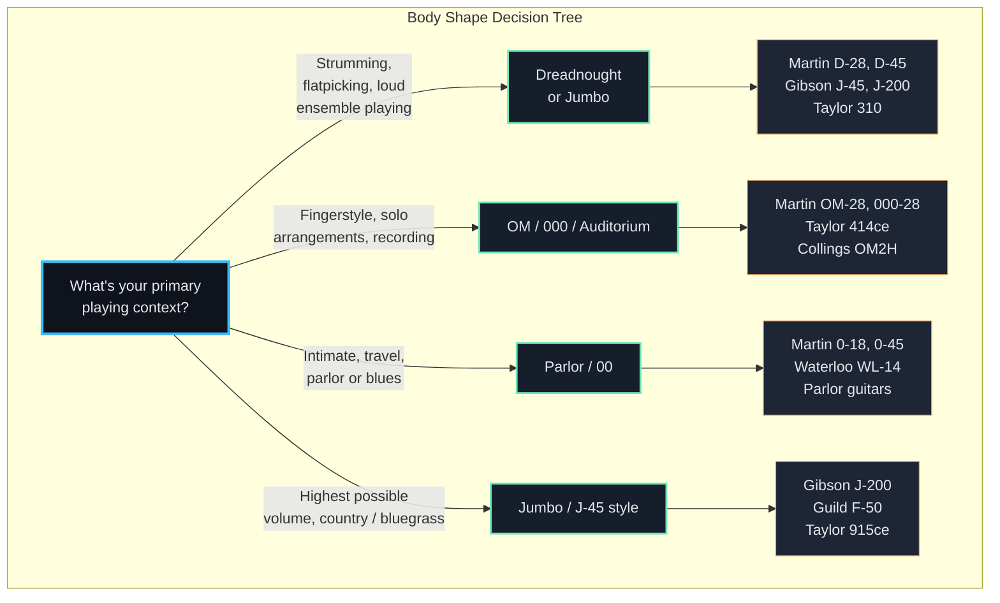
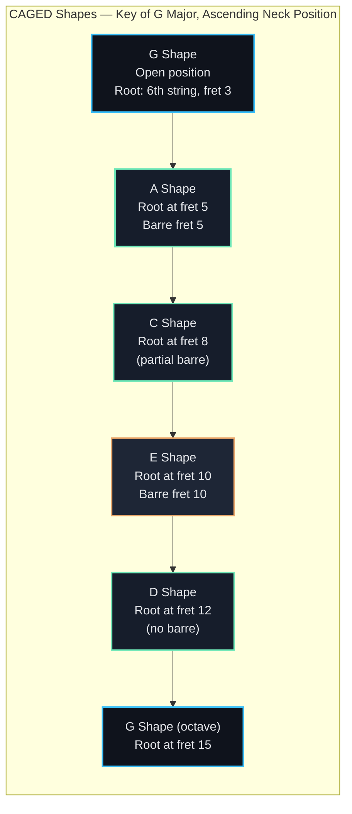
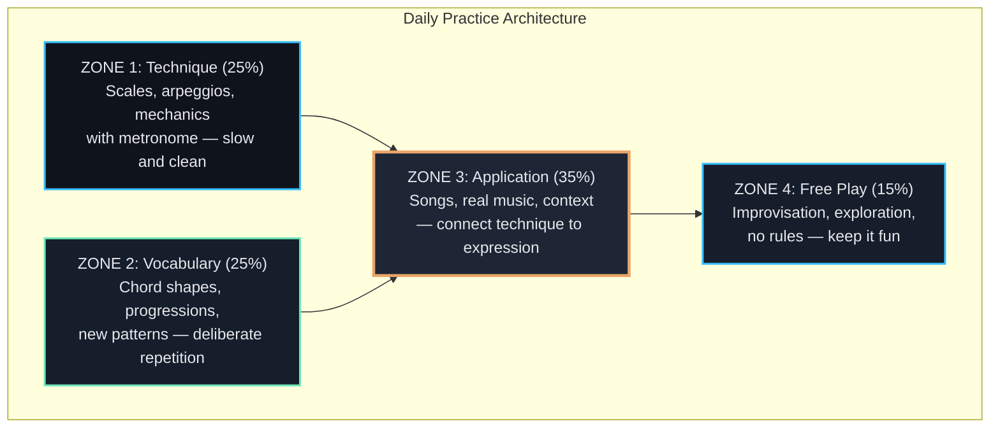
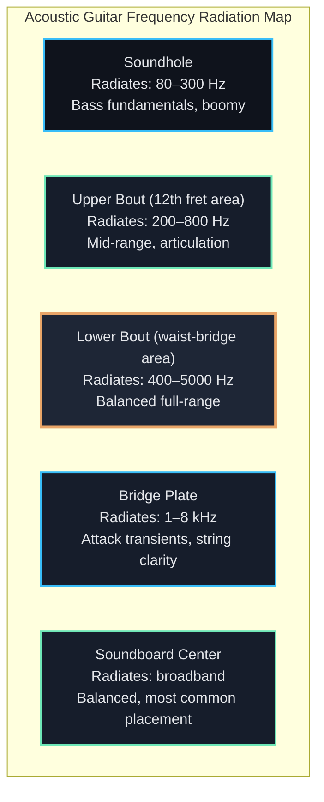

# Acoustic Guitar Mastery: Foundations of Tone, Technique, and Practice

---

## Table of Contents

1. [How an Acoustic Guitar Actually Makes Sound](#1-how-an-acoustic-guitar-actually-makes-sound)
2. [Body Shapes, Scale Lengths, and What They Mean for Your Playing](#2-body-shapes-scale-lengths-and-what-they-mean-for-your-playing)
3. [Fretboard Geometry and the CAGED System](#3-fretboard-geometry-and-the-caged-system)
4. [Right-Hand Mechanics: Picking, Strumming, and Fingerstyle](#4-right-hand-mechanics-picking-strumming-and-fingerstyle)
5. [Left-Hand Mechanics: Fretting, Barre Chords, and Shifting](#5-left-hand-mechanics-fretting-barre-chords-and-shifting)
6. [Open Chord Vocabulary and Voicing Logic](#6-open-chord-vocabulary-and-voicing-logic)
7. [Movable Chord Shapes: CAGED in Action](#7-movable-chord-shapes-caged-in-action)
8. [Travis Picking and Fingerstyle Independence](#8-travis-picking-and-fingerstyle-independence)
9. [Open Tunings and Slide Guitar Fundamentals](#9-open-tunings-and-slide-guitar-fundamentals)
10. [Practice Architecture: Building a Daily Routine](#10-practice-architecture-building-a-daily-routine)
11. [Tone Control: Setup, Strings, and Recording Basics](#11-tone-control-setup-strings-and-recording-basics)
12. [Acoustic Signal Chain and Microphone Placement](#12-acoustic-signal-chain-and-microphone-placement)
13. [Troubleshooting Clinic: Fixing the Problems You'll Actually Have](#13-troubleshooting-clinic-fixing-the-problems-youll-actually-have)

---

## 1. How an Acoustic Guitar Actually Makes Sound

### The Core Problem: Impedance Matching

A vibrating string barely moves the air around it — its cross-section is too thin to push meaningful air volume. The guitar's job is **impedance matching**: coupling the string's high-velocity, low-displacement vibration to a large-area radiator (the soundboard) that can move real air mass.

```mermaid
graph LR
    subgraph sub_excitation ["String Excitation"]
        A["Pick / Finger<br/>releases string"]
        B["String vibrates at<br/>fundamental + harmonics"]
        A --> B
    end

    subgraph sub_coupling ["Mechanical Coupling"]
        C["Saddle transmits<br/>transverse force"]
        D["Bridge plate<br/>distributes load"]
        E["Soundboard flexes<br/>as driven oscillator"]
        B --> C --> D --> E
    end

    subgraph sub_radiation ["Acoustic Radiation"]
        F["Soundboard pumps air<br/>(top-plate modes)"]
        G["Body cavity resonates<br/>(Helmholtz + air modes)"]
        H["Soundhole radiates<br/>low-frequency energy"]
        I["Audible Sound Wave"]
        E --> F --> I
        E <--> G
        G --> H --> I
    end

    style A fill:#0F131C,stroke:#38BDF8,stroke-width:2px,color:#E5E7EB
    style B fill:#0F131C,stroke:#38BDF8,stroke-width:2px,color:#E5E7EB
    style C fill:#161D2B,stroke:#6EE7B7,stroke-width:2px,color:#E5E7EB
    style D fill:#161D2B,stroke:#6EE7B7,stroke-width:2px,color:#E5E7EB
    style E fill:#1E2636,stroke:#38BDF8,stroke-width:3px,color:#E5E7EB
    style F fill:#1E2636,stroke:#E9A568,stroke-width:2px,color:#E5E7EB
    style G fill:#161D2B,stroke:#38BDF8,stroke-width:2px,color:#E5E7EB
    style H fill:#161D2B,stroke:#6EE7B7,stroke-width:2px,color:#E5E7EB
    style I fill:#0F131C,stroke:#E9A568,stroke-width:3px,color:#E5E7EB
```



### What This Means for Your Playing

- **Attack position (right hand)**: Plucking near the bridge excites more high harmonics (thin, nasal, "sitar-like" at extreme). Plucking over the soundhole, roughly 5–8 cm from the bridge, gives the fullest balance of fundamental and overtones — this is the default "good tone" zone. Moving toward the neck (over the 19th-20th fret region on a dreadnought) softens attack further and favors low harmonics — the classical "ponticello/tasto" spectrum in miniature.
- **Nail vs. flesh tone**: Nails create a faster, harder transient — broadband, bright. Flesh gives a slower transient — fewer high harmonics, warmer. Most fingerstyle players blend both: nail leading edge, flesh follow-through, angling the fingertip roughly 20-30° off vertical so nail contacts the string microseconds before flesh.
- **Palm muting**: Resting the edge of the picking-hand palm directly on the strings just in front of the bridge saddle damps the string's displacement at its highest-energy end, killing sustain and fundamental output fast. Move the palm forward (away from bridge) for a looser, more "chunky" mute; right at the saddle for the tightest staccato.
- **String gauge and feel**: Heavier strings (.013–.056) carry more tension, drive the saddle harder, and produce more volume and low-end — at the cost of more left-hand force needed to fret cleanly. Lighter strings (.011–.052) ease fretting but give up dynamic range at a strong strum.

### The Three Resonances You Can Feel

| Resonance | Approximate Frequency | Practical Effect |
|---|---|---|
| Helmholtz (air cavity + soundhole) | 95–105 Hz | Boosts open low E and A string fundamentals |
| Top-plate fundamental mode | 180–250 Hz | Strengthens notes around A2–B3 |
| Air-cavity standing wave | 300–450 Hz | Colors mid-range clarity |

**Try this now**: hold the guitar against your chest and hum different pitches with your mouth close to the soundhole. At one pitch the top will buzz against your sternum — that's the Helmholtz mode talking back. Most steel-strings land near G2-A2 (about 98-110 Hz). Chords and bass notes that land on this pitch will always feel like they "bloom" more under your hand — useful to know when choosing a key for a song you're arranging for solo guitar.

---

## 2. Body Shapes, Scale Lengths, and What They Mean for Your Playing

### Body Shape Comparison

Body shape is a **playing-style decision**, not just a cosmetic one.



### Body Shape Quick Reference

| Shape | Waist Width | Tonal Character | Best For |
|---|---|---|---|
| Dreadnought | Wide | Powerful bass, high volume | Strumming, flatpicking, bluegrass |
| Jumbo | Very wide | Max bass + treble, scooped mid | Country, singer-songwriter |
| OM / Auditorium | Medium | Balanced, articulate | Fingerstyle, recording, all-around |
| 000 / Concert | Medium-narrow | Mid-focused, responsive | Blues, ragtime, studio |
| Parlor / 00 | Narrow | Mid-rich, dry | Intimate, travel, blues |

**Sitting-down test that actually matters**: hold each body shape across your lap, right arm draped over the lower bout to reach the strings. A dreadnought's wide waist pushes your strumming hand forward and up, favoring broad down-up strokes. A parlor or 000 lets your forearm settle closer to the body, which is why fingerstyle players gravitate to smaller bodies — your plucking fingers land more naturally over the sweet spot without reaching.

### Scale Length: The Feel Under Your Left Hand

Scale length is the vibrating string length, nut to saddle. It changes three things you feel immediately:

- **String tension** at pitch — longer scale, same gauge, more tension, stiffer feel.
- **Fret spacing** — longer scale, wider gaps between frets, more hand stretch.
- **Barre chord effort** — more tension means more fingertip force needed for a clean barre.

| Scale Length | Example Guitars | Feel | Tone Character |
|---|---|---|---|
| 24.75" (628 mm) | Gibson J-45, L-00 | Slinky, low tension | Warm, compressed, mid-forward |
| 25.0" (635 mm) | Many Taylors, Collings | Medium | Balanced |
| 25.4" (645 mm) | Martin 000, OM | Slightly firm | Clear, balanced |
| 25.5" (648 mm) | Martin D-28, most dreadnoughts | Firm, responsive | Bright, open, strong fundamental |

**Practical move**: if you're coming from electric and barre chords feel like a wall, borrow or try a 24.75" scale guitar before you drop to lighter strings. The tension drop from scale length alone can be the difference between a clean F barre and a buzzing one — and it doesn't cost you any top-end punch the way ultra-light strings do.

---

## 3. Fretboard Geometry and the CAGED System

### The 6-String Standard Tuning Map

```
String:  6     5     4     3     2     1
Open:    E2    A2    D3    G3    B3    E4

Fret 2:  F#2   B2    E3    A3    C#4   F#4
Fret 3:  G2    C3    F3    A#3   D4    G4
Fret 5:  A2    D3    G3    C4    E4    A4   ← Open chord shapes repeat here
Fret 7:  B2    E3    A3    D4    F#4   B4
Fret 12: E3    A3    D4    G4    B4    E5   ← Exact octave of open strings
```

**Key insight**: fret 5 of any string equals the open pitch of the next string up, *except* string 3 to string 2, where it's fret 4. This single irregularity (the major-third interval between G and B instead of a perfect fourth) is why chord shapes aren't mirror images of each other across string pairs, and why the D-shape and G-shape in CAGED look "lopsided" compared to A and E.

### The CAGED System: One System to Rule the Neck

CAGED maps five open chord shapes (C, A, G, E, D) across the whole neck as movable forms. Moving each shape so its root lands on the right fret produces the same chord at a new pitch, and the five shapes tile the entire fretboard with no gaps.



### CAGED Shape Chord Diagrams (Key of C Major)

**C Shape — open position**
```
   x  3  2  0  1  0
   |  |  |  |  |  |
   ○  |  |  ○  |  ○   ← Nut
1: |  |  |  |  |  |
2: |  |  ②  |  ①  |
3: |  ③  |  |  |  |
```

**A Shape — C chord at fret 3 (barre)**
```
   x  3  3  3  3  x
   |  |  |  |  |  |
3: ①①①①           ← Barre fret 3 with index
4: |  |  ③  ②  |  |
5: |  ④  |  |  |  |
```

**G Shape — C chord at fret 8**
```
   8  10 10 9  8  8
   |  |  |  |  |  |
8: ①  |  |  |  ①  ①  ← Index covers 1st, 5th, 6th strings
9: |  |  |  ②  |  |
10:|  ④  ③  |  |  |
```

**D Shape — C chord at fret 10**
```
   x  x  10 12 13 12
   |  |  |  |  |  |
10:|  |  ①  |  |  |
12:|  |  |  ②  |  ④
13:|  |  |  |  ③  |
```

**E Shape — C chord at fret 8 (full barre, highest string)**

The E-shape version of C sits with the barre at fret 8, using the open-E chord fingering transposed. You'll use this far less than E-shape barres for other keys because it's high on the neck — but it closes the CAGED loop and confirms that all five shapes land correctly between fret 0 and fret 12.

### Fretboard Note Names: Essential Anchor Points

Learn strings 6 and 5 first — they carry the roots of E-shape and A-shape barre chords, your two most-used movable forms.

**String 6 (low E):**
```
Fret: 0   1   2   3   4   5   6   7   8   9   10  11  12
Note: E   F   F#  G   G#  A   A#  B   C   C#  D   D#  E
```

**String 5 (A):**
```
Fret: 0   1   2   3   4   5   6   7   8   9   10  11  12
Note: A   A#  B   C   C#  D   D#  E   F   F#  G   G#  A
```

**Drill**: Have a friend or app call a random note name. Find it on string 6, then string 5, within 3 seconds each. Do this for 5 minutes a day for two weeks — it's the single highest-leverage memorization task in early guitar study, because every barre chord, every CAGED shape, and every scale position depends on instant root-finding on these two strings.

---

## 4. Right-Hand Mechanics: Picking, Strumming, and Fingerstyle

### 4.1 Right-Hand Posture

**Seated position (classical)**:
- Guitar waist rests on left thigh, body tilted toward the player (often with a footstool raising the left foot).
- Right forearm rests on the lower bout; the hand arrives at string level naturally, no reaching.
- Wrist arches slightly away from the soundboard so fingers attack at a consistent angle.

**Seated position (folk/casual)**:
- Guitar waist rests on the right thigh, body more vertical.
- Right forearm drapes over the upper bout, wrist over the soundhole area.
- Fine for strumming; less ideal for demanding fingerstyle because the hand sits further from the ideal plucking zone.

**Wrist mechanics**: the wrist drives strumming. For big, loud strums, let the forearm add a small rotation (pronation on the downstroke, supination on the up). For fast eighth-note strumming, isolate the motion to the wrist only — a locked wrist with an arm-driven strum will fatigue in under a minute and sound stiff. Keep the grip loose; tension in the hand kills dynamic range before it reaches the strings.

### 4.2 Pick Mechanics

**Pick angle (slant)**: hold the pick tip at roughly 30-45° to the string plane, not flat (0°, tip perpendicular to the string). A slight downward slant — tip angled toward the floor — lets the pick glance off the string instead of catching it square-on, which both smooths the tone and speeds up alternate picking because the pick needs less travel to clear the string.

**Pick grip**: pinch the pick between the pad of the index finger and the side of the thumb. Expose only 3-5 mm of tip. More exposed pick means more flex, which softens attack and makes fast runs feel mushy.

**Pick thickness for acoustic**:
- Thin (0.5-0.7 mm): good for strumming; too floppy for clean flatpicked runs.
- Medium (0.73-0.88 mm): versatile, the default choice for most players.
- Heavy (1.0-1.5 mm): bluegrass flatpicking, crosspicking, Django-style rest-stroke runs — the rigidity transfers more energy into the string per stroke.

### 4.3 Strumming Patterns

Every strumming pattern comes from one physical motion: a **continuous pendulum swing**, downstrokes on the beat, upstrokes on the off-beat. Never stop the arm. Decide only which strings you contact on each pass.

**Pattern 1 — Quarter-note strum (60–90 BPM)**
```
Beat:   1    2    3    4
Strum:  ↓    ↓    ↓    ↓
```

**Pattern 2 — Eighth-note down-up (70–100 BPM)**
```
Beat:   1  +  2  +  3  +  4  +
Strum:  ↓  ↑  ↓  ↑  ↓  ↑  ↓  ↑
```

**Pattern 3 — Folk/pop "missing" downstroke (80–110 BPM)**
```
Beat:   1  +  2  +  3  +  4  +
Strum:  ↓  ↑  ↓     ↓  ↑  ↓  ↑
```
Miss the downstroke on beat 3 but keep the arm's motion going through that gap — the "ghost" swing is what creates the groove. Stopping the arm there is the most common beginner mistake with this pattern.

**Pattern 4 — Reggae/skank, upstroke only (80–100 BPM)**
```
Beat:   1  +  2  +  3  +  4  +
Strum:     ↑     ↑     ↑     ↑
```

**Drill**: Metronome at 60 BPM. Play Pattern 2 on an open G chord for 2 minutes without stopping — no chord changes. When every stroke is even in volume and timing, move to 80 BPM. Only then add chord changes (G → C → G → D), one change per 4 beats.

### 4.4 Fingerpicking Fundamentals

**Finger assignment (p-i-m-a, from Spanish pulgar, índice, medio, anular)**:
- **p** (thumb): strings 6, 5, 4 (the bass strings)
- **i** (index): string 3
- **m** (middle): string 2
- **a** (ring): string 1

The thumb runs independently of the fingers, alternating bass strings on the beat. Fingers pluck melody and harmony either together (block chord) or in a rolling sequence (arpeggio).

**Hand position**: wrist arched 3-4 cm off the soundboard. Fingers curved, attacking with a slight pull toward the palm rather than straight up — this is what gives fingerstyle its characteristic warmth instead of a thin "flick" sound. Nail-to-flesh ratio sets brightness: more nail contact brightens the tone, more flesh warms it.

**Foundation drill — alternating thumb, strings 6 and 5**:
```
Beat:  1    2    3    4
Thumb: 6    5    6    5
```
Play this over an open G chord with thumb only, no fingers yet. Metronome at 60 BPM until it's perfectly even in volume and timing between the two strings — this unglamorous drill is the entire backbone of Travis picking in Section 8.

---

## 5. Left-Hand Mechanics: Fretting, Barre Chords, and Shifting

### 5.1 Left-Hand Posture

This is the single most injury-prone area of guitar technique. Fix posture before chasing speed.

**Thumb position**: rests on the back of the neck, roughly opposite the middle finger, pointing up toward the headstock or straight at the ceiling. The thumb should not hook over the top of the neck as a default — hooking locks the wrist, shortens finger reach, and is a direct path to tendon strain over months of practice.

*Exception*: thumb-over technique (Hendrix-style) is a legitimate, deliberate choice for muting the low E string with the thumb tip while fretting a bass note with it — use it as a specific tool, not a resting habit.

**Wrist angle**: swing the wrist slightly forward, away from the neck, so the palm curves. This brings the fingers in roughly perpendicular to the strings instead of at an angle, which reduces buzz and makes each gram of fingertip pressure count.

**Finger curvature**: press with the very tip of the finger, not the pad. Curved fingers avoid muting the adjacent string. If the note on string 2 dies when you fret string 3, your finger is lying across string 2 — curl tighter from the base knuckle.

**Pressure**: press only as hard as needed for a clean note. Most beginners use three to five times the necessary force. Test it: fret a note, strum, then slowly reduce pressure until it buzzes. Clean threshold sits about 20% above that buzz point — that's your target pressure, not maximum squeeze.

### 5.2 Fretting Accuracy: The 3-Zone Rule

```
|--- Fret wire ---|--- Dead zone ---|--- Optimal zone ---|--- Buzz zone ---|--- Next fret wire ---|
   (buzzes here)                      (press here, just      (too far back,
                                       behind fret wire)      inconsistent)
```

Press just behind the fret wire, toward the nut — not on top of the wire, not halfway to the next fret. The closer to the wire, the less force needed for a clean, ringing note.

### 5.3 Barre Chords: The Mechanics

Barre chords stall most beginners. The problem is almost always technique, not hand strength.

**Index finger placement**:
1. Roll the index finger slightly toward the nut side — toward the bonier, flatter edge, not the soft pad. This gives even contact across all six strings with less total force.
2. Angle the finger very slightly diagonal: the headstock-side end of the index sits marginally closer to the nut than the body-side end.
3. The finger's joint creases naturally fall over certain string gaps. If one string buzzes, slide the finger 1-2 mm up or down the fret so a crease isn't sitting directly on that string.

**Thumb counterforce**: the neck is pinched between the index fingertip and the thumb behind it. The squeeze should come from that pinch, not from pushing the whole arm or shoulder into the neck. A tense shoulder is the most common hidden cause of a weak barre.

**Common barre chord failures and fixes**:

| Problem | Cause | Fix |
|---|---|---|
| Muted string 1 or 2 | Finger crease falls on that string | Shift finger 1–2 mm toward nut or body |
| Muted bass strings | Pad pressure instead of edge pressure | Roll finger to its bonier side |
| Wrist pain | Shoulder tension passing through the arm | Relax shoulder; check thumb isn't hooking over |
| Buzzing on fretted notes | Supporting fingers not arched enough | Curl fingers more; check each note individually |

**Recommended F Major fingering** (most players find this easiest):
```
Fret:  1     2     3
  6:   ① barre
  5:   ① barre
  4:   ①     ④
  3:   ①           ②
  2:   ①
  1:   ① barre
```
- Index: full barre, fret 1
- Middle: string 3, fret 2
- Ring: string 5, fret 3
- Pinky: string 4, fret 3

Fret 1 is the hardest barre position on the neck because the frets are widest here and string tension is highest near the nut. If F at fret 1 feels impossible, practice barre technique at fret 5 or 7 first, where the frets are narrower and tension is lower, then work back down the neck.

**Drill — Barre Chord Conditioning (10 minutes daily)**:
1. Place the E-shape barre at fret 5 (A major). Strum once per string, slowly, confirming every string rings clean.
2. Release the hand completely off the neck. Reapply from scratch. Check again.
3. Metronome 60 BPM: place the barre exactly on beat 1, strum beats 2-4, release on beat 4's last eighth. Move to fret 7, repeat.
4. Shrink the placement window: 2 beats to get the barre down, then 1 beat.

### 5.4 Position Shifting

**Rule**: lead a shift with the finger closest to the destination, not by lifting the whole hand at once. Descending, the lowest-numbered finger (usually pinky or ring) peels off the fretboard first; ascending, the highest-numbered finger leads.

**Guide finger technique**: when shifting between positions, keep one finger lightly touching a string through the move — it's not pressing, just riding along for tactile feedback on distance traveled. This single habit does more to eliminate "missed landing" shifts than any amount of slow practice without it.

---

## 6. Open Chord Vocabulary and Voicing Logic

### Core Open Chords

**G Major**:
```
   3  2  0  0  0  3
   |  |  |  |  |  |
2: |  ②  |  |  |  |
3: ①  |  |  |  |  |
4: |  |  |  |  |  ④

Fingers: ①=index (string 6, fret 3), ②=middle (string 5, fret 2),
         ④=ring (string 1, fret 3)
         (leaves pinky free — common add: pinky on string 1 fret 3 instead,
          freeing ring for a quick hammer-on to add a melodic touch)
```

**C Major**:
```
   x  3  2  0  1  0
2: |  |  |  |  ①  |
3: |  |  ②  |  |  |
4: |  ③  |  |  |  |
```

**D Major**:
```
   x  x  0  2  3  2
2: |  |  |  ①  |  ①   ← index covers strings 1 and 3, fret 2 (mini-barre)
3: |  |  |  |  ③  |
```

**E Major**:
```
   0  2  2  1  0  0
1: |  |  |  ①  |  |
2: |  ③  ②  |  |  |
```

**A Major**:
```
   x  0  2  2  2  0
Three-finger option:
2: |  |  ②  ③  ④  |
Barred option (frees ring+pinky for licks):
2: |  |  ③③③  |
```

**E Minor**:
```
   0  2  2  0  0  0
2: |  ②  ③  |  |  |
```

**A Minor**:
```
   x  0  2  2  1  0
1: |  |  |  |  ①  |
2: |  |  ③  ②  |  |
```

**D Minor**:
```
   x  x  0  2  3  1
1: |  |  |  |  |  ①
2: |  |  |  ②  |  |
3: |  |  |  |  ③  |
```

### Open Chord Progressions to Learn Immediately

These four-chord patterns cover roughly 80% of folk, country, pop, and rock acoustic repertoire. Learn the shapes, then drill the *transitions* — that's where real time should go, not re-learning shapes in isolation.

| Progression | Key | Chords |
|---|---|---|
| I–V–vi–IV | G major | G – D – Em – C |
| I–IV–V | A major | A – D – E |
| I–vi–IV–V | C major | C – Am – F – G |
| I–V–IV | G major | G – D – C |
| ii–V–I | D major | Em – A – D |
| vi–IV–I–V | A minor | Am – F – C – G |

**Transition drill**: metronome at 60 BPM, 4 beats per chord, loop G → Em (one finger changes — index stays on string 6, fret 3 in Em analog, practice the minimal-motion path between shapes before speeding up).

---

## 7. Movable Chord Shapes: CAGED in Action

### E-Shape Barre Chords (Root on String 6)

The E-shape is your most-used movable form. Root lives on string 6. Barre the fret where your target note sits on string 6, then layer ring and middle two frets up on strings 5 and 4.

| Barre Fret | Major Chord | Minor Chord (drop the middle finger) |
|---|---|---|
| 1 | F | Fm |
| 3 | G | Gm |
| 5 | A | Am |
| 7 | B | Bm |
| 8 | C | Cm |
| 10 | D | Dm |
| 12 | E | Em (= open Em, octave up) |

**Major fingering**: index barre; ring on string 5, same fret +2; middle on string 4, same fret +2.
**Minor fingering**: index barre; ring and pinky on strings 5 and 4 at +2, middle finger lifted out entirely — removing the major third is what makes it minor.

### A-Shape Barre Chords (Root on String 5)

Harder than E-shape because the full barre must also clear or mute string 1.

| Barre Fret | Major Chord | Minor Chord |
|---|---|---|
| 2 | B | Bm |
| 3 | C | Cm |
| 5 | D | Dm |
| 7 | E | Em |
| 8 | F | Fm |
| 10 | G | Gm |
| 12 | A | Am |

**Practical fingering that beginners can actually play**: index barres strings 1-5 (mute or lightly deaden string 1 with the fingertip's edge), ring finger flat-bars strings 2-3-4 two frets up. This trades a hard full 6-string barre for an easier partial one, at the cost of not including the low root on string 6 — acceptable for most rhythm playing since the bass note still sounds from string 5.

### Power Chords (Root 5 or Root 6)

Power chords — root plus 5th, no 3rd — give a full, clean punch that works surprisingly well on acoustic for rock-leaning rhythm parts.

```
Root on string 6 (e.g. G5 at fret 3):
   3  5  5  x  x  x
   ①  |  |
   |  ③  ④
   index on root, ring+pinky two frets up on strings 5 and 4

Root on string 5 (e.g. D5 at fret 5):
   same 2-fret shape, moved to strings 5 and 4
```

### Sus and Add Chords: Instant Color

**Dsus2** — remove the fretted note on string 1, let it ring open (E, the major 2nd of D):
```
   x  x  0  2  3  0
```

**Gsus4** — replace B on string 2 with C at fret 1:
```
   3  3  0  0  1  3
```

**Cadd9** — move string 2 from fret 1 to fret 3 (D, the 9th of C), string 1 stays open (E):
```
   x  3  2  0  3  0
```

These substitutions need only one finger movement from the parent open chord — practice swapping Dsus2 ↔ D and Cadd9 ↔ C mid-strum until the switch is instant; this is how acoustic rhythm players add color without learning new vocabulary.

---

## 8. Travis Picking and Fingerstyle Independence

Travis picking is the backbone of American acoustic fingerstyle — country, folk, blues. The thumb runs an alternating bass pattern on autopilot while the fingers independently play melody and harmony on top. The goal word is **independence**: thumb and fingers must stop needing to think about each other.

### Phase 1: Establish the Thumb Pattern (Week 1)

**Chord: G major open position. Thumb alternates strings 6 and 4.**

```
Beat:   1     2     3     4
String: 6     4     6     4
Thumb:  p     p     p     p
```
Metronome 50 BPM, 10 minutes, no stopping. Move to the 6-5 alternation for A and C shapes once G is solid. The thumb pattern must be fully automatic — you should be able to hold a conversation while it runs — before adding fingers.

### Phase 2: Add the Simultaneous Pinch on Beat 1

```
Beat:    1        2     3        4
String:  6+1      4     6+1      4
Hand:    p+a      p     p+a      p
```
Thumb and ring finger (a) strike together on beats 1 and 3. Metronome 50-60 BPM.

### Phase 3: Full Travis Pattern

```
Beat:   1     +     2     +     3     +     4     +
String: 6     3     4     2     6     3     4     1
Hand:   p     i     p     m     p     i     p     a
```
The thumb never stops. The fingers fill the off-beat eighth-note subdivisions. Metronome ramp: 50 → 70 → 90 BPM, only advancing once the previous speed is completely even.

### Phase 4: Move Through a Chord Progression

Apply the Phase 3 pattern to **G (8 beats) → C (8 beats) → G (8 beats) → D (8 beats)**. The thumb's string pair changes with the chord:
- G: strings 6-4
- C: strings 5-4
- D: strings 4-5 (some arrangers use 4-3 for D — either is standard)

**Metronome targets**:
- Week 1: 50-60 BPM, single chord only
- Week 2: 60-70 BPM, full progression
- Week 3: 70-85 BPM, start substituting melody notes on the "+"s
- Week 4+: 85-100 BPM, improvise freely within the pattern

### Phase 5: Melodic Travis Picking

Once the pattern runs on its own, substitute target notes from the chord's scale on the upbeats instead of always hitting the same open string.

```
G major melodic variation:
Beat:   1     +     2     +     3     +     4     +
String: 6     3fr2  4     2     6     3fr4  4     1
Note:   G     C     D     B     G     D     D     E
```
This is the vocabulary of Chet Atkins, Merle Travis, and the fingerstyle side of John Denver's playing — the thumb keeps a steady train going while the melody walks over it.

### Fingerstyle Arpeggio Pattern: p-i-m-a-m-i

```
4/4 time:
Beat:   1     +     2     +     3     +     4     +
String: 5     3     2     1     2     1     2     3
Hand:   p     i     m     a     m     a     m     i
```
Run this over Am, then over a full I-vi-IV-V progression (C-Am-F-G) once clean. Metronome 50 → 60 → 75 BPM. This classical-derived pattern is the standard vehicle for solo ballad arrangements.

---

## 9. Open Tunings and Slide Guitar Fundamentals

### Why Open Tunings?

Retuning so all six open strings form a chord gives three advantages: full chords playable with one finger or a slide bar, extra ringing resonance from open strings against fretted notes, and melodic, practical slide technique.

### Open G Tuning: D-G-D-G-B-D (low to high)

From standard EADGBE:
- String 6: E → D (down 2 semitones)
- String 5: A → G (down 2 semitones)
- Strings 4, 3, 2: unchanged (D, G, B)
- String 1: E → D (down 2 semitones)

**Check**: strum all six strings open — you should hear a clean G major chord. If it sounds off, retune string by string against a reference pitch before troubleshooting anything else.

**Key chord positions in Open G**:
```
Chord:    G      C      D      G (octave)
Position: open   5      7      12
Barre:    none   5th    7th    12th

G7: add pinky, string 1, fret 1
Gm: barre fret 3; flatten string 2 by one fret (fret 3 = Bb)
```

**The Keith Richards 5-string trick**: remove or mute the low D string (string 6) entirely. "Honky Tonk Women," "Brown Sugar," and "Start Me Up" use exactly this — five strings, root-less voicings built on open-G tuning, letting the bass player supply the root.

### Open D Tuning: D-A-D-F#-A-D

From standard EADGBE:
- String 6: E → D (down 2)
- String 5: unchanged (A)
- String 4: unchanged (D)
- String 3: G → F# (down 1 semitone)
- String 2: B → A (down 2)
- String 1: E → D (down 2)

**Check**: all six strings open should ring a clean D major chord.

Open D is the classic blues and folk fingerstyle tuning used by Robert Johnson, Son House, and in many Joni Mitchell arrangements.

**Key positions in Open D**:
```
Chord:    D      G      A      D (octave)
Position: open   5      7      12

D7: partial barre at fret 4 — string 2, fret 4 = C (the b7 of D)
Dsus4: fret string 3 at fret 5 (G) while the rest ring open
```

### Slide Technique Fundamentals

The slide sits directly over the fret wire, not behind it — the opposite of normal fretting. It hovers; it does not press the string down to the fretboard.

**Slide placement**:
- Wear the slide on the ring finger (most common) or pinky, leaving other fingers free to fret or mute.
- Rest the trailing fingers lightly on the strings behind the slide — essential for damping unwanted string noise and sympathetic buzz.
- Keep the slide perfectly parallel to the fret wire; any tilt causes pitch smearing across the strings.

**Common slide positions in Open G**:
```
Fret:   0     3     5     7     10    12
Chord:  G     Bb    C     D     F     G (octave)
Degree: Root  b3    4th   5th   b7    Octave
```

**Slide drill — basic blues box in Open G**:
```
Strings 1-2-3 together, slide through frets 0 → 3 → 5 → 3 → 0
Metronome 60 BPM, quarter notes per fret position
Add vibrato once landed on fret 5: rock the slide ±1-2 mm around the fret wire
```

**Vibrato with slide**: oscillate ±2-3 mm around the target fret. Slow, wide oscillation (quarter-note rate) reads as expressive blues phrasing; fast, narrow oscillation (eighth-note rate, ±1 mm) works better for sustaining a note without obvious pitch wobble. Always damp the strings behind the slide with your trailing fingers, or the open-tuned unfretted strings will ring and clash with the slide note.

---

## 10. Practice Architecture: Building a Daily Routine

### The Four Practice Zones



### 30-Minute Beginner Session

| Time | Activity | Metronome |
|---|---|---|
| 0–5 min | Chromatic warm-up: 1-2-3-4 on each string, moving up the neck | 60 BPM |
| 5–10 min | Chord transitions: 2 chords, 4 beats each, loop | 60–80 BPM |
| 10–18 min | Current song, full run-through | Song tempo |
| 18–25 min | New technique (Travis picking, barre chords, etc.) | 50–60 BPM |
| 25–30 min | Free play, no metronome | — |

### 60-Minute Intermediate Session

| Time | Activity | Metronome |
|---|---|---|
| 0–5 min | Major scale across all 5 CAGED positions | 70–90 BPM |
| 5–10 min | Arpeggio patterns (p-i-m-a and variations) | 60–80 BPM |
| 10–20 min | Travis picking — 4-chord progression, clean and even | 70–95 BPM |
| 20–35 min | Song work — the hardest 8-bar section, isolated | Performance tempo |
| 35–45 min | New song/material — learn chord shapes slowly | 50–60 BPM |
| 45–55 min | Ear training + improvisation in one key | — |
| 55–60 min | Sight-reading or new chord voicing exploration | — |

### Metronome Protocols

**The 3-Speed Rule**: practice any new technique or passage at three speeds.
1. **Slow (50-60% of target)**: zero errors, perfect mechanics.
2. **Medium (75-80% of target)**: comfortable and controlled.
3. **Fast (target tempo)**: only once the two slower speeds are consistently clean.

Never raise tempo until the slower speed is completely clean — practicing sloppy at speed just rehearses the mistake at speed.

**Subdivision shifts**: once a pattern is comfortable in eighth notes, run the same material in triplets, then sixteenths. This builds rhythmic flexibility without changing the underlying hand motion at all.

### Hand Health and Injury Prevention

- Warm up before demanding technique work: 5 minutes of gentle wrist circles and slow chromatic 1-2-3-4 exercises.
- Stop at the first sign of sharp or burning pain. Dull fatigue is normal; sharp pain is an injury signal — never play through it.
- Cap continuous technique practice at 25-30 minutes before a 10-minute break. For beginners, 45-60 minutes of total daily technique work is plenty.
- Tendonitis prevention: keep the fretting wrist straight during barre chords; rotate the shoulder slightly forward rather than bending the wrist further to compensate.

---

## 11. Tone Control: Setup, Strings, and Recording Basics

### Guitar Setup: The Three Adjustments That Matter Most

**1. String Action (saddle height)** — measured at the 12th fret, gap between string bottom and fret top:
- Low E: 2.0-2.5 mm (fingerstyle) / 2.5-3.0 mm (strumming)
- High E: 1.5-2.0 mm (fingerstyle) / 2.0-2.5 mm (strumming)

Higher action gives more volume and sustain but takes more force to fret; lower action is easier to play but more prone to buzz.

**2. Neck Relief (truss rod)** — with strings at pitch, capo fret 1, fret the low E at fret 14, measure the gap at frets 7-8:
- Target: 0.2-0.4 mm, about a business card's thickness.
- More relief eases soft playing but risks buzz under hard strumming; less relief allows lower action but risks choking on string bends.

**3. Nut Slot Depth** — capo at fret 2, play strings 1 and 6, confirm they ring clean. Remove the capo and play the same strings open; if they now buzz or feel stiff compared to fretted, the nut slots are cut too high. This is the most common cause of poor feel in the first three frets specifically, as opposed to action problems which affect the whole neck evenly.

If any of this feels out of your depth, a full setup from a luthier typically runs $50-80 and can transform how a guitar feels under your hands.

### String Gauge Guide

| Gauge | Designation | Sound | Best For |
|---|---|---|---|
| .010–.047 | Extra Light | Bright, easy | Beginners, small bodies, hand sensitivity |
| .011–.052 | Light | Balanced | All-around fingerstyle, recording |
| .012–.053 | Medium-Light | Full, responsive | Fingerstyle + strumming, dreadnoughts |
| .013–.056 | Medium | Powerful, loud | Flatpicking, bluegrass, strong players |

**String material**:
- 80/20 Bronze: bright, crisp attack, ages faster. Good for tracking.
- Phosphor Bronze: warmer, longer-lasting, the most common acoustic string choice.
- Coated (Elixir, D'Addario XT): last 3-5x longer, slightly less initial brightness. Worth it if you don't change strings often.

**When to change strings**: brightness fades, strings feel rough under the fingers, or the 12th-fret harmonic stops matching the fretted 12th note (a sign the string's mass is no longer consistent along its length). For a regular player: every 1-3 months.

### Bracing Pattern and Tone Character Quick Reference

| Bracing | Tone Character | Best Guitar Types |
|---|---|---|
| X-Brace (standard) | Balanced, strong bass, clear highs | Steel-string, dreadnought, all-around |
| Scalloped X-Brace | More resonant, faster response | Fingerstyle, vintage-style guitars |
| Fan Brace | Warm, complex, mid-rich | Classical, nylon-string guitars |
| V-Class (Taylor) | Even sustain, improved intonation | Modern Taylor steel-string |
| Ladder Brace | Fundamental-rich, compressed | Historical reproductions, some resonators |

---

## 12. Acoustic Signal Chain and Microphone Placement

### Understanding the Acoustic Guitar's Frequency Map



### Single Microphone Placement Guide

**Position 1 — 12th Fret (most universally good)**
- Distance: 20-30 cm. Aimed at where the neck meets the body.
- Result: balanced fundamental and treble, natural sound.
- Good for: demos, singer-songwriter, most situations.

**Position 2 — Over the shoulder**
- Distance: 30-50 cm, over the player's shoulder, aimed at the upper bout.
- Result: warm, roomier, less attack.
- Good for: intimate recordings, minimizing pick noise.

**Position 3 — Bridge area, close**
- Distance: 15-20 cm, aimed at the saddle/bridge.
- Result: maximum attack detail, can turn harsh.
- Good for: bluegrass, flatpicking, aggressive presence.

**Avoid**: pointing a mic directly at the soundhole up close. The Helmholtz resonance dominates the capture and produces an unnatural, boomy low end that's hard to fix in the mix afterward.

### Two Microphone Stereo Techniques

**XY Stereo** (minimal phase issues, studio standard):
- Mic 1: 12th fret, 25 cm, angled 45° left.
- Mic 2: bridge area, 25 cm, angled 45° right.
- Capsules as close together as possible (coincident).
- Result: tight, mono-compatible stereo image.

**Spaced Pair** (more spacious, phase risk):
- Mic 1: 12th fret, 25 cm.
- Mic 2: lower bout/bridge, 35-40 cm, angled up.
- Check in mono: if the bass disappears, flip polarity on one mic.

### Pickup Systems (Live Performance)

| Pickup Type | Mechanism | Tone Character | Best For |
|---|---|---|---|
| Undersaddle Piezo | Crystal under the saddle | Bright, very feedback-resistant | Live, loud stages |
| Soundboard Transducer | Piezo disc on inner soundboard | More natural, sensitive to body movement | Quiet-to-medium stages |
| Active Magnetic | Coil in the soundhole | Electric-guitar-like warmth | Blues, acoustic-rock |
| Internal Microphone | Small mic inside the body | Most natural-sounding | Studio-level live settings |
| Hybrid System | Mic + piezo blended | Best of both | Premium live/recording rigs |

**Blending piezo + internal mic** (the professional live standard): set the piezo for feedback resistance and low-end punch, then blend in internal mic for natural air and attack. If feedback starts creeping in, roll the mic back first — the piezo keeps functioning at any stage volume.

### Essential EQ Moves for Acoustic Guitar

| Frequency | Problem | Fix |
|---|---|---|
| 100–200 Hz | Boomy, washy low end | High-pass at 80-100 Hz; notch the resonant peak |
| 300–500 Hz | Muddy, boxy sound | Small cut (-2 to -4 dB) at the offending frequency |
| 800 Hz–1.2 kHz | Nasal, honky tone | Slight cut, often fixes soundhole-proximity issues |
| 2–4 kHz | Pick attack and presence | Slight boost for definition and mix cut-through |
| 5–8 kHz | String clarity and air | Gentle shelf boost (2-3 dB) for sparkle |
| 10+ kHz | Air and shimmer | Subtle boost if mic and room quality allow |

**Start flat, subtract before adding.** Find the overcooked frequencies and cut them before reaching for a boost. A well-placed mic rarely needs heavy EQ — if you're fighting the EQ, move the mic first.

---

## 13. Troubleshooting Clinic: Fixing the Problems You'll Actually Have

| Symptom | Likely Cause | Fix |
|---|---|---|
| Open chord has one dead/muted string | Adjacent finger leaning across it | Check each finger's base-knuckle curl; press from the tip, not the pad |
| Barre chord buzzes only on the high E | Index finger rolled too far onto its pad near that string | Roll index slightly more toward the bony side, re-check crease position |
| Chord changes are slow and clunky | Lifting entire hand off the neck between every chord | Find the common finger/shape between the two chords and keep it anchored; practice the transition in isolation at 50 BPM |
| Fingerpicking sounds uneven, thumb rushes | Thumb and fingers haven't been separated in practice | Return to Phase 1 thumb-only drill in Section 8 until the thumb is metronome-perfect alone |
| Strumming sounds choppy, stops between strokes | Arm stops moving on "missed" strokes instead of ghosting through | Keep the pendulum swinging continuously; only decide whether the pick contacts strings |
| New strings sound bright but won't stay in tune | Strings stretching in; normal for first 20-30 minutes of playing | Tune, play a few minutes, re-tune, repeat 3-4 times; also tug each string gently away from the fretboard after installing |
| Fret buzz on specific notes only, same fret across strings | Low spot or high fret, or insufficient relief | Check neck relief first (Section 11); if isolated to one fret, likely needs a luthier's fret level |
| Slide notes sound sharp or flat compared to fretted notes | Slide positioned behind the fret instead of directly over it | Reposition so the slide's center line sits exactly above the fret wire |
| Recording sounds boomy/boxy even with EQ cuts | Mic placed too close to or pointed at the soundhole | Move mic 20-30 cm back, retarget at the 12th fret, re-EQ from there |
| Hands cramp or ache after 15 minutes | Excess grip pressure, thumb hooked over neck, or tense shoulder | Apply the pressure test in Section 5.1; check thumb position; relax shoulder before continuing |

---

## Summary: The Practitioner's Checklist

**Daily non-negotiables:**
- [ ] Right-hand posture checked before playing — forearm on bout, wrist arched
- [ ] Left-hand thumb behind neck, opposite middle finger
- [ ] Metronome on for all technique work
- [ ] Slow before fast — no exceptions

**Weekly benchmarks:**
- [ ] All open chords ring clean, every string
- [ ] Chord transitions smooth at 80+ BPM for the current song
- [ ] One new CAGED shape position learned
- [ ] Travis picking thumb pattern automatic at 70+ BPM

**Monthly milestones:**
- [ ] Full barre chord (E and A shape) clean across all 12 frets
- [ ] A 3-chord song played at full tempo with a consistent strumming pattern
- [ ] Travis picking through a 4-chord progression at 85+ BPM
- [ ] One song learned fully, start to finish

The acoustic guitar rewards consistency over intensity. Twenty focused minutes every day outperforms a two-hour weekend session. Slow, clean practice at 60 BPM builds the neural pathways that eventually produce fast, fluid playing — the metronome isn't a crutch, it's the most honest teacher in the room.
