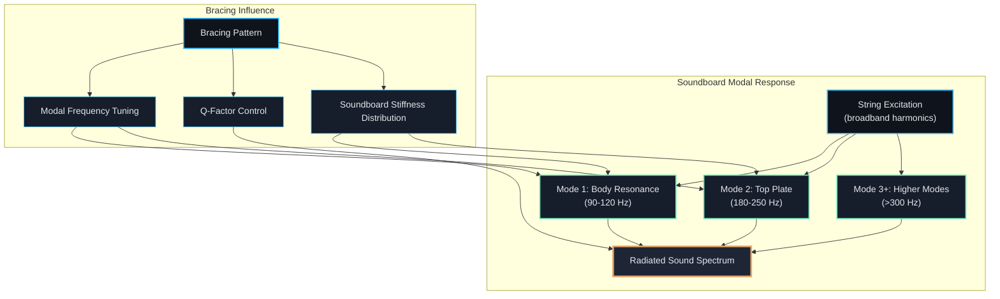

# Lesson 1: Understanding the Acoustic Guitar

## 1. First-Principles Intuition & Invariants

The acoustic guitar functions as a mechanical-to-acoustic transducer, converting the kinetic energy of vibrating strings into pressure waves propagating through air. This transformation hinges on impedance matching: strings vibrating in isolation displace negligible air volume and produce inaudible sound; the guitar's coupled resonant system solves this by transferring string energy to a large-area radiator—the soundboard—whose motion efficiently couples to the acoustic impedance of air.

String vibration follows the one-dimensional wave equation. When a string of length *L*, linear mass density *μ*, and tension *T* is excited, it vibrates at frequencies determined by:

```
f_n = (n / 2L) * sqrt(T / μ)
```

where *n* is the harmonic number (1, 2, 3, ...). The fundamental frequency (*n* = 1) determines pitch; higher harmonics (*n* > 1) constitute the timbre. Standard tuning on a guitar places the low E string at approximately 82.4 Hz, established by choosing appropriate string gauge (mass density) and tension for a given scale length (typically 24.75" to 25.5").

The soundboard acts as a driven oscillator with its own modal frequencies. When string harmonics coincide with soundboard resonances, energy transfer peaks—these coincidences shape the instrument's frequency response and define its "voice." The soundboard is not a simple piston; it vibrates in complex two-dimensional modes described by Chladni patterns. Lower-order modes (the fundamental body resonance typically between 90-120 Hz, and the primary top-plate mode around 180-250 Hz) dominate the radiated sound spectrum.

**Helmholtz Resonance and Body Modes**

The enclosed air cavity and soundhole form a Helmholtz resonator—an acoustic mass-spring system where air in the soundhole acts as a vibrating mass and the compressible air inside the body acts as a spring. The Helmholtz frequency *f_H* is approximated by:

```
f_H ≈ (c / 2π) * sqrt(A / (V * L_eff))
```

where *c* is the speed of sound, *A* is the soundhole area, *V* is the body cavity volume, and *L_eff* is the effective neck length of the soundhole (approximately the soundhole thickness plus an end correction). For typical steel-string guitars, *f_H* falls between 95-105 Hz, reinforcing the lower strings' fundamentals. This resonance produces a pronounced peak in the frequency response and contributes significantly to bass projection.

Beyond the Helmholtz mode, the body supports higher-order cavity modes—standing waves within the enclosed volume. These modes interact with soundboard vibrations, creating the complex resonant landscape that defines tonal character. Material damping (internal friction in wood) limits resonance Q-factors, preventing excessive ringing and broadening frequency response for musical versatility.

**Impedance Matching and Energy Efficiency**

The bridge serves as the mechanical coupling point. String motion at the bridge saddle has amplitude on the order of millimeters; the soundboard must move with similar displacement to radiate efficiently. The bridge mass and soundboard stiffness form a coupled oscillator; energy transfer efficiency depends on the impedance ratio between string and soundboard at the bridge. A lighter, more compliant soundboard accepts energy more readily but may lack structural integrity; a heavier, stiffer soundboard is more robust but less responsive. Luthiers balance these constraints through bracing design.

Wood selection profoundly affects performance. Sitka spruce, the most common soundboard material for steel-string guitars, offers high stiffness-to-weight ratio (Young's modulus ~10-12 GPa, density ~400-450 kg/m³) and favorable damping characteristics. Cedar (Western Red Cedar, *Thuja plicata*) is lighter and more compliant, yielding warmer tone with less projection. Engelmann spruce sits between the two. Back and side woods (mahogany, rosewood, maple) primarily contribute mass, stiffness, and damping to the coupled system, influencing sustain and spectral balance. Rosewood (density ~800-900 kg/m³) emphasizes bass and treble with scooped mids; mahogany (~550-650 kg/m³) produces mid-range focus.

**Invariants Across Design Space**

Certain physical constraints govern all acoustic guitar designs:

- **String tension scales quadratically with frequency**: doubling pitch requires quadrupling tension for fixed string length and mass density. Total tension on a steel-string guitar exceeds 70 kg (150 lbs), demanding robust structural design.
- **Soundboard area determines radiated power**: larger soundboards move more air; dreadnoughts project more volume than parlor guitars, all else equal.
- **Radiation efficiency drops below the baffle step frequency**: when wavelength exceeds soundboard dimensions, the soundboard ceases to function as an effective baffle, and bass radiation efficiency collapses. For a ~40 cm wide guitar body, this occurs below ~400 Hz, explaining the inherent difficulty in radiating low frequencies.
- **Bracing reduces soundboard compliance**: every brace added for structural integrity reduces soundboard mobility and radiation efficiency. Bracing design is an optimization problem balancing strength and acoustic performance.


## 2. Core Architecture & Mechanics

### 2.1 Body Geometry and Acoustic Volume

Body shape determines cavity volume, soundboard area, and waist depth—all critical to acoustic performance. Common shapes represent design tradeoffs:

**Dreadnought** (pioneered by Martin in 1916, named after HMS Dreadnought battleships): Large body volume (~20 L), wide waist, broad shoulders. Soundboard area ~1300-1400 cm². Produces powerful bass response and high overall volume. Helmholtz frequency typically 95-100 Hz. The large soundboard excursion at low frequencies yields strong projection, favored in bluegrass and country music where acoustic volume competes with other instruments.

**Orchestra Model (OM) / Auditorium**: Medium body volume (~17 L), narrower waist with tighter curves. More balanced frequency response with controlled bass. Comfortable for fingerstyle playing due to reduced body depth. Helmholtz frequency ~100-105 Hz.

**Parlor**: Small body volume (~12-14 L), compact dimensions. Reduced bass output but enhanced mid-range clarity and articulation. Historically popular in pre-amplification era for intimate settings. Helmholtz frequency ~105-110 Hz. Lower string tension possible with shorter scale lengths (24"-24.5"), reducing left-hand fatigue.

**Jumbo**: Very large body volume (~22-24 L), rounded bouts. Maximum soundboard area (~1500 cm²). Strong bass and treble with potential mid-range scoop. Requires careful bracing to prevent soundboard over-compliance and loss of definition.

Body depth affects the spacing between soundboard and back plate, influencing cavity modes and overall stiffness. Deeper bodies increase volume but may reduce high-frequency clarity due to increased air mass damping.

### 2.2 Soundboard and Bracing Systems

The soundboard is carved or planed to approximately 2.5-3.5 mm thickness, thin enough to flex under string load yet stiff enough to resist deformation. Quarter-sawn wood (grain perpendicular to the face) is preferred for dimensional stability and maximum stiffness along the grain direction.

Bracing patterns fundamentally alter soundboard modal behavior:

**X-Bracing** (Martin design, ~1850s): Two diagonal braces intersect beneath the soundhole, reinforcing the soundboard against string torque while maintaining flexibility between the braces. The X pattern divides the soundboard into quadrants with distinct modal regions. Tone bars (longitudinal braces extending below the X) provide additional stiffness and shape the lower-bout response. X-bracing is the dominant pattern for steel-string guitars, offering structural integrity under 70+ kg string tension.

**Fan Bracing** (Torres design, classical guitars): Seven or more braces radiate from the lower bout toward the bridge, creating a fan-like pattern. This design supports the lighter tension of nylon strings (~45 kg) and promotes the warm, rounded tone characteristic of classical guitars. The asymmetrical fan pattern tunes individual soundboard regions to specific frequencies, creating a complex modal landscape.

**Ladder Bracing** (historical design, pre-1850s): Parallel lateral braces run perpendicular to the grain. Structurally weaker than X-bracing, suitable only for low-tension gut or nylon strings. Produces a fundamental-rich tone with reduced harmonic complexity. Rarely used in modern construction except for historical reproductions.

**Scalloped Bracing**: Brace material is carved away (scalloped) in regions away from high-stress zones, reducing mass while maintaining structural integrity where needed. Pre-war Martin guitars feature deep scalloping, yielding highly responsive, dynamic instruments prized by collectors. Modern production guitars often use lighter scalloping for cost and durability.

**Advanced Bracing** (contemporary designs): Variations include A-frame bracing (Taylor), double X-patterns, V-class bracing (Taylor, 2018—asymmetric V-pattern for improved intonation and sustain), and hybrid lattice bracing (reduced-mass diagonal grids). These designs leverage FEA (finite element analysis) and modal testing to optimize specific performance characteristics.



### 2.3 Neck Construction and Geometry

The neck supports string tension and provides the fretted scale, dividing the string length into semitone intervals following the 12th root of 2 ratio: each fret position reduces the vibrating length by a factor of 2^(-1/12) ≈ 0.9438743. For a 25.5" scale (648 mm, Fender standard), the 12th fret sits at exactly 324 mm from the saddle, halving the string length and raising pitch by one octave.

**Scale Length Effects**: Longer scales increase string tension for a given pitch, yielding brighter tone with more harmonic content and greater sustain, but requiring more left-hand pressure. Gibson's 24.75" scale (628.65 mm) produces a "slinkier" feel and warmer tone compared to Fender/Martin's 25.5" scale. Some manufacturers use compound scales (e.g., 25" bass side, 24.625" treble side) to balance tension across strings.

**Neck Joint**: The neck-to-body junction significantly affects energy transfer and upper-fret access. Traditional designs include:

- **Dovetail Joint** (Martin standard): A tapered mortise-and-tenon joint, glued without mechanical fasteners. Provides large glue surface area and excellent energy transfer but requires skilled joinery and complicates neck angle adjustment.
- **Mortise-and-Tenon with Bolts** (common production method): Tenon inserted into body mortise, secured with bolts through the body block. Allows neck reset for angle adjustment as the soundboard deforms over decades under string tension.
- **Bolt-On Neck** (Taylor NT neck, some modern designs): Neck attaches with bolts through a pocket, allowing field-replaceable necks and precise angle adjustment via shims. Critiqued by traditionalists as inferior in energy transfer, though objective measurements show minimal acoustic difference.
- **Set Neck** (Gibson): Glued mortise-and-tenon without through-bolts. Traditional construction for archtop and some flat-top guitars.

**Truss Rod**: A steel or graphite rod embedded in the neck, running beneath the fingerboard from headstock to body. Adjustable tension applies counter-bending moment to counteract string pull, allowing neck relief (slight concave bow) adjustment. Modern double-acting truss rods can apply force in either direction. Typical relief is 0.2-0.4 mm measured at the 7th-8th fret with strings tuned to pitch and capo at the 1st fret while fretting the 14th.

**Neck Profile**: Cross-sectional shape affects player comfort. Profiles range from thick "V" shapes (vintage Gibson, ~23-25 mm depth at 1st fret) to thin "C" shapes (~19-21 mm). Wide, flat fingerboards (52-54 mm nut width) suit fingerstyle; narrower boards (42-44 mm) suit electric players transitioning to acoustic.

### 2.4 Bridge and Saddle Mechanics

The bridge transfers string energy to the soundboard while maintaining precise string spacing and action height. Two primary designs exist:

**Pin Bridge** (steel-string standard): Strings pass through holes in the bridge plate (a hardwood reinforcement beneath the soundboard), loop around ball ends, and are secured by tapered bridge pins. String tension compresses the pins into the tapered holes, creating friction lock. The bridge itself is glued directly to the soundboard. Bridge pin holes are angled toward the soundhole to reduce the string break angle over the saddle, minimizing downward force that can deform the soundboard over time.

**Tie-Block Bridge** (classical standard): Strings lack ball ends; instead, they pass through holes in the bridge and are tied off. Lower string tension (~45 kg vs. ~75 kg for steel) reduces structural demands.

The saddle—a thin strip of bone, synthetic bone (TUSQ), or occasionally fossil ivory—sits in a routed slot atop the bridge. String height (action) is adjusted by sanding the saddle base or top. The saddle also establishes intonation: to compensate for the pitch sharpening that occurs when strings are pressed to the fretboard (increasing tension), the saddle is positioned slightly behind the theoretical scale length, a compensation typically 2-4 mm for the bass strings and 1-2 mm for treble strings. Compensated saddles have an angled or stepped top surface to provide individual string compensation.

**Soundboard Loading**: String tension exerts approximately 35-40 kg downward force on the bridge, creating a torque that tends to rotate the bridge clockwise (viewing from the side). This torque is resisted by the soundboard's bending stiffness and the bridge plate glued beneath the soundboard. Over years, plastic deformation can cause "bellying"—the soundboard bulges upward behind the bridge—raising action and degrading playability. High-quality instruments minimize this with proper bracing geometry and rigid bridge plates; vintage instruments often require neck resets to restore proper action after decades of string load.

### 2.5 Nut and Tuners

The nut is a precisely slotted bar at the headstock end of the fingerboard, defining string spacing and height at the open position. Nut slots are filed to half the string diameter depth, allowing the string to rest securely without binding. Materials include bone, synthetic bone (TUSQ, self-lubricating), brass (rare, bright tone), and graphite-impregnated synthetics (improved tuning stability by reducing friction).

Tuning machines (tuners) are geared mechanisms that adjust string tension. Gear ratios typically range from 12:1 to 18:1, meaning the tuning peg makes 12-18 full rotations for one full turn of the string post. Higher ratios provide finer tuning resolution. Open-gear tuners expose the worm drive; sealed tuners enclose the mechanism, reducing maintenance and improving longevity. Locking tuners clamp the string at the post, eliminating windings and improving tuning stability during aggressive playing or string bending.

## 3. Material Science and Acoustic Properties

Wood choice dominates acoustic performance. Relevant material properties include:

**Stiffness (Young's Modulus *E*)**: Higher stiffness increases wave propagation speed in the soundboard, raising modal frequencies. Spruce exhibits high stiffness along the grain (~10-12 GPa longitudinal, ~0.5-0.8 GPa radial), creating directional acoustic properties.

**Density (*ρ*)**: Lower density reduces soundboard mass, improving acceleration under string excitation. The speed of sound in wood is proportional to sqrt(*E* / *ρ*); maximizing this ratio yields responsive soundboards.

**Damping (Internal Friction)**: Wood exhibits viscoelastic behavior; energy is dissipated as heat during flexure. Damping is quantified by loss tangent (tan *δ*), the ratio of energy lost to energy stored per cycle. Spruce has low damping (tan *δ* ~ 0.01-0.02), yielding bright, sustained tones. Mahogany has higher damping (tan *δ* ~ 0.02-0.04), producing warmer, less sustained tones. Tropical hardwoods like rosewood exhibit intermediate damping.

**Aging and "Playing In"**: New instruments exhibit higher damping and stiffness due to residual stresses and moisture content. Over months
