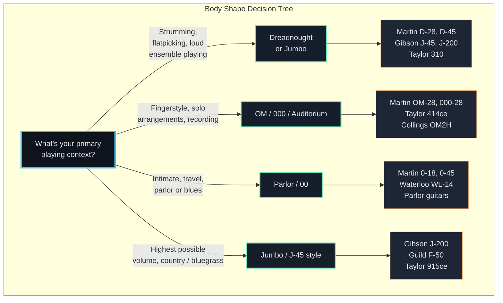
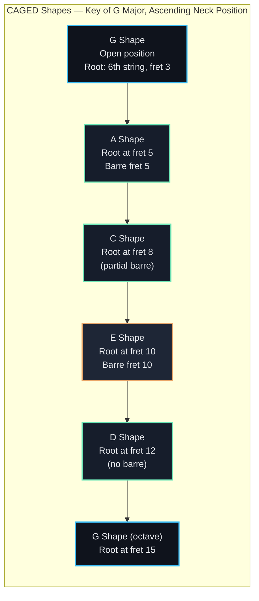
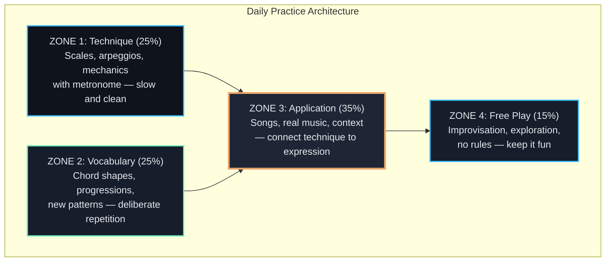
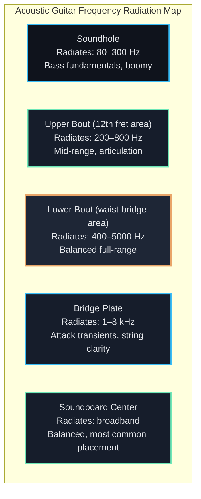

# Acoustic Guitar Mastery: Foundations of Tone, Technique, and Practice

---

## Table of Contents

1. [How an Acoustic Guitar Actually Makes Sound](#1-how-an-acoustic-guitar-actually-makes-sound)
2. [Body Shapes, Scale Lengths, and What They Mean for Your Playing](#2-body-shapes-scale-lengths-and-what-they-mean-for-your-playing)
3. [Fretboard Geometry and the CAGED System](#3-fretboard-geometry-and-the-caged-system)
4. [Right-Hand Mechanics: Picking, Strumming, and Fingerstyle](#4-right-hand-mechanics-picking-strumming-and-fingerstyle)
5. [Left-Hand Mechanics: Fretting, Barre Chords, and Shifting](#5-left-hand-mechanics-fretting-barre-chords-and-shifting)
6. [Open Chord Vocabulary and Voicing Logic](#6-open-chord-vocabulary-and-voicing-logic)
7. [Movable Chord Shapes: CAGED in Action](#7-movable-chord-shapes-caged-in-action)
8. [Travis Picking and Fingerstyle Independence](#8-travis-picking-and-fingerstyle-independence)
9. [Open Tunings and Slide Guitar Fundamentals](#9-open-tunings-and-slide-guitar-fundamentals)
10. [Practice Architecture: Building a Daily Routine](#10-practice-architecture-building-a-daily-routine)
11. [Tone Control: Setup, Strings, and Recording Basics](#11-tone-control-setup-strings-and-recording-basics)
12. [Acoustic Signal Chain and Microphone Placement](#12-acoustic-signal-chain-and-microphone-placement)

---

## 1. How an Acoustic Guitar Actually Makes Sound

### The Core Problem: Impedance Matching

A string vibrating in mid-air barely moves the air around it — the string's cross-section is too thin to displace meaningful air volume. The guitar's entire job is to solve this problem through **impedance matching**: coupling the string's high-velocity, low-displacement vibration to a large-area radiator (the soundboard) that can push substantial air mass.

The signal chain looks like this:



```mermaid
graph LR
    subgraph sub_excitation ["String Excitation"]
        A["Pick / Finger<br/>releases string"]
        B["String vibrates at<br/>fundamental + harmonics"]
        A --> B
    end

    subgraph sub_coupling ["Mechanical Coupling"]
        C["Saddle transmits<br/>transverse force"]
        D["Bridge plate<br/>distributes load"]
        E["Soundboard flexes<br/>as driven oscillator"]
        B --> C --> D --> E
    end

    subgraph sub_radiation ["Acoustic Radiation"]
        F["Soundboard pumps air<br/>(top-plate modes)"]
        G["Body cavity resonates<br/>(Helmholtz + air modes)"]
        H["Soundhole radiates<br/>low-frequency energy"]
        I["Audible Sound Wave"]
        E --> F --> I
        E <--> G
        G --> H --> I
    end

    style A fill:#0F131C,stroke:#38BDF8,stroke-width:2px,color:#E5E7EB
    style B fill:#0F131C,stroke:#38BDF8,stroke-width:2px,color:#E5E7EB
    style C fill:#161D2B,stroke:#6EE7B7,stroke-width:2px,color:#E5E7EB
    style D fill:#161D2B,stroke:#6EE7B7,stroke-width:2px,color:#E5E7EB
    style E fill:#1E2636,stroke:#38BDF8,stroke-width:3px,color:#E5E7EB
    style F fill:#1E2636,stroke:#E9A568,stroke-width:2px,color:#E5E7EB
    style G fill:#161D2B,stroke:#38BDF8,stroke-width:2px,color:#E5E7EB
    style H fill:#161D2B,stroke:#6EE7B7,stroke-width:2px,color:#E5E7EB
    style I fill:#0F131C,stroke:#E9A568,stroke-width:3px,color:#E5E7EB
```

### What This Means for Your Playing

Understanding the physics directly informs technique decisions:

- **Attack position (right hand)**: Plucking near the soundhole amplifies lower harmonics via stronger saddle excitation at the bridge-end node. Plucking over the soundhole's treble side excites higher harmonics. This is why moving your right hand between bridge and soundhole changes timbre so dramatically — you are literally selecting which harmonic partials get the most energy.
- **Nail vs. flesh tone**: Nails create a sharper attack transient, exciting a broader harmonic spectrum (brighter). Flesh produces a slower transient, emphasizing lower harmonics (warmer). Classical players exploit the full gradient.
- **Muting resonance**: The body cavity resonates around 95–105 Hz (Helmholtz frequency). When you rest your palm just behind the bridge saddle, you damp the saddle end of the strings, dramatically reducing fundamental energy transfer — this is the physics of palm muting.
- **String gauge and body feel**: Heavier strings (.013–.056) carry more tension and transfer more force to the soundboard at the saddle. The guitar physically sounds louder and projects more low-end, but requires more left-hand pressure. Lighter strings (.011–.052) are easier to fret but sacrifice some dynamic ceiling.

### The Three Resonances You Can Hear

| Resonance | Approximate Frequency | Practical Effect |
|---|---|---|
| Helmholtz (air cavity + soundhole) | 95–105 Hz | Boosts open low E and A string fundamentals |
| Top-plate fundamental mode | 180–250 Hz | Strengthens notes in the A2–B3 range |
| Air-cavity mode (standing wave) | 300–450 Hz | Colors mid-range clarity |

You can actually hear these: hum at different pitches while holding the guitar against your body. When the guitar "hums back" with extra resonance, you've found a body mode. These are your instrument's natural allies — build phrases that land on these resonances for maximum projection.

---

## 2. Body Shapes, Scale Lengths, and What They Mean for Your Playing

### Body Shape Comparison

Your choice of body shape is a **playing style decision**, not just a tonal preference.



### Body Shape Quick Reference

| Shape | Body Volume | Waist Width | Tonal Character | Best For |
|---|---|---|---|---|
| Dreadnought | ~20 L | Wide | Powerful bass, high volume | Strumming, flatpicking, bluegrass |
| Jumbo | ~22–24 L | Very wide | Maximum bass + treble, scooped mid | Country, singer-songwriter |
| OM / Auditorium | ~17 L | Medium | Balanced, articulate | Fingerstyle, recording, all-around |
| 000 / Concert | ~15 L | Medium-narrow | Mid-focused, responsive | Blues, ragtime, studio |
| Parlor / 00 | ~12–14 L | Narrow | Mid-rich, dry | Intimate, travel, blues |

### Scale Length: The Feel Under Your Left Hand

Scale length is the vibrating string length from nut to saddle. It directly affects:

- **String tension** at a given tuning (longer = tighter = stiffer feel, brighter tone)
- **Fret spacing** (longer scale = wider spacing = greater reach between frets)
- **Chord shapes** (barre chords require more left-hand force on longer scales)

| Scale Length | Example Guitars | Feel | Tone Character |
|---|---|---|---|
| 24.75" (628 mm) | Gibson J-45, L-00 | Slinky, low tension | Warm, compressed, mid-forward |
| 25.0" (635 mm) | Many Taylors, Collings | Medium | Balanced |
| 25.4" (645 mm) | Martin 000, OM | Slightly firm | Clear, balanced |
| 25.5" (648 mm) | Martin D-28, most dreadnoughts | Firm, responsive | Bright, open, strong fundamental |

**Practical implication**: If you're transitioning from electric guitar and struggling with barre chords on acoustic, try a 24.75" scale body before assuming you need lighter strings. The scale length difference alone significantly reduces the left-hand effort required.

---

## 3. Fretboard Geometry and the CAGED System

### The 6-String Standard Tuning Map

Memorize this layout. Everything else builds on it.

```
String:  6     5     4     3     2     1
Open:    E2    A2    D3    G3    B3    E4

Fret 2:  F#2   B2    E3    A3    C#4   F#4
Fret 3:  G2    C3    F3    A#3   D4    G4
Fret 5:  A2    D3    G3    C4    E4    A4   ← Open chord shapes repeat here
Fret 7:  B2    E3    A3    D4    F#4   B4
Fret 12: E3    A3    D4    G4    B4    E5   ← Exact octave of open strings
```

**Key insight**: The 5th fret of any string equals the open pitch of the next string up — except string 3 to string 2, where it's the 4th fret. This tuning asymmetry is why guitar chord shapes are not perfectly symmetrical across all string pairs.

### The CAGED System: One System to Rule the Neck

The CAGED system maps five open chord shapes (C, A, G, E, D) across the entire neck as movable forms. Each shape, when moved up the neck with its root on the appropriate string, produces the same chord type at a new pitch. Together the five shapes tile the fretboard with no gaps.



### CAGED Shape Chord Diagrams (Key of C Major)

**C Shape — open position**
```
   x  3  2  0  1  0
   |  |  |  |  |  |
   ○  |  |  ○  |  ○   ← Nut
1: |  |  |  |  |  |
2: |  |  ②  |  ①  |
3: |  ③  |  |  |  |
```

**A Shape — C chord at fret 3 (barre)**
```
   x  3  3  3  3  x
   |  |  |  |  |  |
3: ①①①①           ← Barre fret 3 with index
4: |  |  ③  ②  |  |
5: |  ④  |  |  |  |
```

**G Shape — C chord at fret 8**
```
   8  10 10 9  8  8
   |  |  |  |  |  |
8: ①  |  |  |  ①  ①  ← Index covers 1st, 5th, 6th strings
9: |  |  |  ②  |  |
10:|  ④  ③  |  |  |
```

**E Shape — C chord at fret 8 (alternative)**
```
   x  3  2  0  1  0
   (same as open C, but mapped via E shape logic at higher positions)
```

**D Shape — C chord at fret 10**
```
   x  x  10 12 13 12
   |  |  |  |  |  |
10:|  |  ①  |  |  |
11:|  |  |  |  |  |
12:|  |  |  ②  |  ④
13:|  |  |  |  ③  |
```

### Fretboard Note Names: Essential Anchor Points

Memorize the notes on strings 6 and 5 first. They are the roots of your E-shape and A-shape barre chords — the two most used movable shapes.

**String 6 (low E):**
```
Fret: 0   1   2   3   4   5   6   7   8   9   10  11  12
Note: E   F   F#  G   G#  A   A#  B   C   C#  D   D#  E
```

**String 5 (A):**
```
Fret: 0   1   2   3   4   5   6   7   8   9   10  11  12
Note: A   A#  B   C   C#  D   D#  E   F   F#  G   G#  A
```

**Drill**: Call out a random note (say "F#"). Find it on string 6 (fret 2) and string 5 (fret 9) within 3 seconds. Practice this daily until it's instant.

---

## 4. Right-Hand Mechanics: Picking, Strumming, and Fingerstyle

### 4.1 Right-Hand Posture

Correct right-hand positioning prevents injury and directly controls tone quality.

**Seated position (classical)**:
- Guitar waist rests on left thigh; body tilted toward player
- Right forearm rests on the lower bout, bringing the hand to the string level naturally
- Wrist arches slightly away from soundboard — fingers attack strings at an angle, not straight down

**Seated position (folk / casual)**:
- Guitar waist rests on right thigh, body more vertical
- Right forearm drapes over the upper bout, wrist positioned over soundhole area
- This is ergonomically less ideal for extended technical playing but entirely acceptable for strumming

**Wrist mechanics**: The wrist is the primary movement generator for strumming. The forearm rotates slightly (pronation/supination) for large strums; the wrist drives smaller, faster strums. Fingers and pick should feel loose — tension in the grip kills dynamics.

### 4.2 Pick Mechanics

**Pick angle (slant)**: Hold the pick with the pointed tip at approximately 30–45° to the string plane. Pure flat-picking (0° angle, tip perfectly perpendicular) creates a harsh, bright attack. A slight downward slant (pick tip pointing slightly toward the floor) produces a smoother tone and faster alternate picking because the pick "releases" the string more easily.

**Pick grip**: Pinch between the pad of the index finger and the side of the thumb. Only 3–5 mm of pick tip should protrude. Too much exposed pick increases flex and decreases attack control.

**Pick thickness for acoustic**:
- Thin (0.5–0.7 mm): Good for strumming, not enough rigidity for flatpicking runs
- Medium (0.73–0.88 mm): Versatile all-around
- Heavy (1.0–1.5 mm): Preferred for bluegrass flatpicking, crosspicking, and Django-style technique

### 4.3 Strumming Patterns

All strumming patterns are built from one physical motion: **a continuous pendulum swing**, with down strokes on the beat and upstrokes on the off-beats. Never stop the arm's motion — only decide which strings to contact on each swing.

**Pattern 1: Basic Quarter-Note Strum (60–90 BPM)**
```
Beat:   1    2    3    4
Strum:  ↓    ↓    ↓    ↓
```

**Pattern 2: Eighth-Note Down-Up (70–100 BPM)**
```
Beat:   1  +  2  +  3  +  4  +
Strum:  ↓  ↑  ↓  ↑  ↓  ↑  ↓  ↑
```

**Pattern 3: Folk/Pop Strum — "Missing" Upstroke (80–110 BPM)**
```
Beat:   1  +  2  +  3  +  4  +
Strum:  ↓  ↑  ↓     ↓  ↑  ↓  ↑
```
*(Miss the downstroke on beat 3 but keep the arm moving — this is what creates the "skipped" groove feel.)*

**Pattern 4: Reggae/Skank — Upstroke Only on Offbeat (80–100 BPM)**
```
Beat:   1  +  2  +  3  +  4  +
Strum:     ↑     ↑     ↑     ↑
```

**Practice drill**: Set metronome to 60 BPM. Play Pattern 2 on a single open G chord for 2 minutes without stopping. When consistent, move to 80 BPM. Add chord changes (G → C → G → D) only after the strumming motion is automatic.

### 4.4 Fingerpicking Fundamentals

**Finger assignment (p-i-m-a notation from Spanish: pulgar, índice, medio, anular)**:
- **p** (thumb): Covers strings 6, 5, and 4 (bass strings)
- **i** (index): String 3
- **m** (middle): String 2
- **a** (ring): String 1

The thumb operates independently, alternating bass strings on beats 1 and 3 (or 1–2–3–4 in waltz). Fingers pluck melody/harmony strings simultaneously or in rolling arpeggios.

**Hand position for fingerstyle**: Wrist arched 3–4 cm off the soundboard. Fingers curved, attacking strings with a slight pull motion toward the palm (not straight up). The nail/flesh contact point determines tone — more nail = brighter, more flesh = warmer.

**Foundation drill — alternating thumb, strings 6 and 5**:
```
Beat:  1    2    3    4
Thumb: 6    5    6    5
```
Run this over open G chord (p on strings 6, 5, 4 cycling), no fingers yet. Metronome 60 BPM until perfectly even. This is the backbone of Travis picking.

---

## 5. Left-Hand Mechanics: Fretting, Barre Chords, and Shifting

### 5.1 Left-Hand Posture

This is the single most injury-prone area of guitar playing. Get it right before building speed.

**Thumb position**: Thumb rests on the **back of the neck**, roughly behind the middle finger, pointing upward (toward the headstock) or at the ceiling. The thumb should NOT hook over the top of the neck — this locks the wrist, reduces finger reach, and causes long-term tendon strain.

*Exception*: Thumb-over technique (Hendrix style) is legitimate for specific chord voicings (muting the 6th string with the thumb tip, playing a low note on the 6th). Use it deliberately, not by default.

**Wrist angle**: Wrist swings slightly forward (away from the neck), creating a curved arch in the palm. This positions the fingers perpendicular to the strings rather than arriving at an angle, which reduces buzzing and maximizes fingertip pressure efficiency.

**Finger curvature**: Press strings with the very tip of each finger, not the pad. Curved fingers prevent adjacent string muting. If the note on string 2 buzzes when you're fingering string 3, your fretting finger is touching string 2 — curl tighter.

**Pressure**: Press just hard enough to produce a clean note. Many beginners apply 3–5× the necessary force, causing fatigue and cramp. Test: fret a note, then gradually reduce pressure until it buzzes. The clean threshold is about 20% above that buzz point.

### 5.2 Fretting Accuracy: The 3-Zone Rule

Where along the fret you press matters:

```
|--- Fret wire ---|--- Dead zone ---|--- Optimal zone ---|--- Buzz zone ---|--- Next fret wire ---|
   (buzzes here)                      (press here, just      (too far back,
                                       behind fret wire)      inconsistent)
```

Press the string in the **optimal zone**: just behind the fret wire (toward the nut), not on top of it, and not halfway between frets. The closer to the fret wire you press, the less force needed for a clean note.

### 5.3 Barre Chords: The Mechanics

Barre chords are where most beginners stall. The difficulty is mechanical, not strength-based — the fix is almost always technique, not more hand strength.

**Index finger placement for full barre**:
1. Roll the index finger slightly toward the nut (toward the knuckle side, not the pad). The side of the finger is bonier and flatter, making consistent contact across all 6 strings.
2. The finger should lie at a very slight diagonal — the nut end of the index slightly closer to the nut than the body end.
3. The joint creases of the index finger naturally fall over the gaps between string pairs. Slide your finger slightly up or down the fret to position creases over the string pairs that buzz.

**Thumb counterforce**: As you apply barre pressure, the thumb provides opposing force from behind the neck. The neck is literally pinched between your index fingertip and thumb — but the force should come from squeezing this pinch, not from pushing your whole arm into the neck. Keep the shoulder relaxed.

**Common barre chord failures and fixes**:

| Problem | Cause | Fix |
|---|---|---|
| Muted string 1 or 2 | Crease of index falls on that string | Shift finger 1–2 mm toward nut or body |
| Muted bass strings | Insufficient index pressure | Roll to finger's side; don't use pad |
| Wrist pain | Shoulder tension passing through arm | Relax shoulder; check thumb isn't hooking over |
| Buzzing on fretted notes | Other fingers not arching enough | Curl fingers more; check individual notes |

**F Major barre chord at fret 1 (hardest barre position due to nut proximity)**:
```
Fret:  1  2  3
  6:   ①  |  |
  5:   ①  |  |
  4:   ①  ③  |
  3:   ①  |  |
  2:   ①  |  ④
  1:   ①  ②  |

Fingers: ①=index (barre), ②=middle (string 2 fret 2), 
         ③=ring (string 4 fret 3), ④=pinky (string 3 fret 3... 
         alternate: use ring for string 3 fret 3, pinky for string 2)
```

**Recommended fingering for F major** (most players find this easier):
- Index: barre all 6 strings at fret 1
- Middle: string 3, fret 2
- Ring: string 5, fret 3
- Pinky: string 4, fret 3

**Drill — Barre Chord Conditioning (10 minutes daily)**:
1. Place E-shape barre at fret 5 (A major). Strum, check every string rings clean.
2. Remove hand completely. Reapply. Check again.
3. 60 BPM: place barre on beat 1, strum on beats 2–4. Move to fret 7, repeat.
4. Progress to 2-beat placement windows, then 1-beat.

### 5.4 Position Shifting

Smooth position shifts are the difference between musical lines and robotic ones.

**Rule**: Lead the shift with the finger closest to the destination, not by lifting all fingers simultaneously. On a descending scale, the lower finger peels off first; on ascending, the higher finger peels off first.

**Guide finger technique**: When shifting between chords or positions, leave one finger lightly touching a string as you move — this gives tactile feedback on distance and prevents over- or under-shooting. The guide finger doesn't press during the transition; it just maintains contact.

---

## 6. Open Chord Vocabulary and Voicing Logic

### Core Open Chords

Every open chord position leverages the natural resonance of open strings against the guitar body. These are your richest-sounding positions on the instrument. Learn each one to ring with every note clean before moving to the next.

**G Major (richest open shape)**:
```
   2  1  0  0  0  3
   |  |  |  |  |  |
1: |  |  |  |  |  |
2: ②  |  |  |  |  |
3: |  ①  |  |  |  |
4: |  |  |  |  |  ④

Fingers: ①=middle (string 5, fret 2), ②=index (string 6, fret 2),
         ④=pinky (string 1, fret 3)
Alternative: Use ring on string 1 and middle on string 5 and index on string 6
             — leaves middle+index free for sus/add9 variations
```

**C Major**:
```
   x  3  2  0  1  0
   |  |  |  |  |  |
1: |  |  |  |  |  |
2: |  |  |  |  ①  |
3: |  |  ②  |  |  |
4: |  ③  |  |  |  |
```

**D Major**:
```
   x  x  0  2  3  2
   |  |  |  |  |  |
1: |  |  |  |  |  |
2: |  |  |  ①  |  ①
3: |  |  |  |  ③  |

(index covers strings 1 and 3 at fret 2 — a mini-barre, or use separate fingers)
```

**E Major**:
```
   0  2  2  1  0  0
   |  |  |  |  |  |
1: |  |  |  ①  |  |
2: |  ③  ②  |  |  |
```

**A Major (3 fingering options)**:
```
   x  0  2  2  2  0
Option A (3 fingers):
1: |  |  |  |  |  |
2: |  |  ②  ③  ④  |
Option B (bar fret 2 with ring):
   |  |  ③③③  |
Option C (bar with middle):
   |  |  ②②②  |   ← leaves ring and pinky free for hammer-ons
```

**E Minor**:
```
   0  2  2  0  0  0
1: |  ②  ③  |  |  |
```

**A Minor**:
```
   x  0  2  2  1  0
1: |  |  |  |  ①  |
2: |  |  ③  ②  |  |
```

**D Minor**:
```
   x  x  0  2  3  1
1: |  |  |  |  |  ①
2: |  |  |  ②  |  |
3: |  |  |  |  ③  |
```

### Open Chord Progressions to Learn Immediately

These cover ~80% of folk, country, pop, and rock acoustic songs:

| Progression | Key | Chords |
|---|---|---|
| I–V–vi–IV | G major | G – D – Em – C |
| I–IV–V | A major | A – D – E |
| I–vi–IV–V | C major | C – Am – F – G |
| I–V–IV | G major | G – D – C |
| ii–V–I | D major | Em – A – D |
| vi–IV–I–V | A minor | Am – F – C – G |

---

## 7. Movable Chord Shapes: CAGED in Action

### E-Shape Barre Chords (Root on String 6)

The E-shape is your most powerful movable major and minor chord. The root note lives on string 6 (low E). To play any major chord, barre at the fret where the target note lives on string 6.

**E Major shape → movable major chord:**
```
   Root on string 6
   R  .  .  .  .  .
   |  ①①①①①①   ← Index barre
   |  |  |  |  |  |
   |  ③  ②  |  |  |
   |  |  |  |  |  |
   (ring on str 5, middle on str 4, same fret + 2)
```

| Barre Fret | Major Chord | Minor Chord (lift middle) |
|---|---|---|
| 1 | F | Fm |
| 2 | F# / Gb | F#m |
| 3 | G | Gm |
| 5 | A | Am |
| 7 | B | Bm |
| 8 | C | Cm |
| 10 | D | Dm |
| 12 | E | Em (same as open) |

**E Minor shape → movable minor chord:**
```
   R  .  .  .  .  .
   |  ①①①①①①   ← Index barre
   |  ③  ④  |  |  |
   (only ring and pinky added, middle not used — creates minor quality)
```

### A-Shape Barre Chords (Root on String 5)

Same concept, root on string 5. These are slightly harder due to the full barre needing to clear string 1 (or mute it).

| Barre Fret | Major Chord | Minor Chord |
|---|---|---|
| 2 | B | Bm |
| 3 | C | Cm |
| 5 | D | Dm |
| 7 | E | Em |
| 8 | F | Fm |
| 10 | G | Gm |
| 12 | A | Am |

**A-shape chord (with partial barre by ring finger on strings 2–3–4):**
```
   x  R  .  .  .  x
   |  ①  |  |  |  |   ← Index on root (string 5)
   |  |  ③③③  |   ← Ring bars strings 2,3,4 two frets up
   String 1 is muted or index tip mutes it
```

### Power Chords (Root 5 or Root 6)

Power chords (5th chords — root + 5th, no 3rd) are essential for acoustic rock. They work beautifully on acoustic for a full, clean punch:

```
Root on string 6 (e.g., G5 at fret 3):
   3  5  5  x  x  x
   ①  |  |
   |  ③  ④
   (index on root, ring + pinky two frets up on strings 5, 4)

Root on string 5 (e.g., A5 at fret 0 open, or D5 at fret 5):
   x  R  .  x  x  x
   Same 2-fret shape, strings 5 and 4
```

### Sus and Add Chords: Instant Color

These require only small additions to open shapes and dramatically expand your vocabulary.

**Dsus2** (remove index, add open string):
```
   x  x  0  2  3  0   ← String 1 open (E = major 2nd of D)
```

**Gsus4**:
```
   3  3  0  0  1  3   (replace B on string 2 with C: fret 1)
```

**Cadd9**:
```
   x  3  2  0  3  0   (string 2 goes to fret 3 = D = major 9th of C)
                        (string 1 open = E stays)
```

---

## 8. Travis Picking and Fingerstyle Independence

Travis picking is the foundation of American acoustic fingerstyle — country, folk, blues. The right thumb creates an alternating bass pattern while fingers independently play melody and harmony. The key word is **independence**: the thumb runs on autopilot while the fingers operate separately.

### Phase 1: Establish the Thumb Pattern (Week 1)

**Chord: G major open position. Thumb alternates strings 6 → 4 → 6 → 4.**

```
Beat:   1     2     3     4
String: 6     4     6     4
Thumb:  p     p     p     p
Finger: —     —     —     —

Metronome: 50 BPM. Run 10 minutes without stopping.
```

Move to alternating 6 → 5 for A and C shapes. The thumb pattern must be completely automatic before adding fingers.

### Phase 2: Add Simultaneous Pinch on Beat 1

```
Beat:   1        2     3        4
String: 6+1      4     6+1      4
Thumb+a: p+a     p     p+a      p

(Thumb hits string 6, ring finger (a) pinches string 1 simultaneously on beats 1 and 3)
Metronome: 50–60 BPM
```

### Phase 3: Full Travis Pattern

```
Beat:   1     +     2     +     3     +     4     +
String: 6     3     4     2     6     3     4     1
Hand:   p     i     p     m     p     i     p     a

Notation: p=thumb, i=index (str 3), m=middle (str 2), a=ring (str 1)
Metronome: 50 → 70 → 90 BPM
```

This pattern loops continuously. The thumb never stops. The fingers fill in the upbeat subdivisions.

### Phase 4: Move Through Chord Progression

Apply the Phase 3 pattern to: **G (8 beats) → C (8 beats) → G (8 beats) → D (8 beats)**.

The thumb pattern changes with each chord:
- **G**: alternates 6 → 4
- **C**: alternates 5 → 4
- **D**: alternates 4 → 5 (or 4 → 4, then 3 → 4 depending on arrangement)

**Metronome targets**:
- Week 1: 50–60 BPM, single chord
- Week 2: 60–70 BPM, chord progression
- Week 3: 70–85 BPM, begin adding melodic variations on beat "+"s
- Week 4+: 85–100 BPM, free improvisation within pattern

### Phase 5: Melodic Travis Picking

Once the pattern is automatic, begin substituting target notes from the chord on the upbeats. For G major chord, instead of always hitting string 3 open (B), occasionally fret string 3 at fret 2 (C), then 4 (D) — this creates walking melodic lines over the static thumb bass.

```
Example — G major melodic variation:
Beat:   1     +     2     +     3     +     4     +
String: 6     3fr2  4     2     6     3fr4  4     1
Note:   G     C     D     B     G     D     D     E
```

This is the vocabulary of Chet Atkins, Merle Travis, and John Denver's acoustic style.

### Fingerstyle Arpeggio Pattern: p-i-m-a-m-i

A classical-derived ascending/descending arpeggio, essential for ballads and solo arrangements.

```
Beat:   1     +     2     +     3     +     (3/4 time)
String: 5     3     2     1     2     3
Hand:   p     i     m     a     m     i

In 4/4:
Beat:   1     +     2     +     3     +     4     +
String: 5     3     2     1     2     1     2     3
Hand:   p     i     m     a     m     a     m     i

Chord: Am, then apply to full I–vi–IV–V progression
Metronome: 50 → 60 → 75 BPM
```

---

## 9. Open Tunings and Slide Guitar Fundamentals

### Why Open Tunings?

Open tunings retune the guitar so strumming all 6 strings open produces a full chord. This creates three advantages:
1. Full chord voicings are playable with a single-finger barre (or slide)
2. Partial open strings ring sympathetically against fretted notes, creating richer textures
3. Slide (bottleneck) technique becomes melodic and practical

### Open G Tuning: D-G-D-G-B-D (Low to High)

Relative to standard EADGBE:
- String 6: tune down from E → D (down 2 semitones)
- String 5: tune down from A → G (down 2 semitones)
- String 4: stays D
- String 3: stays G
- String 2: stays B
- String 1: tune down from E → D (down 2 semitones)

**Check**: Strum all 6 strings open → G major chord.

**Key chord positions in Open G:**
```
Chord:    G    C    D    G(high)
Position: open  5    7    12
Barre:    none  5th  7th  12th fret

G7:  add pinky string 1 fret 1
Gm:  barre 3rd fret, flatten string 2 by 1 fret (string 2 at fret 3 = Bb)
```

**The Keith Richards 5-String Trick**: Remove the low D string (string 6) entirely or mute it. This is how "Honky Tonk Women," "Brown Sugar," and "Start Me Up" are played — only 5 strings, root-less chords with open tuning voicings.

### Open D Tuning: D-A-D-F#-A-D

- String 6: stays D? No — tune E → D (down 2)
- String 5: stays A
- String 4: stays D
- String 3: tune G → F# (down 1 semitone)
- String 2: tune B → A (down 2 semitones)
- String 1: tune E → D (down 2 semitones)

**Check**: Strum all 6 strings open → D major chord.

Open D is the blues and folk fingerstyle standard. Robert Johnson, Son House, and Joni Mitchell (many songs) used variants of this tuning.

**Key positions in Open D:**
```
Chord:    D     G     A     D(oct)
Position: open   5     7     12

D7:  barre 4th fret partially — string 2 at fret 4 = C (b7 of D)
Dsus4: fret 5 string 3 (G) with open rest
```

### Slide Technique Fundamentals

Slide guitar requires the glass or metal slide to sit exactly over the fret wire, not behind it (opposite of normal fretting). The slide hovers — it does not press the string to the fretboard.

**Slide placement**:
- Wear slide on ring finger (most common) or pinky
- Rest fingers behind the slide lightly on the strings — this is essential for muting sympathetic string noise
- Hover the slide parallel to the frets, directly over the target fret wire

**Common slide positions in Open G:**
```
Fret:   0    2    3    5    7    10   12
Chord:  G    A    Ab   C    D    F    G(oct)
Scale:  Root  2nd  b3   4th  5th  b7   Oct
```

**Slide drill — basic blues box in Open G:**
```
|---0--3--5--3--0---|  (string 1)
|---0--3--5--3--0---|  (string 2)
|---0--3--5--3--0---|  (string 3)
Slide all 3 strings simultaneously at frets 0, 3, 5
60 BPM → add vibrato at fret 5 (rock slide 1–2 mm each side of fret)
```

**Vibrato with slide**: Rock the slide back and forth ±2–3 mm around the target fret. The oscillation rate should match musical context — slow and wide (quarter-note rate, ±3 mm) for blues expressiveness; fast and narrow (eighth-note rate, ±1 mm) for sustaining notes.

---

## 10. Practice Architecture: Building a Daily Routine

### The Four Practice Zones

A productive session addresses all four zones. The ratio changes depending on your goals:



### 30-Minute Beginner Session

| Time | Activity | Metronome |
|---|---|---|
| 0–5 min | Chromatic warm-up: 1-2-3-4 on each string, all positions | 60 BPM |
| 5–10 min | Chord transitions: 2 chords, 4 beats each, loop | 60–80 BPM |
| 10–18 min | Current song or progression — full run-through | Song tempo |
| 18–25 min | New technique (Travis picking, barre chords, etc.) | 50–60 BPM |
| 25–30 min | Free play — whatever feels good | No metronome |

### 60-Minute Intermediate Session

| Time | Activity | Metronome |
|---|---|---|
| 0–5 min | Major scale across all 5 CAGED positions | 70–90 BPM |
| 5–10 min | Arpeggio patterns (p-i-m-a and variations) | 60–80 BPM |
| 10–20 min | Travis picking — 4-chord progression, clean and even | 70–95 BPM |
| 20–35 min | Song work — focus on hardest 8-bar section | Performance tempo |
| 35–45 min | New song/material — learn chord shapes, slow | 50–60 BPM |
| 45–55 min | Ear training + improvisation in a key | No metronome |
| 55–60 min | Sight-reading or new chord voicing exploration | — |

### Metronome Protocols

**The 3-Speed Rule**: Practice any new technique or passage at three speeds:
1. **Slow (50–60% of target)**: Perfect mechanics, zero errors
2. **Medium (75–80% of target)**: Comfortable and controlled
3. **Fast (target tempo)**: Only after both slower speeds are consistent

Never increase tempo until the lower speed is completely clean. Practicing sloppy at fast tempo just rehearses the mistakes.

**Subdivision shifts**: Once a pattern is comfortable at eighth notes (2 notes per beat), practice the same material in triplets (3 per beat), then sixteenth notes (4 per beat). This builds internal rhythmic flexibility without changing the actual physical movements.

### Hand Health and Injury Prevention

- **Warm up before playing** — 5 minutes of gentle hand stretches, wrist circles, and slow spider exercises (1-2-3-4 chromatics) before any demanding technique work
- **Stop at the first sign of pain** — aching is fatigue; sharp or burning pain is injury. Never play through sharp pain.
- **Maximum continuous technique practice**: 25–30 minutes before a 10-minute break. Total daily technique practice for beginners: 45–60 minutes.
- **Tendonitis prevention**: Keep wrist straight during barre chords. Rotate shoulder slightly forward rather than extending the thumb to compensate for a bent wrist.

---

## 11. Tone Control: Setup, Strings, and Recording Basics

### Guitar Setup: The Three Adjustments That Matter Most

A poorly set up guitar fights you. These three measurements dictate 90% of playability:

**1. String Action (saddle height)**

Measured at the 12th fret, the gap between string bottom and fret top:
- Low E string: 2.0–2.5 mm (fingerstyle) / 2.5–3.0 mm (strumming)
- High E string: 1.5–2.0 mm (fingerstyle) / 2.0–2.5 mm (strumming)

Higher action = more volume and sustain, harder to press. Lower action = easier to play, more prone to fret buzz.

**2. Neck Relief (truss rod)**

With strings at pitch, capo at fret 1, fret the low E at the 14th fret. Measure the gap at fret 7–8:
- Target: 0.2–0.4 mm (a business card thickness)
- More relief: easier on soft playing, some buzz at high playing
- Less relief: faster, lower action possible, more prone to choking on bends

**3. Nut Slot Depth**

Capo at fret 2. Play strings 1 and 6 open — they should ring clean. Remove capo; play open strings. If open strings now buzz or feel stiff, the nut slots are too high. This is the most common cause of poor feel at the first three frets.

If you're not comfortable making these adjustments yourself, take the guitar to a luthier for a full setup — it typically costs $50–80 and transforms a mediocre-feeling guitar into one that's a joy to play.

### String Gauge Guide

| Gauge | Designation | Sound | Best For |
|---|---|---|---|
| .010–.047 | "10s" / Extra Light | Bright, easy | Beginners, small bodies, players with hand issues |
| .011–.052 | "11s" / Light | Balanced | All-around fingerstyle, recording |
| .012–.053 | "12s" / Medium-Light | Full, responsive | Fingerstyle + strumming, dreadnoughts |
| .013–.056 | "13s" / Medium | Powerful, loud | Flatpicking, bluegrass, strong players |

**String material**:
- **80/20 Bronze** (80% copper, 20% zinc): Bright, crisp attack. Good for recording. Ages faster.
- **Phosphor Bronze** (92% copper, 8% tin/phosphorus): Warmer, longer-lasting. Most popular acoustic string.
- **Coated strings** (Elixir, D'Addario XT): Last 3–5× longer, slightly less brightness. Worth the cost for players who don't change strings frequently.

**How often to change strings**: When they lose brightness, feel rough, or won't intonate properly (12th fret harmonic no longer matches fretted 12th). For regular players: every 1–3 months.

### Bracing Pattern and Tone Character Quick Reference

| Bracing | Tone Character | Best Guitar Types |
|---|---|---|
| X-Brace (standard) | Balanced, strong bass, clear highs | Steel-string, dreadnought, all-around |
| Scalloped X-Brace | More resonant, faster response, dynamic | Fingerstyle, vintage-style guitars |
| Fan Brace | Warm, complex, mid-rich | Classical, nylon-string guitars |
| V-Class (Taylor) | Even sustain, improved intonation | Modern Taylor steel-string |
| Ladder Brace | Fundamental-rich, compressed | Historical reproductions, some resonators |

---

## 12. Acoustic Signal Chain and Microphone Placement

### Understanding the Acoustic Guitar's Frequency Map

Before placing a microphone, know what the instrument radiates from different locations:



### Single Microphone Placement Guide

**Position 1 — 12th Fret (Most Universally Good)**
- Distance: 20–30 cm from the guitar body
- Angle: Aimed at the point where neck meets body (12th fret area)
- Result: Balanced fundamental and high-frequency content, natural-sounding
- Good for: Recording demos, singer-songwriter, most situations

**Position 2 — Over Shoulder (Near 12th Fret, Behind Player)**
- Distance: 30–50 cm
- Angle: Over the player's right shoulder, aimed at upper bout
- Result: Warm, natural room sound, less attack
- Good for: Intimate recordings, folk, minimizing pick noise

**Position 3 — Bridge Area (Up Close)**
- Distance: 15–20 cm
- Angle: Aimed at saddle/bridge area of soundboard
- Result: Maximum attack transients and string detail, can be harsh
- Good for: Bluegrass, flatpicking, when you want aggressive presence

**What to avoid**: Pointing directly at the soundhole at close range. This produces a heavy, uneven bass buildup from the Helmholtz resonance output — the result is boomy and unnatural in recordings.

### Two Microphone Stereo Techniques

**XY Stereo (best for studio, minimum phase issues)**:
- Mic 1: Aimed at 12th fret from 25 cm, 45° left
- Mic 2: Aimed at bridge area from 25 cm, 45° right
- Both capsules as close together as possible (coincident)
- Result: Tight stereo image, mono-compatible, full frequency balance

**Spaced Pair (more spacious, some phase risk)**:
- Mic 1: 12th fret position, 25 cm
- Mic 2: Lower bout / bridge, 35–40 cm, angled up
- Check for phase cancellation: listen in mono — if bass disappears, flip polarity on one mic

### Pickup Systems (Live Performance)

| Pickup Type | Mechanism | Tone Character | Best For |
|---|---|---|---|
| Undersaddle Piezo | Crystal under saddle transduces string vibration | Bright, clinical, very feedback-resistant | Live performance, loud stages |
| Soundboard Transducer | Piezo disc glued to inner soundboard | More natural, sensitive to body movement | Quiet-to-medium stages |
| Active Magnetic | Electromagnetic coil in soundhole | Electric guitar-like warmth | Blues, rock acoustic |
| Internal Microphone | Miniature mic mounted inside body | Most natural-sounding | Studio-level live performances |
| Hybrid System | Mic + piezo blended | Best of both worlds | Premium live and recording applications |

**Blending piezo + internal mic** (the professional standard for live acoustic tone): Set the piezo for feedback resistance and low-end punch; blend in the internal mic for natural air and attack. Roll off the mic signal if feedback starts — the piezo remains functional at any stage volume.

### Essential EQ Moves for Acoustic Guitar

| Frequency | Problem | Fix |
|---|---|---|
| 100–200 Hz | Boomy, washy low end | High-pass filter at 80–100 Hz; notch around the resonant peak |
| 300–500 Hz | Muddy, boxy sound | Small cut (-2 to -4 dB) at the offending frequency |
| 800 Hz–1.2 kHz | Nasal, honky tone | Slight cut if present; often from soundhole proximity |
| 2–4 kHz | Pick attack and presence | Slight boost here adds definition and cut-through |
| 5–8 kHz | String clarity and air | Gentle shelf boost (2–3 dB) for sparkle in mix |
| 10+ kHz | Air and shimmer | Subtle air boost if the mic and room allow it |

**Start flat, subtract before adding**: Find the frequencies that are too prominent and reduce them before reaching for boosts. Acoustic guitar rarely needs much EQ when mic placement is right — if you're fighting the EQ heavily, adjust the microphone position first.

---

## Summary: The Practitioner's Checklist

**Daily non-negotiables:**
- [ ] Right-hand posture checked before playing — forearm on bout, wrist arched
- [ ] Left-hand thumb behind neck opposite middle finger
- [ ] Metronome on for all technique work
- [ ] Slow before fast — no exceptions

**Weekly benchmarks:**
- [ ] All open chords ring clean, every string
- [ ] Chord transitions smooth at 80+ BPM for current song
- [ ] One new CAGED shape position learned
- [ ] Travis picking thumb pattern automatic at 70+ BPM

**Monthly milestones:**
- [ ] Full barre chord (E and A shape) clean across all 12 frets
- [ ] 3-chord song played at full tempo with consistent strumming pattern
- [ ] Travis picking through a 4-chord progression at 85+ BPM
- [ ] One song learned fully from start to finish

The acoustic guitar rewards consistency over intensity. Twenty focused minutes every day outperforms two-hour weekend sessions. Slow, clean, and deliberate practice at 60 BPM builds the neural pathways that unlock fast, fluid playing — the metronome is not a crutch, it's the most honest teacher in the room.
