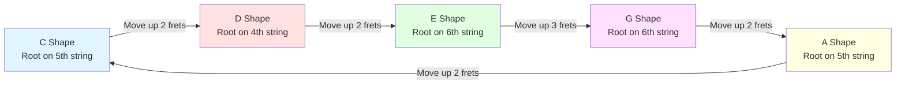
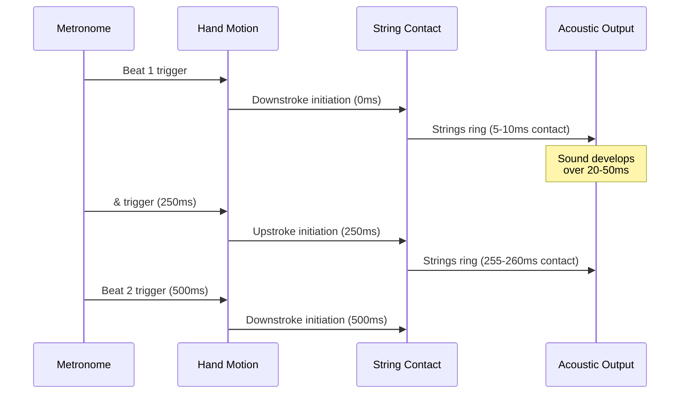
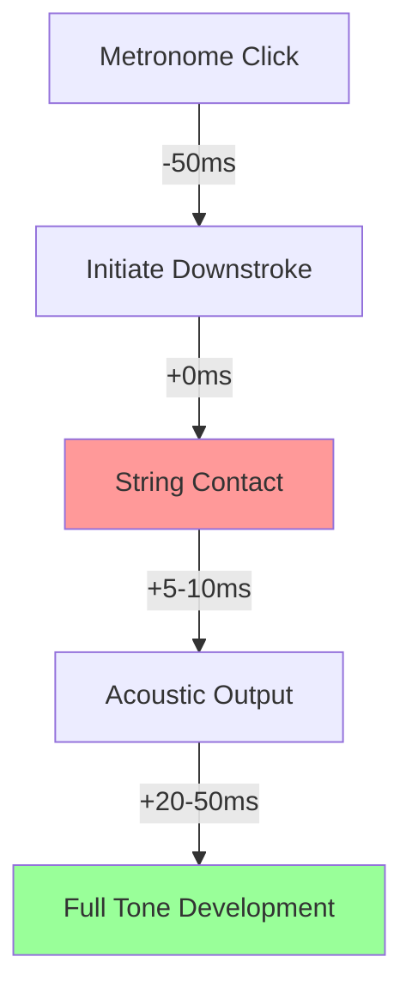

# Lesson 2: Chords and Strumming Patterns

## 1. First-Principles Intuition & Invariants

### The Physical Foundation of Harmonic Sound

The acoustic guitar transforms mechanical energy into acoustic resonance through a precisely engineered system. When a string vibrates, it creates periodic displacement of air molecules. The guitar body acts as a Helmholtz resonator—the soundhole, top plate, back, and sides form a coupled oscillator system that amplifies specific frequency bands. String tension (typically 75-95 lbs total for steel strings, 40-50 lbs for nylon), scale length (most commonly 25.5" for Fender-style, 24.75" for Gibson-style), and string mass determine fundamental frequency according to:

```
f = (1/2L) × sqrt(T/μ)
```

where `f` is frequency, `L` is vibrating length, `T` is tension, and `μ` is linear mass density. When you press a string at the 12th fret, you halve `L`, doubling the frequency—producing an octave.

### Interval Geometry and Harmonic Series

Chords emerge from the harmonic series—the natural overtone sequence produced by any vibrating string. A string vibrating at fundamental frequency `f₀` simultaneously produces overtones at `2f₀, 3f₀, 4f₀...` with decreasing amplitude. The first several harmonics directly correspond to musical intervals:

- 2:1 ratio = octave (12 semitones)
- 3:2 ratio = perfect fifth (7 semitones)
- 4:3 ratio = perfect fourth (5 semitones)
- 5:4 ratio = major third (4 semitones)
- 6:5 ratio = minor third (3 semitones)

A major triad (root, major third, perfect fifth) directly mirrors harmonics 4, 5, and 6 of the harmonic series. This is why major chords sound consonant—they align with natural acoustic phenomena. A major chord built on C comprises:

- Root: C (fundamental)
- Major 3rd: E (4 semitones above C, frequency ratio 5:4)
- Perfect 5th: G (7 semitones above C, frequency ratio 3:2)

Minor chords substitute the major third with a minor third (3 semitones, 6:5 ratio), introducing a different harmonic tension. The minor third lies between harmonics in the series, creating a darker, more ambiguous quality—not dissonant, but less directly aligned with the overtone structure.

### Equal Temperament and Fret Spacing

Modern guitars use 12-tone equal temperament (12-TET), where each semitone represents a frequency ratio of the 12th root of 2 (≈1.05946). Fret positions follow:

```
d = L - L/(2^(n/12))
```

where `d` is distance from nut to fret `n`, and `L` is scale length. The 12th fret sits at exactly `L/2`. This exponential spacing means frets get progressively closer as you move up the neck—a geometric consequence of logarithmic pitch perception.

### The CAGED System: Topological Mapping of the Fretboard

The CAGED system represents five fundamental chord shapes that tile the entire fretboard. Each shape corresponds to an open-position chord (C, A, G, E, D) that can be transposed via barring. The system reveals the fretboard's inherent geometry:



This cyclic structure means learning five patterns grants access to all major chords in all positions. For a C major chord:

- **C shape** at position 0 (open)
- **A shape** at 3rd fret (barre on 3rd)
- **G shape** at 5th fret (partial barre on 5th)
- **E shape** at 8th fret (barre on 8th)
- **D shape** at 10th fret (barre on 10th)

Each position produces the same chord (C-E-G) but with different voicings—the vertical ordering of notes—creating distinct timbral qualities due to changing string overtone interactions.

### Voicing and Register: Why Position Matters

Guitar chords can span up to six notes across nearly four octaves. Voicing determines which notes appear in which register. Close voicings stack notes within an octave, producing dense, complex overtone interactions. Open voicings spread notes across multiple octaves, creating clarity but potentially sacrificing harmonic density.

The open C major chord (x32010) places:
- 3rd fret, 5th string: C (root, lowest note ~131 Hz)
- 2nd fret, 4th string: E (major 3rd, ~165 Hz)
- Open 3rd string: G (perfect 5th, ~196 Hz)
- Open 2nd string: B (major 7th, ~247 Hz) - wait, standard C major is x32010, not x32013
- 1st fret, 2nd string: C (root, ~262 Hz)
- Open 1st string: E (major 3rd, ~330 Hz)

Actually, standard open C major is played x32010:
- x: 6th string muted
- 3: 3rd fret, 5th string = C (~130.81 Hz)
- 2: 2nd fret, 4th string = E (~164.81 Hz)
- 0: Open 3rd string = G (~196.00 Hz)
- 1: 1st fret, 2nd string = C (~261.63 Hz)
- 0: Open 1st string = E (~329.63 Hz)

This voicing doubles the root and major third across octaves, reinforcing those intervals. Changing voicing changes timbral character even when the chord identity remains constant.

## 2. Core Architecture & Mechanics

### Fretboard State Space and Chord Topology

The guitar fretboard comprises a state space of approximately 120 positions (20 frets × 6 strings). Each chord represents a selection of 3-6 positions from this space that produce specific interval relationships. We can model this formally:

**Definition: Chord Formation**

A chord `C` on a guitar is a function:

```
C: {1,2,3,4,5,6} → ({0,1,...,20} ∪ {muted})
```

mapping string numbers to fret positions or muted state. For example, C major in open position:

```
C_major_open = {
  6: muted,
  5: 3,
  4: 2,
  3: 0,
  2: 1,
  1: 0
}
```

### Physical Mechanics of Chord Formation

Forming a chord requires precise finger placement according to biomechanical constraints:

1. **Finger pad positioning**: The fingertip should contact the string just behind (toward the nut) the fret wire, not directly on it. Optimal placement is 1-2mm behind the fret, minimizing required pressure while avoiding fret buzz.

2. **Thumb placement**: The thumb typically anchors behind the neck, roughly opposite the middle finger position. For barre chords, the thumb may move lower to provide leverage for the barring finger.

3. **Finger angle**: Fingers should approach the fretboard at roughly 45-90° to minimize contact with adjacent strings. Collapsed first knuckles cause muting of unintended strings.

4. **Pressure distribution**: Minimum pressure to produce clean tone is approximately 1-2 lbs per finger. Excess pressure (>3-4 lbs) causes fatigue and can bend strings out of tune. Steel strings require more pressure than nylon due to higher tension.

### Hand Physics and Chord Transitions

Chord changes involve coordinated motor patterns. Efficient transitions minimize movement:

```mermaid
stateDiagram-v2
    [*] --> C_Major: Initial position
    C_Major --> G_Major: Lift ring finger<br/>Move middle to 6th string<br/>Add ring & pinky
    G_Major --> D_Major: Lift all<br/>Reform triangle<br/>on strings 1-3
    D_Major --> C_Major: Pivot on middle<br/>finger position
    
    note right of C_Major: x32010<br/>Fingers: x32x1x
    note right of G_Major: 320003<br/>Fingers: 21xxx34
    note right of D_Major: xx0232<br/>Fingers: xxx132
```

Pivot fingers—fingers that remain on the same fret during transitions—serve as anchors, reducing transition time. The C-to-Am change, for example, can pivot on the index and middle fingers (3rd and 2nd strings respectively), requiring only the ring finger to move.

### Strumming Mechanics: Kinematic Analysis

Strumming involves oscillatory motion originating primarily from the wrist, with the elbow providing coarse positioning. Optimal strumming uses:

**Downstroke (forearm pronation + wrist flexion)**:
- Pick angle: 15-30° relative to string plane
- Contact duration per string: 5-10ms
- Total stroke time: 40-80ms (depending on tempo)
- Motion originates from wrist rotation, not finger movement

**Upstroke (forearm supination + wrist extension)**:
- Pick angle: typically shallower, 10-20°
- Often targets subset of strings (usually strings 1-4)
- Slightly faster than downstroke due to lighter contact

### Pattern Notation and Implementation

Strumming patterns combine downstrokes (D), upstrokes (U), and rests (·) in rhythmic cycles. Standard 4/4 patterns align with beat subdivisions:

**Basic Pattern 1 (8th notes, all strummed)**:
```
Beat:    1   &   2   &   3   &   4   &
Pattern: D   U   D   U   D   U   D   U
Count:   |-------|-------|-------|-------|
```

**Pattern 2 (syncopated, with muting)**:
```
Beat:    1   &   2   &   3   &   4   &
Pattern: D   · D U ·   U D   · D U
Mute:    -   - - - x   - -   x - -
Count:   |-------|-------|-------|-------|
```

The 'x' indicates percussive muting—strings damped with fretting hand while strumming, producing a rhythmic "chick" sound without pitch.

### Fretboard Diagram: Precise Notation

Standard tab notation for C major chord with strumming annotation:

```
Standard Tuning: E A D G B E

      C major (open position)
e |---0--- (open E, high)
B |---1--- (1st fret C)
G |---0--- (open G)
D |---2--- (2nd fret E)
A |---3--- (3rd fret C, root)
E |---x--- (muted)
    
Finger placement: x 3 2 0 1 0
                  | | | | | |
                  | | | | | +-- open
                  | | | | +---- index
                  | | | +------ open
                  | | +-------- middle
                  | +---------- ring
                  +------------ muted (don't strike)

Strumming: Start from A string, strum downward through e string
```

### The Barre Chord Mechanism

Barre chords extend the CAGED system by using one finger (typically index) to press multiple strings simultaneously, effectively creating a movable capo. The index finger must:

1. Apply even pressure across all barred strings (~2-3 lbs per string)
2. Position slightly rolled toward thumb side to use the firmer edge of the finger pad
3. Align perpendicular to frets to minimize required hand size

**F major barre chord (E shape at 1st fret)**:
```
e |---1--- (1st fret F, barre)
B |---1--- (1st fret C, barre)
G |---2--- (2nd fret A, middle finger)
D |---3--- (3rd fret F, ring finger)
A |---3--- (3rd fret C, pinky)
E |---1--- (1st fret F, barre, root)

Finger pattern: 1 3 3 2 1 1
                | | | | | |
                | | | | | +-- index barre
                | | | | +---- index barre
                | | | +------ middle
                | | +-------- ring
                | +---------- pinky
                +------------ index barre
```

The barre chord requires approximately 2-3× the finger strength of open chords due to simultaneous multi-string pressure. The thumb provides counter-pressure from behind the neck, creating a pincer mechanism.

### Rhythm Synchronization and Tempo Mapping

Strumming patterns must synchronize with underlying tempo. At 120 BPM (beats per minute):

- Quarter note = 500ms
- 8th note = 250ms
- 16th note = 125ms

A downstroke at 60ms followed by upstroke at 50ms in an 8th-note pattern leaves ~140ms between each strum cycle. This timing must remain consistent with tempo, requiring internalized rhythmic precision or external reference (metronome, backing track).



Latency between intention and sound is approximately 5-15ms for skilled players—shorter than human auditory temporal resolution (~20-30ms), making real-time correction nearly impossible. Precision requires predictive motor control, not reactive feedback.

## 3. High-Performance Optimization & Failure Modes

### Technical Debt in Chord Formation

**Failure Mode 1: Insufficient finger curvature**

Flattened fingers contact adjacent strings, causing unintended muting. The finger should arch such that only the tip contacts the string. Biomechanically, this requires contraction of the flexor digitorum profundus and flexor digitorum superficialis while maintaining extension at the metacarpophalangeal joint.

**Diagnostic**: If chords sound muted or choked, video-record your fretting hand from the side. Check for collapsed first knuckles.

**Solution**: Practice "spider walks"—independent finger exercises moving each finger up and down the fretboard while maintaining arch. Start at 60 BPM, one note per beat.

```python
# Practice regime specification
practice_routine = {
    "exercise": "spider_walk",
    "tempo_bpm": 60,
    "duration_minutes": 5,
    "progression": [
        {"week": 1, "tempo": 60},
        {"week": 2, "tempo": 70},
        {"week": 3, "tempo": 80},
        {"week": 4, "tempo": 90}
    ],
    "success_metric": "clean_tone_percentage > 95"
}
```

**Failure Mode 2: Excessive pressure (force > 4 lbs per finger)**

Over-gripping causes rapid fatigue, tension in forearm and wrist, and can sharp notes by pulling strings laterally. Steel strings on a Fender-scale guitar require approximately 1.5-2.5 lbs of perpendicular force per finger for clean tone. Beyond 4 lbs, additional pressure provides no tonal benefit.

**Diagnostic**: Can you sing or speak normally while holding a chord? Excessive tension often causes unconscious breath-holding and jaw clenching.

**Solution**: Practice with a digital scale under your thumb. Apply only enough pressure to achieve clean tone, then reduce by 20%. Retrain muscle memory at this reduced pressure.

**Failure Mode 3: Thumb overgrip (thumb clamping too high on neck)**

Classical position places thumb centered behind neck, roughly behind the middle finger. If thumb creeps above the neck edge, it forces wrist into extended position, reducing finger reach and causing tendon strain.

**Solution**: Mark the back of the neck at the optimal thumb position with a small piece of tape. Practice with awareness until positioning becomes automatic.

### Strumming Optimization and Common Anti-Patterns

**Failure Mode 4: Arm-dominant strumming (motion from shoulder/elbow)**

Strumming from the elbow creates large, slow motions unsuitable for fast passages. Optimal strumming originates from wrist rotation with minimal forearm movement. The elbow should remain relatively fixed, acting as a pivot point for coarse positioning.

**Diagnostic**: Video your strumming hand. If your elbow moves >2-3 cm during a full strumming cycle, motion is too arm-dominant.

**Solution**: Practice with elbow lightly touching your body or resting on the guitar body. This provides tactile feedback preventing excessive arm motion. Start with slow, deliberate wrist-only strums at 40 BPM.

**Failure Mode 5: Inconsistent string targeting**

Strumming too many or too few strings per pattern reduces clarity and rhythmic definition. A down-up pattern in which downstrokes hit all six strings but upstrokes hit only three creates unwanted dynamic imbalance.

**Diagnostic**: Record yourself and listen for uneven volume or muddy low-end on upstrokes.

**Solution**: Practice with intentional string targeting:
- Full strums (6 strings): all strings
- Treble strums (4 strings): strings 1-4 only  
- Bass strums (4 strings): strings 3-6 only

Mark these in your practice patterns:

```
Pattern:     D   U   D   U   D   U   D   U
Strings:    [6] [4] [6] [4] [6] [4] [6] [4]
            ↓   ↓   ↓   ↓   ↓   ↓   ↓   ↓
         All Treble All Treble All Treble All Treble
```

**Failure Mode 6: Grip tension in pick hand**

Holding the pick with excessive force (>1-2 oz of pressure) causes rapid fatigue and reduces picking speed. The pick should be held firmly enough to avoid slipping but loose enough to flex slightly on string contact.

**Solution**: Practice "pick drops"—hold the pick loosely enough that a moderate shake of your hand causes it to fall. Gradually increase grip just until the pick stays secure during strumming. This is your optimal pressure.

### Advanced Failure Mode: Phase Cancellation in Chord Voicing

When two notes of nearly identical frequency are played simultaneously (e.g., due to intonation error or unintended open string), they can create beating patterns or partial phase cancellation, producing a warbling or thin tone.

**Causes**:
1. Poor intonation (bridge saddle position incorrect)
2. Worn frets causing intonation drift
3. Excessive string bending during fretting
4. Playing harmonics that interfere with fretted notes

**Diagnostic**: Use a tuner in "strobe" mode to check intonation at the 12th fret. If the note is >5 cents sharp or flat compared to the open string, intonation adjustment is needed.

**Solution**: Adjust bridge saddle position. For sharp notes at 12th fret, move saddle away from neck (increase scale length). For flat notes, move saddle toward neck. Adjustment precision: 0.5mm increments.

### Metronome Integration and Temporal Precision

Professional-level timing requires error <±10ms from beat. Human perception of timing errors begins around 20-30ms. Achieving sub-20ms precision requires:

1. **Predictive timing**: Anticipate beats rather than reacting to them
2. **Subdivision internalization**: Feel 16th-note subdivisions even when playing 8th notes
3. **Consistent attack point**: Strumming motion should begin 30-50ms before beat, with string contact precisely on beat



**Training protocol**:
1. Record yourself playing with metronome
2. Import audio into DAW (Digital Audio Workstation)
3. Measure timing error for each strum using grid overlay
4. Target <20ms average deviation
5. Gradually increase tempo while maintaining precision

### Ergonomics and Injury Prevention

Repetitive strain injuries (RSI) affect 60-70% of professional guitarists at some point. Common issues:

1. **Tendinitis** (inflammation of flexor/extensor tendons)
2. **Carpal tunnel syndrome** (median nerve compression)
3. **De Quervain's tenosynovitis** (thumb tendon inflammation)

**Prevention protocol**:
- Warm up 5-10 minutes before practice (gentle stretching, slow chromatic scales)
- Take 5-minute break every 25-30 minutes of practice
- Maintain neutral wrist position (avoid extreme flexion or extension)
- Use lightest gauge strings suitable for your playing style
- Stop immediately if pain occurs (pain ≠ gain in musical practice)

**Stretching routine** (pre-practice):
```
1. Wrist circles: 10 rotations each direction, both hands
2. Finger extensions: spread fingers wide, hold 5 sec, repeat 5×
3. Forearm stretch: extend arm, pull fingers back gently, hold 15 sec each hand
4. Prayer stretch: press palms together, lower hands keeping palms together, hold 15 sec
```

### The Path to Mastery: Deliberate Practice Principles

Random noodling ≠ improvement. Effective practice requires:

1. **Specific, measurable goals**: "Play C-G-Am-F progression cleanly at 90 BPM" not "practice chord changes"
2. **Immediate feedback**: Use recording to identify errors, not just subjective feeling
3. **Focus on edges of competence**: Practice at the tempo where you make 10-20% errors, not where you're perfectly comfortable or completely lost
4. **Interleaving**: Practice multiple patterns/progressions in same session rather than one pattern to exhaustion
5. **Spaced repetition**: Return to older material regularly to maintain skills

**Sample 30-minute practice session**:
```
0:00-0:05   Warm-up (stretches, light chromatic scales)
0:05-0:10   Pattern 1 at target tempo (90% mastery)
0:10-0:15   Pattern 2 at reduced tempo (70% mastery)
0:15-0:20   Pattern 1 at target tempo (reinforce)
0:20-0:25   Progression changes (C-G-Am-F, C-F-G-C)
0:25-0:30   Cool-down, review recordings
```

Track progress quantitatively:
```python
practice_log = {
    "date": "2025-01-15",
    "session_duration_min": 30,
    "exercises": [
        {
            "name": "C-G-Am-F progression",
            "tempo_bpm": 90,
            "clean_changes": 18,
            "total_changes": 20,
            "success_rate": 0.90
        },
        {
            "name": "Strumming pattern 2",
            "tempo_bpm": 80,
            "measures_clean": 14,
            "measures_total": 16,
            "success_rate": 0.875
        }
    ],
    "next_session_goals": [
        "C-G-Am-F at 95 BPM",
        "Pattern 2 at 85 BPM"
    ]
}
```

### Tone Production: The 90% Factor

90% of your tone comes from your hands, not your gear. Two players with identical guitars will sound radically different due to:

1. **Attack angle**: Steeper pick angle (>30°) produces brighter, more aggressive tone; shallower (<20°) produces warmer, mellower tone
2. **Attack position**: Strumming near bridge produces bright, thin tone; near soundhole produces full, bass-heavy tone; near neck produces dark, mellow tone
3. **Dynamic range**: Varying strumming force creates expression; constant force sounds robotic
4. **String damping**: Partial muting with palm or fretting hand adds percussive elements

Experimentation protocol: Record the same chord progression with:
- Three pick angles (15°, 25°, 35°)
- Three positions (bridge, soundhole, neck)  
- Three dynamic levels (soft, medium, hard)

Listen back and identify which combinations suit the musical context. This develops tonal palette awareness beyond mere technical execution.

---

Mastery of chords and strumming emerges from understanding the physical, mechanical, and acoustic principles underlying these techniques, combined with deliberate practice targeting specific failure modes. The path from beginner to proficient is not about "playing more," but about playing correctly, identifying weaknesses precisely, and addressing them systematically.
