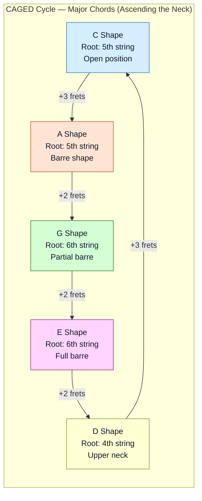
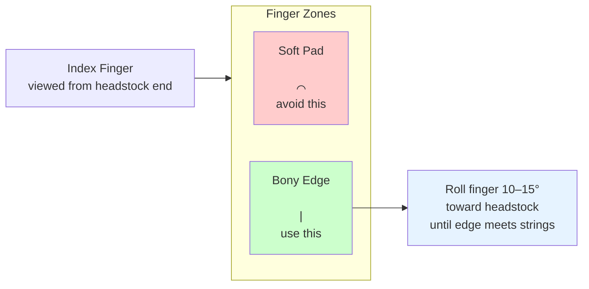
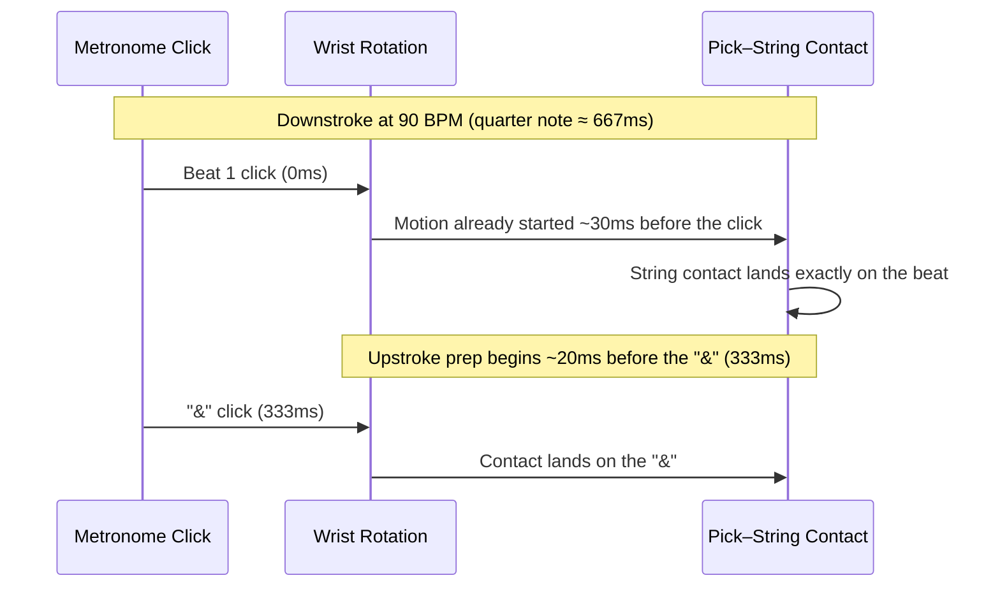
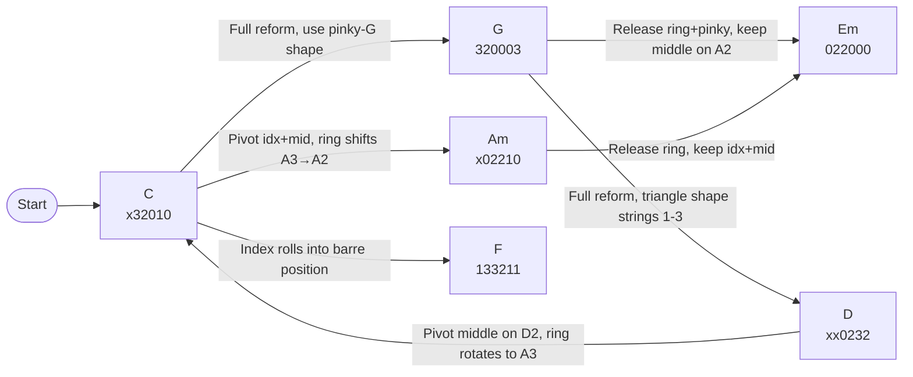
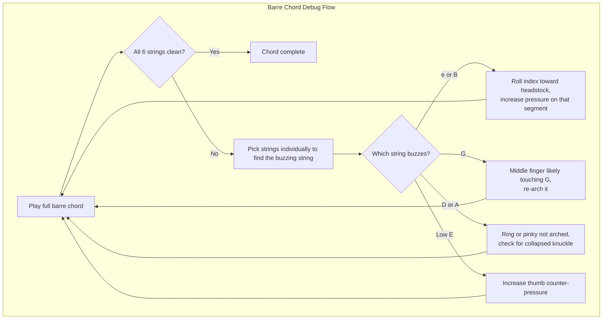
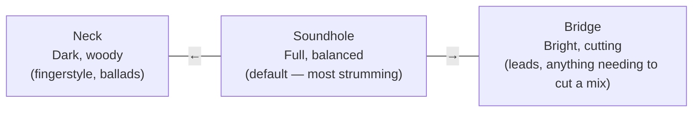
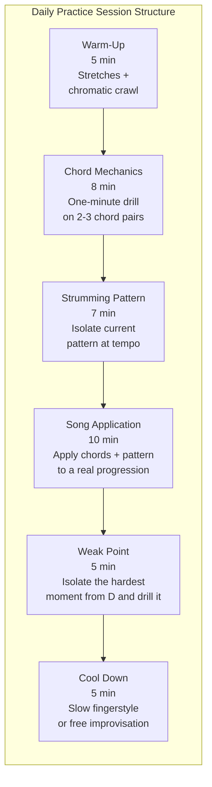
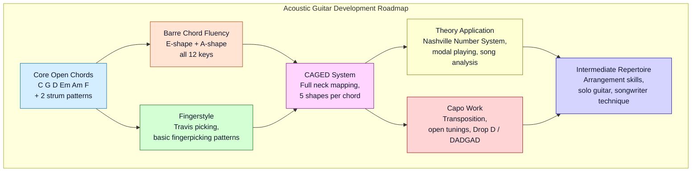

# Acoustic Guitar Masterclass: Chords, Strumming & Fretboard Mastery

## 1. First-Principles Intuition: Why the Guitar Works (Read Once, Internalize, Move On)

### Resonance, Tension, and Tone

When you pluck a string, it vibrates at a fundamental frequency set by three things: **length** (nut to bridge, shortened by fretting), **tension** (tuning tightness), and **mass** (string gauge). That vibration drives the spruce or cedar top through the bridge, and the top plus the air cavity inside the body act as a coupled resonator — amplifying some frequencies more than others depending on body size and bracing. Dreadnoughts and jumbos push more low-end because they move more air; OO and parlor bodies respond faster to light touch and emphasize mids, which is why they record well for fingerstyle.

Practical takeaway, no formula needed: **fretting halfway up the neck (12th fret) doubles the pitch** — one octave. The 7th fret gives you a natural harmonic a perfect fifth above the open string, which is why it's your go-to spot for quick tuning checks by ear (harmonic at fret 5 on one string against harmonic at fret 7 on the adjacent string). Fret spacing narrows as you go up the neck because the length-to-pitch relationship is exponential, not linear — that's also why capoing higher up makes chords feel tighter under the fingers.

### Why Chords Feel the Way They Do

A major chord (root–3rd–5th) echoes the natural overtone series closely, which is why it sounds settled and bright. Flatten the 3rd by one semitone and you get a minor chord — the notes drift slightly out of alignment with that overtone series, producing the moodier, introspective color. Neither is "right" — it's just proximity to acoustic consonance versus a deliberate step away from it, and composers use that gap for emotional effect.

Equal temperament is the compromise that lets all this work on a single fretted instrument: every fret is an equal frequency step, so you can play in any key without re-tuning, at the tiny cost of every interval except the octave being very slightly impure. Your ear doesn't care. Moving on to actually playing the thing.

---

## 2. Posture, Ergonomics & Hand Mechanics

Fix your setup before you fix your playing. Bad posture doesn't just slow progress — it actively builds the wrong muscle memory, and every hour of practice reinforces it.

### Seated Position Options

**Classical position** (footstool, guitar on left thigh):
- Left foot elevated 10–15 cm on a footstool or guitar support
- Waist of the guitar rests on left thigh, neck angled up 30–45°
- Right forearm contacts the lower bout near the elbow, wrist hangs free and loose
- Use for: fingerstyle, Travis picking, anything needing fretting-hand reach up high

**Casual/folk position** (guitar on right thigh):
- Neck roughly parallel to the floor
- Right forearm rests along the upper bout
- Fine for strumming-heavy playing. Watch for the neck dipping below horizontal — that forces your fretting wrist into hyperextension to compensate, which is a direct path to wrist strain

**Standing with a strap:**
- Set the strap so the guitar sits at the same height and angle as your seated position — stand up, play a chord, note where the neck is, adjust strap to match
- Dropping the guitar to hip/knee height forces your fretting elbow out and wrist into extreme flexion. Looks good in photos, ruins barre chords live

### Fretting Hand: The Arch

Your fingers contact the string at the tip, with the first knuckle (closest to the fingertip) staying upright, not collapsed flat. A collapsed knuckle lays the finger pad flat across the fretboard, which mutes the string underneath it — this is the single most common cause of a "dead" adjacent string in beginner chord shapes.

**Self-check**: fret a note on the D string with your middle finger. Without moving anything else, try to pluck the G string right next to it. If it's muted, your knuckle collapsed. Rebuild the arch — bring the fingertip in steeper, more perpendicular to the fretboard.

**Thumb placement**:
- Default: thumb pad (not the side, not the tip) centered on the back of the neck, roughly opposite your 2nd finger
- Open chords: thumb can creep slightly over the top edge to help mute the low E string — common in blues and folk fingerings
- Barre chords: thumb drops to dead-center back of the neck, directly behind the index finger, acting as the lever arm the index finger presses against

**Minimum effective pressure**: fret a note, then slowly release pressure until it just starts to buzz. That threshold is your minimum. Practice fretting at roughly 10% more than that threshold, no more. Overgripping is the single biggest cause of forearm fatigue, tendinitis, and chronically sharp (overbent) pitch on sustained notes.

### Picking/Strumming Hand: Wrist as the Engine

The strum comes from wrist rotation, not elbow pumping. Forearm rests lightly on the lower bout as a stable pivot; the hand and pick rotate around the wrist like a hinge.

- **Pick angle**: 15–25° off the string plane for standard acoustic strumming. Flatter (near 0°) = bright, thin, fast attack. Steeper (up to 40°) = fuller, warmer, slightly slower attack with more string resistance felt in the hand.
- **Pick grip**: pick between thumb pad and the side of the index finger, 5–8mm of tip exposed beyond the fingers. Firm enough to survive fast strumming, loose enough to flex slightly on contact. If your forearm tenses while strumming, loosen the grip first — tension almost always starts in the fingers and travels up.
- **Attack position** changes tone directly: over the soundhole = full and balanced (default), toward the bridge = bright and cutting, toward the neck = warm and dark. More in Section 11.

---

## 3. The CAGED System: Your Fretboard Map

CAGED is five movable chord shapes, named after the open chords they're derived from, that tile the entire fretboard in a repeating cycle. Learn these five shapes cold and every major (and with small adjustments, minor and dominant) chord becomes reachable in any position.



### C Major Across the Full Neck (Same Pitches, Five Locations)

```
Position 1: C Shape (open)        Position 2: A Shape (barre, fret 3)
e |--0--                          e |--3--
B |--1--  index                   B |--5--  barre (index)
G |--0--                          G |--5--  barre (index)
D |--2--  middle                  D |--5--  barre (index)
A |--3--  ring                    A |--3--  (open within barre)
E |--x--                          E |--x--

Position 3: G Shape (fret 5)      Position 4: E Shape (fret 8)
e |--8--  pinky                   e |--8--  barre (index)
B |--8--  ring                    B |--8--  barre (index)
G |--9--  middle                  G |--9--  middle
D |--10-- barre (index)           D |--10-- ring
A |--10-- barre (index)           A |--10-- pinky
E |--8--  index                   E |--8--  barre (index)

Position 5: D Shape (fret 10)
e |--12-- pinky
B |--13-- ring (often omitted live for a thinner voicing)
G |--12-- middle
D |--10-- barre (index)
A |--x--
E |--x--
```

**Drill**: pick any fretted note at random on strings 5 or 6. Name which CAGED shape's root sits there, then build the full chord shape around it from memory. Do this for five minutes daily — it's what converts CAGED from a chart you've seen into a map you actually use while improvising chord voicings on the fly.

---

## 4. Open Chord Vocabulary: Exact Fingerings

Diagram convention used throughout: strings listed low to high (**E A D G B e**), numbers are fret positions, **x** = don't play that string, **0** = open string, finger numbers 1=index, 2=middle, 3=ring, 4=pinky.

```
E Major (022100)          E Minor (022000)
e |--0--                  e |--0--
B |--0--                  B |--0--
G |--1-- (1)               G |--0--
D |--2-- (2)               D |--2-- (2)
A |--2-- (3)               A |--2-- (3)
E |--0--                  E |--0--

A Major (x02220)          A Minor (x02210)
e |--0--                  e |--0--
B |--2-- (3)               B |--1-- (1)
G |--2-- (2)               G |--2-- (2)
D |--2-- (1)               D |--2-- (3)
A |--0--                  A |--0--
E |--x--                  E |--x--
(Alt: barre fingers 1-2-3 flat across fret 2 with one finger)

D Major (xx0232)          D Minor (xx0231)
e |--2-- (2)               e |--1-- (1)
B |--3-- (3)               B |--3-- (3)
G |--2-- (1)               G |--2-- (2)
D |--0--                  D |--0--
A |--x--                  A |--x--
E |--x--                  E |--x--

G Major (320003)          C Major (x32010)
e |--3-- (4 pinky)        e |--0--
B |--0--                  B |--1-- (1)
G |--0--                  G |--0--
D |--0--                  D |--2-- (2)
A |--2-- (2)               A |--3-- (3)
E |--3-- (3)               E |--x--
(Alt low voicing: swap fingers 2/3 on A and E
to free the pinky for pull-offs or added notes)

F Major (133211) — Full Barre      G7 (320001)
e |--1-- barre (1)                  e |--1-- (1)
B |--1-- barre (1)                  B |--0--
G |--2-- (2)                        G |--0--
D |--3-- (3)                        D |--0--
A |--3-- (4)                        A |--2-- (2)
E |--1-- barre (1)                  E |--3-- (3)
```

---

## 5. Barre Chord Mechanics: Building the F

F major at the 1st fret is the technical wall most players hit. It's purely mechanical — fix the geometry and the chord opens up in days, not months.

### Index Finger as a Ridge, Not a Pad

Roll the index finger slightly toward the headstock so the firmer, bony edge of the finger contacts the strings instead of the soft fingerprint pad. The bony edge transmits pressure more efficiently, meaning less total squeeze for the same clean note.



**Clean F checklist:**

1. Thumb directly behind the index, centered on the back of the neck — not hooked over the top
2. Wrist dropped slightly away from the neck so fingers 2–4 arch naturally without extra effort
3. Index finger pressed as close behind the fret wire as possible without touching it
4. Fingers 2–4 stay arched — a collapsed ring or pinky knuckle is the usual culprit when the G or B string dies
5. Isolate: play the chord, then pick each string individually from low to high. Whichever string buzzes tells you exactly which finger needs adjusting — don't guess, test string by string every time

### Progressive Barre Approach — Build Strength Where It's Easiest First

The nut end of the neck has the highest string tension and widest fret spacing, making it the hardest place to barre. Start higher up where it's physically easier, then work down.

```
Week 1: Barre at fret 7  (easiest)  → A-shape fingering = B major chord
Week 2: Barre at fret 5             → E-shape fingering = A major chord
Week 3: Barre at fret 3             → E-shape fingering = G major chord
Week 4: Barre at fret 1  (hardest)  → E-shape fingering = F major chord
```

**Daily barre builder** (2 minutes, every day, separate from your main practice session): barre your current comfortable fret, pick each string to confirm clean, release completely, re-press. 20 reps. No strumming involved — this is pure placement-and-release endurance training, and it builds strength without the fatigue of playing full songs on a chord you haven't mastered yet.

---

## 6. Essential Chord Progressions: Real Music, Real Context

### I–V–vi–IV ("The Axis Progression")

Key of G: **G – D – Em – C**

```
G (320003) → D (xx0232) → Em (022000) → C (x32010)

Strum (one bar each, 4/4):
Beat:   1   &   2   &   3   &   4   &
Strum:  D   .   D   U   .   D   U   .
```

Covers: *Let Her Go, Someone Like You, No Woman No Cry, Africa*, and thousands more — this four-chord loop is the most commercially used progression in modern popular music.

Same progression, key of C: **C – G – Am – F**

### I–IV–V (Blues and Rock Backbone)

Key of E: **E – A – B7**

```
E (022100) → A (x02220) → B7 (x21202)

B7 fingering:
e |--2-- (1)
B |--0--
G |--2-- (2)
D |--1-- (1, flat against same fret as B string — roll slightly)
A |--2-- (3)
E |--x--

12-bar shuffle feel:
Beat:   1  &  2  &  3  &  4  &
Strum:  D  .  D  U  .  U  D  U
```

### I–vi–IV–V (50s Progression / Doo-Wop)

Key of C: **C – Am – F – G**

```
C (x32010) → Am (x02210) → F (133211) → G (320003)
```

Notice the pivot: ring finger stays planted on the 3rd fret of the A string through the entire C-to-Am change — only the index and middle fingers lift and reposition. This is efficient chord geometry: the fewer fingers that move, the faster and cleaner the transition.

### ii–V–I (Jazz Cadence)

Key of G: **Am7 – D7 – Gmaj7**

```
Am7 (x02010)          D7 (xx0212)           Gmaj7 (320002)
e |--0--              e |--2-- (2)           e |--2-- (2)
B |--1-- (1)           B |--1-- (1)           B |--0--
G |--0--              G |--2-- (3)           G |--0--
D |--2-- (2)           D |--0--              D |--0--
A |--0--              A |--x--              A |--2-- (1)
E |--x--              E |--x--              E |--3-- (3)
```

---

## 7. Strumming: Patterns, Mechanics, and Rhythm Feel

### Four Core Patterns — Learn in This Order

**Pattern 1 — All Downstrokes**
```
Beat:   1    2    3    4
        D    D    D    D
Metronome: 60 → 80 → 100 BPM
Feel: driving, locked — country and rock ballad foundation
```

**Pattern 2 — 8th Note Down-Up**
```
Beat:   1   &   2   &   3   &   4   &
        D   U   D   U   D   U   D   U
Metronome: 60 → 90 → 120 BPM
Feel: even and flowing — the pattern everything else builds from
```

**Pattern 3 — "Skip" Pattern (the most common pop/folk feel)**
```
Beat:   1   &   2   &   3   &   4   &
        D   .   D   U   .   U   D   U
Metronome: 70 → 90 → 110 BPM
Feel: syncopated, appears in thousands of recorded songs
```

**Pattern 4 — 16th Note Syncopation with Ghost Strokes**
```
Beat:   1  e  &  a  2  e  &  a  3  e  &  a  4  e  &  a
        D  .  U  .  D  .  U  U  D  .  U  .  D  U  .  U
Metronome: 60 → 80 BPM (16ths feel fast — do not rush this)
Feel: funk/R&B-tinged contemporary acoustic pop
```

> **Ghost stroke rule**: your strumming hand moves in a continuous, unbroken pendulum of 8th or 16th notes. On a rest or "skip," the hand still swings through the same arc — it just doesn't touch the strings. Stopping the pendulum to wait for the next hit is the #1 cause of rushed, uneven strumming. Keep it moving even through silence.

### Percussive Muted Hits ("Chucks")

Mid-phrase, relax fretting-hand pressure just enough that fingers stay on the strings but don't fret a clean note. Strum through — you get a percussive "chk" with no pitch, notated **X**.

```
Beat:   1   &   2   &   3   &   4   &
        D   X   D   U   X   U   D   X
```

These punctuate strumming grooves across folk and pop and are often the difference between a strum pattern that sounds "programmed" and one that grooves.

### Timing: Motion Precedes the Beat



**Takeaway**: the pick touches the strings exactly on the beat, but the wrist starts moving slightly before it. Players who wait for the click before moving are always late — this predictive, not reactive, motion is what separates locked-in rhythm playing from dragging or rushing.

---

## 8. Chord Transition Drills: The Engine Room

### The One-Minute Chord Change Drill

Pick two chords. Set a metronome to a tempo where you can change cleanly even if slow. Play each chord for one beat, switch, repeat for 60 seconds, count every clean change. That number is your baseline — write it down.

```
Week 1 target (clean changes per minute, 60 BPM):
  C ↔ G:  20+
  G ↔ D:  20+
  D ↔ Em: 20+
  Em ↔ C: 20+

Week 4 target: 30+ at 80 BPM
Week 8 target: 40+ at 100 BPM
```

### Pivot Finger Strategy

Before switching, find any finger that lands on the same string and fret in both chords. That finger stays down through the transition — it's your anchor and your timing reference.

```
C → Am:
  C  (x32010): index on B1, middle on D2, ring on A3
  Am (x02210): index on B1, middle on D2, ring on A2
  → Index and middle never move. Only the ring finger shifts one fret (A3 → A2).
```

```
G → Cadd9, using the pinky G voicing (320004):
  G (pinky on e, ring on A2, middle on E3)
  Cadd9 (x32033): ring shifts to A3, pinky stays open on e,
  add middle on D2
  → Pinky becomes the through-line across G → Cadd9 → Em7 → Dsus4,
    a common open-voicing move in contemporary acoustic pop.
```

### Chord Change Map (Common Transitions)



---

## 9. Fingerstyle Foundation: Travis Picking

Travis picking is the backbone of folk, country, and solo acoustic fingerstyle. The thumb runs an independent alternating bass line while the fingers pick out a separate treble pattern on top — two rhythmic voices at once, which is what gives it that "more than one guitar" sound from a single player.

### Right Hand Assignment

```
Thumb  (p) → alternates between 6th and 4th strings
             (use 5th and 4th instead for A-root chords like Am, C)
Index  (i) → 3rd string
Middle (m) → 2nd string
Ring   (a) → 1st string
```

### Basic Pattern on G Major

```
e |--------3---------3---------3---------3--|
B |------0---0-----0---0-----0---0-----0---0|
G |----0-------0-0-------0-0-------0-0-------|
D |--0---------0-----------0-----------0-----|
A |-------------------------------------------|
E |3-----------3-----------3-----------3-----|

Right hand:  p      i  m   p      i  m   p      i  m   p      i  m
```

Thumb hits E6 on beat 1, D4 on beat 3; index and middle fill in the off-beats on the top three strings, creating a rolling, syncopated texture even though the chord never changes.

### Travis Metronome Progression

```
Phase 1 — Thumb only, 50 BPM
  Alternate E6–D4 every beat, no other fingers playing.
  Goal: the bass line is rock solid with zero hesitation before
  you add anything on top.

Phase 2 — Thumb + pinch on beat 1, 50 BPM
  Beat 1: thumb and middle finger strike together (a "pinch").
  All other beats: thumb alone.
  Goal: feel the two voices as genuinely separate motions.

Phase 3 — Full pattern, 50 → 70 → 90 BPM
  Play the complete pattern above. Only introduce chord changes
  once the pattern is fully automatic at 70 BPM — adding chord
  changes too early is the most common reason Travis picking
  stalls out for beginners.
```

---

## 10. Failure Modes, Diagnostics & Fixes

### Muted or Buzzing Strings

**Causes**: collapsed first knuckle muting the adjacent string; finger positioned mid-fret instead of close behind the fret wire (requires more pressure, buzzes more easily at the same force); thumb riding too high on the neck, flattening the fretting angle of the fingers.

**Diagnostic**: play the full chord, then pick each string individually, low to high. The string that buzzes or goes dead tells you exactly which finger to fix — don't re-fret the whole chord blindly.

**Fix**: isolate the offending finger. Hover it over the correct spot, press alone until the note rings clean, then rebuild the rest of the chord around it.

### Slow Chord Changes

**Cause**: lifting every finger simultaneously and placing them one at a time on the new shape ("serial" transition) instead of moving all non-pivot fingers together as one unit ("parallel" transition).

**Fix**: find the pivot finger(s) from Section 8 and anchor them. Practice the change in slow motion — two full seconds per chord — moving everything else as a single coordinated shift, not finger by finger. Speed comes after the motion is unified, not before.

### Strumming Out of Time

**Causes**: reactive timing (waiting for the click before starting the stroke, which means you're always late); stopping the pendulum motion during rests instead of ghosting through them.

**Diagnostic**: record yourself against a metronome, import into Audacity or GarageBand, zoom into the waveform. Strum attacks should land exactly on the grid. Consistently late means reactive timing; consistently early means rushing.

**Fix**: set the metronome to click only on beats 2 and 4. This forces you to hold the subdivision internally rather than relying on the click for every beat. Start at 50 BPM on "2 and 4" (which feels like 100 BPM in quarters), and keep the full pendulum motion running through every rest.

### Arm-Dominant Strumming

**Cause**: large elbow movement substituting for wrist rotation — slow, imprecise, and falls apart above roughly 100 BPM.

**Diagnostic**: watch your elbow in a mirror while strumming. It should barely move (1–2 cm). If the whole forearm is pumping, the elbow is doing work that belongs to the wrist.

**Fix**: rest the elbow lightly against the guitar body as a physical anchor. Spend 10 minutes at 60 BPM doing downstrokes only, wrist hinging, forearm still. Only add upstrokes once the downstroke motion feels automatic.

### Barre Chord Partial Muting

**Causes**: index finger landing on a fret-wire seam where a gap in finger contact mutes a string; insufficient thumb counter-pressure from behind the neck; index finger not rolled enough onto its bony edge.

**Fix protocol**:
1. Barre alone, no other fingers. Pick each string individually.
2. Roll the index slightly more toward the headstock until the buzzing string clears.
3. Add thumb counter-pressure, pushing the neck forward into the barre.
4. If a string still buzzes, shift that part of the index finger 1–2mm and recheck.
5. Only then layer in fingers 2, 3, 4.



### Injury Warning Signs

**Stop immediately if you feel**: sharp or shooting pain (distinct from normal muscle fatigue), tingling or numbness in fingers or palm, or any pain lasting more than 24 hours after playing. These are nerve or tendon signals, not something to practice through.

**Pre-practice warm-up (5 minutes, every session):**
```
1. Wrist circles — 10 slow rotations each direction, both wrists
2. Finger spreads — splay fingers wide, hold 5 sec, 5 reps
3. Forearm extensor stretch — arm out, palm down, gently
   pull fingers back with the other hand, hold 20 sec per arm
4. Prayer stretch — palms together at chest height, lower
   hands slowly while keeping palms touching, hold 15 sec
5. Light chromatic crawl — frets 1–4 across all strings, slow
```

Take a 5-minute break every 25–30 minutes of playing. Never push through pain.

---

## 11. Tone Production: Mostly in Your Hands

Two players on the same guitar sound different because of three variables entirely under your control, independent of gear.

### Attack Position



### Pick Angle

```
15° (near parallel):  thin, bright, fast attack — bluegrass lead feel
25° (moderate):        balanced warmth and clarity — general strumming
40° (steep):           full, round, slightly slower attack — ballads
```

### Dynamic Range

Varying strum force within a song — a verse at roughly 30% intensity building to a chorus at 80% — creates emotional lift without changing a single chord or note. This is the cheapest, most immediate expressive tool you have, and most beginners never touch it because they're focused entirely on getting chords right.

### Calibration Exercise (10 minutes, once)

Loop a 4-bar G–D–Em–C progression nine times with a voice recorder running, changing one variable per pass: three attack positions (neck, soundhole, bridge) × three pick angles (15°, 25°, 40°). Listen back immediately. You're building a mental map of your own tonal palette — something no amount of gear shopping replaces.

---

## 12. Progressive Practice System: 30 Days to Real Playing

### Daily Session Structure (20–45 minutes)



### 4-Week Curriculum

**Week 1 — Foundation (60–70 BPM)**
- Chords: Em, Am, E, A
- Pattern: all downstrokes, quarter notes
- Progression: Em – Am – E – Am
- Goal: every string rings clean on every chord, no exceptions

**Week 2 — Open Set (70–80 BPM)**
- Add: C, G, D, Dm
- Pattern: 8th note down-up (Pattern 2)
- Progression: G – D – Em – C
- Goal: transitions under 0.5 seconds, smooth at tempo

**Week 3 — Syncopation (75–90 BPM)**
- Add: G7, Am7, Dsus2
- Pattern: Skip pattern (Pattern 3)
- Progression: C – Am – F – G (introduce the F barre here)
- Goal: muted percussive hits land cleanly on the "&" of 2 and "&" of 4

**Week 4 — Integration (85–100 BPM)**
- Full open chord set plus F barre chord
- Patterns: switch between Pattern 2 and Pattern 3 across verse/chorus
- Progressions: I–V–vi–IV in both G and C; ii–V–I in G (Am7–D7–Gmaj7)
- Goal: play a complete 3-minute song with no stopping

### Progress Log

```
Date      | Chord Pair | Tempo | Clean Changes/min | Target
----------|-------------|-------|--------------------|--------
Day 1     | C → G       | 60    | 14                 | 20
Day 7     | C → G       | 60    | 21                 | 25
Day 14    | C → G       | 70    | 18                 | 25
Day 21    | C → G       | 80    | 20                 | 25
Day 28    | C → G       | 90    | 20                 | 25
```

The tempo where you consistently hit 25 clean changes per minute is your "mastery tempo" for that pair. Once reached, raise both the target count and the tempo.

---

## 13. Next Steps: Expanding the Vocabulary

Once the core open chords and two strumming patterns are solid at 90 BPM:



The two highest-leverage next moves after open chords:

1. **Barre chords** — unlock every key and let you move existing patterns anywhere on the neck instead of being tied to open position
2. **Travis picking** — the most expressive solo acoustic texture; once automatic, you function as a complete musician rather than someone who just strums along

Both reward slow, consistent daily practice far more than grinding at speed with sloppy technique. Slow and clean compounds into real skill. Fast and sloppy just entrenches the habits you'll have to unlearn later.
