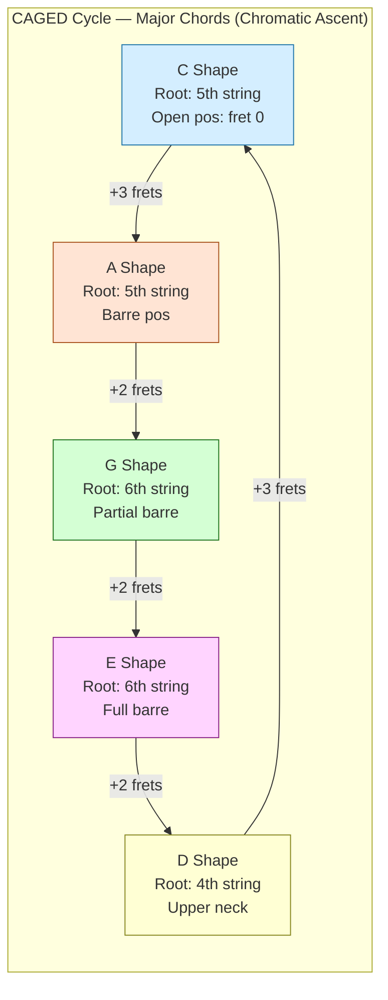
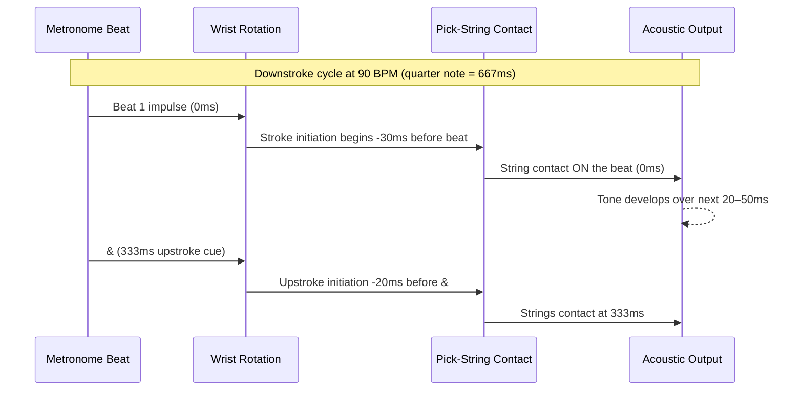
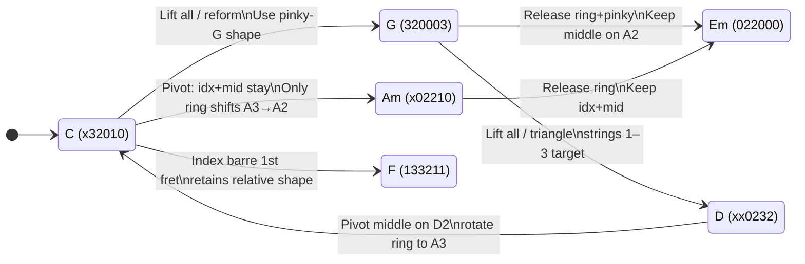
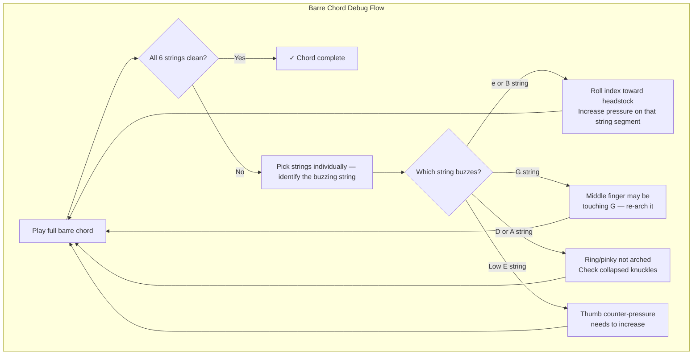
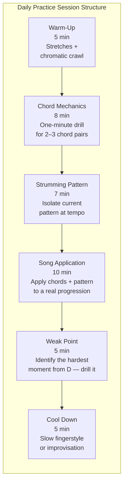
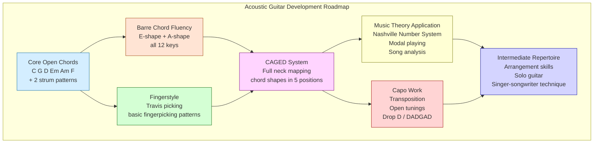

# Acoustic Guitar Masterclass: Chords, Strumming & Fretboard Mastery

## 1. First-Principles Intuition: Why the Guitar Works

### Resonance, Tension, and Tone in 60 Seconds

When you pluck a string, you set it vibrating at a fundamental frequency determined by three things: **length** (scale length minus the fretted point), **tension** (how tight the string is), and **mass** (string gauge). That vibrating string pushes air through the soundhole and flexes the spruce top, which acts as a coupled resonator amplifying certain frequencies over others. Heavier-bodied guitars (dreadnoughts, jumbos) emphasize bass frequencies; smaller-bodied guitars (OO, parlor) are more balanced and responsive to light touch.

One useful physical intuition: pressing the 12th fret **halves** the vibrating string length, which **doubles** the frequency — an octave up. The 7th fret produces 2/3 of the string length, giving you the natural harmonic at a perfect fifth above. You don't need the formula tattooed on your wrist — just understand that **up the neck = shorter string = higher pitch**, and that this relationship is exponential, not linear, which is why fret spacing narrows as you ascend.

### Why Chords Sound the Way They Do

A major chord (root, major 3rd, perfect 5th) mirrors the 4th, 5th, and 6th harmonics of the natural overtone series. These intervals are acoustically "at home" with each other — they don't beat or clash — which is why major chords sound bright and resolved. A minor chord swaps the major 3rd (4 semitones) for a minor 3rd (3 semitones), landing between natural overtones. That slight misalignment is what gives minor chords their introspective, darker quality. It's not dissonance; it's a subtle departure from the overtone series.

**Equal temperament** means every fret represents exactly 1/12 of an octave (a frequency ratio of ≈1.05946). It's a mathematical compromise that lets you play in every key on the same guitar without retuning — but it means every interval except the octave is very slightly "out of pure tune." Your ear accepts this because the deviations are small and consistent.

---

## 2. Posture, Ergonomics & Hand Mechanics

Getting your body position right before touching a chord prevents injuries and directly determines how good you'll sound. No amount of practice fixes bad posture — it just deepens it.

### Classical vs. Casual Seated Position

**Classical position** (right leg, guitar tilted back):
- Left foot elevated on footstool or guitar support
- Guitar waist rests on left thigh, neck angled up 30–45°
- Right forearm rests on the lower bout, wrist floating free
- Best for: fingerstyle, classical, complex chord work

**Casual/Folk position** (right leg, neck roughly horizontal):
- Guitar sits on right thigh, neck roughly parallel to floor
- Right forearm rests on the upper bout curve
- Fine for strumming-dominant playing, but watch the wrist — if the neck dips below horizontal, your fretting wrist hyperextends to compensate

**Standing with strap:**
- Strap height matters enormously — too low forces your fretting wrist into extreme flexion
- Target strap height: guitar at the same position as your seated playing position
- A strap that lets the guitar hang at your knees looks cool and destroys your technique

### Fretting Hand Mechanics

```
Correct finger arch (side view):

    Fingertip contact point
           |
    ┌──────▼──────┐
    │  ○            │   ← Curved arch — 1st knuckle stays UP
    │   \           │
    │    ──────────│   ← String plane
    │      Fretboard│
    └──────────────┘

Collapsed knuckle (WRONG):

    ┌───────────────┐
    │  ___________  │   ← Flat finger mutes adjacent strings
    │             \ │
    │    ──────────│
    └──────────────┘
```

**Thumb placement on the back of the neck:**
- Thumb tip rests roughly behind the 2nd finger, centered on the back of the neck
- Thumb pad, not the side of the thumb — this keeps the wrist low and fingers arched
- For open chords: thumb can wrap slightly over the top to assist muting the low E string (blues/folk technique)
- For barre chords: thumb drops to center-back of neck, providing the lever arm against your index finger

**Minimum effective pressure** is the most important concept a beginner needs. Press just hard enough for a clean note — then consciously back off 10%. Over-squeezing is the #1 cause of fatigue, tendinitis, and sharp intonation. Test: fret a note, gradually release pressure. The moment it buzzes, that's slightly below the threshold. Work just above it.

### Picking/Strumming Hand Mechanics

The motion source for strumming is the **wrist**, not the elbow or shoulder. The forearm rests on the guitar body as a pivot point. Think of your wrist as a door hinge — the door (hand and pick) swings; the frame (forearm) stays relatively still.

- **Pick angle**: 15–25° relative to the string plane for most acoustic strumming. Zero degrees (pick parallel to strings) gives the brightest, thinnest attack. 45° gives a fuller, slightly warmer attack with more string resistance.
- **Pick grip**: Thumb pad to index side, pick protruding 5–8mm. Firm enough that it won't fly out at speed, loose enough that it flexes slightly on contact. If your forearm tenses when you strum, your grip is too tight.
- **Attack position**: Strum over the soundhole for a full, balanced tone. Move toward the bridge for a bright, cutting tone. Move toward the neck for a warm, pillowy tone.

---

## 3. The CAGED System: Your Fretboard Map

The CAGED system is the most important organizational framework for acoustic guitar. Five movable shapes — derived from the five open-position chords — tile the entire neck in a continuous cycle. Learn these five shapes, and every major chord in every position is accessible.



### C Major Across the Full Neck

Every chord position below sounds C–E–G (C major), just in different voicings and registers:

```
Position 1: C Shape (open)        Position 2: A Shape (barre 3)
e |--0--                          e |--3--
B |--1--  ← index                 B |--5--  ← barre (index)
G |--0--                          G |--5--  ← barre (index)
D |--2--  ← middle                D |--5--  ← barre (index)
A |--3--  ← ring                  A |--3--  ← not played / muted
E |--x--                          E |--x--

Position 3: G Shape (5th fret)    Position 4: E Shape (8th fret)
e |--8--  ← pinky                 e |--8--  ← barre (index)
B |--8--  ← ring                  B |--8--  ← barre (index)
G |--9--  ← pinky alt             G |--9--  ← middle
D |--10-- ← barre partial         D |--10-- ← ring
A |--10-- ← barre partial         A |--10-- ← pinky
E |--8--  ← index                 E |--8--  ← barre (index)

Position 5: D Shape (10th fret)
e |--12--  ← pinky
B |--13--  ← (not played in D shape typically)
G |--12--  ← middle
D |--10--  ← open (capo reference)
A |--x--
E |--x--
```

**Practical drill**: Pick any single note on the fretboard. Name the CAGED shape whose root sits closest to that note. This trains you to see the neck as interconnected shapes rather than isolated dots.

---

## 4. Open Chord Vocabulary: Exact Fingerings

Every chord diagram below uses this convention:
- Strings: **E A D G B e** (low to high)
- Numbers: fret position
- **x** = muted (don't strike), **0** = open string
- Finger numbers: 1=index, 2=middle, 3=ring, 4=pinky, T=thumb

### The Core Open Chords (Campfire Set)

```
E Major (022100)          E Minor (022000)
e |--0--                  e |--0--
B |--0--                  B |--0--
G |--1-- ← 1 (index)      G |--0--
D |--2-- ← 2 (middle)     D |--2-- ← 2 (middle)
A |--2-- ← 3 (ring)       A |--2-- ← 3 (ring)
E |--0--                  E |--0--
Fingers: x 2 3 1 x x      Fingers: x 2 3 x x x

A Major (x02220)          A Minor (x02210)
e |--0--                  e |--0--
B |--2-- ← 3 (ring)       B |--1-- ← 1 (index)
G |--2-- ← 2 (middle)     G |--2-- ← 2 (middle)
D |--2-- ← 1 (index)      D |--2-- ← 3 (ring)
A |--0--                  A |--0--
E |--x--                  E |--x--
Alt: barre 2nd fret       Fingers: x x 3 2 1 x
with 1 finger (index)

D Major (xx0232)          D Minor (xx0231)
e |--2-- ← 2 (middle)     e |--1-- ← 1 (index)
B |--3-- ← 3 (ring)       B |--3-- ← 3 (ring)
G |--2-- ← 1 (index)      G |--2-- ← 2 (middle)
D |--0--                  D |--0--
A |--x--                  A |--x--
E |--x--                  E |--x--

G Major (320003)          C Major (x32010)
e |--3-- ← 4 (pinky)      e |--0--
B |--0--                  B |--1-- ← 1 (index)
G |--0--                  G |--0--
D |--0--                  D |--2-- ← 2 (middle)
A |--2-- ← 2 (middle)     A |--3-- ← 3 (ring)
E |--3-- ← 3 (ring)       E |--x--
Alt low: 2 (middle) on A
         1 (index) on E

F Major (133211) — Barre   G7 (320001)
e |--1-- ← 1 barre        e |--1-- ← 1 (index)
B |--1-- ← 1 barre        B |--0--
G |--2-- ← 2 (middle)     G |--0--
D |--3-- ← 3 (ring)       D |--0--
A |--3-- ← 4 (pinky)      A |--2-- ← 2 (middle)
E |--1-- ← 1 barre        E |--3-- ← 3 (ring)
```

---

## 5. Barre Chord Mechanics: Building the F

The F major barre chord at the 1st fret is the wall most guitarists hit and either climb or give up at. Here's the biomechanics of climbing it.

### Index Finger Placement (The Barre)

Your index finger is not a flat pad — it's a ridge. Roll it very slightly toward the headstock (toward your thumb side) so the **bony edge** of the finger, not the soft fingerprint pad, contacts the strings. This edge is firmer and requires less force for a clean press.

```
Index finger cross-section (looking from headstock end):

     ← Toward headstock    Toward body →
     
     Soft pad side         Bony edge side
         ⌒                      |
        /  \                    |   ← USE THIS EDGE
       /    \                   |
      └──────┘
      
Roll 10–15° toward bony edge.
Not so much that pain occurs — just enough to feel the firmer surface.
```

**Checklist for a clean F barre:**

1. **Thumb position**: Directly behind the index finger on the back of the neck, centered — not hooked over the top
2. **Wrist**: Dropped slightly away from the neck, creating a forward bow that naturally arches fingers 2, 3, 4
3. **Index finger**: Pressed as close behind the 1st fret wire as possible without touching it
4. **Arch in fingers 2–4**: Each additional finger must stay arched — collapsed knuckles on the ring or pinky kill the G or B string
5. **Check each string individually**: Press the full chord, then pick strings one at a time, low to high. Identify exactly which string buzzes and adjust that specific finger

### Barre Chord Progressive Approach

Don't start at the 1st fret. The nut adds extra resistance — start at the 5th fret where string action is easier and move down as strength builds.

```
Week 1: Barre at 7th fret (easiest)   → A major shape = E major chord
Week 2: Barre at 5th fret             → E major shape = A major chord
Week 3: Barre at 3rd fret             → E major shape = G major chord
Week 4: Barre at 1st fret             → E major shape = F major chord
```

**Daily barre builder drill**: 2 minutes per day, every day.
Hold the barre at your current comfortable fret. Press, check each string, release, re-press. Repeat 20 times. No strumming — pure placement and release. This builds targeted endurance without fatigue.

---

## 6. Essential Chord Progressions: Real Music, Real Context

Theory means nothing until it sounds like a song. These progressions cover the vast majority of folk, rock, pop, and country guitar.

### The I–V–vi–IV (The Axis Progression)

In the key of G: **G – D – Em – C**

```
G (320003) → D (xx0232) → Em (022000) → C (x32010)
  3 fr          3 fr          2 fr          3 fr

Beat: 1 2 3 4 | 1 2 3 4 | 1 2 3 4 | 1 2 3 4
Strum: D D U D U | D D U D U | D D U D U | D D U D U
```

Covers: *Let Her Go, Someone Like You, No Woman No Cry, Africa* (thousands more)

**Key of C:** C – G – Am – F *(same harmonic function, different shapes)*

### The I–IV–V (Blues and Rock Foundation)

In the key of E: **E – A – B7**

```
E (022100) → A (x02220) → B7 (x21202)

B7 fingering:
e |--2-- ← 1 (index)
B |--0--
G |--2-- ← 2 (middle)
D |--1-- ← 1 (index, same barre position)
A |--2-- ← 3 (ring)
E |--x--

Strum pattern (12-bar feel):
Beat: 1  &  2  &  3  &  4  &
      D  .  D  U  .  U  D  U
```

### The I–vi–IV–V (50s Doo-Wop / Classic Rock)

In C: **C – Am – F – G**

```
C (x32010) → Am (x02210) → F (133211) → G (320003)
     ↑              ↑              ↑           ↑
  Pivot: ring    Pivot: ring  Barre index   Shift
  stays on A5    stays on A5
```

Notice the pivot finger: your ring finger stays on the 3rd fret of the A string through the C-to-Am change. Only the index and middle fingers move. This is **efficient chord geometry**.

### The ii–V–I (Jazz Foundation)

In G: **Am7 – D7 – G major 7**

```
Am7 (x02010)         D7 (xx0212)          Gmaj7 (320002)
e |--0--             e |--2-- ← 2(mid)    e |--2-- ← 2(mid)
B |--1-- ← 1(idx)   B |--1-- ← 1(idx)   B |--0--
G |--0--             G |--2-- ← 3(ring)   G |--0--
D |--2-- ← 2(mid)   D |--0--             D |--0--
A |--0--             A |--x--             A |--2-- ← 1(idx)
E |--x--             E |--x--             E |--3-- ← 3(ring)
```

---

## 7. Strumming: Patterns, Mechanics, and Rhythm Feel

### The Four Core Patterns (Build These First)

**Pattern 1 — All Downstrokes (Quarter notes)**
```
Beat:    1       2       3       4
         D       D       D       D
Target: 60 BPM → 80 BPM → 100 BPM
Feel: solid, driving, country/rock ballad
```

**Pattern 2 — 8th Note Down-Up**
```
Beat:    1   &   2   &   3   &   4   &
         D   U   D   U   D   U   D   U
Target: 60 BPM → 90 BPM → 120 BPM
Feel: even, flowing — the foundation pattern
```

**Pattern 3 — The "Skip" Pattern (most common pop/folk feel)**
```
Beat:    1   &   2   &   3   &   4   &
         D   .   D   U   .   U   D   U
         ↓       ↓   ↑       ↑   ↓   ↑
         hit  skip  hit  skip skip hit hit
Target: 70 BPM → 90 BPM → 110 BPM
Feel: syncopated — this is in thousands of songs
```

**Pattern 4 — 16th Note Syncopation (strumming with ghost strokes)**
```
Beat:    1  e  &  a  2  e  &  a  3  e  &  a  4  e  &  a
         D  .  U  .  D  .  U  U  D  .  U  .  D  U  .  U
         ↓     ↑     ↓     ↑  ↑  ↓     ↑     ↓  ↑     ↑
Target: 60 BPM → 80 BPM (16th notes feel fast — start slow)
Feel: funk/R&B, contemporary acoustic pop
```

> **The ghost stroke rule**: Your strumming hand moves in constant 8th-note or 16th-note pendulum motion. When you see a rest or a "skip," your hand still swings through — it just doesn't contact the strings. This keeps your time locked. Never stop the pendulum motion.

### Strumming with Muted Percussive Hits ("Chucks")

Mid-stroke, loosely release fretting-hand pressure so fingers still touch strings but don't fret them cleanly. Strum across those strings — they produce a percussive "chk" sound with no pitch. Notated with **X**.

```
Beat:    1   &   2   &   3   &   4   &
         D   X   D   U   X   U   D   X
         ↓   ✕   ↓   ↑   ✕   ↑   ↓   ✕

The X hits provide rhythmic punctuation — this is the basis
of "strumming grooves" in folk and pop.
```

### The Strum-Timing Sequence (What Happens Each Hit)



**Key takeaway**: Your physical motion must **precede** the beat. The pick touches strings *on* the beat, but your arm/wrist moves *before* it. This predictive timing, not reactive timing, is what separates locked-in players from rushed/dragging ones.

---

## 8. Chord Transition Drills: The Engine Room

Clean, fast chord changes are built through **deliberate isolation drills**, not just playing through songs and hoping it improves.

### The One-Minute Chord Change Drill

Pick two chords. Set a metronome to a tempo where you can change cleanly, even if slow. Play each chord for one beat, then switch. Count every clean change in 60 seconds. Record your score. This is your baseline.

```
Week 1 targets (clean changes per minute):
- C → G:  20+ changes at 60 BPM
- G → D:  20+ changes at 60 BPM
- D → Em: 20+ changes at 60 BPM
- Em → C: 20+ changes at 60 BPM

Week 4 targets:
- All pairs above: 30+ changes at 80 BPM

Week 8 targets:
- All pairs above: 40+ changes at 100 BPM
```

### Pivot Finger Strategy: Work Smarter

Before switching chords, identify which finger (if any) stays on the same string and fret. Keep that finger down during the transition — it's your anchor.

```
C → Am transition:
C (x32010): index on B1, middle on D2, ring on A3
Am(x02210): index on B1, middle on D2, ring on A2

Pivot: index (B, 1st fret) STAYS
       middle (D, 2nd fret) STAYS
       Only ring moves: A3 → A2 (one fret!)

This is a nearly effortless change — you're only moving one finger one fret.
```

```
G → Cadd9 (x32033) transition:
G (320003):   middle on A2, ring on E3, pinky on e3
Cadd9(x32033): ring on A3, middle on D2, pinky on B3, ring on G0

Better approach: use G with pinky on e (320004 fingering):
G pinky version: ring on A2, middle on E3, pinky on e3
Cadd9: ring stays on A3 (shift 1 fret), pinky stays on e3 (open)
       Add middle on D2

The pinky becomes the pivot across G → Cadd9 → Em7 → Dsus4 —
this is the classic "millennial whoop" open voicing technique.
```

### Chord Change State Map (Common Transitions)



---

## 9. Fingerstyle Foundation: Travis Picking

Travis picking is the backbone of folk, country, and acoustic fingerstyle. The thumb alternates between two bass strings while fingers pluck the treble strings — two independent rhythmic streams happening simultaneously.

### Right Hand Assignment (Standard Travis)

```
Thumb (p) → alternates between 6th and 4th strings (or 5th and 4th for A-root chords)
Index (i) → 3rd string
Middle (m) → 2nd string
Ring (a) → 1st string
```

### Basic Pattern on G Major (320003)

```
G major Travis pattern — 4/4, one measure:

Strings:  E  A  D  G  B  e
Beat:     1     &     2     &     3     &     4     &

          p        i  m     p        i  m     p        i  m     p        i  m
          ↓        ↓  ↓     ↓        ↓  ↓     ↓        ↓  ↓     ↓        ↓  ↓
E(6th):   ×                 ×                 ×                 ×
D(4th):         ×                   ×                   ×                   ×
G(3rd):               ×                   ×                   ×                   ×
B(2nd):         ×                   ×                   ×                   ×

Tab form:
e |--------3---------3---------3---------3--|
B |------0---0-----0---0-----0---0-----0---0|
G |----0-------0-0-------0-0-------0-0-------|
D |--0---------0-----------0-----------0-----|
A |------------------------------------------|
E |3-----------3-----------3-----------3-----|
```

### Travis Picking Metronome Progression

```
Phase 1 (Thumb-only): 50 BPM
  - Thumb alternates E6–D4 on every beat with no other fingers
  - Goal: rock-solid alternating bass, no hesitation

Phase 2 (Thumb + pinch on beat 1): 50 BPM
  - On beat 1: thumb AND middle finger pluck simultaneously (pinch)
  - Remaining beats: thumb-only alternation
  - Goal: feel the two-voice texture

Phase 3 (Full pattern): 50 BPM → 70 BPM → 90 BPM
  - Full Travis pattern as notated above
  - Add chord changes only after pattern is automatic at 70 BPM
```

---

## 10. Failure Modes, Diagnostics & Fixes

### Failure Mode 1: Muted or Buzzing Strings

**Cause A**: Finger not arched — collapsed 1st knuckle mutes adjacent string.
**Cause B**: Finger not close enough behind the fret wire — pressing mid-fret requires more force and buzzes easily.
**Cause C**: Thumb too high on neck — forces wrist forward, flattening finger approach angle.

**Diagnostic**: Press the full chord, then pick each string individually, low to high. The buzzing/muted string tells you exactly which finger to fix.

**Fix**: For the offending finger — hover it over the correct position, then press **only that finger** until you hear a clean note. Then add the remaining fingers. This isolates the bad habit.

### Failure Mode 2: Slow Chord Changes

**Cause**: Lifting all fingers simultaneously and placing them one-by-one on the new chord ("serial" transitions instead of "parallel").

**Fix**: Identify the pivot finger(s) and anchor them. Practice the transition in slow motion — literally 2 seconds per chord — focusing on moving all non-pivot fingers simultaneously as one unit toward the target position. Speed follows precision.

### Failure Mode 3: Strumming Out of Time

**Cause A**: Reactive timing — waiting for the metronome click to start the strum motion. By the time your hand starts moving, the beat has passed.
**Cause B**: Stopping the pendulum motion on rests instead of ghosting through.

**Diagnostic**: Record yourself with a metronome. Import the audio into any DAW (GarageBand, Audacity, or similar). Zoom in on the waveform. Your strum attacks should sit exactly on the grid lines. If they're consistently late, you're being reactive. If they're early, you're rushing.

**Fix**: Set the metronome to click only on beats 2 and 4 (the backbeat). This forces you to maintain internal subdivision. Start at 50 BPM "2 and 4" (which feels like 100 BPM quarter notes). Keep the full pendulum swing going through every rest.

### Failure Mode 4: Arm-Dominant Strumming

**Cause**: Large elbow movement substituting for wrist rotation, creating slow, inaccurate strumming that falls apart above 100 BPM.

**Diagnostic**: Watch your elbow while strumming. It should move less than 1–2 cm. If your whole forearm is pumping up and down, your elbow is doing the work.

**Fix**: Rest your elbow lightly against the guitar body as a tactile anchor. Practice 10-minute sessions of pure wrist-rotation strumming at 60 BPM — downstrokes only, focusing on the wrist hinging while the forearm rests still. Add upstrokes only after wrist-dominant downstrokes feel natural.

### Failure Mode 5: Barre Chord Partial Muting

**Cause A**: Index finger landing on a fret wire seam — the gap between the pad's sections mutes a string.
**Cause B**: Not enough counter-pressure from the thumb.
**Cause C**: Index finger insufficiently rolled to the bony edge.

**Fix protocol**:
1. Fret the barre only (no other fingers). Pick strings one at a time.
2. Rotate the index slightly toward headstock until a buzzing string clears.
3. Add thumb counter-pressure — push the neck into the barre.
4. If one string still buzzes: shift that segment of the index finger 1–2mm and recheck.
5. Only then add fingers 2, 3, 4.



### Failure Mode 6: Injury Warning Signs

**Stop playing immediately if you feel:**
- Sharp or shooting pain (not muscle soreness)
- Tingling or numbness in fingers or palm
- Pain that persists more than 24 hours after playing

**Preventive protocol:**

```
Pre-practice warm-up (5 minutes):
1. Wrist circles: 10 slow rotations each direction, both wrists
2. Finger spreads: splay all fingers wide, hold 5 sec × 5 reps
3. Forearm extensor stretch: arm extended, palm down, 
   gently pull fingers back with other hand — hold 20 sec each arm
4. Prayer stretch: palms together in front of chest,
   slowly lower hands while keeping palms together — hold 15 sec
5. Light chromatic scale: frets 1–4 across all strings, very slowly

Take a 5-minute break every 25–30 minutes of playing.
Never play through pain.
```

---

## 11. Tone Production: 90% Is Your Hands

Two guitarists playing the same guitar will sound fundamentally different. Here's what determines your acoustic tone:

### The Three Tone Variables You Control Right Now

**1. Attack position** — where you strum relative to the soundhole:

```
←─── Neck ───┤ Soundhole ├─── Bridge ───→

Dark, woody,   Full, balanced   Bright, nasal,
pillow tone    (default zone)   cutting tone

Best for:      Best for:        Best for:
fingerstyle,   strumming,       leads, cutting
ballads        most songs       through a mix
```

**2. Pick angle** — how the pick face meets the string:

```
15° (nearly parallel):  Thin, bright, fast attack — bluegrass lead
25° (moderate angle):   Balanced warmth and clarity — general strumming  
40° (steep angle):      Full, round, slower attack — ballads, singer-songwriter
```

**3. Dynamic range** — varying your strumming force within a song. A verse played at 30% force followed by a chorus at 80% creates automatic emotional arc without changing a single note.

### Experiment Protocol (10 minutes, one-time calibration)

Play the same 4-bar G–D–Em–C loop nine times with a voice recorder running. Vary one variable at a time:
- Three positions: neck, soundhole, bridge
- Three angles: 15°, 25°, 40°

Listen back immediately. Your ears will tell you which combinations feel like "your sound." This builds tone palette awareness that no amount of gear shopping can substitute for.

---

## 12. Progressive Practice System: 30 Days to Real Playing

### Daily Practice Structure (20–45 minutes)



### 4-Week Progressive Curriculum

**Week 1 — Foundation (60–70 BPM)**
- Chords: Em, Am, E, A (single-note-per-beat changes)
- Pattern: All-downstrokes, quarter notes
- Progression: Em – Am – E – Am
- Goal: Every string rings clean on every chord

**Week 2 — Open Set (70–80 BPM)**
- Chords: Add C, G, D, Dm
- Pattern: 8th-note down-up (Pattern 2)
- Progression: G – D – Em – C
- Goal: Transitions under 0.5 seconds (smooth at tempo)

**Week 3 — Syncopation (75–90 BPM)**
- Chords: Add G7, Am7, Dsus2
- Pattern: "Skip" pattern (Pattern 3)
- Progression: C – Am – F – G (intro the F barre)
- Goal: Percussive mute hits land cleanly on the & of 2 and & of 4

**Week 4 — Integration (85–100 BPM)**
- Chords: Full open set + F barre chord
- Patterns: Mix Pattern 2, 3 — switch patterns between verse/chorus
- Progressions: I–V–vi–IV in G and C; ii–V–I in G (Am7–D7–Gmaj7)
- Goal: 3-minute song performance, no stopping

### Tracking Your Progress

Keep a simple log. Numbers don't lie:

```
Date        | Chord Pair    | Tempo | Clean Changes/min | Target
------------|---------------|-------|-------------------|---------
Day 1       | C → G         | 60    | 14                | 20
Day 7       | C → G         | 60    | 21                | 25
Day 14      | C → G         | 70    | 18                | 25
Day 21      | C → G         | 80    | 20                | 25
Day 28      | C → G         | 90    | 20                | 25
```

The tempo where you hit 25 clean changes per minute is your "mastery tempo" for that pair. Raise the target, raise the tempo.

---

## 13. Next Steps: Expanding the Vocabulary

Once the core open chords and two strumming patterns are solid at 90 BPM, the natural expansion path:



The two most high-leverage next moves after open chords:
1. **Barre chords**: unlock every key and move your existing patterns anywhere on the neck
2. **Travis picking**: the most expressive solo acoustic texture — once it's automatic, you sound like a complete musician rather than an accompanist

Both reward consistent daily practice at comfortable tempos far more than grinding at fast tempos with sloppy technique. Slow and clean compounds. Fast and sloppy just entrenches bad habits.
