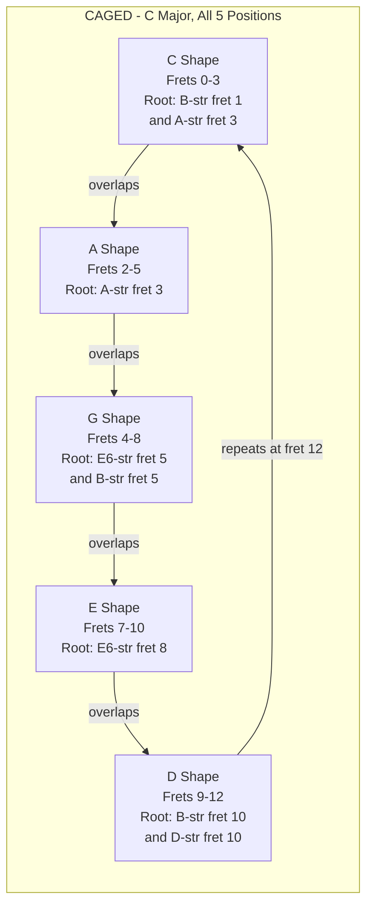
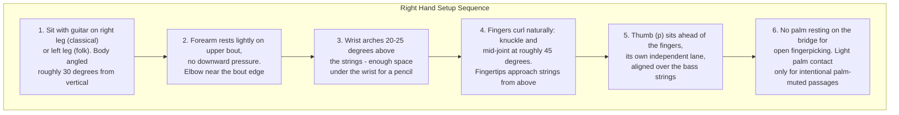
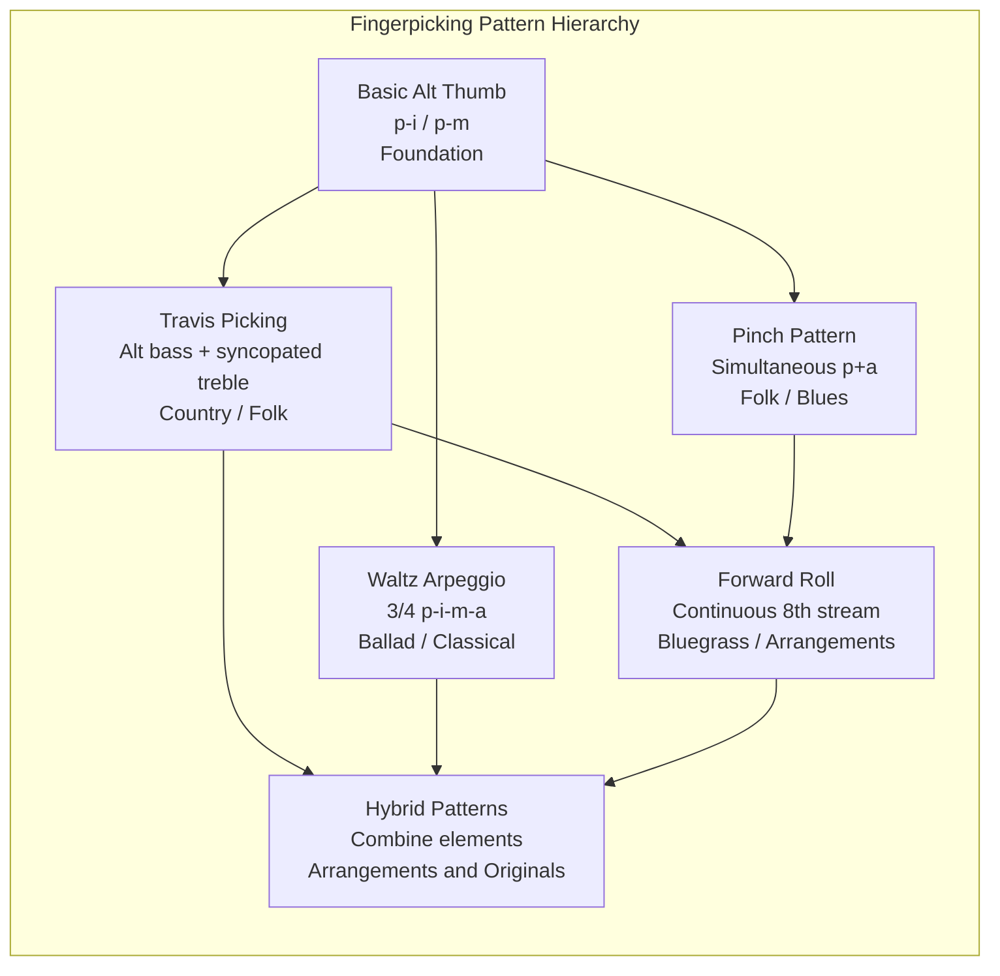
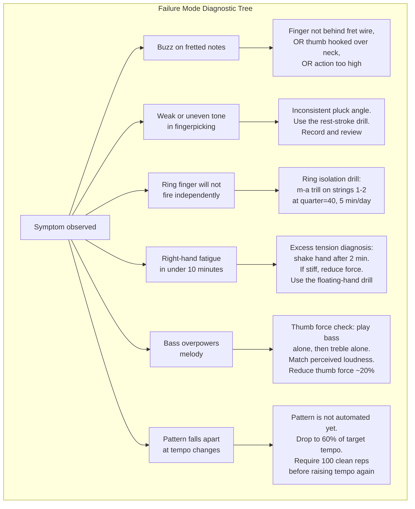
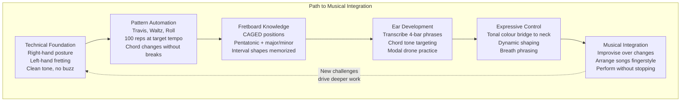

# Acoustic Guitar Masterclass — Lesson 3: Scales & Fingerpicking Techniques

## Table of Contents
1. [First-Principles Intuition (Condensed)](#1-first-principles-intuition-condensed)
2. [Fretboard Architecture & The CAGED System](#2-fretboard-architecture--the-caged-system)
3. [Right-Hand Fingerpicking Mechanics](#3-right-hand-fingerpicking-mechanics)
4. [Fingerpicking Patterns — Drills & Notation](#4-fingerpicking-patterns--drills--notation)
5. [Left-Hand Scale Systems & Positional Playing](#5-left-hand-scale-systems--positional-playing)
6. [Common Failure Modes & Instant Fixes](#6-common-failure-modes--instant-fixes)
7. [Progressive Practice Routines](#7-progressive-practice-routines)
8. [Musical Application — From Mechanics to Expression](#8-musical-application--from-mechanics-to-expression)

---

## 1. First-Principles Intuition (Condensed)

### Why Shorter String = Higher Pitch

Fretting shortens the vibrating string length. Halving the length (12th fret) doubles the frequency — one octave up. Each fret in between raises pitch by a factor of about 1.0595 (the 12th root of 2), so twelve equal steps multiply out to exactly 2×. You don't need the math to play — you need the consequence:

- **Pluck near the bridge** → bright, cutting tone (string is stiffer there, favors high harmonics)
- **Pluck over the soundhole** → warm, full tone (fundamental dominates)
- **Pluck over the 12th fret** → hollow, flute-like tone (you're plucking at a node for even harmonics, which suppresses them)

Your right-hand plucking point is a built-in tone knob. Most players never touch it deliberately — moving your hand 3 inches toward the bridge changes your sound more than most pedals or EQ settings.

### Why Fingers Resist Independence

The ring and middle fingers share a flexor tendon (flexor digitorum profundus) and interconnecting fascia. When you try to move the ring finger alone, the middle finger wants to move with it. This is anatomy, not lack of talent — every fingerstyle player fights this same tendon, including concert classical guitarists in their first years of training. The fix is motor learning, not strength: slow, isolated repetition rewires the signal so the ring finger gets its own clean command. Give it weeks of light daily practice, not one brutal session.

---

## 2. Fretboard Architecture & The CAGED System

### Standard Tuning Reference

```text
String:   6     5     4     3     2     1
Name:     E2    A2    D3    G3    B3    E4
Gauge:   .053  .042  .032  .024  .016  .012  (light acoustic set)
```

> **Tuning anomaly to memorize:** the B string (string 2) sits a major 3rd above the G string (string 3). Every other adjacent string pair is a perfect 4th apart. This means any scale or chord shape that crosses the G→B boundary needs one extra fret to stay in tune with itself. When a shape "breaks" at that boundary, that's the reason — add a fret, don't panic.

### CAGED System Overview

CAGED gives you five overlapping fingering "windows" that together cover the entire fretboard for any key. Each window is named after the open chord shape it resembles. Same notes, five different neighborhoods on the neck — learn to move between them and the fretboard stops being 22 isolated frets and becomes one connected map.



### C Major Scale — All 5 CAGED Positions (Fingering Diagrams)

**Position 1 — C Shape (Open / Frets 0–3)**

```text
e |---0---1---3---|
B |---0---1---3---|
G |---0---2-------|
D |---0---2---3---|
A |---0---2---3---|
     T   1   2/4    (T = open, 1 = index, 2 = middle, 4 = pinky)
```
Root notes: A-string fret 3 (C), B-string fret 1 (C). Skip the low E string — open E is not in the C major scale.

**Position 2 — A Shape (Frets 2–5)**

```text
e |-------5-------|
B |-------5-------|
G |-------4-------|
D |-------5-------|
A |---3-------5---|
E |---3-------5---|
     1           4
```
Root: A-string fret 3 (C). The stretch from fret 3 to fret 5 is where beginners cheat with a flat wrist — keep the wrist straight and let the thumb slide slightly to compensate.

**Position 3 — G Shape (Frets 4–8)**

```text
e |---5---7---8---|
B |---5---6---8---|
G |---4---5---7---|
D |---5---7-------|
A |---5---7-------|
E |---5---7---8---|
     1   2   3/4
```
Root: low E-string fret 8 (C), high e-string fret 8 (C). This position spans a 4-fret stretch with the thumb anchored behind fret 6 — don't let the thumb creep forward to "help" the stretch, it kills left-hand mobility.

**Position 4 — E Shape (Frets 7–10)**

```text
e |---8---10------|
B |---8---10------|
G |---7---9-------|
D |---7---9---10--|
A |---7---9---10--|
E |---8---10------|
     1   3    4
```
Root: low E-string fret 8 (C). Same geometry as the open E chord — most players find this the most intuitive CAGED position to start with because the shape already feels familiar.

**Position 5 — D Shape (Frets 9–12)**

```text
e |---10---12-----|
B |---10---12-----|
G |---9----10--12-|
D |---10---12-----|
A |---10---12-----|
E |---10---12-----|
     1    2   4
```
Root: B-string fret 10 (C), D-string fret 10 (C). This position connects back to Position 1's open-string shapes one octave up at fret 12.

### Invariant Interval Shapes (Cheat Sheet)

Memorize these and you can find any interval anywhere on the neck without thinking in note names.

| Interval | Same String | Adjacent Strings (normal 4th tuning) | Crossing G→B |
|---|---|---|---|
| Unison | — | 5 frets up, 1 string higher | 4 frets up crossing G→B |
| Minor 3rd | 3 frets up | — | — |
| Major 3rd | 4 frets up | same fret, skip 1 string | +1 fret crossing G→B |
| Perfect 4th | 5 frets up | same fret, 1 string higher | +1 fret crossing G→B |
| Perfect 5th | 7 frets up | 2 frets up, 1 string higher | +1 fret crossing G→B |
| Octave | 12 frets up | 2 frets up, 2 strings higher | +1 fret if span crosses G→B |

---

## 3. Right-Hand Fingerpicking Mechanics

### Hand Position Setup — Step by Step

Check this posture before every practice session for the first month. It takes two minutes and prevents months of compensating for bad habits later.



### Finger Naming Convention (PIMA)

| Symbol | Finger | Preferred Strings |
|---|---|---|
| p (pulgar) | Thumb | Strings 6, 5, 4 (bass) |
| i (índice) | Index | String 3 |
| m (medio) | Middle | String 2 |
| a (anular) | Ring | String 1 |

This naming is universal across classical and fingerstyle guitar notation — learn it now and every tab, method book, and teacher will make sense without translation.

### Rest Stroke vs. Free Stroke

**Rest stroke (apoyando):** after plucking, the finger follows through and lands resting on the next lower string. This forces a perpendicular attack angle into the string, which produces the loudest, most focused tone the finger can generate. Use it for single-line melody that needs to project over accompaniment.

**Free stroke (tirando):** the finger plucks and clears all strings without landing on anything. This is mandatory whenever multiple strings need to ring simultaneously — arpeggios, chords, any pattern where the bass note must keep sounding while a treble note fires.

**Drill:** on string 1, play a single note with rest stroke, then the identical note with free stroke. Listen for the volume and color difference. That gap is your dynamic range on tap — use it as a deliberate choice, not an accident of technique.

### Nail vs. Flesh — Tone Control

| Contact | Tone Character | Use Case |
|---|---|---|
| Flesh only | Warm, round, soft attack | Folk, blues, singer-songwriter |
| Nail edge | Bright, articulate, projecting | Classical, dense arrangements |
| Nail + flesh | Balanced, full | Most acoustic fingerstyle |

For unamplified acoustic playing, 1–2 mm of nail extending past the fingertip gives the best projection without turning harsh. File the nail at roughly a 45° bevel on the underside so the string releases smoothly off the edge instead of catching and clicking.

---

## 4. Fingerpicking Patterns — Drills & Notation

All patterns below use **G major, open position (3-2-0-0-0-3)** unless noted. Set a metronome and never exceed the tempo where every note still rings clean.

### Pattern 1 — Basic Alternating Thumb (p-i, p-m)

The foundation pattern. The thumb lays down a steady quarter-note bass pulse; the fingers answer on the off-beats.

```text
Chord: G major (320003)
Time:  4/4

e |--------3-----------3----|
B |------0---0-------0---0--|
G |----0-------0---0-------0|
D |--------------------------|
A |--2-----------2----------|
E |3-----------3-------------|
   p  i   m  i  p  i   m  i

Beat: 1  &  2  &  3  &  4  &
```

**Metronome targets:**
- Week 1: ♩ = 50 BPM — thumb/finger separation, zero tension
- Week 2: ♩ = 65 BPM — add dynamic evenness between p and i/m
- Week 3: ♩ = 80 BPM — maintain full tone quality at speed

**Common error:** thumb and index fire together on beat 1, blurring into a single attack. Fix: deliberately exaggerate the gap between p and i until there's a clear 16th-note space, then shrink that gap gradually as the independence solidifies.

### Pattern 2 — Travis Picking (Alternating Bass + Syncopated Treble)

The signature pattern of country, folk, and acoustic blues guitar. The thumb alternates between two bass strings on a steady pulse while the fingers fill syncopated gaps independently of it.

```text
Chord: C major (x32010)
Time:  4/4

e |----------------1-------1---|
B |----------1-----------1-----|
G |--------0---0-------0---0---|
D |------2-----------2---------|
A |----3-----------3-----------|
E |-----------------------------|
     p  p  i  p  m  p  i  p  m

Beat: 1  &  2  &  3  &  4  &
```

**Thumb alternation rule:**
- Beat 1 & 3 → root string (A-string fret 3 for C)
- Beat 2 & 4 → 5th-string bass (D-string open for C)

**Four-chord Travis exercise** — the most useful vehicle for locking the pattern into muscle memory:

```text
| C (x32010) | Am (x02210) | F (xx3211) | G (320003) |
  1 measure each, loop 8 times.
  Chord changes must not interrupt the thumb's steady alternation.
```

**Metronome targets:**
- ♩ = 55 BPM — independent thumb/finger lanes established
- ♩ = 70 BPM — chord changes with zero hesitation
- ♩ = 90 BPM — relaxed, musical feel at performance tempo

### Pattern 3 — Waltz Arpeggio (3/4)

Essential for ballads, folk waltzes, and classically-influenced pieces.

```text
Chord: Am (x02210)          then          E (022100)
Time:  3/4

e |-----0---------0---|-----0---------0---|
B |---1-----1---1-----|---0-----0---0-----|
G |-2-----------2---2-|-1-----------1---1-|
A |-0-----------------|---2-----------------|
E |---------------------|-0--------------------|
   p    i  m  a   i      p    i  m  a   i

Beat: 1   &  2  &  3  &
```

**Technique note:** the ring finger (a) plucks string 1 on the "& of 2" — the hardest moment in the pattern, since it fires alone while the middle finger holds its position. Isolate beats 2-and-3 as a micro-drill, alternating `m–a–m–a` on strings 2 and 1 repeatedly at ♩ = 40 until the motion feels automatic rather than deliberate.

### Pattern 4 — Pinch Pattern (Simultaneous Bass + Treble)

A "pinch" fires the thumb and a finger together, anchoring the beat with a percussive downbeat. Common in folk strumming-picking hybrids and singer-songwriter accompaniment.

```text
Chord: D major (xx0232)
Time:  4/4

e |--2-------2-------2-------2--|
B |--3-------3-------3-------3--|
G |--2-------2-------2-------2--|
D |--0-2-0---0-2-0---0-2-0---0--|
   p+a  i  m  p+a i  m  p+a i  m
     ^pinch        ^pinch
```

The pinch (p+a together) on beats 1 and 3 gives the pattern its rhythmic anchor. The i–m fill between pinches should stay light and loose, almost an afterthought by comparison.

### Pattern 5 — Rolls (Banjo-Style Forward Roll on Guitar)

A continuous stream of 8th notes — the backbone of fingerstyle arrangements and bluegrass-influenced playing.

```text
Forward Roll:  p  i  m  p  i  m  p  i
String order:  5  3  1  4  3  1  5  3   (varies by chord voicing)

Chord: G (320003)

e |--------3-------3-------|
B |------0-------0---------|
G |----0-------0-----------|
A |--2-------2-------------|
E |3-------3-----------------|
   p i m  p i m  p i m  p i m
```

**Metronome targets:**
- ♩ = 60 — each 8th note lands on a click subdivision
- ♩ = 80
- ♩ = 110 — musical performance tempo

> At ♩ = 110 the roll should feel like a waterfall — continuous, even, effortless. If any single note pops out louder than its neighbors, that finger is over-gripping. Find it and release the excess tension.

### Pattern Architecture — How They Connect



---

## 5. Left-Hand Scale Systems & Positional Playing

### Left-Hand Posture Rules (Non-Negotiable)

1. **Thumb behind the neck**, roughly opposite the middle finger, not hooked over the top. The only exception is an intentional "cheater" barre on bass strings only.
2. **Finger placement just behind the fret wire** (toward the nut), never on top of it, never in the dead middle of the fret gap. This is the single most common cause of fret buzz.
3. **Curved fingers** that arch over strings 1–2 so they don't accidentally mute them with the knuckle.
4. **Minimum pressure.** Squeeze only until the note sounds clean — anything more is wasted effort that fatigues the hand. Test it: fret a note, then slowly ease off the pressure until it just starts to buzz. That threshold, backed off a hair, is your target force.
5. **Neutral wrist**, slightly dropped away from the neck. Never crank it sharply upward — that posture compresses the carpal tunnel and is a direct path to repetitive strain injury.

### Pentatonic Minor Box — The Entry Point

Before tackling full 7-note scales, own the minor pentatonic. Five notes, no half-step dissonance to navigate, and it works convincingly over blues, rock, folk, and country with almost no risk of a "wrong" note.

**A Minor Pentatonic — Box 1 (Frets 5–8, the most-used position on the neck)**

```text
e |---5---8---|
B |---5---8---|
G |---5---7---|
D |---5---7---|
A |---5---7---|
E |---5---8---|
     1   4     (index = 1, pinky = 4)
```

**Scale degree map for Box 1:**

```text
e |--R---4--|   R = root (A)
B |--5---b7-|   5 = perfect 5th
G |--b3--4--|   b3 = minor 3rd, 4 = perfect 4th
D |--b7--b3-|   b7 = minor 7th
A |--4---b7-|
E |--R---4--|
```

**Box 1 drill sequence:**
```text
Ascending:  E6-str 5 → A-str 5 → 7 → D-str 5 → 7 → G-str 5 → 7 → B-str 5 → 8 → e-str 5 → 8
Descending: reverse the exact same path
Fingering:  1-4 | 1-4 | 1-3 | 1-3 | 1-4 | 1-4
```

Metronome: ♩ = 60 → 80 → 100, all notes as even 8ths.

### Five Pentatonic Minor Boxes — Full Neck Map

The five boxes chain together seamlessly, each one starting where the previous one ends. Learn them in order.

```text
   Fret:   1   2   3   4   5   6   7   8   9  10  11  12
           |----|----|----|----|----|----|----|----|----|----|----|
E6:        |    |    |    |    |[1] |    |    |[4] |    |[5] |    |[1]
A:         |    |    |    |    |[1] |    |[3] |    |[4] |    |    |[1]
D:         |    |    |    |    |[1] |    |[3] |    |    |[2] |    |[1]
G:         |    |    |    |    |[1] |    |[3] |    |    |[2] |    |
B:         |    |    |    |    |[1] |    |    |[4] |    |[2] |    |
e:         |    |    |    |    |[1] |    |    |[4] |    |[5] |    |[1]

Box numbers: [1]=Box 1  [2]=Box 2  [3]=Box 3  [4]=Box 4  [5]=Box 5
```

**Connection rule:** the highest note of Box 1 on the high e-string (fret 8) is the identical pitch to the lowest note of Box 2 on that same string. The boxes chain upward in minor-3rd increments of 3 frets each.

### Natural Minor Scale (Aeolian) — Adding the Missing Notes

The minor pentatonic omits the natural 2nd and the ♭6th. Adding those two notes gives the full natural minor scale — seven notes, far more melodic options, and the ability to outline chord changes precisely instead of just implying a mood.

**A Natural Minor — Position 1 (Frets 5–8)**

```text
e |---5---7---8---|
B |---5---6---8---|
G |---5---7-------|
D |---5---7-------|   <- fret 6 here is the added natural 2 / b6 color
A |---5---7-------|
E |---5---7---8---|
     1   2   3   4
```

Compare directly to the pentatonic Box 1 above: the only changes are fret 6 on the B-string. That single added note is what separates "pentatonic blues sound" from "natural minor melodic sound." Practice sliding it in and out to hear the difference live.

**Harmonic Minor variation:** raise the ♭7th by one fret (fret 7 → fret 8 on the A-string, G natural → G#). One fret change produces the dramatic, Spanish/Middle-Eastern character associated with harmonic minor — because it creates a half-step pull directly into the root.

```text
A Harmonic Minor — difference from natural minor:
A-string: fret 7 (G natural) → fret 8 (G#)  <- the only change
```

### Major Scale — E-Shape Position

**G Major, E-Shape Position (Frets 2–5), root G on the low E string at fret 3**

```text
e |---3---5-------|
B |---3---5-------|
G |---2---4---5---|
D |---2---4---5---|
A |---2---4---5---|
E |---3---5-------|
     1   2   3   4
```

Root notes (G): low E-string fret 3, high e-string fret 3.

**Fingering across the strings, ascending:**
```text
E6-str:  1(fret 3)  ->  3(fret 5)
A-str:   1(fret 2)  ->  2(fret 4)  ->  4(fret 5)
D-str:   1(fret 2)  ->  2(fret 4)  ->  4(fret 5)
G-str:   1(fret 2)  ->  2(fret 4)  ->  4(fret 5)
B-str:   1(fret 3)  ->  3(fret 5)        <- note the G->B shift bumps the pattern up one fret
e-str:   1(fret 3)  ->  3(fret 5)
```

### Three-Notes-Per-String (3NPS) — Speed Scale System

Where CAGED organizes the neck by chord shape, 3NPS organizes it for raw picking speed. Exactly three notes per string means every string gets a clean down-up-down (or up-down-up) alternate picking motion, with no awkward mid-string direction changes.

**G Major 3NPS — Pattern 1, starting on the low E string**

```text
e |---3---5---7---|
B |---3---5---7---|
G |---2---4---5---|
D |---2---4---5---|
A |---2---3---5---|
E |---3---5---7---|
     1   2   3/4
```

**Picking hand:** D-U-D on each string, moving to the next string always on a downstroke (a common economy-picking variant that minimizes travel distance).

**Metronome targets:**
- ♩ = 60 as triplets (one string per beat) — internalize the string groupings
- ♩ = 80 as 16th notes (four notes per beat, string crossing lands on the downbeat)
- ♩ = 110 — practical performance tempo for most acoustic repertoire

### Scale Sequences — Breaking the Up-Down Rut

Playing scales only straight up and down is a practice habit, not a musical skill. These sequences train you to actually use scale tones the way real melodies and solos do.

**Sequence 1 — Thirds** (harmonically rich, strong for melodic lines)
```text
Scale degrees:  1-3, 2-4, 3-5, 4-6, 5-7, 6-8, 7-9...
In G major:     G-B, A-C, B-D, C-E, D-F#, E-G, F#-A...

Tab (G major, E-shape position, strings 1-2):
e |---3---5---3---5---5---7---5---7---7---8---|
B |---3---3---5---5---3---3---5---5---7---7---|
     G  B   A  C   B  D   C  E   D  F#
```

**Sequence 2 — Triads up the scale**
```text
1-3-5, 2-4-6, 3-5-7, 4-6-1, 5-7-2, 6-1-3, 7-2-4
In G:  G-B-D, A-C-E, B-D-F#, C-E-G, D-F#-A, E-G-B, F#-A-C
```
Play each triad as a hammer-on triplet: pick the root, hammer the 3rd, hammer the 5th. This produces an arpeggiated, lyrical phrasing that sounds musical immediately, without any improvisational decision-making.

**Sequence 3 — 4-note groups with accent on beat 1**
```text
1-2-3-4, 2-3-4-5, 3-4-5-6, 4-5-6-7...
Accent (play louder): note 1 of each group
Feel: a marching staircase — excellent for building toward a phrase climax
```

---

## 6. Common Failure Modes & Instant Fixes



### Failure Mode Detail — Ring Finger Independence

This is the single most common barrier in fingerpicking development. Full remediation protocol:

**Stage 1 — Isolation (Week 1–2)**
Fret a G chord. Place p on string 6, i on string 3, m on string 2, a on string 1. Without moving any other finger, pluck *only* string 1 with the ring finger (a). No other string may sound. ♩ = 40, one pluck per click, 5 minutes a day.

**Stage 2 — Trill Drill (Week 2–3)**
On string 1, fret any note with the left hand. Alternate plucking with m and a continuously — a trill. ♩ = 50, 2 minutes. Focus specifically on the ring finger firing without dragging the middle finger along with it.

**Stage 3 — Pattern Reintegration (Week 3–4)**
Return to Pattern 3 (Waltz Arpeggio). The m–a crossing on the "& of 2" is now your diagnostic checkpoint — if it flows cleanly, ring independence has arrived. If it still stumbles, go back to Stage 2 for one more week before trying again.

### Failure Mode Detail — Buzz Diagnosis

| Buzz Type | Sound | Cause | Fix |
|---|---|---|---|
| Deadened note | Thud, no pitch | Adjacent finger muting the string | Arch fingers more; check fretting-hand curl |
| Fret buzz (low) | Rattly, thin pitch | Finger too far from the fret wire | Move finger closer to the fret (toward the bridge side of it) |
| Fret buzz (high) | Rattle on release | Insufficient fret pressure | Increase pressure, or have action checked/lowered by a tech |
| Sympathetic ring | Faint ghost note, no clear source | Adjacent open string resonating | Mute with floating thumb or the underside of a fretting finger |

### Failure Mode Detail — Tension Accumulation

**The 2-Minute Tension Check:**
1. Play your hardest pattern for exactly 2 minutes at target tempo.
2. Stop. Let the right hand drop loosely to your lap.
3. Immediately try to shake the wrist freely.

If the wrist shakes loosely, tension is under control. If it feels rigid, or the forearm feels "pumped" like after a workout, you're over-gripping. Play the same pattern again at roughly 70% of your usual grip force — the notes will still sound clean, proving the extra 30% was wasted energy.

---

## 7. Progressive Practice Routines

### Routine A — Beginner Foundation (20 min/day)

| Time | Exercise | Metronome | Focus |
|---|---|---|---|
| 0–3 min | Right-hand posture check + isolate p, i, m, a individually | No click | Setup, zero tension |
| 3–8 min | Pattern 1 (Alt Thumb) over a G–C–D–G loop | ♩ = 55 | Thumb/finger separation |
| 8–13 min | A Minor Pentatonic Box 1, ascending/descending | ♩ = 60 | Clean fretting, no buzz |
| 13–18 min | Pattern 2 (Travis) on C major chord only | ♩ = 55 | Alternating bass lock |
| 18–20 min | Free play — improvise pentatonic over a droning open A | No click | Musical connection |

### Routine B — Intermediate Development (30 min/day)

| Time | Exercise | Metronome | Focus |
|---|---|---|---|
| 0–3 min | Ring finger isolation drill (Stage 2 trill) | ♩ = 50 | Independence |
| 3–8 min | Travis Pattern over I–IV–V in G: G–C–D | ♩ = 65→75 | Chord-change fluidity |
| 8–13 min | G Major E-shape scale, sequence in thirds | ♩ = 65 | Intervallic thinking |
| 13–18 min | Pattern 4 (Pinch) + Pattern 5 (Roll), combined | ♩ = 70 | Pattern mixing |
| 18–25 min | CAGED — connect Position 1 → 2 → 3 in G major | ♩ = 60 | Positional shifting |
| 25–30 min | Transcription: learn 4 bars of a fingerpicking piece by ear | No click | Ear training |

### Routine C — Advanced Integration (45 min/day)

| Time | Exercise | Metronome | Focus |
|---|---|---|---|
| 0–5 min | 3NPS G major scale, all positions, strict alternate picking | ♩ = 80→100 | Speed + accuracy |
| 5–12 min | Full Travis arrangement: melody + bass simultaneously | ♩ = 65→85 | Two-voice independence |
| 12–20 min | Modal drone practice: D Dorian, E Phrygian, B Locrian over drones | No click | Modal ear development |
| 20–28 min | Improvise over Am–F–C–G: target a chord tone on beat 1 of each bar | ♩ = 75 (loop) | Harmonic targeting |
| 28–38 min | Full piece run-through, performance mode, no stops | No click | Continuity, expression |
| 38–45 min | Slow analysis: replay hard sections at 50% tempo, diagnose errors | ♩ = 40 | Precision refinement |

### Tempo Progression Law

Never jump more than 5 BPM without earning it. The standard: **100 consecutive clean repetitions** at the current tempo before adding another 5 BPM. This feels slow, and it is — which is exactly why most players plateau. They spend their practice time grinding at 80% speed instead of fully automating 70% speed first.

```text
Target tempo: quarter = 100
Path: 55 -> 60 -> 65 -> 70 -> 75 -> 80 -> 85 -> 90 -> 95 -> 100
      100 clean reps required at each step before advancing
```

---

## 8. Musical Application — From Mechanics to Expression

### The Two Layers of Timing

**Layer 1 — The Grid:** the metronome pulse. Your bass thumb owns this layer. It never wavers, never rushes ahead, never lags behind.

**Layer 2 — The Feel:** treble voices move around the grid, not locked to it. Rushing the treble slightly into a chord change creates forward momentum — common in bluegrass. Laying the treble back slightly creates a lazy, blues-soaked feel. Neither is wrong; both are deliberate choices once Layer 1 is solid.

The common beginner error is accidentally rushing Layer 1 (the bass pulse) while believing they're just adding expression to Layer 2. Record yourself and listen back. If the bass thumb isn't rock-steady, hold off on expressive phrasing and go back to pure thumb drills first.

### Tonal Colour Map — Right-Hand Position

A free parameter most players never touch deliberately.

```text
Bridge                     Soundhole                  Neck (near 12th fret)
  |---------------------------|----------------------------|
Bright, cutting,           Warm, balanced,             Dark, hollow,
aggressive, louder          full fundamental,           flute-like,
-> slide lead,               -> most fingerstyle,         -> jazz-influenced,
-> emphasizing attack         -> singer-songwriter          -> harmonic natural tone
```

**Exercise:** play the exact same 4-bar phrase three times, once plucking near the bridge, once over the soundhole, once near the 12th fret. Same notes, same rhythm, three noticeably different instruments. This single exercise teaches more about tonal control in five minutes than months of technique drilling without it.

### Phrasing — The Breath Principle

Every musical phrase implies a breath. Singers and wind players are forced to breathe; guitarists aren't — which is exactly why guitar phrasing so often sounds mechanical and relentless.

**Rules for breath phrasing:**
1. Every 2–4 bars, insert a brief rest (8th note minimum) — the "inhale."
2. The phrase following the rest begins with slightly more energy — the "exhale."
3. The last note of a phrase resolves dynamically downward (fading into silence), not just harmonically.

```text
Phrase structure example (4-bar unit):

Bar 1: Statement (forte, start of phrase)
Bar 2: Development (mezzo-forte, melodic motion)
Bar 3: Extension (slight crescendo, climbing toward climax)
Bar 4: Resolution + rest (diminuendo, last note fades, breath)
Bar 5: New phrase begins (fresh dynamic start)
```

### Chord-Scale Connections for Improvising

When improvising over chord changes, the fastest route to sounding musical instead of random is to **target a chord tone on beat 1 of every chord change.**

| Chord | Scale Choice | Avoid Notes | Target Notes (beat 1) |
|---|---|---|---|
| Gmaj | G major / G major pentatonic | F (maj7 tension clashes against the triad) | G, B, D |
| Am | A natural minor / A minor pentatonic | — (all scale notes work) | A, C, E |
| Cmaj | C major / G major | B over C (unless resolving immediately) | C, E, G |
| Dmaj | D major / D mixolydian | C# (sounds overly jazz-inflected) | D, F#, A |
| Em | E natural minor / E minor pentatonic | — | E, G, B |

**One-week targeting drill:** over a G–Em–C–D loop at ♩ = 70, play only single notes. Rule: whatever note lands on the downbeat of each chord change must be a chord tone — root, 3rd, or 5th. Everything else is free. This one constraint eliminates most "random" improvising almost overnight.

### Modal Colour Reference

Modes aren't separate scales to memorize — they're different starting and resting points on the same major scale. To play E Phrygian over a C major scale, start and end phrases on E and lean on the ♭2 (F) for color.

| Mode | Built on | Character | Characteristic Note | Chord Context |
|---|---|---|---|---|
| Ionian | 1st degree | Bright, resolved | Major 7th | Imaj7 |
| Dorian | 2nd degree | Minor, slightly hopeful | Natural 6th | IIm7 |
| Phrygian | 3rd degree | Spanish, dark | ♭2nd | IIIm7 |
| Lydian | 4th degree | Dreamy, floating | ♯4th | IVmaj7♯11 |
| Mixolydian | 5th degree | Bluesy, dominant | ♭7th | V7 |
| Aeolian | 6th degree | Melancholic, natural minor | ♭6th | VIm7 |
| Locrian | 7th degree | Unstable, dissonant | ♭2nd + ♭5th | VIIm7♭5 |

**Practical modal entry point:** start with Dorian — minor key character with a raised 6th. It works convincingly over any minor chord in a major-key context, sounds musical immediately, and the raised 6th clearly distinguishes it from plain natural minor. D Dorian over Dm7 → G7 is the most common ii–V jazz application, and it also works beautifully in folk and Celtic contexts.

### Full Integration Flowchart



---

## Quick Reference Card

| Need | Go To |
|---|---|
| Hand setup check | §3 — Right-Hand Setup Sequence |
| First fingerpicking pattern | §4 — Pattern 1 (Alt Thumb) |
| Fix buzzing notes | §6 — Buzz Diagnosis Table |
| Ring finger won't cooperate | §6 — Ring Finger Independence, 3-Stage Protocol |
| Scale for soloing now | §5 — A Minor Pentatonic Box 1 |
| Connect the whole neck | §2 — CAGED Overview + 5 Positions |
| Sound more musical immediately | §8 — Chord-Scale Targeting Drill |
| Practice schedule | §7 — Routines A / B / C |
