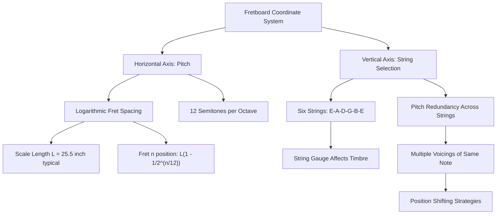
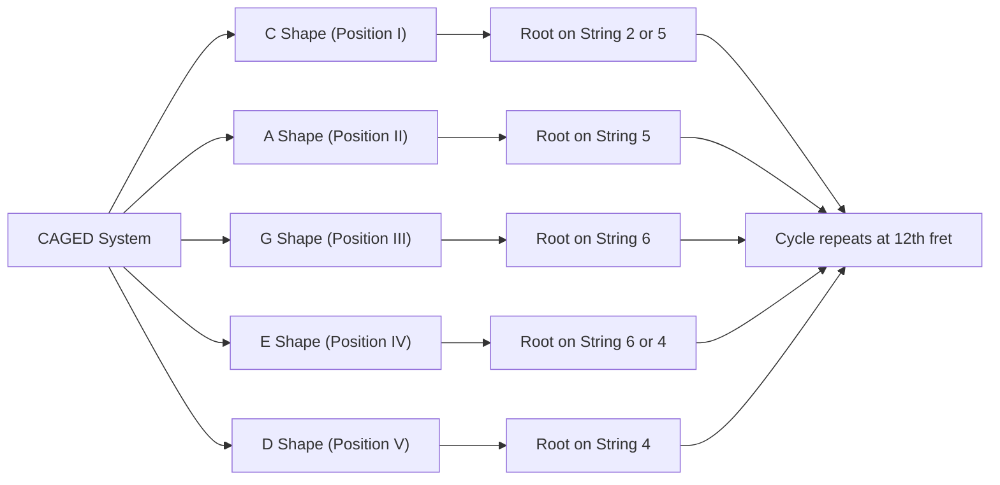

# Lesson 3: Scales and Fingerpicking Techniques

## 1. First-Principles Intuition & Invariants

### Physical Foundations of String Vibration

The acoustic guitar transforms mechanical energy into sound through a chain of coupled oscillators. When a string is displaced and released, it vibrates according to the wave equation:

$$\frac{\partial^2 y}{\partial t^2} = \frac{T}{\mu} \frac{\partial^2 y}{\partial x^2}$$

where $T$ is string tension, $\mu$ is linear mass density (mass per unit length), $y$ is displacement, $t$ is time, and $x$ is position along the string. The fundamental frequency of a vibrating string is determined by:

$$f_0 = \frac{1}{2L}\sqrt{\frac{T}{\mu}}$$

where $L$ is the vibrating length of the string. This relationship reveals the core invariants: for a given string, frequency is inversely proportional to length and proportional to the square root of tension-to-mass ratio. When a guitarist frets a string, they shorten $L$, raising the pitch. The 12th fret halves the string length, doubling the frequency and producing a note one octave higher—a direct consequence of this fundamental equation.

The harmonic series emerges naturally from the boundary conditions at the string's fixed endpoints. The string can vibrate not only at its fundamental frequency but also at integer multiples: $f_n = n \cdot f_0$ where $n = 1, 2, 3, ...$. These harmonics (overtones) give each note its characteristic timbre. The relative amplitudes of these harmonics depend on where the string is plucked: plucking near the bridge emphasizes higher harmonics (brighter tone), while plucking near the 12th fret suppresses even-numbered harmonics (warmer, flute-like tone).

The guitar body acts as a Helmholtz resonator, amplifying certain frequencies through acoustic coupling. The soundboard (top plate) vibrates in response to string energy transmitted through the bridge, exciting the air cavity inside the body. The soundhole functions as the neck of the Helmholtz resonator, with a primary resonant frequency typically between 80-120 Hz, providing bass response. Additional resonances occur in the top and back plates, creating the complex frequency response that defines the guitar's voice. This coupling is inherently nonlinear—the soundboard's impedance varies with frequency and amplitude, introducing subtle harmonic distortion that contributes to the instrument's organic sound.

### Mathematical Structure of Scales

Western music's twelve-tone equal temperament divides the octave into twelve equal semitones, where each semitone represents a frequency ratio of $2^{1/12} ≈ 1.05946$. This compromise tuning allows music to be transposed to any key while maintaining acceptable consonance, though it sacrifices the pure intervals of just intonation. A whole step (two semitones) corresponds to a frequency ratio of $2^{2/12} ≈ 1.1225$, while a half step is the fundamental $2^{1/12}$ ratio.

The major scale's interval pattern—W-W-H-W-W-W-H (whole, whole, half, whole, whole, whole, half)—creates a specific sequence of frequency ratios relative to the root note. In the key of C major (C-D-E-F-G-A-B-C), the ratios in equal temperament are:

- C (1.000) → D (1.122) → E (1.260) → F (1.335) → G (1.498) → A (1.682) → B (1.888) → C (2.000)

These intervals generate the characteristic major scale sound through their specific pattern of consonance and dissonance. The intervals from the root to the 3rd (major third) and 5th (perfect fifth) are particularly consonant, forming the basis of major chords. The major scale's structure is scale-degree invariant: the same interval pattern produces the same tonal relationships regardless of the starting pitch.

The natural minor scale (W-H-W-W-H-W-W) shifts the pattern, lowering the 3rd, 6th, and 7th degrees by a semitone. This creates a different constellation of intervals with the root, fundamentally altering the scale's emotional character through its altered consonance patterns. The pentatonic scale eliminates the half steps entirely, using only five notes per octave (major pentatonic: W-W-1.5W-W-1.5W), which removes the most dissonant intervals and creates the scale's harmonically stable, universal quality across cultures.

### Biomechanical Constraints and Finger Independence

The human hand's motor control system imposes fundamental constraints on fingerpicking. The flexor digitorum superficialis and profundus muscles control the index, middle, ring, and little fingers, but these muscles share common tendons and neural pathways, creating mechanical and neural coupling. This coupling makes truly independent finger movement challenging—movement of one finger naturally influences the others through:

1. **Mechanical coupling**: Tendons pass through the carpal tunnel and share synovial sheaths, physically linking finger movements
2. **Neural coupling**: Motor neurons innervating adjacent fingers have overlapping receptive fields in the motor cortex
3. **Kinematic chains**: The wrist, metacarpophalangeal (MCP), proximal interphalangeal (PIP), and distal interphalangeal (DIP) joints form interconnected kinematic chains

The thumb, controlled by separate thenar muscles (flexor pollicis brevis, opponens pollicis, abductor pollicis brevis), achieves greater independence, making it ideal for bass line duties in fingerpicking. The guitar's string spacing (typically 10-11 mm at the bridge) matches the natural spacing of human fingers in a relaxed hand position, facilitating efficient string targeting.

Skilled fingerpicking requires developing motor programs—learned sequences of muscle activation patterns stored in cerebellar and basal ganglia circuits. With practice, these patterns become automated, reducing cognitive load and enabling the conscious mind to focus on musical expression rather than individual finger movements. The transition from conscious control to automated motor programs explains the initial difficulty and eventual fluidity of fingerpicking mastery.

### Invariant Principles of String Articulation

The plucking motion transfers energy to the string through a brief impulse. The force-time profile of this impulse determines the harmonic content: a sharp, brief pluck excites more high-frequency harmonics (bright attack), while a longer, softer pluck emphasizes the fundamental (mellow attack). The angle of pluck affects this profile—plucking perpendicular to the soundboard creates maximum displacement and volume, while a glancing, parallel motion produces a softer, more controlled articulation.

String damping is equally critical. After plucking, adjacent strings may sympathetically vibrate due to acoustic coupling through the bridge, creating muddy overtones. Effective fingerpicking requires selective damping—using the plucking finger to rest on the adjacent string after articulation (rest stroke) or maintaining light contact with the palm on the bass strings (palm muting) to control sustain and prevent unwanted resonances.

The plucking point along the string's length follows the principle of harmonic excitation: plucking at a position $L/n$ (where $L$ is string length and $n$ is an integer) suppresses the $n$-th harmonic and all its integer multiples. Plucking at $L/2$ (12th fret position) eliminates all even harmonics, producing a hollow, fundamental-rich tone. Plucking at $L/7$ (slightly behind the bridge) excites all harmonics strongly, creating a bright, complex timbre. Classical guitarists exploit this principle by varying the plucking position (tasto near the fingerboard, ponticello near the bridge) to control tonal color.

## 2. Core Architecture & Mechanics

### Coordinate Systems and Fretboard Geometry

The guitar fretboard implements a two-dimensional coordinate system where musical pitch is mapped to spatial position. The horizontal axis (along the neck) represents pitch, with frets positioned according to the equal temperament formula. The distance from the nut to the $n$-th fret is:

$$d_n = L \left(1 - \frac{1}{2^{n/12}}\right)$$

where $L$ is the scale length (distance from nut to bridge, typically 25.5" for Fender-style or 24.75" for Gibson-style guitars). This logarithmic spacing compresses as you move toward the body, with each successive fret representing the same frequency ratio but decreasing physical distance.

The vertical axis (across strings) provides multiple voicing options for the same pitch. Standard tuning (E2-A2-D3-G3-B3-E4) creates overlapping pitch ranges between adjacent strings, allowing the same note to be played on multiple strings at different frets. This redundancy enables position shifting strategies: playing a phrase in different regions of the neck produces identical pitches but different timbral characteristics due to string gauge differences and harmonic content variations.



### Fingerpicking Patterns as State Machines

Fingerpicking patterns can be formally modeled as finite state machines where:

- **States** represent finger-string assignments at discrete time steps
- **Transitions** represent the temporal sequencing of plucks
- **Alphabet** consists of finger identifiers {T (thumb), I (index), M (middle), R (ring), P (pinky, rarely used)}
- **Timing** introduces rhythm through state duration

A basic Travis picking pattern in 4/4 time can be represented as a repeating state sequence:

```
State 1: T(6) - Thumb plucks 6th string (bass note, typically root)
State 2: I(3) - Index plucks 3rd string (treble voice)
State 3: T(4) - Thumb plucks 4th string (alternate bass)
State 4: M(2) - Middle plucks 2nd string (treble voice)
State 5: T(5) - Thumb plucks 5th string (bass)
State 6: I(1) - Index plucks 1st string (treble voice)
State 7: T(4) - Thumb plucks 4th string (bass)
State 8: M(2) - Middle plucks 2nd string (treble voice)
```

This pattern exhibits temporal symmetry with a two-measure periodicity. The thumb creates a steady alternating bass line (beats 1, 2, 3, 4), while the treble fingers articulate a syncopated countermelody (off-beats). The pattern's efficiency derives from minimizing finger travel distance and exploiting the natural rest positions of the hand.

```mermaid
stateDiagram-v2
    [*] --> T6: Beat 1
    T6 --> I3: & of 1
    I3 --> T4: Beat 2
    T4 --> M2: & of 2
    M2 --> T5: Beat 3
    T5 --> I1: & of 3
    I1 --> T4b: Beat 4
    T4b --> M2b: & of 4
    M2b --> [*]: End cycle
    
    note right of T6: Thumb: 6th string (root)
    note right of I3: Index: 3rd string
    note right of T4: Thumb: 4th string (alt bass)
    note right of M2: Middle: 2nd string
```

More complex patterns introduce polyrhythms, where the bass and treble voices operate on different metric subdivisions. A 3-against-2 polyrhythm might have the thumb playing triplets while the treble fingers maintain steady quarter notes, creating a rich rhythmic texture.

### Hand Position and Biomechanical Optimization

Optimal hand position balances mechanical efficiency with tonal control. The right hand (assuming right-handed playing) should be positioned with:

1. **Wrist arch**: 20-30° dorsiflexion, aligning the forearm tendons for efficient force transmission while avoiding carpal tunnel compression
2. **Palm pivot point**: Resting lightly on the bridge, providing a stable reference point without dampening string vibration
3. **Finger curvature**: MCP and PIP joints flexed approximately 45°, creating a "spider position" where fingertips approach strings at near-perpendicular angles
4. **Thumb position**: Operating independently behind the fingers, prepared to strike bass strings with authority

This configuration creates a biomechanical lever system where the forearm muscles (flexor digitorum superficialis, profundus) provide primary force, amplified by the multi-joint finger structure. The MCP joint acts as a fulcrum, with the finger tip as the load point. By maintaining proper joint angles, the guitarist maximizes the mechanical advantage while minimizing the muscular effort required for clear articulation.

The left hand (fretting hand) requires different optimization:

1. **Thumb position**: Behind the neck (not gripping over the top), providing counterpressure opposite the fretting fingers
2. **Finger placement**: Just behind the fret wire (toward the nut), minimizing the force required to fret cleanly without buzzing
3. **Finger curvature**: Arched to avoid muting adjacent strings while allowing the fingertip to press perpendicular to the fretboard
4. **Wrist position**: Neutral to slightly extended, enabling finger reach across multiple frets

The force required to fret a string increases with string gauge and action (string height above fretboard). For a typical .012" gauge string with 3/32" action, approximately 2-3 N of force is required to fret cleanly. This force must be applied perpendicular to the fretboard, directly behind the fret wire, to maximize string-fret contact and minimize fret buzz.

### Pattern Representation and Implementation

Fingerpicking patterns can be encoded in multiple representations, each suited to different purposes:

**Sequential notation** (time-ordered list):
```
Pattern = [
    (T, 6, 0.0),    # (finger, string, time_offset)
    (I, 3, 0.25),
    (T, 4, 0.5),
    (M, 2, 0.75),
    (T, 5, 1.0),
    (I, 1, 1.25),
    (T, 4, 1.5),
    (M, 2, 1.75)
]
```

**Parallel voice notation** (separating bass and treble):
```
Bass = [(T, 6, 0.0), (T, 4, 0.5), (T, 5, 1.0), (T, 4, 1.5)]
Treble = [(I, 3, 0.25), (M, 2, 0.75), (I, 1, 1.25), (M, 2, 1.75)]
```

**Tablature notation** (graphical representation):
```
E|-----0-------0-------|-----0-------0-------|
B|--3-----3--------3---|--3-----3--------3---|
G|---------------------|---------------------|
D|---------------------|---------------------|
A|----------0----------|---------------------|
E|--3------------------|--3------------------|
  T   I   T   M   T   I   T   M
```

The tablature format provides visual feedback for learning but encodes less timing precision than the sequential notation. Professional practice typically combines multiple representations: tablature for visual learning, sequential notation for computational analysis (e.g., difficulty assessment algorithms), and parallel voice notation for understanding musical structure.

### Fingering Algorithms and Position Shifting

Optimal fingering selection is a constrained optimization problem. Given a sequence of notes to play, the goal is to assign left-hand fingers (1-4, representing index through pinky) and string/fret positions to minimize:

- **Hand movement**: Total distance traveled by the hand along the neck
- **Finger stretches**: Intervals requiring large finger spans (>4 frets)
- **Position shifts**: Discontinuous hand movements requiring temporal gaps
- **String crossings**: Right-hand jumps across multiple strings

This problem is NP-complete in the general case, but heuristic approaches yield excellent solutions:

1. **Greedy position selection**: Choose the position that minimizes immediate cost
2. **One-finger-per-fret rule**: In a given position, assign adjacent frets to adjacent fingers
3. **String preference**: Favor higher strings for melodies (brighter tone), lower strings for bass
4. **Open string utilization**: Use open strings during position shifts to mask hand movement

Dynamic programming algorithms can compute optimal fingerings for short passages by building a trellis of possible fingering states and selecting the minimum-cost path. For longer compositions, the problem is typically solved hierarchically: decompose into phrases, optimize each phrase independently, then smooth transitions between phrases.

```python
def optimal_fingering(notes, start_position=0):
    """
    Dynamic programming approach to fingering optimization.
    
    notes: List of (string, fret) tuples
    start_position: Initial left-hand position (fret number)
    
    Returns: List of (finger, string, fret) assignments
    """
    n = len(notes)
    # State: (position, finger_assignment)
    # Cost: cumulative movement + stretch penalties
    
    # DP table: dp[i][position] = (min_cost, best_fingering_sequence)
    dp = [{} for _ in range(n + 1)]
    dp[0][start_position] = (0, [])
    
    for i in range(n):
        string, fret = notes[i]
        for pos, (cost, sequence) in dp[i].items():
            # Try each valid finger assignment at this note
            for finger in range(1, 5):  # Fingers 1-4
                # Check if finger can reach from position pos
                if pos - 1 <= fret <= pos + 4:
                    # Calculate new position and costs
                    new_pos = max(fret - 3, 0)  # Shift if needed
                    move_cost = abs(new_pos - pos) * 10  # Position shift penalty
                    stretch_cost = max(0, abs(fret - pos) - finger) * 5  # Stretch penalty
                    
                    total_cost = cost + move_cost + stretch_cost
                    new_sequence = sequence + [(finger, string, fret)]
                    
                    # Update DP table if this is better
                    if new_pos not in dp[i+1] or dp[i+1][new_pos][0] > total_cost:
                        dp[i+1][new_pos] = (total_cost, new_sequence)
    
    # Return best final fingering
    return min(dp[n].values(), key=lambda x: x[0])[1]
```

This algorithm balances position stability with stretch minimization, though real-world fingering also considers musical phrasing, vibrato opportunities, and tonal color preferences that require human judgment.

## 3. High-Performance Optimization & Failure Modes

### Quantifying Mechanical Efficiency

Mechanical efficiency in fingerpicking can be quantified through several objective metrics:

**Finger velocity minimization**: For a sequence of $n$ plucks with finger positions $\mathbf{p}_i = (x_i, y_i, z_i)$ at times $t_i$, the total finger travel is:

$$D_{total} = \sum_{i=1}^{n-1} ||\mathbf{p}_{i+1} - \mathbf{p}_i||$$

Efficient patterns minimize this metric by clustering plucks spatially and temporally. A well-designed pattern should exhibit $D_{total} < k \cdot n$ where $k$ is a small constant related to the average string spacing.

**Finger acceleration**: Rapid changes in finger velocity require greater muscular force and increase fatigue. The peak acceleration should satisfy:

$$a_{peak} = \max_i \left|\frac{v_{i+1} - v_i}{t_{i+1} - t_i}\right| < a_{threshold}$$

where $a_{threshold}$ is determined by the player's biomechanical limits and comfort level. Patterns with high acceleration demands lead to tension and injury risk.

**Temporal consistency**: In a repeating pattern with period $T$, individual plucks should occur at consistent time offsets $\tau_i$ relative to the pattern start. Temporal variance should satisfy:

$$\sigma_\tau = \sqrt{\frac{1}{n}\sum_{i=1}^n (\tau_i - \bar{\tau}_i)^2} < 5\text{ ms}$$

Professional players achieve temporal precision below 10 ms, while beginners typically exhibit variance of 30-50 ms.

### Common Failure Modes and Diagnostic Techniques

**Failure Mode 1: Inadequate Finger Independence**

Symptom: Adjacent fingers move together, disrupting timing and causing unintended plucks. This manifests as "ghost notes" where strings are accidentally struck or difficulty executing rapid alternation between specific finger pairs (e.g., ring-middle).

Root cause: Insufficient development of motor independence due to the shared flexor tendons and neural coupling discussed earlier. The ring finger is particularly problematic—it shares a tendon with both the middle and pinky fingers, making isolated movement challenging.

Diagnostic test: Attempt to pluck each string in sequence (high to low) with a single finger while keeping other fingers motionless. If other fingers involuntarily curl or twitch, independence is insufficient.

Remediation protocol:
1. **Isolation exercises**: Practice plucking single strings with each finger individually, focusing on keeping non-active fingers relaxed and stationary. Use metronome at 60 BPM, one pluck per click, 5 minutes per finger daily.
2. **Opposing motion drills**: Simultaneously flex one finger while extending another (e.g., curl middle while straightening ring), training the motor cortex to independently activate opposing muscle groups.
3. **Gradual pattern complexity**: Start with two-finger patterns (thumb-index), then three (thumb-index-middle), finally four. Master each level before progressing.

```python
# Exercise generator for finger independence training
def generate_independence_drill(duration_seconds, bpm, target_finger):
    """
    Create a practice sequence focusing on one finger.
    
    target_finger: 'T', 'I', 'M', or 'R'
    Returns: List of (finger, string, timestamp) tuples
    """
    beat_duration = 60.0 / bpm
    num_beats = int(duration_seconds / beat_duration)
    
    # Map finger to preferred strings
    string_map = {'T': [6, 5, 4], 'I': [3], 'M': [2], 'R': [1]}
    strings = string_map[target_finger]
    
    drill = []
    for beat in range(num_beats):
        timestamp = beat * beat_duration
        string = strings[beat % len(strings)]
        drill.append((target_finger, string, timestamp))
    
    return drill

# Example: 60 seconds of middle finger isolation at 80 BPM
middle_drill = generate_independence_drill(60, 80, 'M')
```

**Failure Mode 2: Excessive Muscular Tension**

Symptom: Forearm fatigue after short practice sessions (5-10 minutes), cramping in the hand or wrist, or gradual loss of tone clarity as practice continues.

Root cause: Over-activation of antagonist muscles (extensors while flexors should be active) or excessive grip force. The hand operates in a state of co-contraction, wasting metabolic energy and creating static loading on tendons and joints.

Diagnostic test: Play a simple pattern for 2 minutes, then immediately check forearm rigidity by attempting to shake the hand loosely. If the hand feels stiff or the forearm feels tight/pumped, tension is excessive.

Remediation protocol:
1. **Conscious relaxation**: Before each pluck, mentally scan the hand and forearm for unnecessary tension. Use only the minimum force required to sound the string clearly.
2. **Floating hand technique**: Practice playing with the hand completely unsupported (no palm contact with bridge). This forces awareness of grip tension since any excess immediately causes instability.
3. **Slow practice with tension monitoring**: Play patterns at 50% speed while maintaining awareness of muscle activation. If tension creeps in, stop, shake out the hand, and resume with conscious relaxation.

**Failure Mode 3: Inconsistent Plucking Angle**

Symptom: Some notes sound weak or thin while others are robust; tone varies unpredictably during pattern repetition.

Root cause: The finger's angle of approach to the string varies, changing the force vector's perpendicular component. A glancing blow transfers less energy to the string than a perpendicular pluck.

Diagnostic test: Record audio of a repeating pattern and analyze the amplitude envelope of each pluck using audio software. Coefficient of variation should be < 15% for consistent technique.

```python
import numpy as np
import librosa

def analyze_pluck_consistency(audio_file, expected_plucks):
    """
    Analyze amplitude consistency of plucking pattern.
    
    audio_file: Path to recorded audio
    expected_plucks: Number of plucks in the recording
    
    Returns: Coefficient of variation and amplitude array
    """
    # Load audio
    y, sr = librosa.load(audio_file)
    
    # Detect onsets (plucks)
    onset_frames = librosa.onset.onset_detect(y=y, sr=sr, units='frames')
    onset_times = librosa.frames_to_time(onset_frames, sr=sr)
    
    # Extract amplitude at each onset
    amplitudes = []
    for onset_time in onset_times:
        # Get RMS amplitude in 50ms window after onset
        start_sample = int(onset_time * sr)
        end_sample = start_sample + int(0.05 * sr)
        window = y[start_sample:end_sample]
        rms = np.sqrt(np.mean(window**2))
        amplitudes.append(rms)
    
    amplitudes = np.array(amplitudes)
    
    # Calculate coefficient of variation
    mean_amplitude = np.mean(amplitudes)
    std_amplitude = np.std(amplitudes)
    cv = (std_amplitude / mean_amplitude) * 100
    
    return cv, amplitudes

# Example usage
cv, amps = analyze_pluck_consistency("practice_recording.wav", expected_plucks=32)
print(f"Consistency: {cv:.1f}% CoV (target: <15%)")
```

Remediation: Practice rest-stroke technique where the finger, after plucking, comes to rest against the adjacent lower string. This enforces a consistent perpendicular plucking motion and provides tactile feedback for angle control.

**Failure Mode 4: Bass-Treble Imbalance**

Symptom: Bass notes overpower melody, or conversely, melody is clear but bass is weak and undefined.

Root cause: Differential force application between thumb and fingers, often due to natural strength differences or improper technique adjustment for string gauge differences.

Diagnostic insight: Bass strings (wound, higher mass) require more energy to achieve the same perceived loudness as treble strings (plain steel, lower mass). The psychoacoustic equal-loudness contour (Fletcher-Munson curve) shows that human hearing is less sensitive to low frequencies, requiring 10-15 dB more actual sound pressure level to achieve equivalent perceived loudness.

Remediation protocol:
1. **Calibrated force training**: Practice thumb plucks and finger plucks separately, adjusting force until a tuner or spectrum analyzer shows equivalent peak amplitude. This trains the motor system to apply appropriate differential force.
2. **Microphone feedback**: Record practice sessions and listen critically to the bass-treble balance. Adjust technique until the balance sounds musical (bass present but not overwhelming).
3. **Thumb preparation**: Position the thumb slightly above the target string before plucking, allowing gravity to assist the downward motion and reducing the muscular effort required for bass clarity.

### Advanced Performance Optimization Strategies

**Strategy 1: Anticipatory Finger Positioning**

Elite players position fingers on their target strings before the actual pluck time, minimizing the time-to-contact and enabling faster pattern execution. This can be modeled as a predictive control system where finger positions at time $t$ are determined by target positions at time $t + \Delta t$.

Implementation: During pattern practice, consciously position the next finger on its target string as soon as the current finger completes its pluck. This creates a "prepared state" where all fingers are pre-positioned, waiting only for the temporal trigger to execute their pluck.

**Strategy 2: Relaxation Cycles**

Sustained fingerpicking creates cumulative fatigue. Professional players insert micro-relaxation periods between phrases, allowing muscle fibers to clear metabolic waste products (lactate, adenosine) before they accumulate to fatigue levels.

Protocol: After every 8-16 measures, insert a half-beat pause where the hand completely relaxes (all fingers unweighted, wrist loose). This momentary cessation prevents fatigue accumulation while minimally disrupting the musical flow.

**Strategy 3: Dynamic Practice Variation**

Practicing at a single tempo and dynamic level creates a narrow motor adaptation. To develop robust, flexible technique:

1. **Tempo variation**: Practice each pattern at 50%, 75%, 100%, and 125% of target tempo within a single session
2. **Dynamic variation**: Practice at pianissimo (minimal force), mezzo-forte (moderate), and fortissimo (maximum sustainable force)
3. **Timbral variation**: Practice with different plucking positions (bridge, soundhole, neck) to develop control over tonal color

This variation builds a more flexible motor representation, enabling the player to adapt to different musical contexts without requiring separate learning for each condition.

**Strategy 4: Mental Practice and Motor Imagery**

Motor skill learning occurs not only through physical practice but also through mental rehearsal. Neuroimaging studies show that imagining a movement activates many of the same cortical regions as actual movement, contributing to motor learning.

Protocol: Spend 10-15% of practice time in mental rehearsal. Visualize the fingerpicking pattern in detail: which finger moves to which string, the feeling of the string contact, the sound produced. Research indicates that combined physical and mental practice yields superior results to physical practice alone, particularly for complex sequences requiring precise timing and coordination.

### Injury Prevention and Ergonomic Considerations

Repetitive strain injuries (RSIs) are common among guitarists, particularly tendinitis (inflammation of tendons) in the flexor tendons and carpal tunnel syndrome (compression of the median nerve in the wrist). Prevention strategies include:

1. **Practice duration management**: Limit continuous practice to 25-30 minute blocks, with 5-10 minute breaks to allow tissue recovery
2. **Progressive loading**: Increase practice intensity and duration gradually (10% per week maximum) to allow adaptive remodeling of connective tissues
3. **Wrist position monitoring**: Maintain neutral wrist alignment (within 15° of neutral in all planes) to minimize carpal tunnel pressure
4. **Stretching protocol**: Perform wrist and finger stretches before and after practice sessions to maintain flexibility and reduce adhesion formation
5. **Force minimization**: Use the minimum force necessary to produce clear tone; excessive force provides no musical benefit and accelerates tissue damage

The "two-millimeter rule" provides a useful guideline: if string height (action) increases by 2mm, the required fretting force nearly doubles due to the increased lever arm. Maintaining low action (while avoiding fret buzz) significantly reduces left-hand strain.

## 4. Scale Patterns and Positional Systems

### CAGED System Architecture

The CAGED system is a positional framework that organizes the fretboard into five overlapping regions, each named after an open chord shape (C, A, G, E, D). Each shape represents a specific fingering pattern that can be moved up the neck to produce the same chord type in different keys. More importantly for scale work, each CAGED position defines a specific scale fingering pattern that spans approximately four frets.

The system's power lies in its invariance: the same finger pattern produces the same intervals regardless of absolute position on the neck. For example, the "E shape" major scale pattern maintains the same finger-to-interval relationships whether played in open position (E major) or at the 5th fret (A major) or the 10th fret (D major).



For the key of C major, the five CAGED positions are located at:
- **C shape**: Open position (root on 3rd fret, 5th string)
- **A shape**: 2nd-5th frets (root on 3rd fret, 5th string)
- **G shape**: 4th-7th frets (root on 5th fret, 6th string)
- **E shape**: 7th-10th frets (root on 8th fret, 6th string)
- **D shape**: 9th-12th frets (root on 10th fret, 4th string)

Each position overlaps with its neighbors, allowing seamless transitions between positions. A phrase begun in the G shape can naturally extend into the E shape for higher notes or back into the A shape for lower notes, enabling melodic continuity across the entire fretboard.

### Three-Notes-Per-String System

An alternative to CAGED, the three-notes-per-string (3NPS) system organizes scales to place exactly three scale degrees on each string. This creates a more symmetrical fingering pattern that facilitates faster playing and easier pattern recognition, at the cost of requiring larger finger stretches (spans of 5-6 frets vs. 3-4 frets in CAGED).

For a major scale, the 3NPS pattern on a single string spans one of two interval configurations:
- **Pattern A**: Whole-Whole (e.g., C-D-E, spanning 4 frets)
- **Pattern B**: Whole-Half (e.g., E-F-G, spanning 3 frets)

The complete major scale uses a sequence of these patterns across all six strings:

```
String 6 (E): W-W (e.g., E-F#-G#, frets 0-2-4)
String 5 (A): W-H (e.g., A-B-C#, frets 0-2-4)
String 4 (D): W-W (e.g., D-E-F#, frets 0-2-4)
String 3 (G): W-H (e.g., G-A-B, frets 0-2-4)
String 2 (B): W-W (e.g., B-C#-D#, frets 0-2-4)
String 1 (E): W-H (e.g., E-F#-G#, frets 0-2-4)
```

This pattern shifts one fret for every key change (e.g., to play A major instead of G major, shift the entire pattern up 2 frets). The 3NPS system's regularity makes it particularly suited to rapid scalar passages and sequences, as the picking hand can maintain a strict alternate picking pattern (down-up-down-up) without string-crossing disruptions.

### Intervallic Visualization and Pattern Extension

Beyond position-based systems, expert players develop an intervallic understanding where the fretboard is perceived as a network of interval relationships rather than memorized patterns. For any given note, the player instantly knows the locations of its 3rd, 5th, 7th, etc., enabling spontaneous construction of chords, arpeggios, and melodic lines without reference to pre-learned patterns.

This intervallic approach is based on invariant interval shapes:

- **Minor 3rd** (3 semitones): Same fret, 2 strings higher; or 3 frets higher, same string
- **Major 3rd** (4 semitones): Same fret, 2 strings higher (except G-B string pair requires +1 fret); or 4 frets higher, same string
- **Perfect 5th** (7 semitones): 2 frets higher, 1 string higher (except crossing G-B requires +1 fret); or 7 frets higher, same string
- **Octave**: 2 frets higher, 2 strings higher (adjacent string pairs); or 12 frets higher, same string

These shapes can be chained: to find the 9th (octave + whole step) of a root note, find the octave shape then add a whole step (2 frets). This compositional approach enables players to navigate the fretboard fluidly, constructing any desired interval relationship on demand.

### Scale Practice Methodologies

Effective scale practice goes beyond mechanical repetition of ascending and descending patterns. Advanced methodologies include:

**1. Sequencing**: Practice scales in non-linear patterns that force the fingers to navigate different interval combinations. Common sequences include:

- Thirds: 1-3-2-4-3-5-4-6-5-7-6-8 (in C major: C-E, D-F, E-G, F-A, ...)
- Fourths: 1-4-2-5-3-6-4-7-5-8
- Triadic patterns: 1-3-5, 2-4-6, 3-5-7, 4-6-8 (outlining triads within the scale)

These sequences develop finger independence and train the ear to recognize interval relationships.

**2. Rhythmic Variation**: Practice scales with different rhythmic groupings to develop timing precision and finger control:

- Triplets (3 notes per beat)
- Sixteenth notes (4 notes per beat)
- Quintuplets (5 notes per beat)
- Septuplets (7 notes per beat, creating polyrhythmic texture against 4/4 meter)

**3. Dynamic Contours**: Apply crescendo, decrescendo, or alternating accents to scale passages, developing independent control of timing and dynamics.

**4. Positional Shifting**: Practice scales by changing positions mid-scale, forcing smooth transitions between CAGED positions. For example, ascend the first octave in the E shape, then shift to the D shape for the second octave.

```python
def generate_scale_sequence(root, scale_type, sequence_pattern):
    """
    Generate a scale practice sequence.
    
    root: MIDI note number of scale root
    scale_type: 'major', 'minor', 'pentatonic_major', etc.
    sequence_pattern: List of scale degree offsets (e.g., [0, 2, 1, 3] for thirds)
    
    Returns: List of MIDI note numbers representing the sequence
    """
    # Define scale interval patterns (semitones from root)
    scales = {
        'major': [0, 2, 4, 5, 7, 9, 11, 12],
        'natural_minor': [0, 2, 3, 5, 7, 8, 10, 12],
        'harmonic_minor': [0, 2, 3, 5, 7, 8, 11, 12],
        'pentatonic_major': [0, 2, 4, 7, 9, 12],
        'pentatonic_minor': [0, 3, 5, 7, 10, 12],
    }
    
    if scale_type not in scales:
        raise ValueError(f"Unknown scale type: {scale_type}")
    
    scale_intervals = scales[scale_type]
    sequence = []
    
    # Generate sequence by applying pattern
    i = 0
    while i < len(scale_intervals):
        for offset in sequence_pattern:
            idx = i + offset
            if idx < len(scale_intervals):
                note = root + scale_intervals[idx]
                sequence.append(note)
        i += 1
    
    return sequence

# Example: C major scale in thirds
c_major_thirds = generate_scale_sequence(60, 'major', [0, 2, 1, 3])
# Results in: [C, E, D, F, E, G, F, A, ...]
```

### Modal Practice and Harmonic Context

Each major scale generates seven modes by starting on different scale degrees. These modes—Ionian, Dorian, Phrygian, Lydian, Mixolydian, Aeolian, Locrian—share the same notes but emphasize different tonal centers, creating distinct harmonic flavors.

Rather than memorizing each mode as a separate pattern, expert players leverage the CAGED system's relativity: to play D Dorian (the second mode of C major), simply play the C major scale patterns while emphasizing D as the tonal center. This approach uses existing knowledge (major scale patterns) to generate new musical colors (modal tonalities).

Effective modal practice integrates harmonic context:

1. **Drone practice**: Play a scale over a sustained bass note (the mode's root) to develop the ear's ability to hear the mode's characteristic intervals
2. **Chord progression practice**: Practice the mode over a repeating chord progression that establishes the modal tonality (e.g., Dm7-G7 for D Dorian)
3. **Characteristic phrase construction**: Identify and emphasize each mode's characteristic intervals (e.g., the raised 4th in Lydian, the flat 2nd in Phrygian) to internalize the mode's unique sound

This contextual approach develops musical intuition beyond mechanical pattern execution, enabling the player to choose scales and modes based on the harmonic environment and desired emotional color.

## 5. Integration: Musical Application and Expression

### From Mechanics to Musicality

Technical mastery of scales and fingerpicking patterns is merely the foundation; musical expression requires transcending mechanical execution to shape sound with intention. This transition involves developing control over multiple expressive parameters simultaneously:

**Timing micro-variations**: Strict metronomic timing, while useful for practice, creates mechanical-sounding music. Expressive playing involves subtle timing deviations—rushing slightly into strong beats, laying back on weak beats, or stretching note durations for emphasis. These micro-variations, typically in the 20-50 ms range, are perceived not as timing errors but as musical intentionality, creating groove and emotional impact.

**Dynamic shaping**: Each note can be articulated at any dynamic level from pianissimo to fortissimo. Musical phrases have dynamic contours—crescendos building tension, decrescendos creating release, sudden accents emphasizing structural points. Developing independent dynamic control requires separating the concepts of timing (when the note occurs) and intensity (how hard it's plucked), which are neurologically coupled in untrained players.

**Timbral variation**: By varying the plucking position (bridge vs. soundhole vs. fingerboard), angle of attack, and contact area (fingertip vs. flesh), the guitarist controls the harmonic content and perceived tone color. A melody played near the bridge has a bright, aggressive character; the same melody at the soundhole is warm and round. Expert players vary timbre continuously, using it as an additional expressive dimension beyond pitch, timing, and dynamics.

### Phrasing and Structural Awareness

Musical phrases have internal structure analogous to spoken sentences: beginning (establishment), middle (development), and end (resolution). Effective musical phrasing requires shaping each phrase's arc through coordinated control of timing, dynamics, and timbre.

The phrase boundary is crucial—it's where the musical idea completes and a new idea begins. Guitarists mark phrase boundaries through:

1. **Breath simulation**: Inserting brief silences (50-100 ms) between phrases, mimicking vocal breathing
2. **Dynamic reset**: Reducing volume at phrase end, then beginning the new phrase at a fresh dynamic level
3. **Timbral shift**: Changing plucking position or tone color between phrases to delineate sections

Large-scale musical form emerges from the hierarchical nesting of phrases: motifs combine into phrases, phrases into periods, periods into sections, sections into complete pieces. Awareness of this hierarchical structure informs interpretation—the climax of a piece should receive the greatest dynamic and emotional emphasis, while transitional passages serve connective functions and should not compete for attention.

### Improvisation as Constrained Exploration

Improvisation is not random note generation but rather real-time composition within a constrained solution space. The constraints—harmonic progression, rhythmic feel, melodic motif, stylistic idiom—define the boundaries, while the improviser's creativity explores the space within those boundaries.

Effective improvisation requires internalized knowledge structures:

1. **Harmonic vocabulary**: Deep familiarity with chord-scale relationships, allowing instant selection of appropriate scale material over any chord
2. **Motivic development**: The ability to state a melodic idea, then transform it through rhythmic variation, intervallic expansion/contraction, or sequential transposition
3. **Rhythmic flexibility**: Comfort with placing melodic ideas at different metric positions, creating syncopation and rhythmic interest
4. **Tension-resolution arcs**: Understanding how dissonance (chromaticism, wide intervals, rhythmic displacement) creates tension that requires resolution through consonance (scalar motion, chord tones, metric alignment)

The improviser's mind operates in multiple temporal layers simultaneously: the immediate present (current note execution), near future (next few notes of the current phrase), and long-term structure (position within the overall form). This multi-scale awareness enables coherent improvisations that balance moment-to-moment interest with long-term direction.

### Practice Structure for Musical Development

Developing musical expression requires practice approaches distinct from pure technical development:

**1. Transcription and Analysis**: Learn solos, arrangements, or compositions by ear, then analyze how the original artist shapes phrases, creates dynamics, and structures the overall piece. Transcription develops the ear's ability to perceive subtle expressive nuances and provides models for one's own musical development.

**2. Call-and-Response Practice**: Improvise a short phrase (the "call"), then immediately respond with a complementary phrase (the "response"). This develops the ability to construct balanced musical statements and trains spontaneous creativity within structural constraints.

**3. Stylistic Immersion**: Study recordings intensively within a specific style (blues, jazz, classical, folk, etc.), absorbing the idiomatic vocabulary, phrasing conventions, and tonal colors that define the style. Authentic stylistic playing requires internalizing these characteristics, not just superficial imitation of surface features.

**4. Recording and Critical Listening**: Record practice sessions and performances, then listen critically for opportunities to improve musical expression. What phrases felt effortless but sound unintentional? What sections have clear musical direction vs. aimless wandering? This feedback loop accelerates musical development by making unconscious habits conscious.

**5. Collaboration and Performance**: Play with other musicians and perform for audiences. The social dimension of music-making requires real-time listening, adaptive response, and communication through sound. These skills cannot be developed in isolation—they require musical interaction to emerge.

### The Path to Mastery

Mastery of the acoustic guitar integrates technical command with musical imagination. The scales become not patterns to execute but vocabularies for expression. Fingerpicking patterns transform from mechanical sequences into vehicles for rhythmic and harmonic ideas. The instrument becomes transparent—a direct extension of musical thought, where imagined sounds flow effortlessly into physical reality.

This integration is asymptotic; there is no final destination, only continuous refinement. Each technical challenge overcome reveals new musical possibilities. Each musical idea pursued drives technical development. The interplay between technique and expression forms a virtuous cycle, propelling the guitarist toward ever-deeper mastery of both the instrument and the musical art it serves.
