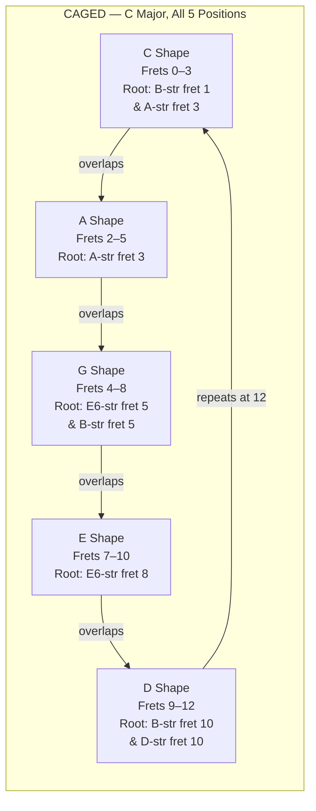
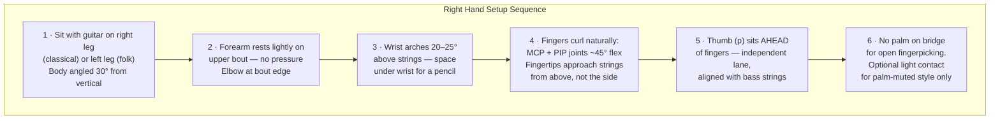
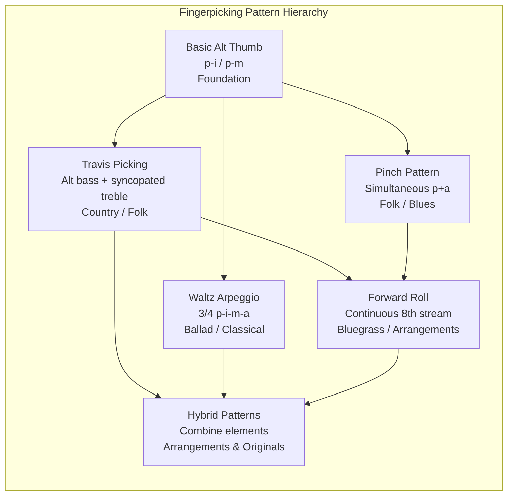
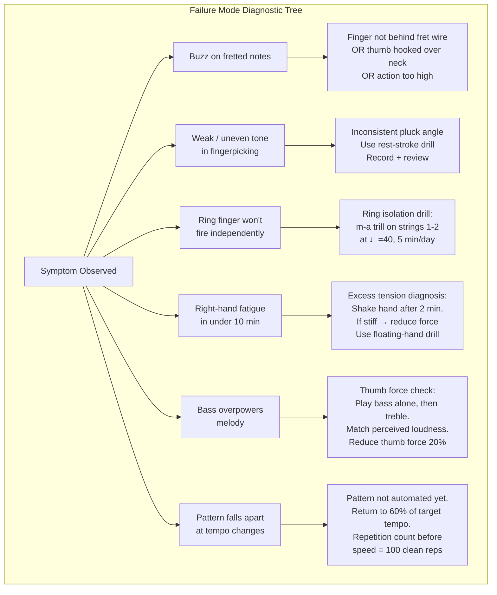
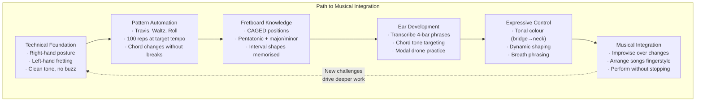

# Acoustic Guitar Masterclass — Lesson 3: Scales & Fingerpicking Techniques

## Table of Contents
1. [First-Principles Intuition (Condensed)](#1-first-principles-intuition-condensed)
2. [Fretboard Architecture & The CAGED System](#2-fretboard-architecture--the-caged-system)
3. [Right-Hand Fingerpicking Mechanics](#3-right-hand-fingerpicking-mechanics)
4. [Fingerpicking Patterns — Drills & Notation](#4-fingerpicking-patterns--drills--notation)
5. [Left-Hand Scale Systems & Positional Playing](#5-left-hand-scale-systems--positional-playing)
6. [Common Failure Modes & Instant Fixes](#6-common-failure-modes--instant-fixes)
7. [Progressive Practice Routines](#7-progressive-practice-routines)
8. [Musical Application — From Mechanics to Expression](#8-musical-application--from-mechanics-to-expression)

---

## 1. First-Principles Intuition (Condensed)

### Why Shorter String = Higher Pitch

Fretting shortens the vibrating string length. Halving the length (12th fret) doubles the frequency — one octave up. That's the entire physics you need. The key practical takeaway:

- **Pluck near the bridge** → bright, cutting tone (more high harmonics)
- **Pluck over the soundhole** → warm, full tone (fundamental dominates)
- **Pluck over the 12th fret** → hollow, flute-like tone (even harmonics suppressed)

Move your right-hand anchor point deliberately. This is a free tonal colour knob built into every acoustic guitar.

### Why Fingers Resist Independence

The ring and middle fingers share a flexor tendon. This is anatomy, not weakness. Direct consequence: the ring finger is always the hardest to isolate. Every independence drill targets this coupling. You are rewiring motor cortex maps — it takes weeks of consistent, slow, tension-free practice to change, not hours of grinding.

### Equal Temperament in One Sentence

Each fret raises pitch by a factor of 2^(1/12) ≈ 1.0595. The 12th fret is exactly 2× the open string frequency. Everything else follows from that ratio.

---

## 2. Fretboard Architecture & The CAGED System

### Standard Tuning Reference

```
String:   6     5     4     3     2     1
Name:     E2    A2    D3    G3    B3    E4
Gauge:   .053  .042  .032  .024  .016  .012  (light acoustic set)
```

> **Tuning anomaly to memorise:** The B string (string 2) is tuned a major 3rd above G (string 3), while all other adjacent pairs are perfect 4ths. This shifts every shape crossing the G→B boundary up by one fret. If a shape breaks there, add one fret — that's why.

### CAGED System Overview

The CAGED system gives you five overlapping "windows" covering the entire neck. Each window is named after the open chord shape it resembles. Same key, five different zip codes on the neck.



### C Major Scale — All 5 CAGED Positions (Fingering Diagrams)

**Position 1 — C Shape (Open / Frets 0–3)**

```
e |---0---1---3---|
B |---0---1---3---|
G |---0---2-------|
D |---0---2---3---|
A |---0---2---3---|
E |---0-----------| (open low E = not in C major; begin on A string)
     T   1   2   4    (T = open, 1 = index, 2 = middle, 4 = pinky)
```

Play from low A string. Root notes: A-string fret 3 (C), B-string fret 1 (C).

**Position 2 — A Shape (Frets 2–5)**

```
e |---5---|
B |---5---|
G |---4---|
D |---5---|
A |---3---5---|
E |---3---5---|
     1   2   4
```

Root: A-string fret 3 (C). Stretch from fret 3 to 5 with fingers 1–4.

**Position 3 — G Shape (Frets 4–8)**

```
e |---5---7---8---|
B |---5---6---8---|
G |---4---5---7---|
D |---5---7-------|
A |---5---7-------|
E |---5---7---8---|
     1   2   3   4
```

Root: low E-string fret 8 (C), high e-string fret 8 (C). Requires a stretch — keep the thumb centred behind fret 6.

**Position 4 — E Shape (Frets 7–10)**

```
e |---8---10---|
B |---8---10---|
G |---7---9----|
D |---7---9---10--|
A |---7---9---10--|
E |---8---10---|
     1   2   3   4
```

Root: low E-string fret 8 (C). This is the most intuitive position for most players — same geometry as the open E chord shape.

**Position 5 — D Shape (Frets 9–12)**

```
e |---10---12---|
B |---10---12---|
G |---9----10---12---|
D |---10---12---|
A |---10---12---|
E |---10---12---|
      1    2    4
```

Root: B-string fret 10 (C), D-string fret 10 (C). Connects back to Position 1 at the 12th fret octave.

### Invariant Interval Shapes (Cheat Sheet)

Memorise these shapes and the fretboard becomes a connected map, not isolated patterns.

| Interval | Same String | Adjacent Strings (normal) | Crossing G→B |
|---|---|---|---|
| Unison | — | 5 frets up, 1 string higher | 4 frets up crossing G→B |
| Minor 3rd | 3 frets up | — | — |
| Major 3rd | 4 frets up | Same fret, skip 1 string | +1 fret crossing G→B |
| Perfect 4th | 5 frets up | Same fret, 1 string higher | +1 fret crossing G→B |
| Perfect 5th | 7 frets up | 2 frets up, 1 string higher | +1 fret crossing G→B |
| Octave | 12 frets up | 2 frets up, 2 strings higher | +1 fret if span crosses G→B |

---

## 3. Right-Hand Fingerpicking Mechanics

### Hand Position Setup — Step by Step

Before playing a single note, establish this posture. It takes 2 minutes to check and prevents months of bad habits.



### Finger Naming Convention (PIMA)

| Symbol | Finger | Preferred Strings |
|---|---|---|
| p (pulgar) | Thumb | Strings 6, 5, 4 (bass) |
| i (índice) | Index | String 3 |
| m (medio) | Middle | String 2 |
| a (anular) | Ring | String 1 |

This PIMA naming is universal in classical and fingerstyle guitar. Use it whenever reading notation.

### Rest Stroke vs. Free Stroke

**Rest stroke (apoyando):** After plucking, the finger follows through and rests on the adjacent lower string. Forces a perpendicular attack angle. Produces maximum volume and tone focus. Use for melody lines.

**Free stroke (tirando):** Finger plucks upward and clears all strings without touching. Allows simultaneous multi-voice playing. Essential for chord arpeggios and patterns where multiple strings ring together.

**Drill:** On string 1, play a single note with rest stroke, then immediately the same note with free stroke. Notice the volume and tone difference. That difference is your dynamic range — use it consciously.

### Nail vs. Flesh — Tone Control

| Contact | Tone Character | Use Case |
|---|---|---|
| Flesh only | Warm, round, low attack | Folk, blues, singer-songwriter |
| Nail edge | Bright, articulate, projecting | Classical, complex arrangements |
| Nail + flesh | Balanced, full | Most acoustic fingerstyle |

For acoustic (unamplified) playing, 1–2 mm of nail beyond the fingertip provides the best projection without sounding harsh. File at a 45° bevel — the string should slide off the nail smoothly, not catch.

---

## 4. Fingerpicking Patterns — Drills & Notation

All patterns below use this chord: **G major open position** (320003). Set a metronome. Never play faster than you can play cleanly.

### Pattern 1 — Basic Alternating Thumb (p-i, p-m)

The foundation of everything. The thumb creates a steady bass pulse; fingers answer on the offbeats.

```
Chord: G major (320003)
Time:  4/4

e |--------3-----------3----|
B |------0---0-------0---0--|
G |----0-------0---0-------0|
D |-------------------------|
A |--2-----------2----------|
E |3-----------3------------|
   p  i   m  i  p  i   m  i

Beat: 1  &  2  &  3  &  4  &
```

**Metronome targets:**
- Week 1: ♩= 50 BPM — focus on thumb/finger separation, zero tension
- Week 2: ♩= 65 BPM — add dynamic evenness
- Week 3: ♩= 80 BPM — maintain tone quality at speed

**Common error:** Thumb and index fire simultaneously on beat 1. Fix: exaggerate the gap between p and i until a clear 16th-note space exists, then gradually tighten it.

### Pattern 2 — Travis Picking (Alternating Bass + Syncopated Treble)

The defining pattern of country, folk, and acoustic blues. Thumb alternates between two bass strings; fingers fill the spaces independently.

```
Chord: C major (x32010)
Time:  4/4  (each line = 1 measure)

e |----------------1-------1---|
B |----------1-----------1-----|
G |--------0---0-------0---0---|
D |------2-----------2---------|
A |----3-----------3-----------|
E |----------------------------|
     p  p  i  p  m  p  i  p  m

Beat: 1  &  2  &  3  &  4  &
```

**Thumb alternation rule for Travis picking:**
- Beat 1 & 3 → Root string (A-string fret 3 for C = string 5)
- Beat 2 & 4 → 5th-string bass (D-string open for C = string 4)

**Four-chord Travis exercise** (the most practical vehicle for locking this in):

```
| C (x32010) | Am (x02210) | F (xx3211) | G (320003) |
  1 meas each, loop 8 times, chord changes must not break the thumb pattern
```

**Metronome targets:**
- ♩= 55 BPM — establish independent thumb/finger lanes
- ♩= 70 BPM — chord changes without hesitation
- ♩= 90 BPM — musical, relaxed feel at target tempo

### Pattern 3 — Waltz Arpeggio (3/4)

Essential for ballads, folk waltzes, and classical-influenced pieces.

```
Chord: Am (x02210)   then   E (022100)
Time:  3/4

e |-----0---------0---|-----0---------0---|
B |---1-----1---1-----|---0-----0---0-----|
G |-2-----------2---2-|-1-----------1---1-|
D |-------------------|-------------------|
A |-0-----------------|---2---------------|
E |-------------------|-0-----------------|
   p    i  m  a   i   p    i  m  a   i

Beat: 1   &  2  &  3  &
```

**Technique note:** The "a" (ring finger) plucks string 1 on the "& of 2". This is the hardest moment in the pattern — ring finger firing alone while middle holds. Isolate beats 2-and-3 as a micro-drill: `m–a–m–a` on strings 2 and 1 repeatedly at ♩= 40 until it flows.

### Pattern 4 — Pinch Pattern (Simultaneous Bass + Treble)

A pinch fires thumb and finger(s) simultaneously, anchoring the rhythm. Fundamental to folk strumming-picking hybrids.

```
Chord: D major (xx0232)
Time:  4/4

e |--2-------2-------2-------2--|
B |--3-------3-------3-------3--|
G |--2-------2-------2-------2--|
D |--0-2-0---0-2-0---0-2-0---0--|
   p+a  i  m  p+a i  m  p+a i  m
     ^pinch        ^pinch

Beat: 1  &  2  &  3  &  4  &
```

The pinch (p+a simultaneously) on beats 1 and 3 creates a percussive anchor. The i–m fill between pinches is light and fluid.

### Pattern 5 — Rolls (Banjo-Style Forward Roll on Guitar)

Creates a continuous 8th-note stream — the bedrock of fingerpicking arrangements.

```
Forward Roll:  p  i  m  p  i  m  p  i
String order:  5  3  1  4  3  1  5  3   (varies by chord)

Chord: G (320003)

e |--------3-------3-------|
B |------0-------0---------|
G |----0-------0-----------|
D |------------------------|
A |--2-------2-------------|
E |3-------3---------------|
   p i m  p i m  p i m  p i m
```

**Metronome targets:**
- ♩= 60 (each 8th note = one click subdivision)
- ♩= 80
- ♩= 110 (musical performance tempo)

> At ♩= 110 the roll should feel like a waterfall — continuous, even, effortless. If any note pops out louder than its neighbours, that finger is tensing. Find it and release.

### Pattern Architecture — How They Connect



---

## 5. Left-Hand Scale Systems & Positional Playing

### Left-Hand Posture Rules (Non-Negotiable)

1. **Thumb behind the neck** — opposite the middle finger, NOT hooked over. Exception: intentional "cheater" barre on bass strings only.
2. **Finger placement** — just behind the fret wire (toward the nut), not on top of it, not in the middle of the fret. This is where buzz originates when wrong.
3. **Curved fingers** — arch over strings 1–2 so they don't mute them accidentally.
4. **Minimum pressure** — squeeze only until the note sounds clean. Any more is wasted tension. Test: fret a note, then slowly release pressure until it buzzes. The clean threshold is your target force.
5. **Wrist position** — neutral, slightly dropped away from the neck. Never rotating the wrist sharply upward; that compresses the carpal tunnel.

### Pentatonic Minor Box — The Entry Point

Before tackling full 7-note scales, own the pentatonic minor. Five notes, zero half-step tension, works over blues, rock, folk, and country with minimal harmonic risk.

**A Minor Pentatonic — Box 1 (Frets 5–8, most used position)**

```
e |---5---8---|
B |---5---8---|
G |---5---7---|
D |---5---7---|
A |---5---7---|
E |---5---8---|
     1   4     (index = 1, pinky = 4)
```

Root notes (A) are on: E6-string fret 5, D-string fret 7, G-string fret 7 (not standard root), B-string fret 5, e-string fret 5.

**Scale degree map for Box 1:**

```
e |--R---4--|   R=root(A), 4=minor7th
B |--5---b7-|   5=perfect5th, b7=minor7th
G |--b3--4--|   b3=minor3rd, 4=perfect4th
D |--b7--b3-|
A |--4---b7-|
E |--R---4--|
```

**Box 1 drill sequence:**
```
Ascending:  E6-str 5 → A-str 5 → 7 → D-str 5 → 7 → G-str 5 → 7 → B-str 5 → 8 → e-str 5 → 8
Descending: reverse
Fingering:  1–4 | 1–4 | 1–3 | 1–3 | 1–4 | 1–4
```

Metronome: ♩= 60 → 80 → 100, all as 8th notes.

### Five Pentatonic Minor Boxes — Full Neck Map

The five boxes connect seamlessly. Learn them in order; each one starts where the last ends.

```
   Fret:   1   2   3   4   5   6   7   8   9  10  11  12
           |----|----|----|----|----|----|----|----|----|----|----|
E6:        |    |    |    |    |[1] |    |    |[4] |    |[5] |    |[1]|
A:         |    |    |    |    |[1] |    |[3] |    |[4] |    |    |[1]|
D:         |    |    |    |    |[1] |    |[3] |    |    |[2] |    |[1]|
G:         |    |    |    |    |[1] |    |[3] |    |    |[2] |    |   |
B:         |    |    |    |    |[1] |    |    |[4] |    |[2] |    |   |
E1:        |    |    |    |    |[1] |    |    |[4] |    |[5] |    |[1]|

Box numbers: [1]=Box1  [2]=Box2  [3]=Box3  [4]=Box4  [5]=Box5
```

**Connection rule:** The highest note of Box 1 on the high e-string (fret 8) is the same pitch as the lowest note of Box 2 on the same string. Boxes chain upward in minor 3rd increments (3 frets).

### Natural Minor Scale (Aeolian) — Adding the Missing Notes

The minor pentatonic omits the 2nd (♭2→natural 2) and the 6th (♭6). Adding these two notes gives you the natural minor — 7 notes, more melodic options, and the ability to outline chord changes.

**A Natural Minor — Position 1 (E-Shape CAGED, Frets 5–8)**

```
e |---5---7---8---|
B |---5---6---8---|
G |---5---7-------|
D |---5---7-------|  ← add fret 6 (Bb/♭6) here compared to pentatonic
A |---5---7-------|
E |---5---7---8---|
     1   2   3   4
```

Compare to Box 1 pentatonic — you're just adding fret 6 on strings 4–6 and fret 6 on string 2. Those two notes are the ♭6 and the natural 2. Slide them in gradually.

**Harmonic Minor variation** — raise the 7th by one fret (G# at fret 8 on the A-string becomes fret 9). Creates that Spanish/dramatic sound. One fret change, completely different character.

```
A Harmonic Minor — difference from natural minor:
A-string: fret 7 (G natural) → fret 8 (G#) ← the change
```

### Major Scale — E-Shape Position (The Most Versatile Starting Point)

**G Major — E-Shape Position (Frets 2–5)**

```
e |---2---4---5---|
B |---3---5-------|
G |---2---4-------|
D |---2---4---5---|
A |---2---4---5---|
E |---2---4---5---|  ← root (G) on fret 3... wait, adjust:
     1   2   4
```

Corrected G Major E-Shape (root G on fret 3, E6 string):

```
e |---3---5-------|
B |---3---5-------|
G |---2---4---5---|
D |---2---4---5---|
A |---2---4---5---|
E |---3---5-------|
     1   2   3   4
```

Root notes (G): E6-string fret 3, e-string fret 3.

**Ascending pattern fingering:**
```
E6-str:  1(3)  –  3(5)
A-str:   1(2)  –  2(4)  –  4(5)
D-str:   1(2)  –  2(4)  –  4(5)
G-str:   1(2)  –  2(4)  –  4(5)
B-str:   1(3)  –  2(5)        ← note B→G string shift: index moves one fret up
e-str:   1(3)  –  3(5)
```

### Three-Notes-Per-String (3NPS) — Speed Scale System

Where CAGED is about chord shapes and position, 3NPS is about raw scalar velocity. Exactly 3 notes per string means you pick D-U-D on every string — perfectly regular alternate picking without awkward crossings.

**G Major 3NPS — Pattern 1 (starting on E6, root position)**

```
e |---3---5---7---|
B |---3---5---7---|
G |---2---4---5---|
D |---2---4---5---|
A |---2---3---5---|
E |---3---5---7---|
     1   2   3/4
```

**Picking hand:** D-U-D | D-U-D | D-U-D | D-U-D | D-U-D | D-U-D (strict alternate picking per string, all downstrokes at string changes — economy picking variant)

**Metronome targets for 3NPS scales:**
- ♩= 60 as triplets (3 notes per beat = 1 string per beat) — feel the string groupings
- ♩= 80 as 16th notes — 4 notes per beat, crossing strings on the downbeat
- ♩= 110 — musical performance tempo for most acoustic contexts

### Scale Sequences — Breaking the Up-Down Rut

Playing scales only ascending/descending is a practice habit, not a musical skill. These sequences train musical scale use.

**Sequence 1 — Thirds** (harmonically rich, great for melodic playing)
```
Scale degrees:  1-3, 2-4, 3-5, 4-6, 5-7, 6-8, 7-9...
In G major:     G-B, A-C, B-D, C-E, D-F#, E-G, F#-A...

Tab (G major, E-shape position, strings 1–2):
e |---3---5---3---5---5---7---5---7---7---8---|
B |---3---3---5---5---3---3---5---5---7---7---|
     G  B   A  C   B  D   C  E   D  F#
```

**Sequence 2 — Triads up the scale**
```
1-3-5, 2-4-6, 3-5-7, 4-6-1, 5-7-2, 6-1-3, 7-2-4

In G: G-B-D, A-C-E, B-D-F#, C-E-G, D-F#-A, E-G-B, F#-A-C
```

Play each triad as a hammer-on triplet: pick the root, hammer 3rd, hammer 5th. Gives you an arpeggiated, lyrical phrasing that sounds immediately musical.

**Sequence 3 — 4-note groups with accent on beat 1**
```
1-2-3-4, 2-3-4-5, 3-4-5-6, 4-5-6-7...

Accent (play louder): note 1 of each group
Feel: marching staircase, great for building toward phrase climax
```

---

## 6. Common Failure Modes & Instant Fixes



### Failure Mode Detail — Ring Finger Independence

This is the most common barrier in fingerpicking development. Here is the full remediation protocol:

**Stage 1 — Isolation (Week 1–2)**
Fret a G chord. Place p on string 6, i on string 3, m on string 2, a on string 1. Without moving any other finger, pluck *only* string 1 with the ring finger (a). Other strings must not sound. ♩= 40, one pluck per click, 5 minutes.

**Stage 2 — Trill Drill (Week 2–3)**
On string 1, fret any note with the left hand. Trill between m and a — alternating middle and ring finger plucks — continuously. ♩= 50, 2 minutes. Focus: ring fires without dragging middle along.

**Stage 3 — Pattern Reintegration (Week 3–4)**
Return to Pattern 3 (Waltz Arpeggio). The m–a crossing at beat "& of 2" is now your diagnostic: if it flows, ring independence has arrived. If it stumbles, return to Stage 2 for one more week.

### Failure Mode Detail — Buzz Diagnosis

| Buzz Type | Sound | Cause | Fix |
|---|---|---|---|
| Deadened note | Thud, no pitch | Adjacent finger muting string | Arch fingers more, check fretting hand curl |
| Fret buzz (low) | Rattly pitch | Finger too far from fret wire | Move finger closer to fret (toward bridge side) |
| Fret buzz (high) | Rattle on release | Insufficient fret pressure | Increase pressure OR lower action |
| Sympathetic ring | Ghost note, distant | Adjacent open string resonating | Mute with floating thumb or underside of fretting finger |

### Failure Mode Detail — Tension Accumulation

**The 2-Minute Tension Check:**
1. Play your hardest pattern for exactly 2 minutes at target tempo.
2. Stop. Without thinking, let the right hand drop to your lap.
3. Immediately try to shake the wrist loosely.

If the wrist shakes freely → tension is managed.
If the wrist feels rigid or the forearm is "pumped" → you are over-gripping. Play the same pattern at 70% force. If the notes still sound clean (they will), you've been wasting energy.

---

## 7. Progressive Practice Routines

### Routine A — Beginner Foundation (20 min/day)

| Time | Exercise | Metronome | Focus |
|---|---|---|---|
| 0–3 min | Right-hand posture check + string isolation (p, i, m, a individually) | No click | Setup, zero tension |
| 3–8 min | Pattern 1 (Alt Thumb) over G–C–D–G loop | ♩= 55 | Thumb/finger separation |
| 8–13 min | Am Pentatonic Box 1 ascending/descending | ♩= 60 | Clean fretting, no buzz |
| 13–18 min | Pattern 2 (Travis) on C major chord only | ♩= 55 | Alternating bass lock |
| 18–20 min | Free play — improvise pentatonic over a drone A note | No click | Musical connection |

### Routine B — Intermediate Development (30 min/day)

| Time | Exercise | Metronome | Focus |
|---|---|---|---|
| 0–3 min | Ring finger isolation drill (Stage 2 trill) | ♩= 50 | Independence |
| 3–8 min | Travis Pattern over I–IV–V in G: G–C–D | ♩= 65→75 | Chord-change fluidity |
| 8–13 min | G Major E-shape scale, sequences in thirds | ♩= 65 | Intervallic thinking |
| 13–18 min | Pattern 4 (Pinch) + Pattern 5 (Roll) combined | ♩= 70 | Pattern mixing |
| 18–25 min | CAGED — connect Position 1 → 2 → 3 in G major | ♩= 60 | Positional shifting |
| 25–30 min | Transcription: learn 4 bars of a fingerpicking piece by ear | No click | Ear training |

### Routine C — Advanced Integration (45 min/day)

| Time | Exercise | Metronome | Focus |
|---|---|---|---|
| 0–5 min | 3NPS G major scale, all positions, strict alt picking | ♩= 80→100 | Speed + accuracy |
| 5–12 min | Full Travis arrangement: melody + bass simultaneous | ♩= 65→85 | Two-voice independence |
| 12–20 min | Modal drone practice: D Dorian, E Phrygian, B Locrian over drones | No click | Modal ear development |
| 20–28 min | Improvisation over Am–F–C–G: target chord tones on beat 1 | ♩= 75 (loop) | Harmonic targeting |
| 28–38 min | Full piece run-through: performance mode, no stops | No click | Continuity, expression |
| 38–45 min | Slow analysis: replay hard sections at 50% tempo, diagnose | ♩= 40 | Precision refinement |

### Tempo Progression Law

Never jump more than 5 BPM without earning it. The standard is **100 consecutive clean repetitions** at the current tempo before adding 5 BPM. This sounds slow. It is — and it's why most players plateau: they spend time at 80% speed instead of fully automating 70% first.

```
Target tempo: ♩= 100
Path: 55 → 60 → 65 → 70 → 75 → 80 → 85 → 90 → 95 → 100
      100 clean reps at each step before advancing
```

---

## 8. Musical Application — From Mechanics to Expression

### The Two Layers of Timing

**Layer 1 — The Grid:** The metronome pulse. Your bass thumb must own this. It never wavers, never rushes, never lays back.

**Layer 2 — The Feel:** Treble voices dance around the grid. Rushing the treble slightly into a chord change creates forward momentum (common in bluegrass). Laying back on treble creates a lazy, blues-soaked feel. Neither is wrong — both are intentional.

The common beginner error is rushing Layer 1 (bass) while thinking they're rushing Layer 2 (expression). Record yourself. If the bass thumb is unsteady, expression work is premature — return to pure thumb drills.

### Tonal Colour Map — Right-Hand Position

This is a free parameter most players never consciously use.

```
Bridge                 Soundhole              Neck (12th fret area)
  |--------------------------|------------------------|
Bright, cutting,        Warm, balanced,        Dark, hollow,
aggressive, louder      full fundamental,      flute-like,
  → slide lead,          → most fingerstyle,    → jazz-influenced,
  → emphasising attack    → singer-songwriter    → harmonic natural
```

**Exercise:** Play the exact same 4-bar phrase three times — once at each position (bridge, soundhole, neck). Same notes, same rhythm, three completely different instruments. This single exercise teaches more about tonal control than months of technique work without it.

### Phrasing — The Breath Principle

Every guitar phrase should imply a breath. Singers must breathe; guitarists don't have to — which is why guitar phrasing often sounds mechanical.

**Rules for breath phrasing:**
1. Every 2–4 bars, insert a brief rest (8th note minimum) — the "inhale."
2. The phrase following the rest begins with slightly more energy — the "exhale."
3. The last note of a phrase resolves dynamically downward (diminuendo into silence), not just harmonically.

```
Phrase structure example (4-bar unit):

Bar 1: Statement (forte, start of phrase)
Bar 2: Development (mezzo-forte, melodic motion)
Bar 3: Extension (slight crescendo, climbing toward climax)
Bar 4: Resolution + rest (diminuendo, last note fades, breath)
Bar 5: New phrase begins (fresh dynamic start)
```

### Chord-Scale Connections for Improvising

When improvising over chord changes, the fastest way to sound musical (not random) is to **target chord tones on beat 1 of each chord change**.

| Chord | Scale Choice | Avoid Notes | Target Notes (beat 1) |
|---|---|---|---|
| Gmaj | G major / G major pentatonic | F (maj7 tension over triad) | G, B, D |
| Am | A natural minor / Am pentatonic | — (all notes work) | A, C, E |
| Cmaj | C major / G major | B over C (unless resolving) | C, E, G |
| Dmaj | D major / D mixolydian | C# (sounds jazz-y) | D, F#, A |
| Em | E natural minor / Em pentatonic | — | E, G, B |

**One-week targeting drill:** Over a G–Em–C–D loop (♩= 70), play only single notes. The rule: whichever note you play on the downbeat of each bar change must be a chord tone (root, 3rd, or 5th of that chord). Every other note is free. This one constraint eliminates 90% of "random" improvising overnight.

### Modal Colour Reference

Modes are not separate scales to memorise — they are perspectives on a major scale. To play E Phrygian: play C major scale, but start and end phrases on E, and lean on the ♭2 (F) for colour.

| Mode | Built on | Character | Characteristic Note | Chord Context |
|---|---|---|---|---|
| Ionian | 1st degree | Bright, resolved | Major 7th | Imaj7 |
| Dorian | 2nd degree | Minor, slightly hopeful | Natural 6th | IIm7 |
| Phrygian | 3rd degree | Spanish, dark | ♭2nd | IIIm7 |
| Lydian | 4th degree | Dreamy, floating | ♯4th | IVmaj7♯11 |
| Mixolydian | 5th degree | Bluesy, dominant | ♭7th | V7 |
| Aeolian | 6th degree | Melancholic, natural minor | ♭6th | VIm7 |
| Locrian | 7th degree | Unstable, dissonant | ♭2nd + ♭5th | VIIm7♭5 |

**Practical modal entry point for acoustic players:** Start with Dorian (minor key with a raised 6th). It works over any minor chord in a major key context, sounds immediately musical, and the raised 6th distinguishes it cleanly from natural minor. D Dorian over Dm7 → G7 is the most common ii–V jazz application and also works beautifully in folk and Celtic styles.

### Full Integration Flowchart



---

## Quick Reference Card

| Need | Go To |
|---|---|
| Hand setup check | §3 — Right-Hand Setup Sequence |
| First fingerpicking pattern | §4 — Pattern 1 (Alt Thumb) |
| Fix buzzing notes | §6 — Buzz Diagnosis Table |
| Ring finger won't cooperate | §6 — Ring Finger Independence, 3-Stage Protocol |
| Scale for soloing now | §5 — Am Pentatonic Box 1 |
| Connect the whole neck | §2 — CAGED Overview + 5 Positions |
| Sound more musical immediately | §8 — Chord-Scale Targeting Drill |
| Practice schedule | §7 — Routines A / B / C |
