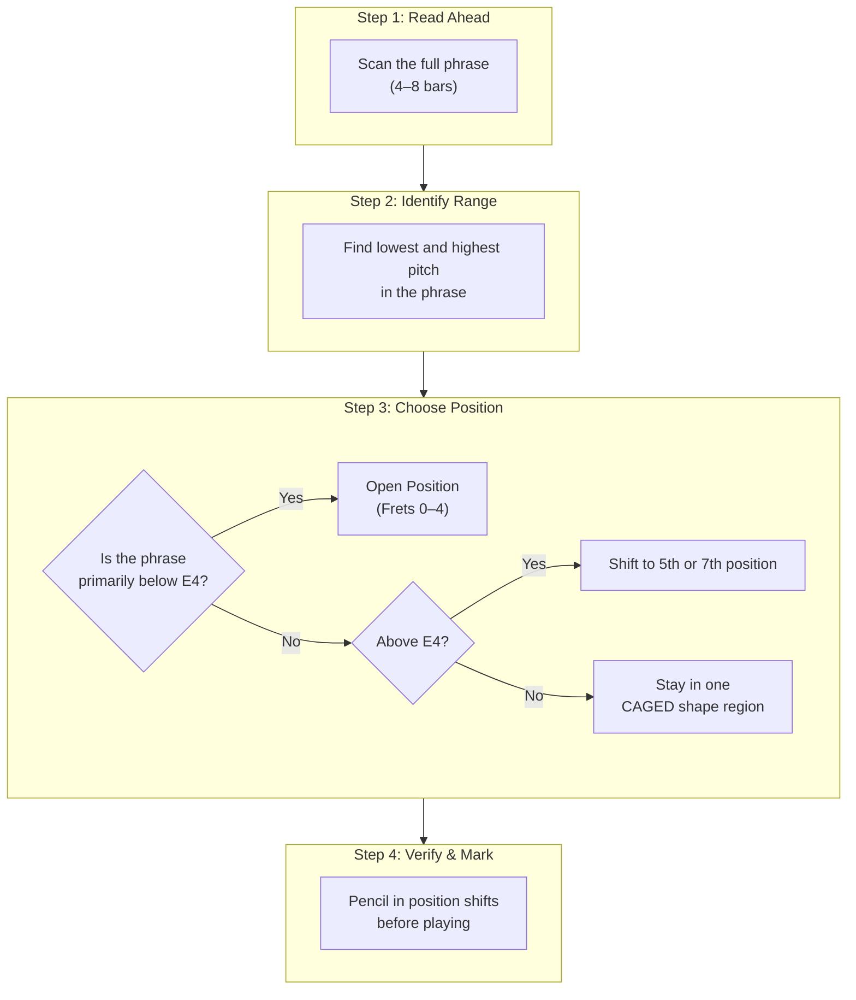
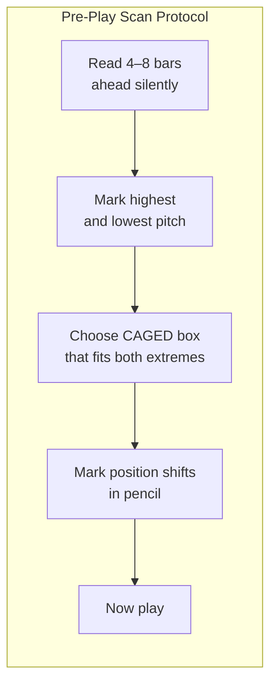
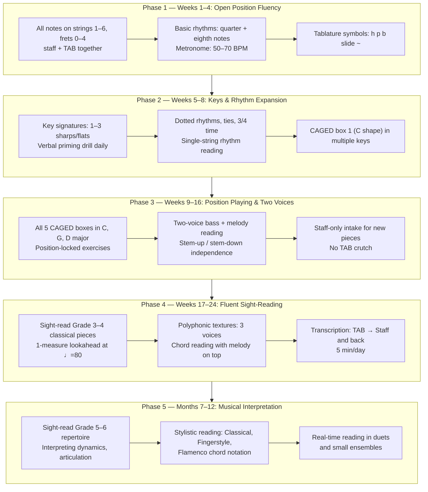

# Lesson 4: Reading Tablature & Sheet Music for Acoustic Guitar

## 1. First-Principles Intuition (The 15%)

The acoustic guitar presents a unique notational challenge: the same pitch lives in up to five different physical locations on the neck. The note A4 (440 Hz) can ring from the open 1st string, the 5th fret of the 2nd string, the 10th fret of the 3rd string, the 14th fret of the 4th string, or the 19th fret of the 5th string. Each location produces a subtly different timbre—brighter and more percussive near the bridge, warmer and rounder over the soundhole—so fingering choice is never purely mechanical. It's a tonal decision.

Two notation systems address this duality from opposite directions:

- **Tablature** tells you *where* to put your fingers. It resolves the multiple-location problem instantly.
- **Staff notation** tells you *what pitch* to play. It captures rhythm, dynamics, phrasing, and harmonic intent with precision tablature cannot match.

A working guitarist needs both. Tablature unlocks transcribed popular music and licks; staff notation opens the classical repertoire, duet parts, and communication with every other musician on the planet.

The bridge between them is standard tuning: **E2 – A2 – D3 – G3 – B3 – E4**. Notice the single asymmetry—the G3→B3 interval is a major third (4 semitones) while every other adjacent pair is a perfect fourth (5 semitones). That one irregularity is why chord shapes look slightly "off" when you cross the G–B string boundary, and why you must memorize separate fingering patterns for the treble strings.

---

## 2. Core Architecture & Mechanics

### 2.1 Tablature: Your Fretboard Map

Six horizontal lines represent the six strings. The *bottom* line is the lowest-pitched string (6th string, E2); the *top* line is the highest (1st string, E4). Numbers indicate which fret to press; 0 means open string.

```
e |-------------------------------------------| 1st string (E4, highest)
B |-------------------------------------------|
G |-------------------------------------------|
D |-------------------------------------------|
A |-------------------------------------------|
E |-------------------------------------------| 6th string (E2, lowest)
```

Read left to right = time passes. Numbers stacked vertically = play simultaneously (chord). Numbers in sequence = play one at a time.

**Complete Tablature Symbol Reference**

| Symbol | Name | Physical Gesture |
|--------|------|-----------------|
| `h` | Hammer-on | Pick the lower note, then slam the fretting finger down for the higher note — no second pick stroke |
| `p` | Pull-off | Both fingers pre-placed; flick the higher fret finger down and off the string to sound the lower note |
| `b` | Bend | Push or pull the string perpendicular to its axis to raise pitch; `b(9)` means bend until it sounds like fret 9 |
| `r` | Release bend | Reverse the bend back to pitch while sustaining |
| `/` | Slide up | Fret the note, slide finger up to target fret without lifting |
| `\` | Slide down | Same, descending |
| `~` | Vibrato | Small, rhythmic side-to-side string flex at the fingertip; aim for 5–6 oscillations per second |
| `x` | Dead note / mute | Touch string without pressing to fret; produces percussive click |
| `PM` | Palm mute | Rest the heel of the picking hand lightly on the strings just above the saddle |
| `<n>` | Natural harmonic | Touch string *directly above* fret wire, do not press; works at frets 5, 7, 12 |
| `[n]` | Artificial harmonic | Fret normally with left hand; touch 12 frets higher with right index, pluck with right thumb |

**Reading rhythm in tablature:** Bare tablature has no rhythmic information. Some publishers add stems above the staff. When no stems appear, use your ear against a recording. For precision, pair the tab with staff notation—this is called a *tab + notation* score and is the professional standard for acoustic fingerstyle publications (Chet Atkins, Tommy Emmanuel transcriptions all use it).

---

### 2.2 Practical TAB Reading: "Blackbird" Fingerstyle Pattern

This McCartney piece is the gold standard for acoustic fingerstyle reading. The pattern uses your thumb on the bass strings and fingers 1–3 on the treble strings simultaneously.

```
e |-------0-------0-------0-------0-------|
B |-----0---0---1---1---0---0---1---1-----|
G |---0-------0-------0-------0-----------|
D |---------------------------------------|
A |-3-------2-------0-------2-------------|
E |---------------------------------------|
   T  1 T 2 T  1 T 2 T  1 T 2 T  1 T 2
   (T = thumb, 1 = index, 2 = middle)
```

**Right-hand assignment:**
- Thumb (p): 5th string (A)
- Index (i): 3rd string (G)
- Middle (m): 2nd string (B)
- Ring (a): 1st string (e)

Fret 3 on A string → C note. Fret 2 → B note. Fret 0 → open A. Practice the thumb-bass line alone at 50 BPM before adding the treble fingers.

---

### 2.3 Staff Notation for Guitarists

Guitar reads in **treble clef** but sounds **one octave lower than written**. The small "8" beneath the clef indicates this transposition. Don't worry about it in practice — just read the positions normally.

**Note positions on the treble staff (sounding pitches):**

```
  ─── E5 (1st string, 12th fret)
  
  ─── D5 (1st string, 10th fret)
 ════════════════  (top line = E5 written, D5 sounding on guitar)
  ─── C5

 ─────────────────  
  ─── B4 (2nd string open)
 ─────────────────
  ─── A4 (2nd string, 5th fret OR 1st string open but sounds E4)
 ─────────────────
  ─── G4 (3rd string open)
 ─────────────────
  ─── F4 (1st fret, 1st string)
 ════════════════  (bottom line = E4 written)

  ─── D4 (ledger below: 1st line below staff)
  ─── C4 (Middle C: 2nd ledger line below)
```

**Practical memorization for open-position guitar notes:**

The open strings are your landmarks. Lock these in first:

| String | Open Pitch | Staff Position |
|--------|-----------|----------------|
| 1st (e) | E4 | First ledger line below staff |
| 2nd (B) | B3 | Third line from bottom |
| 3rd (G) | G3 | Second line from bottom |
| 4th (D) | D3 | First ledger below bottom line |
| 5th (A) | A2 | Second ledger below |
| 6th (E) | E2 | Third ledger below |

**Daily drill — 5 minutes:** Name each open string note aloud, then find it on the staff, then play it. Add fretted notes one at a time, working up each string from open to 5th fret.

---

### 2.4 Rhythm Notation: The Language of Duration

Staff notation encodes rhythm with precision tablature cannot. You need this for classical pieces, duets, and reading chord charts.

```
Whole note     ○       4 beats  (hold for entire measure in 4/4)
Half note      𝅗𝅥       2 beats
Quarter note   ♩       1 beat   (your "tap your foot" unit)
Eighth note    ♪       1/2 beat (two per foot tap)
Sixteenth      ♬       1/4 beat (four per foot tap)
```

**The dot rule:** A dot after any note adds half its value. Quarter note + dot = 1.5 beats. Dotted quarter + eighth = 2 beats (common in 6/8 and 3/4).

**Counting subdivisions aloud:**

```
4/4 measure, all eighth notes:
Beat:    1    &    2    &    3    &    4    &
Clap:    X    X    X    X    X    X    X    X
```

```
Sixteenth note subdivision:
Beat:    1    e    &    ah   2    e    &    ah
Clap:    X    X    X    X    X    X    X    X
```

**Practical exercise:** Before playing anything, clap the rhythm while counting aloud. Only add pitches after the rhythm lives in your body.

---

### 2.5 Key Signatures: The 7-Sharp / 7-Flat Map

Key signatures tell you which notes are always sharp or flat unless marked otherwise. The order of sharps is always **F C G D A E B**; the order of flats reverses it: **B E A D G C F**.

```
Key of G (1 sharp):   F♯ everywhere
Key of D (2 sharps):  F♯, C♯
Key of A (3 sharps):  F♯, C♯, G♯
Key of E (4 sharps):  F♯, C♯, G♯, D♯
Key of C (0):         No accidentals
Key of F (1 flat):    B♭ everywhere
Key of B♭ (2 flats):  B♭, E♭
Key of E♭ (3 flats):  B♭, E♭, A♭
```

**Guitar-practical habit:** Before you play a note, say the key signature aloud: "Key of D — that means every F and C is sharp." This verbal priming cuts key-blindness errors by 80% in the first year.

---

### 2.6 Staff-to-TAB Translation: Finding the Best Fingering

When you have a staff notation melody, you need to choose where to play it. This is the core skill separating guitarists who can read from those who truly sight-read.

**The four-question fingering decision process:**



**C Major Scale — Three Practical Realizations**

The same C major scale (C4 to C5) in three playable positions:

```
Open Position (most resonant, beginner-friendly):
e |------------------0--1--|
B |----------0--1----------|
G |-----0--2---------------|
D |--2--3------------------|
A |--3---------------------|
E |------------------------|
  Fingering: 3  2  0  2  0  1  0  1
```

```
5th Position (consistent tone, no open strings):
e |------------------------|
B |------------------------|
G |--5--7--9---------------|
D |--------10--12----------|
A |-------------12--14--15-|
E |------------------------|
  All notes closed; easier to transpose
```

```
Two-Octave (positions I + V connected):
e |------------------8--10--|
B |--------8--10--12--------|
G |--7--9------------------|
D |--10--------------------|
A |-------------------------|
E |-------------------------|
  Use for single-line melodic phrases in upper register
```

**Rule of thumb:** Use open position for accompaniment and chord-integrated melodies. Use closed positions for single-line runs you need to transpose or for timbral consistency in recordings.

---

## 3. The Five CAGED Positions: Your Fretboard Reading Grid

Before you can sight-read fluidly, you need a mental map of the fretboard. The CAGED system gives you five overlapping boxes that together cover the entire neck in any key. Each box is named after the open chord shape it's rooted in.

**Key of C — Five CAGED Positions for C Major Scale:**

```
C Shape (Open Position, frets 0–3):
e |--0--1--|
B |--0--1--|
G |--0--2--|
D |--0--2--3|
A |--0--2--3|
E |--0--1--3|
```

```
A Shape (frets 2–5):
e |--3--5--|
B |--3--5--|
G |--2--4--5|
D |--2--3--5|
A |--3--5--|
E |--3--5--|
```

```
G Shape (frets 5–8):
e |--5--7--8|
B |--5--6--8|
G |--5--7--|
D |--5--7--|
A |--5--7--|
E |--5--7--8|
```

```
E Shape (frets 7–10):
e |--8--10--|
B |--8--10--|
G |--7--9--|
D |--7--9--10|
A |--7--8--10|
E |--8--10--|
```

```
D Shape (frets 10–13):
e |--10--12--|
B |--10--12--13|
G |--9--10--12|
D |--10--12--|
A |--10--12--|
E |--10--12--|
```

**How to use this for reading:** When you see a phrase on the staff, identify the root note's position, recognize which CAGED box it falls in, and play within that box. This eliminates random string-jumping and builds consistent position playing.

---

## 4. Practical Sight-Reading Drills

### 4.1 Open Position Note Fluency (Weeks 1–4)

**Drill: Note Name Flashcard on the Neck**

Write these 12 notes on index cards. Shuffle. Draw one card, find it on the staff, play it on the guitar without looking at a chart. Time yourself.

```
Target notes (open position, all on strings 1–6, frets 0–4):

String 1 (e): E4(0)  F4(1)  F♯4(2)  G4(3)  G♯4(4)
String 2 (B): B3(0)  C4(1)  C♯4(2)  D4(3)  D♯4(4)
String 3 (G): G3(0)  G♯3(1) A3(2)   A♯3(3) B3(4)
String 4 (D): D3(0)  D♯3(1) E3(2)   F3(3)  F♯3(4)
String 5 (A): A2(0)  A♯2(1) B2(2)   C3(3)  C♯3(4)
String 6 (E): E2(0)  F2(1)  F♯2(2)  G2(3)  G♯2(4)
```

**Target:** Name and play any note in < 3 seconds at week 2, < 1.5 seconds by week 4.

---

### 4.2 Rhythm Reading Separated From Pitch (Week 1 Ongoing)

**Drill: Single-String Rhythm Reading**

Play all notes on the open 1st string. Focus 100% on hitting rhythms correctly.

```
Exercise A — quarter and eighth notes (count aloud while playing):
e |---0---0---0-0-0-0---0---0-0-0-0-0-0-0-0---|
   ♩   ♩   ♩  ♩ ♩  ♩  ♩   ♩  ♩  ♩  ♩  ♩  ♩  ♩  ♩  ♩
   1   2   3  &  4  &  1   2  e  &  ah  3  e  &  ah  4

Exercise B — dotted rhythms (long-short feel):
e |---0----0-0----0-0----0-0----0---|
   ♩.  ♪  ♩.  ♪  ♩.  ♪  ♩.  ♪
   1 &  2  1 &  2  1 &  2  1 &  2

Metronome targets: 60 BPM → 80 BPM → 100 BPM
```

---

### 4.3 Staff Reading Melodies in Open Position

**"Ode to Joy" — Beethoven, in TAB + Notation**

This is the ideal first staff-reading piece: stepwise motion, all quarter notes, stays in open position.

Staff (written, treble clef, key of G — 1 sharp, F♯):

```
Pitches: E  E  F♯  G  |  G  F♯  E  D  |  C  C  D  E  |  E.  D  D
```

Tablature realization (open position):

```
e |--0--0--2--3--|-3--2--0----|-----------|-0-----------|
B |--------------|----------3-|-1--1--3---|-----------3-|
G |--------------|------------|-----------|-0-----------|
D |--------------|------------|-----------|-------------|
  Count: 1  2  3  4    1  2  3  4    1  2  3  4    1  2. 3  4

Fingering (left hand): 
  F♯ on string 1, fret 2 = finger 2
  G  on string 1, fret 3 = finger 3
  C  on string 2, fret 1 = finger 1
  D  on string 2, fret 3 = finger 3

Metronome: 50 BPM (all quarter notes) → 70 BPM → 90 BPM
```

**Practice protocol:**
1. Clap and count the rhythm alone (all quarter notes here — straightforward)
2. Sing or hum the melody while tapping foot
3. Play through slowly, saying each note name aloud as you play it
4. Increase tempo only after pitch names are automatic

---

### 4.4 Connecting TAB and Staff: "House of the Rising Sun" Arpeggio

This Am–C–D–F progression in 3/4 uses a consistent arpeggio pattern and is an ideal staff + tab cross-reference exercise.

**Chord shapes (open position):**

```
Am          C           D           F
e |--0--|   e |--0--|   e |--2--|   e |--1--|
B |--1--|   B |--1--|   B |--3--|   B |--1--|
G |--2--|   G |--0--|   G |--2--|   G |--2--|
D |--2--|   D |--2--|   D |--0--|   D |--3--|
A |--0--|   A |--3--|   A |-----|   A |-----|
E |-----|   E |-----|   E |-----|   E |--1--|
```

**Arpeggio pattern in TAB (6-note per bar, 3/4 time):**

```
Am                          C
e |----0-------------|----0-------------|
B |--1---1----------|--1---1----------|
G |------2-----2----|------0-----0----|
D |--------2-----2--|--------2-----2--|
A |--0--------------|--3--------------|
E |-----------------|-----------------|
  beat: 1 & 2 & 3 &   1 & 2 & 3 &

Right hand: thumb(p) = string 5, index(i) = string 3, middle(m) = string 2, ring(a) = string 1
Pattern: p  i  m  a  m  i  (repeating)
```

**Staff-reading version:**

The same pattern notated in staff: a 3/4 measure with the bass note (A2) as a quarter note followed by five eighth notes (the treble arpeggio). Key of A minor — no sharps or flats. All notes fall within the treble staff plus one ledger line below.

**Cross-reference drill:** Cover the TAB half. Read only the staff. Decide fingering independently. Then uncover TAB to verify. Repeat until your choices match the written TAB.

---

### 4.5 Two-Voice Reading: Bass + Melody Independence

Classical guitar and fingerstyle both require reading two simultaneous voices. The stems tell you which voice is which: **stems up = melody (treble), stems down = bass**.

**Example: Bach-style two-voice texture in G major**

```
e |---3-----------3---2---0---|
B |-----3---3-------3---------|
G |-------0---0---------------|
D |---------------------------| 
A |---------------------------|
E |--3-----------2------------|
   Bass: G        F#       E (stems down, your thumb)
   Melody: D  D  G  G  B  E (stems up, fingers i m a)
```

**Practice method:**
1. Play bass voice alone (thumb only) — steady, even quarter notes
2. Play melody voice alone (fingers only)
3. Combine at 50% of target tempo
4. Increase tempo only when both voices maintain independence

---

## 5. Failure Modes & Targeted Fixes

### 5.1 Key Signature Blindness

**Symptom:** You play F♮ in the key of G, B♮ in B♭, or other "forgotten" accidentals. Pitches sound off; you can't identify why mid-read.

**Root cause:** The key signature is processed once and then forgotten as attention shifts to pitch recognition.

**Fix — Pre-flight verbal priming:**

Before playing a single note, say aloud: *"Key of D — F♯, C♯. Every F is sharp, every C is sharp."* Touch the key signature on the page as you say it. This takes 5 seconds and reduces key errors by roughly 80% within two weeks.

**Reinforcement drill — Key filter:**

```
1. Set metronome to 60 BPM
2. Play a one-octave scale, stopping on every note that the key signature alters
3. Exaggerate that note — hold it one full beat longer
4. Continue

Key of A (F♯ C♯ G♯):
Scale: A B C♯ D E F♯ G♯ A
       —  —  HOLD  —  —  HOLD  HOLD  —
```

---

### 5.2 Rhythmic Drift

**Symptom:** Pitches are correct but tempo rushes through easy passages and drags through hard ones. The music "breathes" with your anxiety level rather than the pulse.

**Root cause:** Attention is captured by difficult fingering decisions, displacing the internal clock.

**Fix protocol:**

1. **Isolate rhythm from pitch.** Play all notes on a single open string. Focus only on rhythmic accuracy with metronome.
2. **Clap before playing.** For any new piece, clap the full rhythm while counting aloud before touching the guitar.
3. **Use subdivided metronome.** Set metronome to click eighth notes rather than quarter notes. You can't rush between eighth-note clicks.
4. **Record yourself.** Play back and listen only for rhythm. Pitch errors are obvious; rhythm errors require deliberate listening.

```
Metronome subdivision test:
If you can't play a passage cleanly at 60 BPM subdivided to 8ths,
you're not ready to increase tempo. The rule: 3 clean passes at
target BPM before moving up 5 BPM.
```

---

### 5.3 Fingering Dead-Ends

**Symptom:** A passage starts fine then hits an impossible stretch or requires a sudden position jump mid-phrase, breaking musical flow.

**Root cause:** Note-by-note reading without scanning ahead. Local optimization leading to global failure.

**Fix — Phrase-scan before play:**



**Practical example:**

A passage ascends from D3 to A4. The D3 is on the open 4th string; A4 is on the 2nd string, 10th fret — that's a 10-fret range, requiring at least one position shift. Pre-scan tells you: start in open position, shift to 7th position at or before the G4 (3rd fret, 1st string in open position, or 8th fret of the 2nd string in higher position). Mark the shift point in pencil. Now the position jump is planned, not panicked.

---

### 5.4 Tablature Dependency

**Symptom:** You learn pieces fluently from TAB but freeze when handed staff notation without tablature. Your repertoire is limited to what others have already transcribed.

**Root cause:** TAB gives you the fingering solution pre-solved. You never develop the translation skill.

**Fix — Staff-only intake for new repertoire:**

For 60 days, learn all new pieces from staff notation only. No TAB. Decide all fingerings yourself, write them in pencil above the staff. After playing the piece, compare your fingering decisions to published TAB or a teacher's suggestions. The discrepancies are your learning targets.

Concurrently: transcribe 5 minutes of a fingerstyle piece from TAB into staff notation every week. You'll read TAB analytically rather than as a crutch.

---

### 5.5 Position Paralysis (Advanced)

**Symptom:** You know notes are on the neck but hesitate before every note above the 5th fret, losing time and confidence.

**Root cause:** Underdeveloped higher-position note geography. The fretboard above the 5th fret feels unmapped.

**Fix — Position isolation practice:**

```
Week 1: Lock in 5th position only. Play all major scale exercises, 
        melodies, and sight-reading fragments entirely in 5th position.
        Refuse to use open strings or other positions.

Week 2: Lock in 7th position. Same approach.

Week 3: Lock in 9th position.

Week 4: Connect all three positions with linking runs.

Exercise — C major, 7th position only:
e |--8--10--|
B |--8--10--|
G |--7--9--|
D |--7--9--10|
A |--7--8--10|
E |--8--10--|

Say note names aloud on every note. No exceptions.
Metronome: 50 BPM → 70 BPM → 90 BPM (quarter notes)
```

---

## 6. Progressive Sight-Reading Practice Roadmap



**Daily practice time targets by phase:**

| Phase | TAB Reading | Staff Reading | Rhythm Drills | Transcription |
|-------|-------------|---------------|---------------|---------------|
| 1 | 10 min | 10 min | 5 min | — |
| 2 | 10 min | 15 min | 10 min | 5 min |
| 3 | 5 min | 20 min | 5 min | 10 min |
| 4 | 5 min | 25 min | 5 min | 15 min |
| 5 | 5 min | 30 min | — | 20 min |

---

## 7. Measurement: How to Know You're Improving

Track these four metrics weekly with a simple log. Use a timer and a metronome. Be honest.

**Metric 1 — Note recognition speed**
Name a random fretted note (e.g., 4th string, 7th fret) and find it on the staff. Time from call to correct identification.
- Week 2 target: < 4 seconds
- Week 8 target: < 2 seconds
- Week 16 target: < 1 second (automatic)

**Metric 2 — Sight-reading accuracy**
Play a piece of music you have never seen before for exactly 2 minutes. Count total notes and errors.
```
Accuracy = (Total Notes − Errors) / Total Notes × 100%
Target: 70% at start → 85% at week 12 → 95% at week 24
```

**Metric 3 — Rhythmic consistency**
Record 32 bars of a piece you know well. Play back and count how many beats you rushed or dragged by more than a 16th note.
- Target: fewer than 3 drift events per 32 bars by week 8

**Metric 4 — Visual lookahead span**
While sight-reading, place a finger on the bar you're currently playing. Notice where your eyes are. How many bars ahead are you reading?
- Week 1: probably 0–1 beats ahead
- Week 8 target: 1 full bar ahead
- Week 24 target: 2 bars ahead at ♩=90

---

## 8. The Performer's Dimension: What Notation Doesn't Tell You

Staff notation and TAB together specify pitches, rhythms, and fingering. They leave these dimensions deliberately open:

- **Micro-timing:** A dotted rhythm can swing loose like Chet Atkins or be played dead-even like a classical étude. Neither is wrong; each is a style choice.
- **Tone color:** The same notated note played over the soundhole is warm and round. Played near the bridge, it cuts and sparkles. TAB cannot encode this.
- **Dynamic shaping within phrases:** Notation says *p* or *f*; it cannot tell you that the third beat of bar 2 needs a tiny swell to breathe life into the phrase.
- **Tempo flexibility (rubato):** A fermata or ritardando instruction is a suggestion; the degree of stretch is a musical judgment you earn through listening.

Build this dimension by:
1. Learning pieces by ear alongside notation — the recording resolves every ambiguity notation leaves open
2. Listening to two or three different guitarists perform the same piece (compare David Russell vs. John Williams on a Bach prelude)
3. Recording yourself and listening back as a third party — you will immediately hear what the notation didn't tell you to do

The notation is the blueprint. Your informed, listening-informed musical judgment is the building.
