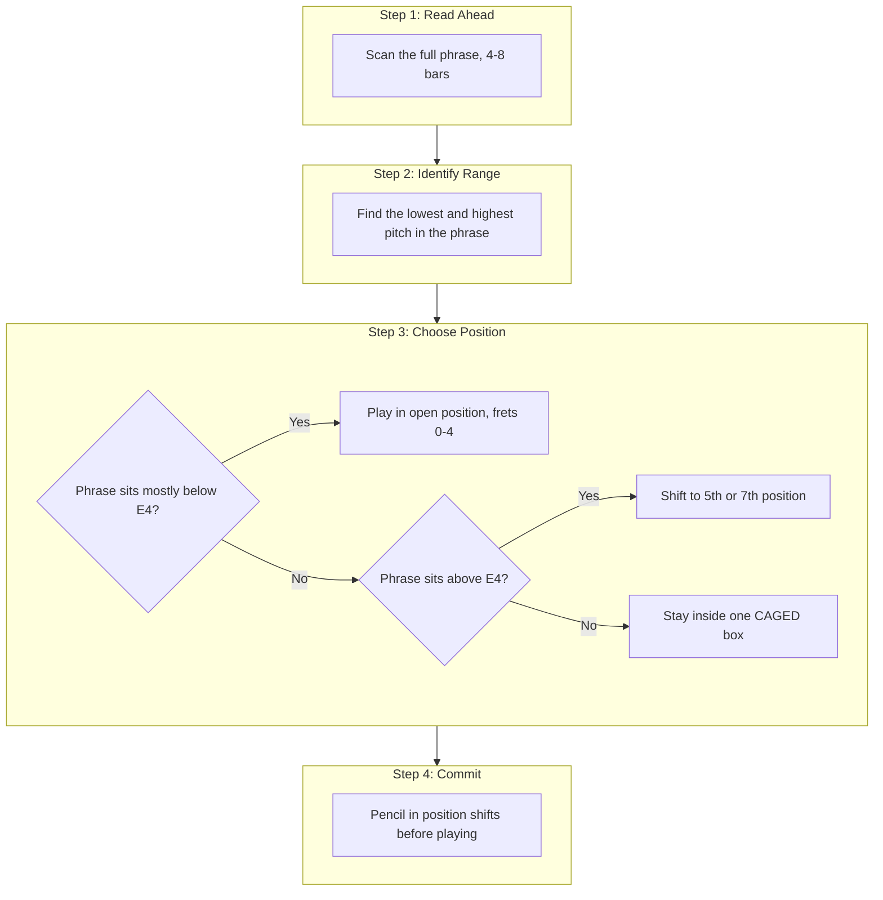
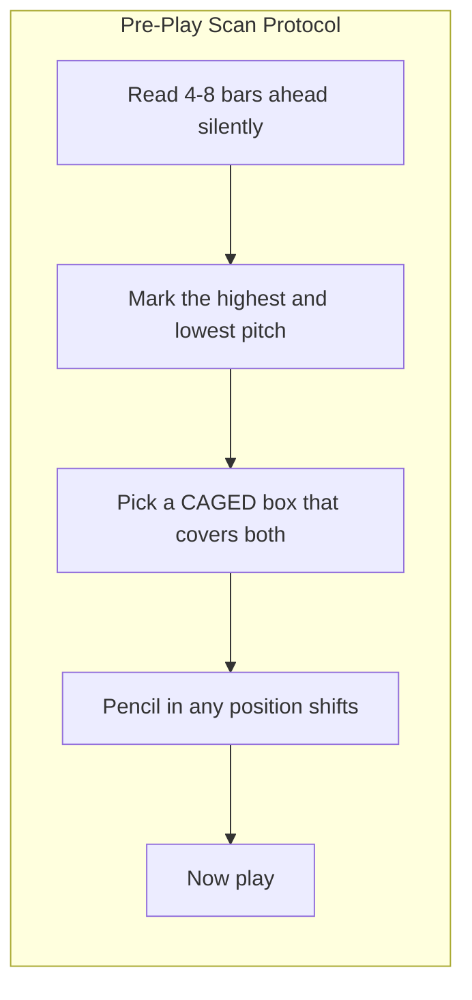
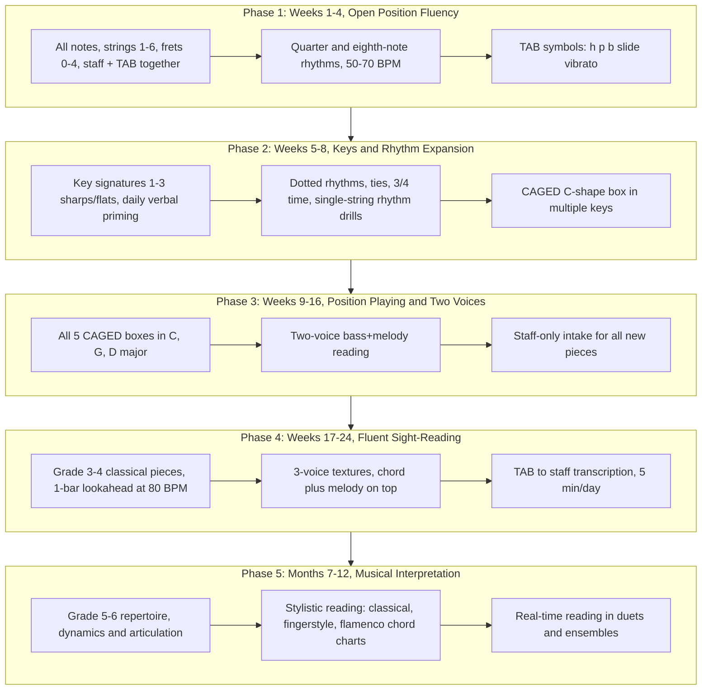

# Lesson 4: Reading Tablature & Sheet Music for Acoustic Guitar

## 1. First-Principles Intuition (The 15%)

The acoustic guitar presents a notational problem no piano faces: the same pitch exists in up to five physical locations on the neck. A4 (440 Hz) rings from the open 1st string, the 5th fret of the 2nd string, the 10th fret of the 3rd string, the 14th fret of the 4th string, or the 19th fret of the 5th string. Each location has a different timbre — brighter near the bridge, warmer over the soundhole — so choosing a fingering is a tonal decision, not just a mechanical one.

Two notation systems split this problem:

- **Tablature** tells you where to put your fingers. It kills the multiple-location ambiguity instantly but says nothing about rhythm by default.
- **Staff notation** tells you what pitch to play, with exact rhythm, dynamics, and phrasing — but leaves fingering for you to solve.

You need both. Tablature unlocks transcribed pop/rock repertoire. Staff notation opens classical repertoire, duets, and communication with every other instrumentalist.

The bridge between the two is standard tuning: **E2 – A2 – D3 – G3 – B3 – E4**. Every adjacent string pair is a perfect fourth (5 semitones) except G3→B3, which is a major third (4 semitones). That single irregularity is why chord shapes distort slightly when they cross the G–B boundary, and why you can't just copy a fingering pattern from the low strings onto the top two.

---

## 2. Core Architecture & Mechanics

### 2.1 Tablature: Your Fretboard Map

Six horizontal lines represent six strings. The bottom line is the lowest string (6th, E2); the top line is the highest (1st, E4). A number is a fret; `0` is open.

```text
e |-------------------------------------------| 1st string (E4, highest)
B |-------------------------------------------|
G |-------------------------------------------|
D |-------------------------------------------|
A |-------------------------------------------|
E |-------------------------------------------| 6th string (E2, lowest)
```

Left to right = time. Numbers stacked vertically = play together (chord). Numbers in sequence = play one at a time.

**Tablature symbol reference and the physical gesture behind each:**

| Symbol | Name | Physical Gesture |
|--------|------|-----------------|
| `h` | Hammer-on | Pick the lower note, then slam the fretting finger down for the higher note — no second pick stroke |
| `p` | Pull-off | Pre-place both fingers; flick the higher-fret finger off the string to sound the lower note underneath |
| `b` | Bend | Push/pull the string sideways to raise pitch; `b(9)` means bend until the pitch matches fret 9 |
| `r` | Release | Let a bend fall back to original pitch while the note still rings |
| `/` | Slide up | Fret the note, slide the same finger up to the target fret without releasing pressure |
| `\` | Slide down | Same motion, descending |
| `~` | Vibrato | Rock the fretting finger side to side at the tip, 5–6 oscillations per second |
| `x` | Dead note | Rest the finger on the string without pressing to the fret — produces a percussive thud |
| `PM` | Palm mute | Rest the picking-hand heel lightly on the strings right in front of the saddle |
| `<n>` | Natural harmonic | Touch the string directly over the fret wire, don't press; strongest at frets 5, 7, 12 |
| `[n]` | Artificial harmonic | Fret normally with the left hand, touch 12 frets higher with the picking-hand index, pluck with the thumb |

**Reading rhythm in TAB:** bare TAB carries no duration information. Professional fingerstyle publications (Chet Atkins, Tommy Emmanuel transcriptions) always pair TAB with a staff above it for rhythm. If you only have bare TAB, learn the rhythm by ear from a recording first, then use the TAB purely for fingering.

---

### 2.2 Practical TAB Reading: "Blackbird" Fingerstyle Pattern

The McCartney classic is the standard first fingerstyle reading piece because the thumb and two fingers each lock onto one string and never cross.

```text
e |-------0-------0-------0-------0-------|
B |-----0---0---1---1---0---0---1---1-----|
G |---0-------0-------0-------0-----------|
D |---------------------------------------|
A |-3-------2-------0-------2-------------|
E |---------------------------------------|
   T  1 T 2 T  1 T 2 T  1 T 2 T  1 T 2
   (T = thumb, 1 = index, 2 = middle)
```

**Right-hand assignment (classical p-i-m-a labeling):**
- Thumb (p): 5th string (A) — alternates fret 3 (C), fret 2 (B), open (A)
- Index (i): 3rd string (G) — stays open throughout
- Middle (m): 2nd string (B) — alternates open and fret 1
- Ring (a): 1st string (e) — stays open throughout

**Drill:** isolate the thumb line alone — A string, 3-2-0-2 repeating — at 50 BPM until it's metronomic and even. Only then layer in the index/middle pattern on top. Most people fail this piece because they rush straight to both hands together; the thumb needs to become unconscious first.

---

### 2.3 Staff Notation for Guitarists

Guitar is written in **treble clef** but sounds **one octave lower than written** — that's what the small "8" under the clef means. In practice, ignore the transposition; read the staff positions exactly as printed and your fretting hand will land in the right physical octave automatically.

**Open-string landmarks — memorize these six positions first, everything else is built from them:**

| String | Open Pitch | Staff Position |
|--------|-----------|----------------|
| 1st (e) | E4 | First ledger line above the staff... no — first space above top line (read as E) |
| 2nd (B) | B3 | Third line from the bottom |
| 3rd (G) | G3 | Second line from the bottom |
| 4th (D) | D3 | First ledger line below the staff |
| 5th (A) | A2 | Second ledger line below the staff |
| 6th (E) | E2 | Third ledger line below the staff |

**Daily drill (5 minutes):** say each open-string note name aloud, locate it on the staff, play it. Once automatic, extend one fret at a time up each string, from open to the 5th fret, saying the note name before you play it.

---

### 2.4 Rhythm Notation

```text
Whole note     𝅝       4 beats  (hold for the full measure in 4/4)
Half note      𝅗𝅥       2 beats
Quarter note   ♩       1 beat   (the "tap your foot" unit)
Eighth note    ♪       1/2 beat (two per foot tap)
Sixteenth      ♬       1/4 beat (four per foot tap)
```

**Dot rule:** a dot adds half the note's value. Dotted quarter = 1.5 beats. Dotted quarter + eighth = exactly 2 beats — the backbone rhythm of most 6/8 and many 3/4 pieces.

**Count subdivisions aloud before you touch the guitar:**

```text
Eighth-note subdivision in 4/4:
Beat:    1    &    2    &    3    &    4    &
Clap:    X    X    X    X    X    X    X    X

Sixteenth-note subdivision:
Beat:    1    e    &    ah   2    e    &    ah
Clap:    X    X    X    X    X    X    X    X
```

Clap and count the rhythm of any new piece before fretting a single note. Pitches layer onto a rhythm that already lives in your body — never the other way around.

---

### 2.5 Key Signatures

Order of sharps: **F C G D A E B**. Order of flats is the reverse: **B E A D G C F**.

```text
Key of G (1 sharp):   F♯ everywhere
Key of D (2 sharps):  F♯ C♯
Key of A (3 sharps):  F♯ C♯ G♯
Key of E (4 sharps):  F♯ C♯ G♯ D♯
Key of C (0):         no accidentals
Key of F (1 flat):    B♭ everywhere
Key of B♭ (2 flats):  B♭ E♭
Key of E♭ (3 flats):  B♭ E♭ A♭
```

**Pre-flight habit:** before playing, touch the key signature on the page and say it aloud — "Key of D, F and C are sharp." Five seconds, and it reliably cuts key-blindness errors within a couple of weeks because it refreshes the rule right before your attention shifts to pitch-reading.

---

### 2.6 Staff-to-TAB Translation: Choosing a Fingering

This is the skill that separates people who can decode TAB from people who can actually sight-read.



**C major scale, three playable realizations of the same pitches (C4–C5):**

```text
Open position (most resonant, best for beginners):
e |------------------0--1--|
B |----------0--1----------|
G |-----0--2---------------|
D |--2--3------------------|
A |--3---------------------|
E |------------------------|
Fingers: 3  2  0  2  0  1  0  1

5th position (closed, no open strings, easy to transpose):
e |------------------------|
B |------------------------|
G |--5--7--9---------------|
D |--------10--12----------|
A |-------------12--14--15-|
E |------------------------|

Two-octave, positions I and V connected:
e |------------------8--10--|
B |--------8--10--12--------|
G |--7--9-------------------|
D |--10----------------------|
A |--------------------------|
E |--------------------------|
```

**Rule of thumb:** open position for accompaniment and anything doubling as chord-melody; closed position when the line must transpose cleanly or when you want even tone across the whole phrase for a recording.

---

## 3. The Five CAGED Positions: Your Fretboard Reading Grid

CAGED gives you five overlapping fretboard "boxes" that together cover the whole neck in any key. Each is named after the open chord shape its scale pattern sits around.

**C major scale across the five CAGED boxes:**

```text
C Shape (frets 0-3, open position):
e |--0--1------|
B |--0--1------|
G |--0--2------|
D |--0--2--3---|
A |--0--2--3---|
E |--0--1--3---|

A Shape (frets 2-5):
e |--3--5------|
B |--3--5------|
G |--2--4--5---|
D |--2--3--5---|
A |--3--5------|
E |--3--5------|

G Shape (frets 5-8):
e |--5--7--8---|
B |--5--6--8---|
G |--5--7------|
D |--5--7------|
A |--5--7------|
E |--5--7--8---|

E Shape (frets 7-10):
e |--8--10-----|
B |--8--10-----|
G |--7--9------|
D |--7--9--10--|
A |--7--8--10--|
E |--8--10-----|

D Shape (frets 10-13):
e |--10--12------|
B |--10--12--13--|
G |--9---10--12--|
D |--10--12------|
A |--10--12------|
E |--10--12------|
```

**How to use this when sight-reading:** spot the root note of the phrase on the staff, identify which CAGED box contains that root at a comfortable fret, then read the rest of the phrase as motion within that one box. This stops the random string-jumping that wrecks timing in beginners and builds the muscle memory of staying in position.

---

## 4. Practical Sight-Reading Drills

### 4.1 Open Position Note Fluency (Weeks 1–4)

**Drill — Flashcard on the neck:** write 30 index cards, one note per card, covering the grid below. Shuffle, draw one, find it on the staff, then play it on the guitar without looking at a chart.

```text
String 1 (e): E4(0)  F4(1)  F#4(2)  G4(3)  G#4(4)
String 2 (B): B3(0)  C4(1)  C#4(2)  D4(3)  D#4(4)
String 3 (G): G3(0)  G#3(1) A3(2)   A#3(3) B3(4)
String 4 (D): D3(0)  D#3(1) E3(2)   F3(3)  F#3(4)
String 5 (A): A2(0)  A#2(1) B2(2)   C3(3)  C#3(4)
String 6 (E): E2(0)  F2(1)  F#2(2)  G2(3)  G#2(4)
```

**Target:** under 3 seconds per card by week 2, under 1.5 seconds by week 4.

---

### 4.2 Rhythm Reading Separated From Pitch (Week 1, ongoing)

Play everything on the open 1st string — no fretting decisions competing for attention, so you can focus entirely on rhythm.

```text
Exercise A — quarters and eighths, count aloud while playing:
e |---0---0---0-0-0-0---0---0-0-0-0-0-0-0-0---|
   1   2   3  &  4  &  1   2  e  &  ah  3  e  &  ah  4

Exercise B — dotted rhythm, long-short feel:
e |---0----0-0----0-0----0-0----0---|
   1 &  2  1 &  2  1 &  2  1 &  2

Metronome: 60 -> 80 -> 100 BPM. Move up only after 3 clean passes.
```

---

### 4.3 Staff Reading in Open Position: "Ode to Joy"

Stepwise motion, all quarter notes, stays in open position — the ideal first real sight-reading piece.

```text
Pitches:  E  E  F#  G  |  G  F#  E  D  |  C  C  D  E  |  E.  D  D
```

```text
e |--0--0--2--3--|-3--2--0----|-----------|-0-----------|
B |--------------|----------3-|-1--1--3---|-----------3-|
G |--------------|------------|-----------|-0-----------|
D |--------------|------------|-----------|-------------|
Count:  1  2  3  4    1  2  3  4    1  2  3  4    1  2. 3  4
```

Left-hand fingering: F♯ (string 1, fret 2) = finger 2; G (string 1, fret 3) = finger 3; C (string 2, fret 1) = finger 1; D (string 2, fret 3) = finger 3.

**Practice protocol:**
1. Clap and count the rhythm alone — trivial here, all quarters
2. Sing the melody while tapping your foot
3. Play slowly, saying each note name aloud as you play it
4. Raise tempo only once note names are automatic (50 → 70 → 90 BPM)

---

### 4.4 TAB + Staff Cross-Reference: "House of the Rising Sun" Arpeggio

The Am–C–D–F progression in 3/4 with a repeating six-note arpeggio pattern per chord.

**Open chord shapes:**

```text
Am        C         D         F
e--0--    e--0--    e--2--    e--1--
B--1--    B--1--    B--3--    B--1--
G--2--    G--0--    G--2--    G--2--
D--2--    D--2--    D--0--    D--3--
A--0--    A--3--    A-----    A-----
E-----    E-----    E-----    E--1--
```

**Arpeggio pattern, Am then C:**

```text
e |----0-------------|----0-------------|
B |--1---1------------|--1---1------------|
G |------2-----2------|------0-----0------|
D |--------2-----2----|--------2-----2----|
A |--0----------------|--3----------------|
E |--------------------|--------------------|
Beat:   1 & 2 & 3 &       1 & 2 & 3 &

Right hand: p = string 5, i = string 3, m = string 2, a = string 1
Pattern: p i m a m i (repeating every beat group)
```

The staff version notates this as a quarter-note bass pulse (the thumb's A2 or C3) followed by five eighth notes (the treble arpeggio) per bar, in A minor, no sharps or flats.

**Cross-reference drill:** cover the TAB staff, read only the written notation, decide your own fingering in pencil, then uncover the TAB and compare. Repeat on new pieces until your independent choices consistently match standard fingering.

---

### 4.5 Two-Voice Reading: Bass + Melody Independence

Stems up = melody (fingers), stems down = bass (thumb) — standard convention in classical guitar and fingerstyle scores.

```text
e |---3-----------3---2---0---|
B |-----3---3-------3---------|
G |-------0---0---------------|
D |---------------------------|
A |---------------------------|
E |--3-----------2------------|
Bass (thumb, stems down):   G    F#    E
Melody (fingers, stems up): D D  G G  B E
```

**Practice sequence:**
1. Thumb alone — steady, even quarters
2. Fingers alone — melody only
3. Combine at half target tempo
4. Raise tempo only when both voices stay independent — if the bass starts following the melody's rhythm, you've dropped a voice; slow back down

---

## 5. Failure Modes & Targeted Fixes

### 5.1 Key Signature Blindness

**Symptom:** you play F♮ in the key of G, or B♮ in B♭ — the key signature was read once, then forgotten once attention shifted to pitches.

**Fix — verbal priming:** before playing, touch the key signature and say it aloud: "Key of D — F♯, C♯, every F and C is sharp." Five seconds, done every time you sit down to a new piece.

**Reinforcement drill — key filter:**

```text
1. Metronome at 60 BPM
2. Play a one-octave scale, holding every altered note one extra beat
3. Continue through the octave

Key of A (F# C# G#):
A  B  C#    D  E  F#    G#    A
-  -  HOLD  -  -  HOLD  HOLD  -
```

---

### 5.2 Rhythmic Drift

**Symptom:** pitches are right but tempo rushes through easy bars and drags through hard ones — the music follows your anxiety, not the pulse.

**Fix protocol:**
1. Isolate rhythm from pitch — play the whole passage on one open string first
2. Clap and count the full rhythm before ever picking up the guitar
3. Subdivide the metronome click to eighths; you physically can't rush between clicks that close together
4. Record yourself and listen back for rhythm only — pitch mistakes jump out on their own, rhythm drift doesn't

**Rule:** if you can't play a passage cleanly against an eighth-note click at 60 BPM, you're not ready to raise the tempo. Three clean passes required before moving up 5 BPM.

---

### 5.3 Fingering Dead-Ends

**Symptom:** a passage plays fine until it suddenly demands an impossible stretch or a panicked jump mid-phrase.

**Root cause:** reading note-by-note with no lookahead — a locally fine choice that turns out globally wrong two bars later.



**Worked example:** a line climbs from D3 (open 4th string) to A4 (2nd string, 10th fret) — a 10-fret span, so at least one shift is unavoidable. The scan tells you to start in open position and shift to 7th position before the line reaches G4, rather than discovering the stretch is impossible mid-phrase. Mark the shift point in pencil before you play it once.

---

### 5.4 Tablature Dependency

**Symptom:** fluent from TAB, but freeze when handed staff-only notation. Your repertoire is capped at whatever's already been transcribed by someone else.

**Fix — 60-day staff-only intake:** for two months, learn every new piece from staff notation only, no TAB. Decide fingerings yourself in pencil. Afterward, compare against published TAB or a teacher — the mismatches are exactly what to drill next. In parallel, transcribe 5 minutes of a known fingerstyle piece from TAB into staff notation each week; this forces you to read TAB analytically instead of leaning on it.

---

### 5.5 Position Paralysis

**Symptom:** you know the notes exist above the 5th fret, but hesitate before every one of them, losing time and confidence.

**Fix — position isolation:**

```text
Week 1: lock into 5th position only for every exercise. No open strings.
Week 2: lock into 7th position only.
Week 3: lock into 9th position only.
Week 4: connect all three with linking runs between positions.

C major, 7th position:
e |--8--10--|
B |--8--10--|
G |--7--9---|
D |--7--9--10|
A |--7--8--10|
E |--8--10--|

Say every note name aloud as you play it. No exceptions.
Metronome: 50 -> 70 -> 90 BPM, quarter notes.
```

---

## 6. Progressive Sight-Reading Practice Roadmap



**Daily time allocation by phase:**

| Phase | TAB Reading | Staff Reading | Rhythm Drills | Transcription |
|-------|-------------|---------------|---------------|---------------|
| 1 | 10 min | 10 min | 5 min | — |
| 2 | 10 min | 15 min | 10 min | 5 min |
| 3 | 5 min | 20 min | 5 min | 10 min |
| 4 | 5 min | 25 min | 5 min | 15 min |
| 5 | 5 min | 30 min | — | 20 min |

---

## 7. Measurement: Knowing You're Improving

Track these four metrics weekly, with a timer and metronome, logged honestly.

**Note recognition speed** — call out a fretted note (e.g., 4th string, 7th fret), time how long until you correctly name it on the staff.
- Week 2: under 4 seconds. Week 8: under 2 seconds. Week 16: under 1 second, automatic.

**Sight-reading accuracy** — play a piece you've never seen for exactly 2 minutes, count notes and errors.
```text
Accuracy = (Total Notes - Errors) / Total Notes x 100%
Target: 70% at week 1, 85% at week 12, 95% at week 24
```

**Rhythmic consistency** — record 32 bars of something you know well, play it back, count beats rushed or dragged by more than a sixteenth note.
- Target: fewer than 3 drift events per 32 bars by week 8

**Visual lookahead span** — while sight-reading, note where your eyes are relative to the bar your hands are playing.
- Week 1: 0–1 beat ahead. Week 8: a full bar ahead. Week 24: 2 bars ahead at ♩=90.

---

## 8. The Performer's Dimension: What Notation Doesn't Tell You

Staff and TAB together fix pitch, rhythm, and fingering. They deliberately leave open:

- **Micro-timing** — a dotted rhythm can swing loose like Chet Atkins or sit dead-even like a classical étude; both are valid style choices, not notation errors.
- **Tone color** — the identical written note played over the soundhole is warm and round, played near the bridge it's bright and percussive. Neither TAB nor staff encodes where along the string you pluck.
- **Dynamic shaping inside a phrase** — notation marks *p* or *f* at a point, not the tiny swell on beat 3 of bar 2 that makes the phrase breathe.
- **Rubato** — a fermata or ritardando is a direction, not a number; how much to stretch is a judgment call earned by listening, not read off the page.

Build this judgment by: learning pieces by ear alongside the notation so the recording resolves what the page leaves ambiguous; comparing two or three recordings of the same piece (David Russell vs. John Williams on a Bach prelude is a good pair); and recording yourself, then listening back as an outside listener to hear exactly what the notation didn't tell you to do.

The notation is the blueprint. Your listening-informed judgment is what actually gets built from it.
