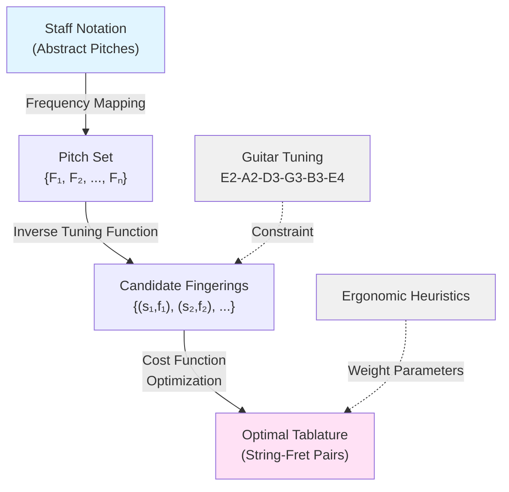
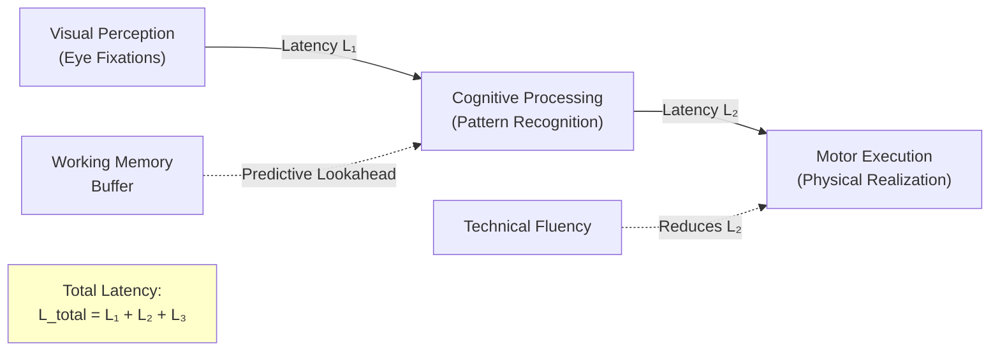
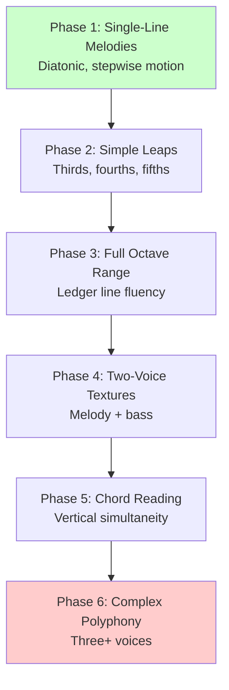

# Lesson 4: Reading Tablature and Sheet Music

## 1. First-Principles Intuition & Invariants

Musical notation systems encode the dual nature of music: the abstract realm of pitch relationships, rhythmic proportions, and harmonic structures, and the concrete domain of physical gestures required to produce sound on a specific instrument. For guitarists, this duality manifests in two complementary notation systems—tablature and staff notation—each prioritizing different aspects of the musical information hierarchy.

Tablature operates as a direct spatial mapping between notation and instrument topology. It emerged during the Renaissance (ca. 1507, with Petrucci's lute tablatures) as a pragmatic solution to the fingering ambiguities inherent in fretted instruments. Unlike the piano, where each pitch has a unique location, the guitar's overlapping register design allows the same pitch to be produced at multiple positions. For instance, the note A at 440 Hz can be played as an open 5th string, the 5th fret of the 6th string, the 10th fret of the 2nd string, or the 14th fret of the 3rd string. Tablature resolves this ambiguity by prescribing exact string-fret coordinates, prioritizing execution efficiency over theoretical abstraction.

Standard notation on the treble clef staff, conversely, operates as a pitch-centric encoding scheme divorced from instrumental specifics. It captures the composer's intended pitch sequence, rhythm, dynamics, and articulation without constraining the performer's choice of fingering. This abstraction enables identical scores to be performed on violin, flute, or guitar, though it burdens the guitarist with the interpretive task of translating staff positions into optimal fingering patterns—a non-trivial problem involving voice-leading efficiency, timbre consistency, and physical ergonomics.

The invariant principle connecting these systems is the fixed tuning of the guitar in standard configuration: E2-A2-D3-G3-B3-E4 (82.41 Hz to 329.63 Hz). This tuning establishes the bijection between tablature coordinates and staff pitches. The guitar's unique tuning irregularity—the major third interval between G and B strings rather than the perfect fourth intervals elsewhere—creates systematic fingering patterns that differ across string sets, a fact that both notation systems must accommodate through different mechanisms.

Understanding both systems is not merely pedagogically convenient but mathematically necessary. Tablature encodes the solution to the "realization problem" (mapping abstract pitches to concrete fingerings), while staff notation encodes the "composition problem" (organizing pitches into coherent musical structures). A complete guitarist must fluently translate between these representations, much as a programmer must understand both high-level algorithms and their low-level machine implementations.

## 2. Core Architecture & Mechanics

### 2.1 Tablature: Spatial Coordinate System

Tablature functions as a 2D coordinate system where the y-axis represents string selection and the x-axis represents temporal progression. The notation consists of six horizontal lines arranged in vertical pitch order from high to low, creating a visual isomorphism with the guitarist's downward view of the fretboard:

```
e|------------------------  (1st string: E4, 329.63 Hz)
B|------------------------  (2nd string: B3, 246.94 Hz)
G|------------------------  (3rd string: G3, 196.00 Hz)
D|------------------------  (4th string: D3, 146.83 Hz)
A|------------------------  (5th string: A2, 110.00 Hz)
E|------------------------  (6th string: E2, 82.41 Hz)
```

Fret numbers placed on these lines specify left-hand finger placement, with 0 denoting an open string. The number n on a given string indicates "press behind the nth fret," producing a pitch n semitones above the string's open pitch. This follows the equal-tempered scale relationship where frequency increases by the factor 2^(1/12) ≈ 1.05946 per fret.

**Extended Tablature Symbology:**

```
h   - hammer-on: ascending slur without right-hand articulation
p   - pull-off: descending slur via left-hand finger release
b   - bend: pitch elevation via string tension increase
r   - release: return from bent pitch
/   - slide up: glissando with continuous contact
\   - slide down: descending glissando
~   - vibrato: periodic pitch modulation via finger oscillation
x   - mute: percussive attack with damped fundamental
PM  - palm mute: damping at bridge for staccato timbre
```

The temporal dimension in tablature remains implicit. Note durations are indicated through vertical alignment (simultaneous notes) and horizontal spacing (approximate rhythmic proportions), though precise rhythmic notation requires augmentation with standard rhythmic stems above the staff or separate rhythm notation.

**Example: Opening of "Blackbird" by The Beatles (Paul McCartney)**

```
e|-------0-------0-------0-------0---|
B|-----0---0---1---1---0---0---1---1-|
G|---0-------0-------0-------0-------|
D|------------------------------------|
A|-3-------2-------0-------2---------|
E|------------------------------------|
  1 & 2 & 3 & 4 & 1 & 2 & 3 & 4 &
```

This notation specifies Travis-picking patterns with precise string-fret coordinates while rhythm notation above clarifies the eighth-note subdivision.

### 2.2 Staff Notation: Pitch-Time Coordinate System

Staff notation employs a continuous pitch space mapped onto a five-line staff augmented with ledger lines for extended ranges. For guitar, music is notated in treble clef with the convention of sounding one octave lower than written—a transposition artifact simplifying the visual representation by keeping most guitar music within the primary staff bounds without excessive ledger lines.

**Pitch Encoding:**

The treble clef (𝄞) establishes the second line from bottom as G4 (392.00 Hz). Pitches are encoded through vertical position following the diatonic scale sequence:

```
     E5  (line above staff)
  ═══════
     D5  (5th line)
  ─────── C5 (space)
     B4  (4th line)
  ─────── A4 (space)
     G4  (3rd line)
  ─────── F4 (space)
     E4  (2nd line)
  ─────── D4 (space)
     C4  (1st line)
  ═══════
     B3  (line below staff)
```

Accidentals modify pitch by semitones: ♯ raises by one semitone (frequency multiplied by 2^(1/12)), ♭ lowers by one semitone (frequency divided by 2^(1/12)), and ♮ cancels previous accidentals. Key signatures place accidentals at staff beginning, applying to all instances of named pitches throughout the piece unless locally contradicted.

**Rhythmic Encoding:**

Duration follows a binary subdivision hierarchy:

```
Whole note:      𝅝    4 beats (in 4/4 time)
Half note:       𝅗𝅥    2 beats
Quarter note:    𝅘𝅥    1 beat
Eighth note:     𝅘𝅥𝅮    1/2 beat
Sixteenth note:  𝅘𝅥𝅯    1/4 beat
```

Dotted notes extend duration by 50% (multiplier of 1.5), while ties combine durations additively. Tuplets create non-binary divisions—triplets divide a beat into three equal parts, quintuplets into five, etc.

Time signatures establish metric framework: the numerator specifies beats per measure, the denominator specifies which note value receives one beat. Common time (4/4) places four quarter-note beats per measure; 6/8 places six eighth-note beats (typically grouped as two dotted-quarter pulses).

**Dynamic and Articulation Markings:**

- **pp** (pianissimo) to **ff** (fortissimo): amplitude spectrum from very soft to very loud
- **crescendo** (<) / **diminuendo** (>): gradual dynamic transitions
- **staccato** (·): abbreviated duration, typically 50% of written value
- **legato** (slur): smooth connection without re-articulation
- **accent** (>): emphasized attack transient
- **fermata** (𝄐): prolongation beyond notated duration

### 2.3 Mapping Between Systems

The translation from staff notation to tablature requires solving the fingering optimization problem. Given a sequence of pitches P = {p₁, p₂, ..., pₙ} and guitar state space S = {(string, fret) pairs}, find the mapping f: P → S that minimizes:

```
Cost = w₁·(hand position shifts) + w₂·(string changes) + 
       w₃·(finger stretches) + w₄·(timbre inconsistency)
```

This optimization problem is NP-hard in general but admits heuristic solutions based on domain knowledge:

1. **Position stability**: Minimize left-hand position jumps by favoring solutions within a 4-fret span
2. **Voice integrity**: Keep melodic lines on consistent strings for timbral uniformity
3. **Open string efficiency**: Use open strings strategically for position shifts and sustain
4. **Ergonomic constraints**: Avoid extreme stretches (>5 frets) and awkward finger combinations



**Example Translation: C Major Scale**

Staff notation (ascending C major scale from C4 to C5):

```
Pitches: C4  D4  E4  F4  G4  A4  B4  C5
Freq:    261 294 329 349 392 440 494 523 Hz
```

Multiple tablature realizations exist:

**Position I (open position, prioritizes open strings):**
```
e|----------------------0--1--|
B|----------------0--1--------|
G|----------0--2--------------|
D|----0--2--------------------|
A|--3-------------------------|
E|----------------------------|
```

**Position V (5th position, closed fingering):**
```
e|----------------------------|
B|----------------------------|
G|--5--7--9--10--12--14--16--17|
D|----------------------------|
A|----------------------------|
E|----------------------------|
```

The choice depends on musical context: open position offers resonance and facilitates chord integration, while closed position provides timbral consistency and enables position-invariant pattern recognition for transposition.

### 2.4 Cognitive Models: Chunking and Pattern Recognition

Fluent sight-reading relies on hierarchical pattern recognition rather than symbol-by-symbol decoding. Expert musicians perceive notation in multi-note "chunks"—scale fragments, arpeggio patterns, chord shapes—rather than individual pitches. This chunking operates at multiple time scales:

```mermaid
graph TD
    A["Raw Notation Stream"] --> B["Note-Level Parsing<br/>(10-50ms per symbol)"]
    B --> C["Pattern Recognition<br/>(100-300ms per chunk)"]
    C --> D["Phrase-Level Interpretation<br/>(1-3 sec per phrase)"]
    D --> E["Structural Understanding<br/>(sections, form)"]
    
    F["Long-Term Memory<br/>(Stored Patterns)"] -.->|"Template Matching"| C
    G["Motor Programs<br/>(Finger Sequences)"| -.->|"Execution"| H["Physical Performance"]
    
    C --> G
    D --> H
    
    style A fill:#ffe1e1
    style E fill:#e1ffe1
    style F fill:#f5f5dc
    style G fill:#f5f5dc
```

Common guitar patterns form the vocabulary for this chunking process:

**Scale Patterns**: Five CAGED positions for major scale across the fretboard
**Arpeggio Shapes**: Triad and seventh chord arpeggios in closed voicings
**Chord Voicings**: Drop-2, drop-3, and closed-position chord forms
**Intervallic Patterns**: Third sequences, sixth sequences, octave displacement

Deliberate practice should focus on expanding this pattern vocabulary while strengthening the association between visual notation chunks and motor execution programs.

## 3. High-Performance Optimization & Failure Modes

### 3.1 Sight-Reading Performance Model

Sight-reading performance can be modeled as a pipeline with three critical stages:



**Performance bottlenecks** typically occur at:

1. **Visual parsing** (L₁): Slow symbol recognition due to unfamiliarity with notation density, key signatures, or rhythmic complexity
2. **Cognitive translation** (L₂): Inefficient pattern matching or fingering decisions
3. **Motor execution** (L₃): Technical limitations preventing realization of intended gestures

### 3.2 Optimization Strategies

**Strategy 1: Expand Visual Chunking Capacity**

Train the visual system to perceive larger units per fixation. Progressive exercises:

1. Practice reading simple melodies focusing 2-4 beats ahead of current playing position
2. Gradually increase lookahead distance to full measures
3. Introduce polyphonic textures (two voices, then three)
4. Add chord frames and dense rhythmic notation

**Metric**: Measure "visual-motor span" (the temporal distance between current eye fixation and currently played note). Expert musicians maintain 1-2 measure spans; beginners often read note-by-note (zero span).

**Strategy 2: Automate Pattern-to-Fingering Mappings**

Build fluent associations between notated patterns and optimal fingerings through systematic pattern practice:

```python
# Pseudo-training protocol
patterns = [
    "major_scales_all_positions",
    "minor_scales_all_positions", 
    "diatonic_triads_all_inversions",
    "seventh_chord_arpeggios",
    "chromatic_sequences"
]

for pattern in patterns:
    for key in keys:
        for position in guitar_positions:
            practice_until_automatic(pattern, key, position)
            record_fingering_as_chunk(pattern, key, position)
```

This creates a library of motor programs that can be invoked during sight-reading without conscious deliberation.

**Strategy 3: Develop Predictive Reading**

Leverage musical syntax knowledge to predict upcoming content:

- **Harmonic progressions**: Recognize cadential patterns (V-I, ii-V-I) and anticipate resolutions
- **Melodic contours**: Expect stepwise motion to be more common than leaps; prepare for approach-note patterns
- **Rhythmic structures**: Recognize metric hierarchies and predict strong-beat emphasis

This predictive processing reduces cognitive load by transforming "cold reading" into "confirmation of expectations."

**Strategy 4: Optimize Practice Material Sequencing**

Follow progressive difficulty curves:



Each phase should achieve 90% accuracy before progressing to ensure solid foundations.

### 3.3 Common Failure Modes and Mitigations

**Failure Mode 1: Rhythmic Inaccuracy**

*Symptom*: Correct pitches but inconsistent timing, rushing or dragging, metric instability

*Root cause*: Inadequate subdivision awareness; failure to maintain internal pulse

*Mitigation*:
- Practice all sight-reading with metronome at multiple subdivision levels
- Conduct while reading (physical beat-keeping through motion)
- Separately practice rhythm reading using single-pitch exercises
- Record performances and analyze timing deviations quantitatively

**Failure Mode 2: Key Signature Blindness**

*Symptom*: Forgetting accidentals specified in key signature, defaulting to C major reading

*Root cause*: Insufficient automaticity in applying key signature transformations to staff positions

*Mitigation*:
- Before reading, verbally enumerate accidentals ("F♯, C♯, G♯")
- Practice scales in all keys until visual recognition of altered notes becomes automatic
- Use color-coding exercises: highlight all affected pitches in score during learning phase
- Implement daily key signature drills: sight-read short excerpts in all 15 major/minor keys

**Failure Mode 3: Fingering Dead-Ends**

*Symptom*: Starting passages in suboptimal positions, leading to forced awkward shifts mid-phrase

*Root cause*: Insufficient lookahead; local optimization without global phrase consideration

*Mitigation*:
- Before playing, scan full phrase and identify position boundaries (where shifts will be necessary)
- Mark optimal starting positions in pencil during practice
- Develop position-choice heuristics: "Melodies ascending beyond E5 likely require position shifts; plan accordingly"
- Practice position-locked exercises: force performance within single position to internalize range constraints

**Failure Mode 4: Tablature Dependency**

*Symptom*: Fluent tablature reading but inability to read staff notation; limited to transcribed repertoire

*Root cause*: Tablature provides "turnkey" solutions, preventing development of fingering problem-solving skills

*Mitigation*:
- Deliberately practice staff notation without tablature reference, forcing fingering decisions
- Use staff notation for all new repertoire learning for 3-6 months
- Transcribe tablature to staff notation as exercise in reverse translation
- Balance repertoire: 50% from staff notation sources, 50% from tablature

**Failure Mode 5: Single-System Dependence**

*Symptom*: Over-reliance on single notation system limits repertoire access and musical understanding

*Root cause*: Incomplete development of bidirectional translation skills

*Mitigation*:
- Daily practice routine: 20 minutes tablature reading, 20 minutes staff notation reading
- Transcription exercises: convert tablature to staff notation and vice versa
- Analyze the same piece in both notations to understand complementary information encoded in each

### 3.4 Measurement and Assessment

Quantify sight-reading proficiency through standardized metrics:

**Accuracy Rate**: 
```
Accuracy = (Correct Notes) / (Total Notes) × 100%
```
Target: >95% for practiced material, >85% for sight-reading

**Tempo Maintenance**:
```
Timing Variance = σ(inter-beat-intervals) / μ(inter-beat-intervals)
```
Target: <5% coefficient of variation

**Comprehension Span**:
```
Span = (Maximum Lookahead Distance) / (Current Tempo × Note Density)
```
Target: >1 measure at moderate tempos (♩= 90-120)

**Recovery Time**:
Time required to resume after error without stopping
Target: <500ms (less than one beat at ♩= 120)

Track these metrics weekly to identify improvement trajectories and persistent weaknesses.

### 3.5 Advanced Integration: Musical Interpretation Beyond Notation

While tablature and staff notation encode precise execution instructions, they underspecify crucial performative dimensions:

- **Micro-timing**: Subtle deviations from strict metric grid (humanization, groove)
- **Dynamic shaping**: Phrase-level crescendo/diminuendo beyond notated dynamics
- **Timbral variation**: Tone color changes via picking position, pressure, attack angle
- **Rubato**: Expressive tempo flexibility within phrases

These elements emerge from stylistic knowledge, listening experience, and interpretive judgment. The notation systems provide the skeletal structure; the performer provides the living musical flesh through informed interpretive choices.

Advanced study should include:

1. **Comparative listening**: Study multiple performances of same work, analyzing interpretive differences
2. **Stylistic immersion**: Deep engagement with genre-specific performance practices
3. **Transcription beyond notation**: Capture micro-timing and dynamic nuance from recordings
4. **Informed experimentation**: Test interpretive choices against stylistic norms and personal expression

The ultimate goal is not mere literacy but musicianship—the ability to transform notation into meaningful, expressive musical communication.

## 4. Practical Mastery Roadmap

**Weeks 1-4: Foundation**
- Master note reading on all string/fret combinations for first position
- Achieve automatic recognition of notes on treble staff (C3-C5 range)
- Learn basic tablature symbols (h, p, b, slide)
- Daily: 10 minutes tablature reading, 10 minutes staff notation reading

**Weeks 5-8: Expansion**
- Extend range to full fretboard (positions I-XII)
- Introduce key signatures up to 3 sharps/flats
- Practice rhythmic reading exercises (separate pitch from rhythm)
- Daily: 15 minutes mixed tablature/staff reading, 5 minutes rhythm-only drills

**Weeks 9-16: Integration**
- Sight-read simple pieces combining both systems
- Develop fingering decision algorithms for standard progressions
- Introduce polyphonic textures (bass + melody)
- Daily: 20 minutes sight-reading new material, 10 minutes pattern vocabulary expansion

**Weeks 17-24: Fluency**
- Sight-read intermediate repertoire (grade 3-4 level)
- Achieve 1-measure lookahead at moderate tempos
- Perform in musical contexts (duets, small ensembles) requiring real-time reading
- Daily: 30 minutes diverse sight-reading material across styles

**Months 7-12: Mastery**
- Sight-read advanced repertoire (grade 5-6 level)
- Develop stylistic interpretation skills beyond literal notation
- Transcribe by ear and notate in both systems
- Daily: 40 minutes reading + 20 minutes transcription/analysis

Consistent, deliberate practice following this progressive structure will develop functional literacy in both notation systems, enabling access to the vast documented history of guitar music and facilitating communication with the broader musical community.
