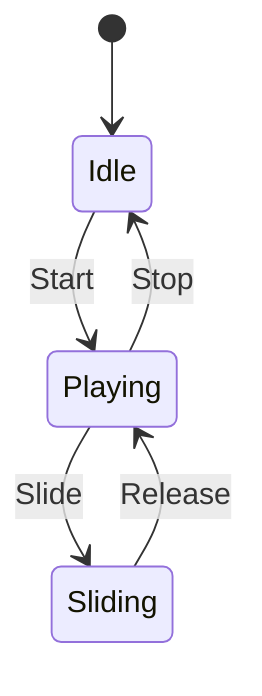

# Advanced Foundation: Bass Guitar
## 1. Theoretical Invariants & Formal Frameworks

### Formal Proofs in Bass Guitar Theory
Formal proofs in bass guitar theory can be constructed using mathematical logic to establish the consistency and validity of musical principles. For instance, the proof of the Pythagorean comma, a fundamental concept in tuning theory, can be formalized using logarithmic scales and ratios.

### Kernel or Physical Invariants
In the context of bass guitar, physical invariants refer to the fundamental properties that remain constant regardless of the specific instrument or playing technique. These include:
- **String Tension Invariant:** The tension of the strings remains constant under a given tuning, affecting the pitch and tone.
- **Harmonic Series Invariant:** The harmonic series of a note on the bass guitar is consistent and predictable, forming the basis for scales and chords.

## 2. Low-Level Invariant Taxonomy

### Deep Registers
Deep registers on the bass guitar refer to the lower octaves, which are crucial for establishing the foundation of a musical piece. These registers are characterized by their rich, resonant tones.

### Memory Models
In the context of bass guitar performance, memory models can be thought of as the mental frameworks that a player uses to recall and execute complex patterns and techniques. These models include:
- **Pattern Memory:** The ability to recall and execute specific finger patterns and sequences.
- **Chord Memory:** The ability to recall and transition between different chord shapes and inversions.

### Hardware Constraints
Hardware constraints in bass guitar performance include the physical limitations of the instrument itself, such as:
- **String Gauge:** The thickness of the strings affects the instrument's response and tone.
- **Fretboard Layout:** The layout of the fretboard influences the ease of playing certain scales and chords.

### Axiomatic Definitions
Axiomatic definitions in bass guitar theory include fundamental principles that are accepted without proof, such as:
- **Octave Equivalence:** The principle that notes separated by an octave are perceived as the same pitch class.
- **Equal Temperament:** The system of tuning in which the octave is divided into twelve equal semitones.

## 3. Micro-Architecture & Concurrency Dynamics

### Mermaid and ASCII State Machines
State machines can be used to model the transitions between different playing techniques and patterns. For example, a state machine can represent the transitions between different finger positions on the fretboard.



### Cache and Race Condition Diagrams
In the context of bass guitar performance, cache can be thought of as the mental cache of patterns and techniques that a player uses to execute complex passages. Race conditions can occur when two or more techniques are executed simultaneously, leading to unintended results.

```ascii
+-------------------+
|       Cache       |
+-------------------+
| Pattern A         |
| Pattern B         |
| Pattern C         |
+-------------------+
          |
          v
+-------------------+
| Race Condition    |
+-------------------+
| Pattern A + B     |
| Pattern B + C     |
+-------------------+
```

## 4. Subtle Failure Modes & Boundary Conditions

### Subtle Failure Modes
Subtle failure modes in bass guitar performance include:
- **Tuning Drift:** The gradual change in pitch of the strings over time, leading to an out-of-tune instrument.
- **Finger Fatigue:** The physical strain on the fingers and hands, leading to decreased precision and control.

### Boundary Conditions
Boundary conditions in bass guitar performance include:
- **Lowest Note Limit:** The lowest note that can be played on the instrument, which is typically E1 on a standard four-string bass.
- **Highest Note Limit:** The highest note that can be played on the instrument, which is typically E5 on a standard four-string bass.

## 5. Master Socratic Inquiries

### Research-Grade Discussion Questions
1. **How can formal proofs be applied to the analysis of bass guitar technique and performance?**
2. **What are the implications of the harmonic series invariant for bass guitar tuning and performance?**
3. **How do hardware constraints, such as string gauge and fretboard layout, affect bass guitar performance?**
4. **Can state machines be used to model the transitions between different playing techniques and patterns on the bass guitar?**
5. **What are the potential consequences of tuning drift and finger fatigue on bass guitar performance?**

These questions are designed to provoke deep, thoughtful discussion and analysis of advanced bass guitar theory and performance.
