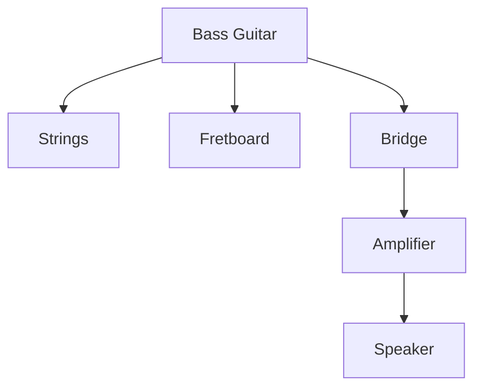

# Beginner Foundation: Bass Guitar

## 1. Everyday Intuition & First Principles
Imagine the bass guitar as the backbone of a musical ensemble. Just as your spine supports your body, the bass guitar supports the rhythm and harmony of a song. It provides the foundation that holds everything together, giving depth and stability to the music. Without a strong bass line, a song can feel hollow and disconnected.

## 2. Foundational Vocabulary & Glossary
- **Bass Guitar:** A stringed instrument typically played with a pick or fingers, featuring a long neck and four strings. It is the lowest-pitched member of the guitar family.
- **Strings:** The metal wires that vibrate to produce sound when plucked or strummed. On a bass guitar, these are usually thicker than those on a regular guitar.
- **Fretboard:** The fingerboard of the bass guitar, marked with metal strips called frets. These guide your fingers to the correct notes.
- **Tuning:** The process of adjusting the strings to the correct pitch. Standard bass tuning is E-A-D-G, from the thickest to the thinnest string.
- **Pick:** A small, usually plastic tool used to pluck the strings. Picks come in various shapes and thicknesses.
- **Fingerstyle:** A technique where the fingers are used to pluck the strings instead of a pick.
- **Amplifier:** An electronic device that amplifies the sound produced by the bass guitar. It is essential for projecting the bass sound in a live setting.
- **Bridge:** The part of the bass guitar that transfers the vibrations of the strings to the body of the instrument, which then amplifies the sound.

## 3. Visual System Flow
### ASCII Diagram
```
+-------------------+
|   Bass Guitar     |
+-------------------+
| Strings           |
| Fretboard         |
| Bridge            |
+-------------------+
          |
          v
+-------------------+
|   Amplifier       |
+-------------------+
| Speaker           |
+-------------------+
```

### Mermaid Flowchart


## 4. Common Beginner Misconceptions & Mental Traps
- **Misconception:** The bass guitar is only for playing simple, repetitive lines. **Reality:** Bass players can play complex and intricate lines that add depth and complexity to a song.
- **Misconception:** You need to be able to read music to play bass. **Reality:** While reading music is helpful, many bass players learn by ear and through tablature.
- **Misconception:** The bass guitar is only for rock music. **Reality:** The bass guitar is used in a wide variety of genres, including jazz, funk, pop, and classical music.
- **Misconception:** You need expensive gear to play bass. **Reality:** While high-quality gear can enhance your sound, you can start with an affordable bass guitar and amplifier.

## 5. Socratic Discussion Starters
- What is the role of the bass guitar in a band?
- How does the tuning of a bass guitar differ from a regular guitar?
- Can you play bass without an amplifier?
- What are some common techniques used in bass playing?
- How do you choose the right pick for your playing style?
