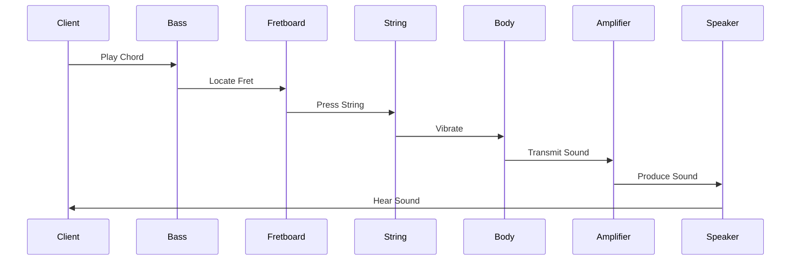

# Intermediate Foundation: Bass Guitar
## 1. Architectural Mental Model
### Overview
In the realm of bass guitar performance, the architectural mental model involves understanding the instrument's role within a musical composition, the interplay between technique and expression, and the broader context of music production. This model assumes a foundational knowledge of bass guitar basics, such as finger placement, basic chords, and simple scales, and builds upon these to explore more complex musical structures and performance techniques.

### Key Components
- **Role in the Ensemble:** The bass guitar serves as the backbone of a musical composition, providing the harmonic foundation and rhythmic stability. It interacts with other instruments to create a cohesive sound.
- **Technique and Expression:** Advanced techniques such as fingerstyle, slap, and tapping are crucial for expressive playing. Understanding how to use these techniques effectively is essential for a nuanced performance.
- **Music Production:** In a production context, the bass guitar is often recorded and mixed to fit within the overall sound of a track. This involves understanding equalization, compression, and other audio processing techniques.

## 2. Systems Taxonomy & Component Protocols
### Standard Interfaces and Protocols
- **Fretboard Layout:** The standard bass guitar has 20-24 frets and 4 strings tuned to E, A, D, and G. Understanding the fretboard layout is crucial for navigating the instrument and executing complex chord progressions and scales.
- **Tuning Protocols:** Standard tuning is E, A, D, G, but alternative tunings (e.g., drop D) are also common. Each tuning affects the instrument's range and tone, and understanding these differences is important for versatility.
- **Notation and Tablature:** Music notation and tablature are standard protocols for writing bass guitar parts. Familiarity with both is essential for reading and interpreting musical scores.

### Data Models
- **Chord Progressions:** Chord progressions are the building blocks of most musical compositions. Understanding common chord progressions and how to navigate them on the bass guitar is crucial for effective playing.
- **Scales and Modes:** Scales and modes provide the melodic foundation for bass guitar playing. Familiarity with major, minor, blues, and other scales is important for improvisation and soloing.
- **Rhythmic Patterns:** Rhythmic patterns are essential for creating a solid groove. Understanding common rhythmic patterns and how to adapt them to different musical styles is crucial for effective playing.

## 3. Multi-Component Interaction Flow
### Detailed ASCII and Mermaid Sequence Diagram
#### ASCII Sequence Diagram
```
Client ->> Bass: Play Chord
Bass ->> Fretboard: Locate Fret
Fretboard ->> String: Press String
String ->> Body: Vibrate
Body ->> Amplifier: Transmit Sound
Amplifier ->> Speaker: Produce Sound
Speaker ->> Client: Hear Sound
```

#### Mermaid Sequence Diagram


## 4. Architectural Trade-offs & Production Pitfalls
### Trade-offs
- **Tuning vs. Range:** Lower tunings provide a deeper sound but reduce the instrument's range. Higher tunings provide a wider range but may sacrifice depth.
- **Technique vs. Expression:** Advanced techniques can enhance expression but may require more practice and precision.
- **Production vs. Performance:** In a production context, the bass guitar is often recorded and mixed to fit within the overall sound of a track. This can involve trade-offs between the raw sound of the instrument and the desired production sound.

### Pitfalls
- **Overreliance on Effects:** Overusing effects can detract from the natural sound of the bass guitar and undermine the instrument's role in the ensemble.
- **Neglecting Rhythm:** A solid groove is essential for effective bass playing. Neglecting rhythm can undermine the overall feel of a composition.
- **Ignoring Theory:** Understanding music theory is crucial for effective bass playing. Ignoring theory can limit a player's ability to navigate complex chord progressions and scales.

## 5. Socratic Discussion Starters
### Questions Bridging Architecture to Low-level Implementation
- **How does the choice of tuning affect the bass guitar's role in a musical composition?**
- **What are the trade-offs between advanced techniques and expressive playing?**
- **How does the interaction between the bass guitar and other instruments in an ensemble affect the overall sound of a composition?**
- **What are the key considerations when recording and mixing a bass guitar part in a production context?**
- **How does understanding music theory enhance a bass player's ability to navigate complex chord progressions and scales?**

By exploring these questions, bass guitarists can deepen their understanding of the instrument's role in music and enhance their technical and expressive abilities.
