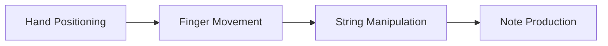

# Lesson 4: Playing in Position and Out of Position

## 1. First-Principles Intuition & Invariants

Navigating the fretboard requires a fundamental understanding of position and its relationship to the instrument's geometry. The fretboard can be conceptualized as a two-dimensional grid, with the x-axis representing the strings and the y-axis representing the frets. Each position on the fretboard corresponds to a unique set of notes, and mastering the transition between positions is crucial for effective bass playing.

Position is intricately linked to the instrument's tuning and the player's hand positioning. When playing in a specific position, the player's fingers are arranged to facilitate efficient access to the desired notes. As the player moves between positions, the hand must adapt to new fingerings, string crossings, and fretting techniques.

Mathematically, the fretboard can be represented as a grid of points, where each point corresponds to a unique note. The distance between these points represents the interval between notes. Developing an intuitive sense of the fretboard's geometry, including the relationships between notes, intervals, and positions, is essential for effective playing.

## 2. Core Architecture & Mechanics

The process of playing in position and out of position involves a complex interplay between hand positioning, finger movement, and string manipulation. At a fundamental level, this process can be broken down into several key components:

- **Hand positioning**: The player's hand must be positioned on the fretboard in a way that allows for efficient access to the desired notes. This involves understanding the instrument's geometry and developing a sense of the hand's position relative to the fretboard.
- **Finger movement**: The player's fingers must move between positions on the fretboard efficiently. This requires developing finger independence, strength, and dexterity.
- **String manipulation**: The player must manipulate the strings to produce the desired notes. This involves understanding the instrument's tuning and developing a sense of the string's vibration patterns.

The following diagram illustrates the key components of the playing process:

## 3. High-Performance Optimization & Failure Modes

To optimize performance when playing in position and out of position, the player must navigate a complex interplay between hand positioning, finger movement, and string manipulation. Developing strategies for efficient hand positioning, finger movement, and string manipulation is crucial.

- **Concurrency**: The player must develop the ability to play multiple notes simultaneously while maintaining an understanding of the fretboard's geometry and the relationships between notes.
- **Resource scaling**: The player must adapt to changing musical contexts, including variations in tempo, dynamics, and articulation.
- **Boundary edge cases**: The player must navigate the boundaries between positions on the fretboard, understanding the relationships between notes, intervals, and positions.
- **Failure mitigations**: The player must develop strategies to mitigate failure modes, such as finger fatigue, hand positioning errors, and string manipulation mistakes.

By cultivating a deep understanding of the fretboard's geometry, the player can optimize performance, navigate complex musical contexts, and achieve mastery over the instrument.
