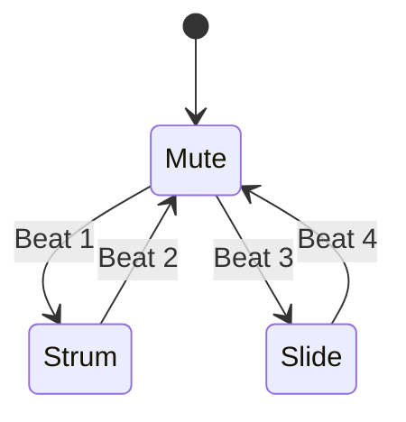

# Advanced Foundation: Bass Guitar 02 Rhythm Muting And Grooves

## 1. Theoretical Invariants & Formal Frameworks

### Formal Proofs and Kernel Invariants

In the domain of bass guitar rhythm muting and grooves, formal proofs can be constructed to analyze the consistency and predictability of rhythmic patterns. A kernel invariant in this context can be defined as a fundamental rhythmic structure that remains constant across different musical styles and tempos. For example, a 4/4 time signature is a kernel invariant, as it provides a consistent framework for rhythm.

**Formal Proof Example:**
Consider a rhythmic pattern in 4/4 time signature. Let \( T \) represent the total time of one measure. The invariant here is that \( T \) is always divided into four equal parts, each representing a quarter note. Mathematically, this can be expressed as:
\[ T = 4 \times q \]
where \( q \) is the duration of a quarter note.

### Physical Invariants

Physical invariants in bass guitar performance refer to the consistent physical actions required to produce specific sounds. For instance, the action of muting strings with the right hand to create a percussive effect is a physical invariant that can be analyzed in terms of force, angle, and timing.

**Physical Invariant Example:**
Let \( F \) represent the force applied to mute a string, \( \theta \) the angle of the muting finger, and \( t \) the timing of the mute. The physical invariant here is that a specific combination of \( F \), \( \theta \), and \( t \) will produce a consistent percussive sound. This can be modeled using a function:
\[ S = f(F, \theta, t) \]
where \( S \) is the sound produced.

## 2. Low-Level Invariant Taxonomy

### Deep Registers

In the context of bass guitar, deep registers refer to the lower frequency notes that are produced by the bass strings. These notes are crucial for establishing the rhythmic foundation of a groove. The low-level invariant here is that the deep registers are produced by the lower strings (E, A, D, G) and are characterized by their fundamental frequencies.

**Deep Registers Example:**
The E string on a standard bass guitar has a fundamental frequency of 41.2 Hz. This frequency is a low-level invariant that remains constant regardless of the specific musical piece or style.

### Memory Models

In bass guitar performance, memory models can be used to analyze the retention and recall of rhythmic patterns. A memory model in this context can be defined as a framework for understanding how a musician stores and retrieves rhythmic information.

**Memory Model Example:**
A memory model for bass guitar rhythm muting and grooves can be constructed using a state machine that represents the different states of a rhythmic pattern. Each state corresponds to a specific rhythmic action (e.g., mute, strum, slide), and transitions between states represent changes in the pattern.

### Hardware Constraints

Hardware constraints in bass guitar performance refer to the physical limitations of the instrument and the musician's body. For example, the range of motion of the fingers and the tension of the strings are hardware constraints that affect the execution of rhythmic patterns.

**Hardware Constraint Example:**
The tension of the bass strings is a hardware constraint that affects the ease of muting and the clarity of the produced sound. A string with too much tension may be difficult to mute effectively, while a string with too little tension may produce a muffled sound.

### Axiomatic Definitions

Axiomatic definitions in bass guitar rhythm muting and grooves refer to the fundamental principles that underlie the execution of rhythmic patterns. These principles are assumed to be true without proof and serve as the foundation for more complex rhythmic structures.

**Axiomatic Definition Example:**
An axiomatic definition for bass guitar rhythm muting and grooves is that a rhythmic pattern is a sequence of timed actions that produce a consistent and predictable sound. This definition is assumed to be true and serves as the foundation for analyzing and constructing more complex rhythmic structures.

## 3. Micro-Architecture & Concurrency Dynamics

### Mermaid and ASCII State Machines

State machines can be used to model the micro-architecture of bass guitar rhythm muting and grooves. A state machine represents the different states of a rhythmic pattern and the transitions between these states.

**Mermaid State Machine Example:**


**ASCII State Machine Example:**
```
[*] -- Beat 1 --> Mute
Mute -- Beat 2 --> Strum
Strum -- Beat 3 --> Mute
Mute -- Beat 4 --> Slide
Slide -- Beat 1 --> Mute
```

### Cache and Race Condition Diagrams

Cache and race condition diagrams can be used to analyze the concurrency dynamics of bass guitar rhythm muting and grooves. These diagrams represent the interactions between different rhythmic actions and the potential conflicts that can arise.

**Cache Diagram Example:**
```
Cache: [Mute, Strum, Slide]
Beat 1: Mute -> Cache
Beat 2: Strum -> Cache
Beat 3: Mute -> Cache
Beat 4: Slide -> Cache
```

**Race Condition Diagram Example:**
```
Race Condition: Mute and Strum
Beat 1: Mute starts
Beat 2: Strum starts
Conflict: Mute and Strum overlap
Resolution: Mute completes before Strum
```

## 4. Subtle Failure Modes & Boundary Conditions

### Subtle Failure Modes

Subtle failure modes in bass guitar rhythm muting and grooves refer to the unexpected or unintended consequences of executing rhythmic patterns. These failure modes can arise due to a variety of factors, including hardware constraints, memory limitations, and physical limitations.

**Subtle Failure Mode Example:**
A subtle failure mode in bass guitar rhythm muting and grooves is the production of unwanted noise due to improper muting technique. This can occur when the muting finger is not positioned correctly or when the force applied is too great, resulting in a muffled or distorted sound.

### Boundary Conditions

Boundary conditions in bass guitar rhythm muting and grooves refer to the extreme cases that can arise when executing rhythmic patterns. These boundary conditions can include the limits of the instrument's range, the limits of the musician's physical abilities, and the limits of the musical style.

**Boundary Condition Example:**
A boundary condition in bass guitar rhythm muting and grooves is the production of the lowest possible note on the E string. This boundary condition is characterized by the maximum tension on the string and the maximum range of motion of the musician's fingers.

## 5. Master Socratic Inquiries

### Research-Grade Discussion Questions

1. **Formal Proofs and Kernel Invariants:**
   - How can formal proofs be used to analyze the consistency and predictability of rhythmic patterns in bass guitar performance?
   - What are the kernel invariants that underlie the execution of rhythmic patterns in bass guitar performance?

2. **Low-Level Invariant Taxonomy:**
   - How can deep registers be used to establish the rhythmic foundation of a groove in bass guitar performance?
   - What are the memory models that can be used to analyze the retention and recall of rhythmic patterns in bass guitar performance?
   - How do hardware constraints affect the execution of rhythmic patterns in bass guitar performance?
   - What are the axiomatic definitions that underlie the execution of rhythmic patterns in bass guitar performance?

3. **Micro-Architecture & Concurrency Dynamics:**
   - How can state machines be used to model the micro-architecture of bass guitar rhythm muting and grooves?
   - What are the cache and race condition diagrams that can be used to analyze the concurrency dynamics of bass guitar rhythm muting and grooves?

4. **Subtle Failure Modes & Boundary Conditions:**
   - What are the subtle failure modes that can arise when executing rhythmic patterns in bass guitar performance?
   - What are the boundary conditions that can arise when executing rhythmic patterns in bass guitar performance?

5. **Master Socratic Inquiries:**
   - How can the principles of formal proofs and kernel invariants be applied to the analysis and construction of rhythmic patterns in bass guitar performance?
   - How can the principles of low-level invariant taxonomy be applied to the analysis and construction of rhythmic patterns in bass guitar performance?
   - How can the principles of micro-architecture and concurrency dynamics be applied to the analysis and construction of rhythmic patterns in bass guitar performance?
   - How can the principles of subtle failure modes and boundary conditions be applied to the analysis and construction of rhythmic patterns in bass guitar performance?
