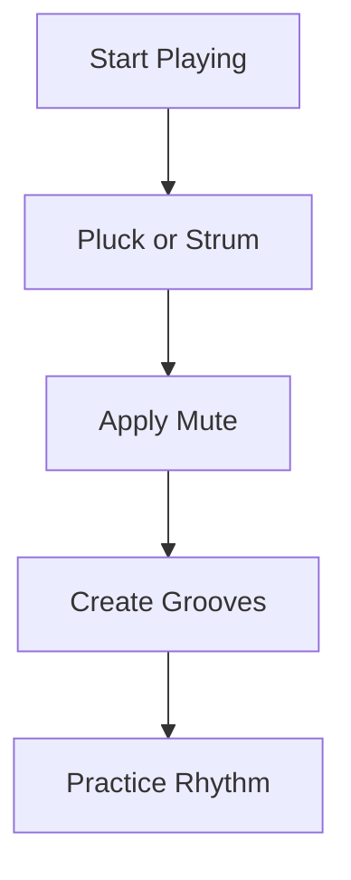

# Beginner Foundation: Bass Guitar 02 Rhythm Muting And Grooves

## 1. Everyday Intuition & First Principles
Imagine you're playing a game where you're the heartbeat of the band. Just like your heart pumps blood to keep your body alive, your bass guitar provides the rhythmic foundation that keeps the music alive. Rhythm muting and grooves are like the heartbeat's control valves and patterns. Muting helps you control the flow of sound, ensuring the rhythm is crisp and clear, while grooves are the unique patterns that make your heartbeat distinct and engaging.

## 2. Foundational Vocabulary & Glossary
- **Mute:** To silence or dampen the sound of a string by touching it with a finger or the palm of your hand.
- **Rhythm:** The pattern of musical sounds and silences.
- **Groove:** A rhythmic pattern that gives a piece of music its feel or character.
- **Pluck:** To play a string by plucking it with a finger or pick.
- **Strum:** To play a stringed instrument by striking the strings with a pick or fingers.
- **Accent:** To emphasize a particular note or beat by playing it louder or with more force.
- **Slap:** To play a stringed instrument by striking the strings with the back of the hand or the palm.
- **Pop:** To play a stringed instrument by plucking the strings with the thumb.

## 3. Visual System Flow
### ASCII Diagram
```
+-------------------+
|   Start Playing   |
+-------------------+
          |
          v
+-------------------+
|   Pluck or Strum  |
+-------------------+
          |
          v
+-------------------+
|     Apply Mute    |
+-------------------+
          |
          v
+-------------------+
|   Create Grooves  |
+-------------------+
          |
          v
+-------------------+
|   Practice Rhythm |
+-------------------+
```

### Mermaid Flowchart


## 4. Common Beginner Misconceptions & Mental Traps
- **Misconception:** Muting is only for silencing unwanted noise. **Truth:** Muting is a technique to control dynamics and create specific rhythmic effects.
- **Misconception:** Grooves are complicated and require advanced skills. **Truth:** Grooves can be simple and are built from basic rhythmic patterns.
- **Misconception:** You need to be a virtuoso to play bass effectively. **Truth:** Effective bass playing is about understanding rhythm and groove, not just technical prowess.
- **Misconception:** Slapping and popping are the only ways to create grooves. **Truth:** Grooves can be created through a variety of techniques, including plucking, strumming, and muting.

## 5. Socratic Discussion Starters
- What is the purpose of muting in a bass line?
- How do you think muting affects the overall rhythm of a song?
- Can you describe a simple groove pattern you can practice?
- How does accenting certain beats change the feel of a groove?
- What are some common mistakes beginners make when trying to create grooves?
- How can you use muting to enhance your groove playing?
