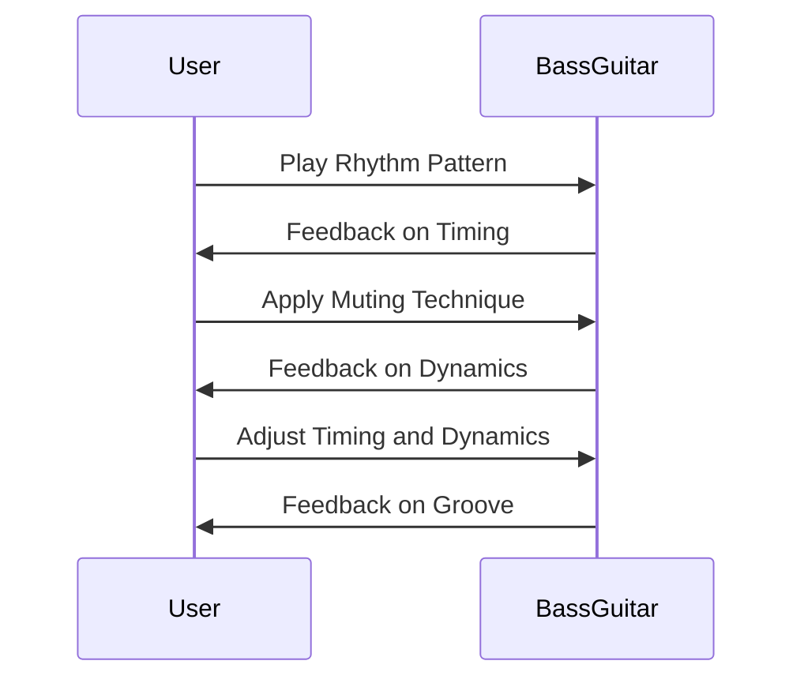

# Intermediate Foundation: Bass Guitar 02 Rhythm Muting And Grooves

## 1. Architectural Mental Model

In the realm of bass guitar performance, especially when focusing on rhythm muting and grooves, it's essential to establish a robust mental model that integrates technique, timing, and feel. This model should be built upon the foundational skills of finger placement, string tension, and basic rhythm patterns. The architectural mental model for rhythm muting and grooves can be broken down into several key components:

- **Rhythm Patterns:** Understanding and internalizing common rhythm patterns such as shuffle, funk, reggae, and rock grooves.
- **Muting Techniques:** Mastering various muting techniques including palm muting, finger muting, and pick muting to control sustain and dynamics.
- **Timing and Feel:** Developing a strong sense of timing and feel to lock in with the drummer and other band members.
- **Dynamic Range:** Learning to control dynamics through muting and articulation to create depth and interest in the groove.

## 2. Systems Taxonomy & Component Protocols

### Standard Interfaces

- **Rhythm Pattern Interface:** A standardized way to represent and communicate rhythm patterns. This could be through tablature, notation, or a digital format like MIDI.
- **Muting Technique Interface:** A standardized way to describe and teach muting techniques. This could include written descriptions, video tutorials, or interactive software.

### Protocols

- **Timing Protocol:** A protocol for ensuring consistent timing across different rhythm patterns and muting techniques. This could involve using a metronome or drum machine to maintain a steady beat.
- **Feel Protocol:** A protocol for conveying the feel of a groove. This could involve listening to and analyzing recordings of different styles to understand the nuances of each.

### Data Models

- **Rhythm Pattern Data Model:** A data model that captures the essential elements of a rhythm pattern, such as the timing, feel, and muting techniques used.
- **Muting Technique Data Model:** A data model that captures the essential elements of a muting technique, such as the hand position, string contact, and resulting sound.

## 3. Multi-Component Interaction Flow

### ASCII Sequence Diagram

```
User -> Bass Guitar: Play Rhythm Pattern
Bass Guitar -> User: Feedback on Timing
User -> Bass Guitar: Apply Muting Technique
Bass Guitar -> User: Feedback on Dynamics
User -> Bass Guitar: Adjust Timing and Dynamics
Bass Guitar -> User: Feedback on Groove
```

### Mermaid Sequence Diagram



## 4. Architectural Trade-offs & Production Pitfalls

### Trade-offs

- **Precision vs. Feel:** Balancing the need for precise timing with the need to convey the feel of a groove.
- **Simplicity vs. Complexity:** Choosing between simple, easy-to-play patterns and more complex, intricate grooves.

### Production Pitfalls

- **Over-Complicating Patterns:** Avoid the temptation to use overly complex patterns that can detract from the overall groove.
- **Ignoring Dynamics:** Failing to control dynamics through muting and articulation can result in a flat, uninteresting sound.

## 5. Socratic Discussion Starters

- How can a bassist effectively communicate the feel of a groove to other band members?
- What are the trade-offs between precision and feel in rhythm playing?
- How can a bassist use muting techniques to create depth and interest in a groove?
- What are some common pitfalls to avoid when developing rhythm patterns and muting techniques?
- How can a bassist adapt their playing style to different musical genres and styles?
