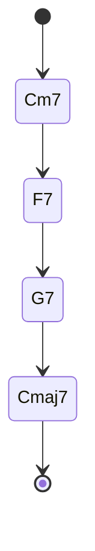

# Advanced Foundation: Bass Guitar 03 Walking Lines And Harmonic Theory

## 1. Theoretical Invariants & Formal Frameworks

### Formal Proofs and Kernel Invariants

In the domain of bass guitar performance, particularly in the context of walking lines and harmonic theory, formal proofs and kernel invariants can be understood through the lens of music theory and mathematical structures. A walking line is a melodic line that outlines the harmonic structure of a piece of music, typically moving stepwise between chord tones. The theoretical invariant here is the consistency of the walking line with the underlying harmonic progression.

**Formal Proof Example:**
Consider a harmonic progression in C major: Cm7 - F7 - G7 - Cmaj7. A walking line might be constructed as follows:
- Cm7: C - D - Eb - F
- F7: F - G - Ab - Bb
- G7: G - A - Bb - C
- Cmaj7: C - D - E - F

Each note in the walking line is a stepwise movement between chord tones, maintaining a consistent invariant of stepwise motion and chord tone adherence.

### Kernel or Physical Invariants

Physical invariants in bass guitar performance refer to the consistent physical techniques and principles that underpin effective playing. These include finger placement, string tension, and the mechanics of the instrument.

**Physical Invariant Example:**
The physical invariant of finger placement on the bass guitar ensures that each note is played with consistent pressure and articulation. For example, the first finger should always be placed at the first fret, the second finger at the second fret, and so on. This invariant allows for precise and reliable execution of walking lines.

## 2. Low-Level Invariant Taxonomy

### Deep Registers, Memory Models, Hardware Constraints, or Axiomatic Definitions

In the context of bass guitar, deep registers refer to the lower-pitched strings and their corresponding notes. Memory models can be thought of as the mental frameworks musicians use to recall and apply harmonic progressions and walking lines. Hardware constraints include the physical limitations of the bass guitar, such as string tension and fingerboard length.

**Low-Level Invariant Example:**
A low-level invariant in bass guitar playing is the consistent use of the thumb for the E and A strings, while the index, middle, ring, and pinky fingers are used for the D and G strings. This invariant is based on the physical constraints of the instrument and the ergonomic considerations of finger placement.

## 3. Micro-Architecture & Concurrency Dynamics

### Mermaid and ASCII State Machines / Cache / Race Condition Diagrams

In bass guitar performance, the micro-architecture can be visualized through state machines that represent the transitions between different chords and walking lines. Cache and race condition diagrams can be used to illustrate the flow of notes and the potential for harmonic conflicts.

**Mermaid State Machine Example:**


**ASCII State Machine Example:**
```
[*] -> Cm7 -> F7 -> G7 -> Cmaj7 -> [*]
```

**Cache Diagram Example:**
```
Cache: [Cm7, F7, G7, Cmaj7]
```

**Race Condition Diagram Example:**
```
Race Condition: Cm7 -> F7 (conflict with G7)
```

## 4. Subtle Failure Modes & Boundary Conditions

### Edge Cases and Anomalies

Subtle failure modes in bass guitar performance can arise from improper technique, inconsistent timing, or harmonic misinterpretation. Boundary conditions refer to the limits of the instrument's capabilities, such as the highest and lowest notes that can be played.

**Subtle Failure Mode Example:**
A subtle failure mode occurs when a player attempts to execute a walking line with inconsistent timing, leading to a lack of rhythmic cohesion. This can be mitigated by practicing metronome exercises and focusing on precise timing.

**Boundary Condition Example:**
A boundary condition is reached when a player attempts to play a note below the lowest E on the bass guitar. This can be addressed by using a five-string bass or employing alternative techniques, such as using the thumb to play the low C.

## 5. Master Socratic Inquiries

### Research-Grade Discussion Questions

1. How can formal proofs be applied to the construction of walking lines in complex harmonic progressions?
2. What are the physical invariants that must be maintained to ensure consistent bass guitar technique?
3. How can state machines be used to model the transitions between chords in a walking line?
4. What are the potential race conditions that can arise in bass guitar performance, and how can they be avoided?
5. How do boundary conditions affect the execution of walking lines, and what strategies can be employed to navigate these limits?

These inquiries are designed to challenge and deepen the understanding of bass guitar performance, walking lines, and harmonic theory.
