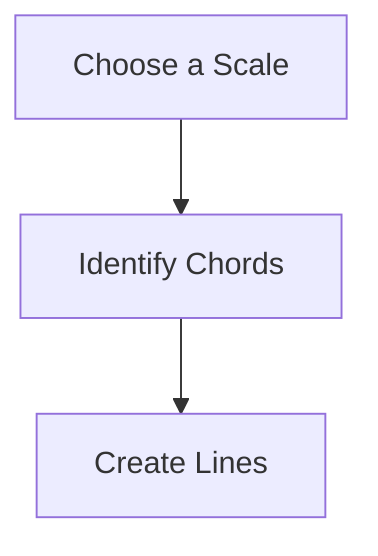

# Beginner Foundation: Bass Guitar 03 Walking Lines And Harmonic Theory

## 1. Everyday Intuition & First Principles

Imagine you're walking through a colorful garden, and each step you take is a note that harmonizes with the flowers around you. Walking lines on the bass guitar are like those steps, guiding you through a musical landscape that complements the melody and other instruments. Just as each step in the garden is part of a path that tells a story, walking lines in music tell a harmonic story that supports the overall composition.

## 2. Foundational Vocabulary & Glossary

- **Walking Line:** A series of notes played on the bass guitar that outlines the harmony of a piece of music, often moving stepwise.
- **Harmony:** The combination of musical notes played or sung together to produce chords and progressions.
- **Chord:** A group of three or more notes played simultaneously.
- **Scale:** A sequence of musical notes in ascending or descending order.
- **Root Note:** The fundamental note of a chord, around which the other notes are built.
- **Interval:** The distance between two notes, measured in steps or half-steps.
- **Resolution:** The movement of a note to a more stable or consonant note, often resolving dissonance.
- **Tension:** The feeling of musical anticipation, often created by dissonant intervals or unresolved notes.

## 3. Visual System Flow

### ASCII Diagram

```
+-------------------+       +-------------------+       +-------------------+
|   Choose a Scale  |  ---> |   Identify Chords |  ---> |   Create Lines    |
+-------------------+       +-------------------+       +-------------------+
```

### Mermaid Flowchart



## 4. Common Beginner Misconceptions & Mental Traps

- **Misconception:** Walking lines are just random notes.
  - **Reality:** Walking lines are purposefully constructed to outline the harmony and create a coherent musical path.
- **Misconception:** You need to know every chord in a song to play walking lines.
  - **Reality:** Understanding the root notes and basic chord structures is sufficient to start creating walking lines.
- **Misconception:** Walking lines are only for jazz.
  - **Reality:** Walking lines are used in various genres, including pop, rock, and R&B, to enhance the harmonic texture.

## 5. Socratic Discussion Starters

- What is the purpose of a walking line in a musical composition?
- How does choosing a scale influence the walking lines you can create?
- Can you identify the root notes of a simple chord progression?
- How do intervals contribute to the tension and resolution in a walking line?
- What are some common mistakes beginners make when creating walking lines, and how can they be avoided?
