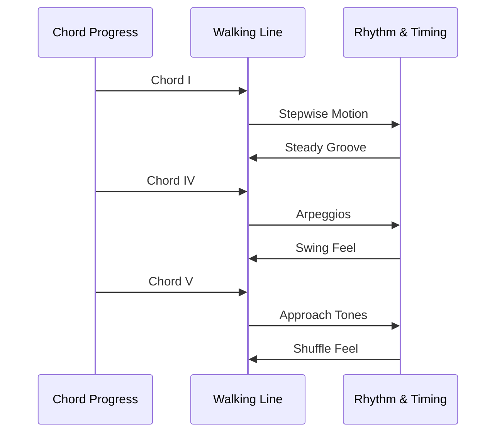

# Intermediate Foundation: Bass Guitar 03 Walking Lines And Harmonic Theory

## 1. Architectural Mental Model

In the realm of bass guitar performance, particularly when delving into walking lines and harmonic theory, it's crucial to establish a robust mental model that integrates both theoretical and practical aspects. This model should encompass the foundational elements of music theory, the technical skills required for bass playing, and the strategic thinking necessary to navigate complex harmonic progressions.

### Key Components:
- **Harmonic Theory**: Understanding chord structures, scales, and their relationships.
- **Walking Lines**: Techniques for creating melodic lines that move smoothly between chords.
- **Rhythm and Timing**: Maintaining a steady groove and understanding rhythmic variations.
- **Phrasing and Dynamics**: Articulating notes with expression and control.

### Assumptions:
- The reader has a foundational understanding of bass guitar techniques and basic music theory.
- The reader is familiar with reading music and tablature.
- The reader has experience playing along with chord progressions.

## 2. Systems Taxonomy & Component Protocols

### Harmonic Theory Protocols:
- **Chord Progressions**: Standard progressions like I-IV-V, ii-V-I, and their variations.
- **Scale Types**: Major, minor, blues, dorian, mixolydian, etc.
- **Chord Extensions**: 7ths, 9ths, 11ths, 13ths, and altered chords.

### Walking Lines Protocols:
- **Stepwise Motion**: Moving one note at a time between chord tones.
- **Arpeggios**: Playing the notes of a chord in sequence.
- **Chromatic Approach Tones**: Using non-chord tones to create tension and resolution.
- **Enclosures**: Surrounding a target note with approach tones.

### Rhythm and Timing Protocols:
- **Feel**: Groove, swing, shuffle, funk, etc.
- **Time Signatures**: 4/4, 3/4, 6/8, 12/8, etc.
- **Syncopation**: Playing notes off the beat for emphasis.

### Phrasing and Dynamics Protocols:
- **Articulation**: Staccato, legato, accent, etc.
- **Dynamics**: Crescendo, decrescendo, pizzicato, etc.
- **Expression**: Slurs, bends, hammer-ons, pull-offs, etc.

## 3. Multi-Component Interaction Flow

### Detailed ASCII Sequence Diagram

```
+-------------------+       +-------------------+       +-------------------+
|   Chord Progress  |       |     Walking Line  |       |   Rhythm & Timing |
+-------------------+       +-------------------+       +-------------------+
          |                           |                           |
          v                           v                           v
+-------------------+       +-------------------+       +-------------------+
|   Chord I         |------>|   Stepwise Motion |------>|   Steady Groove   |
+-------------------+       +-------------------+       +-------------------+
          |                           |                           |
          v                           v                           v
+-------------------+       +-------------------+       +-------------------+
|   Chord IV        |------>|   Arpeggios       |------>|   Swing Feel      |
+-------------------+       +-------------------+       +-------------------+
          |                           |                           |
          v                           v                           v
+-------------------+       +-------------------+       +-------------------+
|   Chord V         |------>|   Approach Tones  |------>|   Shuffle Feel    |
+-------------------+       +-------------------+       +-------------------+
```

### Mermaid Sequence Diagram



## 4. Architectural Trade-offs & Production Pitfalls

### Trade-offs:
- **Complexity vs. Simplicity**: Balancing intricate walking lines with the need for clarity and accessibility.
- **Feel vs. Precision**: Maintaining a groove while executing precise technical maneuvers.
- **Harmonic Accuracy vs. Creativity**: Staying true to the harmonic structure while adding personal flair.

### Pitfalls:
- **Overcomplicating Lines**: Creating lines that are too complex and lose their impact.
- **Ignoring Rhythm**: Focusing too much on melodic content at the expense of rhythmic feel.
- **Neglecting Dynamics**: Playing with a static volume and articulation, lacking expression.

## 5. Socratic Discussion Starters

1. **How does the choice of scale affect the harmonic tension and resolution in a walking line?**
2. **What are the benefits and drawbacks of using chromatic approach tones in your walking lines?**
3. **How can you maintain a consistent groove while navigating complex chord progressions?**
4. **In what ways can you use phrasing and dynamics to enhance the emotional impact of your bass playing?**
5. **How do you balance the need for technical precision with the creative expression in your bass lines?**

By exploring these questions, you can deepen your understanding of walking lines and harmonic theory, and apply these principles to your bass playing in a more nuanced and effective way.
