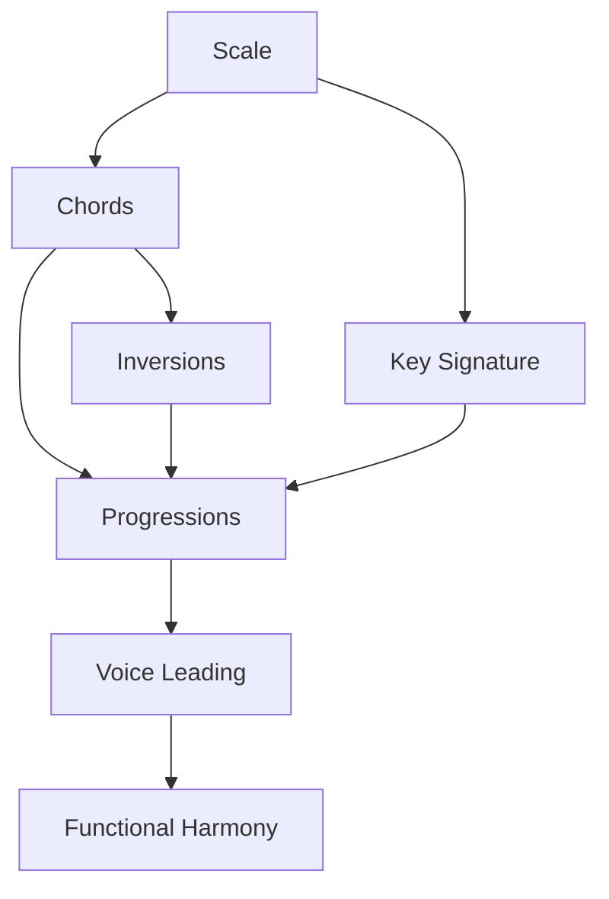

# Lesson 2: Fundamentals of Harmonic Theory

## First-Principles Intuition & Invariants

Harmonic theory is the study of how musical tones and chords interact to create the rich tapestry of Western music. For the bass guitarist, understanding harmonic theory is not merely an academic exercise but a practical necessity that informs every note played and every line constructed. The bass line, often the foundation of a musical composition, must resonate with the harmonic structure of the piece, providing both rhythmic and harmonic support.

At the heart of harmonic theory lies the concept of the scale, which is a sequence of musical notes ordered by pitch. The most fundamental scale is the diatonic scale, constructed using the formula W-W-H-W-W-W-H, where W represents a whole step and H represents a half step. This scale can be transposed to any key, creating twelve distinct diatonic scales, each with its own unique character and emotional resonance. For instance, the C major scale (C-D-E-F-G-A-B) is often associated with a bright, uplifting quality, while the C minor scale (C-D-D#-F-G-A-A#) evokes a more somber, introspective mood.

Chords, the building blocks of harmonic progressions, are constructed from the notes of a scale. A triad, the simplest type of chord, consists of three notes: the root, third, and fifth. These notes are derived from the scale and can be arranged in various inversions, each offering a different harmonic color and bass note. For example, in the key of C major, the C major triad (C-E-G) can be played in root position, first inversion (E-G-C), or second inversion (G-C-E). Each inversion provides a distinct harmonic texture and can be used to create smooth voice leading between chords.

Harmonic progressions, sequences of chords that move from one to another, are the backbone of Western music. These progressions are governed by rules of voice leading, which dictate how the notes of one chord should move to the notes of the next chord in a way that is both smooth and consonant. One of the most common harmonic progressions is the I-IV-V-I progression, which in the key of C major would be C-F-G-C. This progression is ubiquitous in popular music and jazz, providing a sense of resolution and direction.

The concept of functional harmony, introduced by Heinrich Schenker, further enriches our understanding of harmonic theory. Schenkerian analysis posits that all chords in a piece of music can be reduced to a hierarchy of tonic, dominant, and subdominant functions. The tonic chord (I) serves as the home base, the dominant chord (V) creates tension, and the subdominant chord (IV) provides a pivot point. Understanding these functions allows the bass guitarist to anticipate and reinforce the harmonic structure of a piece, creating a more cohesive and compelling musical line.

## Core Architecture & Mechanics

To explore the architecture and mechanics of harmonic theory, we can use a conceptual framework that maps the relationships between scales, chords, and progressions. This framework can be visualized using a Mermaid diagram, which provides a clear and intuitive representation of these relationships.

In this diagram, the scale serves as the foundation, generating the chords that form the harmonic progressions. The key signature, which determines the sharps or flats in a scale, influences the chords and progressions. Chords can be arranged in various inversions, each offering a different harmonic color and bass note. Voice leading, the smooth movement of notes between chords, is crucial for creating a cohesive harmonic structure. Finally, functional harmony provides a framework for understanding the roles of different chords in a progression, allowing the bass guitarist to anticipate and reinforce the harmonic structure of a piece.

## High-Performance Optimization & Failure Modes

In the realm of harmonic theory, high-performance optimization involves creating bass lines that are both musically compelling and technically efficient. This requires a deep understanding of the relationships between scales, chords, and progressions, as well as the ability to anticipate and reinforce the harmonic structure of a piece.

One key optimization technique is the use of walking bass lines, which involve playing a series of quarter notes that outline the chords of a progression. Walking bass lines are characterized by smooth voice leading, with each note moving to the next in a logical and consonant manner. This technique allows the bass guitarist to create a strong rhythmic foundation while reinforcing the harmonic structure of a piece.

Another optimization technique is the use of chromatic approach notes, which are notes that are not part of the chord but are used to create tension and resolution. Chromatic approach notes can be used to add color and interest to a bass line, creating a more dynamic and engaging musical texture.

However, there are also potential failure modes that can arise in the application of harmonic theory. One common failure mode is the overuse of clichéd progressions and chord voicings, which can result in a lack of originality and creativity. To mitigate this, it is important to explore a wide range of scales, chords, and progressions, and to experiment with different voicings and inversions.

Another failure mode is the failure to anticipate and reinforce the harmonic structure of a piece, which can result in a bass line that is disconnected from the rest of the music. To mitigate this, it is important to study the harmonic structure of a piece in depth, and to practice creating bass lines that reinforce the harmonic progression.

Harmonic theory is a fundamental aspect of music performance, particularly for the bass guitarist. By understanding the relationships between scales, chords, and progressions, and by applying optimization techniques such as walking bass lines and chromatic approach notes, the bass guitarist can create a strong rhythmic foundation while reinforcing the harmonic structure of a piece. Being aware of potential failure modes and continuously exploring and experimenting with new harmonic ideas is also crucial.
