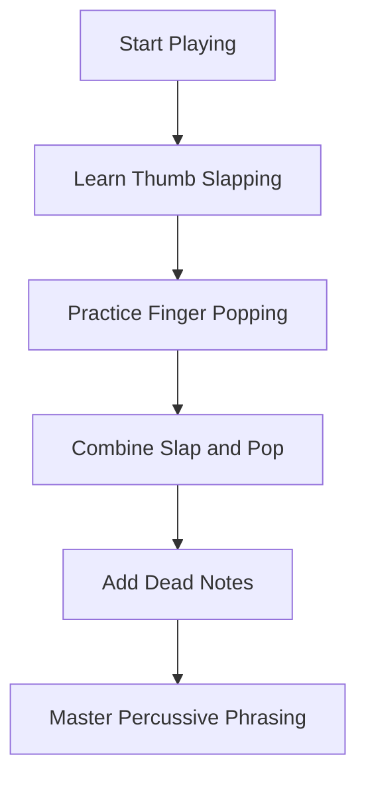

# Beginner Foundation: Bass Guitar 04 Slap Pops And Percussive Phrasing

## 1. Everyday Intuition & First Principles
Imagine your bass guitar as a versatile percussion instrument that can also produce melodic lines. Slap pops and percussive phrasing are techniques that allow you to create rhythmic and dynamic sounds, much like tapping on a drum. These techniques add a unique flavor to your playing, making your bass lines more engaging and expressive. Just as a drummer uses different sticks and surfaces to create various sounds, you can use slap pops and percussive phrasing to add texture and depth to your bass playing.

## 2. Foundational Vocabulary & Glossary
- **Slap Pop:** A technique where the player slaps the string against the fingerboard with the thumb, creating a sharp, percussive sound.
- **Percussive Phrasing:** Using techniques that mimic percussion instruments to add rhythmic and dynamic elements to bass playing.
- **Thumb Slap:** The act of slapping the string with the thumb to produce a percussive sound.
- **Finger Pop:** The act of popping the string with the fingers to produce a percussive sound.
- **Dead Note:** A technique where the string is muted immediately after being struck, producing a short, staccato sound.
- **Staccato:** A musical term indicating that notes should be played briefly and detached.

## 3. Visual System Flow
### ASCII Diagram
```
+-------------------+
|   Start Playing   |
+-------------------+
          |
          v
+-------------------+
|   Learn Thumb     |
|     Slapping      |
+-------------------+
          |
          v
+-------------------+
|   Practice Finger |
|     Popping       |
+-------------------+
          |
          v
+-------------------+
|   Combine Slap    |
|   and Pop         |
+-------------------+
          |
          v
+-------------------+
|   Add Dead Notes  |
+-------------------+
          |
          v
+-------------------+
|   Master Percussive|
|   Phrasing        |
+-------------------+
```

### Mermaid Flowchart


## 4. Common Beginner Misconceptions & Mental Traps
- **Misconception:** Slap pops and finger pops are difficult to learn and require a lot of practice. **Truth:** While they do require practice, the techniques are accessible to beginners and can be learned step-by-step.
- **Misconception:** You need a specific type of bass guitar to perform slap pops and finger pops. **Truth:** Any bass guitar can be used, but a fretless bass or a bass with a lighter gauge string might make it easier to execute these techniques.
- **Misconception:** Slap pops and finger pops are only used in certain genres of music. **Truth:** These techniques can be used in various genres, including funk, jazz, rock, and more.

## 5. Socratic Discussion Starters
- What are the benefits of incorporating slap pops and finger pops into your bass playing?
- How do you think the choice of string gauge and bass type can affect your ability to perform these techniques?
- Can you think of any examples of songs where slap pops and finger pops are prominently used?
- How do you plan to practice these techniques to ensure you develop a strong foundation?
- What are some common mistakes to avoid when learning slap pops and finger pops?
