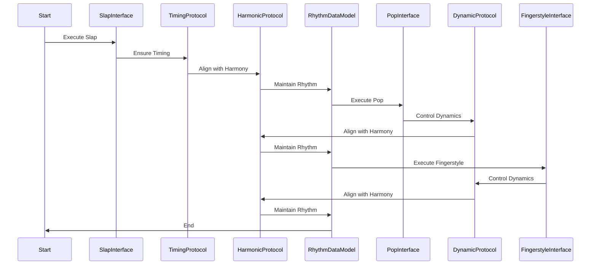

# Intermediate Foundation: Bass Guitar 04 Slap Pops And Percussive Phrasing

## 1. Architectural Mental Model
In the realm of bass guitar performance, slap pops and percussive phrasing introduce a new architectural layer to your playing. This involves understanding how to integrate percussive techniques with melodic and harmonic structures. The architectural mental model here is to view your bass as a multi-component system where each technique (slap, pop, fingerstyle) is a module that interacts with the overall musical composition.

### Key Components:
- **Slap Technique Module:** Focuses on the rhythmic and percussive aspects of playing.
- **Pop Technique Module:** Emphasizes the clarity and articulation of notes.
- **Fingerstyle Module:** Provides a foundation for traditional bass playing.
- **Harmonic Structure Module:** Ensures that all techniques align with the harmonic progression.
- **Rhythmic Structure Module:** Maintains the integrity of the rhythmic feel.

## 2. Systems Taxonomy & Component Protocols
### Standard Interfaces:
- **Slap Interface:** Defined by the specific finger placement and wrist motion required for slapping.
- **Pop Interface:** Defined by the finger placement and the use of the thumb for popping.
- **Fingerstyle Interface:** Defined by the use of fingers to pluck or fingerpick the strings.

### Protocols:
- **Timing Protocol:** Ensures that all techniques are executed in time with the beat.
- **Dynamic Protocol:** Controls the volume and intensity of each technique.
- **Harmonic Protocol:** Ensures that each technique complements the harmonic progression.

### Data Models:
- **Rhythm Data Model:** Represents the rhythmic structure of the piece.
- **Harmonic Data Model:** Represents the harmonic progression of the piece.
- **Technique Data Model:** Represents the specific techniques used in the performance.

## 3. Multi-Component Interaction Flow
### ASCII Sequence Diagram:
```
[Start] --> [Slap Interface] --> [Timing Protocol] --> [Harmonic Protocol] --> [Rhythm Data Model] --> [Pop Interface] --> [Dynamic Protocol] --> [Harmonic Protocol] --> [Rhythm Data Model] --> [Fingerstyle Interface] --> [Dynamic Protocol] --> [Harmonic Protocol] --> [Rhythm Data Model] --> [End]
```

### Mermaid Sequence Diagram:


## 4. Architectural Trade-offs & Production Pitfalls
### Trade-offs:
- **Complexity vs. Clarity:** Balancing the complexity of multiple techniques with the clarity of the performance.
- **Rhythm vs. Harmony:** Ensuring that rhythmic precision does not overshadow harmonic accuracy.
- **Volume vs. Tone:** Balancing the volume of percussive techniques with the tonal quality of fingerstyle.

### Pitfalls:
- **Overemphasis on Percussive Techniques:** Focusing too much on slap and pop can detract from the overall musicality.
- **Lack of Dynamic Control:** Poor dynamic control can lead to a monotonous performance.
- **Inconsistent Timing:** Inconsistent timing can disrupt the rhythmic structure of the piece.

## 5. Socratic Discussion Starters
1. How can you integrate slap and pop techniques into a piece that primarily relies on fingerstyle?
2. What are the key considerations when transitioning from slap to pop in a performance?
3. How does the use of percussive techniques affect the harmonic progression of a piece?
4. In what ways can dynamic control enhance the effectiveness of slap and pop techniques?
5. How can you maintain rhythmic precision while incorporating multiple techniques into your performance?
