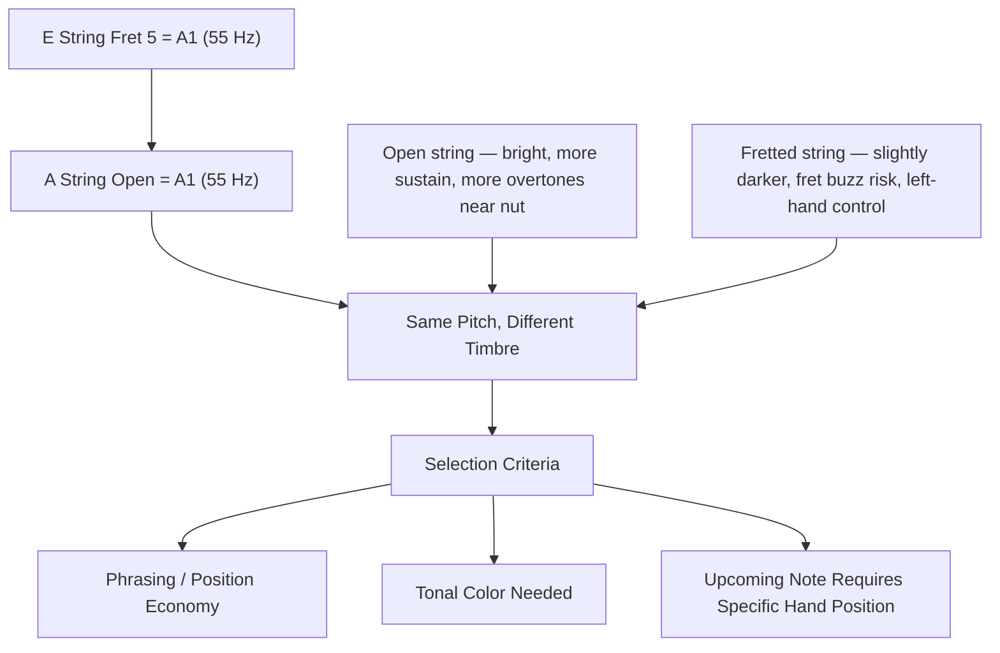
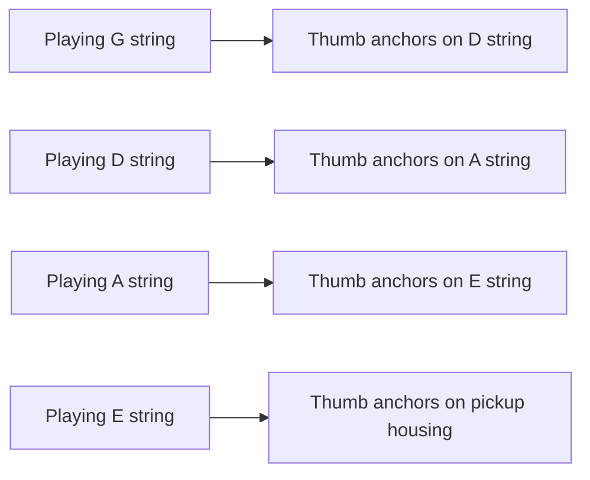
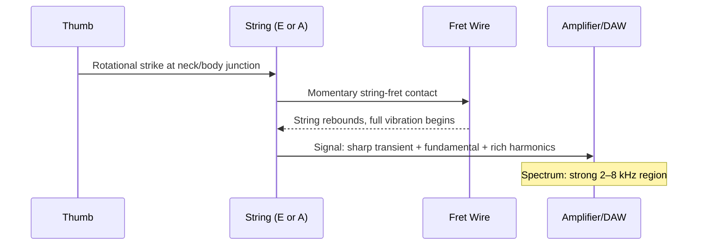
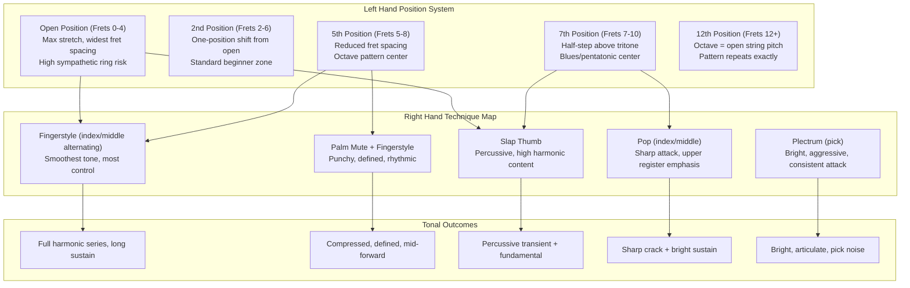
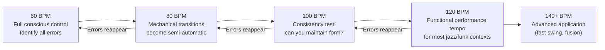

# Operational Verification Labs: 01 — Technique and Fretboard Mechanics

## Preface: Why Mechanics Precede Music

Bass guitar occupies a singular structural role in Western tonal music: it simultaneously anchors harmonic root motion and defines rhythmic pulse. Unlike guitar or piano, where both hands share melodic and harmonic duties, the bassist operates at the intersection of the rhythm section and the harmony. Every physical mechanic — where your thumb rests, how much finger pad contacts the string, the angle of attack during slap — has direct and measurable acoustic consequences. This lab treats those mechanics as engineering problems with physical first principles, not stylistic preferences to be discovered by feel alone.

Understanding *why* a technique produces a given sound requires grounding in the underlying physics: string vibration modes, the relationship between contact point and harmonic content, how wood density and bridge mass affect sustain. This material develops that understanding systematically. The exercises are not rote drills; they are structured experiments designed to build a mental model of the instrument that persists across all musical contexts.

---

## Lab Setup and Prerequisite Knowledge

### Instrument Requirements

**Electric bass guitar** (4-string, standard scale 34 inches / 864 mm) is the primary instrument for all exercises. A 34-inch scale length is used as the reference point for all fret distance calculations in this lab. Short-scale (30 inches) and medium-scale (32 inches) instruments are acoustically equivalent in pitch, but the reduced string tension alters left-hand technique — specifically, the force required for clean fretting.

**Acoustic/electric bass** is acceptable for Exercises 1 and 2. Exercise 3 (slap/pop) requires amplification to accurately assess tonal variation; an acoustic instrument does not project adequately for comparative analysis.

### Toolchain

| Tool | Purpose | Recommended Options |
|---|---|---|
| Chromatic tuner | Reference pitch, intonation verification | TC Electronic PolyTune 3, Peterson StroboStomp HD, or DAW plugin |
| Metronome | Tempo and subdivision reference | Physical or DAW-integrated click track |
| Audio interface | Capture dry signal for analysis | Focusrite Scarlett 2i2, Universal Audio Volt 1 |
| DAW | Waveform, spectrum, and transient analysis | Reaper (free/low cost), Logic Pro, Ableton Live |
| Spectrum analyzer plugin | FFT-based tone comparison | SPAN by Voxengo (free), FabFilter Pro-Q 3 |

### Standard Tuning Reference

Standard bass tuning (EADG) assigns the following fundamental frequencies to open strings:

| String | Note | Frequency (Hz) | MIDI Note Number |
|---|---|---|---|
| 4 (thickest) | E1 | 41.20 Hz | 28 |
| 3 | A1 | 55.00 Hz | 33 |
| 2 | D2 | 73.42 Hz | 38 |
| 1 (thinnest) | G2 | 98.00 Hz | 43 |

Each fret raises pitch by one equal-tempered semitone, a frequency ratio of 2^(1/12) ≈ 1.0595. The physical fret distance from fret *n* to fret *n+1* decreases logarithmically toward the body. The distance from the nut to fret *n* on a 34-inch scale is given by:

```
d(n) = scale_length × (1 - 2^(-n/12))
```

For a 34-inch scale, the distance from nut to fret 5 is:

```
d(5) = 34 × (1 - 2^(-5/12))
     = 34 × (1 - 0.7491)
     = 34 × 0.2509
     ≈ 8.53 inches
```

This calculation explains why fretting closer to the nut requires greater left-hand reach, and why beginners encounter more intonation problems in the first five frets versus the upper register.

---

## Fretboard Architecture: First Principles

### The Equal-Tempered Chromatic Scale

The 12-tone equal temperament (12-TET) system divides the octave into 12 logarithmically equal semitones. This is a deliberate acoustic compromise: no interval other than the octave is acoustically pure in 12-TET, but all intervals are equally impure, allowing the instrument to play in any key without retuning. The perfect fifth in 12-TET is 700 cents, versus the just-intonation fifth of 701.96 cents — a 1.96-cent deviation that most listeners cannot detect in isolation.

### Full 4-String Fretboard Map (Frets 0–12)

The following diagram maps every note across all four strings for the first 12 frets. Fret 12 reproduces the open string pitch one octave higher, which is why the pattern repeats.

```
Fret:  0    1    2    3    4    5    6    7    8    9    10   11   12
G2:    G    Ab   A    Bb   B    C    Db   D    Eb   E    F    Gb   G
D2:    D    Eb   E    F    Gb   G    Ab   A    Bb   B    C    Db   D
A1:    A    Bb   B    C    Db   D    Eb   E    F    Gb   G    Ab   A
E1:    E    F    Gb   G    Ab   A    Bb   B    C    Db   D    Eb   E
```

The same pitch appears in multiple locations. For example, A2 (110 Hz) is available at:
- E string, fret 5
- A string, open (A1 is 55 Hz — this is A1, not A2; A2 = A string fret 12)
- D string, fret 7 (this gives A2)
- G string, fret 2 (this gives A2)

Choosing *which* position to play a given note is a core left-hand decision governed by phrasing, timbre, and shifting economy.

### Fretboard Position Relationships



---

## Exercise 1: Foundational Mechanics

### 1A — Left-Hand Finger Placement and the Physics of Clean Fretting

#### Biomechanics of Fretting

The left hand must generate sufficient string displacement to bring the string into firm contact with the fret wire without excessive force. The minimum force required to produce a clean note depends on:

1. **String gauge and tension** — heavier strings (e.g., .105 for E) require more force than lighter strings (.045 for G).
2. **Action height** — the gap between the string and the fret at a given position. High action demands more force; low action risks fret buzz.
3. **Finger placement relative to the fret** — placing the fingertip as close as possible to the *leading edge* (body side) of the fret wire minimizes the force required, because the mechanical advantage of string deflection is greatest there.

The correct position is not "press down" but rather "press forward toward the fret." This distinction matters for two reasons: it reduces muscle fatigue, and it eliminates dead-note artifacts caused by the string vibrating against the fret further down the neck.

#### One-Finger-Per-Fret (OFPF) Framework

The standard foundational framework assigns one fretting finger per semitone across four adjacent frets:

| Finger | Fret (example, starting at fret 2) |
|---|---|
| Index (1) | 2 |
| Middle (2) | 3 |
| Ring (3) | 4 |
| Pinky (4) | 5 |

This framework distributes lateral hand stretch evenly. In lower positions (frets 1–5), the stretch between frets is wider due to the logarithmic fret spacing described above, making OFPF more physically demanding than in upper positions (frets 7–12).

#### Exercise Protocol

1. Tune to EADG using a chromatic tuner. Verify each string against its target frequency with a strobe tuner if available, as standard needle tuners have ±3 cent accuracy variance.
2. With OFPF starting at fret 2, play E string frets 2-3-4-5 ascending, then descending. Use only downstrokes with the right-hand index finger at this stage.
3. Record a 30-second clip. Load into your DAW and visually inspect the waveform for:
   - Consistent amplitude across all four notes (indicates even fretting pressure)
   - Absence of buzz artifacts (sharp transient spikes in the waveform body)
   - Consistent note duration (indicates rhythm accuracy)
4. Advance the OFPF starting position to fret 5, then fret 7. Observe how reduced fret spacing in higher positions decreases the stretch demand on the left hand.

### 1B — Right-Hand Muting: Technique, Acoustics, and Palm Position

#### Why Muting Matters Acoustically

An unmuted bass string rings sympathetically when adjacent strings are played, creating harmonic interference that muddies the low-frequency mix. The floating sympathetic resonances at the fundamentals and harmonics of open strings are particularly problematic in a band context because they overlap with kick drum and bass frequencies (40–200 Hz). Professional bass playing requires continuous, unconscious right-hand muting as a default state, not an occasional action.

#### Palm Muting: The Physics

Resting the right-hand palm edge (the hypothenar eminence — the fleshy pad below the pinky) lightly on the strings near the bridge applies a damping force that absorbs string energy into the hand's mass. The position of this contact point relative to the bridge saddle determines the degree of muting:

- **Very close to saddle (< 5 mm):** Minimal damping — primarily removes extreme high-frequency overtones, leaves fundamental intact. Produces a tight, punchy tone.
- **5–15 mm from saddle:** Moderate damping — reduces sustain, emphasizes fundamental, removes upper harmonics above approximately the 4th partial. This is the standard "palm mute" tone.
- **> 20 mm from saddle (toward middle of string):** Heavy damping — produces a thuddy, almost percussive tone with very short sustain. Associated with Motown-era upright bass emulation on electric.

The muting position is a continuous tonal parameter, not a binary mute/unmute switch. Players who understand this exploit the full dynamic range of the technique.

#### Right-Hand Thumb Anchor

The right-hand thumb serves a dual purpose: as a muting anchor on the pickup or the low string, and as a pivot point that stabilizes the hand position during finger plucking. The floating thumb technique — where the thumb moves to mute the string just below the one being played — is the professional standard and should be developed from the beginning:



This eliminates sympathetic ringing from lower strings without requiring the player to consciously manage each string independently.

#### Exercise Protocol

1. Play a quarter-note pulse on E string, fret 5 (A1) at 60 BPM. Keep thumb on pickup.
2. Record. Listen for sympathetic ring on A, D, G strings in the sustain portion of each note.
3. Reposition thumb to float on E string. Play the same pulse on A string, fret 5 (D2). Record.
4. Advance to playing a two-string pattern: E string fret 5, A string fret 5, alternating. Each time you move to a higher string, the thumb drops to mute the string below. Verify with recording that no sympathetic ring persists.

### 1C — Walking Bass Lines: Harmonic and Voice-Leading Architecture

#### What a Walking Bass Line Actually Does

A walking bass line is not a melody played on the bass, nor is it arbitrary. It is a voice-leading structure that fulfills three simultaneous functions:

1. **Root confirmation** — typically establishes the chord root on beat 1, anchoring the harmony for the listener.
2. **Chromatic approach** — uses chromatic passing tones, diatonic approach notes, and chord-tone arpeggiation to create forward momentum toward the next chord's root.
3. **Rhythmic subdivison** — the quarter-note pulse of a walking line in a jazz context locks with the ride cymbal and defines the tempo's internal subdivision.

The classic four-beat walking pattern over a single chord follows this construction logic:

```
Beat 1: Root (R)
Beat 2: 3rd or 5th of the chord (chord tone)
Beat 3: Chromatic or diatonic passing note toward beat 4 target
Beat 4: Leading tone (semitone above or below) the next chord's root
```

#### Chord Tones for the Exercise Progressions

**Progression 1: Cm7 — F7 — G7 — Cm7** (each chord for one bar)

| Chord | Root | 3rd | 5th | 7th |
|---|---|---|---|---|
| Cm7 | C | Eb | G | Bb |
| F7 | F | A | C | Eb |
| G7 | G | B | D | F |

A well-constructed walking line for this progression:

```
Bar 1 (Cm7): C - Eb - G - Bb
Bar 2 (F7):  F - A  - C - Eb
Bar 3 (G7):  G - B  - D - F
Bar 4 (Cm7): C - Eb - G - Bb
```

Beat 4 of bar 2 (Eb) is a half-step above D — this is a leading tone into G7's root (G) only by a minor 3rd, which is a weaker approach. A stronger approach uses a chromatic leading tone (F# → G):

```
Bar 2 (F7):  F - A - C - F#   (tritone substitution approach note)
Bar 3 (G7):  G - B - D - F
```

This F# (Gb) is one semitone below G and creates maximal forward pull through voice leading — this is the most common jazz walking bass convention.

**Progression 2: Dm7 — G7 — A7 — Dm7** (ii-V-I in D minor)

| Chord | Root | 3rd | 5th | 7th |
|---|---|---|---|---|
| Dm7 | D | F | A | C |
| G7 | G | B | D | F |
| A7 | A | C# | E | G |

Walking line:
```
Bar 1 (Dm7): D - F - A - C
Bar 2 (G7):  G - B - D - Ab  (Ab is b2 of A, chromatic approach)
Bar 3 (A7):  A - C# - E - G
Bar 4 (Dm7): D - F - A - C
```

#### Fretboard Mapping for Progression 1 (Cm7)

```
Beat 1 — C: A string fret 3
Beat 2 — Eb: A string fret 6  (or D string open and shift — less preferred)
Beat 3 — G: E string fret 3   (position shift) or D string fret 5
Beat 4 — Bb: A string fret 1  (requires position shift for bar 2 F)
```

Efficient fingering minimizes lateral position shifts. Practice each bar in isolation before connecting them.

#### Exercise Protocol

1. Set metronome to 60 BPM. Play Cm7 walking line in isolation, looping bar 1 until note-to-note transitions are seamless and the tempo is locked.
2. Connect bar 1 (Cm7) to bar 2 (F7). The transition point is beat 4 of Cm7 leading into beat 1 of F7. Record 8 repetitions of this two-bar loop.
3. Extend to the full four-bar progression. Record.
4. Increase tempo to 80 BPM, then 100 BPM. The target functional tempo for a walking bass line is 120 BPM — work toward it incrementally.
5. Repeat the entire protocol with Progression 2.

### 1D — Slap/Pop Mechanics: Physics and Execution

#### The Physics of Slap Bass

Slap bass produces its characteristic percussive sound through a fundamentally different excitation mechanism than fingerstyle or plectrum playing. In standard fingerstyle, the string is displaced laterally (parallel to the fretboard face) and released, producing a relatively smooth attack transient. In slap technique:

1. **Thumb strike (slap):** The bony knuckle of the right thumb strikes the string at a point directly over the last fret of the neck (typically the 24th fret area or the neck-body junction). The string is struck with enough force to momentarily contact the fret wire, producing a percussive "clack" transient that is rich in high-frequency energy (2–8 kHz). This is not incidental fret noise — it is the defining acoustic event of slap tone.

2. **Index/middle finger pop:** The player hooks the index or middle finger under the G or D string and pulls it away from the body of the bass perpendicularly to the fretboard face, then releases it. The string snaps back and strikes the frets, producing a sharp high-frequency crack similar to the thumb strike but with a different tonal character due to the string gauge and lateral pull direction.

The resulting tone has a heavily compressed, percussive attack with strong upper harmonic content, which explains why slap bass is associated with funk genres where it needs to cut through dense rhythm section arrangements.



#### Thumb Strike Mechanics

The thumb does not press down or stay on the string. The motion is a **rotational forearm movement** (forearm supination) that causes the thumb to strike the string and immediately rebound. If the thumb remains in contact with the string after the strike, it damps the vibration and kills the sustain. The motion is analogous to a drumstick stroke — impact and immediate rebound.

Correct thumb contact point: the outer edge of the distal joint of the thumb (the bony knuckle), not the pad or the tip.

#### Pop Mechanics

The pop is executed on the G or D string (occasionally the A string in some styles). Hook the index finger pad under the string with just enough purchase to pull it approximately 5–10 mm perpendicular to the fretboard. Release. The string snaps back against the frets. Excessive pull distance degrades pitch accuracy and increases fret wear. Insufficient pull produces no audible pop.

#### Basic Slap/Pop Pattern

The foundational pattern is a 16th-note grid with slap on beats 1 and 3 (downbeats) and pop on the "and" of 2 and 4 (the backbeat subdivision):

```
16th note grid:  1  e  +  a  2  e  +  a  3  e  +  a  4  e  +  a
Technique:       S  -  -  -  -  -  P  -  S  -  -  -  -  -  P  -
```

Where S = slap (thumb on E string), P = pop (index on G string). This is the foundational pattern used in Larry Graham's approach and forms the basis of Flea's (Red Hot Chili Peppers), Marcus Miller's, and Victor Wooten's more complex polyrhythmic extensions.

#### Exercise Protocol

1. Practice the thumb rotational motion on the open E string without worrying about pitch. Focus exclusively on immediate rebound. The tone should have a sharp, percussive attack with 1–2 seconds of sustain. Record 20 strikes and examine the attack transients in your DAW.
2. Practice the pop motion on the open G string. Each pop should produce a clear "crack" with consistent amplitude. Record and compare 20 pops.
3. Combine: Slap E string beat 1, pop G string beat 3. No subdivision yet — just alternating at 60 BPM quarter notes.
4. Add the 16th-note grid pattern above at 60 BPM. Increase to 80 BPM once pattern is clean.

---

## Exercise 2: Parameter Variation and Empirical Analysis

### 2A — Muting Position Mapping

This exercise quantifies how right-hand palm position affects tonal spectrum. Set up your DAW with a spectrum analyzer (SPAN or equivalent) in real-time display mode.

Play the same note (A string fret 5, D2) with consistent force and velocity, varying only the palm muting contact point. Hold each position for 4 beats at 60 BPM and capture the spectrum.

| Palm Position | Expected Spectral Effect | Practical Use Case |
|---|---|---|
| No palm mute | Full harmonic series, long sustain | Solo lines, melodic passages |
| 2–5 mm from bridge | Slight top-end reduction, full fundamental | Standard fingerstyle tone |
| 5–15 mm from bridge | Reduced sustain, punchy midrange | Funk, R&B pocket playing |
| 20–30 mm from bridge | Short sustain, strong fundamental, weak upper partials | Motown-style, upright bass emulation |
| 50+ mm (mid-string) | Severe damping, nearly percussive thud | Special effect, not standard technique |

Record each position. Load all clips into your DAW on separate tracks. Use the spectrum analyzer to compare the harmonic content. Document the frequency of the first partial that disappears at each muting position. The relationship should be monotonically decreasing: each step toward the neck removes higher harmonics first.

### 2B — Walking Bass Line: Rhythmic Subdivision Variation

The quarter-note walking line is the foundation, but walking lines derive forward momentum from rhythmic displacement within the beat. This exercise introduces subdivision variation.

**Variation 1: Triplet feel (12/8 implied over 4/4)**

Play each beat of the walking line with a slight triplet delay on beats 2 and 4 — this gives the classic swing feel. The difference is approximately 15–20 ms of delay on the second and fourth beats' attacks relative to a strict grid. This is not a technique error; it is intentional rhythmic placement that defines the difference between jazz feel and straight-eighth feel.

**Variation 2: Ghost note integration**

Add a right-hand ghost note (muted string pluck, producing a percussive click with no defined pitch) on the "and" of beat 2 within each bar of the walking line. The left hand mutes the string being plucked by releasing fretting pressure without lifting the finger. This technique adds rhythmic density without harmonic interference and is central to funk and soul bass playing.

**Rhythmic notation for ghost note integration:**

```
Beat:    1    +    2    +    3    +    4    +
Notes:   C    -   Eb    x    G    -   Bb    -
(x = ghost note, muted click)
```

Record both variations. Compare the waveform shapes: the swing variation will show slightly irregular peak spacing on a grid display; the ghost note variation will show additional low-amplitude transients between the primary note peaks.

### 2C — Slap/Pop Force Mapping

Slap tone is highly sensitive to strike force because the degree of string-fret contact during the strike changes with force:

- **Low force (barely perceptible "clack"):** String barely contacts fret. Output is essentially a pizzicato note with enhanced attack. Weak high-frequency content.
- **Medium force (clean pop with sustain):** String contacts fret cleanly and rebounds immediately. Balanced attack and sustain. This is the target for most applications.
- **High force (aggressive, compressed attack):** String contacts multiple frets. Increases high-frequency transient at the expense of pitch clarity and sustain. Can produce unintended fret buzz on adjacent frets.

Record 10 strikes at each force level on E string, open. Load all clips into the DAW. Use a transient analyzer or the spectrum analyzer in peak-hold mode to compare the following measurements:

1. **Peak transient amplitude (dBFS):** Should increase linearly with force up to a saturation point.
2. **Transient duration (ms):** The duration of the initial "clack" before the sustained tone begins. Longer transient duration indicates more fret contact time.
3. **Fundamental-to-harmonic ratio:** At higher force levels, the ratio of harmonic energy (above 1 kHz) to fundamental energy (around 41 Hz) will increase.

---

## Exercise 3: Fault Injection and Stress Testing

### Understanding Fault Injection in a Physical Skill Context

Fault injection in software engineering deliberately introduces errors into a system to test its robustness and recovery characteristics. Applied to physical skill development, it means intentionally using incorrect technique to develop:

1. **Kinesthetic recognition** — the ability to feel when technique has degraded, before an audible problem occurs.
2. **Recovery pathways** — specific motor corrections that return the technique to correct execution.
3. **Tolerance boundaries** — an empirical understanding of how much deviation from ideal form is acceptable before the output quality degrades measurably.

Each fault injection test below specifies the fault, the expected acoustic signature of the fault, the recovery action, and the diagnostic signal that confirms recovery.

### 3A — Muting Faults

**Fault 1: Index finger muting instead of palm mute**

Place the index finger across all strings near the bridge (a barre position) rather than using the palm mute. Play a walking line.

- *Expected acoustic signature:* Uneven muting across strings — the index finger contacts each string at a different pressure point and angle, producing inconsistent note lengths and spectral content across the four strings. The muted tone will have more high-frequency content than a palm mute, because a narrow surface area concentrates contact at a single point rather than distributing it.
- *Recovery action:* Transition to palm position in real time while maintaining the pulse. Do not stop — practice the recovery at tempo.
- *Diagnostic signal:* Consistent note length and tonal character restored across all four strings. Spectrum analyzer shows consistent harmonic roll-off pattern.

**Fault 2: Over-muting (eliminating fundamental)**

Apply extreme palm mute pressure, pressing the palm firmly against the strings rather than resting lightly.

- *Expected acoustic signature:* Notes become indistinct thuds with no perceptible pitch. The fundamental at 41–98 Hz will drop 10–20 dB or disappear in the spectrum analyzer. At extreme pressure, fret buzz may increase as strings are forced against frets.
- *Recovery action:* Reduce palm contact pressure until the fundamental is audible and the note has a recognizable pitch.
- *Diagnostic signal:* Spectrum analyzer shows fundamental peak returning to within 6 dB of the strongest harmonic.

### 3B — Walking Bass Line Faults

**Fault 1: Chromatic note substitution (wrong notes)**

Play the Cm7 walking line but substitute random chromatic notes for the correct chord tones:

```
Incorrect: C - E - Ab - B  (non-diatonic, non-chord-tone substitution)
Correct:   C - Eb - G - Bb
```

- *Expected acoustic signature:* Harmonic tension increases dramatically. The E natural (instead of Eb) creates a major 3rd against a minor chord, producing strong dissonance. The Ab creates a diminished 5th against C, and B creates a major 7th — all increasing instability.
- *Recovery action:* Return to the correct chord tones in real time, without stopping. Identify the first incorrect note by ear and correct from that beat forward.
- *Diagnostic signal:* Harmonic tension resolves. If you have a chord playback track in your DAW, the bass line should sit without clashing against the chord voicings.

**Fault 2: Rhythmic displacement (beat 1 displacement)**

Play the walking line with all notes shifted one eighth note late (beat 1 note lands on the "and" of 1). This simulates the common beginner error of late entrances.

- *Expected acoustic signature:* The bass line feels "behind" the beat. If playing with a metronome, the clicks will fall at the beginning of each note's sustain rather than at the attack. The groove loses forward momentum.
- *Recovery action:* Lock onto the click on beat 1 and anticipate the note — place the attack fractionally *before* the click rather than on it. This "front of the beat" placement is what gives a walking line its drive.
- *Diagnostic signal:* Waveform attack peaks align with or slightly precede the click transients visible in the DAW grid.

### 3C — Slap/Pop Faults

**Fault 1: Thumb resting (no rebound)**

Strike the E string with the thumb but allow the thumb to rest on the string after impact rather than rebounding.

- *Expected acoustic signature:* The struck string is immediately damped. Output is a dull thud with no sustain. High-frequency content from fret contact is present (the slap transient still occurs) but the subsequent fundamental tone is killed. This is the most common slap technique error for beginners.
- *Recovery action:* Focus on the rotational forearm motion and practice the rebound independently (without worrying about pitch or fretting) until it is reflexive.
- *Diagnostic signal:* Recording shows a sharp transient attack followed by a sustaining fundamental — not just a click.

**Fault 2: Middle finger pop instead of index finger**

Use the middle finger for the pop motion on the G string.

- *Expected acoustic signature:* The middle finger has a larger mass and a different anatomical hook profile than the index finger. The pop will be slightly harder to control, and the string pull distance will be less consistent due to reduced tactile feedback. Tone will not differ substantially, but consistency and timing precision will degrade.
- *Recovery action:* Return to index finger immediately. This fault is used to demonstrate that the index finger's specific anatomy (shorter, greater tactile sensitivity) is mechanically suited to the pop motion.
- *Diagnostic signal:* Amplitude consistency across 10 consecutive pops within ±2 dB (verify in DAW).

**Fault 3: Pop on wrong string (D instead of G)**

Execute the pop motion on the D string instead of the G string.

- *Expected acoustic signature:* The D string (73 Hz fundamental) produces a much darker, lower-pitched pop tone. The D string also requires more pull force to produce the characteristic snap due to its heavier gauge. In the context of a slap/pop groove, this inverts the expected frequency relationship (low slap on E, high pop on G), creating a tonal imbalance.
- *Recovery action:* Identify the string under the finger before striking. Develop the proprioceptive habit of feeling for the gap between G and D strings as a tactile reference before executing the pop.
- *Diagnostic signal:* Fundamental frequency of the pop returns to approximately 98 Hz (G2 open string) rather than 73 Hz (D2).

---

## Fretboard Mechanics: Integrated Position Map

The following diagram represents the logical architecture of fretboard navigation — how positions, shifts, and string crossings relate to each other in a systematic way.



---

## Acoustic Measurement: Python Analysis Scripts

The following Python script automates tonal analysis of recorded bass exercises. It computes the fundamental frequency via autocorrelation, plots the FFT spectrum, and measures the transient attack duration — all three metrics used in the exercises above.

```python
"""
Bass Guitar Exercise Acoustic Analyzer
Requires: numpy, scipy, matplotlib, soundfile
Install: pip install numpy scipy matplotlib soundfile
"""

import numpy as np
import soundfile as sf
import matplotlib.pyplot as plt
from scipy.signal import find_peaks
from scipy.fft import rfft, rfftfreq


def load_audio(filepath: str) -> tuple[np.ndarray, int]:
    """Load mono or stereo audio file, downmix to mono if stereo."""
    data, sample_rate = sf.read(filepath, always_2d=True)
    mono = np.mean(data, axis=1)  # downmix stereo to mono
    return mono, sample_rate


def compute_fft_spectrum(signal: np.ndarray, sample_rate: int) -> tuple[np.ndarray, np.ndarray]:
    """Compute magnitude spectrum in dB using real FFT."""
    n = len(signal)
    window = np.hanning(n)
    windowed = signal * window
    spectrum = np.abs(rfft(windowed))
    # Avoid log(0) by clipping to small positive value
    spectrum = np.clip(spectrum, 1e-10, None)
    spectrum_db = 20 * np.log10(spectrum / np.max(spectrum))
    freqs = rfftfreq(n, d=1.0 / sample_rate)
    return freqs, spectrum_db


def find_fundamental(freqs: np.ndarray, spectrum_db: np.ndarray,
                     freq_min: float = 30.0, freq_max: float = 300.0) -> float:
    """
    Estimate fundamental frequency by finding the highest-amplitude peak
    within the expected bass guitar fundamental range (30–300 Hz).
    """
    band_mask = (freqs >= freq_min) & (freqs <= freq_max)
    band_spectrum = spectrum_db[band_mask]
    band_freqs = freqs[band_mask]
    peak_indices, _ = find_peaks(band_spectrum, height=-40.0, distance=5)
    if len(peak_indices) == 0:
        return 0.0
    dominant_idx = peak_indices[np.argmax(band_spectrum[peak_indices])]
    return float(band_freqs[dominant_idx])


def measure_attack_duration(signal: np.ndarray, sample_rate: int,
                             threshold_db: float = -20.0) -> float:
    """
    Measure transient attack duration in milliseconds.
    Attack is defined as the interval from onset to the point where
    the signal envelope first drops below the peak by threshold_db.
    """
    # Compute RMS envelope with 5ms window
    window_samples = int(0.005 * sample_rate)
    envelope = np.array([
        np.sqrt(np.mean(signal[i:i + window_samples] ** 2))
        for i in range(0, len(signal) - window_samples, window_samples)
    ])
    envelope_db = 20 * np.log10(np.clip(envelope, 1e-10, None))
    peak_idx = np.argmax(envelope_db)
    peak_db = envelope_db[peak_idx]
    # Find first point after peak where level drops below threshold
    post_peak = envelope_db[peak_idx:]
    drop_indices = np.where(post_peak < (peak_db + threshold_db))[0]
    if len(drop_indices) == 0:
        return float('inf')
    attack_samples = (peak_idx + drop_indices[0]) * window_samples
    return (attack_samples / sample_rate) * 1000.0  # return milliseconds


def analyze_muting_position(filepath: str) -> dict:
    """
    Full analysis pipeline for muting position experiment.
    Returns fundamental frequency, attack duration, and peak spectrum.
    """
    signal, sr = load_audio(filepath)
    freqs, spectrum = compute_fft_spectrum(signal, sr)
    fundamental = find_fundamental(freqs, spectrum)
    attack_ms = measure_attack_duration(signal, sr)

    return {
        "fundamental_hz": round(fundamental, 2),
        "attack_duration_ms": round(attack_ms, 2),
        "peak_frequency_hz": round(float(freqs[np.argmax(spectrum)]), 2),
    }


def plot_comparative_spectra(filepaths: list[str], labels: list[str]) -> None:
    """
    Plot overlaid FFT spectra for multiple recordings.
    Used for muting position comparison (Exercise 2A).
    """
    fig, ax = plt.subplots(figsize=(12, 6))
    for filepath, label in zip(filepaths, labels):
        signal, sr = load_audio(filepath)
        freqs, spectrum = compute_fft_spectrum(signal, sr)
        # Plot only 20–5000 Hz range for bass analysis
        mask = (freqs >= 20) & (freqs <= 5000)
        ax.plot(freqs[mask], spectrum[mask], label=label, linewidth=1.5)

    ax.set_xlabel("Frequency (Hz)", fontsize=12)
    ax.set_ylabel("Magnitude (dB, normalized)", fontsize=12)
    ax.set_title("Muting Position Spectral Comparison", fontsize=14)
    ax.set_xscale("log")
    ax.set_xlim(20, 5000)
    ax.set_ylim(-80, 0)
    ax.grid(True, which="both", alpha=0.3)
    ax.legend()
    plt.tight_layout()
    plt.savefig("muting_comparison.png", dpi=150)
    plt.show()


# Example usage for Exercise 2A:
if __name__ == "__main__":
    # Replace filenames with your actual recordings from Exercise 2A
    recordings = [
        ("no_mute.wav", "No Mute"),
        ("palm_2mm.wav", "Palm 2-5mm"),
        ("palm_10mm.wav", "Palm 5-15mm"),
        ("palm_25mm.wav", "Palm 20-30mm"),
    ]
    filepaths, labels = zip(*recordings)

    print("=== Muting Position Analysis ===")
    for fp, label in zip(filepaths, labels):
        try:
            result = analyze_muting_position(fp)
            print(f"\n{label}:")
            print(f"  Fundamental:    {result['fundamental_hz']} Hz")
            print(f"  Attack duration: {result['attack_duration_ms']} ms")
            print(f"  Peak frequency: {result['peak_frequency_hz']} Hz")
        except FileNotFoundError:
            print(f"  [File not found — record {fp} first]")

    # Comparative plot (requires all files to exist)
    # plot_comparative_spectra(list(filepaths), list(labels))
```

---

## Tempo Progression and Practice Architecture

### Why 60 BPM Is Not the Target — It Is the Diagnostic

Beginning at 60 BPM is not about playing slowly. It is about playing at a tempo slow enough that every error is audible and every mechanical decision is conscious. The target practice architecture is:



The diagnostic rule is: **if technique degrades at a new tempo, the previous tempo is not yet consolidated.** Return to the lower tempo and add five additional minutes of deliberate practice before attempting the increase. This is not regression — it is accurate assessment.

### Practice Session Structure

A productive session follows this architecture, not an arbitrary time division:

| Phase | Duration | Focus |
|---|---|---|
| Warm-up (physical) | 5–8 min | Slow OFPF chromatic crawl, all strings, frets 1–12, no tempo pressure |
| Technique isolation | 15–20 min | Single technique from this lab: muting, walking, or slap — not all three |
| Integration | 10–15 min | Combine technique with a chord progression at functional tempo |
| Recording and review | 5–10 min | Listen back critically; identify one specific error to target next session |

Total productive session: 35–55 minutes. Sessions beyond 90 minutes produce diminishing returns in skill acquisition and increase injury risk (tendinitis, carpal tunnel syndrome, ulnar nerve compression — all documented occupational hazards for bassists).

---

## Quick Reference: Fretboard, Technique, and Acoustic Parameters

### Note Identification at Critical Fret Positions

| Fret | E String | A String | D String | G String |
|---|---|---|---|---|
| Open | E1 (41 Hz) | A1 (55 Hz) | D2 (73 Hz) | G2 (98 Hz) |
| 2 | F#1/Gb1 | B1 | E2 | A2 |
| 3 | G1 | C2 | F2 | Ab2/Bb2 |
| 5 | A1 | D2 | G2 | C3 |
| 7 | B1 | E2 | A2 | D3 |
| 9 | C#2/Db2 | F#2/Gb2 | B2 | E3 |
| 12 | E2 (82 Hz) | A2 (110 Hz) | D3 (147 Hz) | G3 (196 Hz) |

*Note: Fret 12 is exactly one octave above the open string — double the frequency.*

### Technique Diagnostic Matrix

| Symptom | Probable Cause | Correction |
|---|---|---|
| Fret buzz on fretted notes | Finger too far from fret wire; insufficient pressure; action too low | Move finger toward leading edge of fret; increase pressure slightly |
| Sympathetic string ring | Inadequate floating thumb muting | Implement floating thumb: anchor on string below the one being played |
| Dead/muted notes when fretting | Finger pad inadvertently touching adjacent string | Increase arch in finger; approach fret more perpendicularly |
| Slap tone lacks percussive "crack" | Thumb not rebounding; striking with pad instead of knuckle | Practice rotational rebound motion independently |
| Walking line loses tempo on chord changes | Position shift too slow; finger travel distance too great | Map chord transitions for minimal hand movement; practice transition points in isolation |
| Pop produces inconsistent amplitude | Inconsistent pull distance; wrong finger anatomy | Standardize pull to 5–8 mm; use index finger exclusively |
| Tone muddy and undefined | Palm mute position too far from bridge | Move palm contact point closer to bridge saddle |

### Equal Temperament Reference: First Twelve Semitones

| Semitones from Reference | Interval Name | Frequency Ratio | Example (from C) |
|---|---|---|---|
| 0 | Unison | 1.000 | C |
| 1 | Minor 2nd | 1.0595 | Db |
| 2 | Major 2nd | 1.1225 | D |
| 3 | Minor 3rd | 1.1892 | Eb |
| 4 | Major 3rd | 1.2599 | E |
| 5 | Perfect 4th | 1.3348 | F |
| 6 | Tritone (aug 4th / dim 5th) | 1.4142 | Gb |
| 7 | Perfect 5th | 1.4983 | G |
| 8 | Minor 6th | 1.5874 | Ab |
| 9 | Major 6th | 1.6818 | A |
| 10 | Minor 7th | 1.7818 | Bb |
| 11 | Major 7th | 1.8877 | B |
| 12 | Octave | 2.0000 | C (upper) |

---

## Injury Prevention: Biomechanical Constraints

Bass guitar playing involves sustained repetitive motion under moderate loads. The following risks are real and documented:

**Carpal tunnel syndrome** results from sustained wrist flexion compressing the median nerve. The left-hand position is high risk when the wrist is bent sharply downward to reach low-position frets. The mitigation is to position the instrument so the neck is elevated (strap set so the neck rises toward the shoulder), keeping the left wrist as straight as possible.

**Ulnar nerve compression** occurs when the right elbow rests hard on the instrument body for extended periods. The floating forearm technique — where the forearm rests lightly on the instrument rather than the sharp edge of the body — reduces ulnar nerve pressure.

**Extensor tendinitis** in the right hand is associated with excessive slap force and high-repetition pop practice. The 20-minute technique isolation limit per session is a clinical recommendation, not a stylistic preference.

If pain, numbness, or tingling occurs in any finger during or after practice, stop immediately and consult a physician. Nerve and tendon damage from overuse is cumulative and potentially career-ending. No practice target in this or any lab justifies playing through pain.

---

## Summary

This lab establishes bass guitar technique through physics-grounded mechanics rather than imitation. The key architectural principles are:

The fretboard is a logarithmically scaled frequency-to-position mapping, and understanding its geometry directly reduces left-hand position shift inefficiency. Right-hand muting is a continuous spectral parameter, not a binary state — its position relative to the bridge saddle determines which harmonic partials are attenuated. Walking bass lines are voice-leading structures built on chord tones and chromatic approach notes, not arbitrary scale runs. Slap technique derives its tone from momentary string-fret contact during a rotational thumb strike, not from downward pressing force. Every technique has a measurable acoustic signature that can be objectively verified with readily available DAW tools.

The practice architecture — slow tempo for diagnosis, incremental increases, isolation before integration, recording for review — applies to all subsequent labs in this curriculum.
