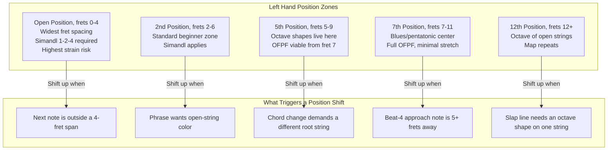
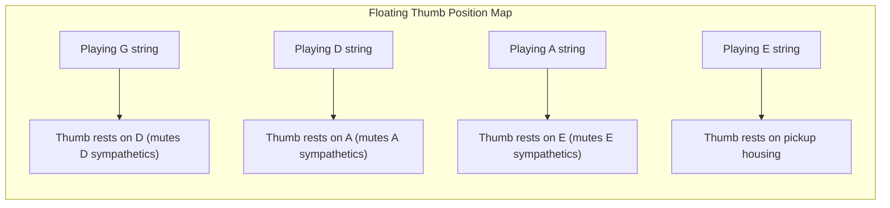
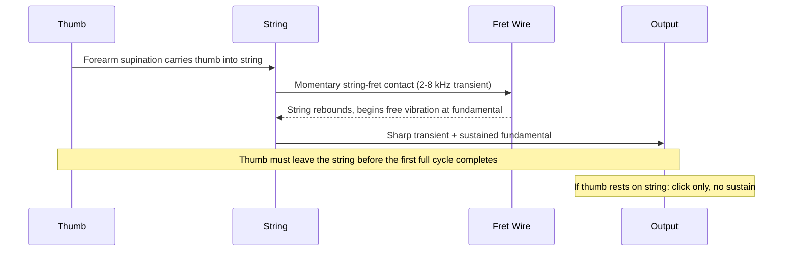
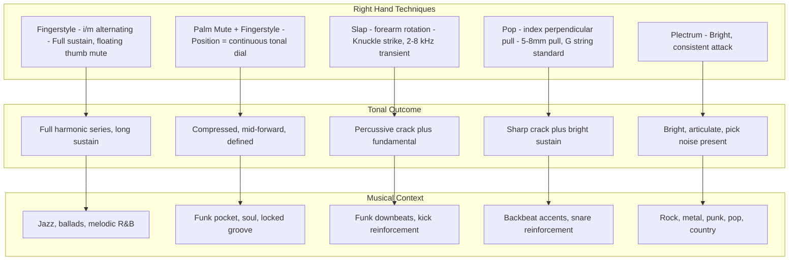
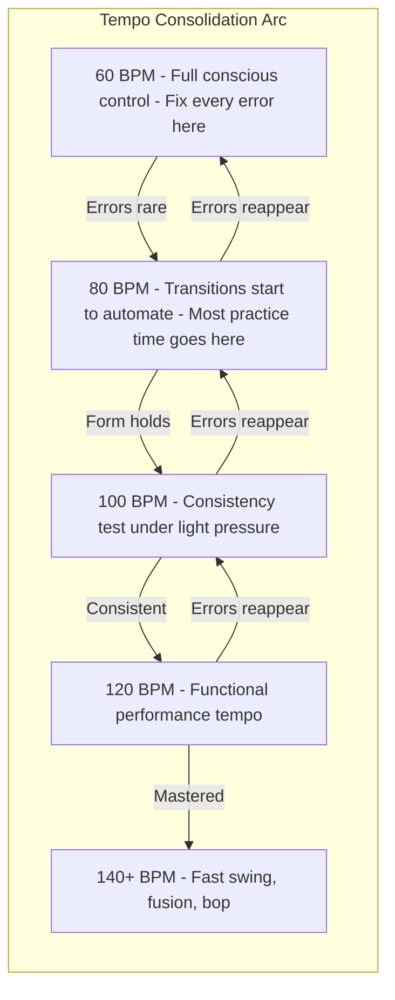

# Bass Guitar Masterclass — Lab 01: Technique, Fretboard Mechanics & Groove Architecture

## Why Mechanics Come First

The bass sits between the drummer's time and the harmony everyone else is playing. Your open E at 41 Hz locks with the kick; your root motion tells the listener what every chord above you means. On every note you make one binary decision: *is this anchoring the pulse, or voice-leading toward the next chord?* Hand mechanics exist to serve that decision without getting in its way.

**How to use this lab:** put the bass on and run the drill before reading the next section. Reading about technique consolidates nothing — only reps do. Target: clean execution at 120 BPM for every exercise by the end of this sequence.

---

## Gear Setup

| Item | Purpose | Notes |
|---|---|---|
| 4-string bass, 34" scale | Reference instrument | All fret positions in this lab assume standard scale |
| Clip-on or pedal tuner | Tuning reference | PolyTune 3, Peterson StroboStomp HD, or a DAW tuner plugin |
| Metronome | Subdivision reference | Phone app, drum machine, or DAW click |
| Audio interface + DAW | Recording yourself for review | Any interface + Reaper/Logic/Ableton — recording is mandatory, not optional |

A short-scale (30") or medium-scale (32") bass plays the same pitches but with less string tension, so fretting feels easier in the first five frets. That's fine for comfort, but learn the Simandl stretch on a 34" at some point — it's the standard you'll meet on most gigs and rentals.

### Standard Tuning (EADG)

Tune up before every session.

| String | Note | Frequency |
|---|---|---|
| 4 (thickest) | E1 | 41 Hz |
| 3 | A1 | 55 Hz |
| 2 | D2 | 73 Hz |
| 1 (thinnest) | G2 | 98 Hz |

Each fret raises pitch one semitone. Frets get physically closer together as you move toward the body — this is why open position (frets 0–4) feels like a bigger stretch than 7th position, and why most beginner buzzing happens below fret 5.

---

## The Fretboard: What You're Actually Looking At

### Note Map, Frets 0–12

```
Fret:  0    1    2    3    4    5    6    7    8    9    10   11   12
G:     G    Ab   A    Bb   B    C    Db   D    Eb   E    F    Gb   G
D:     D    Eb   E    F    Gb   G    Ab   A    Bb   B    C    Db   D
A:     A    Bb   B    C    Db   D    Eb   E    F    Gb   G    Ab   A
E:     E    F    Gb   G    Ab   A    Bb   B    C    Db   D    Eb   E
```

Memorize this grid cold. Every scale, arpeggio, and walking line you'll ever play is a navigation problem on this map.

**Same pitch, four locations.** A2 (110 Hz) exists in four spots:

| String | Fret | Character |
|---|---|---|
| E string | 5 | Warmest, closest to open-string resonance |
| A string | 12 | Open-string ring an octave up |
| D string | 7 | Balanced, mid-neck |
| G string | 2 | Thin string, brightest and most present |

Which one you choose is a real musical decision — driven by where your hand needs to be next, and what color the phrase wants.

### The Five Root-Box Shapes

These move to any key by sliding the root to a new fret. Learn them in one key, then transpose by ear.

**Box 1 — Root on E string.** Key of G, root at fret 3.

```
G |——————————————————|
D |———————5——————————|
A |———5——————————————|
E |———3——————————————|
      R              5    Oct
      G              D    G
```
Finger 1 on fret 3, finger 3 on fret 5 (Simandl zone).

**Box 2 — Root on A string.** Key of G, root at fret 10.

```
G |———————12—————————|
D |——10———————12—————|
A |——10——————————————|
E |——————————————————|
    R         5      Oct
    G         D      G
```
Fret 10 = finger 1, fret 12 = finger 3 (OFPF zone — frets are close together up here).

**Box 3 — Octave-pair box.** Root + octave only. This is your most-used shape when locking tight with a kick drum pattern.

```
G |——————————5———————|   octave (G, fret 5)
D |——————————————————|
A |———————5——————————|   5th above root
E |———3——————————————|   root (G, fret 3)
```

**Box 4 — Minor pentatonic box.** Key of G minor, root on E string fret 3. This is the backbone of R&B and funk bass lines.

```
Fret:    3    5    6    8    10
Interval R   m3   P4   P5   m7/R(oct)
Notes:   G   Bb    C    D    F/G
```
Fingers: fret 3 = 1, fret 5 = 3, fret 6 = 4 (Simandl through fret 6, OFPF from fret 7 up).

**Box 5 — Dorian box.** Key of D Dorian, root on A string fret 5. Every minor 7th chord in jazz and funk — Dm7, Am7, Cm7 — lives in this shape relative to its root.

```
Fret:     5    6    7    8    9    10
Interval  R   M2   m3   P4   P5   M6/m7
Notes:    D    E    F    G    A    B/C
```

---

### Fretboard Position Map



---

## Part 1: Left-Hand Foundational Mechanics

### 1A — Clean Fretting

#### The physics, in one paragraph

A string has to be pushed far enough to make clean contact with the fret wire — no more, no less. Press your fingertip onto the **leading edge of the fret** (the side closer to the bridge, not the middle of the fret gap). That position gives you the most leverage because the string is pinned directly over the contact point. You're not pressing the string *down*. You're pressing it *forward*, into the fret.

#### Simandl 1-2-4 fingering, frets 1–5

On a 34" scale, the stretch from fret 1 to fret 4 is wide enough that one-finger-per-fret in open position strains the hand. The Simandl system handles this with three working fingers:

```
Finger 1 (index)  — covers the lowest fret of the position
Finger 2 (middle) — covers the next fret up
Finger 4 (pinky)  — covers the top two frets, stretching back one fret when needed
Finger 3 (ring)   — supports finger 4 laterally, doesn't fret alone
```

E string, frets 1–4:
```
Fret 1 → F1  → finger 1
Fret 2 → F#1 → finger 2
Fret 3 → G1  → finger 4 (stretched back)
Fret 4 → Ab1 → finger 4 (natural position)
```

**Thumb:** centered on the back of the neck, opposite finger 2, wrist straight. A bent left wrist under sustained load is the main path to carpal tunnel problems on bass. If your wrist bends to reach open-position frets, raise the strap two inches before playing another note — don't push through it.

**Switch to OFPF (one finger per fret) from fret 7 up.** Frets are narrower there, so finger 1 on the low fret, 2/3/4 climbing up gives you full reach with no stretch penalty.

#### Drill 1A — Chromatic Crawl (daily warm-up)

Metronome at 60 BPM, quarter notes, one note per beat.

```
Pass 1 (ascending, Simandl):
  E: 1-2-3-4 (fingers 1-2-4-4)   A: 1-2-3-4   D: 1-2-3-4   G: 1-2-3-4

Pass 2 (descending, Simandl):
  G: 4-3-2-1 (fingers 4-4-2-1)   D: 4-3-2-1   A: 4-3-2-1   E: 4-3-2-1

Pass 3 (ascending, OFPF):
  E: 5-6-7-8 (fingers 1-2-3-4)   A: 5-6-7-8   D: 5-6-7-8   G: 5-6-7-8

Pass 4 (descending, OFPF):
  G: 8-7-6-5   D: 8-7-6-5   A: 8-7-6-5   E: 8-7-6-5
```

Run all four passes without stopping. That's one complete cycle.

**Listen for:**
- Buzz: fingertip is too far back from the fret — move it to the leading edge
- Uneven volume across strings: uneven finger pressure, the most common beginner issue
- Dead notes: an adjacent finger is touching a string it shouldn't
- Wrist pain in frets 1–4: raise your strap before continuing

**Tempo gates — don't skip these:**

| Stage | BPM | Requirement to advance |
|---|---|---|
| Entry | 60 | Zero buzz, zero dead notes, all 4 passes |
| Developing | 80 | Same clean standard |
| Consolidating | 100 | Form holds without conscious monitoring |
| Performance | 120 | Automatic; attention free for musical choices |

---

### 1B — Right-Hand Fingerstyle: Index-Middle Alternation

#### The mechanics

Use the pads of index (i) and middle (m), alternating every stroke. The motion **pulls toward the palm**, not down into the body — the fingertip catches the string, pulls slightly, releases, and the string snaps back against the fretboard.

**Rest stroke (apoyando):** after plucking, your finger lands on the next string down (toward the floor) and stays there until the next stroke. This mutes that string automatically and anchors your hand. It's the standard bass fingerstyle stroke — not the free stroke classical guitarists use.

#### The floating thumb — your automatic mute

A thumb parked on the pickup forever creates sympathetic ringing problems: play a D-string line and the open E rings underneath it, muddying your low end against the kick. Fix: the thumb follows your plucking hand, always resting on the string one below whichever string you're playing.



This becomes reflex within two weeks of deliberate practice. Don't skip it because it feels slow at first — it's the difference between a clean low end and mud in a band mix.

#### Drill 1B — Two-finger alternation

60 BPM, quarter notes, open E string, no fretting:

```
Beat:    1    2    3    4    1    2    3    4
Finger:  i    m    i    m    i    m    i    m
```

Then apply strict i-m alternation to the full Drill 1A chromatic crawl. Never pluck the same finger twice in a row, through every string crossing.

**Common error:** resetting to index on beat 1 every time. Record yourself and check — this habit collapses under real groove tempo because it isn't true independence, it's a crutch.

**String-crossing drill, 100 BPM target:**
```
4 notes on E (i-m-i-m) → 4 on A → 4 on D → 4 on G → reverse: G → D → A → E
```
Alternation continues unbroken across every crossing. Zero same-finger hits at 100 BPM = consolidated.

---

### 1C — Palm Muting as a Tonal Dial, Not a Switch

Beginners treat muting as on/off. Professionals treat the position of the palm edge (the fleshy pad below the pinky, resting near the bridge saddle) as a continuous control over which harmonics survive.

| Palm distance from bridge | Sound | Context |
|---|---|---|
| No contact | Open, full sustain, singing | Jazz solos, ballads |
| 2–5 mm | Standard fingerstyle punch | Pop, rock, modern jazz |
| 5–15 mm | Defined funk pocket, reduced sustain | Funk, R&B, locked groove |
| 20–30 mm | Thuddy, Motown-style upright emulation | Motown, soul, country |
| 50+ mm (mid-string) | Percussive thud, no pitch center | Intros, effects |

The fundamental barely moves in level as you mute — what changes is which upper harmonics survive. Moving the palm toward the neck strips harmonics from the top down, which is why a heavily muted note sounds dark rather than just quiet.

#### Drill 1C — Muting spectrum walk

Play A string, fret 5 (D, 73 Hz), same picking force, 4 beats at each palm position above. If you have a spectrum analyzer (SPAN, free, or any DAW plugin), watch the upper harmonics drop out step by step as you move toward the neck. If you don't, just listen — the brightness-to-thud progression is audible without any tool. Record a few takes so you have a reference for how your bass sounds at each setting; you'll want this vocabulary when a producer or bandleader asks for "more Motown" or "brighter."

---

### 1D — Walking Bass Lines: Voice Leading in Four Beats

#### What a walking line actually does

Three jobs per bar:

1. **Beat 1: confirm the root** — non-negotiable in jazz and most funk
2. **Beats 2–3: arpeggiate chord tones** — establish the chord's quality (major, minor, dominant)
3. **Beat 4: chromatic approach to the next root** — semitone pull that creates forward motion

```
Beat 1: Root
Beat 2: 3rd or 5th
Beat 3: diatonic or chromatic passing note
Beat 4: chromatic leading tone into next bar's root
```

Beat 4 is the most important note in the bar. Approaching from a semitone *below* the target is the classic, strongest pull. Combined with a diatonic beat-3 approach from *above*, you get the "encircle" move used throughout advanced jazz walking.

#### Progression 1 — Cm7 | F7 | Bb7 | Eb△7 (one bar each)

| Chord | Root | 3rd | 5th | 7th |
|---|---|---|---|---|
| Cm7 | C | Eb | G | Bb |
| F7 | F | A | C | Eb |
| Bb7 | Bb | D | F | Ab |
| Eb△7 | Eb | G | Bb | D |

Basic chord-tone line:
```
Bar 1 (Cm7):  C   Eb   G    Bb
Bar 2 (F7):   F   A    C    Eb
Bar 3 (Bb7):  Bb  D    F    Ab
Bar 4 (Eb△7): Eb  G    Bb   D
```

With chromatic leading tones on beat 4:
```
Bar 1 (Cm7):  C   Eb   G    E    ← E, semitone below F, pulls into bar 2
Bar 2 (F7):   F   A    C    A    ← A moves back toward the Bb approach
Bar 3 (Bb7):  Bb  D    F    D    ← D, semitone below Eb, pulls into bar 4
Bar 4 (Eb△7): Eb  G    Bb   B    ← B leads back to C at the top of the form
```
This E-natural-into-F move on bar 1 is the single most common jazz walking convention — you'll hear it on nearly every Ray Brown and Paul Chambers recording.

#### Fretboard mapping, bar by bar

**Bar 1 (Cm7):**
```
Beat 1 — C:  A string fret 3   finger 1
Beat 2 — Eb: A string fret 6   finger 4
Beat 3 — G:  D string fret 5   finger 3 (string cross, same hand position)
Beat 4 — E:  E string fret 7   finger 3 (shift up, leading into F)
```

**Bar 2 (F7), option A — drop back to open position:**
```
Beat 1 — F:  E string fret 1   finger 1
Beat 2 — A:  open A string
Beat 3 — C:  A string fret 3   finger 1
Beat 4 — A:  open A string
```

**Bar 3 (Bb7):**
```
Beat 1 — Bb: A string fret 1   finger 1
Beat 2 — D:  A string fret 5   finger 3
Beat 3 — F:  E string fret 1   finger 1
Beat 4 — D:  A string fret 5   finger 3
```

**Bar 4 (Eb△7):**
```
Beat 1 — Eb: A string fret 6   finger 4
Beat 2 — G:  D string fret 5   finger 3
Beat 3 — Bb: A string fret 1   finger 1
Beat 4 — B:  A string fret 2   finger 2
```

The beat-4-into-beat-1 transitions are the hardest to play cleanly at tempo. Find your two worst bar connections and loop them in isolation before attempting a full pass.

**Smaller-hand alternative** — stay on A and E strings only, more position shifts, fewer string crossings:
```
Bar 1: C (A3) / Eb (A6) / G (E3) / E (E7)
Bar 2: F (E1) / A (E5) / C (A3) / A (E5)
```

#### Walking Line Drill — Isolation Protocol

1. 60 BPM. Loop bar 1 alone until clean.
2. Connect bar 1 → bar 2. Loop the two-bar phrase 8 times, focusing on the transition.
3. Play all four bars. Record 8 passes.
4. Advance 80 → 100 → 120 BPM, only when the current tempo is error-free.
5. Repeat the full protocol with a second progression (e.g. a ii–V–i–IV in minor) for harmonic variety.
6. Alternate between both progressions without stopping, four bars each — this is the real test.

---

### 1E — Slap/Pop Mechanics

#### How slap tone is actually generated

Fingerstyle displaces the string laterally and releases it smoothly. Slap uses two completely different excitation mechanisms:

**Thumb strike:** the bony outer knuckle of the thumb strikes the string at the neck/body joint, hard enough to momentarily slam the string into the fret wire. That split-second string-fret contact is the "clack" — a burst of energy roughly 2–8 kHz. Without that contact, you have a hard fingerstyle pluck, not a slap.

**Pop:** the index finger hooks under the G (or D) string and pulls it perpendicular to the fretboard, 5–8 mm, then releases. The string snaps back against the frets, producing a bright crack plus a clear fundamental. More than 10 mm pull starts bending the pitch sharp on the attack; less than 5 mm gives you no audible snap.



**Contact point:** the bony distal knuckle, not the fleshy pad. The knuckle transmits energy into the fret; the pad absorbs it and gives you a soft thud instead of a crack.

**20-strike test:** open E, no fretting. Sharp attack followed by 1–2 seconds of sustain = correct rebound. Click with no sustain = thumb resting on the string after the strike.

**Pop mechanics:** curl the index finger under the G string at the first joint, pull perpendicular to the fretboard 5–8 mm, release clean. No fingernail drag — the string should come off the pad of the first joint sharply.

#### Foundational slap/pop pattern (16th-note grid)

Notation: T = thumb slap, P = pop, H = hammer-on, x = ghost note, . = rest

**Pattern 1 — entry, 60 BPM:**
```
16th:  1  e  +  a  2  e  +  a  3  e  +  a  4  e  +  a
       T  .  .  .  .  .  .  .  T  .  .  .  .  .  .  .
```
Just two thumb slaps, beats 1 and 3. Lock this to the kick drum before adding anything else.

**Pattern 2 — add the pop:**
```
16th:  1  e  +  a  2  e  +  a  3  e  +  a  4  e  +  a
       T  .  .  .  .  .  P  .  T  .  .  .  .  .  P  .
```
Pops on the "and" of 2 and "and" of 4 — the classic backbeat subdivision, aligning slap with the kick and pop with the snare.

**Pattern 3 — the Marcus Miller octave move:**
```
16th:  1  e  +  a  2  e  +  a  3  e  +  a  4  e  +  a
       T  .  H  .  .  .  P  .  T  .  H  .  .  .  P  .
Fret:  0  .  7  .  .  .  G  .  0  .  7  .  .  .  G  .
```
T = open E slap, H = left-hand hammer-on to fret 7 on the E string (B natural), P = open G pop. No right hand on the hammer-on — the left-hand finger drops onto the fret using the energy the slap already put into the string.

**Pattern 4 — ghost note integration (intermediate):**
```
16th:  1  e  +  a  2  e  +  a  3  e  +  a  4  e  +  a
       T  .  .  x  .  .  P  .  T  .  .  x  .  .  P  .
```
x = left hand releases fretting pressure while staying in contact with the string; right hand plucks anyway, producing a pitchless click. This fills out the 16th-note grid the way Bootsy Collins and Victor Wooten lines do.

#### Slap/Pop Drill Protocol

1. Thumb isolation: 20 strikes, open E, no fretting. Rebound and sustain only.
2. Pop isolation: 20 pops, open G, consistent amplitude, index only.
3. Pattern 1 at 60 BPM.
4. Pattern 2: 60 → 80 → 100 BPM.
5. Pattern 3 at 60 BPM — hammer-on must ring without right-hand help.
6. Pattern 4 at 60 BPM only, until ghosts are crisp and precise.

---

## Fretboard Navigation & Right-Hand Technique Map



---

## Part 2: Listening-Based Self-Assessment

You don't need a spectrum analyzer to diagnose most of these techniques — your ear, a mirror, and a recorder are enough. Use software where it genuinely sharpens judgment (pitch and timing checks); don't let tool setup replace practice time.

### 2A — Muting Position Ear Test

Record yourself playing A string fret 5 at each of the five palm positions from section 1C, four beats each, same pick force. Play it back. Rank the four recordings from brightest to darkest by ear alone, then check your ranking against the palm distances you used. If your ranking doesn't match the distance order, your palm movements between takes weren't consistent — redo the test with a visual reference point (a strip of tape on the body marking each distance).

### 2B — Walking Line: Swing Feel vs. Straight Eighths

A jazz walking line doesn't sit precisely on the click. "Laying back" means beats 2 and 4 land 15–20 ms after the grid — not sloppy, a deliberate and *consistent* delay.

Record Progression 1's walking line twice:
- **Version A:** every beat exactly on the click
- **Version B:** deliberately relaxed, beats 2 and 4 arrive just slightly late

Play both back. Version B should sound like it's breathing; a poorly executed version B sounds drunk or uncertain. The test: can you repeat the same amount of lag every time? If the delay varies wildly bar to bar, it reads as sloppy rather than intentional. If you have DAW access, zoom into the waveform — Version B's beat 2/4 attacks should sit visibly right of the grid lines, consistently.

### 2C — Ghost Note Check

Add ghost notes on the "and" of beat 2 in the Cm7 bar:

```
Beat:    1    +    2    +    3    +    4    +
Notes:   C    .   Eb    x    G    .   Bb    .
```

**Left-hand technique:** after fretting Eb (A string fret 6, finger 4), release pressure while keeping the fingertip touching the string. Pluck with the right hand as usual. You should hear a dry click with no pitch center. If you hear a faint pitch bleeding through, your release isn't complete — the finger is still pressing the string against the fret, just lightly. Record and listen back: a correct ghost note should be clearly quieter and have no identifiable note name.

### 2D — Slap Force Comparison

Play 10 open-E slaps at light, medium, and heavy force, recording each set. Listen back for:

| Force | What you should hear |
|---|---|
| Light | Soft tap, barely any clack, mostly fundamental |
| Medium (target) | Sharp clack plus a clean sustained note — this is correct slap tone |
| Heavy | Loud crash-like attack, sustain chokes off fast, possible buzz on neighboring strings |

Heavy force sounds more aggressive but is a technique error, not more "intensity" — in a band mix it competes with the snare's frequency range and clips easily. Medium force, consistently executed, is the professional standard.

---

## Part 3: Fault Injection — Deliberate Error Drills

Fault injection means playing the wrong technique on purpose so you recognize the error by feel before you even hear it, and can recover without stopping the time. For each fault: execute it deliberately, notice its signature, then fix it mid-phrase.

### 3A — Muting Faults

**Fault 1: Bar-mute with a flat index finger instead of palm edge**

Lay your index finger flat across the strings near the bridge instead of resting the palm. Play a walking line.

- *Signature:* uneven muting across strings — the finger contacts each string at different pressure, so note length and brightness vary string to string, and there's more high-frequency content than a proper palm mute.
- *Recovery:* switch to palm position without breaking the pulse.
- *Confirmation:* note length and tone even out across all four strings.

**Fault 2: Over-muting — pressing the palm hard instead of resting it**

- *Signature:* notes become pitchless thuds, fundamental drops out, possibly increased fret buzz from the strings being forced into the frets.
- *Recovery:* lighten palm contact until pitch returns.
- *Confirmation:* you can name the note by ear again.

### 3B — Left-Hand Faults

**Fault 1: Wrong chord tones in the walking line**

```
Wrong:   C  E   Ab   B    (E = major 3rd clashing against a minor chord, Ab = dim5, B = major 7th)
Correct: C  Eb  G    Bb
```

- *Signature:* the major 3rd against a minor chord is an obvious, ugly clash — most listeners hear "wrong" immediately, no theory required.
- *Recovery:* identify the wrong note by ear, correct from that beat forward without restarting the bar.
- *Confirmation:* play against a recorded chord track — the fixed line sits inside the harmony with no friction.

**Fault 2: Playing one eighth-note late (beat 1 lands on the "and" of 1)**

- *Signature:* the line drags — the click falls during the sustain of your note instead of at the attack. The bass sounds like it's chasing the time instead of driving it.
- *Recovery:* place your attack fractionally *before* the click — think of the click as marking the release of your note, not its trigger.
- *Confirmation:* attacks land with or slightly ahead of the beat.

**Fault 3: Thumb creeping over the top of the neck (guitar-style thumb-over)**

- *Signature:* no immediate sound change — this is a biomechanical fault. The danger is the compensating wrist bend that leads to repetitive strain over months.
- *Recovery:* reposition the thumb to the back of the neck opposite finger 2; straighten the wrist.
- *Confirmation:* you should be able to slide a finger between your palm and the neck without touching either in open position.

### 3C — Slap/Pop Faults

**Fault 1: Thumb rests on the string after striking (no rebound)**

- *Signature:* you still get the clack (contact happened during the strike) but no sustain follows — just a thud. This is the most common beginner slap error because resting the thumb feels controlled.
- *Recovery:* 20 isolated strikes focusing only on rebound. The thumb must leave the string within roughly 12 ms — before the string's first full cycle completes.
- *Confirmation:* a sharp attack *followed by* a ringing note, not just a click.

**Fault 2: Striking with the thumb pad instead of the knuckle**

- *Signature:* soft, warm attack, no bright crack — it sounds like a hard fingerstyle pluck, not a slap.
- *Recovery:* rotate the forearm further so the bony knuckle edge leads. Check in a mirror.
- *Confirmation:* the crack returns.

**Fault 3: Popping the D string instead of the G string**

- *Signature:* darker, lower pop that inverts the expected low-slap/high-pop contrast that defines funk slap tone. Sounds flat and undifferentiated.
- *Recovery:* feel for the gap between G and D strings with your fingertip before each pop — you shouldn't need to look.
- *Confirmation:* the pop regains its bright, higher character.

**Fault 4: Pulling the pop more than 10 mm**

- *Signature:* sharp crack but the pitch bends audibly sharp right on the attack — a "twang" instead of a clean pop.
- *Recovery:* reduce the pull to 5–8 mm; the snap comes from release speed, not travel distance.
- *Confirmation:* pitch is stable the instant the string is released. Check against a tuner if the bend is subtle.

---

## Tempo Architecture: The Diagnostic Principle

60 BPM isn't about playing slow for its own sake — it's the speed at which every error is still conscious and audible, before it becomes automatic. Motor memory encodes whatever you practice, errors included. A technique only belongs at 120 BPM once it was genuinely clean at 60.



**The rule:** if technique falls apart at a new tempo, the previous tempo wasn't actually consolidated. Drop back one step, give it five focused minutes, then try the increase again. That's accurate self-assessment, not failure.

### Practice Session Structure

| Phase | Duration | Focus |
|---|---|---|
| Warm-up | 5–8 min | Chromatic crawl (Drill 1A), all strings, no tempo pressure |
| Technique isolation | 15–20 min | One technique only — muting, walking, or slap. Not all three. |
| Integration | 10–15 min | Apply the isolated technique to a full progression at tempo. Record it. |
| Review | 5–10 min | Listen back critically. Pick one specific thing to fix next session. |

Total: 35–55 minutes. Past 90 minutes, returns drop fast and injury risk climbs. Five 45-minute sessions a week beats two 3-hour marathons every time.

---

## Part 4: Repertoire Application — Three Bass Lines Worth Stealing

Technique only matters once it shows up in real music. These three lines each isolate one skill from this lab inside a recognizable style context. Learn them by ear against a recording first, then use the tab as a cross-check.

### 4A — Motown-style quarter-note line (heavy palm mute, Box 1/Box 3)

Styled after the James Jamerson approach to a I-vi-IV-V in C, quarter notes, heavy thumb-over-the-pickup-style mute (approximate with the floating thumb or a foam mute under the strings at the bridge):

```
Bar 1 (C):   C(A3) E(A7) G(D5) C(D8... use D5+oct, or G string fret 0 oct up)
Simplify to single-octave box:
Bar 1 (C):   E:3   A:0   A:4   A:2     (C  E  G  B — outlines Cmaj7 color tone)
Bar 2 (Am):  A:0   A:3   D:2   D:0     (A  C  E  D)
Bar 3 (F):   E:1   E:0   A:3   A:2     (F  E  C  B — chromatic walk-up into G)
Bar 4 (G):   E:3   A:0   A:2   A:4     (G  A  B  C — stepwise climb back to I)
```
Palm position: 20–30 mm from the bridge throughout. This is section 1C's Motown setting in direct musical use — the thud has to be present on every note, not just the downbeats.

### 4B — Funk octave-slap groove (Box 3, Pattern 3 vocabulary)

16th-note funk in G, built from Box 3's root/octave relationship plus Pattern 3's hammer-on move:

```
16th:  1  e  +  a  2  e  +  a  3  e  +  a  4  e  +  a
Tech:  T  .  H  .  .  .  P  .  T  .  .  x  H  .  P  .
Fret:  3  .  7  .  .  .  5   .  3  .  .  x  5  .  5   .
String: E  .  E  .  .  .  G  .  E  .  .  G  D  .  G  .
```
T on fret 3 (G, root) of the E string, H hammers to fret 7 (B), P pops the G string fret 5 (C), ghost note x on the G string between hits. Loop bar-length at 70 BPM before looping as a continuous groove.

### 4C — Jazz ballad walking line with encirclement (Box 5, section 1D vocabulary)

ii–V–I in C major, quarter notes, demonstrating the encircle approach (diatonic from above, chromatic from below) into each new root:

```
Bar 1 (Dm7):  D(A5)  F(A8... or D string 3)  A(A10 or D string 5)  Eb(E string 6, chromatic approach)
Bar 2 (G7):   G(E3)  B(A2)  D(A5)             F#(A4, chromatic approach from below into G)
Bar 3 (Cmaj7):C(A3)  E(A7)  G(D5)             Db(A4, chromatic approach from above into C... loop back)
```
Play this against a recorded ii-V-I backing track (search "jazz ii V I backing track in C") at 70 BPM with heavy swing lay-back on beats 2 and 4, per drill 2B.

---

## Quick Reference Tables

### Fretboard Note Map — Key Positions

| Fret | E String | A String | D String | G String |
|---|---|---|---|---|
| Open | E1 | A1 | D2 | G2 |
| 1 | F1 | Bb1 | Eb2 | Ab2 |
| 2 | F#1 | B1 | E2 | A2 |
| 3 | G1 | C2 | F2 | Bb2 |
| 4 | Ab1 | Db2 | Gb2 | B2 |
| 5 | A1 | D2 | G2 | C3 |
| 6 | Bb1 | Eb2 | Ab2 | Db3 |
| 7 | B1 | E2 | A2 | D3 |
| 8 | C2 | F2 | Bb2 | Eb3 |
| 9 | Db2 | Gb2 | B2 | E3 |
| 10 | D2 | G2 | C3 | F3 |
| 12 | E2 | A2 | D3 | G3 |

Fret 12 is exactly one octave above the open string — the whole fretboard pattern repeats from there.

### Technique Diagnostic Matrix

| Symptom | Likely Cause | Fix |
|---|---|---|
| Fret buzz | Finger too far back from the fret, or insufficient pressure | Move fingertip to the fret's leading edge, push forward not down |
| Sympathetic ringing on other strings | No floating thumb mute | Rest the plucking-hand thumb on the string below the one you're playing |
| Dead/muted notes while fretting | Adjacent finger touching the string | Arch fingers more, approach the string more perpendicularly |
| Slap has no sustain, just a thud | Thumb resting on the string after the strike | Drill the rotational rebound in isolation |
| Slap has no bright crack | Striking with the pad, not the knuckle | Rotate the forearm so the knuckle leads |
| Pop amplitude inconsistent | Pull distance varies, or using the wrong finger | Fix pull at 5–8 mm, index finger only |
| Pop sharp on the attack | Pull distance over 10 mm | Reduce to 5–8 mm |
| Walking line stalls at chord changes | Position shift too far or too slow | Map each change for minimum hand travel, drill the transition alone |
| Tone muddy, undefined | Palm too far from the bridge | Move palm contact closer to the saddle |
| Left wrist pain | Wrist bent sharply in open position | Raise strap height, check thumb is centered on the back of the neck |
| Ghost notes have audible pitch | Left-hand release incomplete | Release fretting pressure fully while keeping contact |
| Walking line sounds stiff, no swing | Every beat placed exactly on the grid | Add a deliberate, consistent 15–20 ms lag on beats 2 and 4 |
| Hammer-on after slap doesn't ring | Left-hand finger lands too slowly | Drill the hammer-on timing in isolation, no right hand |

### Interval Reference

| Semitones | Interval | From C | Bass Context |
|---|---|---|---|
| 0 | Unison | C | Root, always beat 1 |
| 1 | Minor 2nd | Db | Chromatic approach from above |
| 2 | Major 2nd | D | Diatonic passing tone |
| 3 | Minor 3rd | Eb | Minor chord quality |
| 4 | Major 3rd | E | Major chord quality |
| 5 | Perfect 4th | F | Strong consonance, common beat-2 tone |
| 6 | Tritone | Gb | Maximum tension, tritone substitution |
| 7 | Perfect 5th | G | Strong consonance, common beat-2 tone |
| 8 | Minor 6th | Ab | Color tone, Dorian/Aeolian |
| 9 | Major 6th | A | Dorian brightness |
| 10 | Minor 7th | Bb | Dominant/minor 7th quality |
| 11 | Major 7th | B | Chromatic approach from below |
| 12 | Octave | C | Slap octave pattern, position anchor |

---

## Injury Prevention

Bass playing is sustained repetitive motion under moderate load. The risks are real and well documented, and they're preventable with correct setup and session discipline.

**Carpal tunnel syndrome** — median nerve compression from sustained left-wrist flexion. Open-position frets are the highest-risk zone because low frets force the wrist to bend. Raise your strap so the neck sits elevated toward the shoulder, keeping the wrist straight. If you have to reach under the neck to fret, your strap is too low.

**Ulnar nerve compression** — from resting the right elbow on a sharp body edge. Rest the forearm on the curved upper bout instead.

**Extensor tendinitis (right hand)** — from excessive slap force and high-rep popping. The 15–20 minute isolation cap per session is a real limit, not a suggestion. Rest between sets, stretch between sessions.

**Flexor tendinitis (left hand)** — from sustained heavy fretting pressure, often made worse by high action or heavy strings. If notes take real effort to fret cleanly, get your setup checked (action height, nut slot depth, truss rod relief) before grinding out hours of compensatory bad technique. A good setup can cut required fretting force by 30–50%.

**Non-negotiable rule:** pain, numbness, or tingling in any finger means stop immediately. Nerve and tendon damage from overuse is cumulative and can be permanent. No tempo goal is worth playing through it. Rest 48–72 hours and see a sports medicine physician or physical therapist before resuming if symptoms persist.

---

## Lab Summary

The fretboard is a fixed, learnable map. Once the five root-box shapes are internalized, every scale, arpeggio, and position shift becomes a navigation problem with a known answer.

Palm muting is a continuous tonal dial, not a switch — distance from the bridge determines which harmonics survive, while the fundamental barely moves. This is what lets you dial in anything from singing jazz tone to thumpy Motown thud with the same right hand.

Walking bass lines are voice-leading structures: root on 1, chord tones on 2–3, chromatic approach on 4. That beat-4 leading tone is the engine of harmonic momentum. Ghost notes and deliberate swing placement are what separate a time-keeper from a groove architect.

Slap tone comes from a split-second of string-fret contact during a rotational thumb strike — knuckle, not pad; rebound, not rest. Force beyond medium degrades tone instead of enhancing it.

The repertoire lines in Part 4 exist to prove the point: none of this technique matters in isolation. A Motown line is palm-muting applied with intent. A funk slap groove is Box 3 plus the thumb/pop mechanics from 1E. A jazz walking line with encirclement is 1D's voice-leading rules played at tempo with swing feel. Every lab from here forward builds directly on this foundation — the practice architecture (60 BPM for diagnosis, incremental tempo increases, one technique isolated per session, recording for review) is the template you'll reuse every time.
