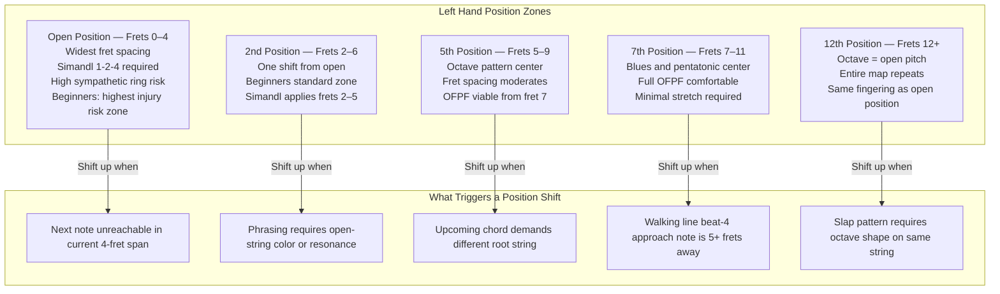
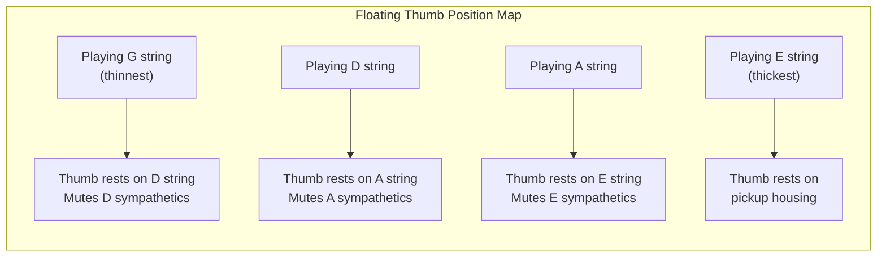
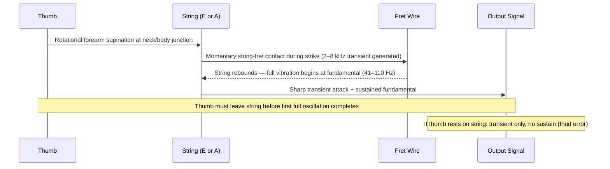
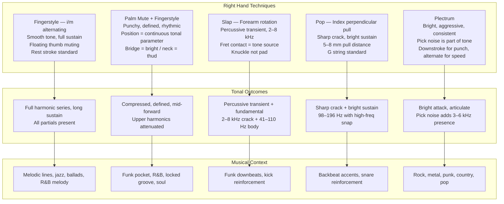
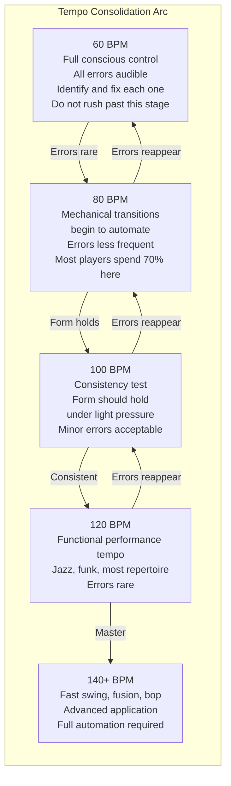

# Bass Guitar Masterclass — Lab 01: Technique, Fretboard Mechanics & Groove Architecture

## Why Mechanics Come First

The bass guitar sits at the intersection of rhythm and harmony. Your open E string at 41 Hz locks with the kick drum; your root motion defines what every chord above you means to the listener. Unlike guitar or piano — where both hands share melody, harmony, and color — the bassist makes one binary decision on every note: *is this anchoring the pulse, or is it voice-leading toward the next chord?* Every physical choice feeds that decision.

This lab treats your hands as precision instruments with specific mechanical constraints. Thumb angle, the exact forearm rotation that produces a slap transient, palm contact distance from the bridge — these are not stylistic preferences. They are physical parameters with measurable acoustic consequences. We will measure them, and we will play them.

**How to use this lab:** Read each section once, then put the bass on and execute the drill before reading further. Passive reading of technique descriptions consolidates nothing. The goal is clean execution at 120 BPM for every exercise by the end of the curriculum sequence.

---

## Gear Setup

### What You Need

| Item | Purpose | Recommended Options |
|---|---|---|
| Electric bass (4-string, 34" scale) | Primary instrument | Standard scale is the reference for all fret positions in this lab |
| Chromatic strobe tuner | Pitch reference and intonation check | TC Electronic PolyTune 3, Peterson StroboStomp HD, or DAW plugin |
| Metronome | Subdivision reference | Physical click, app, or DAW grid |
| Audio interface | Capture dry signal | Focusrite Scarlett 2i2, UA Volt 1 |
| DAW | Waveform, spectrum, and transient analysis | Reaper (free/low cost), Logic Pro, Ableton Live |
| Spectrum analyzer | Real-time FFT display | SPAN by Voxengo (free), FabFilter Pro-Q 3 |

A short-scale (30") or medium-scale (32") bass is acoustically identical in pitch but has lower string tension. This *reduces* fretting force needed in the first five frets, which changes the proprioceptive feedback you get from these exercises. Use a standard 34" if you have one.

### Standard Tuning (EADG)

Tune before every session. Use a strobe tuner if available — needle tuners carry ±3 cent accuracy variance, which is audible on sustained notes against a chord track.

| String | Note | Frequency | MIDI # |
|---|---|---|---|
| 4 (thickest) | E1 | 41.20 Hz | 28 |
| 3 | A1 | 55.00 Hz | 33 |
| 2 | D2 | 73.42 Hz | 38 |
| 1 (thinnest) | G2 | 98.00 Hz | 43 |

Each fret raises pitch by one equal-tempered semitone (frequency ratio ≈ 1.0595). Fret spacing decreases logarithmically toward the body — this is why open-position playing demands more left-hand reach than 7th-position playing, and why beginners accumulate more intonation and buzzing problems below fret 5.

---

## The Fretboard: What You Are Actually Looking At

### Full 4-String Note Map (Frets 0–12)

Memorize this grid. Everything else in bass — scales, arpeggios, walking lines, position shifts — is a navigation problem on this map.

```
Fret:  0    1    2    3    4    5    6    7    8    9    10   11   12
G:     G    Ab   A    Bb   B    C    Db   D    Eb   E    F    Gb   G
D:     D    Eb   E    F    Gb   G    Ab   A    Bb   B    C    Db   D
A:     A    Bb   B    C    Db   D    Eb   E    F    Gb   G    Ab   A
E:     E    F    Gb   G    Ab   A    Bb   B    C    Db   D    Eb   E
```

**Key insight — multiple positions for the same pitch.** The note A2 (110 Hz) lives at four locations simultaneously:

| String | Fret | Notes on choice |
|---|---|---|
| E string | 5 | Warmest; closest to nut resonance |
| A string | 12 | Open-string ring, brightens octave |
| D string | 7 | Mid-neck, balanced fundamental |
| G string | 2 | Thin string = brightest, most present |

Choosing *which* position to play is a core left-hand decision governed by phrase direction, tonal color, and hand economy — where will your hand need to be for the *next* note?

### The Five Essential Root-Box Shapes

These five moveable boxes are the foundation of every scale, arpeggio, and position shift you will ever play. They move to any key by sliding the root to any fret.

**Box 1 — Root on E string (example: A major, root at fret 5)**

```
G: ———|———|———|———|———|———|
D: ———|———|———|—o—|———|—o—|   (D string: b7 at fret 7, root octave at fret 10... )
A: ———|———|———|———|———|—o—|   (A string: Root at fret 5, then 5th at fret 7)
E: ———|———|———|———|———|—R—|   (E string: Root at fret 5)
        3    4    5    6    7
```

Let's lay this out cleanly with explicit finger assignments. Root on **A string, key of C, fret 3** — the most useful starting position because it places the root in the natural playing zone of frets 1–5.

**Box 1 — Root on A string (C, fret 3), Simandl fingering**

```
String  Fret  Note   Finger  Interval
——————  ————  —————  ——————  ————————
E        3    G       1       5th (below root — use sparingly)
A        3    C       1       Root  ← anchor
A        5    D       3       Major 2nd (passing)
A        6    Eb      4       Minor 3rd (Cm chord tone)
D        3    F       1       Perfect 4th / b7 of G7
D        5    G       3       Perfect 5th
D        6    Ab      4       Minor 6th (color tone)
G        3    Bb      1       Minor 7th (Cm7 chord tone)
G        5    C       3       Octave  ← anchor
G        6    Db      4       Minor 9th (color)
```

**Box 2 — Major Triad Box (R–3–5–8), root on A string, key of A (fret 0 = open)**

```
   Fret:   0    2    4
G:  ——|——|—o—|——|    (E = major 6th, passing)
D:  —o—|——|—o—|——|    (A = 1oct up at fret 7; here: 5th at fret 2, Root at fret 0 is open D...)
```

The clearest way to see moveable boxes is in tablature. Here are all five root-box shapes as tab diagrams, each shown in the key of **G** so you can compare their positions on the neck simultaneously:

---

**Box 1: Root on E string (G = fret 3)**
```
G |——————————————————|
D |———————5——————————|
A |———5——————————————|
E |———3——————————————|
      R              5    Oct
      G              D    G
```
Fingers: Fret 3 = finger 1 (Simandl), Fret 5 = finger 3

**Box 2: Root on A string (G = fret 10)**
```
G |———————12—————————|
D |——10———————12—————|
A |——10——————————————|
E |——————————————————|
    R         5      Oct
    G         D      G
```
Fingers: Fret 10 = finger 1 (OFPF zone), Fret 12 = finger 3

**Box 3: Octave-Pair Box (root + octave only, essential for locking with kick)**
```
G |——————————5———————|   ← octave (G at fret 5)
D |——————————————————|
A |———————5——————————|   ← 5th above root
E |———3——————————————|   ← root (G at fret 3)
      R    5    Oct
```

**Box 4: Minor Pentatonic Box (the foundation of R&B and funk bass)**
Key of G minor, root on E string fret 3:
```
Fret:  3    5    6    7    8    10
G:  ———o————o————————————————————
D:  ———o————o————————————————————
A:  ———o————o————————————————————
E:  ———o————o————————————————————
    R  m3  P4   P5  m7  R(oct)
    G  Bb   C    D   F   G
```
Finger assignment (Simandl in frets 3–6, OFPF from 7+):
- Fret 3: finger 1
- Fret 5: finger 3
- Fret 6: finger 4

**Box 5: Dorian Mode Box (the jazz/funk workhorse, natural minor with raised 6th)**
Key of D Dorian (A string, root at fret 5):
```
Fret:  5    6    7    8    9    10
G:  ————o————o————o———————————
D:  ————o————o————o———————————
A:  ————o————o————o———————————
     R  M2  m3  P4   P5  M6  m7  Oct
     D   E   F   G    A   B   C   D
```
Dorian is the mode of Cm7, Am7, Dm7 — every minor chord in jazz and funk lives here.

---

### Fretboard Position Architecture



---

## Part 1: Left-Hand Foundational Mechanics

### 1A — Clean Fretting: Where Your Finger Goes and Why

#### The Physics in One Paragraph

The string must be displaced far enough to contact the fret wire cleanly. Minimum fretting force depends on string gauge (heavier = more tension = more force needed), action height (the gap between string and fret wire), and your finger's position relative to the fret. Placing your fingertip on the **leading edge of the fret** — the body-side wall of the fret slot — maximizes mechanical advantage because you are leveraging the string directly over the contact point. The mental model: you are not pressing *down* on the string. You are pressing it *forward* into the fret.

#### Simandl 1-2-4 Fingering in Detail (Frets 1–5)

In open position on a 34" scale bass, the stretch between frets 1 and 4 is approximately 65–75 mm — too wide for comfortable one-finger-per-fret without risking extensor tendon strain. The Simandl system resolves this:

```
Finger 1 (index)  — covers fret 1 (or the lowest fret in any position)
Finger 2 (middle) — covers fret 2
Finger 4 (pinky)  — covers frets 3 AND 4 (stretches back one fret when needed)
Ring finger (3)   — rests alongside pinky for lateral support, never frets alone in this system
```

Practical assignment, E string, frets 1–4:

```
Fret 1 → F1   → Finger 1
Fret 2 → F#1  → Finger 2
Fret 3 → G1   → Finger 4 (stretching back to fret 3 from its natural fret 4 position)
Fret 4 → Ab1  → Finger 4 (now on its natural fret)
```

**Thumb position:** Centered on the back of the neck, opposite finger 2 (middle finger). Keep your wrist straight — the neck elevation of your strap does most of the work. A sharply bent left wrist is the primary vector for carpal tunnel syndrome on bass. If you feel your wrist bending to reach open-position frets, raise your strap height two inches before playing another note.

**Transition to OFPF (One Finger Per Fret):** From fret 7 upward, fret spacing has narrowed enough that four-finger spans are comfortable. Use finger 1 on the lowest fret of your position, 2 on the next, 3 on the next, 4 on the highest. This gives you maximum reach and independence in the upper register.

#### Drill 1A — Chromatic Crawl (Daily Warm-Up)

This is your diagnostic tool and warm-up for every session. It surfaces buzzes, dead notes, and inconsistent pressure immediately.

**Setup:** Metronome at 60 BPM, quarter notes. One note per beat.

```
Pass 1 (ascending, Simandl):
  E string: frets 1—2—3—4   (fingers 1—2—4—4)
  A string: frets 1—2—3—4
  D string: frets 1—2—3—4
  G string: frets 1—2—3—4

Pass 2 (descending, Simandl):
  G string: frets 4—3—2—1   (fingers 4—4—2—1)
  D string: frets 4—3—2—1
  A string: frets 4—3—2—1
  E string: frets 4—3—2—1

Pass 3 (ascending, OFPF):
  E string: frets 5—6—7—8   (fingers 1—2—3—4)
  A string: frets 5—6—7—8
  D string: frets 5—6—7—8
  G string: frets 5—6—7—8

Pass 4 (descending, OFPF):
  G string: frets 8—7—6—5
  D string: frets 8—7—6—5
  A string: frets 8—7—6—5
  E string: frets 8—7—6—5
```

Do all four passes without stopping. This is one complete warm-up cycle.

**What to listen for:**
- Every note rings clean with zero buzz — if you get buzz, your fingertip is too far from the fret wire, move it forward
- Consistent volume across all four strings — uneven pressure is the most common beginner problem
- No dead notes — if a note thuds instead of rings, an adjacent finger is accidentally touching that string
- No left-wrist pain — if you feel strain in frets 1–4, raise your strap before continuing

**Tempo targets:**

| Stage | BPM | Requirement to Advance |
|---|---|---|
| Entry | 60 | Zero buzzes, zero dead notes across all 4 passes |
| Developing | 80 | Same clean standard, beginning to feel automatic |
| Consolidating | 100 | Form holds without conscious monitoring |
| Performance | 120 | Fully automatic; attention can shift to musical expression |

Only advance tempo when you can complete all four passes with zero errors at the current speed. This is non-negotiable.

---

### 1B — Right-Hand Fingerstyle: Alternating Index-Middle

#### The Mechanics

Right-hand fingerstyle uses the **pad of the index finger (i) and middle finger (m)** alternating on each stroke. The motion is a **pulling stroke toward the palm** — not a downward push. The fingertip catches the string, pulls slightly toward the palm, and releases. The string snaps back against the fretboard.

**Rest stroke (apoyando):** After each stroke, the finger comes to rest against the string directly below it (the string toward the floor). This provides a natural muting mechanism for the string you just played and anchors your hand position. It is the standard fingerstyle stroke for bass — not the free stroke used in classical guitar.

**Right-hand anchor:** Thumb on the pickup housing when playing the E string, or floating to the string directly below the one being played (see floating thumb, below).

#### The Floating Thumb — Your Automatic Muting System

This is the single most important right-hand technique to develop from the start. A fixed thumb anchored permanently on the pickup creates sympathetic ringing problems as your playing moves across strings — an open E string vibrating under a D-string line adds 41 Hz mud to your low-frequency mix and clashes with the kick drum in a band context. The floating thumb eliminates this automatically.

The thumb follows your playing hand across the strings, always resting on the string one below the one being played:



The transition between thumb positions is not a conscious decision — it happens automatically as your hand moves from string to string. Practice this slowly at first; within two weeks it becomes reflex.

#### Drill 1B — Two-Finger Alternation, Single String

**60 BPM, quarter notes. E string open. No fretting.**

```
Beat:    1    2    3    4    1    2    3    4
Finger:  i    m    i    m    i    m    i    m
```

Then apply strict i-m alternation to the full chromatic crawl from Drill 1A. The goal: never pluck the same finger twice in a row, through all string crossings and position shifts.

**Common error — same-finger reset:** Most beginners unconsciously reset to index (i) on every beat 1 or after a string crossing. Record yourself and check. If your hand always starts phrases with index, you are not building true alternation independence — you are building a habit that will collapse at tempo under a groove context.

**Advanced variation — string crossing independence:** Once alternation is automatic at 100 BPM on a single string, add this:

```
4 notes on E (i-m-i-m) → 4 notes on A (continue: i-m-i-m) → 4 notes on D → 4 notes on G
Then reverse: 4 notes on G → D → A → E
```

The alternation pattern continues unbroken across all string crossings. When you can do this at 100 BPM with zero same-finger hits, right-hand alternation is consolidated.

---

### 1C — Right-Hand Muting: Palm Position Is a Tonal Parameter

#### Why Muting Is Not Binary

Most beginners treat palm muting as "muted vs. not muted." Professional players treat it as a continuous knob shaping the harmonic content of every note. The position of your palm edge (the **hypothenar eminence** — the fleshy pad below your pinky) relative to the bridge saddle determines which harmonic partials are attenuated:

| Palm Distance from Bridge | Spectral Effect | Practical Sound | Genre Context |
|---|---|---|---|
| No contact | Full harmonic series, full sustain | Open, melodic, singing | Jazz solos, ballads, R&B melody |
| 2–5 mm from saddle | Slight top-end reduction, full fundamental | Standard fingerstyle punch | Pop, rock, modern jazz |
| 5–15 mm from saddle | Reduced sustain, strong fundamental, upper harmonics cut | Defined funk pocket | Funk, R&B, locked groove |
| 20–30 mm from saddle | Short sustain, thuddy fundamental, most harmonics absent | Motown upright emulation | Motown, soul, country |
| 50+ mm (mid-string) | Percussive thud, almost no pitch definition | Rhythmic effect | Intros, special effects |

This relationship is consistent: every step toward the neck removes progressively lower harmonics. The fundamental amplitude changes very little — muting is a *harmonic* attenuator, not a volume knob.

#### Drill 1C — Muting Spectrum Walk

**Setup:** Audio interface → DAW with SPAN on the channel, display set to 20–5000 Hz.

Play A string fret 5 (D2, 73 Hz) with consistent picking force at each palm position listed above. Hold each position for 4 beats at 60 BPM. Watch the spectrum change in real time — specifically notice:

1. The fundamental peak at ~73 Hz: does its amplitude change significantly?
2. The harmonics at ~146 Hz (2nd partial), ~219 Hz (3rd), ~292 Hz (4th): when does each disappear?
3. The high harmonic shelf (500 Hz and above): at what palm position does it drop 20 dB or more?

After you can hear the difference clearly, record four takes and label them `no_mute.wav`, `palm_5mm.wav`, `palm_15mm.wav`, `palm_25mm.wav`. You will use these in Exercise 2A.

---

### 1D — Walking Bass Lines: Voice Leading in Four Beats

#### What a Walking Line Actually Is

A walking bass line is a **voice-leading structure**, not a scale run. It has three simultaneous jobs:

1. **Confirm the chord root on beat 1** — non-negotiable in jazz and most funk contexts
2. **Arpeggiate chord tones on beats 2 and 3** — establishing chord identity
3. **Approach the next chord's root by semitone on beat 4** — the chromatic leading tone creates forward harmonic momentum

The four-beat blueprint:

```
Beat 1: Root (R)                          → Confirm the harmony
Beat 2: 3rd or 5th of the chord           → Establish chord quality
Beat 3: Diatonic or chromatic passing note → Color and momentum
Beat 4: Chromatic leading tone to next R   → Voice-lead into bar 2 (semitone above or below target)
```

Beat 4 is the most important voice-leading note in the bar. A semitone *below* the target root creates maximum pull (classic approach). A semitone *above* creates encirclement when combined with a diatonic approach on beat 3 — this is the "encircle" technique used in advanced jazz walking.

#### Chord Tone Reference: Two Progressions

**Progression 1 — Cm7 | F7 | Bb7 | Eb△7** (iii–VI–II–V in Eb major, one bar each, 4/4)

| Chord | Root | 3rd | 5th | 7th |
|---|---|---|---|---|
| Cm7 | C | Eb (minor 3rd) | G | Bb |
| F7 | F | A (major 3rd) | C | Eb |
| Bb7 | Bb | D (major 3rd) | F | Ab |
| Eb△7 | Eb | G (major 3rd) | Bb | D |

Walking line — basic chord tones only:

```
Bar 1 (Cm7):  C   Eb   G    Bb
Bar 2 (F7):   F   A    C    Eb
Bar 3 (Bb7):  Bb  D    F    Ab
Bar 4 (Eb△7): Eb  G    Bb   D
```

Walking line — with chromatic leading tones on beat 4:

```
Bar 1 (Cm7):  C   Eb   G    E    ← E is semitone below F, pulls into bar 2
Bar 2 (F7):   F   A    C    A    ← A leads back through Bb approach
Bar 3 (Bb7):  Bb  D    F    D    ← D is semitone below Eb, pulls into bar 4
Bar 4 (Eb△7): Eb  G    Bb   B    ← B leads back to C (bar 1 repeat) or use Db descend
```

The chromatic leading tone on bar 1 beat 4 (E natural) is one semitone below F (the root of bar 2). This is the strongest possible voice-leading approach and is the most common convention in jazz walking. You will hear it in every Ray Brown, Paul Chambers, and Ron Carter recording.

**Progression 2 — Dm7 | G7 | Cm7 | F7** (ii–V–i–IV in C minor, one bar each)

| Chord | Root | 3rd | 5th | 7th |
|---|---|---|---|---|
| Dm7 | D | F (minor 3rd) | A | C |
| G7 | G | B (major 3rd) | D | F |
| Cm7 | C | Eb (minor 3rd) | G | Bb |
| F7 | F | A (major 3rd) | C | Eb |

Walking line with encirclement on bar 2:

```
Bar 1 (Dm7): D   F    A    Bb   ← Bb (whole step above A) → encircle into G7
Bar 2 (G7):  G   B    D    Db   ← Db (semitone above C) → drops into Cm7
Bar 3 (Cm7): C   Eb   G    E    ← E (semitone below F)
Bar 4 (F7):  F   A    C    Eb
```

The Bb→G on bar 1 beat 4 to beat 1 of bar 2 is a half-step from above — an "above approach" or "ghost encircle." Combined with the Db on bar 2 beat 4 (semitone above C), this creates the sophisticated chromatic encirclement move that distinguishes advanced walking from beginner chord-tone walking.

#### Fretboard Mapping — Progression 1, Full Four Bars

Efficient fingering minimizes lateral hand travel. Here is the complete fretboard map for Progression 1 with explicit string/fret/finger assignments:

**Bar 1 (Cm7) — A string zone:**

```
Beat 1 — C:  A string, fret 3   finger 1  (Simandl anchor)
Beat 2 — Eb: A string, fret 6   finger 4  (Simandl stretch)
Beat 3 — G:  D string, fret 5   finger 3  (string cross, same hand position)
Beat 4 — E:  E string, fret 7   finger 3  (shift up, leading tone into F)
  → Bar 2 opens on F: A string fret 8 OR E string fret 1
```

**Bar 2 (F7) — dual position options:**

Option A (staying in upper position, economical if bar 1 ended at fret 7):
```
Beat 1 — F:  E string, fret 1   finger 1  (jump down — position shift)
Beat 2 — A:  A string, fret 0   open      (open string, bright color)
Beat 3 — C:  A string, fret 3   finger 1
Beat 4 — A:  A string, fret 0   open OR E string fret 5
```

Option B (staying higher on neck):
```
Beat 1 — F:  A string, fret 8   finger 1  (stays in position from bar 1)
Beat 2 — A:  D string, fret 7   finger 4  (string cross)
Beat 3 — C:  G string, fret 5   finger 3
Beat 4 — A:  D string, fret 7   finger 4
```

**Bar 3 (Bb7):**
```
Beat 1 — Bb: A string, fret 1   finger 1  (Simandl, open position)
Beat 2 — D:  A string, fret 5   finger 3  OR D string open
Beat 3 — F:  E string, fret 1   finger 1
Beat 4 — D:  A string, fret 5   finger 3  (leading tone: Eb target - 1 = D)
```

**Bar 4 (Eb△7):**
```
Beat 1 — Eb: A string, fret 6   finger 4  (Simandl)
Beat 2 — G:  D string, fret 5   finger 3
Beat 3 — Bb: A string, fret 1   finger 1  OR D string fret 8
Beat 4 — B:  A string, fret 2   finger 2  (leading tone: C target - 1 = B)
  → Bar 1 repeat: C at A string fret 3
```

The beat 4 → beat 1 transitions are the hardest voice-leading mechanics to execute cleanly at tempo. Identify your two most problematic bar-connecting transitions and practice them in isolation before playing full passes.

**Alternative fingering for smaller hands** — keep all notes on the A and E strings (fewer string crossings, more position shifts):

```
Bar 1 (Cm7):
  C:  A fret 3  / Eb: A fret 6  / G:  E fret 3  / E:  E fret 7

Bar 2 (F7):
  F:  E fret 1  / A:  E fret 5  / C:  A fret 3  / A:  E fret 5
```

#### Walking Bass Drill — Isolation Protocol

1. **60 BPM.** Play only bar 1 in a loop until all four notes are clean, in time, and smoothly connected.
2. **Connect bar 1 → bar 2.** Loop the two-bar phrase eight times. Focus entirely on the transition.
3. **Full four bars.** Record eight complete passes.
4. **Advance: 80 → 100 → 120 BPM.** Target performance tempo for most jazz and funk walking is 120 BPM. Only advance when the current tempo is completely clean.
5. **Repeat the entire protocol with Progression 2.**
6. **Final challenge:** Alternate between Progression 1 and 2 without stopping — four bars each.

---

### 1E — Slap/Pop Mechanics: Physics and Execution

#### How Slap Tone Actually Happens

Slap bass sounds the way it does because of a fundamentally different string excitation mechanism. In fingerstyle, the string is displaced laterally (parallel to the fretboard face) and released — a smooth attack. In slap, two separate mechanisms produce two separate sounds:

**Thumb strike:** The bony outer knuckle of the right thumb strikes the string at the neck/body junction (over the last fret or the first pickup). The strike is forceful enough to briefly push the string *into contact with the fret wire*. That momentary string-fret contact produces the defining "clack" transient — a burst of energy in the 2–8 kHz range. This is not accidental fret buzz. It is the sound. Without it, you have a heavy fingerstyle pluck, not a slap.

**Pop:** The index finger hooks under the G (or D) string and pulls it **perpendicular to the fretboard** — away from the body of the bass — approximately 5–10 mm. Release. The string snaps back, strikes the frets, and produces a sharp crack with a bright fundamental. Pulling more than 10 mm degrades pitch accuracy and increases fret wear. Pulling less than 5 mm produces no audible snap — just a dull pluck.



#### Thumb Strike — The Rotational Motion

The thumb does not press or stay on the string. The motion is **forearm supination** — rotating the forearm so the palm faces upward — that carries the thumb into the string and immediately away. If the thumb rests on the string after the strike, it damps the vibration. Output is a click with no sustain.

**Contact point:** The outer edge of the distal joint — the bony knuckle. Not the pad, not the tip. The knuckle has the mass and hardness to push the string into the fret wire. The pad absorbs energy instead of transmitting it.

**Practice test:** Twenty strikes on the open E string, no fretting. Listen for: sharp transient attack + 1–2 seconds of sustain. Sustain = thumb rebounded. No sustain = thumb rested. The rebound is automatic if the forearm rotation is complete.

#### Pop — Index Finger Mechanics

**Curl** the index finger under the G string so the first joint is engaged. **Pull** perpendicular to the fretboard (away from the body, not sideways) 5–8 mm and release cleanly. The fingernail should not drag — the string should catch on the first joint's pad and snap off cleanly.

Middle finger pop is used by some players (Flea uses both) but index-only is the standard starting point. The index finger has more strength and a more natural perpendicular angle from the resting position.

#### Foundational Slap/Pop Pattern — 16th-Note Grid

The classic Larry Graham groove structure. This is the foundation of every slap pattern in funk, R&B, and fusion.

**Notation key:** T = Thumb slap (E string), P = Pop (G string), H = Hammer-on, . = rest

**Pattern 1 — Quarter-note framework (60 BPM entry point):**

```
16th grid:  1  e  +  a  2  e  +  a  3  e  +  a  4  e  +  a
Technique:  T  .  .  .  .  .  .  .  T  .  .  .  .  .  .  .
            Slap beat 1              Slap beat 3
```

**Pattern 2 — Add pop on the "and" of 2 and 4:**

```
16th grid:  1  e  +  a  2  e  +  a  3  e  +  a  4  e  +  a
Technique:  T  .  .  .  .  .  P  .  T  .  .  .  .  .  P  .
String:     E                  G  .  E                  G
```

The pops land on the "and" of 2 and "and" of 4 — the classic backbeat subdivision. This aligns slap with the kick drum and pop with the snare.

**Pattern 3 — Classic octave slap fill (the "Marcus Miller move"):**

```
16th grid:  1  e  +  a  2  e  +  a  3  e  +  a  4  e  +  a
Technique:  T  .  H  .  .  .  P  .  T  .  H  .  .  .  P  .
Fret:       0  .  7  .  .  .  G  .  0  .  7  .  .  .  G  .
```

T = open E slap, H = hammer-on to E string fret 7 (B1), P = pop G string open.
The hammer-on requires no right-hand involvement — left-hand index (or ring) finger drops onto fret 7 immediately after the slap. The hammer-on note should ring from the string energy of the slap alone.

**Pattern 4 — Syncopated 16th with ghost note (intermediate level):**

```
16th grid:  1  e  +  a  2  e  +  a  3  e  +  a  4  e  +  a
Technique:  T  .  .  x  .  .  P  .  T  .  .  x  .  .  P  .
```

x = ghost note: left hand releases fretting pressure (but stays touching string), right hand plucks. No pitch — percussive click only. This creates the dense 16th-note feel of Bootsy Collins and Victor Wooten groove lines.

#### Slap/Pop Drill Protocol

1. **Thumb isolation:** 20 strikes, open E, no fretting. Focus only on rebound and sustain. Record.
2. **Pop isolation:** 20 pops, open G string. Consistent amplitude — verify ±2 dB in DAW. Index finger only.
3. **Quarter-note alternating (Pattern 1):** Slap E on beat 1, pop G on beat 3. 60 BPM.
4. **Full 16th pattern (Pattern 2):** 60 BPM → 80 BPM → 100 BPM.
5. **Octave fill (Pattern 3):** 60 BPM. Left-hand hammer-on must sound without right-hand assist.
6. **Ghost note integration (Pattern 4):** 60 BPM only until ghost notes are percussive and precise.

---

## Part 2: Empirical Parameter Analysis

### 2A — Muting Position Spectrum Mapping

This is a measurement exercise. Use the four recordings from Drill 1C.

Load all four files into your DAW on separate tracks. Open SPAN on each track. Measure and record:

1. **Fundamental amplitude:** Note the peak amplitude at ~73 Hz for each file. Expected result: changes less than ±3 dB across all positions. Muting is a harmonic attenuator, not a volume knob.
2. **Harmonic disappearance:** Identify at what palm position each harmonic partial vanishes. The highest partial disappears first; each step toward the neck removes progressively lower harmonics.
3. **Sustain duration:** Use the waveform display — measure from the attack peak to where the signal reaches -40 dBFS. Expected result: sustain shortens monotonically as palm moves toward neck.
4. **Spectral centroid shift:** This is the perceptual "brightness" of the sound. As harmonics disappear, the spectral center of mass moves toward the fundamental. This is why a Motown-style palm mute sounds dark and thumpy — the fundamental dominates because every color harmonic above it has been attenuated.

### 2B — Walking Line: Swing Feel vs. Straight Eighth

A quarter-note walking line in jazz does not sit precisely on the metronomic grid. The "laying back" feel comes from a **15–20 ms delay on the attack of beats 2 and 4** relative to strict placement. This is not a mistake. It is intentional rhythmic placement used by every professional jazz bassist.

Record two versions of Progression 1's walking line:
- **Version A:** Every beat precisely on the click
- **Version B:** Intentionally relaxed — beats 2 and 4 arrive just slightly late

Load both into your DAW. Zoom into the waveform grid display. Version B's beat 2 and beat 4 attack peaks will sit 15–20 ms to the right of the grid lines. This visual confirmation is what "laying back" looks like.

The swing feel is *not* random looseness. It is a specific, consistent delay. If beat 2 lags 15 ms, beat 4 should lag approximately the same amount. If the delay is inconsistent — sometimes 5 ms, sometimes 30 ms — it registers as sloppy rather than intentional. Practice until the delay is controllable and repeatable.

**Advanced measurement:** Set your DAW grid to display milliseconds rather than bars/beats. Zoom in enough to see individual 10 ms increments. Quantify your average lag on beats 2 and 4 across four passes. A well-played jazz feel will show 12–22 ms consistently. Outside that range in either direction reads as either mechanical or sloppy.

### 2C — Ghost Note Integration

A **ghost note** is a right-hand pluck executed while the left hand releases fretting pressure (but does not lift off the string), producing a muted percussive click with no defined pitch. It adds rhythmic density without harmonic interference — the defining texture of a groove-locked bass line versus a melodic bass line.

Add ghost notes on the "and" of beat 2 in each bar of the Cm7 walking line:

```
Beat:    1    +    2    +    3    +    4    +
Notes:   C    .   Eb    x    G    .   Bb    .
(x = ghost note — left hand releases pressure, right hand plucks A or D string)
```

**Left-hand ghost technique:** After placing finger 4 on Eb (A string fret 6), release the fretting pressure — the finger stays in contact with the string but no longer pushes it to the fret. Pluck. The string vibrates against the flat of the finger pad, producing a click with no pitch center.

In your DAW waveform, the ghost note will appear as a small-amplitude transient between the larger note peaks — roughly 10–15 dB quieter than the fretted notes. If your ghost notes are within 5 dB of the fretted notes, your left-hand release is incomplete and the ghost note has pitch bleed.

### 2D — Slap Force Mapping

Play 10 open-E slaps at three distinct force levels. Record each set separately and label them `slap_light.wav`, `slap_medium.wav`, `slap_heavy.wav`.

| Force Level | Expected Acoustic Result | DAW Measurement Target |
|---|---|---|
| Light (barely a tap) | Minimal fret contact, essentially a pizzicato note | Soft transient, weak fundamental, low harmonic content |
| Medium (controlled rotational strike) | Clean fret contact, full rebound | Sharp transient + strong sustained fundamental — this is the target |
| Heavy (aggressive force) | Multi-fret contact, aggressive transient | Very sharp transient, compressed sustain, possible buzz on adjacent strings |

Load all three into SPAN with peak-hold enabled. Compare:
- **Peak transient amplitude (dBFS):** Increases with force, then saturates or distorts at heavy
- **Fundamental-to-harmonic ratio:** Heavy strikes skew the spectrum toward upper harmonics (above 1 kHz) — the sound becomes more crash than note
- **Transient duration (ms):** Longer at heavy force = more fret-contact time = more clatter and less fundamental

Medium force is correct. Heavy force is a technique error that masquerades as intensity. In a band context, excessive slap force creates transient peaks that compete with the snare drum frequency range (1–4 kHz) and cause clipping in the stage monitor mix.

---

## Part 3: Fault Injection — Deliberate Error Analysis

Fault injection means intentionally using incorrect technique to develop kinesthetic recognition (feeling the error before you hear it) and fast recovery pathways. For each fault below, execute the error deliberately, listen to its acoustic signature, then recover without stopping the pulse.

### 3A — Muting Faults

**Fault 1: Index finger bar-mute instead of palm mute**

Place your index finger flat across all strings near the bridge (a barre position) rather than using the palm edge. Play a walking line.

- *Acoustic signature:* Uneven muting — the index finger contacts each string at different pressure, producing inconsistent note lengths and spectral content across strings. More high-frequency content than palm muting because the contact area is narrow and inconsistent.
- *Recovery:* Transition to palm position *without stopping*. Keep the pulse going. The act of recovering at tempo is the drill.
- *Confirmation:* Consistent note length and tonal character restored across all four strings on the spectrum display.

**Fault 2: Over-muting (eliminating the fundamental)**

Press the palm firmly into the strings instead of resting lightly near the saddle.

- *Acoustic signature:* Notes become pitchless thuds. The fundamental (41–98 Hz depending on string) drops 10–20 dB or disappears entirely from the spectrum. Fret buzz may increase as strings are forced into frets.
- *Recovery:* Lighten palm contact until the note has a recognizable pitch. The fundamental should return to within 6 dB of its strongest harmonic in SPAN.
- *Confirmation:* Fundamental peak visible at approximately its expected frequency.

---

### 3B — Left-Hand Faults

**Fault 1: Non-chord tone substitution in walking line**

Play the Cm7 bar with non-chord tones replacing correct chord tones:

```
Incorrect: C  E   Ab   B    (E natural = major 3rd against minor chord; Ab = dim5; B = major 7th)
Correct:   C  Eb  G    Bb
```

- *Acoustic signature:* E natural creates a major 3rd against a minor chord — strong dissonance. The combined effect is that the bar sounds unstable, pulling away from the harmony instead of confirming it. Against a Cm7 chord track, this will produce noticeable clashes on beats 2 and 4 that most listeners identify as "wrong" even without music theory knowledge.
- *Recovery:* Identify the first wrong note by ear and correct from that beat forward without stopping or restarting.
- *Confirmation:* If you have a chord track in your DAW, the corrected line sits inside the voicing without clashing. Record against a chord track and listen back — wrong notes are unmistakable in context.

**Fault 2: Late beat 1 — eighth-note displacement**

Play the walking line with every note shifted one eighth note late (beat 1 note lands on the "and" of beat 1).

- *Acoustic signature:* The line drags. With a metronome, the clicks fall during the sustain of each note rather than at the attack. The groove loses forward momentum — the bass sounds like it is following the pulse rather than driving it.
- *Recovery:* Lock onto beat 1 of the click and **anticipate** the note — place the attack fractionally *before* the click. "Front of the beat" placement is what gives a walking line its drive. Think of the click as the *release* of your note, not the trigger.
- *Confirmation:* In the DAW waveform, attack peaks align with or slightly precede the grid lines.

**Fault 3: Creeping thumb — thumb drifting over the neck**

Allow your left-hand thumb to rotate up over the top of the neck while playing open-position frets. This is the guitar-style "thumb over" technique.

- *Acoustic signature:* No immediate tonal change — this fault is primarily biomechanical, not acoustic. The danger is that the wrist bends downward sharply to compensate, creating the sustained flexion that leads to carpal tunnel syndrome after months of repetition.
- *Recovery:* Reposition the thumb to the center of the back of the neck, opposite finger 2. Straighten the wrist.
- *Confirmation:* You should be able to slide a finger between your palm and the neck in open position without touching either. If your palm is pressed against the neck, the wrist is bent.

---

### 3C — Slap/Pop Faults

**Fault 1: Thumb resting on string after strike (no rebound)**

Strike the E string but allow the thumb to rest on the string after impact.

- *Acoustic signature:* The characteristic clack transient still occurs (string-fret contact happens during the strike), but the thumb immediately damps the fundamental. Output is a click with no sustain — just a thud. This is the single most common slap error for beginners because the "thumb anchor" feels controlled and intentional.
- *Recovery:* Practice the rotational forearm motion with no fretting, focusing only on the rebound. Twenty strikes, isolating the motion. The thumb must leave the string before the string's first full oscillation completes — approximately 12 ms for an open E string at 41 Hz.
- *Confirmation:* Recording shows a sharp transient attack followed by a sustaining fundamental. Not just a click.

**Fault 2: Thumb pad instead of knuckle contact**

Strike with the fleshy pad of the thumb rather than the outer bony knuckle.

- *Acoustic signature:* The pad has much higher impedance — it absorbs energy rather than transferring it into the fret wire. Output is a soft, warm attack with far less high-frequency transient content. It sounds like a heavy fingerstyle pluck, not a slap. No 2–8 kHz transient in the SPAN display.
- *Recovery:* Rotate the forearm slightly further so the knuckle edge leads the strike. Practice in front of a mirror to verify contact point.
- *Confirmation:* Sharp 2–8 kHz transient returns in the spectrum display.

**Fault 3: Pop on D string instead of G string**

Execute the pop on D string instead of G string.

- *Acoustic signature:* The D string (73 Hz fundamental, .070" typical gauge) produces a much darker, lower-pitched pop. The heavier gauge requires more pull force for the same snap amplitude. In a groove context, this inverts the expected high-low frequency contrast (low slap on E, high pop on G) that defines funk slap tone. The result sounds flat and undifferentiated — no brightness contrast between slap and pop.
- *Recovery:* Develop the proprioceptive habit of feeling for the gap between G and D strings as a tactile reference before each pop. The G string is thinner — you can feel it without looking.
- *Confirmation:* Pop fundamental returns to approximately 98 Hz (G2) rather than 73 Hz (D2). Verify in SPAN.

**Fault 4: Over-pulling the pop (more than 10 mm)**

Pull the G string more than 10 mm perpendicular from the fretboard before releasing.

- *Acoustic signature:* The pop produces a sharp crack but the pitch bends sharply upward on the attack (string tension increases proportionally to displacement). In a DAW, the fundamental briefly spikes 15–30 cents sharp before settling to pitch — audible as a "twang" rather than a clean pop. At extreme pull distances, intonation errors can reach a full semitone on the attack.
- *Recovery:* Reduce pull distance to 5–8 mm. The snap is generated by the release velocity, not the pull distance.
- *Confirmation:* Pitch remains stable on the attack transient. Verify with a strobe tuner display showing no pitch deviation on the attack.

---

## Fretboard Navigation Architecture



---

## Tempo Architecture: The Diagnostic Principle

60 BPM is not about playing slowly. It is about playing at the speed where **every error is conscious and audible** before it becomes automatic. The only way a technique can be consolidated at 120 BPM is if it was first clean at 60 BPM. This is not a stylistic preference — it is how motor memory consolidation works. Skills that are practiced at high speed before being clean at low speed encode the errors along with the technique.



**The rule:** If technique degrades at a new tempo, the previous tempo is not yet consolidated. Return one step and add five minutes of deliberate repetition before attempting the increase. This is accurate self-assessment, not regression.

### Practice Session Structure

| Phase | Duration | Focus |
|---|---|---|
| Physical warm-up | 5–8 min | Slow chromatic crawl Drill 1A, all strings, frets 1–12. No tempo pressure. |
| Technique isolation | 15–20 min | One technique only: muting, walking, or slap. Not all three in one session. |
| Integration | 10–15 min | Apply isolated technique to a chord progression at functional tempo. Record it. |
| Recording review | 5–10 min | Listen back critically. Identify one specific error to target next session. |

Total: 35–55 minutes. Sessions beyond 90 minutes produce diminishing returns in motor consolidation and increase injury risk. Consistency across days beats length in a single session. Five 45-minute sessions per week outperforms two 3-hour sessions every time.

---

## Quick Reference Tables

### Fretboard Note Map — Critical Positions

| Fret | E String | A String | D String | G String |
|---|---|---|---|---|
| Open | E1 (41 Hz) | A1 (55 Hz) | D2 (73 Hz) | G2 (98 Hz) |
| 1 | F1 | Bb1 | Eb2 | Ab2 |
| 2 | F#1 | B1 | E2 | A2 |
| 3 | G1 | C2 | F2 | Bb2 |
| 4 | Ab1 | Db2 | Gb2 | B2 |
| 5 | A1 | D2 | G2 | C3 |
| 6 | Bb1 | Eb2 | Ab2 | Db3 |
| 7 | B1 | E2 | A2 | D3 |
| 8 | C2 | F2 | Bb2 | Eb3 |
| 9 | Db2 | Gb2 | B2 | E3 |
| 10 | D2 | G2 | C3 | F3 |
| 12 | E2 (82 Hz) | A2 (110 Hz) | D3 (147 Hz) | G3 (196 Hz) |

Fret 12 = exactly one octave above open string. The entire fretboard map repeats from fret 12 onward.

### Technique Diagnostic Matrix

| Symptom | Probable Cause | Correction |
|---|---|---|
| Fret buzz on fretted notes | Finger too far from fret wire; insufficient pressure; action too low | Move fingertip to leading edge of fret (body side); apply forward pressure not downward |
| Sympathetic ring on adjacent strings | No floating thumb muting | Implement floating thumb: anchor on string directly below the one being played |
| Dead/muted notes when fretting | Finger pad touching adjacent string | Increase finger arch; approach string more perpendicularly |
| Slap tone has no sustain — just a thud | Thumb resting on string after strike | Practice rotational rebound; thumb must leave string immediately after contact |
| Slap has no high-frequency crack | Striking with thumb pad, not knuckle | Rotate forearm so bony outer knuckle contacts the string |
| Pop inconsistent amplitude | Inconsistent pull distance; using middle finger | Fix pull to 5–8 mm perpendicular; index finger only |
| Pop pitch sharp on attack | Pull distance excessive (over 10 mm) | Reduce pull to 5–8 mm; snap from release velocity not pull distance |
| Walking line loses tempo on chord changes | Position shift too slow; finger travel too far | Map each chord change for minimum hand movement; drill transition points in isolation |
| Tone muddy and undefined | Palm too far from bridge | Move palm contact point closer to bridge saddle |
| Left wrist pain after playing | Wrist bent sharply downward in open position | Raise strap height so neck elevation straightens the left wrist; check thumb position |
| Ghost notes have audible pitch | Left-hand release incomplete | Release fretting pressure fully; finger touches string but does not press it |
| Walking line sounds mechanical, no swing | Beats placed strictly on grid | Introduce 15–20 ms delay on beats 2 and 4; verify visually in DAW |
| Hammer-on after slap doesn't ring | Hammer-on finger not landing fast enough | Left-hand finger must arrive at fret within 50 ms of slap strike; practice in isolation |

### Interval Reference — Equal Temperament

| Semitones | Interval | Freq Ratio | From C | Bass Context |
|---|---|---|---|---|
| 0 | Unison | 1.000 | C | Root — always beat 1 |
| 1 | Minor 2nd | 1.0595 | Db | Chromatic leading tone (approach from above) |
| 2 | Major 2nd | 1.1225 | D | Diatonic passing tone |
| 3 | Minor 3rd | 1.1892 | Eb | Minor chord quality marker |
| 4 | Major 3rd | 1.2599 | E | Major chord quality marker |
| 5 | Perfect 4th | 1.3348 | F | Strong consonance; walking tone beat 2 |
| 6 | Tritone | 1.4142 | Gb | Maximum tension; tritone substitution |
| 7 | Perfect 5th | 1.4983 | G | Strong consonance; walking tone beat 2 |
| 8 | Minor 6th | 1.5874 | Ab | Color tone; Dorian/Aeolian |
| 9 | Major 6th | 1.6818 | A | Dorian color; bright minor quality |
| 10 | Minor 7th | 1.7818 | Bb | Dominant 7th quality marker; m7 chords |
| 11 | Major 7th | 1.8877 | B | Chromatic leading tone (approach from below) |
| 12 | Octave | 2.0000 | C (upper) | Octave anchor; slap octave pattern |

---

## Acoustic Analysis: DAW Measurement Scripts

The following Python script automates tonal analysis of your recorded exercises. It computes the fundamental frequency, plots overlaid FFT spectra for muting position comparison, and measures transient attack duration — the three metrics you need for Exercises 2A and 2D.

```python
"""
Bass Guitar Exercise Acoustic Analyzer
Covers: Exercise 2A (muting spectrum comparison), Exercise 2D (slap force mapping),
        Exercise 2B (swing feel measurement), Exercise 2C (ghost note detection)

Dependencies:
    pip install numpy==1.26.4 scipy==1.13.0 matplotlib==3.9.0 soundfile==0.12.1
"""

from __future__ import annotations

import sys
from pathlib import Path

import numpy as np
import soundfile as sf
import matplotlib.pyplot as plt
from scipy.signal import find_peaks
from scipy.fft import rfft, rfftfreq


# ---------------------------------------------------------------------------
# Audio I/O
# ---------------------------------------------------------------------------

def load_mono(filepath: str) -> tuple[np.ndarray, int]:
    """Load audio file and downmix to mono if stereo."""
    path = Path(filepath)
    if not path.exists():
        raise FileNotFoundError(f"File not found: {filepath}")
    data, sr = sf.read(str(path), always_2d=True)
    return np.mean(data, axis=1), int(sr)


# ---------------------------------------------------------------------------
# FFT Spectrum
# ---------------------------------------------------------------------------

def compute_spectrum(signal: np.ndarray, sr: int) -> tuple[np.ndarray, np.ndarray]:
    """
    Compute normalized magnitude spectrum in dB using real FFT with Hann window.

    Returns:
        freqs: frequency axis in Hz
        db:    magnitude in dB, normalized so peak = 0 dB
    """
    window = np.hanning(len(signal))
    magnitudes = np.abs(rfft(signal * window))
    magnitudes = np.clip(magnitudes, 1e-10, None)
    db = 20.0 * np.log10(magnitudes / np.max(magnitudes))
    freqs = rfftfreq(len(signal), d=1.0 / sr)
    return freqs, db


# ---------------------------------------------------------------------------
# Fundamental detection
# ---------------------------------------------------------------------------

def find_fundamental(
    freqs: np.ndarray,
    db: np.ndarray,
    freq_min: float = 30.0,
    freq_max: float = 300.0,
    min_height_db: float = -40.0,
    min_distance_bins: int = 5,
) -> float:
    """
    Find the highest-amplitude spectral peak in the bass guitar fundamental range.

    Args:
        freqs:            frequency axis from compute_spectrum()
        db:               magnitude axis (dB, normalized)
        freq_min:         lower bound of search range in Hz
        freq_max:         upper bound of search range in Hz
        min_height_db:    minimum peak height relative to noise floor
        min_distance_bins: minimum spacing between detected peaks

    Returns:
        Fundamental frequency in Hz, or 0.0 if no peak found.
    """
    mask = (freqs >= freq_min) & (freqs <= freq_max)
    band_db = db[mask]
    band_freqs = freqs[mask]
    peaks, _ = find_peaks(band_db, height=min_height_db, distance=min_distance_bins)
    if len(peaks) == 0:
        return 0.0
    dominant = peaks[np.argmax(band_db[peaks])]
    return float(band_freqs[dominant])


# ---------------------------------------------------------------------------
# Harmonic series analysis
# ---------------------------------------------------------------------------

def analyze_harmonics(
    freqs: np.ndarray,
    db: np.ndarray,
    fundamental_hz: float,
    num_harmonics: int = 8,
    tolerance_hz: float = 5.0,
) -> list[dict]:
    """
    Measure the amplitude of the first N harmonics relative to the fundamental.
    Useful for Exercise 2A to quantify how palm muting attenuates each partial.

    Args:
        freqs:          frequency axis
        db:             magnitude axis (dB)
        fundamental_hz: detected fundamental frequency
        num_harmonics:  how many partials to analyze (1 = fundamental only)
        tolerance_hz:   search window around each expected harmonic in Hz

    Returns:
        List of dicts: [{partial, expected_hz, measured_hz, amplitude_db}, ...]
    """
    results = []
    if fundamental_hz <= 0:
        return results

    for n in range(1, num_harmonics + 1):
        target = fundamental_hz * n
        mask = (freqs >= target - tolerance_hz) & (freqs <= target + tolerance_hz)
        if not np.any(mask):
            results.append({
                "partial": n,
                "expected_hz": round(target, 1),
                "measured_hz": None,
                "amplitude_db": None,
            })
            continue

        band_db = db[mask]
        band_freqs = freqs[mask]
        peak_idx = int(np.argmax(band_db))
        results.append({
            "partial": n,
            "expected_hz": round(target, 1),
            "measured_hz": round(float(band_freqs[peak_idx]), 1),
            "amplitude_db": round(float(band_db[peak_idx]), 1),
        })
    return results


# ---------------------------------------------------------------------------
# Attack duration measurement
# ---------------------------------------------------------------------------

def measure_attack_ms(
    signal: np.ndarray,
    sr: int,
    threshold_db: float = -20.0,
    envelope_window_ms: float = 5.0,
) -> float:
    """
    Measure transient attack duration in milliseconds.

    Definition: time from onset peak to the first point where the RMS envelope
    drops more than `threshold_db` below the peak value.

    Args:
        signal:            mono audio array
        sr:                sample rate
        threshold_db:      drop threshold relative to peak (negative value)
        envelope_window_ms: RMS window size for envelope extraction

    Returns:
        Attack duration in milliseconds, or float('inf') if the signal never drops.
    """
    window_samples = max(1, int((envelope_window_ms / 1000.0) * sr))
    num_frames = len(signal) // window_samples

    if num_frames < 2:
        return float("inf")

    envelope = np.array([
        np.sqrt(np.mean(signal[i * window_samples:(i + 1) * window_samples] ** 2))
        for i in range(num_frames)
    ])
    envelope_db = 20.0 * np.log10(np.clip(envelope, 1e-10, None))

    peak_idx = int(np.argmax(envelope_db))
    peak_level = envelope_db[peak_idx]
    post_peak = envelope_db[peak_idx:]
    drop_indices = np.where(post_peak < (peak_level + threshold_db))[0]

    if len(drop_indices) == 0:
        return float("inf")

    attack_frames = peak_idx + drop_indices[0]
    return (attack_frames * window_samples / sr) * 1000.0


# ---------------------------------------------------------------------------
# Onset detection (for swing feel measurement — Exercise 2B)
# ---------------------------------------------------------------------------

def detect_note_onsets(
    signal: np.ndarray,
    sr: int,
    hop_ms: float = 10.0,
    threshold_db: float = -40.0,
) -> list[float]:
    """
    Detect note onset times (in milliseconds) using an energy-derivative method.
    Used for Exercise 2B to measure beat placement relative to the grid.

    Args:
        signal:       mono audio
        sr:           sample rate
        hop_ms:       analysis hop size in milliseconds
        threshold_db: minimum energy level to consider as a note onset

    Returns:
        List of onset times in milliseconds.
    """
    hop = max(1, int((hop_ms / 1000.0) * sr))
    num_frames = len(signal) // hop

    energy = np.array([
        np.sum(signal[i * hop:(i + 1) * hop] ** 2)
        for i in range(num_frames)
    ])
    energy_db = 10.0 * np.log10(np.clip(energy, 1e-20, None))

    # Spectral flux: positive energy increases signal note onsets
    flux = np.diff(energy_db)
    flux = np.maximum(flux, 0.0)  # half-wave rectify

    # Threshold and minimum spacing (50 ms between onsets minimum)
    min_onset_hop = max(1, int(50.0 / hop_ms))
    peaks, _ = find_peaks(flux, height=1.0, distance=min_onset_hop)

    # Filter out sub-threshold frames
    valid = []
    for p in peaks:
        if energy_db[p] > threshold_db:
            valid.append((p + 1) * hop / sr * 1000.0)

    return valid


def measure_swing_offset_ms(
    onsets_ms: list[float],
    bpm: float,
    beat_subdivision: int = 4,
) -> dict:
    """
    Measure the average offset of beats 2 and 4 from the strict metronomic grid.

    Args:
        onsets_ms:        list of onset times in milliseconds
        bpm:              tempo in beats per minute
        beat_subdivision: 4 = quarter notes, 8 = eighth notes

    Returns:
        Dict with average offsets for beats 2 and 4 and standard deviation.
    """
    beat_ms = 60000.0 / bpm
    subdivision_ms = beat_ms / (beat_subdivision / 4)

    beat2_offsets = []
    beat4_offsets = []

    for onset in onsets_ms:
        # Find which beat position this onset is closest to
        beat_position = onset / subdivision_ms
        beat_number = round(beat_position) % 4  # 0=beat1, 1=beat2, 2=beat3, 3=beat4
        grid_time = round(beat_position) * subdivision_ms
        offset = onset - grid_time

        if beat_number == 1:   # beat 2
            beat2_offsets.append(offset)
        elif beat_number == 3:  # beat 4
            beat4_offsets.append(offset)

    result = {}
    for label, offsets in [("beat_2", beat2_offsets), ("beat_4", beat4_offsets)]:
        if offsets:
            result[label] = {
                "mean_offset_ms": round(float(np.mean(offsets)), 1),
                "std_ms": round(float(np.std(offsets)), 1),
                "count": len(offsets),
            }
        else:
            result[label] = {"mean_offset_ms": None, "std_ms": None, "count": 0}

    return result


# ---------------------------------------------------------------------------
# Ghost note detection (Exercise 2C)
# ---------------------------------------------------------------------------

def detect_ghost_notes(
    signal: np.ndarray,
    sr: int,
    ghost_max_db_below_peak: float = 15.0,
    hop_ms: float = 10.0,
) -> dict:
    """
    Identify transient events that are significantly quieter than the main notes.
    Ghost notes typically appear 10–20 dB below fretted notes.

    Args:
        signal:                  mono audio
        sr:                      sample rate
        ghost_max_db_below_peak: events quieter than (peak - this value) = ghost candidates
        hop_ms:                  analysis hop size

    Returns:
        Dict with ghost note onset times and their amplitude relative to the main peak.
    """
    all_onsets = detect_note_onsets(signal, sr, hop_ms=hop_ms)
    if not all_onsets:
        return {"ghost_onsets_ms": [], "fretted_onsets_ms": [], "peak_db": None}

    hop = max(1, int((hop_ms / 1000.0) * sr))

    # Compute amplitude at each onset
    amplitudes = []
    for onset_ms in all_onsets:
        onset_sample = int(onset_ms / 1000.0 * sr)
        window = signal[onset_sample:onset_sample + hop]
        if len(window) > 0:
            rms = np.sqrt(np.mean(window ** 2))
            amplitudes.append(20.0 * np.log10(max(rms, 1e-10)))
        else:
            amplitudes.append(-96.0)

    peak_db = float(np.max(amplitudes))
    ghost_threshold = peak_db - ghost_max_db_below_peak

    ghost_onsets = [t for t, a in zip(all_onsets, amplitudes) if a <= ghost_threshold]
    fretted_onsets = [t for t, a in zip(all_onsets, amplitudes) if a > ghost_threshold]

    return {
        "ghost_onsets_ms": [round(t, 1) for t in ghost_onsets],
        "fretted_onsets_ms": [round(t, 1) for t in fretted_onsets],
        "peak_db": round(peak_db, 1),
        "ghost_threshold_db": round(ghost_threshold, 1),
        "ghost_count": len(ghost_onsets),
        "fretted_count": len(fretted_onsets),
    }


# ---------------------------------------------------------------------------
# Single-file full analysis pipeline
# ---------------------------------------------------------------------------

def analyze_recording(filepath: str, bpm: float = 60.0) -> dict:
    """
    Full analysis pipeline: load → FFT → fundamental → harmonics → attack → onsets.

    Args:
        filepath: path to audio file
        bpm:      tempo used during recording (for swing analysis)

    Returns:
        Dict with all measurements.
    """
    signal, sr = load_mono(filepath)
    freqs, db = compute_spectrum(signal, sr)
    fundamental = find_fundamental(freqs, db)
    attack_ms = measure_attack_ms(signal, sr)
    harmonics = analyze_harmonics(freqs, db, fundamental)
    onsets = detect_note_onsets(signal, sr)

    return {
        "file": Path(filepath).name,
        "sample_rate": sr,
        "duration_s": round(len(signal) / sr, 2),
        "fundamental_hz": round(fundamental, 1),
        "attack_ms": round(attack_ms, 1) if attack_ms != float("inf") else None,
        "harmonics": harmonics,
        "onset_count": len(onsets),
        "onsets_ms": [round(o, 1) for o in onsets],
    }


# ---------------------------------------------------------------------------
# Comparative spectrum plot (Exercise 2A — muting positions)
# ---------------------------------------------------------------------------

def plot_muting_comparison(
    recordings: list[tuple[str, str]],
    output_png: str = "muting_comparison.png",
    freq_range: tuple[float, float] = (20.0, 5000.0),
    show_harmonics: bool = True,
) -> None:
    """
    Overlay FFT spectra for multiple muting positions on a log-frequency axis.
    Marks the fundamental of each recording with a vertical dotted line.

    Args:
        recordings:    list of (filepath, label) tuples
        output_png:    output image filename
        freq_range:    (low_hz, high_hz) display range
        show_harmonics: if True, annotate the first 4 harmonic positions
    """
    fig, ax = plt.subplots(figsize=(14, 7))
    colors = plt.cm.plasma(np.linspace(0.1, 0.9, len(recordings)))

    for (filepath, label), color in zip(recordings, colors):
        try:
            signal, sr = load_mono(filepath)
            freqs, db = compute_spectrum(signal, sr)
            mask = (freqs >= freq_range[0]) & (freqs <= freq_range[1])
            ax.plot(freqs[mask], db[mask], label=label, linewidth=1.8, color=color)

            f0 = find_fundamental(freqs, db)
            if f0 > 0:
                ax.axvline(f0, color=color, linestyle=":", linewidth=1.0, alpha=0.7)
                ax.annotate(
                    f"{f0:.0f} Hz",
                    xy=(f0, -5),
                    xytext=(f0 * 1.1, -10),
                    fontsize=8,
                    color=color,
                    alpha=0.9,
                )
                if show_harmonics:
                    for n in range(2, 5):
                        ax.axvline(
                            f0 * n,
                            color=color,
                            linestyle="--",
                            linewidth=0.5,
                            alpha=0.3,
                        )
        except FileNotFoundError as e:
            print(f"  Warning: {e}")

    ax.set_xlabel("Frequency (Hz)", fontsize=12)
    ax.set_ylabel("Magnitude (dB, normalized to 0 dB)", fontsize=12)
    ax.set_title(
        "Palm Muting Position — Spectral Comparison (Exercise 2A)\n"
        "Dotted vertical lines = fundamental; dashed = harmonics 2–4",
        fontsize=13,
    )
    ax.set_xscale("log")
    ax.set_xlim(*freq_range)
    ax.set_ylim(-80, 2)
    ax.grid(True, which="both", alpha=0.2)
    ax.legend(fontsize=10, loc="upper right")
    plt.tight_layout()
    plt.savefig(output_png, dpi=150)
    print(f"  Saved: {output_png}")
    plt.show()


# ---------------------------------------------------------------------------
# Harmonic attenuation table (Exercise 2A extended)
# ---------------------------------------------------------------------------

def print_harmonic_attenuation_table(
    recordings: list[tuple[str, str]],
    num_harmonics: int = 6,
) -> None:
    """
    Print a formatted table showing how each harmonic partial is attenuated
    across different palm muting positions. Confirms the perceptual model:
    harmonics disappear progressively from high to low as palm moves toward neck.
    """
    print("\n=== Harmonic Attenuation by Muting Position ===")
    print(f"{'Position':<28}", end="")
    for n in range(1, num_harmonics + 1):
        label = "Fund." if n == 1 else f"P{n}"
        print(f"{label:>10}", end="")
    print()
    print("-" * (28 + num_harmonics * 10))

    for filepath, label in recordings:
        try:
            signal, sr = load_mono(filepath)
            freqs, db = compute_spectrum(signal, sr)
            f0 = find_fundamental(freqs, db)
            harmonics = analyze_harmonics(freqs, db, f0, num_harmonics=num_harmonics)
            print(f"{label:<28}", end="")
            for h in harmonics:
                amp = h["amplitude_db"]
                display = f"{amp:.1f}" if amp is not None else "—"
                print(f"{display:>10}", end="")
            print()
        except FileNotFoundError as e:
            print(f"{label:<28}  [File not found: {e}]")


# ---------------------------------------------------------------------------
# Slap force comparison (Exercise 2D)
# ---------------------------------------------------------------------------

def compare_slap_forces(recordings: list[tuple[str, str]]) -> None:
    """
    Print a formatted comparison table for slap force levels.
    Columns: fundamental Hz, attack duration ms, peak transient frequency.
    """
    print("\n=== Exercise 2D: Slap Force Analysis ===")
    print(f"{'Label':<28} {'Fund. (Hz)':<14} {'Attack (ms)':<14} {'Peak Freq (Hz)':<16} {'Duration (s)'}")
    print("-" * 88)
    for filepath, label in recordings:
        try:
            result = analyze_recording(filepath)
            attack = result["attack_ms"] if result["attack_ms"] is not None else "∞"
            print(
                f"{label:<28} "
                f"{result['fundamental_hz']:<14} "
                f"{str(attack):<14} "
                f"{result['harmonics'][0]['measured_hz'] if result['harmonics'] else 'N/A':<16} "
                f"{result['duration_s']}"
            )
        except FileNotFoundError as e:
            print(f"{label:<28}  [File not found: {e}]")


# ---------------------------------------------------------------------------
# Swing feel analysis (Exercise 2B)
# ---------------------------------------------------------------------------

def analyze_swing_feel(filepath: str, bpm: float) -> None:
    """
    Analyze a walking bass recording for beat placement consistency.
    Prints average offset of beats 2 and 4 relative to the metronomic grid.
    Target for good jazz feel: 12–22 ms consistently late on beats 2 and 4.
    """
    print(f"\n=== Exercise 2B: Swing Feel Analysis — {Path(filepath).name} ===")
    try:
        signal, sr = load_mono(filepath)
        onsets = detect_note_onsets(signal, sr)
        swing = measure_swing_offset_ms(onsets, bpm=bpm)

        print(f"  Tempo: {bpm} BPM  |  Detected onsets: {len(onsets)}")
        for beat_label, data in swing.items():
            if data["count"] > 0:
                offset = data["mean_offset_ms"]
                std = data["std_ms"]
                feel = "→ good jazz feel" if 10.0 <= offset <= 25.0 else "→ review placement"
                print(f"  {beat_label}: avg offset = {offset:+.1f} ms (σ={std:.1f} ms, n={data['count']})  {feel}")
            else:
                print(f"  {beat_label}: no onsets detected")
    except FileNotFoundError as e:
        print(f"  [File not found: {e}]")


# ---------------------------------------------------------------------------
# Ghost note analysis (Exercise 2C)
# ---------------------------------------------------------------------------

def analyze_ghost_notes(filepath: str) -> None:
    """
    Detect and report ghost notes in a groove recording.
    Ghost notes should appear 10–20 dB below fretted notes.
    """
    print(f"\n=== Exercise 2C: Ghost Note Detection — {Path(filepath).name} ===")
    try:
        signal, sr = load_mono(filepath)
        result = detect_ghost_notes(signal, sr)
        print(f"  Peak level        : {result['peak_db']} dB")
        print(f"  Ghost threshold   : {result['ghost_threshold_db']} dB")
        print(f"  Fretted notes     : {result['fretted_count']}")
        print(f"  Ghost notes found : {result['ghost_count']}")
        if result["ghost_onsets_ms"]:
            print(f"  Ghost onsets (ms) : {result['ghost_onsets_ms']}")
        else:
            print("  No ghost notes detected — ensure left-hand is fully releasing pressure")
    except FileNotFoundError as e:
        print(f"  [File not found: {e}]")


# ---------------------------------------------------------------------------
# Entry point
# ---------------------------------------------------------------------------

if __name__ == "__main__":
    # -----------------------------------------------------------------------
    # Exercise 2A: Muting position spectrum comparison
    # Record four takes of A string fret 5 with different palm positions.
    # -----------------------------------------------------------------------
    muting_recordings = [
        ("no_mute.wav",     "No Mute — full sustain"),
        ("palm_5mm.wav",    "Palm 2–5 mm from bridge"),
        ("palm_15mm.wav",   "Palm 5–15 mm from bridge"),
        ("palm_25mm.wav",   "Palm 20–30 mm from bridge"),
    ]

    print("=== Exercise 2A: Muting Position Analysis ===")
    for filepath, label in muting_recordings:
        try:
            r = analyze_recording(filepath)
            print(f"\n  {label}")
            print(f"    Fundamental  : {r['fundamental_hz']} Hz")
            print(f"    Attack time  : {r['attack_ms']} ms")
            print(f"    Duration     : {r['duration_s']} s")
            if r["harmonics"]:
                print(f"    Harmonic 2   : {r['harmonics'][1]['amplitude_db']} dB (relative)")
                print(f"    Harmonic 3   : {r['harmonics'][2]['amplitude_db']} dB (relative)")
        except FileNotFoundError:
            print(f"\n  {label} — [file not found: record {filepath} first]")

    # Harmonic attenuation table
    print_harmonic_attenuation_table(muting_recordings)

    # Comparative spectrum plot — uncomment to generate PNG
    # plot_muting_comparison(muting_recordings)

    # -----------------------------------------------------------------------
    # Exercise 2D: Slap force comparison
    # Record 10 open-E slaps at light, medium, and heavy force.
    # -----------------------------------------------------------------------
    slap_recordings = [
        ("slap_light.wav",  "Light force (tap)"),
        ("slap_medium.wav", "Medium force (target)"),
        ("slap_heavy.wav",  "Heavy force (error)"),
    ]
    compare_slap_forces(slap_recordings)

    # -----------------------------------------------------------------------
    # Exercise 2B: Swing feel measurement
    # Record the Progression 1 walking line at 60 BPM.
    # -----------------------------------------------------------------------
    analyze_swing_feel("walking_straight.wav", bpm=60.0)
    analyze_swing_feel("walking_swing.wav", bpm=60.0)

    # -----------------------------------------------------------------------
    # Exercise 2C: Ghost note detection
    # Record the Cm7 walking line with ghost notes added on "and" of beat 2.
    # -----------------------------------------------------------------------
    analyze_ghost_notes("walking_ghost_notes.wav")
```

---

## Injury Prevention

Bass playing involves sustained repetitive motion under moderate muscular load. These risks are real, documented in occupational medicine literature, and entirely preventable with correct setup and session structure.

**Carpal tunnel syndrome** — median nerve compression from sustained left-wrist flexion. The open-position frets are the highest risk zone because reaching low frets on a horizontally-held bass forces the wrist into flexion. Mitigation: raise your strap so the neck is elevated toward your shoulder at approximately 45 degrees, keeping the left wrist as straight as possible. If you need to reach under the neck to fret, the strap is too low.

**Ulnar nerve compression** — from resting the right elbow sharply on the instrument body edge. Keep the right forearm resting on the instrument's curved upper bout, not the sharp binding edge.

**Extensor tendinitis in the right hand** — from excessive slap force and high-repetition pop practice. The 15–20 minute technique isolation limit per session is a clinical recommendation, not a suggestion. Slap technique is high-impact on the index finger's flexor mechanism and the thumb's extensor. Rest between sets. Stretch between sessions.

**Flexor tendinitis in the left hand** — from sustained fretting pressure, particularly with heavy-gauge strings or high action. If notes require significant effort to fret cleanly, have your bass setup checked before spending hours developing incorrect compensatory technique. A proper setup (action, nut slot depth, truss rod relief) reduces required fretting force by 30–50 percent.

**The non-negotiable rule:** If pain, numbness, or tingling occurs in any finger during or after practice — stop immediately. Nerve and tendon damage from overuse is cumulative and potentially permanent. No tempo target or practice goal justifies playing through pain. Rest 48–72 hours and consult a sports medicine physician or physical therapist before resuming.

---

## Lab Summary

The fretboard is a logarithmically scaled frequency-to-position map. Its geometry is fixed and learnable — once you internalize the five root-box shapes, every scale, arpeggio, and position shift becomes a navigation problem with a known solution.

Right-hand palm muting is a continuous spectral parameter, not a switch. Distance from the bridge saddle determines which harmonic partials survive. The fundamental amplitude barely changes — muting shapes tone, not volume.

Walking bass lines are voice-leading structures built on chord tones and chromatic approach notes. The beat-4 leading tone is the engine of harmonic momentum. Ghost notes and swing placement are what separate a time-keeper from a groove architect.

Slap technique derives its tone from momentary string-fret contact during a rotational thumb strike. The knuckle, not the pad. Rebound, not rest. Force beyond medium degrades the tone — it does not enhance it.

Every technique covered in this lab has a measurable acoustic signature verifiable with the DAW tools and Python script provided. Use them. Objective measurement gives you faster, more accurate feedback than ear alone — especially in the first six months before your ears are trained to hear the specific artifacts you are trying to eliminate.

The practice architecture — 60 BPM for diagnosis, incremental tempo increases, one technique at a time, recording for review — is the template for every subsequent lab in this curriculum.
