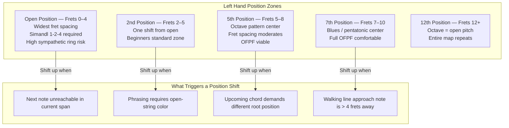
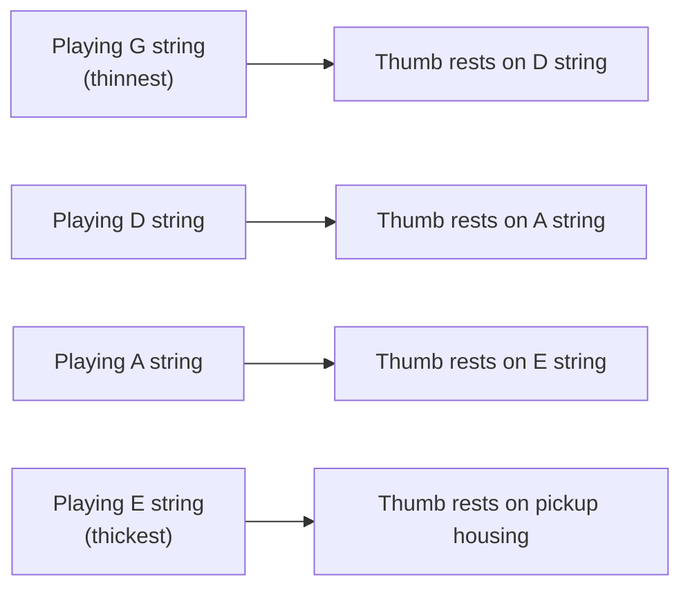
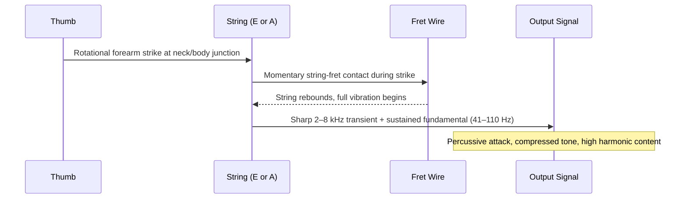
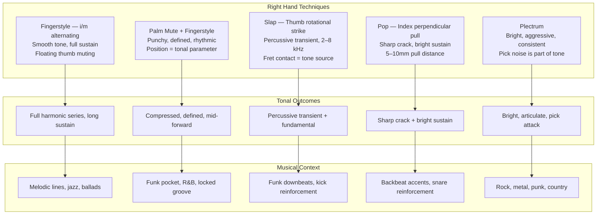
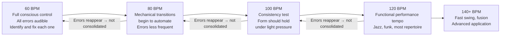

# Bass Guitar Masterclass — Lab 01: Technique and Fretboard Mechanics

## Why Mechanics Come First

The bass guitar sits at the intersection of rhythm and harmony. Your low E fundamental at 41 Hz locks with the kick drum; your root motion defines what every chord above you means to the listener. Unlike guitar or piano — where both hands share melody, harmony, and color — the bassist makes one binary decision on every note: *is this anchoring the pulse, or is it voice-leading toward the next chord?* Every physical choice you make feeds that decision.

This lab treats your hands as precision instruments with specific mechanical constraints. Thumb angle, palm contact distance from the bridge, the exact joint that strikes the string during slap — these are not stylistic preferences. They are physical parameters with measurable acoustic consequences. We will measure them.

---

## Gear Setup

### What You Need

| Item | Purpose | Recommended Options |
|---|---|---|
| Electric bass (4-string, 34" scale) | Primary instrument | Standard scale is the reference for all fret positions in this lab |
| Chromatic tuner | Pitch reference and intonation check | TC Electronic PolyTune 3, Peterson StroboStomp HD, or DAW plugin |
| Metronome | Subdivision reference | Physical click or DAW grid — both work |
| Audio interface | Capture dry signal | Focusrite Scarlett 2i2, UA Volt 1 |
| DAW | Waveform, spectrum, and transient analysis | Reaper (free/low cost), Logic Pro, Ableton Live |
| Spectrum analyzer | Real-time FFT display | SPAN by Voxengo (free), FabFilter Pro-Q 3 |

A short-scale (30") or medium-scale (32") bass is acoustically identical in pitch but has lower string tension. This *reduces* the fretting force needed in the first five frets, which changes the proprioceptive feedback you get from these exercises. Use a standard 34" if you have one.

### Standard Tuning (EADG)

Tune before every session. Verify with a strobe tuner if you have one — needle tuners carry ±3 cent accuracy variance, which is audible on sustained notes against a chord track.

| String | Note | Frequency | MIDI # |
|---|---|---|---|
| 4 (thickest) | E1 | 41.20 Hz | 28 |
| 3 | A1 | 55.00 Hz | 33 |
| 2 | D2 | 73.42 Hz | 38 |
| 1 (thinnest) | G2 | 98.00 Hz | 43 |

Each fret raises pitch by one equal-tempered semitone (frequency ratio ≈ 1.0595). Fret spacing decreases logarithmically toward the body — this is why open-position playing demands more left-hand reach than 7th-position playing, and why beginners experience more intonation problems below fret 5.

---

## The Fretboard: What You Are Actually Looking At

### Full 4-String Note Map (Frets 0–12)

Memorize this. Everything else in bass playing — scales, arpeggios, walking lines, position shifts — is a navigation problem on this grid.

```
Fret:  0    1    2    3    4    5    6    7    8    9    10   11   12
G:     G    Ab   A    Bb   B    C    Db   D    Eb   E    F    Gb   G
D:     D    Eb   E    F    Gb   G    Ab   A    Bb   B    C    Db   D
A:     A    Bb   B    C    Db   D    Eb   E    F    Gb   G    Ab   A
E:     E    F    Gb   G    Ab   A    Bb   B    C    Db   D    Eb   E
```

**Key insight — multiple positions for the same pitch.** The note A2 (110 Hz) lives at:
- E string, fret 5
- A string, fret 12
- D string, fret 7
- G string, fret 2

Choosing *which* position to play is a core left-hand decision. It is governed by phrase direction, tonal color (open strings ring brighter than fretted notes), and hand position economy — where will your hand need to be for the *next* note?

### The Moveable Root-Box Pattern

Before learning scales, internalize this five-note box. It gives you the root, octave, and primary chord tones for any key — moveable to any fret.

```
Root on E string (example: A at fret 5):

E: ——|——|——|——|——|
A: ——|——|——|——|——|
D: ——|——|——|——|——|
G: ——|——|——|——|——|
       R        Oct
  Root: A str fret 5 → E string fret 5 (same note, one octave lower... wait)
```

Let's be precise. Here is the root-box with finger assignments for root on the **A string**, key of **C** (A string fret 3):

```
String  Fret    Note    Finger    Function
E       ——      ——      ——        ——
A        3      C       1         Root
A        5      D       3         Major 2nd (passing)
A        6      Eb      4         Minor 3rd (Cm7 chord tone)
D        3      F       1         Perfect 4th / b7 of G7
D        5      G       3         Perfect 5th
G        3      Bb      1         Minor 7th (Cm7 chord tone)
G        5      C       3         Octave
```

**Finger assignments use Simandl 1-2-4** in frets 1–5 (index=1, middle=2, pinky=4 — ring finger rests against pinky for support). Use one-finger-per-fret (OFPF) from fret 7 upward where fret spacing has narrowed enough to make four-finger spans comfortable.

### Fretboard Position Architecture



---

## Exercise 1: Left-Hand Foundational Mechanics

### 1A — Clean Fretting: Where Your Finger Goes and Why

#### The Physics in One Paragraph

The string must be displaced far enough to contact the fret wire cleanly. The minimum force to achieve that contact depends on string gauge (heavier = more tension = more force needed), action height (the gap between string and fret), and your finger's position relative to the fret. Placing your fingertip on the **leading edge** of the fret — the body-side wall of the fret slot — maximizes mechanical advantage because you are leveraging the string directly over the contact point, not trying to bow it down from a distance.

The mental model: you are not pressing *down* on the string. You are pressing it *forward* into the fret.

#### Simandl 1-2-4 Fingering (Frets 1–5)

In open position, the stretch between frets 1 and 4 is roughly 65–75 mm on a 34" scale — too wide for comfortable one-finger-per-fret without risking extensor tendon strain. The Simandl system resolves this:

```
Finger 1 (index)  — covers one fret
Finger 2 (middle) — covers the adjacent fret
Finger 4 (pinky)  — covers TWO frets above finger 1
Ring finger (3)   — rests alongside pinky for lateral support, never frets alone
```

Practical example, E string, frets 1–4:

```
Fret 1 (F1)   → Finger 1
Fret 2 (F#1)  → Finger 2
Fret 3 (G1)   → Finger 4 (stretching back one fret)
Fret 4 (Ab1)  → Finger 4 (now on its natural fret)
```

Thumb position: centered on the back of the neck, roughly opposite finger 2 (middle finger). Keep your wrist straight — the neck elevation of your strap does most of the work. A sharply bent left wrist is the primary vector for carpal tunnel syndrome on bass.

#### Drill — Chromatic Crawl

This is your warm-up for every session and your diagnostic tool today.

**Setup:** Metronome at 60 BPM, quarter notes. Play each note for one beat.

```
Step 1: E string, frets 1-2-3-4, ascending (Simandl 1-2-4-4)
Step 2: A string, frets 1-2-3-4, ascending
Step 3: D string, frets 1-2-3-4, ascending
Step 4: G string, frets 1-2-3-4, ascending
Step 5: Reverse — G descending, D descending, A descending, E descending
```

This is one full pass. Do four passes without stopping.

**What to listen for:**
- Every note rings clean with no buzz — if you get buzz, your finger is too far from the fret wire
- Consistent volume across all four strings — uneven pressure is the most common issue
- No "dead" notes — if a note thuds instead of rings, an adjacent finger is accidentally touching that string

**Advance to frets 5-6-7-8 using OFPF once the 1-4 position is clean.** The reduced fret spacing will feel noticeably easier.

**Tempo targets:** 60 BPM → 80 BPM → 100 BPM. Only advance when you can complete four full passes without a single buzz or dead note.

---

### 1B — Right-Hand Fingerstyle: Alternating Index-Middle

#### The Mechanics

Right-hand fingerstyle uses the **pad of the index finger (i) and middle finger (m)** alternating on each stroke. The motion is a **pulling stroke toward the palm** — not a downward push. The fingertip catches the string, pulls slightly toward the palm, then the string releases and snaps back against the fretboard.

**Stroke mechanics:**
- After each stroke, the finger comes to **rest against the string below** (the string toward the floor). This is called the rest stroke (*apoyando*), and it provides a natural muting mechanism for the string you just played.
- Right-hand thumb anchors on the pickup housing (when playing E string) or floats to the string just below the one being played (floating thumb).

#### The Floating Thumb — Your Automatic Muting System

This is the single most important right-hand technique to develop from the start. The thumb does not stay fixed on the pickup. It follows your playing hand across the strings, always resting on the string one below the one you are playing:



This eliminates sympathetic ringing from lower (thicker) strings without any conscious effort. An unmuted open E string vibrating sympathetically under a D-string melody line adds 41 Hz mud to your low-frequency mix and clashes with the kick drum in a band context. The floating thumb makes this a non-issue.

#### Drill — Two-Finger Alternation, Single String

**60 BPM, quarter notes. E string, open.**

```
Beat:    1    2    3    4    1    2    3    4
Finger:  i    m    i    m    i    m    i    m
```

Then move to the OFPF chromatic crawl from 1A, but now use strict i-m alternation. The goal is that you never pluck the same finger twice in a row. This takes conscious effort at first. At 80 BPM it will begin to feel automatic.

**Common error:** Starting a phrase or returning from a rest with the same finger every time. Record yourself and check — if your hand naturally resets to index on every beat 1, you are not building true alternation independence.

---

### 1C — Right-Hand Muting: Palm Position Is a Tonal Parameter

#### Why Muting Is Not Binary

Most beginners treat palm muting as "muted vs. not muted." Professional players treat it as a continuous knob that shapes the harmonic content of every note. The position of your palm edge (the **hypothenar eminence** — the fleshy pad below your pinky) relative to the bridge saddle determines which harmonic partials are attenuated:

| Palm Distance from Bridge | Spectral Effect | Practical Sound |
|---|---|---|
| No contact | Full harmonic series, full sustain | Melodic solo lines |
| 2–5 mm from saddle | Slight top-end reduction, full fundamental intact | Standard fingerstyle punch |
| 5–15 mm from saddle | Reduced sustain, strong fundamental, upper harmonics cut | Funk/R&B pocket groove |
| 20–30 mm from saddle | Short sustain, thuddy fundamental, most harmonics gone | Motown upright-emulation |
| 50+ mm (mid-string) | Percussive thud, almost no pitch definition | Special effect |

This relationship is monotonically consistent: every step toward the neck removes progressively lower harmonics. You can hear it in real time with SPAN on your DAW.

#### Drill — Muting Spectrum Walk

Set SPAN in your DAW to display 20–5000 Hz. Play A string fret 5 (D2, 73 Hz) with a consistent picking force at each palm position listed above. Hold each position for 4 beats at 60 BPM. Watch the spectrum change in real time.

After you can hear the difference clearly, record each position separately and label the files `no_mute.wav`, `palm_5mm.wav`, `palm_15mm.wav`, `palm_25mm.wav`. You will use these in Exercise 2A.

---

### 1D — Walking Bass Lines: Voice Leading in Four Beats

#### What a Walking Line Actually Is

A walking bass line is a **voice-leading structure**, not a scale run. It has three jobs simultaneously:

1. **Confirm the chord root on beat 1** — this is non-negotiable in jazz and most funk contexts
2. **Arpeggiate chord tones on beats 2 and 3** — establishing the chord identity
3. **Approach the next chord's root by semitone on beat 4** — this chromatic leading tone creates forward harmonic momentum

The four-beat blueprint:

```
Beat 1: Root (R)
Beat 2: 3rd or 5th of the chord
Beat 3: Diatonic or chromatic passing note
Beat 4: Chromatic leading tone to next chord's root (semitone above or below)
```

Beat 4 is the most important voice-leading note in the bar. A leading tone a semitone *below* the target root (the classic approach) creates maximum pull. A semitone *above* creates a chromatic encirclement when combined with the diatonic approach on beat 3.

#### Chord Tone Reference: Two Essential Progressions

**Progression 1 — Cm7 | F7 | G7 | Cm7** (one bar each, 4/4)

| Chord | Root | Minor/Major 3rd | 5th | 7th |
|---|---|---|---|---|
| Cm7 | C | Eb (minor 3rd) | G | Bb |
| F7 | F | A (major 3rd) | C | Eb |
| G7 | G | B (major 3rd) | D | F |

Walking line — basic version:

```
Bar 1 (Cm7): C  - Eb - G  - Bb
Bar 2 (F7):  F  - A  - C  - Eb
Bar 3 (G7):  G  - B  - D  - F
Bar 4 (Cm7): C  - Eb - G  - Bb
```

Walking line — with chromatic leading tones on beat 4:

```
Bar 1 (Cm7): C  - Eb - G  - E    ← E is semitone below F, pulls into bar 2
Bar 2 (F7):  F  - A  - C  - F#   ← F# is semitone below G, tritone sub approach
Bar 3 (G7):  G  - B  - D  - B    ← B is semitone above C... or use Db→C approach
Bar 4 (Cm7): C  - Eb - G  - Bb
```

The F# on beat 4 of bar 2 deserves explanation: G7's root is G, and F# is one semitone below G. This is the strongest possible voice-leading approach (tritone substitution or simply a chromatic leading tone) and is the most common convention in jazz walking bass. You will hear this move constantly in Ray Brown, Paul Chambers, and Ron Carter.

**Progression 2 — Dm7 | G7 | A7 | Dm7** (ii–V–i in D minor)

| Chord | Root | 3rd | 5th | 7th |
|---|---|---|---|---|
| Dm7 | D | F (minor 3rd) | A | C |
| G7 | G | B (major 3rd) | D | F |
| A7 | A | C# (major 3rd) | E | G |

Walking line:

```
Bar 1 (Dm7): D  - F  - A  - C
Bar 2 (G7):  G  - B  - D  - Ab  ← Ab is semitone above A (encirclement from above)
Bar 3 (A7):  A  - C# - E  - G
Bar 4 (Dm7): D  - F  - A  - C
```

#### Fretboard Mapping — Progression 1, Bar 1 (Cm7)

Efficient fingering minimizes lateral hand travel between beats:

```
Beat 1 — C:  A string, fret 3   (finger 1)
Beat 2 — Eb: A string, fret 6   (finger 4, Simandl stretch from fret 3)
Beat 3 — G:  D string, fret 5   (finger 3, hand shifts up one position)
Beat 4 — Bb: A string, fret 1   (finger 1, hand shifts back to open position)
  → Bar 2 opens on F: A string, fret 8 OR E string, fret 1
```

The beat 4 → beat 1 transition (Bb → F) is the most common position-shift problem for beginners. Practice this specific two-beat connection in isolation before playing the full bar.

**Alternative fingering for smaller hands** — keep everything on the A and E strings:

```
Beat 1 — C:  A string, fret 3
Beat 2 — Eb: A string, fret 6
Beat 3 — G:  E string, fret 3   (string cross, same position)
Beat 4 — Bb: E string, fret 6   (or A string fret 1 for a half-step lower Bb)
```

#### Walking Bass Drill — Isolation Protocol

1. **60 BPM.** Play only bar 1 (Cm7) in a loop until all four notes are clean, in time, and smoothly connected. No hesitation between beats.
2. **Connect bar 1 → bar 2.** The transition point is beat 4 of Cm7 into beat 1 of F7. Loop this two-bar phrase eight times.
3. **Full four bars.** Record eight full passes.
4. **Advance: 80 BPM → 100 BPM → 120 BPM.** Target performance tempo for most jazz and funk walking contexts is 120 BPM. Only advance when the previous tempo is clean.
5. **Repeat the entire protocol with Progression 2.**

---

### 1E — Slap/Pop Mechanics: Physics and Execution

#### How Slap Tone Actually Happens

Slap bass sounds the way it does because of a fundamentally different string excitation mechanism. In fingerstyle, the string is displaced laterally (parallel to the fretboard face) and released — a smooth attack. In slap:

**Thumb strike:** The bony outer knuckle of the right thumb strikes the string at the neck/body junction (over the last fret or the pickup). The strike is forceful enough to briefly push the string *into contact with the fret wire*. That momentary string-fret contact produces the defining "clack" transient — a burst of energy in the 2–8 kHz range. This is not accidental fret buzz. It is the sound.

**Pop:** The index finger hooks under the G (or D) string and pulls it **perpendicular to the fretboard** — away from the body of the bass — approximately 5–10 mm. Release. The string snaps back, strikes the frets, and produces a sharp crack with a bright fundamental. Pulling more than 10 mm degrades pitch accuracy and increases fret wear. Pulling less than 5 mm produces no audible pop.



#### Thumb Strike — The Rotational Motion

The thumb does not press or stay. The motion is **forearm supination** (rotating the forearm so the palm faces upward) that carries the thumb into the string and immediately away. If the thumb rests on the string after the strike, it damps the vibration — you get a thud instead of a note.

**Contact point:** The outer edge of the distal joint — the bony knuckle. Not the pad, not the tip. The knuckle has the mass and hardness to produce the fret-contact transient.

Practice this motion on the open E string with no fretting. Twenty strikes. Listen for: sharp transient attack + 1–2 seconds of sustain. The sustain is what tells you the thumb rebounded. No sustain = thumb rested.

#### Foundational Slap/Pop Pattern — 16th-Note Grid

The classic Larry Graham groove structure. At 80 BPM:

```
16th note grid:  1  e  +  a  2  e  +  a  3  e  +  a  4  e  +  a
Technique:       T  .  .  .  .  .  P  .  T  .  .  .  .  .  P  .
String:          E  .  .  .  .  .  G  .  E  .  .  .  .  .  G  .
```

T = thumb slap on E string. P = index finger pop on G string.

The pops land on the "and" of 2 and "and" of 4 — the classic backbeat subdivision. This aligns slap with the kick drum and pop with the snare.

**Add a hammer-on for the classic octave slap fill:**

```
16th note grid:  1  e  +  a  2  e  +  a  3  e  +  a  4  e  +  a
Technique:       T  .  H  .  .  .  P  .  T  .  H  .  .  .  P  .
Fret:            0  .  7  .  .  .  G  .  0  .  7  .  .  .  G  .
(T = open E slap, H = hammer-on to E string fret 7 = B1, P = pop G string open)
```

This is the building block of Flea's and Marcus Miller's pocket grooves.

#### Slap/Pop Drill Protocol

1. **Thumb isolation:** 20 strikes, open E, no fretting. Focus only on rebound. Record and check in DAW — you want a sharp transient followed by clear sustain.
2. **Pop isolation:** 20 pops, open G string. Each pop should be consistent in amplitude (verify ±2 dB in DAW). Index finger only.
3. **Alternating at quarter notes:** Slap E on beat 1, pop G on beat 3. 60 BPM. No subdivision yet.
4. **Full 16th-note pattern:** 60 BPM → 80 BPM. Target 100 BPM for a usable funk groove tempo.

---

## Exercise 2: Empirical Parameter Analysis

### 2A — Muting Position Spectrum Mapping

This is a measurement exercise, not a playing exercise. Use the four recordings you made in Exercise 1C.

Load all four files into your DAW on separate tracks. Open SPAN on each track. Compare:

1. Where does the first significant harmonic disappear as you move from bridge toward neck?
2. What is the amplitude of the fundamental (around 73 Hz for D2) at each position? Does it change, or only the harmonics?
3. How long is the sustain at each position? Use the waveform display — measure from the attack peak to where the signal reaches -40 dBFS.

**What you should find:**
- The fundamental amplitude changes very little with palm position. Muting attenuates harmonics, not the fundamental.
- The first partial to disappear is the highest one. Each step toward the neck removes progressively lower harmonics.
- Sustain shortens monotonically as you move toward the neck.

This is the empirical basis for understanding why a Motown-style palm mute sounds dark and thumpy — the fundamental dominates, all color harmonics are gone — while a lightly muted fingerstyle line sounds full and present.

### 2B — Walking Line: Swing Feel vs. Straight Eighth

A quarter-note walking line in jazz does not sit precisely on the grid. The "swing feel" comes from a **15–20 ms delay on the attack of beats 2 and 4** relative to strict metronomic placement. This is not an error. It is intentional rhythmic placement.

Record two versions of Progression 1's walking line:
- **Version A:** Strict grid, every beat precisely on the click
- **Version B:** Intentionally relaxed placement — think of beats 2 and 4 as arriving just slightly late

Load both into your DAW. Zoom into the waveform grid display and look at where the attack transients fall relative to the bar lines. Version B's beat 2 and beat 4 peaks will sit slightly to the right of the grid lines. This visual confirmation is what "laying back" looks like in a DAW.

The swing feel is not random looseness. It is a *specific, consistent* delay. If beat 2 lags 15 ms, beat 4 should lag approximately the same amount. Practice until the delay is intentional and repeatable.

### 2C — Ghost Note Integration

A **ghost note** is a right-hand pluck executed while the left hand releases fretting pressure (but does not lift off the string), producing a muted percussive click with no defined pitch. It adds rhythmic density without harmonic interference.

Add ghost notes on the "and" of beat 2 in each bar of the Cm7 walking line:

```
Beat:    1    +    2    +    3    +    4    +
Notes:   C    .   Eb    x    G    .   Bb    .
(x = ghost note — left hand releases pressure, right hand plucks D or A string)
```

The ghost note is typically played on the string adjacent to the last fretted note. In bar 1, after playing Eb on A string, the ghost note can land on A or D string — whichever your right hand reaches most naturally in the flow.

In your DAW waveform, the ghost note will show as a small-amplitude transient between the larger note peaks. This is the visual signature of a groove that has rhythmic density.

### 2D — Slap Force Mapping

Play 10 open-E slaps at three distinct force levels. Record each set separately.

| Force Level | Expected Acoustic Result | DAW Measurement |
|---|---|---|
| Light (barely a tap) | Minimal fret contact, essentially a pizzicato note | Transient: soft, short; fundamental clear but weak |
| Medium (clean controlled strike) | Clean fret contact, full rebound | Sharp transient + strong sustained fundamental — this is the target |
| Heavy (aggressive strike) | Multi-fret contact, aggressive transient | Very sharp transient, compressed sustain, possible buzz on adjacent frets |

Load all three sets into SPAN with peak-hold enabled. Compare:
- **Peak transient amplitude (dBFS):** Increases with force, then saturates
- **Fundamental-to-harmonic balance:** Heavy strikes skew the spectrum toward upper harmonics (above 1 kHz)
- **Transient duration (ms):** Longer at heavy force = more fret-contact time

Medium force is correct. Heavy force is a technique error that masquerades as intensity.

---

## Exercise 3: Fault Injection — Deliberate Error Analysis

Fault injection means intentionally using incorrect technique to develop kinesthetic recognition (feeling the error before you hear it) and fast recovery pathways. Each test below specifies the fault, what it sounds like, how to recover, and what confirms the fix.

### 3A — Muting Faults

**Fault 1: Index finger bar-mute instead of palm mute**

Place your index finger flat across all strings near the bridge (a barre position) rather than using the palm edge. Play a walking line.

- *Acoustic signature:* Uneven muting — the index finger contacts each string at different pressure, producing inconsistent note lengths and spectral content across strings. More high-frequency content than palm muting because the contact area is narrow.
- *Recovery:* Transition to palm position *without stopping*. Keep the pulse going. Practice the recovery at tempo.
- *Confirmation:* Consistent note length and tonal character restored across all four strings on the spectrum display.

**Fault 2: Over-muting (eliminating the fundamental)**

Press the palm firmly into the strings instead of resting lightly.

- *Acoustic signature:* Notes become pitchless thuds. The fundamental (41–98 Hz depending on string) drops 10–20 dB or disappears entirely from the spectrum. Fret buzz may increase as strings are forced into frets.
- *Recovery:* Lighten palm contact until the note has a recognizable pitch. The fundamental should return to within 6 dB of the strongest harmonic.
- *Confirmation:* Fundamental peak visible in SPAN at approximately its expected frequency.

---

### 3B — Left-Hand Faults

**Fault 1: Wrong note substitution in walking line**

Play the Cm7 bar with non-chord tones replacing correct chord tones:

```
Incorrect: C - E  - Ab - B   (E natural, Ab, B natural — none are Cm7 chord tones)
Correct:   C - Eb - G  - Bb
```

- *Acoustic signature:* E natural creates a major 3rd against a minor chord — strong dissonance. Ab creates a diminished 5th against C. B creates a major 7th. The combined effect is that the bar sounds unstable and unresolved, pulling away from the harmony instead of confirming it.
- *Recovery:* Identify the first wrong note by ear and correct from that beat forward. Do not stop to restart.
- *Confirmation:* If you have a chord track in your DAW, the corrected line sits inside the voicing without clashing.

**Fault 2: Late beat 1 — eighth-note displacement**

Play the walking line with every note shifted one eighth note late (beat 1 note lands on the "and" of 1).

- *Acoustic signature:* The line feels dragged and "behind." With a metronome, the clicks fall during the sustain of each note rather than at the attack. The groove loses forward momentum entirely.
- *Recovery:* Lock onto beat 1 of the click and **anticipate** the note — place the attack fractionally *before* the click. "Front of the beat" placement is what gives a walking line its drive.
- *Confirmation:* In the DAW waveform, attack peaks align with or slightly precede the grid lines.

---

### 3C — Slap/Pop Faults

**Fault 1: Thumb resting on string after strike (no rebound)**

Strike the E string but allow the thumb to rest on the string after impact.

- *Acoustic signature:* The characteristic clack transient still occurs (the string-fret contact happens during the strike), but the thumb immediately damps the fundamental. Output is a click with no sustain — just a thud. This is the single most common slap error for beginners.
- *Recovery:* Practice the rotational forearm motion with no fretting, focusing only on the rebound. Twenty strikes, isolating the motion. The thumb must leave the string before the string's first full oscillation completes.
- *Confirmation:* Recording shows a sharp transient attack followed by a sustaining fundamental. Not just a click.

**Fault 2: Thumb pad instead of knuckle contact**

Strike with the fleshy pad of the thumb rather than the outer bony knuckle.

- *Acoustic signature:* The pad has much higher impedance — it absorbs more energy from the string rather than transferring it into the fret wire. Output is a soft, warm attack with far less high-frequency transient content. It sounds like a heavy fingerstyle pluck, not a slap.
- *Recovery:* Rotate the forearm slightly further so the knuckle edge leads the strike. Practice in front of a mirror to verify contact point.
- *Confirmation:* Sharp 2–8 kHz transient returns in the spectrum display.

**Fault 3: Pop on D string instead of G string**

Execute the pop on D string.

- *Acoustic signature:* The D string (73 Hz fundamental, .070" typical gauge) produces a much darker, lower-pitched pop. The heavier gauge requires more pull force for the same snap amplitude. In a groove context, this inverts the expected high-low relationship (low slap on E, high pop on G), collapsing the frequency contrast that defines funk slap tone.
- *Recovery:* Develop the proprioceptive habit of feeling for the gap between G and D strings as a tactile reference before each pop. The G string is thinner — you can feel it.
- *Confirmation:* Pop fundamental returns to approximately 98 Hz (G2) rather than 73 Hz (D2). Verify in SPAN.

---

## Fretboard Navigation Architecture



---

## Tempo Architecture: The Diagnostic Principle

60 BPM is not about playing slowly. It is about playing at the speed where **every error is conscious and audible** before it becomes automatic. The only way a technique can be consolidated at 120 BPM is if it was first clean at 60 BPM.



**The rule:** If technique degrades at a new tempo, the previous tempo is not yet consolidated. Return one step and add five minutes of deliberate repetition before attempting the increase. This is accurate self-assessment, not regression.

### Practice Session Structure

| Phase | Duration | Focus |
|---|---|---|
| Physical warm-up | 5–8 min | Slow chromatic crawl 1A, all strings, frets 1–12. No tempo pressure. |
| Technique isolation | 15–20 min | One technique only: muting, walking, or slap. Not all three. |
| Integration | 10–15 min | Apply isolated technique to a chord progression at functional tempo. |
| Recording review | 5–10 min | Listen back critically. Identify one specific error to target next session. |

Total: 35–55 minutes. Sessions beyond 90 minutes produce diminishing returns in motor consolidation and increase injury risk. Consistency across days beats length in a single day.

---

## Quick Reference Tables

### Fretboard Note Map — Critical Positions

| Fret | E String | A String | D String | G String |
|---|---|---|---|---|
| Open | E1 (41 Hz) | A1 (55 Hz) | D2 (73 Hz) | G2 (98 Hz) |
| 1 | F1 | Bb1 | Eb2 | Ab2 |
| 2 | F#1 | B1 | E2 | A2 |
| 3 | G1 | C2 | F2 | Bb2 |
| 5 | A1 | D2 | G2 | C3 |
| 7 | B1 | E2 | A2 | D3 |
| 9 | C#2 | F#2 | B2 | E3 |
| 12 | E2 (82 Hz) | A2 (110 Hz) | D3 (147 Hz) | G3 (196 Hz) |

Fret 12 = exactly one octave above open string. The entire fretboard map repeats from fret 12 onward.

### Technique Diagnostic Matrix

| Symptom | Probable Cause | Correction |
|---|---|---|
| Fret buzz on fretted notes | Finger too far from fret wire; insufficient pressure; action too low | Move fingertip to leading edge of fret (body side); apply forward pressure not downward |
| Sympathetic ring on adjacent strings | No floating thumb muting | Implement floating thumb: anchor on string directly below the one being played |
| Dead/muted notes when fretting | Finger pad touching adjacent string | Increase finger arch; approach string more perpendicularly |
| Slap tone has no sustain — just a thud | Thumb resting on string after strike | Practice rotational rebound motion; thumb must leave string immediately |
| Slap has no high-frequency crack | Striking with thumb pad, not knuckle | Rotate forearm so bony outer knuckle contacts the string |
| Pop inconsistent amplitude | Inconsistent pull distance; using middle finger | Fix pull to 5–8 mm perpendicular; index finger only |
| Walking line loses tempo on chord changes | Position shift too slow; finger travel too far | Map each chord change for minimum hand movement; drill the transition points in isolation |
| Tone muddy and undefined | Palm too far from bridge | Move palm contact point closer to the bridge saddle |
| Left wrist pain after playing | Wrist bent sharply downward in open position | Raise strap height so neck elevation straightens the left wrist |

### Interval Reference — Equal Temperament

| Semitones | Interval | Freq Ratio | From C |
|---|---|---|---|
| 0 | Unison | 1.000 | C |
| 1 | Minor 2nd | 1.0595 | Db |
| 2 | Major 2nd | 1.1225 | D |
| 3 | Minor 3rd | 1.1892 | Eb |
| 4 | Major 3rd | 1.2599 | E |
| 5 | Perfect 4th | 1.3348 | F |
| 6 | Tritone | 1.4142 | Gb |
| 7 | Perfect 5th | 1.4983 | G |
| 8 | Minor 6th | 1.5874 | Ab |
| 9 | Major 6th | 1.6818 | A |
| 10 | Minor 7th | 1.7818 | Bb |
| 11 | Major 7th | 1.8877 | B |
| 12 | Octave | 2.0000 | C (upper) |

---

## Acoustic Analysis: DAW Measurement Scripts

The following Python script automates tonal analysis of your recorded exercises. It computes the fundamental frequency via autocorrelation, plots overlaid FFT spectra for the muting position comparison, and measures transient attack duration — the three metrics you need for Exercises 2A and 2D.

```python
"""
Bass Guitar Exercise Acoustic Analyzer
Covers: Exercises 2A (muting spectrum), 2D (slap force mapping)

Dependencies:
    pip install numpy scipy matplotlib soundfile
"""

import numpy as np
import soundfile as sf
import matplotlib.pyplot as plt
from scipy.signal import find_peaks
from scipy.fft import rfft, rfftfreq
from pathlib import Path


# ---------------------------------------------------------------------------
# Audio I/O
# ---------------------------------------------------------------------------

def load_mono(filepath: str) -> tuple[np.ndarray, int]:
    """Load audio file, downmix to mono if stereo."""
    data, sr = sf.read(filepath, always_2d=True)
    return np.mean(data, axis=1), sr


# ---------------------------------------------------------------------------
# FFT Spectrum
# ---------------------------------------------------------------------------

def compute_spectrum(signal: np.ndarray, sr: int) -> tuple[np.ndarray, np.ndarray]:
    """
    Compute normalized magnitude spectrum in dB using real FFT.
    Returns (frequencies_hz, magnitude_db).
    """
    window = np.hanning(len(signal))
    windowed = signal * window
    magnitudes = np.abs(rfft(windowed))
    magnitudes = np.clip(magnitudes, 1e-10, None)
    db = 20.0 * np.log10(magnitudes / np.max(magnitudes))
    freqs = rfftfreq(len(signal), d=1.0 / sr)
    return freqs, db


# ---------------------------------------------------------------------------
# Fundamental detection
# ---------------------------------------------------------------------------

def find_fundamental(
    freqs: np.ndarray,
    db: np.ndarray,
    freq_min: float = 30.0,
    freq_max: float = 300.0,
) -> float:
    """
    Find the highest-amplitude spectral peak within the bass guitar fundamental
    range (30–300 Hz). Returns the peak frequency in Hz, or 0.0 if none found.
    """
    mask = (freqs >= freq_min) & (freqs <= freq_max)
    band_db = db[mask]
    band_freqs = freqs[mask]
    peaks, _ = find_peaks(band_db, height=-40.0, distance=5)
    if len(peaks) == 0:
        return 0.0
    dominant = peaks[np.argmax(band_db[peaks])]
    return float(band_freqs[dominant])


# ---------------------------------------------------------------------------
# Attack duration measurement
# ---------------------------------------------------------------------------

def measure_attack_ms(
    signal: np.ndarray,
    sr: int,
    threshold_db: float = -20.0,
    envelope_window_ms: float = 5.0,
) -> float:
    """
    Measure transient attack duration in milliseconds.

    Definition: time from the onset peak to the first point where the RMS
    envelope drops more than `threshold_db` below the peak.
    """
    window_samples = max(1, int((envelope_window_ms / 1000.0) * sr))
    num_frames = (len(signal) - window_samples) // window_samples

    envelope = np.array([
        np.sqrt(np.mean(signal[i * window_samples:(i + 1) * window_samples] ** 2))
        for i in range(num_frames)
    ])
    envelope_db = 20.0 * np.log10(np.clip(envelope, 1e-10, None))

    peak_idx = int(np.argmax(envelope_db))
    peak_level = envelope_db[peak_idx]
    post_peak = envelope_db[peak_idx:]
    drop = np.where(post_peak < (peak_level + threshold_db))[0]

    if len(drop) == 0:
        return float("inf")

    attack_samples = (peak_idx + drop[0]) * window_samples
    return (attack_samples / sr) * 1000.0


# ---------------------------------------------------------------------------
# Single-file analysis
# ---------------------------------------------------------------------------

def analyze_recording(filepath: str) -> dict:
    """
    Full pipeline: load → FFT → fundamental → attack duration.
    Returns a dict suitable for printing or logging.
    """
    signal, sr = load_mono(filepath)
    freqs, db = compute_spectrum(signal, sr)
    fundamental = find_fundamental(freqs, db)
    attack_ms = measure_attack_ms(signal, sr)
    peak_freq = float(freqs[np.argmax(db)])

    return {
        "file": Path(filepath).name,
        "fundamental_hz": round(fundamental, 1),
        "attack_ms": round(attack_ms, 1),
        "peak_freq_hz": round(peak_freq, 1),
    }


# ---------------------------------------------------------------------------
# Comparative spectrum plot (Exercise 2A — muting positions)
# ---------------------------------------------------------------------------

def plot_muting_comparison(
    recordings: list[tuple[str, str]],
    output_png: str = "muting_comparison.png",
    freq_range: tuple[float, float] = (20.0, 5000.0),
) -> None:
    """
    Overlay FFT spectra for multiple recordings on a log-frequency axis.

    Args:
        recordings: list of (filepath, label) tuples
        output_png: output image filename
        freq_range: (low_hz, high_hz) display range
    """
    fig, ax = plt.subplots(figsize=(12, 6))
    colors = plt.cm.viridis(np.linspace(0, 0.85, len(recordings)))

    for (filepath, label), color in zip(recordings, colors):
        signal, sr = load_mono(filepath)
        freqs, db = compute_spectrum(signal, sr)
        mask = (freqs >= freq_range[0]) & (freqs <= freq_range[1])
        ax.plot(freqs[mask], db[mask], label=label, linewidth=1.8, color=color)

        # Mark fundamental with a vertical dotted line
        f0 = find_fundamental(freqs, db)
        if f0 > 0:
            ax.axvline(f0, color=color, linestyle=":", linewidth=0.9, alpha=0.6)

    ax.set_xlabel("Frequency (Hz)", fontsize=12)
    ax.set_ylabel("Magnitude (dB, normalized to 0)", fontsize=12)
    ax.set_title("Palm Muting Position — Spectral Comparison (Exercise 2A)", fontsize=14)
    ax.set_xscale("log")
    ax.set_xlim(*freq_range)
    ax.set_ylim(-80, 2)
    ax.grid(True, which="both", alpha=0.25)
    ax.legend(fontsize=10)
    plt.tight_layout()
    plt.savefig(output_png, dpi=150)
    print(f"Saved: {output_png}")
    plt.show()


# ---------------------------------------------------------------------------
# Slap force comparison (Exercise 2D)
# ---------------------------------------------------------------------------

def compare_slap_forces(
    recordings: list[tuple[str, str]],
) -> None:
    """
    Print a formatted table comparing attack transient amplitude, duration,
    and fundamental-to-harmonic ratio across slap force levels.
    """
    print(f"\n{'Label':<25} {'Fundamental (Hz)':<18} {'Attack (ms)':<14} {'Peak Freq (Hz)'}")
    print("-" * 70)
    for filepath, label in recordings:
        try:
            r = analyze_recording(filepath)
            print(
                f"{label:<25} {r['fundamental_hz']:<18} {r['attack_ms']:<14} {r['peak_freq_hz']}"
            )
        except (FileNotFoundError, Exception) as exc:
            print(f"{label:<25} [Error: {exc}]")


# ---------------------------------------------------------------------------
# Entry point — replace filenames with your Exercise 2A and 2D recordings
# ---------------------------------------------------------------------------

if __name__ == "__main__":
    # ----- Exercise 2A: Muting position comparison -----
    muting_recordings = [
        ("no_mute.wav",     "No Mute — full sustain"),
        ("palm_5mm.wav",    "Palm 2–5 mm from bridge"),
        ("palm_15mm.wav",   "Palm 5–15 mm from bridge"),
        ("palm_25mm.wav",   "Palm 20–30 mm from bridge"),
    ]

    print("=== Exercise 2A: Muting Position Analysis ===")
    for filepath, label in muting_recordings:
        try:
            r = analyze_recording(filepath)
            print(f"\n  {label}")
            print(f"    Fundamental : {r['fundamental_hz']} Hz")
            print(f"    Attack time : {r['attack_ms']} ms")
            print(f"    Peak freq   : {r['peak_freq_hz']} Hz")
        except FileNotFoundError:
            print(f"\n  {label} — [file not found: record {filepath} first]")

    # Uncomment to generate the comparative spectrum plot:
    # plot_muting_comparison(muting_recordings)

    # ----- Exercise 2D: Slap force comparison -----
    slap_recordings = [
        ("slap_light.wav",  "Light force"),
        ("slap_medium.wav", "Medium force (target)"),
        ("slap_heavy.wav",  "Heavy force"),
    ]

    print("\n\n=== Exercise 2D: Slap Force Analysis ===")
    compare_slap_forces(slap_recordings)
```

---

## Injury Prevention

Bass playing involves sustained repetitive motion under moderate muscular load. These risks are real and documented in occupational medicine literature.

**Carpal tunnel syndrome** — median nerve compression from sustained left-wrist flexion. The open-position frets are the highest risk zone because reaching low frets on a horizontally-held bass forces the wrist into flexion. Mitigation: raise your strap so the neck is elevated toward your shoulder, keeping the left wrist as straight as possible.

**Ulnar nerve compression** — from resting the right elbow sharply on the instrument body edge. Keep the right forearm resting on the instrument's curved upper bout, not the sharp binding edge.

**Extensor tendinitis** in the right hand — from excessive slap force and high-repetition pop practice. The 15–20 minute technique isolation limit per session is a clinical recommendation. Slap technique is high-impact on the index finger's flexor mechanism.

**The non-negotiable rule:** If pain, numbness, or tingling occurs in any finger during or after practice — stop immediately. Nerve and tendon damage from overuse is cumulative and potentially permanent. No tempo target or practice goal justifies playing through pain.

---

## Lab Summary

The fretboard is a logarithmically scaled frequency-to-position map. Understanding its geometry reduces left-hand position shift inefficiency because you can predict fret distances and plan hand movements before you need them.

Right-hand palm muting is a continuous spectral parameter, not a switch. Its distance from the bridge saddle determines which harmonic partials survive — this is a tone-shaping tool used in every genre.

Walking bass lines are voice-leading structures built on chord tones and chromatic approach notes. The beat-4 leading tone is the engine of harmonic momentum — neglect it and the line loses forward drive.

Slap technique derives its tone from momentary string-fret contact during a rotational thumb strike. Force and pad contact produce a thud. Rotational rebound with the knuckle produces the tone.

Every technique covered in this lab has a measurable acoustic signature verifiable with the DAW tools and Python script provided. Use them. Objective measurement is faster feedback than ear alone.

The practice architecture — 60 BPM for diagnosis, incremental tempo increases, one technique at a time, recording for review — is the template for all subsequent labs in this curriculum.
