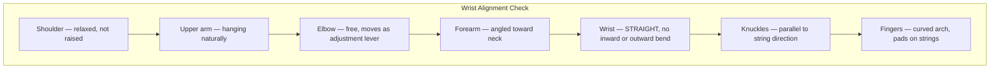
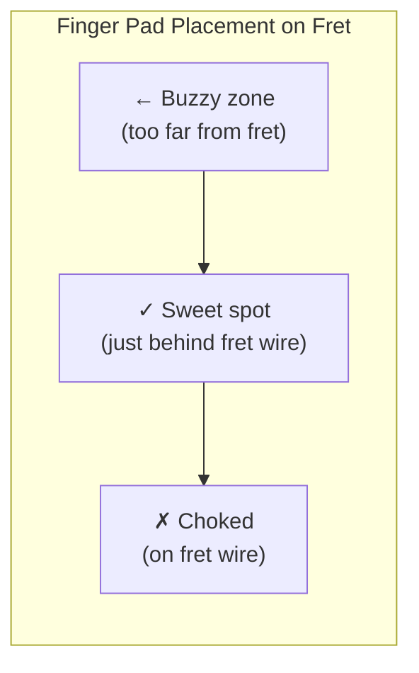
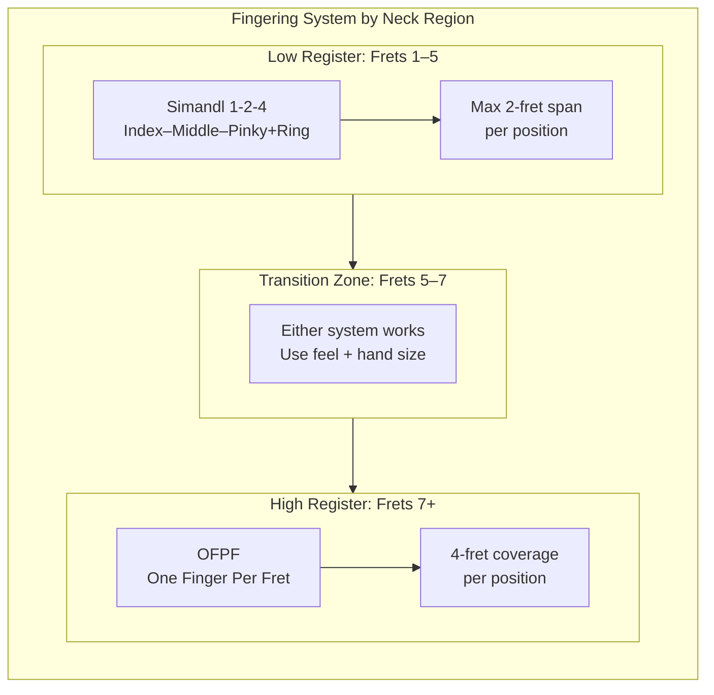
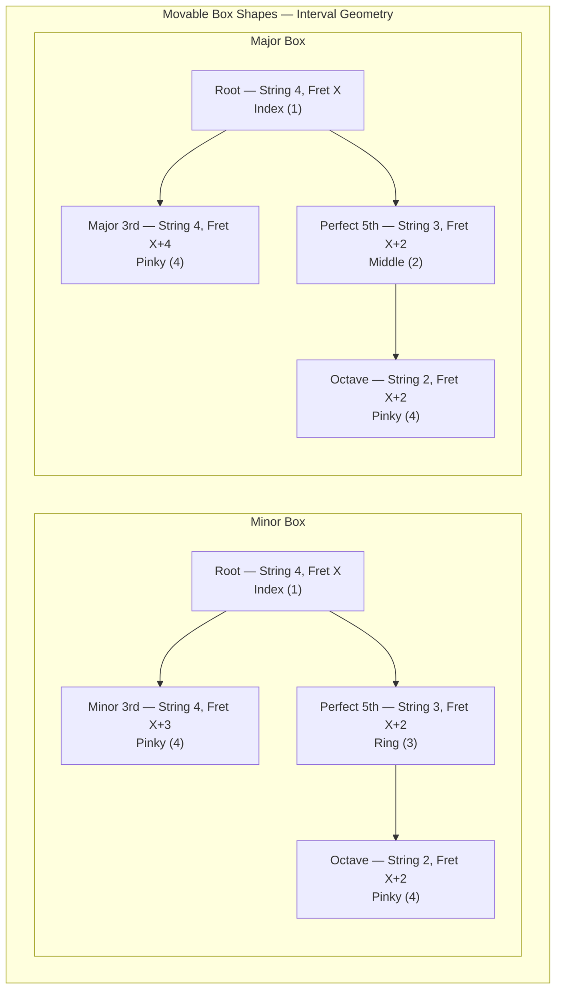
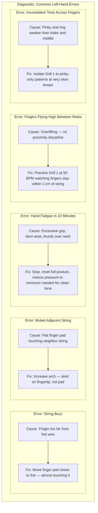

# Lesson 1: Bass Guitar Fretboard Layout and Left-Hand Mechanics

**Discipline:** Music Performance | **Domain:** Arts
**Level:** Foundation | **Series:** Bass Guitar Masterclass

---

## Learning Objectives

By the end of this lesson you will be able to:

- Navigate the full bass fretboard and locate any note by name
- Execute the Franz Simandl 1-2-4 fingering system in the low register without strain
- Apply One-Finger-Per-Fret (OFPF) technique cleanly above the 7th fret
- Play movable Root–3rd–5th–Octave box shapes in any key
- Complete all finger-independence and shifting drills at 60, 80, and 100 BPM

---

## 1. Acoustic Grounding (The 15%)

The bass guitar's longer scale length — typically 34 inches on a standard instrument — means its open strings vibrate at lower frequencies than a guitar because longer, heavier strings require more energy to reach pitch and produce longer wavelengths. String tension, mass per unit length, and vibrating string length together determine fundamental frequency: when you press a fret you shorten the vibrating portion of the string, raising its frequency in a precisely equal-tempered relationship so that each fret represents exactly one semitone, or one-twelfth of an octave. This physical reality is why left-hand position and finger placement directly behind the fret wire matters so much — you are dividing a tensioned string with mechanical precision, and even a few millimeters of slop introduces buzz, flatness, or muted tone. Everything that follows in this lesson is built on that single physical fact.

---

## 2. The Fretboard as a Map

Before your fingers move, your eyes need to read the neck. The bass fretboard is a grid. Strings run horizontally, frets run vertically, and every intersection is a unique pitch.

### 2.1 Standard Tuning Open Strings

```
String 4 (thickest, lowest): E2
String 3:                     A2
String 2:                     D3
String 1 (thinnest):          G3
```

Each string is tuned a perfect fourth above the one below it. That interval relationship is the structural backbone of everything you will learn on this instrument.

### 2.2 The Chromatic Note Grid (Frets 0–12)

The table below maps every note on a standard 4-string bass from open strings through the 12th fret. The 12th fret is the octave of the open string — the pattern repeats from fret 12 onward.

| Fret | String 4 (E) | String 3 (A) | String 2 (D) | String 1 (G) |
|------|-------------|-------------|-------------|-------------|
| 0 (open) | E | A | D | G |
| 1 | F | A# / Bb | D# / Eb | G# / Ab |
| 2 | F# / Gb | B | E | A |
| 3 | G | C | F | A# / Bb |
| 4 | G# / Ab | C# / Db | F# / Gb | B |
| 5 | A | D | G | C |
| 6 | A# / Bb | D# / Eb | G# / Ab | C# / Db |
| 7 | B | E | A | D |
| 8 | C | F | A# / Bb | D# / Eb |
| 9 | C# / Db | F# / Gb | B | E |
| 10 | D | G | C | F |
| 11 | D# / Eb | G# / Ab | C# / Db | F# / Gb |
| 12 | E (octave) | A (octave) | D (octave) | G (octave) |

**Key observation:** The note at fret 5 on any string is the same pitch as the open string above it. E string fret 5 = A (open string 3). This is your primary tuning reference and your first fretboard navigation shortcut.

### 2.3 Fretboard Navigation Diagram

```mermaid
graph LR
    subgraph sub_strings ["4-String Fretboard — Chromatic Layout"]
        subgraph sub_e ["String 4: E"]
            E0["E (0)"] --> E1["F (1)"] --> E2["F# (2)"] --> E3["G (3)"] --> E4["Ab (4)"] --> E5["A (5)"] --> E7["B (7)"] --> E12["E (12)"]
        end
        subgraph sub_a ["String 3: A"]
            A0["A (0)"] --> A1["Bb (1)"] --> A2["B (2)"] --> A3["C (3)"] --> A5["D (5)"] --> A7["E (7)"] --> A12["A (12)"]
        end
        subgraph sub_d ["String 2: D"]
            D0["D (0)"] --> D2["E (2)"] --> D3["F (3)"] --> D5["G (5)"] --> D7["A (7)"] --> D12["D (12)"]
        end
        subgraph sub_g ["String 1: G"]
            G0["G (0)"] --> G2["A (2)"] --> G4["B (4)"] --> G5["C (5)"] --> G7["D (7)"] --> G12["G (12)"]
        end
    end
```



---

## 3. Left-Hand Mechanics: The Foundation of Everything

Poor left-hand mechanics are the number one cause of repetitive strain injury in bassists. The habits you build in the first thirty days are the habits you will carry for life. Get this right before you go fast.

### 3.1 Total Body Setup

Before the left hand does anything, the instrument must be positioned correctly.

**Seated position:**
- Rest the lower bout of the bass on your right thigh (for right-handed players)
- The neck angles upward at roughly 45 degrees — never horizontal, never pointing at the floor
- The body of the bass rests lightly against your torso; do not grip it with your forearm
- Your left elbow hangs freely from your shoulder, pointing down toward the floor

**Standing position:**
- Strap length should allow the same neck angle as seated — many players err by wearing the bass too low, which forces wrist deviation and causes injury over time
- A practical test: if you can maintain the same hand position sitting and standing, your strap is at the correct length

### 3.2 The Fretting Wrist

This is the single most important mechanical concept in this lesson.

**The wrist must stay straight — meaning the back of your hand, the wrist joint, and the forearm form one continuous line, with no bend up, down, or sideways.**

When the wrist bends inward (toward the neck), the median nerve and tendons running through the carpal tunnel are compressed under load. Do this for a few months and you have chronic tendinitis or carpal tunnel syndrome. Neither is compatible with a playing career.

Achieving a straight wrist on bass requires that your elbow swing outward and slightly forward. The elbow acts as the adjustment lever. When you need your fingers to reach a low string, the elbow drops. When you need to reach a high string, the elbow swings out. The wrist itself does not bend — the elbow compensates.



**Common wrist error — the death grip:** Many beginners wrap the thumb over the top of the neck and squeeze. This locks the wrist into a bent position and kills finger independence. If you catch yourself doing this, stop completely, reset, and continue at a slower tempo.

### 3.3 Thumb Placement

The fretting thumb belongs on the back of the neck, not over the top.

**Correct thumb position:**
- Resting lightly on the back of the neck, behind the middle finger (second finger)
- Making gentle contact — the thumb is a guide, not a clamp
- Pointing roughly upward or at a slight diagonal toward the headstock
- Never gripping or squeezing; the thumb opposes the fingers with just enough counter-pressure to allow the fingertips to fret cleanly

The thumb moves along the back of the neck as you shift positions. It does not stay locked in one spot while your fingers stretch away from it. When the fingers move, the thumb travels with them.

### 3.4 Finger Arch and Pad Placement

Each fretting finger must maintain a curved arch — think of the shape your hand makes when you rest it on a ball. The tips of the fingers come down onto the string, not the flat flesh of the finger pad.

**Precision pad placement:**
- Land directly behind the fret wire — as close to the fret as possible without being on top of it
- This minimizes the string length you need to depress to make clean contact with the fret
- The result is clean tone with minimal pressure required

**What happens when placement is wrong:**
- Too far back from the fret → buzzing, requires excessive pressure, fatigues the hand
- On top of the fret wire → choked, dead tone
- Flat finger pad instead of tip → mutes adjacent strings, reduces independence



---

## 4. The Two Fingering Systems: When to Use Each

Bass guitar's wide fret spacing — especially in the first five frets — means that applying classical guitar OFPF (one finger per fret) in the low register puts the hand in a biomechanically dangerous lateral stretch. Two distinct systems solve this problem.

### 4.1 Franz Simandl 1-2-4: Frets 1 Through 5

The Simandl system, adapted from double bass technique, assigns fingers as follows in the low register:

| Finger | Simandl Assignment | Notes |
|--------|--------------------|-------|
| Index (1) | 1st position | Anchors the position |
| Middle (2) | 2nd position | Adjacent to index |
| Ring (3) | — | Reinforces pinky (not independent) |
| Pinky (4) | 3rd position | Ring finger stacks behind pinky for support |

In this system the ring finger is not used independently. Instead it supports the pinky from behind, sharing the load. This is the key injury-prevention mechanism. The pinky on bass guitar bears significant mechanical disadvantage — it is the weakest finger and has the most independent tendon structure. Forcing it to operate alone across a wide fret span in the low register is a recipe for strain. The ring+pinky combined unit solves this.

**Simandl hand shape in first position (frets 1–3):**
```
Fret 1 → Index finger (1)
Fret 2 → Middle finger (2)
Fret 3 → Pinky (4), with ring finger supporting from behind
```

**Simandl extended position (frets 1–5, using a half-shift):**
```
Fret 1 → Index
Fret 2 → Middle
Fret 3 → Pinky (first position)
  — shift thumb slightly, elbow adjusts —
Fret 5 → Index (shifted, now in 3rd position effectively)
```

The Simandl system means you are always covering a maximum span of two frets comfortably, with one half-position shift available when needed. You never stretch three wide frets with an isolated pinky.

### 4.2 One-Finger-Per-Fret (OFPF): Fret 7 and Above

As you move up the neck, fret spacing narrows significantly. By the 7th fret, the spacing is comfortable enough for each finger to cover one fret independently:

| Finger | Fret covered |
|--------|-------------|
| Index (1) | Base fret of position |
| Middle (2) | Base fret + 1 |
| Ring (3) | Base fret + 2 |
| Pinky (4) | Base fret + 3 |

OFPF gives you four frets of chromatic coverage per position without shifting. The transition zone between Simandl and OFPF is roughly frets 5–7, where either system is viable and personal physiology determines which feels more natural.

### 4.3 System Transition Diagram



---

## 5. Movable Box Shapes: Your Harmonic Navigation System

A box shape is a fingering template that expresses a musical interval relationship — it is defined by its geometry on the fretboard, not by the note it starts on. Because the tuning interval between strings is consistent (perfect fourths throughout), any box shape can be moved to any string and any fret without changing its fingering. Move the root, and the entire shape transposes with it.

### 5.1 The Core Intervals on the Fretboard

Understanding where intervals live relative to any root note is the foundation of fretboard navigation.

**Same string:**
- 1 fret up = minor 2nd (half step)
- 2 frets up = major 2nd (whole step)
- 3 frets up = minor 3rd
- 4 frets up = major 3rd
- 5 frets up = perfect 4th
- 7 frets up = perfect 5th

**Across strings (adjacent string, same fret):**
- One string up, same fret = perfect 4th above

**Across strings (adjacent string, back two frets):**
- One string up, 2 frets back = major 3rd above
- One string up, 3 frets back = minor 3rd above

**Octave shape:**
- Two strings up, 2 frets forward = octave above (the most used shape in bass)

### 5.2 The Root–5th–Octave Power Shape

This three-note shape is the backbone of rock, R&B, and pop bass lines. Learn it first.

```
String layout (reading low to high):
Root (R) on any string, any fret
Perfect 5th (P5): 1 string up, same fret → then 2 frets forward (or: 1 string up, fret+2)

Wait — let's be precise:

If Root is on String 4, fret X:
  P5  = String 3, fret X+2
  Oct = String 2, fret X+2
```

**Example — G root, 3rd fret, String 4:**
```
String 4, Fret 3  → G  (Root)
String 3, Fret 5  → D  (Perfect 5th)
String 2, Fret 5  → G  (Octave)
```

**Fingering:** Index on root, ring or pinky on the 5th and octave (they share a fret or sit adjacent).

### 5.3 The Minor Box Shape (Root–m3–P5–Octave)

```
Root  → String 4, Fret X     — Index finger
m3    → String 4, Fret X+3   — Pinky (Simandl) or Ring (OFPF)
P5    → String 3, Fret X+2   — Ring or Pinky
Oct   → String 2, Fret X+2   — Ring or Pinky
```

**Example — A minor box, root at String 4, Fret 5:**
```
String 4, Fret 5  → A   (Root)         — Index
String 4, Fret 8  → C   (minor 3rd)    — Ring
String 3, Fret 7  → E   (Perfect 5th)  — Middle or Ring
String 2, Fret 7  → A   (Octave)       — Pinky
```

### 5.4 The Major Box Shape (Root–M3–P5–Octave)

```
Root  → String 4, Fret X     — Index finger
M3    → String 4, Fret X+4   — Pinky
P5    → String 3, Fret X+2   — Middle
Oct   → String 2, Fret X+2   — Ring or Pinky
```

**Example — A major box, root at String 4, Fret 5:**
```
String 4, Fret 5  → A   (Root)         — Index
String 4, Fret 9  → C#  (Major 3rd)    — Pinky
String 3, Fret 7  → E   (Perfect 5th)  — Middle
String 2, Fret 7  → A   (Octave)       — Pinky
```

### 5.5 Box Shape Diagram



### 5.6 Transposing the Box: The Core Principle

The box shape is a movable template. The only thing that changes when you transpose is where you place the root. The finger geometry stays identical.

| Root Note | Root Fret (String 4) | Minor Box m3 Fret | P5 Fret (String 3) | Octave Fret (String 2) |
|-----------|---------------------|-------------------|---------------------|------------------------|
| E | 0 (open) | 3 | 2 | 2 |
| F | 1 | 4 | 3 | 3 |
| G | 3 | 6 | 5 | 5 |
| A | 5 | 8 | 7 | 7 |
| B | 7 | 10 | 9 | 9 |
| C | 8 | 11 | 10 | 10 |
| D | 10 | 13 | 12 | 12 |

The pattern is absolute: once your fingers know the minor box shape, moving it to a new root takes zero extra learning — only positional awareness.

---

## 6. Practical Drills and Metronome Progressions

Every drill below follows the same progression framework:

```
Start: 60 BPM — focus on mechanics, not speed
Target: 80 BPM — smooth and even
Advance: 100 BPM — controlled and clean
Rule: Never advance BPM until the lower tempo is completely clean for 2 full minutes
```

Use a physical metronome or a metronome app. Turn it on before you pick up the bass. Every note lands on the beat or in a precise subdivided position. If you are playing without a metronome, you are not practicing — you are noodling.

---

### Drill 1: The Spider — Chromatic Finger Independence (Simandl Zone)

**Purpose:** Build independent finger movement, equal tone across all fingers, and clean fret muting in the Simandl region (frets 1–4).

**Setup:** Fingers 1, 2, and 4 (index, middle, pinky+ring) assigned to frets 1, 2, and 3 respectively on String 4. Each note is played with a strict downstroke of the right-hand index or middle finger (alternate fingers on every note).

**Pattern (ascending, one string):**
```
Fret 1 (Index) — Fret 2 (Middle) — Fret 3 (Pinky) — back to Fret 2 — Fret 1
```

**Full spider pattern across all four strings:**
```
String 4: Fret 1–2–3–2–1
String 3: Fret 1–2–3–2–1
String 2: Fret 1–2–3–2–1
String 1: Fret 1–2–3–2–1
Then reverse: String 1 back down to String 4
```

**Mechanics checklist during this drill:**
- [ ] Wrist remains straight throughout — no bending when crossing strings
- [ ] Each lifted finger lifts only about 1 cm above the string — no dramatic lifting
- [ ] Fingers not currently playing remain close to the string (hovering, not flying away)
- [ ] Thumb stays behind the neck, moving gently with the hand, not gripping
- [ ] Each note rings cleanly with no buzz

**BPM progression:**
- 60 BPM: Quarter notes — one note per click
- 80 BPM: Quarter notes
- 100 BPM: Quarter notes — then restart at 60 with eighth notes (two notes per click)

---

### Drill 2: Position Crawl — Simandl Shifting Along One String

**Purpose:** Train the thumb-and-hand unit to shift smoothly between first, second, and third positions on a single string without breaking tone or wrist alignment.

**Concept:** In Simandl technique, shifting means the entire hand travels as a unit. The thumb leads slightly, arriving at the new position just before the fingers land. This keeps the wrist relationship constant through the shift.

**Pattern on String 4 (E string), ascending by half-steps in Simandl positions:**
```
Position 1: Index=Fret1, Middle=Fret2, Pinky=Fret3
  Play: 1–2–3

Shift — thumb slides up, hand follows
Position 2: Index=Fret2, Middle=Fret3, Pinky=Fret4
  Play: 2–3–4

Shift
Position 3: Index=Fret3, Middle=Fret4, Pinky=Fret5
  Play: 3–4–5

Shift
Continue through fret 7, then descend back to fret 1
```

**What to feel during a good shift:**
- The thumb slides — it does not stay put and let the fingers stretch away from it
- There is a brief micro-silence between positions (it is better to be clean than to rush the shift)
- The wrist angle does not change during the shift — only the whole arm translates along the neck

**BPM progression:**
- 60 BPM: Each three-note group fills one full measure (triplet feel, one note per beat)
- 80 BPM: Same
- 100 BPM: Same — focus on the silence between groups being metrically precise

---

### Drill 3: OFPF Four-Fret Chromatic Ladder (High Register)

**Purpose:** Build finger independence with all four fingers in the OFPF region (fret 7 and above), where the spacing allows it.

**Setup:** Starting at fret 7, String 4. Each finger covers one fret: Index=7, Middle=8, Ring=9, Pinky=10.

**Ascending ladder pattern:**
```
String 4: 7–8–9–10
String 3: 7–8–9–10
String 2: 7–8–9–10
String 1: 7–8–9–10
```

**Descending:**
```
String 1: 10–9–8–7
String 2: 10–9–8–7
String 3: 10–9–8–7
String 4: 10–9–8–7
```

**Key mechanical note:** When crossing from one string to the next, the fretting finger does not pluck or flick — it lifts cleanly while the right hand plucks. The left hand is not responsible for the attack, only for fretting. Keep these roles separate in your mind.

**BPM progression:**
- 60 BPM: Eighth notes (two notes per click, so one four-note group per two beats)
- 80 BPM: Eighth notes
- 100 BPM: Eighth notes — then restart at 60 with sixteenth notes

---

### Drill 4: Box Shape Transposition Drill

**Purpose:** Internalize the minor and major box shapes as physical muscle memory across all keys by moving the root around the neck.

**Minor box — cycle through six keys:**

Play the full Root–m3–P5–Octave shape, then slide to the next root. Keep it slow. Hear the shape. Feel the fingering geometry.

```
Key of A: Root at String 4, Fret 5
Key of B: Root at String 4, Fret 7
Key of C: Root at String 4, Fret 8
Key of D: Root at String 4, Fret 10
Key of E: Root at String 4, Fret 12
Key of G: Root at String 4, Fret 3
```

**For each key, play:**
1. Root (hold 1 beat)
2. Minor 3rd (hold 1 beat)
3. Perfect 5th (hold 1 beat)
4. Octave (hold 1 beat)
5. Back to Root (hold 1 beat)

**Then repeat the same sequence with the major box shape in the same keys.**

**BPM progression:**
- 60 BPM: Quarter notes — one note per click, full attention on clean fretting
- 80 BPM: Quarter notes
- 100 BPM: Quarter notes — at this tempo begin connecting the shapes: play the full box pattern as a continuous ascending–descending line

---

### Drill 5: System Transition Drill — Simandl to OFPF and Back

**Purpose:** This is the drill that ties both systems together and trains the hand to switch fingering approaches seamlessly as it crosses into different neck regions.

**Pattern on String 4:**
```
Simandl zone — ascending:
Fret 1 (Index), Fret 2 (Middle), Fret 3 (Pinky) — Simandl

Half-shift:
Fret 3 (Index), Fret 4 (Middle), Fret 5 (Pinky) — still Simandl

Transition — arriving in OFPF zone:
Fret 7 (Index), Fret 8 (Middle), Fret 9 (Ring), Fret 10 (Pinky) — OFPF

Descend back:
Fret 10 (Pinky), Fret 9 (Ring), Fret 8 (Middle), Fret 7 (Index) — OFPF
Fret 5 (Pinky/Simandl), Fret 4 (Middle), Fret 3 (Index) — Simandl
Fret 2 (Middle), Fret 1 (Index) — return home
```

The transition between frets 5 and 7 is where many players feel the hand reorganize. That is correct — there is a brief internal re-mapping as the ring finger activates or deactivates. Practice this transition deliberately until it becomes automatic.

**BPM progression:**
- 60 BPM: Quarter notes — feel every shift, name every note in your head as you play it
- 80 BPM: Quarter notes
- 100 BPM: Quarter notes — work toward naming notes without hesitation

---

### Practice Session Structure

A complete daily practice session for this material:

```
Total time: 30 minutes

00:00–03:00  Warm-up — Drill 1 (Spider) at 60 BPM, one string only, no pressure
03:00–08:00  Drill 1 (Spider) — full four strings, 60→80 BPM
08:00–13:00  Drill 2 (Position Crawl) — String 4 only, 60→80 BPM
13:00–18:00  Drill 3 (OFPF Ladder) — 60→80 BPM
18:00–24:00  Drill 4 (Box Shapes) — three keys minor, three keys major, 60 BPM
24:00–29:00  Drill 5 (System Transition) — 60→80 BPM
29:00–30:00  Cool-down — play Drill 1 at 60 BPM with eyes closed, focus on feel
```

When all five drills are clean at 80 BPM for two consecutive sessions, advance the entire schedule by 10 BPM. The 100 BPM target is a milestone, not a finish line.

---

## 7. Common Errors and How to Fix Them



---

## 8. Injury Prevention Protocol

Playing through pain is never acceptable. The following protocol is non-negotiable.

**Before every session:**
- Warm up hands and forearms away from the instrument: rotate wrists slowly ten times in each direction, spread and close fingers ten times, gently pull each finger back (extensor stretch) holding three seconds
- Never pick up the bass cold and immediately play fast or with tension

**During every session:**
- If you feel tingling, numbness, or sharp pain in the fingers, wrist, or forearm — stop immediately
- Take a five-minute break every twenty minutes of active practice
- Reduce pressure: use only the minimum pressure necessary to produce a clean tone

**After every session:**
- Stretch the flexors: extend arm forward, palm up, and gently pull the fingers back with the other hand — hold fifteen seconds each hand
- Stretch the extensors: extend arm forward, palm down, and gently press the back of the hand downward — hold fifteen seconds each hand

**Warning signs that require rest:**
- Aching that persists more than one hour after stopping
- Swelling in the finger joints
- Weakness in grip unrelated to fatigue
- Any pain that gets worse during playing, not better

If these symptoms appear and do not resolve with two or three days of rest, consult a sports medicine physician or physical therapist familiar with musician injuries before returning to the instrument.

---

## 9. Lesson Summary and Progress Benchmarks

By the end of your work with this lesson material you should be able to do all of the following:

**Fretboard knowledge:**
- [ ] Name any note on any string from fret 0 through fret 12 within five seconds
- [ ] Locate the same pitch in two different positions on the neck

**Mechanics:**
- [ ] Demonstrate a straight fretting wrist in both seated and standing positions
- [ ] Show correct thumb placement behind the neck on command
- [ ] Arch all four fingers correctly with tips landing precisely behind the fret wire

**Simandl system:**
- [ ] Execute Drill 1 (Spider) across all four strings at 80 BPM with clean tone and no buzz
- [ ] Execute Drill 2 (Position Crawl) from fret 1 to fret 7 and back at 80 BPM

**OFPF system:**
- [ ] Execute Drill 3 (OFPF Ladder) at 80 BPM with four-finger independence
- [ ] Demonstrate the transition between Simandl and OFPF cleanly (Drill 5) at 80 BPM

**Box shapes:**
- [ ] Play the minor box shape in A, C, D, E, F, and G without hesitation
- [ ] Play the major box shape in the same six keys without hesitation
- [ ] Move any box shape to a new root within two seconds

---

## 10. Looking Ahead: Lesson 2

The fretboard layout and left-hand mechanics you have built here are the platform for everything that follows. In Lesson 2 you will develop right-hand technique — alternating finger plucking mechanics, muting discipline, and pick technique — and begin connecting left-hand box shapes to real musical contexts in the form of your first bass lines. The work you do in this lesson determines the ceiling of everything you build on top of it. Invest in it completely.

---

*Masterclass Series: Bass Guitar — Foundation Level*
*Lesson 1 of 12 | Next: Right-Hand Technique and Your First Bass Lines*
