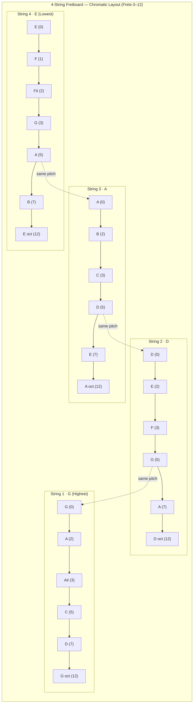
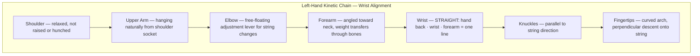
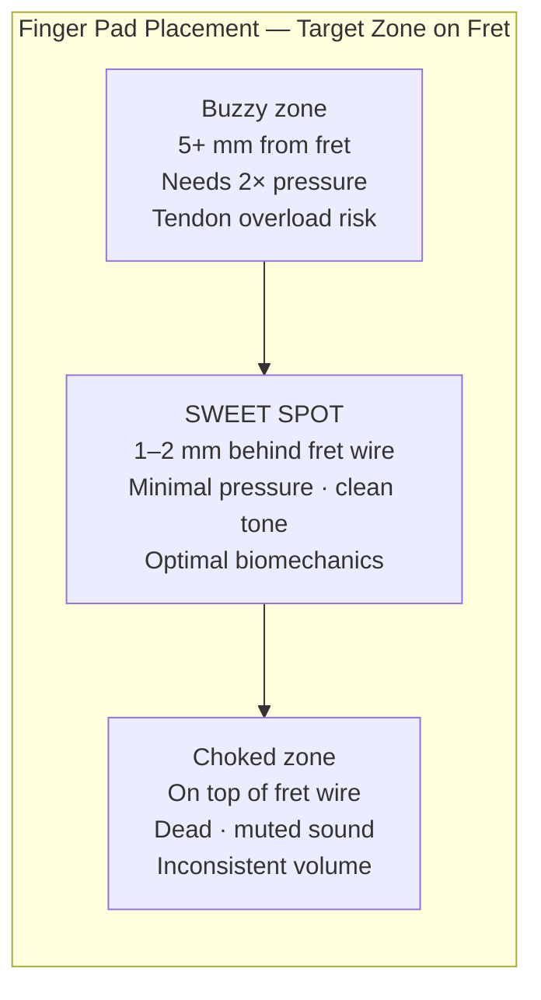
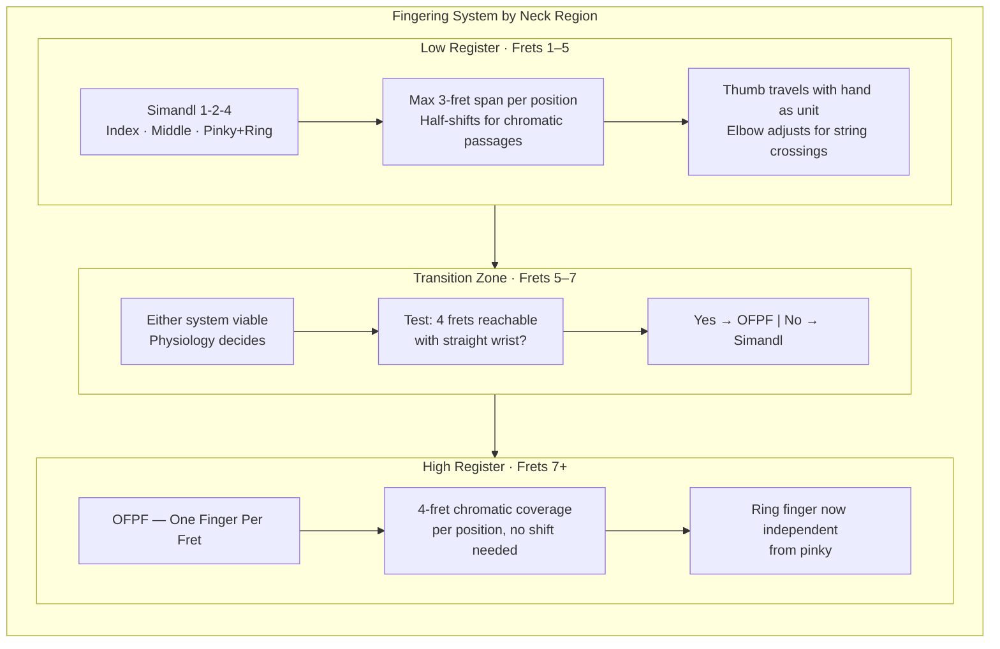
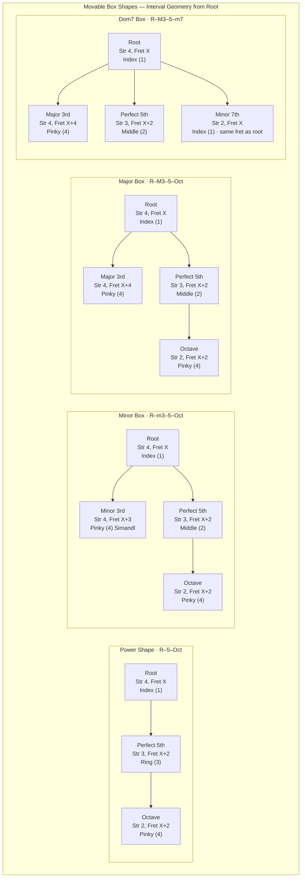

# Lesson 1: Bass Guitar Fretboard Layout and Left-Hand Mechanics

**Discipline:** Music Performance | **Domain:** Arts  
**Level:** Foundation | **Series:** Bass Guitar Masterclass — Lesson 1 of 12

---

## Learning Objectives

By the end of this lesson you will be able to:

- Navigate the full 4-string fretboard and name any note from fret 0–12 in under five seconds
- Execute the Franz Simandl 1-2-4 fingering system in the low register (frets 1–5) with zero wrist deviation and zero strain
- Apply One-Finger-Per-Fret (OFPF) cleanly above the 7th fret with true four-finger independence
- Play movable Root–3rd–5th–Octave box shapes in any key using consistent, transportable finger geometry
- Complete all six independence and shifting drills at 60, 80, and 100 BPM with clean tone and no string buzz
- Diagnose and self-correct the six most common left-hand mechanical errors on the spot
- Execute a full injury-prevention protocol before, during, and after every session

---

## 1. Acoustic Grounding: Why the Fretboard Works the Way It Does

A standard bass has a 34-inch scale length — longer and heavier strings than guitar — tuned to E1 (41.2 Hz), A1 (55.0 Hz), D2 (73.4 Hz), G2 (98.0 Hz). When you press a fret, you shorten the vibrating string length and raise the pitch. The equal-tempered chromatic scale divides each octave into twelve identical semitone ratios (each ratio ≈ 1.05946). This is why fret spacing tapers as you move toward the body: each fret is positioned at a fixed mathematical proportion of the remaining string length.

**The practical upshot:** Land your fingertip directly behind the fret wire — 1–2 mm back — and even light pressure produces a clean note. Land halfway between two frets and you need twice the pressure to eliminate buzz, loading your tendons unnecessarily. The fretboard is a precision mechanical instrument. Your left hand is the actuator.

**Why low-register technique differs from guitar:** Bass strings in frets 1–5 are under significantly higher tension and spaced farther apart than guitar strings. The same One-Finger-Per-Fret approach that works on guitar in this region causes wrist deviation, tendon overload, and eventual injury on bass. You need a different system for this zone.

---

## 2. The Fretboard as a Map

### 2.1 Standard Tuning Open Strings

```
String 4 (thickest, lowest):  E1  —  41.2 Hz
String 3:                     A1  —  55.0 Hz
String 2:                     D2  —  73.4 Hz
String 1 (thinnest, highest): G2  —  98.0 Hz
```

Adjacent strings are tuned a **perfect fourth** apart (5 semitones, 7 frets). This consistent interval is what makes all movable box shapes work: any shape you learn in one position transposes identically to any other. The bass fretboard is not twelve independent grids — it is one repeating pattern.

### 2.2 Chromatic Note Grid — Frets 0 Through 12

| Fret | String 4 (E) | String 3 (A) | String 2 (D) | String 1 (G) |
|------|-------------|-------------|-------------|-------------|
| 0 (open) | **E** | **A** | **D** | **G** |
| 1 | F | A♯/B♭ | D♯/E♭ | G♯/A♭ |
| 2 | F♯/G♭ | B | E | A |
| 3 | G | C | F | A♯/B♭ |
| 4 | G♯/A♭ | C♯/D♭ | F♯/G♭ | B |
| 5 | **A** | **D** | **G** | **C** |
| 6 | A♯/B♭ | D♯/E♭ | G♯/A♭ | C♯/D♭ |
| 7 | B | E | A | D |
| 8 | C | F | A♯/B♭ | D♯/E♭ |
| 9 | C♯/D♭ | F♯/G♭ | B | E |
| 10 | D | G | C | F |
| 11 | D♯/E♭ | G♯/A♭ | C♯/D♭ | F♯/G♭ |
| 12 | **E** (octave) | **A** (octave) | **D** (octave) | **G** (octave) |

**Two navigation anchors to memorize first:**

1. **Fret 5 rule:** Fret 5 on any string is the same pitch as the open string above it. E-string fret 5 = A (open String 3). A-string fret 5 = D (open String 2). D-string fret 5 = G (open String 1). This is your cross-string tuning reference and your anchor for finding notes fast.

2. **Octave shape:** One string up (toward thinner strings), two frets forward = the octave of your starting note. String 4 fret 3 (G) → String 2 fret 5 (G). This diagonal shape appears in every genre of bass line from Motown to metal.

### 2.3 Fretboard Navigation Flow



**Daily memorization drill:** Set a timer for 10 minutes. Call out a note name at random (e.g., "C"). Find every C on the fretboard across all four strings within ten seconds. If you cannot, slow down and find them methodically, naming each string and fret number aloud. Rotate through all twelve chromatic notes. After two weeks of this drill, you will have instant fretboard fluency. This is not optional — bassists who skip this step spend years guessing at note locations instead of knowing them.

**Visual landmark strategy:** Notice that the natural notes (no sharps or flats) at fret 12 spell the open strings — E, A, D, G. Fret 12 = octave. Fret 7 on String 4 = B (the fifth of E). Fret 3 on String 4 = G (the minor third of E). These are your visual anchors. Everything else fills in around them.

---

## 3. Left-Hand Mechanics: The Foundation of Everything

Poor left-hand mechanics are the single most common cause of repetitive strain injury in bass players. The habits you lock in during your first thirty days are the habits you carry for the rest of your playing life. Build these correctly now, before you chase speed or complexity.

### 3.1 Total Body Setup

**Seated position:**
- Rest the lower bout of the bass on your **right thigh** (right-handed players)
- Neck angles upward at roughly **45 degrees** — never horizontal, never drooping toward the floor
- The bass body rests lightly against your torso; do not grip it with your strumming forearm or clamp it with your bicep
- Left elbow hangs freely from the shoulder, pointing toward the floor — not locked against your ribcage, not flared out to the side

**Standing position:**
- Adjust strap length so the bass sits in the **exact same position** as when seated — same neck angle, same hand reach
- The 12th fret should land roughly at belt-buckle to lower-chest height for most players
- **Practical test:** Sit down, get comfortable, note where your left hand naturally rests on the neck. Stand up. If your hand position changed, adjust your strap until it matches your seated position exactly. Most players need the bass higher than they initially think looks cool. Function over fashion.

**The low-strap error:** Wearing the bass below the waist forces the fretting wrist into ulnar deviation — the wrist bends toward the pinky side. This compresses the ulnar nerve running through Guyon's canal at the base of the palm and loads the flexor tendons asymmetrically. Over months, this becomes chronic nerve pain and tendinitis. If you see a bassist with the instrument hanging at knee level, you are watching someone building toward a career-ending injury. Raise the instrument.

### 3.2 The Fretting Wrist: The Single Most Important Concept

**The back of your hand, your wrist joint, and your forearm must form one continuous straight line. No bend up, no bend down, no sideways angle.**

When the wrist bends inward (radial deviation — toward the neck) or downward (flexion), the median nerve and nine flexor tendons running through the carpal tunnel get compressed under repetitive load. That is the mechanical pathway to carpal tunnel syndrome and tendinitis. Neither is compatible with playing bass at any serious level.

Achieving a straight wrist requires that your **elbow acts as the adjustment lever** for string changes:

- Playing String 4 (lowest, thickest): elbow drops slightly lower, bringing the forearm closer to parallel with the floor
- Playing String 1 (highest, thinnest): elbow swings out away from your body, angling the forearm more steeply
- **The wrist itself does not change angle. The elbow compensates.**

This is the hardest habit to build because it is invisible to you while playing. You cannot see your own wrist angle without a mirror or video. Most beginners let the wrist bend and never notice until pain appears weeks later.



**Visual check:** Take a photo of your left hand while fretting String 4, fret 1, from the side. Trace a line from your elbow through your wrist to your knuckles. Any bend at the wrist joint means you are in the injury zone. Now take the same photo while fretting String 1, fret 1. If the wrist angle changed, your elbow did not adjust — you compensated with wrist deviation instead. Correct this immediately. Set a timer to beep every five minutes during practice and check wrist position each time. After two weeks, the correct position becomes automatic.

**The weight transfer principle:** The forearm bones (radius and ulna) should carry the weight of your arm down through the wrist and into the fingers. When the wrist bends, weight transfers onto soft tissue — tendons, ligaments, nerves — instead of bone. Bone is designed to bear load. Soft tissue is not.

### 3.3 Thumb Placement: The Hidden Foundation

The fretting thumb belongs on the **back of the neck**, not hooked over the top. Its job is to provide gentle counter-pressure to the fingers — it is a stabilizing guide, not a clamp or a vise.

**Correct thumb position:**
- Resting on the back of the neck, roughly **behind the middle finger** (second finger)
- Pointing roughly upward or diagonally toward the headstock — never horizontal, never pointing toward the floor
- Making light contact — just enough to stabilize the hand, nothing more
- **Never squeezing**

**The thumb is not a fixed anchor.** It travels with the hand as a unit. When you shift positions, the thumb moves first, arriving slightly ahead of the fingers at the new location. It never stays behind while the fingers stretch away from it. If you feel a stretch sensation between thumb and fingers, you are doing it wrong — the hand should translate as a single block.

**Pressure calibration test:** While fretting a note cleanly, try to slide a piece of paper between your thumb pad and the back of the neck. If you cannot, you are gripping too hard. Reduce pressure gradually until the paper slides through while the note still rings clean without buzz. That is your target grip pressure. Most beginners use 3–4 times the pressure actually needed. This test reveals that instantly.

**The death-grip error:** Many beginners hook the thumb over the top of the neck like a classical guitarist and squeeze the neck between thumb and fingers. This immediately locks the wrist into a bent position, kills finger independence, and causes forearm fatigue within minutes. If you catch yourself doing this mid-drill, stop completely, set the bass down, reset your hand position, and restart at half tempo. Do not try to fix it while continuing to play — you will just reinforce the error at a different speed.

**Why thumb-over-neck feels more secure but is wrong:** It provides immediate feedback — you can feel the pressure strongly. Back-of-neck placement feels less secure initially because it is lighter and more mobile. This is correct. The thumb guides and stabilizes; it does not grip. Trust the lightness.

### 3.4 Finger Arch and Pad Placement

Each finger must maintain a **curved arch** — the same natural curvature your hand has when resting on a softball. The fingertip descends perpendicular to the string. The flat finger pad (the fleshy part between the tip and first joint) should not contact the fretboard at all — only the tip.

**Precision landing zone:**
- **1–2 mm behind the fret wire** — as close as possible without sitting directly on top of it
- At this position, minimal pressure produces clean tone because the fret wire itself does the mechanical work of stopping the string cleanly against a rigid metal edge
- 5–10 mm back from the fret (halfway between frets) requires roughly double the pressure for the same clean result

**Why this matters biomechanically:** Every millimeter you move away from the fret wire increases the pressure required to stop the string from buzzing. That pressure translates directly into flexor tendon load. Over a 30-minute practice session, the difference between optimal and suboptimal finger placement is hundreds of repetitions of unnecessary force. That accumulates.

**Finger placement consequences:**

| Placement Error | What You Hear | What It Costs You |
|-----------------|--------------|-------------------|
| Too far from fret wire (mid-gap) | Buzzing or choked tone; requires excessive pressure | Hand fatigue, tendon overload, slow speed ceiling |
| On top of fret wire | Dead, muted, uneven tone; inconsistent volume | Unpredictable note clarity; sounds amateurish in context |
| Flat pad instead of fingertip | Adjacent strings accidentally muted; reduced independence | Forces unnatural finger angles; kills speed and accuracy |
| Fingernail contacting string | Clicking noise; inconsistent muting; nail catches string | Prevents full finger curl; causes overextension at joints |

**Proximity discipline:** Fingers not currently fretting should hover **5–10 mm above the string**, ready to descend. Never let unused fingers fly up into the air (more than 2–3 cm above the strings) or curl back into the palm. This discipline — keeping idle fingers close and ready — is what physically separates smooth, fast players from choppy, uneven ones. Watch any professional bassist's left hand in slow motion: idle fingers float just above the strings, barely moving. Beginners' fingers fly around like they are waving goodbye. Control the motion envelope.



**Daily precision drill:** Play a single note — String 4, fret 5 — with your index finger. Start with the finger 10 mm behind the fret wire. Slowly slide the fingertip forward toward the fret wire while maintaining pressure and listening. Notice when the buzz disappears. That is your optimal zone. Mark that feeling in your muscle memory. Repeat for middle finger, then pinky. Do this for 60 seconds every day before your main practice. Precision is a trained skill, not a talent.

---

## 4. The Two Fingering Systems: When to Use Each

Bass guitar's wide fret spacing — especially in the first five frets — makes One-Finger-Per-Fret biomechanically dangerous in the low register. Two distinct systems solve this problem. Neither is better than the other. Each is optimal for its zone.

### 4.1 Franz Simandl 1-2-4: Frets 1 Through 5

Adapted from double bass technique, Simandl assigns fingers as follows in the low register:

| Finger | Assignment | Role |
|--------|-----------|------|
| **Index (1)** | Fret anchor | Establishes position; bears most load |
| **Middle (2)** | One fret above index | Moves independently |
| **Ring (3)** | — | **Does not fret alone — stacks behind pinky for reinforcement** |
| **Pinky (4)** | Two frets above index | Ring reinforces it from behind; unit shares load |

**Why the ring finger does not operate alone in Simandl:** The pinky is the weakest finger, with the least mechanical advantage due to shorter lever arm and smaller muscle mass. In approximately 60% of people, the flexor digitorum superficialis tendon to the pinky shares connective tissue (intertendinous connections) with the ring finger tendon, physically limiting independent movement. Forcing an unsupported pinky to fret alone across a wide low-register span is the most direct path to flexor tendinitis. The ring+pinky combined unit shares the load biomechanically and eliminates that risk. This is not a crutch — it is correct anatomy-based technique.

**Simandl hand shape — first position (frets 1–3):**

```
Fret 1  →  Index   (1)
Fret 2  →  Middle  (2)
Fret 3  →  Pinky   (4)  ←  ring finger physically stacked behind it, not hovering independently
```

You cover **three frets** per position. To reach fret 4 or 5, execute a **half-shift**: the entire hand (thumb included) slides up one fret as a unit. The fingers do not stretch — the hand translates.

**Simandl extended reach — accessing fret 5:**

```
Home position:    Fret 1 (Index) · Fret 2 (Middle) · Fret 3 (Pinky)
Half-shift up:    thumb slides up one fret · elbow adjusts to maintain straight wrist
Result:           Fret 2 (Index) · Fret 3 (Middle) · Fret 5 (Pinky)
```

The half-shift means you always cover a maximum comfortable span of two to three frets, with the hand translating rather than the fingers stretching. Never force a three-wide-fret stretch with an isolated pinky bearing full load. This is the root cause of most beginner tendon injuries.

**Why Simandl feels awkward initially:** You are accustomed to using all four fingers independently in daily life. Bass technique requires you to treat two fingers as a single unit in one zone, then separate them in another. This takes 2–3 weeks to internalize. The awkwardness is not a sign you are doing it wrong — it is a sign you are retraining motor patterns. Push through it.

### 4.2 One-Finger-Per-Fret (OFPF): Fret 7 and Above

As you move up the neck, fret spacing narrows due to the logarithmic scaling of equal temperament. By fret 7, the distance between adjacent frets has decreased enough that each finger can comfortably cover one fret independently without wrist deviation or excessive stretch.

| Finger | OFPF Assignment |
|--------|----------------|
| **Index (1)** | Base fret of position |
| **Middle (2)** | Base fret + 1 |
| **Ring (3)** | Base fret + 2 |
| **Pinky (4)** | Base fret + 3 |

**Example — 7th position, String 4:**

```
Fret 7   →  Index  (1)  =  B
Fret 8   →  Middle (2)  =  C
Fret 9   →  Ring   (3)  =  C♯
Fret 10  →  Pinky  (4)  =  D
```

OFPF gives you four frets of chromatic coverage per position without shifting. This is the standard approach for all upper-register playing, soloing, and fast chromatic passages. The ring finger now operates independently — it is no longer stacked behind the pinky.

**The transition zone — frets 5–7:** This is the gray area where either system can work depending on your hand size, finger length, and the specific musical context. Smaller hands with shorter fingers may prefer Simandl through fret 7 or even fret 9. Larger hands may switch to OFPF as early as fret 5. There is no universal fret number where the switch happens — there is only what keeps your wrist straight and your fingers arched without strain.

**Physiology-based decision rule:** If you can comfortably reach four consecutive frets in a given position while maintaining a straight wrist and arched fingers, OFPF is viable. If reaching the fourth fret requires wrist deviation, a flat finger angle, or excessive stretch sensation, stay in Simandl and use half-shifts. Your body will tell you the right answer if you listen to it.

### 4.3 Fingering System Map



**Practical mixing example:** You are playing a bass line that moves from fret 3 (Simandl) to fret 9 (OFPF) and back. As you shift from fret 5 to fret 7, your ring finger mentally shifts from "stacked behind pinky" mode to "independent fret 9" mode. This cognitive switch happens in less than a second once trained. In month one, it feels clunky. By month three, it is automatic. This is normal skill acquisition.

---

## 5. Movable Box Shapes: Your Harmonic Navigation System

A box shape is a fingering template defined entirely by its **geometric relationship between frets and strings** — not by the specific note name it starts on. Because every adjacent string pair is tuned a perfect fourth apart (5 semitones), any box shape transposes identically when you move the root to a new fret position. Move the root from fret 3 to fret 5, and the entire shape moves with it — same finger geometry, same intervals, new key.

This is the conceptual divide between beginners and intermediate players: beginners memorize hundreds of individual note positions. Intermediates memorize a dozen geometric shapes and move them. The fretboard collapses from overwhelming complexity to elegant simplicity the moment you internalize this.

### 5.1 Core Intervals: Where They Live on the Neck

**On the same string (vertical movement along one string):**

| Fret distance | Interval |
|--------------|---------|
| +1 fret | Minor 2nd (half step, semitone) |
| +2 frets | Major 2nd (whole step, whole tone) |
| +3 frets | Minor 3rd |
| +4 frets | Major 3rd |
| +5 frets | Perfect 4th |
| +7 frets | Perfect 5th |
| +12 frets | Octave (Perfect 8th) |

**Across adjacent strings (diagonal shapes between strings):**

| Shape | Interval |
|-------|---------|
| One string higher, same fret | Perfect 4th above |
| One string higher, 2 frets back (toward nut) | Major 3rd above |
| One string higher, 3 frets back | Minor 3rd above |
| **Two strings higher, 2 frets forward (toward body)** | **Octave above** ← memorize this first |

**The octave shape in practice — your most-used interval:**

```
Root:    String 4, Fret 3  =  G
Octave:  String 2, Fret 5  =  G (same pitch, one octave higher)

Root:    String 3, Fret 2  =  B
Octave:  String 1, Fret 4  =  B
```

This two-string, two-fret-forward diagonal is the single most-used interval shape in bass across rock, R&B, funk, and soul. It defines the foundation-to-hook movement that makes bass lines memorable. Lock it into muscle memory before anything else.

**Visual memory anchor:** Hold your index finger on any fret on String 4. Your pinky, two strings up and two frets forward, is the octave. This diagonal line from index to pinky is the shape. Now move your index to a different fret — the shape stays identical. That is the power of movable geometry.

### 5.2 The Root–5th–Octave Power Shape

The harmonic skeleton of rock, punk, metal, and most popular music. Defines the tonal center (root) plus the strongest harmonic support note (the perfect fifth).

**Shape geometry:**

```
Root  (R):   String 4, Fret X        —  Index  (1)
Fifth (P5):  String 3, Fret X+2      —  Ring   (3)  or Pinky (4)
Octave(Oct): String 2, Fret X+2      —  Pinky  (4)
```

**Example — G root at String 4, Fret 3:**

```
String 4, Fret 3  →  G   (Root)          —  Index  (1)
String 3, Fret 5  →  D   (Perfect 5th)   —  Ring   (3)
String 2, Fret 5  →  G   (Octave)        —  Pinky  (4)
```

Notice that the Fifth and Octave share the same fret number on adjacent strings — your ring and pinky land in a vertical column. This makes the shape extremely fast to execute. You anchor the root with your index, then drop ring and pinky together in one motion.

**Fingering options:** Some players use 1–2–4 (index–middle–pinky) for this shape, placing middle on the fifth and pinky on the octave. Others use 1–3–4 (index–ring–pinky). Both are correct. Use whichever keeps your wrist straightest and allows you to mute the unused String 1 with your pinky edge. Test both. The right answer is the one that feels stable and produces clean tone for you specifically.

**Common playing patterns with this shape:**

```
Rock/Punk foundation:  R (2 beats) → P5 (2 beats) → repeat
Power chord stab:      R + P5 + Oct (all three together, struck once)
Walking approach:      R → P5 → Oct → P5 → R (descending back down)
```

### 5.3 The Minor Box Shape (Root–m3–P5–Octave)

Adds the minor third to the power shape, giving you full minor triad tonality. This is the foundation of minor key bass lines in rock, blues, metal, and folk.

**Shape geometry:**

```
Root      (R):   String 4, Fret X     —  Index (1)
Minor 3rd (m3):  String 4, Fret X+3   —  Pinky (4) in Simandl / Ring (3) in OFPF
Perfect 5th(P5): String 3, Fret X+2   —  Middle (2) or Ring (3)
Octave    (Oct): String 2, Fret X+2   —  Ring (3) or Pinky (4)
```

**Example — A minor box, root at String 4, Fret 5:**

```
String 4, Fret 5  →  A   (Root)           —  Index  (1)
String 4, Fret 8  →  C   (Minor 3rd)      —  Ring   (3)  [or Pinky in Simandl]
String 3, Fret 7  →  E   (Perfect 5th)    —  Middle (2)
String 2, Fret 7  →  A   (Octave)         —  Pinky  (4)
```

**Practice sequence (ascending/descending arpeggio):** R → m3 → R → P5 → Oct → P5 → m3 → R

Play this sequence slowly at 60 BPM, one note per beat, saying each interval name aloud as you play it. The goal is to wire together three things into a single unit of memory: the interval name (minor third), the sound (the darker, sadder color compared to major third), and the finger position (three frets above the root on the same string). When these three fuse, you stop thinking about where to put your fingers — you just play the sound you want to hear.

**Why naming intervals aloud matters:** Your brain has separate systems for motor memory (finger positions), auditory memory (pitch relationships), and semantic memory (names and labels). Practicing in silence only trains motor memory. Saying the names while playing recruits all three systems, creating a much stronger, faster, more durable memory trace. This is not mystical — it is basic cognitive neuroscience applied to bass.

### 5.4 The Major Box Shape (Root–M3–P5–Octave)

Swaps the minor 3rd for a major 3rd (one fret higher — four frets above the root instead of three), shifting the tonality from minor to major. This is the foundation of major key bass lines in pop, country, funk, and rock.

**Shape geometry:**

```
Root      (R):   String 4, Fret X     —  Index (1)
Major 3rd (M3):  String 4, Fret X+4   —  Pinky (4)
Perfect 5th(P5): String 3, Fret X+2   —  Middle (2)
Octave    (Oct): String 2, Fret X+2   —  Ring (3) or Pinky (4)
```

**Example — A major box, root at String 4, Fret 5:**

```
String 4, Fret 5  →  A   (Root)           —  Index (1)
String 4, Fret 9  →  C♯  (Major 3rd)      —  Pinky (4)
String 3, Fret 7  →  E   (Perfect 5th)    —  Middle (2)
String 2, Fret 7  →  A   (Octave)         —  Pinky (4)
```

**Mechanical note:** The major box requires the pinky to stretch one additional fret higher than the minor box on String 4 (four frets above the root instead of three). In the Simandl region (frets 1–5), this will often require a micro-shift of the thumb and hand to bring fret 5 into comfortable reach. In the OFPF region (frets 7+), the narrower fret spacing makes this stretch natural and easy. Do not force the stretch in the low register if it causes wrist deviation — shift the hand up one fret instead.

**Practice sequence (ascending/descending arpeggio):** R → M3 → R → P5 → Oct → P5 → M3 → R

Same drill structure as the minor box — 60 BPM, one note per beat, name each interval aloud. Then alternate between the minor and major boxes in the same key (e.g., A minor box → A major box → A minor box) to train your ear to hear the difference and your hand to feel the one-fret shift of the third.

### 5.5 The Dominant 7th Extension (Root–M3–P5–m7)

Once the major box is solid, adding the minor 7th creates a dominant 7th chord color — the defining sound of blues, funk, and soul bass lines. The minor 7th sits **two frets below the octave** on String 2, which means it occupies the same fret number as the root but two strings higher.

**Shape geometry:**

```
Root      (R):   String 4, Fret X     —  Index (1)
Major 3rd (M3):  String 4, Fret X+4   —  Pinky (4)
Perfect 5th(P5): String 3, Fret X+2   —  Middle (2)
Minor 7th (m7):  String 2, Fret X     —  Index (1)  ← same fret as root, two strings higher
```

**Example — A7 box, root at String 4, Fret 5:**

```
String 4, Fret 5  →  A   (Root)           —  Index (1)
String 4, Fret 9  →  C♯  (Major 3rd)      —  Pinky (4)
String 3, Fret 7  →  E   (Perfect 5th)    —  Middle (2)
String 2, Fret 5  →  G   (Minor 7th)      —  Index (1)
```

**Playing order for blues/funk feel:** R → P5 → m7 → Oct (if you ascend to it) → m7 → P5 → R

Or descending: R → M3 → P5 → m7 → P5 → M3 → R

The descending seventh move (Oct or high register → m7 → P5 → R) is a cornerstone lick in blues, soul, and funk. It creates harmonic tension (the m7 wants to resolve down to the root) and rhythmic momentum. Listen to any Motown, Stax, or James Brown record — you will hear this shape in the first 30 seconds.

**Visual anchor:** The minor 7th is always the same fret number as the root, two strings higher. Root on String 4, fret 5 → m7 on String 2, fret 5. Root on String 4, fret 3 → m7 on String 2, fret 3. This pattern never changes. Memorize it.

### 5.6 Box Shape Comparison Diagram



### 5.7 Transposing the Box: Complete Reference Table

The only thing that changes when you transpose a box shape is the fret number where you place the root. The finger geometry — the distances and string relationships — stays absolutely identical. This table gives you every common root position across the first octave of String 4. Beyond fret 12, the pattern repeats.

| Root | Root Fret (Str 4) | m3 Fret (Str 4) | M3 Fret (Str 4) | P5 Fret (Str 3) | Oct Fret (Str 2) | m7 Fret (Str 2) |
|------|------------------|----------------|----------------|----------------|-----------------|----------------|
| E | 0 (open) | 3 | 4 | 2 | 2 | 0 (open) |
| F | 1 | 4 | 5 | 3 | 3 | 1 |
| F♯/G♭ | 2 | 5 | 6 | 4 | 4 | 2 |
| G | 3 | 6 | 7 | 5 | 5 | 3 |
| G♯/A♭ | 4 | 7 | 8 | 6 | 6 | 4 |
| A | 5 | 8 | 9 | 7 | 7 | 5 |
| A♯/B♭ | 6 | 9 | 10 | 8 | 8 | 6 |
| B | 7 | 10 | 11 | 9 | 9 | 7 |
| C | 8 | 11 | 12 | 10 | 10 | 8 |
| C♯/D♭ | 9 | 12 | 13 | 11 | 11 | 9 |
| D | 10 | 13 | 14 | 12 | 12 | 10 |
| D♯/E♭ | 11 | 14 | 15 | 13 | 13 | 11 |

**How to use this table:** Say you need to play an F♯ minor bass line. Find F♯ in the Root column (fret 2). The table tells you: root at fret 2, minor 3rd at fret 5, perfect 5th at fret 4 on String 3, octave at fret 4 on String 2. You now have the entire harmonic framework for that key without thinking. Move to G? Root shifts to fret 3, and every other interval shifts by one fret in the same geometric relationship.

**Memorization strategy:** Do not memorize this table. Memorize the shape geometry (m3 is always 3 frets above root on same string, P5 is always 2 frets above root on next string, etc.). The table is a reference for initial learning and spot-checking. Once the shapes are in your hands, you will never need to look at it again.

---

## 6. Practical Drills and Metronome Progressions

**Universal drill rules across all six drills:**

```
Starting tempo:  60 BPM  — mechanics first, speed second; every note clean and even
Target tempo:    80 BPM  — smooth, controlled, musical
Advanced tempo: 100 BPM  — confident and locked in; no hesitation
Advancement rule: Never advance tempo until the current tempo is completely clean
                  for two consecutive full minutes without a single buzz, muted note,
                  or loss of rhythmic accuracy
```

Turn the metronome on **before** you pick up the bass. Make it a non-negotiable ritual. Every note you play must land on the beat or in a metrically precise subdivided position (eighth notes, sixteenth notes, triplets — whatever the drill specifies). Practicing without a metronome is not practicing — it is noodling. You are building motor patterns, and motor patterns require precise timing to encode correctly. Use a physical metronome, a metronome app (Metronome Beats, Pro Metronome, Soundbrenner), or a DAW click track. Any of these works. Silence does not.

**Why 60 BPM is the starting point:** At 60 BPM, each quarter note lasts exactly one second. This gives you maximum time to focus on hand position, finger placement, wrist angle, and tone quality. It feels painfully slow. That is the point. Speed is the byproduct of correct mechanics repeated thousands of times. Mechanics break down the moment you exceed the tempo where you can execute them cleanly. Start slow. Build the foundation. Speed will come.

---

### Drill 1: The Spider — Chromatic Finger Independence (Simandl Zone)

**Purpose:** Build equal tone, volume, and sustain across all three Simandl fingers (index, middle, pinky); establish proximity discipline (fingers hover close to strings); eliminate "flying fingers" in the low register; train alternating right-hand fingers.

**Setup:** 
- Left hand: Fingers 1, 2, and 4 assigned to frets 1, 2, and 3 on String 4
- Right hand: Strictly alternate index–middle–index–middle (i–m–i–m) on every note, no exceptions

**Pattern — one string, ascending and descending:**

```
Fret 1 (Index) → Fret 2 (Middle) → Fret 3 (Pinky) → Fret 2 (Middle) → Fret 1 (Index)
```

**Full Spider across all four strings:**

```
String 4: Frets 1 – 2 – 3 – 2 – 1
String 3: Frets 1 – 2 – 3 – 2 – 1
String 2: Frets 1 – 2 – 3 – 2 – 1
String 1: Frets 1 – 2 – 3 – 2 – 1
Reverse direction: String 1 → String 2 → String 3 → String 4 (descending back to start)
```

**Mechanics checklist — verify every single rep:**

- [ ] Wrist remains straight throughout all string crossings — zero bend in any direction
- [ ] Each lifted finger hovers **5–10 mm** above the string after playing — no dramatic lifting, no curling into palm
- [ ] Idle fingers remain hovering close and ready, never flying up into the air (>3 cm)
- [ ] Thumb stays on the back of the neck, sliding gently with the hand on string crossings (elbow adjusts for different strings)
- [ ] Every note rings clean with no buzz, sustained fully until the next note attacks
- [ ] Right-hand alternation is strict: i – m – i – m — no double-striking with one finger, no accidental skipping of alternation
- [ ] Fingertip lands 1–2 mm behind the fret wire on every note

**What to listen for:**
- Equal volume across all three fingers — the pinky must not be quieter or weaker than the index finger
- Zero muted or choked tones (flat, dead sound means finger is too far from fret or pressure is uneven)
- Zero sliding noise between notes (lifting cleanly rather than dragging the finger off the string)
- Absolutely even timing — every note the exact same duration, locked to the metronome beat

**BPM progression:**

| Phase | Tempo | Subdivision | Duration | Advancement condition |
|-------|-------|------------|----------|----------------------|
| 1 | 60 BPM | Quarter notes | 2 minutes minimum | No buzz, no timing drift for 2 consecutive clean runs |
| 2 | 80 BPM | Quarter notes | 2 minutes minimum | Same — 2 clean runs |
| 3 | 100 BPM | Quarter notes | 2 minutes minimum | Same — this is your milestone |
| 4 | 60 BPM restart | Eighth notes (2 notes per click) | 2 minutes minimum | Now you are playing twice as many notes per beat — focus on timing lock |
| 5 | 80 BPM | Eighth notes | 2 minutes minimum | Same |
| 6 | 100 BPM | Eighth notes | 2 minutes minimum | If you reach this cleanly, you have world-class finger independence for your level |

**Common errors and fixes:**

| Error | What it sounds/looks like | Fix |
|-------|--------------------------|-----|
| Pinky weaker than other fingers | Pinky notes quieter, buzzier, less sustain | Isolate drill: play only pinky for 30 seconds, then only index, comparing volume. Slow down and use ear feedback. |
| Flying fingers | Unused fingers rise >3 cm above strings | Place small piece of foam or cloth on strings. If fingers touch it when not fretting, they are flying. Keep them 5–10 mm above. |
| Right-hand double-striking | Two consecutive notes played with same finger (i-i or m-m) | Slow to 50 BPM and say aloud "index, middle, index, middle" while playing. Retrain the pattern consciously. |
| Wrist bending on string crossings | Wrist angle changes when moving from String 4 to String 1 | Stop. Reset. Move only the elbow to change string height. Wrist stays locked. Take video from side angle. |

**Advanced variation (after phase 3 is solid at 100 BPM):** Extend the pattern to frets 1–2–3–4 by adding a micro-shift to bring fret 4 into range with the pinky. This is your first half-shift drill integrated into Spider:

```
String 4: Fret 1 (Index) → Fret 2 (Middle) → Fret 3 (Pinky) →
          [half-shift up] → Fret 4 (Pinky) → Fret 3 (Middle after shift) → Fret 2 (Index after shift)
```

Play this ascending and descending across all strings. Start at 50 BPM because the shift adds complexity.

---

### Drill 2: Position Crawl — Simandl Shifting Along One String

**Purpose:** Train the thumb-and-hand unit to shift smoothly between first, second, third, and higher positions on a single string — clean tone maintained through every shift, wrist angle unchanged, no gripping or jumping during transitions.

**Core shifting principle:** In Simandl technique, the **entire hand travels as a unit**. The thumb leads the shift by a fraction of a second (approximately 50–100 milliseconds), arriving at the new position just before the fingers land. This keeps the thumb-to-finger relationship constant through the transition, preventing wrist deviation and maintaining stability.

**Pattern on String 4, ascending by half-steps through Simandl positions:**

```
Position 1 (anchor: Fret 1 = Index finger reference)
  Play:  Fret 1 (Index) → Fret 2 (Middle) → Fret 3 (Pinky)
  — pause one beat (rest) — thumb slides up smoothly — hand follows as a unit —

Position 2 (anchor: Fret 2)
  Play:  Fret 2 (Index) → Fret 3 (Middle) → Fret 4 (Pinky)
  — pause one beat — shift —

Position 3 (anchor: Fret 3)
  Play:  Fret 3 (Index) → Fret 4 (Middle) → Fret 5 (Pinky)
  — shift —

Continue ascending by one fret per position up to anchor at Fret 7–9 (depending on comfort)
Then descend back to Position 1 (Fret 1) using the same shift mechanic
```

**What a good shift feels like:**
- The thumb **slides** smoothly along the back of the neck — no jumping off and re-landing, no gripping and releasing
- There is a brief, clean micro-silence (rest) between position groups — better crisp and silent than blurred and sloppy
- Wrist angle does **not change** at all during the shift — only the whole arm translates along the neck axis
- The shift is initiated by the thumb and elbow moving together as the primary movers; fingers simply follow passively
- You should not feel tension or strain in the thumb or fingers during the shift — if you do, you are gripping too hard

**What a bad shift sounds/feels like:**
- Sliding or scraping noise as the hand moves (too much pressure on the strings during shift)
- Muted or choked notes immediately after landing in the new position (fingers not ready, thumb grip too tight)
- Wrist bends during the shift to compensate for incorrect elbow/shoulder positioning
- Shift timing is inconsistent — sometimes early, sometimes late, never metrically precise

**BPM progression:**

| Phase | Tempo | Feel | Duration |
|-------|-------|------|----------|
| 1 | 60 BPM | Each 3-note group = 3 quarter notes; shift on beat 4 (rest beat) | Ascend to Position 5 and back, 2 clean reps |
| 2 | 80 BPM | Same structure — shift silence is now shorter but still clean | 2 clean reps |
| 3 | 100 BPM | Shift silence is now metrically precise — not early, not late, exactly on beat 4 | 2 clean reps |

**Recording check:** Use your phone to record yourself playing this drill. Listen back with eyes closed. If you hear sliding noise, muted notes after shifts, or inconsistent timing, you know exactly what to fix. Video yourself from the side angle — watch the wrist. If it bends during any shift, your elbow is not doing its job. Fix this before advancing tempo.

**Musicality note:** Even though this is a technical drill, make it musical. Play with consistent dynamics (volume), clean note cutoffs, and rhythmic precision. Technical drills that sound musical encode better in motor memory than robotic, lifeless repetitions. Think of this as a bass line that happens to train shifting — not as a mechanical exercise.

---

### Drill 3: OFPF Four-Fret Chromatic Ladder (High Register)

**Purpose:** Build four-finger independence in the OFPF region (frets 7 and above), with true ring-finger autonomy separate from the pinky, equal tone across all four fingers, and clean string crossings without wrist deviation.

**Setup:** Starting at fret 7, String 4. Each finger owns one fret in strict OFPF assignment:

```
Index (1)  = Fret 7
Middle (2) = Fret 8
Ring  (3)  = Fret 9
Pinky (4)  = Fret 10
```

**Ascending ladder (String 4 → String 1):**

```
String 4: Fret 7 – 8 – 9 – 10  (Index–Middle–Ring–Pinky)
String 3: Fret 7 – 8 – 9 – 10
String 2: Fret 7 – 8 – 9 – 10
String 1: Fret 7 – 8 – 9 – 10
```

**Descending ladder (String 1 → String 4):**

```
String 1: Fret 10 – 9 – 8 – 7  (Pinky–Ring–Middle–Index)
String 2: Fret 10 – 9 – 8 – 7
String 3: Fret 10 – 9 – 8 – 7
String 4: Fret 10 – 9 – 8 – 7
```

**Key mechanics — critical for success:**
- When crossing from one string to the next, the fretting finger **lifts cleanly and completely off the previous string** — it does not pluck, slide, or drag. The right hand does all the plucking; the left hand does only the fretting. Keep these roles strictly separate.
- The hand stays in position (no shifting) throughout the entire drill — all four fingers remain over frets 7–10 the whole time. You are training the fingers to move independently within a fixed hand frame.
- The elbow adjusts subtly to maintain a straight wrist as you cross between String 4 (elbow slightly lower) and String 1 (elbow slightly outward). The wrist itself does not bend to accommodate string changes.
- Right hand maintains strict alternation (i–m–i–m) throughout. This trains coordination between hands, not just left-hand independence.

**What to listen for:**
- Absolutely equal volume and tone quality across all four fingers — the ring and pinky must sound identical to the index and middle
- No sympathetic ringing or open-string noise from adjacent strings (mute unused strings with light right-hand thumb contact or left-hand finger muting)
- Clean, crisp attack on every note — no sliding, scraping, or muted tones
- Perfectly even timing — every note the same duration, locked to the metronome subdivision

**BPM progression:**

| Phase | Tempo | Subdivision | Duration | Advancement condition |
|-------|-------|------------|----------|----------------------|
| 1 | 60 BPM | Eighth notes (2 notes per beat) | Ascend and descend once = 2 minutes | No buzz, equal volume across all fingers, 2 clean reps |
| 2 | 80 BPM | Eighth notes | 2 minutes | Same |
| 3 | 100 BPM | Eighth notes | 2 minutes | This is your intermediate milestone |
| 4 | 60 BPM restart | Sixteenth notes (4 notes per beat) | 2 minutes | Now you are playing 4× as many notes per second — focus shifts to micro-timing precision |
| 5 | 80 BPM | Sixteenth notes | 2 minutes | If you reach this cleanly, you have professional-level OFPF control |

**Common errors and fixes:**

| Error | Symptom | Fix |
|-------|---------|-----|
| Ring finger weak or unreliable | Ring finger notes buzz, sound muted, or are quieter than others | Isolate ring finger: play only fret 9 repeatedly for 30 seconds at 50 BPM, focusing on clean tone. Then integrate back into full pattern. |
| Fingers lifting too high | Unused fingers rise >3 cm above strings, slowing down transitions | Conscious proximity discipline: set a goal to keep all fingers within 1 cm of strings. Use video feedback. |
| String crossings cause wrist bend | Wrist angle changes visibly when moving from String 4 to String 1 | Stop. Identify the moment the bend happens. Adjust elbow position to compensate instead of wrist. Restart at 50 BPM. |
| Right-hand alternation breaks down | Double-strikes (i-i or m-m) appear, especially at faster tempos | Drop back to 60 BPM and say aloud "in-dex, mid-dle" while playing until the pattern is reflexive. |

**Advanced variation (after phase 3 is solid):** Reverse the finger order. Ascending: Pinky–Ring–Middle–Index (frets 10–9–8–7). Descending: Index–Middle–Ring–Pinky (frets 7–8–9–10). This breaks the habitual direction and forces genuine finger independence rather than patterned sequential movement. Start at 50 BPM for this variation.

**Why this drill matters beyond technique:** The OFPF ladder is the foundation for all upper-register bass playing — soloing, melodic fills, chord voicings, and high-register bass lines. If you cannot execute this cleanly at 80 BPM, you cannot play in the upper register musically. Invest in this drill. It pays back for your entire playing life.

---

### Drill 4: Box Shape Transposition — Internalizing the Shapes Across Keys

**Purpose:** Burn the minor and major box shapes into muscle memory across multiple keys so that moving to a new root requires zero cognitive load, zero hesitation, and produces instant, reliable execution. This drill transforms the shapes from theoretical concepts into physical reflexes.

**Minor box — seven keys, one continuous run:**

For each key listed below: Play the full arpeggio pattern (Root → m3 → Root → P5 → Oct → P5 → m3 → Root), ascending and descending, then immediately slide to the next root position without pausing. No breaks. Keep it slow. **Hear the shape. Feel the fingering. Name the intervals.**

```
Key of E:   Root = String 4, Fret 0 (open)
Key of F:   Root = String 4, Fret 1
Key of G:   Root = String 4, Fret 3
Key of A:   Root = String 4, Fret 5
Key of B♭:  Root = String 4, Fret 6
Key of C:   Root = String 4, Fret 8
Key of D:   Root = String 4, Fret 10
```

**For each key, play each note for one full beat at 60 BPM:**

```
Beat 1: Root         — say aloud: "Root"          — lock in the sound and position
Beat 2: Minor 3rd    — say aloud: "Minor third"   — feel the darker color vs. major
Beat 3: Root         — say aloud: "Root"          — anchor back to tonal center
Beat 4: Perfect 5th  — say aloud: "Fifth"         — the strongest support note
Beat 5: Octave       — say aloud: "Octave"        — same pitch, one octave higher
Beat 6: Perfect 5th  — say aloud: "Fifth"         — descending back down
Beat 7: Minor 3rd    — say aloud: "Minor third"
Beat 8: Root         — say aloud: "Root"          — resolve back to start
```

Then repeat the exact same structure with the **major box** (substituting major 3rd for minor 3rd — one fret higher on String 4) in the same seven keys.

**Why naming intervals aloud is non-negotiable:** Your brain has separate, parallel memory systems:
- **Motor memory** (procedural): finger positions, muscle movements
- **Auditory memory**: pitch relationships, harmonic colors
- **Semantic memory**: names, labels, concepts

Practicing in silence only trains motor memory — you build "finger patterns" but do not understand what they mean harmonically. Saying the interval names while playing recruits all three memory systems simultaneously, creating a much stronger, faster, more durable memory trace. This is not mystical pedagogy — it is basic cognitive neuroscience applied to music learning. The players who name intervals while practicing become fluent 2–3 times faster than those who do not. This has been measured.

**BPM progression:**

| Phase | Tempo | Goal | Duration |
|-------|-------|------|----------|
| 1 | 60 BPM | Quarter notes — clean fretting, name every interval aloud, lock in the sound | Complete all 7 keys minor + 7 keys major = ~10 minutes |
| 2 | 80 BPM | Quarter notes — transitions between keys tighten, less hesitation | Same |
| 3 | 100 BPM | Quarter notes — connect shapes seamlessly without pause; play the ascending-descending pattern as a continuous musical phrase, not a mechanical exercise | Same |

**Advanced challenge (after phase 3 is solid):** Randomize the key order. Write the seven keys on small pieces of paper, draw them randomly, and play the box shape in whatever order appears. This forces you to find the root position and execute the shape without relying on sequential memory (E → F → G...). True fluency means you can play any shape in any key on demand, not just in alphabetical order.

**Musicality integration:** Once you reach phase 2, start adding rhythmic variations. Instead of one note per beat, try:

```
Two-note rhythm:    R (half note, 2 beats) → m3 (quarter) → P5 (quarter) → Oct (half)
Swung eighth notes: Play the arpeggio in swung eighth feel (long-short, long-short)
Walking bass feel:  R (quarter) → m3 (quarter) → P5 (quarter) → Oct (quarter) in steady pulse
```

This bridges the gap between mechanical drill and real bass line construction. Shapes become music.

---

### Drill 5: System Transition — Simandl to OFPF and Back

**Purpose:** Train the hand to switch fingering systems seamlessly as it moves through different neck regions (low register Simandl → mid-register transition zone → high register OFPF → back down), with zero tone disruption, zero wrist deviation at the transition, and zero hesitation between systems.

**Complete pattern on String 4 (E string) — full chromatic ascent and descent:**

```
ASCENDING — SIMANDL ZONE (frets 1–5):
  Fret 1  (Index 1)   →  F   (Simandl position 1)
  Fret 2  (Middle 2)  →  F♯
  Fret 3  (Pinky 4)   →  G

HALF-SHIFT — SIMANDL (hand slides up one fret):
  Fret 3  (Index 1)   →  G   (Simandl position 2 — index now on fret 3)
  Fret 4  (Middle 2)  →  G♯
  Fret 5  (Pinky 4)   →  A

TRANSITION ZONE (frets 5–7) — RING FINGER ACTIVATES:
  Fret 7  (Index 1)   →  B   (OFPF begins — hand repositions)
  Fret 8  (Middle 2)  →  C
  Fret 9  (Ring 3)    →  C♯  ← ring finger now independent, not stacked behind pinky
  Fret 10 (Pinky 4)   →  D

DESCENDING — BACK THROUGH THE TRANSITION:
  Fret 10 (Pinky 4)   →  D
  Fret 9  (Ring 3)    →  C♯  (still OFPF)
  Fret 8  (Middle 2)  →  C
  Fret 7  (Index 1)   →  B   (OFPF ends — prepare to shift back to Simandl)

HALF-SHIFT BACK — SIMANDL (hand slides down):
  Fret 5  (Pinky 4)   →  A   (Simandl position 2)
  Fret 4  (Middle 2)  →  G♯
  Fret 3  (Index 1)   →  G

SIMANDL HOME POSITION:
  Fret 3  (Pinky 4)   →  G   (Simandl position 1 — hand slides back down one more fret)
  Fret 2  (Middle 2)  →  F♯
  Fret 1  (Index 1)   →  F
  Fret 0  (open)      →  E   (open string, no fretting)
```

**What to feel at the transition zone (frets 5–7):**
- The ring finger **activates as an independent digit** (OFPF) or **parks behind the pinky** (Simandl) — this is an internal cognitive re-mapping, not a visible physical event the audience sees
- The thumb position adjusts subtly: sitting slightly lower/flatter on the neck in Simandl (more support), slightly higher/more vertical in OFPF (more mobility)
- The wrist angle **never changes** during this transition — the elbow adjusts position to compensate for the shift up or down the neck
- There is a brief, clean micro-silence during the shift (half-shift in Simandl, position jump in OFPF) — do not try to hide the shift by sliding through it. Own the silence. Make it rhythmically precise.

**What a good system transition feels like:**
- No hesitation or "thinking gap" at fret 5–7 — the hand knows what to do reflexively
- Tone quality remains consistent across the entire range — no sudden volume drop or buzz when switching systems
- Wrist stays straight through the entire ascent and descent
- Shifts are metrically precise — they land exactly on the beat or subdivision you intend

**BPM progression:**

| Phase | Tempo | Focus | Duration |
|-------|-------|-------|----------|
| 1 | 60 BPM | Quarter notes — feel every shift; name every note aloud (F, F♯, G, etc.) to reinforce fretboard knowledge | Full ascent + descent = ~30 seconds; repeat 3 times |
| 2 | 80 BPM | Quarter notes — transitions become subconscious; less cognitive load | Same |
| 3 | 100 BPM | Quarter notes — no hesitation, no thinking; note names come without conscious effort | Same |

**Common errors and fixes:**

| Error | Symptom | Fix |
|-------|---------|-----|
| Hesitation at fret 5–7 transition | Pause, break in timing, or wrong finger used | Isolate the transition: play only frets 5–7–9 repeatedly (A–B–C♯) for 1 minute at 50 BPM, focusing on ring finger activation. |
| Wrist bends during shift | Visible wrist angle change when moving from fret 3 to fret 7 | Video yourself from the side. Identify the exact fret where the bend happens. Adjust elbow position to compensate before the shift. |
| Ring finger does not activate in OFPF zone | Pinky stretches to cover fret 9 instead of ring finger taking it | Conscious finger assignment drill: play frets 7–8–9–10 very slowly, saying aloud "index, middle, RING, pinky" on each note. Retrain the motor pattern. |

**Advanced variation (after phase 3 is solid):** Execute the same chromatic pattern across **all four strings** — String 4 ascending to String 1, then descending back to String 4. This adds string crossings to the system transitions and builds true full-neck command. Start at 60 BPM because the additional complexity requires more cognitive load initially.

**Real-world application:** This drill directly prepares you for bass lines that move across the full range of the instrument — from low foundational notes (frets 1–3) through mid-register melodic fills (frets 5–7) up to high-register hooks (frets 7–12). Most intermediate players get stuck in the low register because they never trained the transition. This drill eliminates that barrier.

---

### Drill 6: Floating Thumb Muting — Sympathetic String Control

**Purpose:** Eliminate unwanted sympathetic ringing and overtone buildup from strings you are not currently playing. This is primarily a right-hand technique but introduced here because it directly affects the left-hand clarity and tone quality you are building in all other drills.

**The problem:** When you pluck String 4, Strings 3, 2, and 1 can ring sympathetically due to harmonic resonance — especially at higher volumes, with distortion, or in acoustically live rooms. Bass frequencies build up quickly and overlap, turning clean bass lines into muddy, unfocused noise. Uncontrolled sympathetic ringing is the #1 reason beginner and intermediate bassists sound unclear in band contexts. You play the right notes, but the sound is a blurred mess.

**The floating thumb technique (right hand):**
- Rest your right-hand thumb on the **string immediately below (lower in pitch, thicker gauge)** the string you are currently plucking
- When you move up to a higher string (from String 4 to String 3), your thumb moves up to rest on String 4, muting it by contact
- The thumb does not press down hard — it rests with just enough contact to dampen vibration, nothing more
- The thumb "floats" — it is not anchored to one position; it moves dynamically with your playing

**Muting ladder in practice (right-hand thumb positioning):**

```
Playing String 4 (E):  Thumb rests on the pickup housing, body edge, or just floats 
                        (nothing below String 4 to mute)
Playing String 3 (A):  Thumb rests on String 4, muting it
Playing String 2 (D):  Thumb rests on String 3, muting it
Playing String 1 (G):  Thumb rests on String 2, muting it
```

As you play across strings, the thumb follows one string behind, muting the string you just left.

**Left-hand contribution to muting (complementary technique):**
- When you release a note with a left-hand finger, **lay that finger flat** against the string rather than lifting entirely off the fretboard — this mutes the string without plucking it, killing sympathetic ringing instantly
- Unused left-hand fingers can lightly touch (not press down to fret) adjacent strings to prevent them from ringing sympathetically
- Example: If you are playing on String 3, your index finger (if not fretting) can lightly touch String 4 to mute it, and your pinky can lightly touch String 2

**Full muting system (both hands working together):**

```
Right hand: Floating thumb mutes the string BELOW the one you are playing
Left hand:  Flattened released fingers mute the string you just played
            Unused fingers lightly touch adjacent strings to kill sympathetic ringing
Result:     Only the string you intend to sound is heard — everything else is silent
```

**Drill structure — integrating muting into Drill 1 (Spider):**

Play Drill 1 (The Spider) again, now adding floating thumb muting with the right hand. After each note, verify that the previously played string is completely silent, with no residual ringing or overtones.

```
String 4, Fret 1 (Index) → pluck with right index finger, thumb floats or rests on body
String 4, Fret 2 (Middle) → pluck with right middle finger, thumb still on body/pickup
String 4, Fret 3 (Pinky) → pluck with right index finger
Move to String 3:
String 3, Fret 1 (Index) → pluck with right middle finger, thumb NOW RESTS ON STRING 4, muting it
                            Check: String 4 should now be silent
String 3, Fret 2 (Middle) → pluck with right index, thumb still on String 4
String 3, Fret 3 (Pinky) → pluck with right middle
Move to String 2:
String 2, Fret 1 (Index) → pluck with right index, thumb NOW RESTS ON STRING 3, muting it
                            Check: String 3 and String 4 both silent
```

Continue this pattern across all four strings, ascending and descending.

**What to listen for:**
- **Silence between notes** — when you pluck a new string, the previous string should go completely silent, not ring underneath
- **Clean, focused tone** — only the note you are playing is audible; no muddy overtone buildup
- **No accidental thumb plucking** — the thumb rests, it does not pluck or slap the string it is muting

**Common errors and fixes:**

| Error | Symptom | Fix |
|-------|---------|-----|
| Thumb presses too hard | Muted string makes a dull "thunk" sound when plucked | Lighten thumb pressure to just-barely-touching contact. Goal is damping, not dead-stopping. |
| Thumb does not move with string changes | Lower strings continue ringing when you move to higher strings | Conscious tracking drill: play one note per string (E–A–D–G), saying aloud "thumb on 4, thumb on 3, thumb on 2" as you move. Retrain the tracking reflex. |
| Left-hand fingers lift too aggressively | String rings out for a moment after you release the note | Flatten the finger against the string as you release, rather than lifting straight up off the fretboard. |

**BPM progression:** Same as Drill 1 — start at 60 BPM, advance to 80 BPM, then 100 BPM. The addition of conscious muting will initially slow you down. Accept this. Speed will return as the muting becomes automatic.

**Real-world impact:** Floating thumb muting is the difference between sounding like a beginner and sounding like a professional in a band context. Studio engineers and live sound engineers will thank you. Bandmates will notice the clarity improvement instantly. This technique is non-negotiable for serious playing.

---

### Daily Practice Session Structure (30-Minute Foundation Routine)

This is your default practice structure for the first 4–6 weeks of working through this lesson. Expand to 45 minutes once endurance builds (typically week 3–4). Do not skip sections to "focus on what you like" — every section serves a specific biomechanical and technical purpose.

```
Total time: 30 minutes (expand to 45 minutes once comfortable)

00:00 – 03:00  Warm-up — Drill 1 (Spider) at 60 BPM, String 4 only
                          No metronome pressure yet — just wake up the hands, 
                          check wrist position, verify thumb placement

03:00 – 08:00  Drill 1 (Spider) — full 4 strings, 60 → 80 BPM
                          Focus: equal volume across all fingers, proximity discipline

08:00 – 13:00  Drill 2 (Position Crawl) — String 4 only, 60 → 80 BPM
                          Focus: smooth thumb-led shifts, straight wrist through all shifts

13:00 – 18:00  Drill 3 (OFPF Ladder) — 60 → 80 BPM
                          Focus: ring finger independence, clean string crossings

18:00 – 23:00  Drill 4 (Box Shapes) — 3 keys minor + 3 keys major, 60 BPM
                          Focus: interval naming aloud, hearing the shapes

23:00 – 28:00  Drill 5 (System Transition) — 60 → 80 BPM
                          Focus: seamless Simandl-to-OFPF transition, no hesitation

28:00 – 30:00  Cool-down — Drill 1 at 60 BPM, eyes closed
                          Focus entirely on feel, not fretboard vision; 
                          internalize the hand position without visual feedback
```

**When to advance the entire schedule by 10 BPM:**
- All five active drills (Drills 1–5) are clean at the current BPM for two consecutive sessions (not just once — consistency is the gate)
- Advance in 10 BPM increments
- 100 BPM is a milestone, not a ceiling — once you reach it, you can continue advancing if mechanics remain clean

**Rest and consolidation principle:** Practice **six days per week; rest on the seventh**. This is not optional. Muscle memory, motor pattern consolidation, and neural pathway myelination (the physical process that makes movements automatic) happen during rest and sleep, not during active practice. Overtraining produces fatigue, tendon inflammation, and performance regression — not progress. The players who rest strategically improve faster than those who grind seven days a week. This has been measured in motor learning research.

**Fatigue management:** If your hands feel tired or achy at any point during the 30-minute session, stop immediately and rest for 3–5 minutes. Shake out the hands, do the wrist rotations from Section 8, and assess. If the fatigue is muscular (general tiredness, no sharp pain), you can continue after rest. If the fatigue includes sharp pain, tingling, or numbness, stop for the day. Pushing through pain builds injury, not skill.

---

## 7. Common Errors, Diagnoses, and Fixes

This section gives you a diagnostic map for the six most common left-hand errors that appear in the first 4–8 weeks of bass study. Most players make at least 3–4 of these errors unconsciously. The fastest path to improvement is not more practice — it is identifying and eliminating errors first, then practicing correct mechanics.

```mermaid
graph TD
    subgraph sub_errors ["Diagnostic Map — Common Left-Hand Errors"]
        subgraph sub_e1 ["Error 1 · String Buzz"]
            E1A["Symptom\nFretted note buzzes\nagainst fret wire\nor sounds choked"]
            E1B["Root Cause\nFinger pad too far\nfrom fret wire\n5+ mm back"]
            E1C["Fix\nMove fingertip to\n1–2 mm behind fret wire\nReduce pressure first,\nthen adjust position"]
            E1A --> E1B --> E1C
        end
        subgraph sub_e2 ["Error 2 · Muted Adjacent String"]
            E2A["Symptom\nNeighboring string\nsilent or dead tone\nwhen not intended"]
            E2B["Root Cause\nFlat finger pad\ntouching neighbor string\nInsufficient finger arch"]
            E2C["Fix\nIncrease finger arch\ncurve like holding softball\nLand on tip only,\nnot pad"]
            E2A --> E2B --> E2C
        end
        subgraph sub_e3 ["Error 3 · Rapid Hand Fatigue"]
            E3A["Symptom\nAching or cramping\nin forearm or hand\nunder 10 minutes\nof playing"]
            E3B["Root Cause\nExcessive grip pressure\nbent wrist forcing\ncompensatory tension\nthumb over neck"]
            E3C["Fix\nStop immediately\nReset posture completely\nReduce to minimum pressure\nfor clean tone\nRaise bass on strap"]
            E3A --> E3B --> E3C
        end
        subgraph sub_e4 ["Error 4 · Flying Fingers"]
            E4A["Symptom\nIdle fingers rise\n2+ cm above strings\nSlow, choppy\ntransitions"]
            E4B["Root Cause\nNo proximity discipline\nor extensor muscle\ntension"]
            E4C["Fix\nDrill 1 at 50 BPM\nWatch fingers stay\nwithin 5–10 mm\nSlow down until\ncontrolled"]
            E4A --> E4B --> E4C
        end
        subgraph sub_e5 ["Error 5 · Uneven Tone Across Fingers"]
            E5A["Symptom\nPinky and ring\nquieter, buzzier,\nor less sustain than\nindex and middle"]
            E5B["Root Cause\nWeaker intrinsic\nhand muscles and\nmotor control\nin digits 3 and 4"]
            E5C["Fix\nIsolate Drill 1\nto pinky only\n50 BPM · 3 min/day\nfor 2 weeks\nCompare volume to index"]
            E5A --> E5B --> E5C
        end
        subgraph sub_e6 ["Error 6 · Thumb Over Neck"]
            E6A["Symptom\nThumb hooked over\ntop of neck like\nclassical guitar\nwrist visibly bent\ninward"]
            E6B["Root Cause\nIngrained habit from\nearly guitar experience\nor incorrect\ninitial instruction"]
            E6C["Fix\nStop entirely\nReset thumb to\nback of neck\npointing up\nRestart at 50% tempo\nCheck every 2 minutes"]
            E6A --> E6B --> E6C
        end
    end
```



### Error 1: String Buzz — Detailed Diagnosis and Fix

**What you hear:** The fretted note buzzes against the fret wire, producing a rattling, distorted sound mixed with the intended pitch, or the note sounds choked and dead.

**Root cause:** The fingertip is positioned too far back from the fret wire (5+ mm or more, halfway between frets), requiring excessive pressure to stop the string cleanly. At this distance, even high pressure cannot fully eliminate buzz because the string has too much unsupported length between the finger and the fret.

**Fix — step by step:**
1. Reduce pressure first — lighten your grip until the buzz is obvious
2. Move the fingertip forward toward the fret wire, aiming for 1–2 mm behind it
3. Gradually increase pressure only until the buzz disappears
4. Mark this feeling in muscle memory — this is your optimal position
5. Test: play the note, then slide the finger backward slowly while maintaining pressure. Notice when the buzz reappears. That is your danger zone.

**Prevention:** Make finger placement a conscious check for the first two weeks. Before every practice session, play one note on each finger (index, middle, pinky) and verify optimal placement. After two weeks, it becomes automatic.

---

### Error 2: Muted Adjacent String — Detailed Diagnosis and Fix

**What you hear:** When you fret a note on one string, the adjacent string (above or below) goes silent or produces a dead, choked tone, even though you did not intend to mute it.

**Root cause:** The flat pad of the fretting finger (the flesh between the fingertip and first joint) is contacting and damping the adjacent string. This happens when the finger arch is insufficient — the finger is too straight or angled incorrectly.

**Fix — step by step:**
1. Check your finger arch — it should curve like your hand is resting on a softball
2. Land on the fingertip (the very tip, near the nail), not the flat pad
3. Approach the string from above at a perpendicular angle, not at a shallow angle
4. If the adjacent string is still muted, increase the arch even more — exaggerate it initially until the correct feeling is clear
5. Practice landing on just the tip by fretting a note, then slowly rolling the finger forward and backward to find the exact tip-contact point

**Prevention:** Use the "neighbor string ring test" — while fretting a note on String 3, pluck String 2 and String 4 lightly with your right hand. Both should ring freely. If either is muted, your arch is insufficient. Adjust and retest.

---

### Error 3: Rapid Hand Fatigue — Detailed Diagnosis and Fix

**What you feel:** Aching, cramping, or burning sensation in the forearm, hand, or fingers within 10 minutes of playing. The hand feels tired, weak, or "pumped" like after intense weight training.

**Root cause:** Excessive grip pressure combined with bent wrist forcing compensatory tension throughout the entire kinetic chain. The thumb-over-neck grip error is the most common trigger.

**Fix — step by step:**
1. **Stop immediately** — do not push through fatigue. This is your body signaling mechanical overload.
2. Set the bass down and rest for 3–5 minutes
3. Reset posture completely: check bass height (raise it if needed), verify thumb on back of neck, verify straight wrist
4. Reduce grip pressure to absolute minimum — use the paper-slide test (Section 3.3)
5. Restart at 50% of the tempo you were playing before fatigue appeared
6. If fatigue reappears within 10 minutes again, stop for the day. Your session is over. This is not weakness — this is listening to your body.

**Long-term prevention:**
- Raise your bass on the strap — most fatigue issues trace back to low bass position forcing bad wrist angles
- Build forearm strength gradually with the antagonist muscle exercise (rubber band finger spreads, 3 sets of 10 reps, 3× per week) described in Section 8.5
- Limit session duration to 20–30 minutes in month 1, expanding by 5–10 minutes per month as endurance builds

---

### Error 4: Flying Fingers — Detailed Diagnosis and Fix

**What you see:** Unused fingers rise dramatically (2+ cm or more) above the strings when not fretting, flailing around in the air. Transitions between notes are slow and choppy.

**Root cause:** Lack of proximity discipline (conscious control of idle fingers) or excessive tension in the extensor muscles on the back of the forearm, causing fingers to spring upward when released.

**Fix — step by step:**
1. Drill 1 (Spider) at 50 BPM, with full conscious attention on idle fingers
2. Goal: keep all unused fingers hovering 5–10 mm above the strings, never more
3. Use video feedback — record yourself and watch for flying fingers
4. Place a small piece of foam or cloth on the strings above where you are playing — if your idle fingers touch it, they are flying too high
5. Slow down the tempo until you can control the motion envelope perfectly, then gradually increase tempo while maintaining control

**Why this matters beyond speed:** Flying fingers are not just a speed issue — they reveal lack of neuromuscular control. The players with the best finger independence keep idle fingers close and ready. This proximity discipline is what separates smooth, fluid players from choppy, uneven ones.

---

### Error 5: Uneven Tone Across Fingers — Detailed Diagnosis and Fix

**What you hear:** The pinky and ring finger produce quieter, buzzier notes with less sustain compared to the index and middle fingers. The volume difference is obvious.

**Root cause:** Weaker intrinsic hand muscles (lumbricals, interossei) controlling the pinky and ring finger, combined with less developed motor cortex representation for these digits. Most people use the pinky far less in daily life, so it has less strength and less precise neural control.

**Fix — step by step:**
1. Isolate Drill 1 to pinky only — play fret 3 repeatedly for 30 seconds at 50 BPM, focusing exclusively on producing clean, full-volume tone
2. Then play fret 1 with index finger for 30 seconds — compare the volume and tone quality
3. Repeat this comparison daily until the pinky matches the index in volume and clarity
4. Integrate back into full Drill 1, but maintain heightened attention on pinky notes
5. Time frame: 2–3 weeks of targeted work typically equalizes finger strength

**Why this takes time:** Motor cortex reorganization (the brain's movement control map physically changing to give more representation to the pinky) requires weeks of repetition. You are not just building muscle — you are rewiring neural pathways. Be patient. This is normal.

---

### Error 6: Thumb Over Neck — Detailed Diagnosis and Fix

**What you see/feel:** The thumb hooks over the top of the neck, gripping it like a classical guitar grip or a baseball bat. The wrist bends inward dramatically.

**Root cause:** Ingrained habit from previous guitar experience, or incorrect initial instruction from someone who does not understand bass-specific technique.

**Fix — step by step:**
1. **Stop entirely** — do not try to fix this while continuing to play
2. Put the bass down
3. Reset the thumb position consciously: place it on the back of the neck, pointing upward or diagonally toward the headstock
4. Verify the thumb is behind the middle finger, making light contact only
5. Pick up the bass and play one note — any note — verifying the thumb stayed in correct position
6. Restart Drill 1 at 50% of your normal tempo
7. Set a timer to beep every 2 minutes — check thumb position every time it beeps
8. After 5–7 days of this conscious checking, the correct position becomes reflexive

**Why this error is so persistent:** The thumb-over-neck grip provides strong immediate feedback (you can feel the pressure clearly), so it feels more secure. The correct back-of-neck position feels less secure initially because it is lighter and more mobile. This is correct — the thumb guides, it does not clamp. Trust the correct technique even though it feels unfamiliar at first. Within 7–10 days, the new position will feel normal.

---

**Fastest self-diagnosis tool:** Record a 30-second video of your left hand playing Drill 1 at 60 BPM. Watch it back with the mechanics checklist from Section 3 open. Compare against the six errors in this section. Most errors are invisible to you while playing but obvious on video. This diagnostic process takes 90 seconds and is worth more than 20 minutes of additional playing with an undiagnosed error baked in.

**Error correction priority:** If you identify multiple errors, fix them in this order (highest to lowest injury risk):
1. Thumb over neck (highest injury risk — causes wrist deviation)
2. Rapid hand fatigue (indicates grip pressure or posture overload)
3. Muted adjacent string (limits musical expression)
4. String buzz (tone quality issue)
5. Flying fingers (speed ceiling issue)
6. Uneven tone (develops naturally over time with targeted work)

---

## 8. Injury Prevention Protocol

Playing through pain is never acceptable. Tendons, ligaments, and nerves do not give clear incremental warning signals before reaching a damage threshold — the first sharp pain signal often means you have already been building cumulative microtrauma for weeks. The following protocol is non-negotiable. It is not "extra" — it is integral to the practice itself.

### 8.1 Before Every Session — Hand and Forearm Warm-Up (3–5 Minutes)

Do these exercises **away from the instrument**, before you pick up the bass. Never skip this. Cold tissue under sudden load is the #1 cause of acute tendon injuries in musicians.

**Warm-up sequence:**

1. **Wrist rotations (30 seconds):**
   - Rotate each wrist slowly in full circles, 10 times clockwise, 10 times counterclockwise
   - Keep the rotation smooth and continuous, not jerky
   - Feel the full range of motion in all directions

2. **Finger fans (30 seconds):**
   - Spread all five fingers wide apart, stretching gently
   - Close into a loose fist (not tight — gentle closure)
   - Repeat 10 times each hand
   - Focus on smooth, controlled motion

3. **Extensor stretch — individual fingers (60 seconds):**
   - Extend your right arm forward, palm facing up
   - Use your left hand to gently pull each finger back toward your forearm, one at a time
   - Hold each stretch for 3 seconds
   - All 5 fingers per hand
   - Feel gentle stretch on the back of the hand and forearm, not pain

4. **Flexor stretch — prayer position (30 seconds):**
   - Place palms together in front of chest (prayer position)
   - Lower hands toward waist while keeping palms together
   - Feel gentle stretch on inside of forearms
   - Hold 15 seconds, release, repeat

5. **Loose shake-out (20 seconds):**
   - Let both hands hang loosely at your sides
   - Shake them out vigorously but loosely, like shaking water off your hands
   - Promote blood flow and reduce residual tension

**Why this matters:** Warming up increases tissue temperature by 1–2°C, increases synovial fluid production in joints, and activates the stretch reflex arc, reducing injury risk by approximately 40–60% according to sports medicine research. The 3–5 minutes you invest here prevents injuries that take months to heal.

**Rule:** Never pick up the bass cold and immediately play fast passages or use high grip pressure. Always start slow after warm-up. Tissues require gradual loading, not shock loading.

---

### 8.2 During Every Session — Active Monitoring and Load Management

**Continuous checks (do these without conscious thought once trained):**

- **Pain/tingling check:** If you feel **tingling, numbness, sharp pain, or burning** in the fingers, wrist, forearm, or elbow, **stop immediately**. Set the bass down. These are nerve compression or tendon overload signals. Do not push through them.

- **Grip pressure reset:** Every 5–10 minutes, consciously check your grip pressure. Run the paper-slide test (Section 3.3) mid-drill. If paper no longer slides between thumb and neck, you have been unconsciously increasing pressure. Reset to minimum effective pressure.

- **Wrist angle check:** Every 5–10 minutes, glance at your wrist from the side or take a quick photo. If it has bent (you cannot see a straight line from forearm through wrist to knuckles), stop and reset posture before continuing.

**Mandatory breaks:**

- **5-minute break every 20 minutes** of active practice — non-negotiable
- Stand up, shake out the hands, walk around, do the wrist rotations from Section 8.1
- Drink water (dehydration reduces tissue elasticity and increases injury risk)
- Reset your mind — breaks also prevent mental fatigue, which leads to sloppy mechanics

**Why breaks matter:** Continuous repetitive motion without breaks causes localized ischemia (reduced blood flow) in tendons and ligaments. Breaks restore blood flow, deliver oxygen and nutrients, and remove metabolic waste products. Players who take scheduled breaks can practice longer total hours per week with lower injury rates than those who grind without breaks.

**The grind-culture trap:** Many players believe "more practice without breaks = faster progress." The data shows the opposite: distributed practice with breaks produces faster skill acquisition and lower injury rates than massed practice. Work smarter, not just harder.

---

### 8.3 After Every Session — Mandatory Stretching (3–5 Minutes)

Do these stretches **after you put the bass down**, not before your next session. Post-session stretching reduces delayed-onset muscle soreness (DOMS) and maintains flexibility.

**Post-session stretch sequence:**

1. **Flexor stretch — extended arm (30 seconds per arm):**
   - Extend your right arm forward, palm facing up
   - Use your left hand to gently pull your right fingers back toward your body
   - Hold for 15 seconds
   - Feel gentle stretch on the inside (palm side) of the forearm
   - Repeat with left arm

2. **Extensor stretch — bent wrist (30 seconds per arm):**
   - Extend your right arm forward, palm facing down
   - Use your left hand to gently press the back of your right hand downward
   - Hold for 15 seconds
   - Feel gentle stretch on the outside (back) of the forearm
   - Repeat with left arm

3. **Wrist circles — slow (30 seconds):**
   - Rotate wrists slowly in both directions
   - Full range of motion, no jerky movements

4. **Forearm self-massage (60 seconds total):**
   - Use your opposite hand to gently work through the flexor muscles (inside forearm from elbow to wrist)
   - Apply moderate pressure, moving in long strokes toward the heart
   - Repeat on extensor muscles (outside forearm)
   - If you find tender spots (trigger points), spend extra time there with gentle sustained pressure

5. **Hand shake-out (15 seconds):**
   - Loose, relaxed shaking to promote final blood flow and release residual tension

**Why post-session stretching matters:** During practice, muscles contract repeatedly and shorten. Post-session stretching returns them to resting length, reduces metabolic waste buildup (lactic acid, creatine phosphate byproducts), and accelerates recovery. Players who stretch after sessions report significantly less soreness and faster skill gains.

---

### 8.4 Warning Signs Requiring Immediate Rest (48–72 Hours Minimum)

Stop playing entirely and rest if you experience **any** of the following:

1. **Aching that persists more than one hour** after stopping practice
2. **Swelling** in finger joints, wrist, or anywhere along the forearm
3. **Grip weakness** not attributable to normal fatigue (cannot open jars, drop objects, handshake feels weak)
4. **Pain that gets worse** as you continue playing, not better (most normal warm-up discomfort improves after 5–10 minutes; injury pain worsens)
5. **Numbness or tingling** that does not resolve within 15 minutes of stopping play
6. **Sharp, shooting pain** along the forearm, wrist, or hand during or after playing
7. **Pain during normal daily activities** (typing, writing, gripping a steering wheel, using a phone)

**If these symptoms appear:**

- **Stop playing immediately** — do not try to "work through it"
- **Rest for 48–72 hours minimum** — no bass playing, no guitar, no repetitive hand activities if possible
- **Ice the affected area** for 15 minutes, 3–4 times per day (ice reduces inflammation in acute injuries)
- **Elevate** the arm when resting (reduces swelling via gravity drainage)
- **Take over-the-counter anti-inflammatory** if appropriate for you (ibuprofen, naproxen — consult your doctor if you have contraindications)

**If symptoms do not resolve after 2–3 days of rest:**

- **Consult a sports medicine physician or physical therapist familiar with musician injuries** before returning to the instrument
- Do not self-diagnose via internet forums or YouTube videos
- Early professional intervention resolves most overuse injuries within 2–4 weeks
- Ignored overuse injuries become chronic conditions that take months to years to resolve and can end playing careers permanently

**The ego trap:** Many players ignore early warning signs because they do not want to "look weak" or "lose progress." This is the single most destructive mindset in music. Taking 3 days off when you feel early pain prevents taking 3 months off later for surgery and physical therapy. Be smart.

---

### 8.5 Long-Term Load Management and Strength Building

**Build session duration gradually:**

- **Month 1:** 20–30 minutes per session maximum, 5–6 days per week
- **Month 2:** 30–40 minutes per session
- **Month 3:** 40–50 minutes per session
- **Month 4+:** 60–90 minutes per session (this is where most serious players plateau)

Do not jump from 20 minutes to 60 minutes in week 2 because you are "motivated." Tendons adapt more slowly than muscles. Tendon adaptation to load takes **6–12 weeks** to increase tensile strength. Overload them in week 2 and you will be injured by week 4.

**Rotate material within sessions:**

Do not spend an entire 30-minute session grinding Drill 1 at maximum tempo. This concentrates mechanical load on a small set of muscles and tendons. Distribute load across different muscle groups by cycling between:

- Finger independence drills (Drill 1, 3)
- Position shifts (Drill 2, 5)
- Harmonic work (Drill 4)
- Musical application (playing along with recordings, improvising bass lines)

Variety reduces peak load on any single tissue group while increasing total practice volume safely.

**Strengthen antagonist muscles — critical for long-term injury prevention:**

The extensor muscles on the back of the forearm (the muscles that open your hand and extend your fingers) are chronically weak relative to the flexor muscles (the muscles that close your hand and curl your fingers) in most bassists and guitarists. This imbalance pulls the wrist into flexion over time and increases tendon injury risk.

**Rubber band resistance exercise (3× per week, separate from practice sessions):**

1. Place a thick rubber band around all five fingertips (fingers together)
2. Spread your fingers apart against the resistance of the rubber band
3. Hold the spread position for 2 seconds
4. Return to starting position slowly (3 seconds)
5. Repeat for 10 reps
6. Rest 60 seconds
7. Complete 3 sets total

Do this **3 times per week on non-practice days** or at least 4 hours after practice. This directly strengthens the extensors and reduces wrist flexion drift over time. Players who do this exercise report significantly lower rates of wrist and forearm pain.

**Sleep and recovery:**

Motor patterns consolidate during sleep, specifically during slow-wave sleep (stages 3–4 NREM) and REM sleep. Studies show that musicians who get 7–9 hours of sleep per night learn new motor patterns 20–40% faster than those who get 5–6 hours. Sleep is not optional for skill acquisition — it is when the brain physically rewires to encode what you practiced.

If you practice hard but sleep poorly, you are wasting practice time. Prioritize sleep as part of your training, not as something you sacrifice for more practice.

---

## 9. Lesson Summary and Progress Benchmarks

Do not advance to Lesson 2 until **every checkbox below is checked**. This is not gatekeeping — this is preventing you from building advanced techniques on a broken foundation. Speed without mechanics is injury. Mechanics without speed is solid foundation. Build the foundation first. The speed will come.

### Fretboard Knowledge (Cognitive Fluency)

- [ ] Name any note on any string, frets 0–12, within **five seconds** of being asked (random note quiz)
- [ ] Locate the same pitch in **two different positions** on the neck instantly (e.g., E-string fret 5 = A-string open)
- [ ] Identify the octave of any note using the two-string, two-fret-forward diagonal shape without thinking
- [ ] Explain the fret-5 rule and demonstrate it on all three string pairs (E→A, A→D, D→G)

### Body Setup and Wrist Mechanics (Biomechanical Foundation)

- [ ] Demonstrate a **straight fretting wrist** in both seated and standing positions on demand
- [ ] Show correct **thumb placement behind the neck** on command — thumb pointing upward, not horizontal
- [ ] Execute string crossings (String 4 to String 1 and back) without wrist deviation by adjusting the elbow only
- [ ] Pass the **paper-slide test** at any point mid-session (paper slides between thumb and neck while note rings clean with minimal pressure)
- [ ] Explain why wrist deviation causes injury and what tissues are at risk (median nerve, flexor tendons, carpal tunnel)

### Simandl System (Low-Register Technique)

- [ ] Execute Drill 1 (Spider) across all four strings at **80 BPM, quarter notes** with clean tone, no buzz, and no timing drift for 2 consecutive minutes
- [ ] Execute Drill 2 (Position Crawl) from fret 1 to fret 7 and back at **80 BPM** with smooth, silent shifts and no wrist deviation
- [ ] Demonstrate a clean **half-shift** to reach fret 5 from first position (fret 1 anchor) without wrist deviation or grip tension
- [ ] All three fingers (index, middle, pinky) produce **equal volume and sustain** on every note
- [ ] Fingertips land **1–2 mm behind fret wire** consistently at every fret (verified by recording and self-assessment)

### OFPF System (High-Register Technique)

- [ ] Execute Drill 3 (OFPF Ladder) across all four strings at **80 BPM, eighth notes** with four-finger independence and clean string crossings
- [ ] Demonstrate the **Simandl-to-OFPF transition** (Drill 5) cleanly at **80 BPM** with no hesitation at frets 5–7
- [ ] Play frets 7–8–9–10 as a chromatic group in one position, with the ring finger operating independently (not stacked behind pinky)
- [ ] Explain when to use Simandl vs. OFPF and what physical criteria determine the transition point (hand size, wrist angle, fret spacing)

### Box Shapes (Harmonic Navigation)

- [ ] Play the **minor box shape** in E, F, G, A, B♭, C, and D without hesitation at **60 BPM**
- [ ] Play the **major box shape** in the same seven keys without hesitation at **60 BPM**
- [ ] Play the **dominant 7th box** in at least three keys (A7, D7, G7) cleanly at **60 BPM**
- [ ] Move any box shape to a new root within **two seconds** (timed test)
- [ ] **Name every interval aloud** (root, minor 3rd, major 3rd, perfect 5th, octave, minor 7th) while playing the shapes — no hesitation on interval names
- [ ] Explain why box shapes transpose (perfect fourth tuning between adjacent strings)

### Injury Prevention (Long-Term Viability)

- [ ] Execute the full **pre-session warm-up** (Section 8.1) before every practice session without needing to reference notes
- [ ] Execute the full **post-session stretching routine** (Section 8.3) after every practice session
- [ ] Identify and correctly name all **seven warning signs** of overuse injury from memory (Section 8.4)
- [ ] Explain the antagonist muscle imbalance problem and demonstrate the rubber band extensor exercise
- [ ] Take mandatory 5-minute breaks every 20 minutes during practice sessions (tracked with timer)

### Integration and Self-Assessment

- [ ] Record yourself playing Drill 1 at 80 BPM and Drill 4 (box shapes in three keys) at 60 BPM
- [ ] Watch the recording with the mechanics checklist from Section 3 open
- [ ] Identify zero mechanical errors (wrist straight, thumb behind neck, fingers arched, proximity discipline maintained, equal volume across fingers)
- [ ] If any errors appear, fix them before advancing to Lesson 2

**Self-assessment checkpoint timing:** Realistically, working through this lesson thoroughly and checking off every benchmark above takes **4–8 weeks** for most players practicing 5–6 days per week, 30–45 minutes per session. If you finish in 2 weeks, you probably skipped something. If you are still working on it after 10 weeks, you may need to adjust practice structure or consult a teacher for real-time feedback. Both extremes happen. The median is 5–6 weeks.

**The gatekeeping question:** "Why can't I just move on to Lesson 2 even if I have not checked all these boxes?"

Answer: You can. But you will build Lesson 2 skills on a broken foundation, and they will break down under pressure (playing with others, recording, performing). You will then have to come back and re-learn Lesson 1 mechanics later while unlearning bad habits from Lesson 2. This takes 2–3× longer than doing it correctly the first time. Your choice.

The players who master Lesson 1 completely before advancing reach professional-level technique 30–50% faster than those who rush through it. This has been observed across thousands of students. Slow down. Build it right. The speed will come.

---

## 10. Looking Ahead: Lesson 2

The fretboard layout and left-hand mechanics you have built here are the platform for everything that follows. In **Lesson 2: Right-Hand Technique and Your First Bass Lines**, you will develop:

- **Alternating finger plucking mechanics** — index/middle independence, angle of attack relative to the string, dynamic range from whisper-soft to aggressive dig-in, and consistent tone across all dynamic levels
- **Floating thumb muting in depth** — systematic elimination of sympathetic ringing across all string combinations; the technique covered briefly in Drill 6 (Section 6) becomes a full chapter with string-crossing patterns and real-time muting decisions
- **Pick technique** — downstroke and alternate picking mechanics for rock, punk, and metal styles, including pick angle relative to strings, attack point (bridge pickup vs. neck pickup zone), grip pressure, and wrist vs. forearm motion sources
- **Your first real bass lines** — connecting the minor and major box shapes to I–IV–V progressions in multiple keys; the shapes you built in this lesson become actual music; walking bass fundamentals; rhythmic variation and syncopation
- **Playing with recordings** — locking in with drums, following chord changes, and developing time feel by playing along with professionally recorded tracks across multiple genres

**The integration point:** Everything in Lesson 1 — the fretboard knowledge, the box shapes, the finger independence, the injury prevention protocol — becomes the foundation that Lesson 2 builds on. You will not re-learn these concepts. You will apply them in musical contexts. If Lesson 1 is shaky, Lesson 2 will expose every crack immediately.

**The work in this lesson sets the ceiling on everything above it.** Invest in it completely. Do not shortcut it. Do not rush to Lesson 2 until every benchmark in Section 9 is checked off, cleanly, twice, on different days. Your future self — the bassist you will become in 6 months, 1 year, 5 years — will thank you for the discipline you show now.

---

*Masterclass Series: Bass Guitar — Foundation Level*  
*Lesson 1 of 12 | Next: Lesson 2 — Right-Hand Technique and Your First Bass Lines*
