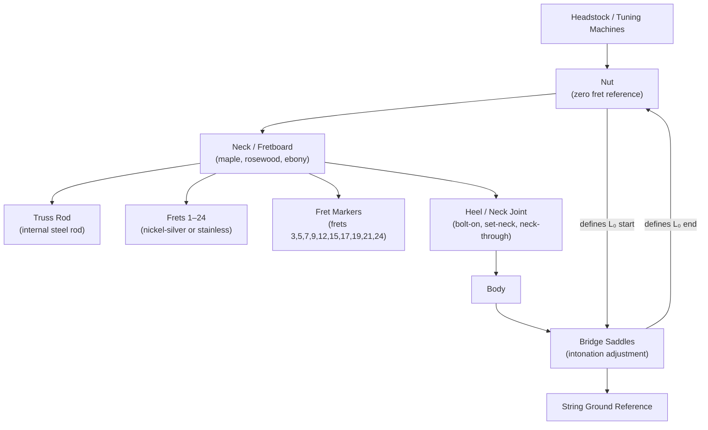
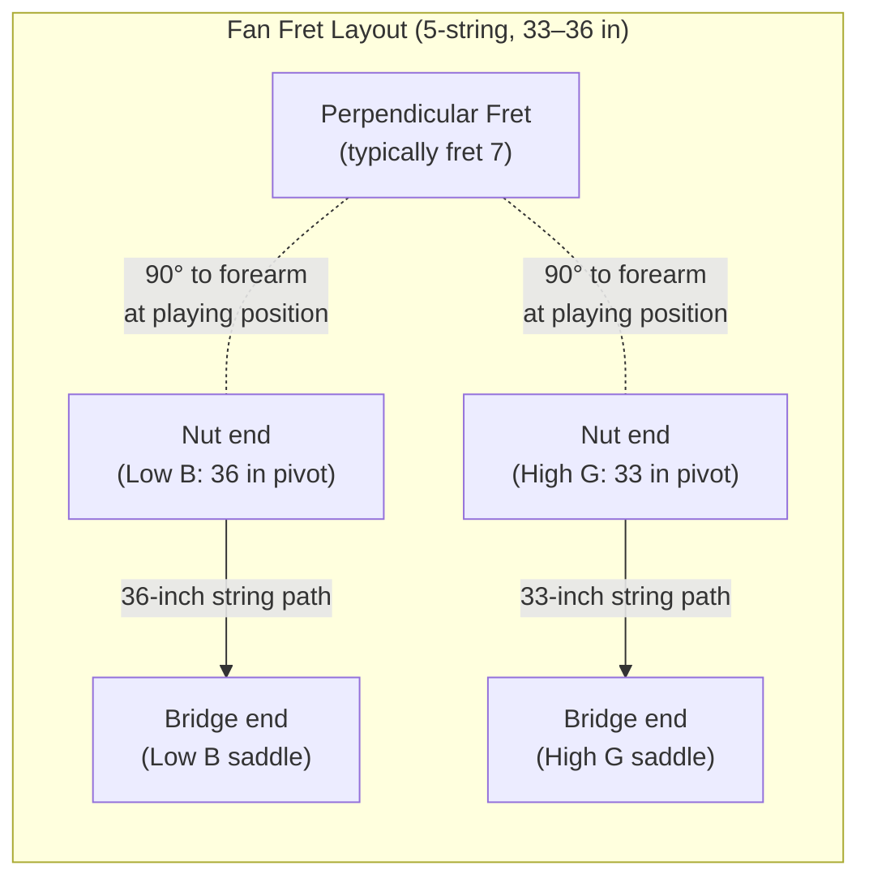
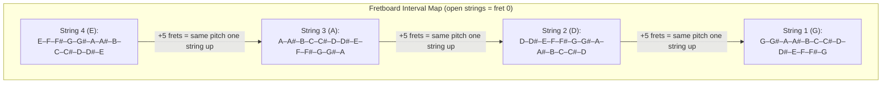
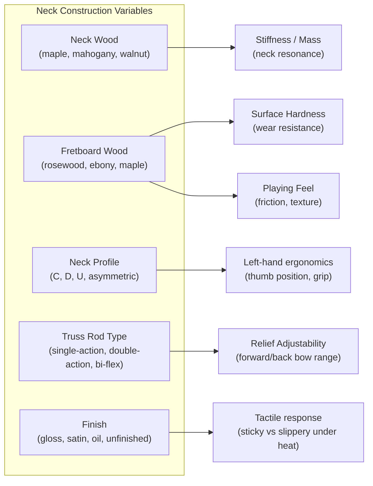

# Lesson 1: Bass Guitar Fretboard Layout — Acoustics, Mathematics, and Lutherie

## 1. First-Principles Intuition & Invariants

### The Physics of a Vibrating String

A bass guitar string is, to first approximation, a one-dimensional elastic medium with fixed boundary conditions at both the nut and the bridge saddle. When plucked, it vibrates in a superposition of its fundamental frequency and harmonics. The fundamental frequency of a vibrating string is governed by Mersenne's Law:

$$f = \frac{1}{2L} \sqrt{\frac{T}{\mu}}$$

where:
- $L$ is the vibrating string length (from nut to saddle)
- $T$ is string tension in Newtons
- $\mu$ is linear mass density in kg/m

This equation encodes three independent levers that instrument designers and players control:

1. **Length** — halving $L$ doubles the frequency (one octave up), which is exactly what fretting accomplishes.
2. **Tension** — tuning pegs adjust $T$; higher tension raises pitch.
3. **Linear density** — thicker/wound strings increase $\mu$, lowering pitch, which is why the low E string is wound with metal wrap wire.

A fret is simply a mechanical means of shortening $L$ to a precisely calculated value. Every fret position is therefore a direct physical instantiation of a frequency ratio.

### Equal Temperament: The Twelve-Root-of-Two Invariant

Western music divides the octave into 12 equal semitones. "Equal" here means that the frequency ratio between any two adjacent semitones is identical — a constraint that makes all keys equally in-tune (and equally slightly compromised relative to pure just intonation). The ratio per semitone is:

$$r = 2^{1/12} \approx 1.05946$$

The absolute frequency of the $n$-th semitone above a reference pitch $f_0$ is:

$$f_n = f_0 \cdot 2^{n/12}$$

For standard bass tuning, $f_0$ for the open low E string is **41.2034 Hz** (E1). The open strings in standard EADG tuning produce:

| String | Note | Frequency (Hz) | Semitones above E1 |
|--------|------|---------------:|-------------------:|
| 4th (lowest) | E1 | 41.20 | 0 |
| 3rd | A1 | 55.00 | 5 |
| 2nd | D2 | 73.42 | 10 |
| 1st (highest) | G2 | 98.00 | 15 |

Adjacent open strings are a perfect fourth apart — 5 semitones — meaning the same fingering pattern on adjacent strings produces the same intervallic relationship, a property that creates the repeating diagonal geometry players exploit for scale and arpeggio patterns.

### Fret Position Formula: Derivation from First Principles

The vibrating length $L_n$ required to produce the $n$-th fret's note is:

$$L_n = L_0 \cdot 2^{-n/12}$$

where $L_0$ is the full scale length (nut to saddle). The *distance* from the nut to the $n$-th fret, $d_n$, is:

$$d_n = L_0 - L_n = L_0 \left(1 - 2^{-n/12}\right) = L_0 \left(1 - \frac{1}{2^{n/12}}\right)$$

The distance from fret $n$ to fret $n+1$ (the inter-fret spacing) is:

$$\Delta_n = d_{n+1} - d_n = L_0 \left(2^{-n/12} - 2^{-(n+1)/12}\right) = L_0 \cdot 2^{-n/12} \left(1 - 2^{-1/12}\right)$$

Since $\left(1 - 2^{-1/12}\right) \approx 0.05613$ is a constant, the spacing between successive frets decreases exponentially — each gap is $2^{-1/12} \approx 0.9439$ times the gap before it. This is why frets crowd together as you ascend the neck.

**The Rule of 18 (historical approximation):** Pre-calculator luthiers approximated $2^{1/12} \approx 1.0595$ with $18/17 \approx 1.0588$, giving the recursive rule: each fret is placed $1/18$ of the remaining string length from the previous fret. The error accumulates to roughly 1.7 cents by the 12th fret — audible under careful listening. Modern CNC lutherie uses the exact formula.

### Computed Fret Positions for a 34-Inch Scale Bass

The 34-inch (863.6 mm) scale length is the dominant standard for electric bass, established by Leo Fender on the original 1951 Precision Bass. For reference, the following table gives exact nut-to-fret distances:

| Fret $n$ | Note (from E1) | $d_n$ (mm) | $L_n$ (mm) | Inter-fret gap (mm) |
|------:|-----------|----------:|----------:|-------------------:|
| 1 | F1 | 48.47 | 815.13 | 48.47 |
| 2 | F#1/G♭1 | 94.08 | 769.52 | 45.61 |
| 3 | G1 | 136.98 | 726.62 | 42.90 |
| 4 | G#1/A♭1 | 177.23 | 686.37 | 40.25 |
| 5 | A1 | 215.00 | 648.60 | 37.77 |
| 7 | B1 | 285.71 | 577.89 | — |
| 9 | C#2/D♭2 | 350.00 | 513.60 | — |
| 12 | E2 (octave) | 431.80 | 431.80 | — |
| 24 | E3 (2nd octave) | 647.70 | 215.90 | — |

At fret 12, $d_{12} = L_0 / 2 = 431.8$ mm exactly — a clean verification that the 12th fret bisects the scale length, as the octave demands. The 24th fret (if present) bisects the remaining half again.

---

## 2. Core Architecture & Mechanics

### Anatomical Components of the Fretboard System



### Scale Length Variants and Their Acoustic Consequences

Scale length is not standardized across all instruments. Its choice involves a tradeoff between tension, tone, and ergonomics:

| Scale Length | Classification | Example Instruments | Characteristic |
|-------------|---------------|--------------------|-|
| 30 in (762 mm) | Short scale | Fender Mustang Bass, Hofner Violin Bass | Lower string tension, warmer/rounder tone, easier reach |
| 32 in (813 mm) | Medium scale | Gibson SG Bass | Transitional feel, balanced tension |
| 34 in (864 mm) | Long scale | Fender Precision Bass, Jazz Bass | Standard; bright, focused, high definition |
| 35 in (889 mm) | Extra long | Many 5-string basses (e.g., Lakland 55-94) | Added tension for low B string clarity |
| 36 in (914 mm) | Baritone | Dingwall Afterburner (fanned frets) | Maximum tension for extended range |

**Why longer scales clarify low strings:** Per Mersenne's Law, maintaining the same pitch at longer scale length requires proportionally higher tension (since $T \propto (2Lf)^2 \mu$). Higher tension increases the string's stiffness-to-mass ratio, shifting inharmonicity (the deviation of overtones from perfect integer multiples) downward in the spectrum. This produces a tighter, more fundamental-dominant low end — audibly "tighter" bass response.

### Fanned-Fret (Multi-Scale) Architecture

A fanned-fret bass uses a different scale length per string, with frets that are not parallel to the nut but instead fanned at an angle. The motivation is acoustic: the low B string on a 5-string bass needs ~35 inches for sufficient tension, while the high G benefits from a shorter ~33-inch scale for playability.



Dingwall Guitars (Nova, Combustion, Afterburner series) are the most recognized proponents; the design was popularized by luthier Sheldon Dingwall from the 1990s onward, though the concept originates with Ralph Novak's 1989 patent.

### Neck Relief, Action, and the Truss Rod

A perfectly straight neck is not the optimal geometry for bass playability. The vibrating string traces an arc (the string's vibration envelope widens toward the midpoint of its length), so a neck with a slight concave bow — called **relief** — prevents the string from buzzing against frets in the lower positions.

The truss rod is a steel rod (or dual-action rod) running through the neck channel. By tightening its adjustment nut:
- **Clockwise** tightening applies a backbow force, reducing relief (straightening the neck).
- **Counter-clockwise** loosening allows string tension to increase forward bow, adding relief.

Typical target relief for bass is **0.25–0.50 mm** measured at the 7th or 8th fret when the 1st and last frets are fretted simultaneously (a three-point beam measurement). Action (string height above the 12th fret) typically targets **2.0–2.5 mm on the G string** and **2.5–3.0 mm on the E string** for fingerstyle playing.

### String Tension: Quantified

Using Mersenne's formula solved for tension:

$$T = \mu \cdot (2Lf)^2$$

For a standard D'Addario EXL160 roundwound set (.050–.105) on a 34-inch (0.8636 m) scale:

| String | Gauge | $\mu$ (kg/m) | Note | $f$ (Hz) | $T$ (N) | $T$ (lbs) |
|--------|-------|----------:|------|--------:|--------:|---------:|
| E | .105 | 0.01175 | E1 | 41.20 | 68.9 | 15.5 |
| A | .085 | 0.00769 | A1 | 55.00 | 62.4 | 14.0 |
| D | .070 | 0.00497 | D2 | 73.42 | 52.9 | 11.9 |
| G | .050 | 0.00249 | G2 | 98.00 | 40.4 | 9.1 |
| **Total** | | | | | **224.6** | **50.5** |

Over 50 lbs of cumulative string pull acts on the neck. The truss rod and neck wood must collectively counteract this force to maintain stable relief geometry over years of use and across temperature/humidity cycles.

---

## 3. The Fretboard as a Note Matrix

### Interval Architecture and Geometric Patterns

Because adjacent strings are tuned a perfect fourth (5 semitones) apart, the fretboard has a highly regular intervallic structure. Any note fingered at fret $n$ on string $s$ produces the same pitch as fret $n+5$ on string $s+1$ (one string lower in pitch). This creates a consistent diagonal geometry:



Key geometric invariants every player internalizes:

- **Octave shape:** Any note at fret $n$ on string $s$ is an octave above the note at fret $n+2$ on string $s-2$ (two strings lower in pitch, two frets higher). This "2-string, 2-fret" octave shape is universal across all EADG tuning.
- **Perfect fifth:** 7 semitones = 7 frets on the same string, or 2 frets back on the adjacent lower string.
- **Perfect fourth:** 5 semitones = 5 frets on the same string, or the same fret on the adjacent lower string (open-string tuning interval).

### Note Frequency Reference Table

The following Python snippet computes the frequency of every note on a standard 4-string bass across 24 frets, using the equal temperament formula:

```python
# fretboard_frequencies.py
# Computes the exact frequency of every note on a standard 4-string bass.
# EADG tuning, 24 frets, equal temperament (A4 = 440 Hz reference).

import math

# A4 = 440 Hz is the ISO 16 standard reference pitch.
# E1 = 440 * 2^((28 - 69) / 12) using MIDI note numbering.
# MIDI note 28 = E1, 33 = A1, 38 = D2, 43 = G2.

OPEN_STRING_MIDI = {
    'E': 28,  # E1 — lowest string
    'A': 33,  # A1
    'D': 38,  # D2
    'G': 43,  # G2 — highest string
}

NOTE_NAMES = ['C', 'C#/Db', 'D', 'D#/Eb', 'E', 'F',
              'F#/Gb', 'G', 'G#/Ab', 'A', 'A#/Bb', 'B']

A4_HZ = 440.0
A4_MIDI = 69


def midi_to_freq(midi_note: int) -> float:
    """Convert a MIDI note number to frequency in Hz using equal temperament."""
    return A4_HZ * (2.0 ** ((midi_note - A4_MIDI) / 12.0))


def midi_to_name(midi_note: int) -> str:
    """Return the note name and octave for a MIDI note number."""
    octave = (midi_note // 12) - 1
    name = NOTE_NAMES[midi_note % 12]
    return f"{name}{octave}"


def compute_fretboard(num_frets: int = 24) -> dict:
    """
    Returns a dict mapping (string_name, fret) -> (note_name, frequency_hz).
    Fret 0 = open string.
    """
    fretboard = {}
    for string_name, open_midi in OPEN_STRING_MIDI.items():
        for fret in range(num_frets + 1):
            midi = open_midi + fret
            freq = midi_to_freq(midi)
            note = midi_to_name(midi)
            fretboard[(string_name, fret)] = (note, round(freq, 3))
    return fretboard


def compute_fret_positions(scale_length_mm: float, num_frets: int = 24) -> list:
    """
    Compute nut-to-fret distances in mm for a given scale length.
    Uses the exact equal-temperament formula: d_n = L0 * (1 - 2^(-n/12))
    """
    return [
        (n, round(scale_length_mm * (1.0 - 2.0 ** (-n / 12.0)), 3))
        for n in range(1, num_frets + 1)
    ]


if __name__ == '__main__':
    fb = compute_fretboard()

    # Print the note at each fret for every string
    print(f"{'String':<8} {'Fret':<6} {'Note':<10} {'Freq (Hz)':<12}")
    print('-' * 40)
    for string in ['E', 'A', 'D', 'G']:
        for fret in range(0, 13):  # first octave only
            note, freq = fb[(string, fret)]
            print(f"{string:<8} {fret:<6} {note:<10} {freq:<12.3f}")
        print()

    # Print fret positions for 34-inch (863.6 mm) scale
    print("\nFret positions (34-inch / 863.6 mm scale):")
    print(f"{'Fret':<6} {'Nut-to-fret (mm)':<20} {'Remaining length (mm)'}")
    print('-' * 50)
    scale = 863.6
    for fret, dist in compute_fret_positions(scale, 24):
        remaining = round(scale - dist, 3)
        print(f"{fret:<6} {dist:<20} {remaining}")
```

Running this confirms, for example, that string E at fret 12 is E2 at 82.407 Hz — exactly double 41.203 Hz, validating the octave invariant.

---

## 4. High-Performance Lutherie: Tolerances, Materials, and Failure Modes

### Fret Placement Tolerance

CNC fret slotting machines achieve slot placement accuracy of ±0.025 mm (±0.001 inch). To understand the intonation consequence of a placement error $\epsilon$ at fret $n$, differentiate the frequency-position relationship:

$$\delta f = f_n \cdot \frac{\ln 2}{12} \cdot \frac{\epsilon}{L_n}$$

Converting to cents (1 cent = 1/100 semitone, $\approx 0.5783\%$ frequency deviation):

$$\delta c \approx \frac{1200 \cdot \epsilon}{L_n \cdot \ln 2}$$

For fret 12 on a 34-inch scale ($L_{12} = 431.8$ mm), a 0.5 mm error produces:

$$\delta c \approx \frac{1200 \times 0.5}{431.8 \times 0.6931} \approx 2.0 \text{ cents}$$

2 cents is at the threshold of perception for trained listeners. 5 cents is audible to most musicians. Fret placement error is therefore not the dominant intonation error source — saddle compensation is.

### Saddle Compensation: Correcting Fretting Sharp

When a string is fretted, it undergoes slight elongation beyond its resting length, increasing tension and slightly raising the pitch above the theoretical value. This effect, called **fretting sharpness** or **fret compensation**, is proportional to string stiffness and action height. It is corrected by **saddle compensation**: setting each bridge saddle slightly *behind* the theoretical scale length endpoint, effectively increasing the vibrating length to lower the pitch back to target.

The compensation amount $C$ for a string is approximated by:

$$C \approx \frac{B}{2} \left(\frac{h^2}{L_0^2}\right) L_0$$

where $B$ is a stiffness-related constant (empirically derived per string gauge), $h$ is the action height, and $L_0$ is the nominal scale length. In practice, compensation is set empirically by comparing the 12th-fret harmonic (pure half-length frequency) with the 12th-fret fretted note; the saddle is moved until they match to within 1–2 cents.

This is why bass bridges provide individual saddle adjustment: a wound .105 E string requires significantly more compensation (~3–5 mm on a 34-inch scale) than a plain .050 G string (~1–2 mm).

### Fret Materials and Wear Mechanics

Fret wire is an alloy extruded into a cross-section with a crown (the visible rounded top) and tangs (barbs that press into the fret slot). The dominant alloys are:

| Material | Composition | Rockwell Hardness | Lifespan (relative) | Characteristic |
|----------|------------|-------------------|--------------------|-|
| Nickel silver | 18% Ni, 65% Cu, 17% Zn | ~60 HRB | 1× baseline | Most common; easy to level/crown; moderate lifespan |
| Stainless steel | 18/8 or similar austenitic | ~92 HRB | 4–6× | Extremely durable; resists string groove; harder to work |
| EVO Gold | Titanium-copper-tin alloy | ~72 HRB | 2–3× | Warm appearance; gold color; intermediate hardness |
| Gold frets | Gold-plated nickel silver | Same as base | 1× | Cosmetic; plating wears through quickly |

Nickel silver (a misnomer — it contains no silver) is softer than stainless steel strings, so string grooves develop over time. A fret with grooves deeper than ~0.3 mm typically requires leveling, recrowning, and polishing (a full "fret dress"). Stainless steel frets outlast the neck wood's finish, but their hardness accelerates file wear during installation and requires specialized tools.

### Neck Wood and Fretboard Material Acoustics



Denser fretboard woods (ebony, ~800 kg/m³) provide a stiffer end-grain surface and are associated with a faster, brighter attack transient. Rosewood (~700–750 kg/m³) has a more open pore structure and is perceived as warmer. However, controlled acoustic studies (e.g., Patrick Hase et al. in peer-reviewed lutherie literature) show that fretboard wood contributes minimally to the amplified electric bass tone — the dominant variables for electric instruments are pickup type, placement, and electronics. Fretboard material matters primarily for playability (feel, friction) and mechanical durability.

**Note on CITES regulations:** Brazilian rosewood (*Dalbergia nigra*) is CITES Appendix I (commercial trade banned). Indian rosewood (*Dalbergia latifolia*) was added to CITES Appendix II in 2017, requiring export permits. Many manufacturers now use pau ferro (*Libidibia ferrea*, sometimes marketed as "Morado") or synthetic alternatives (Richlite, Ebonol) to avoid trade restrictions.

---

## 5. Intonation, Tuning Systems, and Temperament Trade-offs

### Equal Temperament vs. Just Intonation

The equal temperament system is a deliberate compromise. Pure interval ratios (just intonation) produce beatless consonances: a perfect fifth is exactly $3:2$ (702.0 cents), a major third is exactly $5:4$ (386.3 cents). Equal temperament approximates these:

| Interval | Just ratio | Just (cents) | ET (cents) | Error (cents) |
|----------|-----------|-------------:|------------:|---------------:|
| Unison | 1:1 | 0.0 | 0.0 | 0.0 |
| Minor 2nd | 16:15 | 111.7 | 100.0 | −11.7 |
| Major 2nd | 9:8 | 203.9 | 200.0 | −3.9 |
| Minor 3rd | 6:5 | 315.6 | 300.0 | −15.6 |
| **Major 3rd** | **5:4** | **386.3** | **400.0** | **+13.7** |
| Perfect 4th | 4:3 | 498.0 | 500.0 | +2.0 |
| **Perfect 5th** | **3:2** | **702.0** | **700.0** | **−2.0** |
| Octave | 2:1 | 1200.0 | 1200.0 | 0.0 |

The equal-tempered major third is 13.7 cents wide — a clearly audible discrepancy in sustained chords. The equal-tempered perfect fifth is 2 cents narrow — essentially imperceptible in isolation but cumulative in stacked fifth tuning (a reason why violinists and vocalists instinctively widen their fifths when playing unaccompanied).

For bass players, this manifests practically: when playing a sustained major third interval against a keyboard or guitar, the equal-tempered fretted major third will produce a slow beat frequency with any just-tuned harmonic instrument. Skilled players compensate with slight pitch inflection via string bending or fingertip pressure variation — a technique more available on fretless bass.

### Buzz Feiten Tuning System

The Buzz Feiten Tuning System (BFTS), patented in 1994, addresses systemic intonation errors inherent to equal temperament on fretted instruments by:

1. **Shortening the nut compensation:** Moving the nut slightly (1–2 mm) toward the first fret, effectively reducing the theoretical scale length by a small fraction.
2. **Adjusting saddle offsets** using a proprietary compensation table (not a single uniform shift) calibrated to minimize cumulative intonation error across the range of a chord voicing.

BFTS is used by several manufacturers (Yamaha, Peavey in certain models) and is available as an aftermarket modification. Its perceptual benefit is most audible when playing chord voicings in the first five frets.

---

## 6. Extended Range and Alternative Tunings

### Five- and Six-String Architectures

Adding a low B string (B0, 30.87 Hz) below the standard E string creates significant lutherie challenges:

- **Scale length:** A .130 or .135 gauge B string on a 34-inch scale produces tension of only ~37 N — insufficient for a taut, articulate low end. Most 5-string basses use 35-inch scale, or a fan-fret design, to restore adequate tension.
- **Nut slot width:** Total nut width increases from ~38 mm (4-string) to ~44–47 mm (5-string), increasing left-hand stretch.
- **String spacing:** Bridge spacing is typically narrowed from 19 mm (4-string standard) to 17.5–18 mm (5-string) to keep the instrument playable at a narrower overall width.

### Alternate Tunings and Their Fretboard Implications

| Tuning | Description | Common context |
|--------|------------|----------------|
| EADG | Standard | Universal |
| Drop D (DADG) | Detuned E to D | Rock, metal; enables power-chord shapes on two strings |
| BEAD | 4-string tuned as bottom four of a 5-string | Extended low range without 5th string |
| CGDA (tenor) | Up a whole step | Melodic playing, chord-melody bass |
| DGDA (open D) | Partial open tuning | Slide bass |

Drop D shifts the low E string down two semitones, moving its fretboard map 2 frets flat relative to standard. This breaks the uniform fourth-interval geometry between strings 4 and 3 — the first three frets on the E string now produce notes that standard fingering patterns on that string would not. Players who primarily use drop D often develop a bifurcated mental map: standard geometry on strings 1–3, offset geometry on string 4.

---

## Summary

The bass guitar fretboard is an engineered artifact whose geometry is fully determined by equal temperament mathematics: fret positions follow $d_n = L_0(1 - 2^{-n/12})$, inter-fret spacing decreases geometrically by factor $2^{-1/12}$ per fret, and the 12th fret always bisects the scale length. String physics (Mersenne's Law), material science (fret alloy hardness, neck wood stiffness), and lutherie craft (saddle compensation, truss rod relief) together determine whether the mathematical ideal translates into a playable, accurately intonated instrument. Understanding these first principles gives players, builders, and teachers a rigorous framework for diagnosing intonation failures, selecting instruments for specific musical contexts, and making informed decisions about setup and modification.
