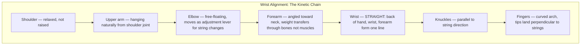
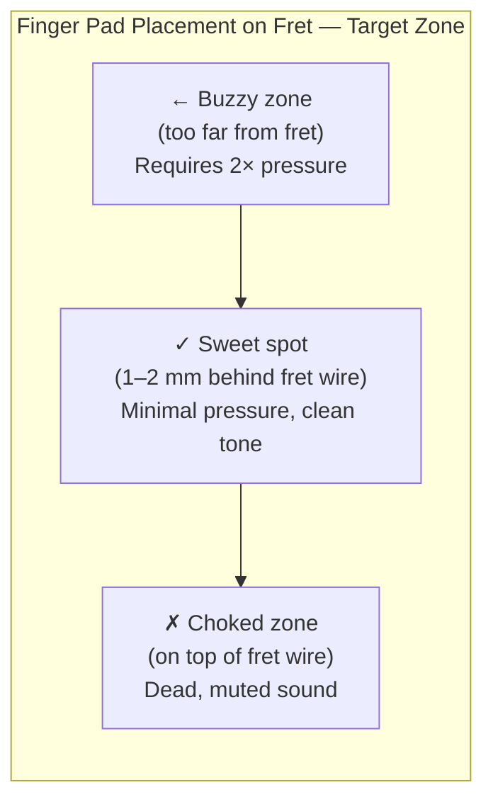
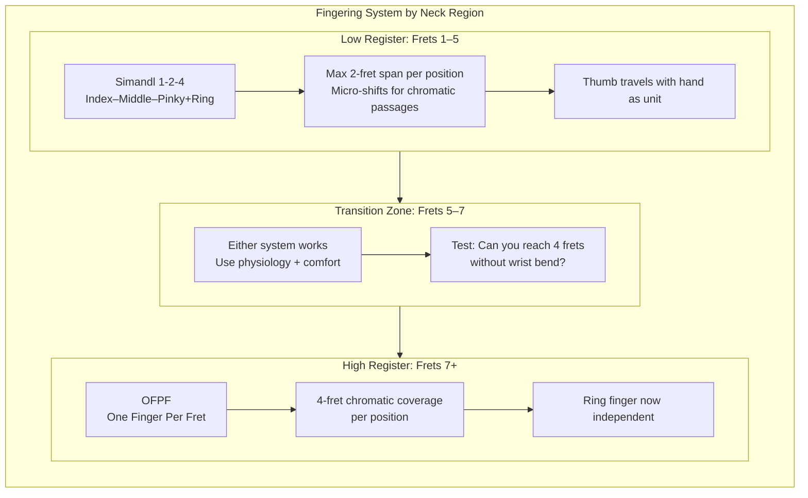
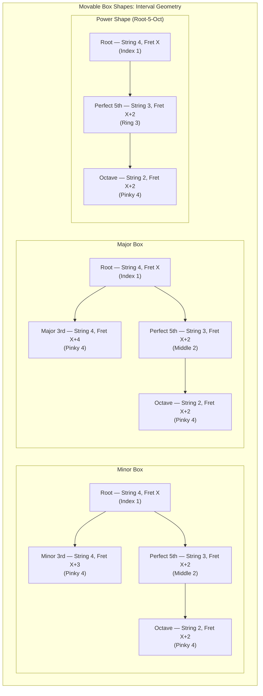

# Lesson 1: Bass Guitar Fretboard Layout and Left-Hand Mechanics

**Discipline:** Music Performance | **Domain:** Arts  
**Level:** Foundation | **Series:** Bass Guitar Masterclass

---

## Learning Objectives

By the end of this lesson you will be able to:

- Navigate the full bass fretboard and locate any note by name in under five seconds
- Execute the Franz Simandl 1-2-4 fingering system in the low register (frets 1–5) without strain or wrist deviation
- Apply One-Finger-Per-Fret (OFPF) technique cleanly and independently above the 7th fret
- Play movable Root–3rd–5th–Octave box shapes in any key with consistent fingering geometry
- Complete all finger-independence and shifting drills at 60, 80, and 100 BPM with clean tone and no buzz
- Diagnose and correct the five most common left-hand mechanical errors
- Implement injury-prevention protocols before, during, and after every practice session

---

## 1. Acoustic Grounding: Why the Fretboard Exists

The bass guitar's longer scale length — typically 34 inches on a standard instrument — means its open strings vibrate at lower frequencies than a guitar. Longer, heavier strings require more energy to reach pitch and produce longer wavelengths. String tension, mass per unit length, and vibrating string length together determine fundamental frequency.

When you press a fret, you shorten the vibrating portion of the string, raising its frequency in a precisely equal-tempered relationship: each fret represents exactly one semitone, or one-twelfth of an octave. This physical relationship is why left-hand finger placement directly behind the fret wire matters so much — you are dividing a tensioned string with mechanical precision. Even a few millimeters of slop introduces buzz, flatness, or muted tone.

**Takeaway:** The fretboard is not arbitrary geometry. It is a physical implementation of the equal-tempered chromatic scale. Your hand is the actuator. Precision in placement yields clean tone; slop yields mechanical failure.

---

## 2. The Fretboard as a Map

Before your fingers move, your eyes must read the neck. The bass fretboard is a grid: strings run horizontally (low to high), frets run vertically (nut to body), and every intersection is a unique pitch.

### 2.1 Standard Tuning Open Strings

```
String 4 (thickest, lowest):  E2  (41.2 Hz)
String 3:                     A2  (55.0 Hz)
String 2:                     D3  (73.4 Hz)
String 1 (thinnest):          G3  (98.0 Hz)
```

Each string is tuned a **perfect fourth** (five semitones, or a 4:3 frequency ratio) above the one below it. This interval relationship is the structural backbone of everything you will learn on this instrument.

### 2.2 The Chromatic Note Grid (Frets 0–12)

The table below maps every note on a standard 4-string bass from open strings through the 12th fret. The 12th fret is the octave of the open string — the pattern repeats identically from fret 12 onward.

| Fret | String 4 (E) | String 3 (A) | String 2 (D) | String 1 (G) |
|------|-------------|-------------|-------------|-------------|
| 0 (open) | **E** | **A** | **D** | **G** |
| 1 | F | A♯ / B♭ | D♯ / E♭ | G♯ / A♭ |
| 2 | F♯ / G♭ | B | E | A |
| 3 | G | C | F | A♯ / B♭ |
| 4 | G♯ / A♭ | C♯ / D♭ | F♯ / G♭ | B |
| 5 | **A** | **D** | **G** | **C** |
| 6 | A♯ / B♭ | D♯ / E♭ | G♯ / A♭ | C♯ / D♭ |
| 7 | B | E | A | D |
| 8 | C | F | A♯ / B♭ | D♯ / E♭ |
| 9 | C♯ / D♭ | F♯ / G♭ | B | E |
| 10 | D | G | C | F |
| 11 | D♯ / E♭ | G♯ / A♭ | C♯ / D♭ | F♯ / G♭ |
| 12 | **E** (octave) | **A** (octave) | **D** (octave) | **G** (octave) |

**Key navigation shortcut:** The note at fret 5 on any string is the same pitch as the open string above it. E string fret 5 = A (open string 3). This is your primary tuning reference and your first inter-string anchor point.

### 2.3 Fretboard Navigation Diagram

```mermaid
graph LR
    subgraph sub_strings ["4-String Fretboard: Chromatic Layout (Frets 0–12)"]
        subgraph sub_e ["String 4: E (Lowest)"]
            E0["E₂ (0)"] --> E1["F (1)"] --> E2["F♯ (2)"] --> E3["G (3)"] --> E5["A (5)"] --> E7["B (7)"] --> E12["E₃ (12)"]
        end
        subgraph sub_a ["String 3: A"]
            A0["A₂ (0)"] --> A2["B (2)"] --> A3["C (3)"] --> A5["D (5)"] --> A7["E (7)"] --> A12["A₃ (12)"]
        end
        subgraph sub_d ["String 2: D"]
            D0["D₃ (0)"] --> D2["E (2)"] --> D3["F (3)"] --> D5["G (5)"] --> D7["A (7)"] --> D12["D₄ (12)"]
        end
        subgraph sub_g ["String 1: G (Highest)"]
            G0["G₃ (0)"] --> G2["A (2)"] --> G3["A♯ (3)"] --> G5["C (5)"] --> G7["D (7)"] --> G12["G₄ (12)"]
        end
    end
```



**Memorization drill:** Pick any note name (e.g., "C"). Find all occurrences of C on the fretboard within ten seconds. Repeat daily with different note names until instant recall.

---

## 3. Left-Hand Mechanics: The Foundation of Everything

Poor left-hand mechanics are the number one cause of repetitive strain injury in bassists. The habits you build in the first thirty days are the habits you will carry for life. Get this right before you go fast.

### 3.1 Total Body Setup

Before the left hand does anything, the instrument must be positioned correctly.

**Seated position:**
- Rest the lower bout of the bass on your **right thigh** (for right-handed players)
- The neck angles upward at roughly **45 degrees** — never horizontal, never pointing at the floor
- The body of the bass rests lightly against your torso; do **not** grip it with your forearm
- Your left elbow hangs freely from your shoulder, pointing down toward the floor, not locked against your body

**Standing position:**
- Strap length should allow the **same neck angle** as seated — many players err by wearing the bass too low, which forces wrist deviation and causes injury over time
- **Practical test:** If you can maintain the same hand position sitting and standing, your strap is at the correct length
- The strap should be adjusted so the 12th fret is roughly at shoulder height

**Common setup error:** Bass hanging below the waist forces the fretting hand to reach upward, bending the wrist into ulnar deviation (wrist angled toward the pinky side). This compresses the ulnar nerve and loads the tendons asymmetrically. Raise the instrument.

### 3.2 The Fretting Wrist: The Single Most Important Mechanical Concept

**The wrist must stay straight — meaning the back of your hand, the wrist joint, and the forearm form one continuous line, with no bend up, down, or sideways.**

When the wrist bends inward (toward the neck, called radial deviation), the median nerve and flexor tendons running through the carpal tunnel are compressed under load. Do this for a few months and you develop chronic tendinitis or carpal tunnel syndrome. Neither is compatible with a playing career.

Achieving a straight wrist on bass requires that your **elbow swing outward and slightly forward**. The elbow acts as the adjustment lever:
- When you need your fingers to reach a low string (String 4), the elbow drops lower
- When you need to reach a high string (String 1), the elbow swings out away from your body
- **The wrist itself does not bend — the elbow compensates**



**Visual check:** Take a photo of your left hand while fretting String 4, fret 1, with your index finger. Draw a straight line from your elbow through your wrist to your knuckles. If the line bends at the wrist joint, you are in a danger zone.

**Common wrist error — the death grip:** Many beginners wrap the thumb over the top of the neck like a classical guitarist and squeeze. This locks the wrist into a bent position and eliminates finger independence. If you catch yourself doing this, stop completely, reset to correct thumb placement (see below), and continue at a slower tempo.

### 3.3 Thumb Placement: The Hidden Foundation

The fretting thumb belongs **on the back of the neck**, not over the top. It acts as a gentle counterbalance to the fingers, not a clamp.

**Correct thumb position:**
- Resting lightly on the back of the neck, **behind the middle finger** (second finger)
- Making gentle contact — the thumb is a **guide**, not a vise
- Pointing roughly upward or at a slight diagonal toward the headstock
- **Never gripping or squeezing**; the thumb opposes the fingers with just enough counter-pressure to allow the fingertips to fret cleanly

**Thumb mobility principle:** The thumb moves along the back of the neck as you shift positions. It does **not** stay locked in one spot while your fingers stretch away from it. When the fingers move, the thumb travels with them as a unit.

**Pressure test:** While fretting a note cleanly, try to slide a piece of paper between your thumb and the back of the neck. If you cannot, you are gripping too hard. Reduce pressure until the note still rings but the paper can slide. That is your baseline pressure.

### 3.4 Finger Arch and Pad Placement

Each fretting finger must maintain a **curved arch** — think of the shape your hand makes when you rest it on a tennis ball. The tips of the fingers come down onto the string, not the flat flesh of the finger pad.

**Precision pad placement:**
- Land **directly behind the fret wire** — as close to the fret as possible without being on top of it
- This minimizes the string length you need to depress to make clean contact with the fret
- The result is **clean tone with minimal pressure required**

**What happens when placement is wrong:**

| Placement Error | Acoustic Result | Mechanical Cost |
|----------------|----------------|----------------|
| Too far back from the fret (e.g., halfway between two frets) | Buzzing, requires excessive pressure | Hand fatigue, potential tendon strain |
| On top of the fret wire | Choked, dead tone | Uneven volume across notes |
| Flat finger pad instead of tip | Mutes adjacent strings, reduces independence | Forces fingers into unnatural angles |
| Fingernail touching the string | Clicking noise, unpredictable muting | Limits finger curl, forces overextension |



**Finger proximity discipline:** Fingers not currently fretting a note should **hover 5–10 mm above the string**, ready to descend instantly. Do not let unused fingers fly high into the air or curl back into the palm. This proximity discipline is what separates clean, fast playing from sloppy, uneven playing.

---

## 4. The Two Fingering Systems: When to Use Each

Bass guitar's wide fret spacing — especially in the first five frets — means that applying classical guitar OFPF (one finger per fret) in the low register puts the hand in a biomechanically dangerous lateral stretch. Two distinct systems solve this problem.

### 4.1 Franz Simandl 1-2-4: Frets 1 Through 5

The Simandl system, adapted from double bass technique, assigns fingers as follows in the low register:

| Finger | Simandl Assignment | Physical Role |
|--------|--------------------|--------------|
| **Index (1)** | 1st position | Anchors the hand position |
| **Middle (2)** | 2nd position | Adjacent to index, one fret higher |
| **Ring (3)** | — | **Does not fret independently; reinforces pinky** |
| **Pinky (4)** | 3rd position | Ring finger stacks behind pinky for support |

**Why the ring finger does not fret independently:** In the low register, the pinky on bass guitar bears significant mechanical disadvantage — it is the weakest finger, has the shortest reach, and has the most independent tendon structure (the flexor digitorum profundus tendon to the pinky is often partially fused to the ring finger tendon in many people's anatomy). Forcing the pinky to operate alone across a wide fret span in the low register is a recipe for strain. The ring+pinky combined unit solves this by sharing the load.

**Simandl hand shape in first position (frets 1–3):**
```
Fret 1 → Index finger (1)
Fret 2 → Middle finger (2)
Fret 3 → Pinky (4), with ring finger physically stacked behind it for support
```

You cover **two frets** comfortably in this configuration. To reach fret 4 or 5 from first position, you execute a **half-shift**: the entire hand (thumb included) slides up slightly so the index finger now rests near fret 2 or 3, making fret 4 or 5 reachable by the pinky without dangerous stretch.

**Simandl extended reach (accessing fret 5 from first position):**
```
Fret 1 → Index (1) — home position
Fret 2 → Middle (2)
Fret 3 → Pinky (4)
  — micro-shift: thumb slides up ~1 fret, elbow adjusts forward —
Fret 5 → Pinky (4), ring still supporting
```

This half-shift means you are always covering a **maximum span of two to three frets comfortably**, with strategic micro-shifts for chromatic passages. You never stretch three wide frets with an isolated pinky bearing full load.

### 4.2 One-Finger-Per-Fret (OFPF): Fret 7 and Above

As you move up the neck, fret spacing narrows significantly. By the 7th fret, the spacing is comfortable enough for each finger to cover one fret independently:

| Finger | Fret Assignment in OFPF |
|--------|------------------------|
| **Index (1)** | Base fret of position |
| **Middle (2)** | Base fret + 1 |
| **Ring (3)** | Base fret + 2 |
| **Pinky (4)** | Base fret + 3 |

**Example — 7th position OFPF:**
```
String 4, Fret 7 → Index (1) = B
String 4, Fret 8 → Middle (2) = C
String 4, Fret 9 → Ring (3) = C♯
String 4, Fret 10 → Pinky (4) = D
```

OFPF gives you **four frets of chromatic coverage per position** without shifting. The transition zone between Simandl and OFPF is roughly **frets 5–7**, where either system is viable and personal physiology (hand size, finger length, flexibility) determines which feels more natural.

**Biomechanical decision point:** Players with smaller hands or shorter fingers may prefer to use Simandl up through fret 7. Players with larger hands or long fingers may switch to OFPF as early as fret 5. There is no single correct transition point — the correct system is the one that allows you to maintain a straight wrist and arch your fingers without strain.

### 4.3 System Transition Diagram



---

## 5. Movable Box Shapes: Your Harmonic Navigation System

A **box shape** is a fingering template that expresses a musical interval relationship — it is defined by its **geometry on the fretboard**, not by the note it starts on. Because the tuning interval between strings is consistent (perfect fourths throughout), any box shape can be moved to any string and any fret without changing its fingering. **Move the root, and the entire shape transposes with it.**

This is the core principle that separates beginners from intermediate players: beginners memorize individual notes; intermediates memorize shapes and move them.

### 5.1 The Core Intervals on the Fretboard

Understanding where intervals live relative to any root note is the foundation of fretboard navigation.

**Same string (vertical intervals):**
- 1 fret up = minor 2nd (half step)
- 2 frets up = major 2nd (whole step)
- 3 frets up = minor 3rd
- 4 frets up = major 3rd
- 5 frets up = perfect 4th
- 7 frets up = perfect 5th
- 12 frets up = octave

**Across adjacent strings (horizontal intervals, same fret):**
- One string higher, same fret = **perfect 4th above** (because strings are tuned in 4ths)

**Diagonal intervals (cross-string shapes):**
- One string higher, 2 frets back = major 3rd above
- One string higher, 3 frets back = minor 3rd above
- **Two strings higher, 2 frets forward = octave above** (the most-used shape in bass)

**Octave shape diagram:**
```
Root on String 4, Fret X
Octave on String 2, Fret X+2

Example:
String 4, Fret 3 = G (root)
String 2, Fret 5 = G (octave)
```

This two-string, two-fret-forward octave shape is the backbone of rock, R&B, and funk bass lines. Learn it first.

### 5.2 The Root–5th–Octave Power Shape

This three-note shape is the harmonic skeleton of most popular music bass lines. It defines the root and fifth of any chord, giving you the tonal center and the strongest harmonic support note.

**Shape geometry:**
```
Root (R):   String 4, Fret X          — Index finger (1)
Perfect 5th (P5): String 3, Fret X+2  — Ring (3) or Pinky (4)
Octave (Oct):     String 2, Fret X+2  — Pinky (4) or use same finger as P5
```

**Example — G root, 3rd fret, String 4:**
```
String 4, Fret 3  → G  (Root)         — Index (1)
String 3, Fret 5  → D  (Perfect 5th)  — Ring (3)
String 2, Fret 5  → G  (Octave)       — Pinky (4)
```

**Fingering variation:** Some players use index–middle–pinky (1-2-4) for this shape, placing the middle finger on the 5th and pinky on the octave. Others use index–ring–pinky (1-3-4). Choose the fingering that keeps your wrist straightest.

### 5.3 The Minor Box Shape (Root–m3–P5–Octave)

The minor box adds the **minor 3rd** to the power shape, giving you full tonal definition of a minor chord.

**Shape geometry:**
```
Root (R):   String 4, Fret X          — Index (1)
Minor 3rd (m3): String 4, Fret X+3    — Pinky (4) in Simandl, Ring (3) in OFPF
Perfect 5th (P5): String 3, Fret X+2  — Middle (2) or Ring (3)
Octave (Oct):     String 2, Fret X+2  — Ring (3) or Pinky (4)
```

**Example — A minor box, root at String 4, Fret 5:**
```
String 4, Fret 5  → A   (Root)         — Index (1)
String 4, Fret 8  → C   (minor 3rd)    — Ring (3) or Pinky (4)
String 3, Fret 7  → E   (Perfect 5th)  — Middle (2)
String 2, Fret 7  → A   (Octave)       — Pinky (4)
```

**Playing order for practice:** Root → m3 → Root → P5 → Octave → P5 → Root. This ascending-descending pattern ingrains the finger geometry into muscle memory.

### 5.4 The Major Box Shape (Root–M3–P5–Octave)

The major box substitutes a **major 3rd** (one fret higher than the minor 3rd) for the minor 3rd, defining a major tonality.

**Shape geometry:**
```
Root (R):   String 4, Fret X          — Index (1)
Major 3rd (M3): String 4, Fret X+4    — Pinky (4)
Perfect 5th (P5): String 3, Fret X+2  — Middle (2)
Octave (Oct):     String 2, Fret X+2  — Ring (3) or Pinky (4)
```

**Example — A major box, root at String 4, Fret 5:**
```
String 4, Fret 5  → A   (Root)         — Index (1)
String 4, Fret 9  → C♯  (Major 3rd)    — Pinky (4)
String 3, Fret 7  → E   (Perfect 5th)  — Middle (2)
String 2, Fret 7  → A   (Octave)       — Pinky (4)
```

**Mechanical note:** The major box requires the pinky to stretch one additional fret higher than the minor box on String 4. In the Simandl region (frets 1–5), this stretch may require a micro-shift of the thumb and hand. In the OFPF region (frets 7+), the spacing makes this stretch natural.

### 5.5 Box Shape Comparison Diagram



### 5.6 Transposing the Box: The Core Principle

The box shape is a **movable template**. The only thing that changes when you transpose is where you place the root. **The finger geometry stays identical.**

| Root Note | Root Fret (String 4) | Minor Box m3 Fret | Major Box M3 Fret | P5 Fret (String 3) | Octave Fret (String 2) |
|-----------|---------------------|-------------------|-------------------|--------------------|------------------------|
| E | 0 (open) | 3 | 4 | 2 | 2 |
| F | 1 | 4 | 5 | 3 | 3 |
| F♯ / G♭ | 2 | 5 | 6 | 4 | 4 |
| G | 3 | 6 | 7 | 5 | 5 |
| G♯ / A♭ | 4 | 7 | 8 | 6 | 6 |
| A | 5 | 8 | 9 | 7 | 7 |
| A♯ / B♭ | 6 | 9 | 10 | 8 | 8 |
| B | 7 | 10 | 11 | 9 | 9 |
| C | 8 | 11 | 12 | 10 | 10 |
| C♯ / D♭ | 9 | 12 | 13 | 11 | 11 |
| D | 10 | 13 | 14 | 12 | 12 |
| D♯ / E♭ | 11 | 14 | 15 | 13 | 13 |
| E (octave) | 12 | 15 | 16 | 14 | 14 |

**The pattern is absolute:** Once your fingers know the minor box shape, moving it to a new root takes zero additional cognitive load — only positional awareness. This is the efficiency principle that makes bass guitar a navigable instrument across its entire range.

---

## 6. Practical Drills and Metronome Progressions

Every drill below follows the same progression framework:

```
Start: 60 BPM — focus on mechanics, not speed; every note clean
Target: 80 BPM — smooth, even, and controlled
Advance: 100 BPM — confident and musical
Rule: Never advance BPM until the lower tempo is completely clean for 2 full minutes
```

Use a physical metronome, a metronome app, or a DAW click track. **Turn it on before you pick up the bass.** Every note lands on the beat or in a precise subdivided position. If you are playing without a metronome, you are not practicing — you are noodling.

---

### Drill 1: The Spider — Chromatic Finger Independence (Simandl Zone)

**Purpose:** Build independent finger movement, equal tone volume and sustain across all fingers, and clean fret muting in the Simandl region (frets 1–4).

**Setup:**
- Fingers 1, 2, and 4 (index, middle, pinky+ring) assigned to frets 1, 2, and 3 respectively on String 4
- Each note is played with a strict **downstroke** of the right-hand index or middle finger (**alternate fingers on every note**)
- Use a light touch — do not dig into the string

**Pattern (ascending, one string):**
```
Fret 1 (Index) → Fret 2 (Middle) → Fret 3 (Pinky) → back to Fret 2 (Middle) → Fret 1 (Index)
```

**Full spider pattern across all four strings:**
```
String 4: Fret 1–2–3–2–1
String 3: Fret 1–2–3–2–1
String 2: Fret 1–2–3–2–1
String 1: Fret 1–2–3–2–1
Then reverse: String 1 back down to String 4
```

**Mechanics checklist during this drill:**
- [ ] Wrist remains straight throughout — no bending when crossing strings
- [ ] Each lifted finger lifts only **5–10 mm** above the string — no dramatic flying
- [ ] Fingers not currently playing remain **hovering close to the string**, ready to descend
- [ ] Thumb stays behind the neck, moving gently with the hand as it crosses strings, **not gripping**
- [ ] Each note rings cleanly with **no buzz** and sustains until the next note is played
- [ ] Right-hand alternation is strict: i–m–i–m–i–m (index–middle)

**What to listen for:**
- All notes have equal volume — the pinky is not quieter than the index
- No muted or choked notes
- No clicks or finger-sliding noises between notes

**BPM progression:**
- 60 BPM: Quarter notes — one note per click
- 80 BPM: Quarter notes
- 100 BPM: Quarter notes — then restart at 60 BPM with **eighth notes** (two notes per click)

**Advanced variation (once 100 BPM quarter notes are clean):**
- Add the pattern **Fret 1–2–3–4** by incorporating a micro-shift to reach fret 4 with the pinky
- This trains the half-shift mechanic

---

### Drill 2: Position Crawl — Simandl Shifting Along One String

**Purpose:** Train the thumb-and-hand unit to shift smoothly between first, second, and third positions on a single string without breaking tone or wrist alignment.

**Concept:** In Simandl technique, shifting means the **entire hand travels as a unit**. The thumb leads slightly, arriving at the new position just before the fingers land. This keeps the wrist relationship constant through the shift.

**Pattern on String 4 (E string), ascending by half-steps in Simandl positions:**
```
Position 1 (Base at Fret 1): Index=Fret 1, Middle=Fret 2, Pinky=Fret 3
  Play: 1 → 2 → 3 (quarter notes)

Shift — thumb slides up, hand follows as a unit
Position 2 (Base at Fret 2): Index=Fret 2, Middle=Fret 3, Pinky=Fret 4
  Play: 2 → 3 → 4

Shift
Position 3 (Base at Fret 3): Index=Fret 3, Middle=Fret 4, Pinky=Fret 5
  Play: 3 → 4 → 5

Continue shifting by half-steps up to fret 7, then descend back to fret 1
```

**What to feel during a good shift:**
- The thumb **slides** along the back of the neck — it does not stay put and let the fingers stretch away from it
- There is a **brief micro-silence** between positions (better to be clean than to blur the shift)
- The wrist angle does **not change** during the shift — only the whole arm translates along the neck
- The shift is led by the thumb and elbow; the fingers follow

**Shift timing:**
- If playing quarter notes at 60 BPM, the shift happens in the space of one click (one quarter note rest)
- Do not rush the shift — let the position change be deliberate

**BPM progression:**
- 60 BPM: Each three-note group (1-2-3, 2-3-4, etc.) = three quarter notes (3 clicks)
- 80 BPM: Same
- 100 BPM: Same — focus on the silence between groups being metrically precise

**Listening check:** Record yourself. If you hear sliding noises or muted notes during shifts, you are either gripping too hard or shifting too fast. Slow down and lighten the thumb pressure.

---

### Drill 3: OFPF Four-Fret Chromatic Ladder (High Register)

**Purpose:** Build finger independence with all four fingers in the OFPF region (fret 7 and above), where the spacing allows independent ring finger use.

**Setup:** Starting at fret 7, String 4. Each finger covers one fret:
- Index = Fret 7
- Middle = Fret 8
- Ring = Fret 9
- Pinky = Fret 10

**Ascending ladder pattern:**
```
String 4: 7–8–9–10 (Index–Middle–Ring–Pinky)
String 3: 7–8–9–10
String 2: 7–8–9–10
String 1: 7–8–9–10
```

**Descending ladder pattern:**
```
String 1: 10–9–8–7 (Pinky–Ring–Middle–Index)
String 2: 10–9–8–7
String 3: 10–9–8–7
String 4: 10–9–8–7
```

**Key mechanical notes:**
- When crossing from one string to the next, the **fretting finger does not pluck or flick** — it lifts cleanly while the **right hand plucks**. Keep these roles separate.
- The hand remains in one position (no shifting) — all four fingers stay over their assigned frets throughout
- The elbow adjusts when moving between String 4 and String 1 to maintain wrist straightness

**BPM progression:**
- 60 BPM: Eighth notes (two notes per click, so one four-note group = two beats)
- 80 BPM: Eighth notes
- 100 BPM: Eighth notes — then restart at 60 BPM with **sixteenth notes** (four notes per click)

**Advanced variation:**
- Reverse the finger order: Pinky–Ring–Middle–Index ascending, Index–Middle–Ring–Pinky descending
- This breaks habitual patterns and forces true independence

---

### Drill 4: Box Shape Transposition Drill

**Purpose:** Internalize the minor and major box shapes as **physical muscle memory** across all keys by moving the root around the neck.

**Minor box — cycle through six keys:**

Play the full Root → m3 → P5 → Octave → P5 → m3 → Root sequence (ascending and descending), then slide to the next root. Keep it slow. **Hear the shape. Feel the fingering geometry.**

```
Key of E: Root at String 4, Fret 0 (open E)
Key of F: Root at String 4, Fret 1
Key of G: Root at String 4, Fret 3
Key of A: Root at String 4, Fret 5
Key of B♭: Root at String 4, Fret 6
Key of C: Root at String 4, Fret 8
Key of D: Root at String 4, Fret 10
```

**For each key, play:**
1. Root (hold 1 beat)
2. Minor 3rd (hold 1 beat)
3. Root (hold 1 beat)
4. Perfect 5th (hold 1 beat)
5. Octave (hold 1 beat)
6. Perfect 5th (hold 1 beat)
7. Minor 3rd (hold 1 beat)
8. Root (hold 1 beat)

**Then repeat the same sequence with the major box shape in the same keys.**

**Cognitive goal:** As you play each note, **name the interval out loud**: "Root. Minor third. Root. Fifth. Octave..." This builds the connection between the physical shape, the sound, and the harmonic function.

**BPM progression:**
- 60 BPM: Quarter notes — one note per click, full attention on clean fretting
- 80 BPM: Quarter notes
- 100 BPM: Quarter notes — at this tempo, begin **connecting the shapes**: play the full box pattern as a continuous ascending-descending line without pauses

---

### Drill 5: System Transition Drill — Simandl to OFPF and Back

**Purpose:** Train the hand to switch fingering approaches seamlessly as it crosses into different neck regions.

**Pattern on String 4 (E string):**
```
Simandl zone — ascending:
Fret 1 (Index) → Fret 2 (Middle) → Fret 3 (Pinky) — Simandl

Half-shift:
Fret 3 (Index, shifted) → Fret 4 (Middle) → Fret 5 (Pinky) — still Simandl

Transition — arriving in OFPF zone:
Fret 7 (Index) → Fret 8 (Middle) → Fret 9 (Ring) → Fret 10 (Pinky) — OFPF

Descend back:
Fret 10 (Pinky) → Fret 9 (Ring) → Fret 8 (Middle) → Fret 7 (Index) — OFPF
Fret 5 (Pinky/Simandl) → Fret 4 (Middle) → Fret 3 (Index) — Simandl
Fret 2 (Middle) → Fret 1 (Index) — return home
```

**What to feel during the transition:**
- Between frets 5 and 7, there is a brief **internal re-mapping** as the ring finger activates (OFPF) or deactivates (Simandl)
- The thumb position shifts: in Simandl it stays closer to the nut; in OFPF it moves higher up the neck
- The wrist angle may adjust slightly, but **never bends** — the elbow compensates

**BPM progression:**
- 60 BPM: Quarter notes — feel every shift, **name every note** in your head as you play it (E, F, F♯, G, etc.)
- 80 BPM: Quarter notes
- 100 BPM: Quarter notes — work toward naming notes **without hesitation**

**Advanced variation:**
- Play the drill across all four strings, creating a chromatic ladder from String 4 Fret 1 to String 1 Fret 10
- This forces multiple system transitions and string crossings

---

### Practice Session Structure

A complete daily practice session for this material:

```
Total time: 30 minutes (expandable to 45 minutes as endurance builds)

00:00–03:00  Warm-up — Drill 1 (Spider) at 60 BPM, String 4 only, no metronome pressure
03:00–08:00  Drill 1 (Spider) — full four strings, 60 BPM → 80 BPM
08:00–13:00  Drill 2 (Position Crawl) — String 4 only, 60 BPM → 80 BPM
13:00–18:00  Drill 3 (OFPF Ladder) — 60 BPM → 80 BPM
18:00–24:00  Drill 4 (Box Shapes) — three keys minor, three keys major, 60 BPM
24:00–29:00  Drill 5 (System Transition) — 60 BPM → 80 BPM
29:00–30:00  Cool-down — play Drill 1 at 60 BPM with eyes closed, focus on feel
```

**When to advance the schedule:**
- When all five drills are clean at 80 BPM for **two consecutive sessions** (not just once)
- Advance the entire schedule by **10 BPM** at once
- The 100 BPM target is a **milestone**, not a finish line — continue increasing in 10 BPM increments as long as mechanics stay clean

**Rest days:**
- Practice this material **six days per week**, rest on the seventh
- Muscle memory consolidates during rest; overtraining produces fatigue and injury, not progress

---

## 7. Common Errors and How to Fix Them

```mermaid
graph TD
    subgraph sub_errors ["Diagnostic: Common Left-Hand Errors and Fixes"]
        subgraph sub_e1 ["Error: String Buzz"]
            E1A["Symptom: Fretted note buzzes\nagainst fret wire"]
            E1B["Cause: Finger too far\nfrom fret wire"]
            E1C["Fix: Move finger pad closer\nto fret — 1–2 mm behind wire"]
            E1A --> E1B --> E1C
        end
        subgraph sub_e2 ["Error: Muted Adjacent String"]
            E2A["Symptom: Unintended string\nsilence or dead tone"]
            E2B["Cause: Flat finger pad\ntouching neighbor string"]
            E2C["Fix: Increase finger arch\nLand on fingertip, not pad"]
            E2A --> E2B --> E2C
        end
        subgraph sub_e3 ["Error: Hand Fatigue in <10 Minutes"]
            E3A["Symptom: Aching, cramping,\nor burning in hand/forearm"]
            E3B["Cause: Excessive grip,\nbent wrist, or thumb over neck"]
            E3C["Fix: Stop immediately.\nReset posture.\nReduce pressure to minimum\nneeded for clean tone."]
            E3A --> E3B --> E3C
        end
        subgraph sub_e4 ["Error: Fingers Flying High"]
            E4A["Symptom: Unused fingers\nrise >2 cm above strings"]
            E4B["Cause: No proximity\ndiscipline"]
            E4C["Fix: Practice Drill 1\nat 50 BPM\nWatch fingers stay\nwithin 1 cm of string"]
            E4A --> E4B --> E4C
        end
        subgraph sub_e5 ["Error: Inconsistent Tone Across Fingers"]
            E5A["Symptom: Pinky and ring\nquieter or buzzier\nthan index and middle"]
            E5B["Cause: Weaker finger\nstrength and control"]
            E5C["Fix: Isolate Drill 1\nto pinky-only patterns\nat 50 BPM for 5 min/day"]
            E5A --> E5B --> E5C
        end
        subgraph sub_e6 ["Error: Thumb Gripping Over Neck"]
            E6A["Symptom: Thumb wrapped\nover top of neck\nlike classical guitar"]
            E6B["Cause: Unconscious\nhabit or incorrect\nearly instruction"]
            E6C["Fix: Stop. Reset thumb\nto back of neck.\nRestart drill at 50% tempo."]
            E6A --> E6B --> E6C
        end
    end
```



**Additional diagnostic tip:** If you cannot identify which error is causing your problem, **record a 30-second video** of your left hand while playing Drill 1 at 60 BPM. Watch the video and compare your hand position to the mechanics described in Section 3. Most errors become obvious when you see them from an outside perspective.

---

## 8. Injury Prevention Protocol

Playing through pain is **never acceptable**. The following protocol is non-negotiable.

### 8.1 Before Every Session

**Hand and forearm warm-up (away from the instrument):**
1. Rotate wrists slowly **10 times** in each direction (clockwise, counterclockwise)
2. Spread fingers wide and close into a loose fist **10 times**
3. Gently pull each finger back (extensor stretch), holding **3 seconds** per finger
4. Shake out hands loosely for **10 seconds**

**Never pick up the bass cold and immediately play fast or with tension.** Muscles, tendons, and ligaments require gradual loading.

### 8.2 During Every Session

**Active monitoring:**
- If you feel **tingling, numbness, or sharp pain** in the fingers, wrist, or forearm — **stop immediately**
- Take a **five-minute break** every twenty minutes of active practice
- Use only the **minimum pressure** necessary to produce a clean tone — test this regularly by reducing pressure incrementally until the note buzzes, then add back just enough pressure to eliminate the buzz

**Grip pressure test:**
- While fretting a note cleanly, try to slide a piece of paper between your thumb and the back of the neck
- If you cannot, you are gripping too hard — reduce pressure until the paper can slide but the note still rings

### 8.3 After Every Session

**Post-session stretching (mandatory):**
1. **Flexor stretch:** Extend arm forward, palm up, and gently pull the fingers back with the other hand — hold **15 seconds** each arm
2. **Extensor stretch:** Extend arm forward, palm down, and gently press the back of the hand downward — hold **15 seconds** each arm
3. **Wrist circles:** Rotate wrists slowly **10 times** in each direction
4. **Forearm massage:** Gently massage the flexor muscles (inside of forearm) and extensor muscles (outside of forearm) for **30 seconds** total

### 8.4 Warning Signs That Require Rest

**Stop playing and rest for 48–72 hours if you experience:**
- Aching that persists more than **one hour** after stopping
- Swelling in the finger joints or wrist
- Weakness in grip unrelated to fatigue
- Any pain that **gets worse during playing**, not better
- Numbness or tingling that does not resolve within 15 minutes of stopping

**If these symptoms appear and do not resolve with two or three days of rest, consult a sports medicine physician or physical therapist familiar with musician injuries before returning to the instrument.** Early intervention prevents chronic injury.

### 8.5 Long-Term Injury Prevention

- **Build playing time gradually:** If you are a beginner, do not exceed 30 minutes of focused practice per session in the first month. Increase by 10 minutes per month until you reach 60–90 minutes per session.
- **Vary your practice material:** Do not spend an entire session on one repetitive drill. Rotate between drills, scales, and musical material to distribute load across different muscle groups.
- **Strengthen antagonist muscles:** The extensor muscles (on the back of the forearm) are often weak compared to the flexors (on the inside of the forearm). Strengthen extensors with rubber band exercises: place a rubber band around all five fingertips and spread your fingers against resistance, 3 sets of 10 reps, three times per week.

---

## 9. Lesson Summary and Progress Benchmarks

By the end of your work with this lesson material, you should be able to do **all** of the following:

### Fretboard Knowledge
- [ ] Name any note on any string from fret 0 through fret 12 within **five seconds**
- [ ] Locate the same pitch in **two different positions** on the neck (e.g., E string fret 5 = A string fret 0)
- [ ] Identify the octave of any note using the two-string, two-fret-forward shape

### Mechanics
- [ ] Demonstrate a **straight fretting wrist** in both seated and standing positions
- [ ] Show correct **thumb placement behind the neck** on command, with thumb pointing upward or diagonally toward headstock
- [ ] Arch all four fingers correctly with **tips landing precisely 1–2 mm behind the fret wire**
- [ ] Execute string crossings (String 4 to String 1) without wrist bend by adjusting the elbow

### Simandl System
- [ ] Execute Drill 1 (Spider) across all four strings at **80 BPM** with clean tone and no buzz
- [ ] Execute Drill 2 (Position Crawl) from fret 1 to fret 7 and back at **80 BPM**
- [ ] Demonstrate a clean **half-shift** to reach fret 5 from first position without wrist deviation

### OFPF System
- [ ] Execute Drill 3 (OFPF Ladder) at **80 BPM** with four-finger independence
- [ ] Demonstrate the **transition between Simandl and OFPF** cleanly (Drill 5) at **80 BPM**
- [ ] Play a four-note chromatic pattern (e.g., frets 7–8–9–10) in one position without shifting

### Box Shapes
- [ ] Play the **minor box shape** in E, F, G, A, B♭, C, and D without hesitation
- [ ] Play the **major box shape** in the same seven keys without hesitation
- [ ] Move any box shape to a new root within **two seconds**
- [ ] **Name the intervals** (root, minor 3rd, perfect 5th, octave, etc.) as you play them

### Injury Prevention
- [ ] Execute the **pre-session warm-up** routine before picking up the bass
- [ ] Execute the **post-session stretching** routine after every practice session
- [ ] Recognize the **warning signs** of overuse injury and know when to stop

**Self-assessment checkpoint:** Record yourself playing Drill 1 at 80 BPM and Drill 4 (box shapes in three keys) at 60 BPM. Watch the video with the mechanics checklist from Section 3. If you can check every box, you are ready to advance to Lesson 2.

---

## 10. Looking Ahead: Lesson 2

The fretboard layout and left-hand mechanics you have built here are the **platform** for everything that follows. In **Lesson 2: Right-Hand Technique and Your First Bass Lines**, you will develop:

- **Right-hand alternating finger plucking mechanics** — index/middle independence, angle of attack, and dynamic control
- **Floating thumb muting** — eliminating sympathetic string ringing and controlling overtone buildup
- **Pick technique** — for rock, punk, and metal styles requiring aggressive attack
- **Connecting box shapes to real musical contexts** — your first walking bass lines in major and minor keys

The work you do in this lesson determines the **ceiling** of everything you build on top of it. Invest in it completely. Do not rush to Lesson 2 until every benchmark above is checked. Speed without mechanics is injury. Mechanics without speed is foundation. Build the foundation first.

---

*Masterclass Series: Bass Guitar — Foundation Level*  
*Lesson 1 of 12 | Next: Right-Hand Technique and Your First Bass Lines*
