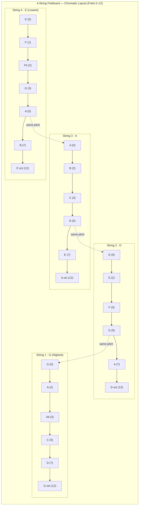
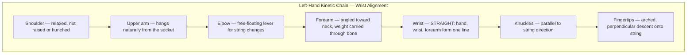
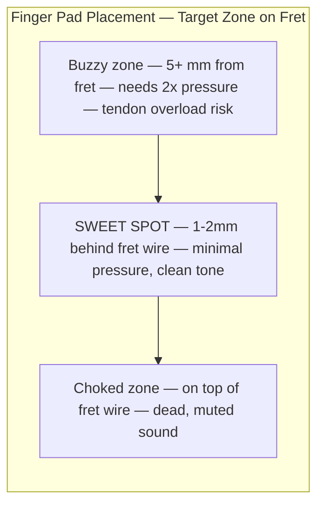
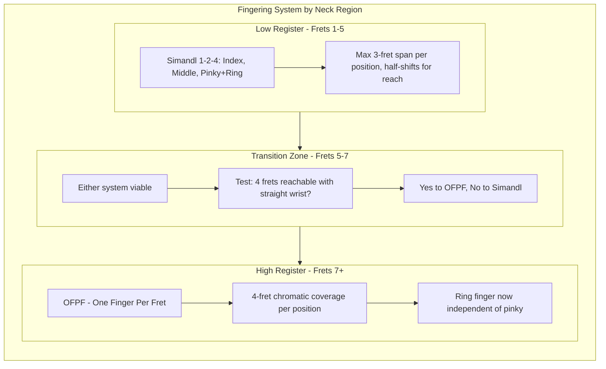
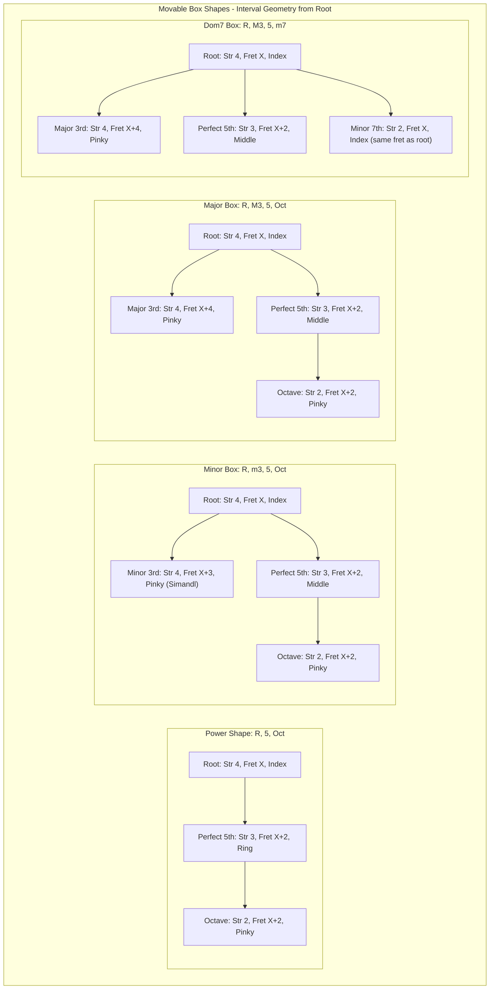

# Lesson 1: Bass Guitar Fretboard Layout and Left-Hand Mechanics

**Discipline:** Music Performance | **Domain:** Arts
**Level:** Foundation | **Series:** Bass Guitar Masterclass — Lesson 1 of 12

---

## Learning Objectives

By the end of this lesson you will be able to:

- Navigate the full 4-string fretboard and name any note from fret 0–12 in under five seconds
- Execute the Franz Simandl 1-2-4 fingering system in the low register (frets 1–5) with a straight wrist and zero tendon strain
- Apply One-Finger-Per-Fret (OFPF) cleanly above the 7th fret with true four-finger independence
- Play movable Root–3rd–5th–Octave box shapes in any key using consistent, transportable finger geometry
- Complete all six mechanics drills at 60, 80, and 100 BPM with clean tone and no string buzz
- Diagnose and self-correct the six most common left-hand mechanical errors on the spot
- Run a complete injury-prevention protocol before, during, and after every session

---

## 1. Why the Fretboard Behaves the Way It Does

A standard bass has a 34-inch scale length, with thicker, higher-tension strings than a guitar, tuned E1–A1–D2–G2. Pressing a fret shortens the vibrating length of the string and raises the pitch. Frets get closer together as you move toward the body because each one marks a fixed proportion of the remaining string length — that's why the 12th fret sits at the halfway point of the scale length, giving you the octave.

**The practical upshot:** land your fingertip 1–2 mm behind the fret wire and light pressure produces a clean note, because the fret wire itself does the work of stopping the string against a hard edge. Land in the middle of the gap between two frets and you need roughly double the pressure for the same result — pressure your tendons pay for over a 30-minute session.

**Why low-register technique differs from guitar:** frets 1–5 on a bass are wider and under more string tension than the equivalent region on a guitar. One-Finger-Per-Fret in this zone forces the hand into a stretch that drags the wrist out of alignment. That's the single biggest reason beginning bassists hurt their wrists in month one — they're playing guitar technique on a bass neck.

---

## 2. The Fretboard as a Map

### 2.1 Standard Tuning, Open Strings

```text
String 4 (thickest, lowest):  E1
String 3:                     A1
String 2:                     D2
String 1 (thinnest, highest): G2
```

Adjacent strings sit a **perfect fourth** apart (5 semitones, 7 frets). That one consistent interval is why every box shape you learn in one position transposes identically anywhere else on the neck. The fretboard isn't twelve unrelated grids — it's one repeating pattern.

### 2.2 Chromatic Note Grid, Frets 0–12

| Fret | String 4 (E) | String 3 (A) | String 2 (D) | String 1 (G) |
|------|-------------|-------------|-------------|-------------|
| 0 (open) | **E** | **A** | **D** | **G** |
| 1 | F | A♯/B♭ | D♯/E♭ | G♯/A♭ |
| 2 | F♯/G♭ | B | E | A |
| 3 | G | C | F | A♯/B♭ |
| 4 | G♯/A♭ | C♯/D♭ | F♯/G♭ | B |
| 5 | **A** | **D** | **G** | **C** |
| 6 | A♯/B♭ | D♯/E♭ | G♯/A♭ | C♯/D♭ |
| 7 | B | E | A | D |
| 8 | C | F | A♯/B♭ | D♯/E♭ |
| 9 | C♯/D♭ | F♯/G♭ | B | E |
| 10 | D | G | C | F |
| 11 | D♯/E♭ | G♯/A♭ | C♯/D♭ | F♯/G♭ |
| 12 | **E** (octave) | **A** (octave) | **D** (octave) | **G** (octave) |

**Two anchors to lock in first:**

1. **Fret 5 rule:** fret 5 on any string equals the open pitch of the next thinner string. E-string fret 5 = open A. A-string fret 5 = open D. D-string fret 5 = open G. This is your fastest cross-string tuning check and navigation reference.

2. **Octave shape:** one string up (toward thinner strings), two frets forward (toward the body) = the octave. String 4 fret 3 (G) → String 2 fret 5 (G). This diagonal shows up in bass lines from Motown to metal — it's the most-used shape on the instrument.

### 2.3 Fretboard Navigation Flow



**Daily memorization drill (10 minutes):** call out a note name at random — "C." Find every C on the fretboard across all four strings within ten seconds. If you can't, slow down and find them one at a time, naming string and fret aloud. Rotate through all twelve chromatic notes. Two weeks of this and you have instant fretboard recall. Skip it, and you'll spend years guessing at note locations instead of knowing them.

**Visual anchors:** fret 12 on every string spells out the open strings — E, A, D, G — one octave up. On String 4, fret 7 is B (the fifth of E), fret 3 is G (the minor third of E). Build out from these landmarks instead of counting frets one at a time.

---

## 3. Left-Hand Mechanics: The Foundation of Everything

Poor left-hand mechanics are the leading cause of repetitive strain injury in bass players. The habits you lock in during your first thirty days are the habits you carry for the rest of your playing life.

### 3.1 Total Body Setup

**Seated:**
- Lower bout rests on your **right thigh** (right-handed players)
- Neck angles upward at roughly **45 degrees** — never horizontal, never drooping
- Body rests lightly against your torso; don't clamp it with your strumming forearm or bicep
- Left elbow hangs freely from the shoulder, pointing toward the floor — not pinned to your ribs, not flared out

**Standing:**
- Set strap length so the bass sits in the **exact same position** as when seated
- The 12th fret should land roughly belt-buckle to lower-chest height for most players
- **Test it:** sit down, get comfortable, note where your left hand naturally rests. Stand up. If hand position changed, adjust the strap to match. Most players need the bass higher than they think looks cool — function over fashion.

**The low-strap error:** wearing the bass below the waist forces the fretting wrist into ulnar deviation (bent toward the pinky side), compressing the ulnar nerve at Guyon's canal and loading the flexor tendons unevenly. Months of this becomes chronic nerve pain and tendinitis. If the instrument hangs at knee level, raise it.

### 3.2 The Fretting Wrist: The Single Most Important Concept

**The back of your hand, your wrist joint, and your forearm should form one continuous straight line. No bend up, down, or sideways.**

When the wrist bends inward (toward the neck) or downward, the median nerve and nine flexor tendons running through the carpal tunnel get compressed under repetitive load — the mechanical pathway to carpal tunnel syndrome and tendinitis.

The fix is that the **elbow does the adjusting**, not the wrist:

- Playing String 4 (lowest): elbow drops, forearm moves closer to parallel with the floor
- Playing String 1 (highest): elbow swings outward, forearm angles more steeply
- **The wrist angle itself never changes.**

This is hard to build because you can't see your own wrist angle while playing. Most beginners let it bend and don't notice until pain shows up weeks later.



**Visual check:** photograph your left hand from the side while fretting String 4, fret 1. Trace a line from elbow through wrist to knuckles — any bend means you're in the injury zone. Repeat the photo on String 1, fret 1. If the wrist angle changed between the two shots, your elbow didn't adjust and your wrist compensated instead. Set a timer to beep every five minutes during practice and check. After two weeks the correct position becomes automatic.

**Why it matters mechanically:** the forearm bones carry the weight of the arm down through a straight wrist into the fingers. Bend the wrist and that load shifts onto tendons, ligaments, and nerves — tissue that isn't built to bear load the way bone is.

### 3.3 Thumb Placement: The Hidden Foundation

The fretting thumb sits on the **back of the neck**, not hooked over the top. Its job is light counter-pressure — a guide, not a clamp.

**Correct placement:**
- On the back of the neck, roughly behind the middle finger
- Pointing upward or diagonally toward the headstock — never horizontal, never toward the floor
- Light contact only, just enough to stabilize the hand
- **Never squeezing**

The thumb travels with the hand as a single unit. When you shift position, it moves fractionally ahead of the fingers, arriving first. If you feel a stretch between thumb and fingers, the hand isn't translating as a block — fix that before continuing.

**Pressure calibration test:** while fretting a clean note, try to slide a piece of paper between your thumb pad and the back of the neck. If you can't, you're gripping too hard. Ease off gradually until the paper slides through and the note still rings clean. That's your target pressure — most beginners use three to four times what's actually needed.

**The death-grip error:** hooking the thumb over the top like a classical guitarist and squeezing the neck between thumb and fingers immediately locks the wrist into a bent position, kills finger independence, and fatigues the forearm within minutes. If you catch yourself doing it, stop, set the bass down, reset, and restart at half tempo — don't try to fix it mid-phrase, you'll just reinforce the error at a different speed.

### 3.4 Finger Arch and Pad Placement

Each finger keeps a **curved arch**, the same natural curl your hand has resting on a softball. The fingertip descends perpendicular to the string; the flat pad never touches the fretboard, only the tip.

**Landing zone:** 1–2 mm behind the fret wire. At this distance minimal pressure produces clean tone, because the fret wire itself stops the string against a rigid edge. Land 5–10 mm back (halfway between frets) and you roughly double the required pressure for the same result.

| Placement error | What you hear | What it costs you |
|-----------------|--------------|-------------------|
| Too far from fret wire (mid-gap) | Buzzing, choked tone, needs excessive pressure | Hand fatigue, tendon overload, a low speed ceiling |
| On top of fret wire | Dead, muted, uneven tone | Unpredictable note clarity |
| Flat pad instead of fingertip | Adjacent strings muted accidentally | Forces unnatural angles, kills speed |
| Fingernail touching string | Clicking noise, inconsistent muting | Prevents full finger curl, strains joints |

**Proximity discipline:** fingers not currently fretting hover **5–10 mm above the string**, ready to drop. Never let idle fingers fly more than 2–3 cm into the air or curl into the palm. Watch any professional bassist's left hand in slow motion — idle fingers barely move. Beginners' fingers wave around like they're saying goodbye. Control that motion envelope and your speed ceiling rises immediately.



**Daily precision drill (60 seconds):** fret String 4, fret 5, with your index finger starting 10 mm behind the fret wire. Slowly slide the fingertip forward while maintaining pressure and listening. Note exactly when the buzz disappears — that's your sweet spot. Repeat with middle, then pinky.

---

## 4. The Two Fingering Systems: When to Use Each

Bass fret spacing — especially frets 1–5 — makes One-Finger-Per-Fret biomechanically risky in the low register. Two systems solve this. Neither is "better." Each is correct for its zone.

### 4.1 Franz Simandl 1-2-4: Frets 1 Through 5

Adapted from double bass technique:

| Finger | Assignment | Role |
|--------|-----------|------|
| Index (1) | Fret anchor | Establishes position, carries most load |
| Middle (2) | One fret above index | Moves independently |
| Ring (3) | — | Stacks behind pinky for reinforcement, doesn't fret alone |
| Pinky (4) | Two frets above index | Ring reinforces it from behind; load is shared |

**Why the ring finger doesn't fret alone here:** the pinky has the least mechanical advantage of any finger — shortest lever arm, smallest muscle mass. In roughly 60% of people the flexor tendons to the ring and pinky share connective tissue, physically limiting independent motion. Forcing an unsupported pinky across a wide low-register stretch is the fastest route to flexor tendinitis. Stacking ring behind pinky shares the load — this is correct anatomy-based technique, not a crutch.

**Simandl hand shape, first position (frets 1–3):**

```text
Fret 1  →  Index   (1)
Fret 2  →  Middle  (2)
Fret 3  →  Pinky   (4)  ← ring finger stacked behind it, not hovering independently
```

You cover three frets per position. To reach fret 4 or 5, execute a **half-shift**: the whole hand, thumb included, slides up one fret as a unit. Fingers don't stretch — the hand translates.

```text
Home position:    Fret 1 (Index) · Fret 2 (Middle) · Fret 3 (Pinky)
Half-shift up:     thumb leads, elbow adjusts, wrist angle unchanged
Result:            Fret 2 (Index) · Fret 3 (Middle) · Fret 5 (Pinky)
```

Never force a three-fret stretch with an isolated pinky under full load. That's the root cause of most beginner tendon injuries. Expect 2–3 weeks for this to stop feeling awkward — you're retraining a motor pattern, not failing at one.

### 4.2 One-Finger-Per-Fret (OFPF): Fret 7 and Above

As fret spacing narrows going up the neck, each finger can cover one fret independently without wrist deviation.

| Finger | OFPF Assignment |
|--------|----------------|
| Index (1) | Base fret |
| Middle (2) | Base fret + 1 |
| Ring (3) | Base fret + 2 |
| Pinky (4) | Base fret + 3 |

**Example, 7th position, String 4:**

```text
Fret 7   →  Index  (1)  =  B
Fret 8   →  Middle (2)  =  C
Fret 9   →  Ring   (3)  =  C♯
Fret 10  →  Pinky  (4)  =  D
```

Four frets of chromatic coverage per position, no shifting. The ring finger now works independently — no longer stacked behind the pinky.

**The transition zone, frets 5–7:** either system can work depending on hand size. Smaller hands may stay in Simandl through fret 7 or 9; larger hands may switch to OFPF as early as fret 5. **Decision rule:** if you can reach four consecutive frets with a straight wrist and arched fingers, OFPF is viable. If the fourth fret forces wrist deviation or a flattened finger, stay in Simandl and use half-shifts.

### 4.3 Fingering System Map



**Practical mixing:** playing a line that moves from fret 3 (Simandl) to fret 9 (OFPF) and back, your ring finger mentally shifts from "stacked behind pinky" to "independent on fret 9" as you cross fret 5–7. It's clunky in month one, automatic by month three.

---

## 5. Movable Box Shapes: Your Harmonic Navigation System

A box shape is defined by the **geometric relationship between frets and strings**, not by the note name it starts on. Because every adjacent string pair is a perfect fourth apart, any shape transposes identically when you move the root. Beginners memorize hundreds of note positions; intermediate players memorize a dozen shapes and move them. That's the whole leap.

### 5.1 Core Intervals on the Neck

**Same string:**

| Fret distance | Interval |
|--------------|---------|
| +1 fret | Minor 2nd |
| +2 frets | Major 2nd |
| +3 frets | Minor 3rd |
| +4 frets | Major 3rd |
| +5 frets | Perfect 4th |
| +7 frets | Perfect 5th |
| +12 frets | Octave |

**Across adjacent strings:**

| Shape | Interval |
|-------|---------|
| One string higher, same fret | Perfect 4th above |
| One string higher, 2 frets back | Major 3rd above |
| One string higher, 3 frets back | Minor 3rd above |
| **Two strings higher, 2 frets forward** | **Octave above** — memorize first |

**The octave shape in practice:**

```text
Root:    String 4, Fret 3  =  G
Octave:  String 2, Fret 5  =  G

Root:    String 3, Fret 2  =  B
Octave:  String 1, Fret 4  =  B
```

Index finger on any fret, String 4; pinky two strings up, two frets forward, lands on the octave. That diagonal is the single most-used interval shape in rock, R&B, funk, and soul — lock it in before anything else.

### 5.2 The Root–5th–Octave Power Shape

The harmonic skeleton of rock, punk, and metal: the tonal center plus its strongest support tone.

```text
Root  (R):   String 4, Fret X        —  Index  (1)
Fifth (P5):  String 3, Fret X+2      —  Ring   (3) or Middle (2)
Octave(Oct): String 2, Fret X+2      —  Pinky  (4)
```

**Example, G root at String 4, Fret 3:**

```text
String 4, Fret 3  →  G   (Root)        —  Index  (1)
String 3, Fret 5  →  D   (Perfect 5th) —  Ring   (3)
String 2, Fret 5  →  G   (Octave)      —  Pinky  (4)
```

The fifth and octave share the same fret number on adjacent strings, so ring and pinky land in a vertical column — fast to execute as a block. Test both the 1-2-4 and 1-3-4 fingering options and use whichever keeps your wrist straightest.

```text
Rock/punk foundation:   R (2 beats) -> P5 (2 beats) -> repeat
Power chord stab:       R + P5 + Oct struck together
Walking approach:       R -> P5 -> Oct -> P5 -> R
```

### 5.3 The Minor Box Shape (Root–m3–P5–Octave)

```text
Root      (R):   String 4, Fret X     —  Index (1)
Minor 3rd (m3):  String 4, Fret X+3   —  Pinky (4) in Simandl / Ring (3) in OFPF
Perfect 5th(P5): String 3, Fret X+2   —  Middle (2)
Octave    (Oct): String 2, Fret X+2   —  Ring (3) or Pinky (4)
```

**Example, A minor box, root at String 4, Fret 5:**

```text
String 4, Fret 5  →  A   (Root)        —  Index  (1)
String 4, Fret 8  →  C   (Minor 3rd)   —  Ring   (3) [or Pinky in Simandl]
String 3, Fret 7  →  E   (Perfect 5th) —  Middle (2)
String 2, Fret 7  →  A   (Octave)      —  Pinky  (4)
```

**Practice sequence:** R → m3 → R → P5 → Oct → P5 → m3 → R, at 60 BPM, one note per beat, naming each interval aloud as you play it.

**Why naming intervals aloud matters:** motor memory, auditory memory, and semantic (naming) memory are separate systems in the brain. Silent practice trains motor memory alone — your fingers learn a shape without your ear or brain linking it to a sound. Saying the names recruits all three at once, which builds a faster, more durable memory trace. Players who do this reach fluency noticeably faster than those who drill in silence.

### 5.4 The Major Box Shape (Root–M3–P5–Octave)

Swap the minor 3rd for a major 3rd — one fret higher on String 4.

```text
Root      (R):   String 4, Fret X     —  Index (1)
Major 3rd (M3):  String 4, Fret X+4   —  Pinky (4)
Perfect 5th(P5): String 3, Fret X+2   —  Middle (2)
Octave    (Oct): String 2, Fret X+2   —  Ring (3) or Pinky (4)
```

**Example, A major box, root at String 4, Fret 5:**

```text
String 4, Fret 5  →  A   (Root)        —  Index (1)
String 4, Fret 9  →  C♯  (Major 3rd)   —  Pinky (4)
String 3, Fret 7  →  E   (Perfect 5th) —  Middle (2)
String 2, Fret 7  →  A   (Octave)      —  Pinky (4)
```

**Mechanical note:** the major box asks the pinky to stretch one fret farther than the minor box on String 4. In the Simandl region, this may require a micro-shift of the whole hand to bring the stretch into comfortable reach — don't force it with an isolated pinky if it causes wrist deviation. In the OFPF region, the narrower spacing makes the stretch natural.

**Practice sequence:** R → M3 → R → P5 → Oct → P5 → M3 → R, same drill structure. Then alternate minor and major box in the same key (A minor box → A major box → A minor box) to train your ear on the one-fret third shift.

### 5.5 The Dominant 7th Extension (Root–M3–P5–m7)

The minor 7th sits at the same fret number as the root, two strings higher.

```text
Root      (R):   String 4, Fret X     —  Index (1)
Major 3rd (M3):  String 4, Fret X+4   —  Pinky (4)
Perfect 5th(P5): String 3, Fret X+2   —  Middle (2)
Minor 7th (m7):  String 2, Fret X     —  Index (1) — same fret as root, two strings up
```

**Example, A7 box, root at String 4, Fret 5:**

```text
String 4, Fret 5  →  A   (Root)        —  Index (1)
String 4, Fret 9  →  C♯  (Major 3rd)   —  Pinky (4)
String 3, Fret 7  →  E   (Perfect 5th) —  Middle (2)
String 2, Fret 5  →  G   (Minor 7th)   —  Index (1)
```

**Descending for blues/funk feel:** Oct (or high register) → m7 → P5 → R. This downward seventh move creates tension that wants to resolve to the root — it's a cornerstone lick in Motown, Stax, and James Brown recordings, usually showing up in the first 30 seconds of the track.

### 5.6 Box Shape Comparison Diagram



### 5.7 Transposing the Box: Reference Table

| Root | Root Fret (Str 4) | m3 Fret (Str 4) | M3 Fret (Str 4) | P5 Fret (Str 3) | Oct Fret (Str 2) | m7 Fret (Str 2) |
|------|------------------|----------------|----------------|----------------|-----------------|----------------|
| E | 0 (open) | 3 | 4 | 2 | 2 | 0 (open) |
| F | 1 | 4 | 5 | 3 | 3 | 1 |
| F♯/G♭ | 2 | 5 | 6 | 4 | 4 | 2 |
| G | 3 | 6 | 7 | 5 | 5 | 3 |
| G♯/A♭ | 4 | 7 | 8 | 6 | 6 | 4 |
| A | 5 | 8 | 9 | 7 | 7 | 5 |
| A♯/B♭ | 6 | 9 | 10 | 8 | 8 | 6 |
| B | 7 | 10 | 11 | 9 | 9 | 7 |
| C | 8 | 11 | 12 | 10 | 10 | 8 |
| C♯/D♭ | 9 | 12 | 13 | 11 | 11 | 9 |
| D | 10 | 13 | 14 | 12 | 12 | 10 |
| D♯/E♭ | 11 | 14 | 15 | 13 | 13 | 11 |

**How to use it:** need an F♯ minor line? Find F♯ in the Root column (fret 2): minor 3rd at fret 5, perfect 5th at fret 4 on String 3, octave at fret 4 on String 2. Move to G and every interval shifts by one fret in the same relationship.

**Memorization strategy:** don't memorize the table — memorize the shape geometry (m3 is always 3 frets above root on the same string, P5 is always 2 frets above root on the next string). The table is a reference while the shapes get into your hands, not a permanent crutch.

---

## 6. Practical Drills and Metronome Progressions

**Universal rules across all six drills:**

```text
Starting tempo:   60 BPM  — mechanics first, speed second
Target tempo:     80 BPM  — smooth, controlled, musical
Advanced tempo:  100 BPM  — confident, locked in, no hesitation
Advancement rule: never raise tempo until the current tempo is completely clean
                  for two consecutive full minutes — no buzz, no muted notes,
                  no rhythmic drift
```

Turn the metronome on before you pick up the bass, every time. Use a physical metronome, an app (Metronome Beats, Pro Metronome, Soundbrenner), or a DAW click. Practicing without one is noodling, not practicing — motor patterns need precise timing to encode correctly.

**Why 60 BPM:** each quarter note lasts exactly one second, giving you maximum time to check hand position, finger placement, wrist angle, and tone. It feels painfully slow — that's the point. Mechanics break down the instant you exceed the tempo you can execute them cleanly at.

---

### Drill 1: The Spider — Chromatic Finger Independence (Simandl Zone)

**Purpose:** equal tone and sustain across index, middle, and pinky; proximity discipline; alternating right-hand picking.

**Setup:** left-hand fingers 1, 2, 4 on frets 1, 2, 3 of String 4. Right hand strictly alternates i–m–i–m on every note, no exceptions.

```text
String 4: Frets 1 - 2 - 3 - 2 - 1
String 3: Frets 1 - 2 - 3 - 2 - 1
String 2: Frets 1 - 2 - 3 - 2 - 1
String 1: Frets 1 - 2 - 3 - 2 - 1
Reverse direction back to String 4
```

**Checklist, verify every rep:**

- [ ] Wrist stays straight through every string crossing
- [ ] Lifted fingers hover 5–10 mm above the string, no dramatic lifting
- [ ] Idle fingers never fly more than 3 cm up
- [ ] Thumb stays on the back of the neck, elbow adjusts for string height
- [ ] Every note rings clean, no buzz
- [ ] Right hand strictly alternates i–m–i–m, no doubles
- [ ] Fingertip lands 1–2 mm behind the fret wire

**BPM progression:**

| Phase | Tempo | Subdivision | Advancement condition |
|-------|-------|------------|----------------------|
| 1 | 60 BPM | Quarter notes | 2 clean minutes, no buzz, no drift |
| 2 | 80 BPM | Quarter notes | Same |
| 3 | 100 BPM | Quarter notes | Milestone |
| 4 | 60 BPM | Eighth notes (2/click) | Timing lock at double density |
| 5 | 80 BPM | Eighth notes | Same |
| 6 | 100 BPM | Eighth notes | Pro-level independence for this stage |

**Common errors:**

| Error | Symptom | Fix |
|-------|---------|-----|
| Weak pinky | Quieter, buzzier, less sustain | Isolate pinky for 30 seconds, compare to index, retrain by ear |
| Flying fingers | Idle fingers rise >3 cm | Lay cloth on strings above playing zone; if fingers touch it, they're flying |
| Right-hand doubling | i-i or m-m instead of alternation | Drop to 50 BPM, say "index, middle" aloud while playing |
| Wrist bends on string crossing | Visible angle change | Stop, move only the elbow, video-check from the side |

**Advanced variation (after Phase 3):** extend to frets 1–2–3–4 with a half-shift bringing fret 4 into reach with the pinky. Start at 50 BPM for the added complexity.

---

### Drill 2: Position Crawl — Simandl Shifting Along One String

**Purpose:** train the thumb-and-hand unit to shift cleanly between positions, wrist angle unchanged, no gripping during the move.

**Core principle:** the thumb leads the shift by roughly 50–100 ms, arriving just before the fingers. This keeps the thumb-to-finger relationship constant through the transition.

```text
Position 1 (Fret 1 anchor): Fret 1 (Index) -> Fret 2 (Middle) -> Fret 3 (Pinky)
  -- rest beat, thumb slides, hand follows as a unit --
Position 2 (Fret 2 anchor): Fret 2 (Index) -> Fret 3 (Middle) -> Fret 4 (Pinky)
  -- shift --
Position 3 (Fret 3 anchor): Fret 3 (Index) -> Fret 4 (Middle) -> Fret 5 (Pinky)
Continue up to Fret 7-9, then descend back to Position 1.
```

**Good shift:** thumb slides smoothly, no re-gripping; a clean, brief silence between groups; wrist angle never changes; shift is metrically precise, landing exactly on the rest beat.

**Bad shift:** sliding/scraping noise (too much pressure during the move); muted notes on landing (thumb grip too tight, fingers not ready); wrist bends to compensate; inconsistent timing.

**BPM progression:**

| Phase | Tempo | Feel |
|-------|-------|------|
| 1 | 60 BPM | Shift lands exactly on beat 4 (the rest beat) |
| 2 | 80 BPM | Shift silence shortens but stays clean |
| 3 | 100 BPM | Shift is metrically precise, not early or late |

**Recording check:** film from the side. Watch the wrist during every shift. Any bend means the elbow isn't doing its job — fix before raising tempo.

---

### Drill 3: OFPF Four-Fret Chromatic Ladder (High Register)

**Purpose:** four-finger independence above fret 7, with the ring finger operating fully on its own.

**Setup, starting at fret 7, String 4:** Index=7, Middle=8, Ring=9, Pinky=10.

```text
Ascending, String 4 to String 1:
String 4: 7-8-9-10 (Index-Middle-Ring-Pinky)
String 3: 7-8-9-10
String 2: 7-8-9-10
String 1: 7-8-9-10

Descending, String 1 to String 4:
String 1: 10-9-8-7 (Pinky-Ring-Middle-Index)
String 2: 10-9-8-7
String 3: 10-9-8-7
String 4: 10-9-8-7
```

**Key mechanics:** the fretting finger lifts cleanly off the previous string, no dragging. The hand stays in position over frets 7–10 the entire drill — only the fingers move. The elbow adjusts subtly for string height; the wrist doesn't.

**BPM progression:**

| Phase | Tempo | Subdivision | Advancement condition |
|-------|-------|------------|----------------------|
| 1 | 60 BPM | Eighth notes | No buzz, equal volume across fingers |
| 2 | 80 BPM | Eighth notes | Same |
| 3 | 100 BPM | Eighth notes | Intermediate milestone |
| 4 | 60 BPM | Sixteenth notes | Micro-timing precision |
| 5 | 80 BPM | Sixteenth notes | Professional-level OFPF control |

**Common errors:**

| Error | Symptom | Fix |
|-------|---------|-----|
| Ring finger unreliable | Buzzes, muted, quieter than others | Isolate fret 9 at 50 BPM for 30 seconds, then reintegrate |
| Fingers lifting too high | Transitions slow down | Goal: keep all fingers within 1 cm of the string; use video |
| Wrist bends on string crossing | Visible angle change | Adjust elbow instead, restart at 50 BPM |
| Right-hand alternation breaks down | Doubles at speed | Drop to 60 BPM, say "in-dex, mid-dle" aloud |

**Advanced variation:** reverse finger order — ascend Pinky-Ring-Middle-Index, descend Index-Middle-Ring-Pinky. Start at 50 BPM; this breaks habitual sequencing and forces genuine independence.

---

### Drill 4: Box Shape Transposition — Internalizing Shapes Across Keys

**Purpose:** burn minor and major box shapes into reflex across keys, with zero cognitive delay when the root changes.

**Minor box, seven keys, one continuous run — no pauses between keys:**

```text
Key of E:   Root = String 4, Fret 0 (open)
Key of F:   Root = String 4, Fret 1
Key of G:   Root = String 4, Fret 3
Key of A:   Root = String 4, Fret 5
Key of B♭:  Root = String 4, Fret 6
Key of C:   Root = String 4, Fret 8
Key of D:   Root = String 4, Fret 10
```

**For each key, one beat per note at 60 BPM, naming each interval aloud:**

```text
Beat 1: Root           ("Root")
Beat 2: Minor 3rd       ("Minor third")
Beat 3: Root            ("Root")
Beat 4: Perfect 5th     ("Fifth")
Beat 5: Octave          ("Octave")
Beat 6: Perfect 5th     ("Fifth")
Beat 7: Minor 3rd       ("Minor third")
Beat 8: Root            ("Root")
```

Then repeat with the **major box** (major 3rd, one fret higher) across the same seven keys.

**Why naming aloud matters:** it fuses motor memory, auditory memory, and semantic memory into one trace instead of training finger patterns in isolation — players who do this consistently reach fluency noticeably faster.

**BPM progression:**

| Phase | Tempo | Goal |
|-------|-------|------|
| 1 | 60 BPM | Clean fretting, name every interval, lock in the sound (~10 min for all 14 runs) |
| 2 | 80 BPM | Transitions between keys tighten |
| 3 | 100 BPM | Shapes connect as one continuous musical phrase |

**Advanced challenge:** write the seven keys on slips of paper, draw at random, and play the shape in whatever order comes up. This forces true recall instead of sequential memory.

**Musicality integration (from Phase 2 on):** try rhythmic variations —

```text
Two-note rhythm:     R (half, 2 beats) -> m3 (quarter) -> P5 (quarter) -> Oct (half)
Swung eighths:       Play the arpeggio with a long-short swing feel
Walking bass feel:   R-m3-P5-Oct, all quarter notes, steady pulse
```

---

### Drill 5: System Transition — Simandl to OFPF and Back

**Purpose:** switch fingering systems seamlessly moving through the neck, with no tone disruption and no wrist deviation at the transition point.

**Full chromatic pattern on String 4:**

```text
ASCENDING, SIMANDL ZONE (frets 1-5):
  Fret 1 (Index 1)  -> F
  Fret 2 (Middle 2) -> F#
  Fret 3 (Pinky 4)  -> G

HALF-SHIFT (hand slides up one fret):
  Fret 3 (Index 1)  -> G  (position 2, index now on fret 3)
  Fret 4 (Middle 2) -> G#
  Fret 5 (Pinky 4)  -> A

TRANSITION ZONE (frets 5-7), RING FINGER ACTIVATES:
  Fret 7 (Index 1)  -> B   (OFPF begins, hand repositions)
  Fret 8 (Middle 2) -> C
  Fret 9 (Ring 3)   -> C#  (ring now independent, not stacked behind pinky)
  Fret 10 (Pinky 4) -> D

DESCENDING back through the transition and down to:
  Fret 1 (Index 1)  -> F
  Fret 0 (open)     -> E
```

**At the transition zone (frets 5–7):** the ring finger switches mentally between "stacked behind pinky" and "independent" — an internal re-mapping, not a visible event. The thumb sits slightly lower/flatter in Simandl, slightly higher/more vertical in OFPF. The wrist angle never changes; the elbow does all the adjusting. Own the brief silence at the shift point rather than sliding through it.

**BPM progression:**

| Phase | Tempo | Focus |
|-------|-------|-------|
| 1 | 60 BPM | Name every note aloud (F, F♯, G...) while feeling each shift |
| 2 | 80 BPM | Transitions become subconscious |
| 3 | 100 BPM | No hesitation, no conscious naming needed |

**Common errors:**

| Error | Symptom | Fix |
|-------|---------|-----|
| Hesitation at frets 5-7 | Timing break, wrong finger chosen | Isolate frets 5-7-9 at 50 BPM, focus on ring-finger activation |
| Wrist bends during shift | Visible angle change | Video from the side, find the exact fret it happens on, adjust elbow earlier |
| Ring finger doesn't activate | Pinky stretches to cover fret 9 | Say "index, middle, RING, pinky" aloud at slow tempo until it retrains |

**Advanced variation:** run the full chromatic pattern across all four strings, ascending then descending, at 60 BPM to start.

---

### Drill 6: Floating Thumb Muting — Sympathetic String Control

**Purpose:** eliminate sympathetic ringing from strings you aren't currently playing — a right-hand technique that directly protects the left-hand clarity you're building elsewhere.

**The problem:** plucking String 4 lets Strings 3, 2, and 1 ring sympathetically, especially at volume or with distortion. Uncontrolled ringing is the top reason intermediate bassists sound muddy in a band mix even when playing the right notes.

**Right-hand floating thumb:**
- Rest the thumb on the string immediately below (thicker, lower) the one you're plucking
- When you move up a string, the thumb follows, muting the one you just left
- Light contact only — damping, not dead-stopping

```text
Playing String 4: thumb rests on pickup/body edge (nothing below to mute)
Playing String 3: thumb rests on String 4
Playing String 2: thumb rests on String 3
Playing String 1: thumb rests on String 2
```

**Left-hand contribution:**
- When releasing a note, lay the finger flat against the string instead of lifting clear — this mutes without plucking
- Idle fingers can lightly touch adjacent strings to prevent sympathetic ringing

**Drill structure, integrated into Drill 1:** play The Spider again, adding floating thumb muting. After each note, verify the previously played string has gone silent.

**Common errors:**

| Error | Symptom | Fix |
|-------|---------|-----|
| Thumb presses too hard | Dull "thunk" instead of clean dampening | Lighten to barely-touching contact |
| Thumb doesn't track string changes | Lower strings keep ringing | Say "thumb on 4, thumb on 3" aloud while moving strings |
| Left fingers lift too fast on release | Brief ring-out after releasing a note | Flatten the finger against the string on release instead of lifting |

**BPM progression:** same as Drill 1 — 60 → 80 → 100 BPM. Expect a temporary slowdown while the muting becomes automatic; speed returns.

---

### Daily Practice Session Structure (30-Minute Foundation Routine)

Use this structure for the first 4–6 weeks. Expand to 45 minutes once endurance builds (typically week 3–4).

```text
00:00-03:00  Warm-up: Drill 1 at 60 BPM, String 4 only
             No metronome pressure - wake up the hands, check wrist and thumb

03:00-08:00  Drill 1, full 4 strings, 60 -> 80 BPM
             Focus: equal volume across fingers, proximity discipline

08:00-13:00  Drill 2, String 4 only, 60 -> 80 BPM
             Focus: smooth thumb-led shifts, straight wrist

13:00-18:00  Drill 3, 60 -> 80 BPM
             Focus: ring-finger independence, clean string crossings

18:00-23:00  Drill 4, 3 keys minor + 3 keys major, 60 BPM
             Focus: naming intervals aloud, hearing the shapes

23:00-28:00  Drill 5, 60 -> 80 BPM
             Focus: seamless Simandl-to-OFPF transition

28:00-30:00  Cool-down: Drill 1 at 60 BPM, eyes closed
             Focus on feel, not visual tracking
```

**Advance the whole schedule by 10 BPM when:** all five active drills are clean at the current tempo for two consecutive sessions — not just once. Advance in 10 BPM increments. 100 BPM is a milestone, not a ceiling.

**Rest principle:** practice six days a week, rest the seventh. Motor consolidation happens during rest and sleep, not during active practice — overtraining produces fatigue and regression, not progress.

**Fatigue management:** if your hands feel tired or achy mid-session, stop and rest 3–5 minutes, shake out, do the wrist rotations from Section 8. Muscular tiredness with no sharp pain is fine to continue after rest. Sharp pain, tingling, or numbness ends the session for the day.

---

## 7. Common Errors, Diagnoses, and Fixes

```mermaid
graph TD
    subgraph sub_errors ["Diagnostic Map - Common Left-Hand Errors"]
        subgraph sub_e1 ["Error 1: String Buzz"]
            E1A["Symptom: fretted note buzzes or sounds choked"]
            E1B["Cause: finger pad 5+ mm from fret wire"]
            E1C["Fix: land 1-2mm behind fret wire, reduce pressure first"]
            E1A --> E1B --> E1C
        end
        subgraph sub_e2 ["Error 2: Muted Adjacent String"]
            E2A["Symptom: neighbor string goes dead unintentionally"]
            E2B["Cause: flat finger pad touching neighbor string"]
            E2C["Fix: increase arch, land on tip only"]
            E2A --> E2B --> E2C
        end
        subgraph sub_e3 ["Error 3: Rapid Hand Fatigue"]
            E3A["Symptom: aching under 10 minutes of play"]
            E3B["Cause: excessive grip, bent wrist, thumb over neck"]
            E3C["Fix: stop, reset posture, minimum pressure, raise strap"]
            E3A --> E3B --> E3C
        end
        subgraph sub_e4 ["Error 4: Flying Fingers"]
            E4A["Symptom: idle fingers rise 2+ cm, choppy transitions"]
            E4B["Cause: no proximity discipline, extensor tension"]
            E4C["Fix: Drill 1 at 50 BPM, keep fingers within 5-10mm"]
            E4A --> E4B --> E4C
        end
        subgraph sub_e5 ["Error 5: Uneven Tone Across Fingers"]
            E5A["Symptom: pinky/ring quieter and buzzier"]
            E5B["Cause: weaker intrinsic hand muscles, less motor control"]
            E5C["Fix: isolate pinky drill, 50 BPM, 2-3 weeks"]
            E5A --> E5B --> E5C
        end
        subgraph sub_e6 ["Error 6: Thumb Over Neck"]
            E6A["Symptom: thumb hooked over top, wrist bent inward"]
            E6B["Cause: carried-over guitar habit or bad early instruction"]
            E6C["Fix: reset thumb to back of neck, restart at 50% tempo"]
            E6A --> E6B --> E6C
        end
    end
```



### Error 1: String Buzz

**Fix:** ease pressure first, move the fingertip forward toward the fret wire (1–2 mm behind it), then add just enough pressure to kill the buzz. Mark the feeling. Test the danger zone by sliding the finger back slowly and noting exactly when buzz returns.

### Error 2: Muted Adjacent String

**Fix:** check your arch (should curve like holding a softball), land on the fingertip near the nail, approach perpendicular rather than at a shallow angle. Use the "neighbor string ring test": while fretting String 3, pluck String 2 and String 4 — both should ring freely.

### Error 3: Rapid Hand Fatigue

**Fix:** stop immediately, rest 3–5 minutes, reset posture (raise bass height if needed, thumb on back of neck, straight wrist), restart at 50% tempo. If fatigue returns within 10 minutes, the session is over for the day — this is not weakness, it's correct load management.

### Error 4: Flying Fingers

**Fix:** Drill 1 at 50 BPM with conscious attention on idle fingers, held at 5–10 mm. Use video feedback or a cloth laid on the strings above the playing zone as a physical boundary check.

### Error 5: Uneven Tone Across Fingers

**Fix:** isolate the pinky — play fret 3 repeatedly for 30 seconds at 50 BPM focused on full volume, compare to index finger, repeat daily. Expect 2–3 weeks for equalization; you're retraining motor cortex representation for the weaker digits, not just building muscle.

### Error 6: Thumb Over Neck

**Fix:** stop entirely, set the bass down, reset the thumb to the back of the neck pointing toward the headstock, restart at 50% tempo, check every two minutes with a timer. Expect 5–10 days for the correct position to feel normal — the thumb-over grip feels more secure initially simply because it gives stronger feedback, not because it's correct.

**Error correction priority (highest injury risk first):**

1. Thumb over neck
2. Rapid hand fatigue
3. Muted adjacent string
4. String buzz
5. Flying fingers
6. Uneven tone

**Fastest self-diagnosis tool:** record 30 seconds of Drill 1 at 60 BPM, watch it back against the Section 3 mechanics checklist. Most errors are invisible while playing but obvious on video — this takes 90 seconds and saves weeks of baked-in bad habits.

---

## 8. Injury Prevention Protocol

Playing through pain is never acceptable. The first sharp pain signal usually means weeks of cumulative microtrauma already happened. This protocol is integral to practice, not optional extra.

### 8.1 Before Every Session — Warm-Up (3–5 Minutes)

Do these away from the instrument. Cold tissue under sudden load is the top cause of acute tendon injury in musicians.

1. **Wrist rotations (30 sec):** 10 circles each direction, smooth and continuous
2. **Finger fans (30 sec):** spread wide, close to a loose fist, 10 reps each hand
3. **Extensor stretch (60 sec):** arm forward, palm up, gently pull each finger back toward the forearm, 3 seconds each
4. **Flexor stretch, prayer position (30 sec):** palms together at chest, lower toward waist, hold 15 sec, release, repeat
5. **Loose shake-out (20 sec):** hands hang loose, shake vigorously to promote blood flow

**Rule:** never pick up the bass cold and play fast passages or use high grip pressure. Tissue needs gradual loading.

### 8.2 During Every Session — Active Monitoring

- **Pain check:** tingling, numbness, sharp pain, or burning in fingers, wrist, forearm, or elbow means stop immediately
- **Grip pressure reset:** every 5–10 minutes, run the paper-slide test mid-drill
- **Wrist angle check:** every 5–10 minutes, glance from the side or snap a quick photo

**Mandatory breaks:** 5 minutes every 20 minutes of active practice. Stand, shake out, do wrist rotations, drink water. Distributed practice with breaks produces faster skill gains and lower injury rates than grinding without them.

### 8.3 After Every Session — Stretching (3–5 Minutes)

1. **Flexor stretch (30 sec/arm):** arm forward, palm up, gently pull fingers back, hold 15 sec
2. **Extensor stretch (30 sec/arm):** arm forward, palm down, gently press the back of the hand down, hold 15 sec
3. **Wrist circles (30 sec):** slow, full range, both directions
4. **Forearm self-massage (60 sec):** work flexor then extensor muscles with the opposite hand, moving toward the heart
5. **Hand shake-out (15 sec):** loose, relaxed

### 8.4 Warning Signs Requiring Immediate Rest (48–72 Hours Minimum)

Stop entirely if you notice any of:

1. Aching persisting more than an hour after stopping
2. Swelling in finger joints, wrist, or forearm
3. Grip weakness beyond normal fatigue
4. Pain that worsens as you continue, rather than easing after warm-up
5. Numbness or tingling that doesn't resolve within 15 minutes of stopping
6. Sharp, shooting pain along forearm, wrist, or hand
7. Pain during normal daily activities (typing, gripping a steering wheel)

**If these appear:** stop immediately, rest 48–72 hours minimum, ice 15 minutes 3–4 times a day, elevate, consider an OTC anti-inflammatory if appropriate for you. If symptoms persist past 2–3 days of rest, see a sports medicine physician or physical therapist familiar with musician injuries — don't self-diagnose from forums. Early intervention resolves most overuse injuries in 2–4 weeks; ignored injuries become chronic and can end a playing career.

### 8.5 Long-Term Load Management

**Build session duration gradually:**

```text
Month 1: 20-30 minutes, 5-6 days/week
Month 2: 30-40 minutes
Month 3: 40-50 minutes
Month 4+: 60-90 minutes
```

Tendon tensile strength takes 6–12 weeks to adapt to new load. Jumping from 20 to 60 minutes in week 2 because you're motivated gets you injured by week 4.

**Rotate material within sessions** — cycle between finger independence drills, position shifts, harmonic work, and musical application — to spread mechanical load across different tissue groups instead of grinding one drill at maximum tempo for 30 minutes straight.

**Strengthen the extensors (rubber band exercise, 3×/week, separate from practice):**

1. Place a thick rubber band around all five fingertips
2. Spread fingers against the resistance, hold 2 seconds
3. Return slowly over 3 seconds
4. 10 reps, rest 60 seconds, 3 sets total

Do this on non-practice days or at least 4 hours after practice. The extensors (back of forearm) are chronically weak relative to the flexors in most bassists, and that imbalance pulls the wrist into flexion over time.

**Sleep:** motor patterns consolidate during slow-wave and REM sleep. Musicians sleeping 7–9 hours learn new motor patterns noticeably faster than those sleeping 5–6. Poor sleep wastes practice time regardless of how hard you drilled.

---

## 9. Ear-to-Fretboard: Hearing What You Play

Mechanics without ear training produces a player who can execute shapes but can't find a note by sound, follow a song by ear, or correct a wrong note before the audience hears it. Build this alongside the drills above, not after them.

### 9.1 Sing the Root Before You Play It

Before every repetition of Drill 4 (box shapes), hum or sing the root pitch, then play it and check the match. This closes the loop between what you intend to hear and what the string actually produces — the same checkpoint a singer uses, applied to an instrument.

### 9.2 Interval Ear Drill (10 Minutes, Paired with Section 5)

```text
Step 1: Play Root, then Perfect 5th. Sing the 5th back without the bass.
Step 2: Play Root, then minor 3rd. Sing it back. Compare the "darker" color to the 5th.
Step 3: Play Root, then Major 3rd. Sing it back. Compare the "brighter" color to the minor 3rd.
Step 4: Have a practice partner or looper play a root. Identify m3 vs M3 by ear alone,
        then confirm on the fretboard.
```

**Why this belongs in Lesson 1:** box shapes are finger geometry wrapped around intervals you need to recognize by ear in real time, on stage, when someone calls a key change or you drop into an unfamiliar jam. Players who skip ear training can execute a rehearsed shape perfectly and still freeze the moment the context changes.

### 9.3 Call-and-Response Drill (5 Minutes Daily)

Using a backing track, looper pedal, or practice partner: they play or sing a single note, you find it on the fretboard in two different positions as fast as possible, then play the perfect 5th above it without checking a chart. This single drill, done daily, does more for real-world fretboard fluency than any amount of isolated shape memorization.

---

## 10. Lesson Summary and Progress Benchmarks

Don't advance to Lesson 2 until every box below is checked, cleanly, on two different days.

### Fretboard Knowledge

- [ ] Name any note, frets 0–12, any string, within five seconds
- [ ] Locate the same pitch in two different positions instantly
- [ ] Identify the octave of any note using the two-string, two-fret diagonal without thinking
- [ ] Demonstrate the fret-5 rule on all three string pairs

### Body Setup and Wrist Mechanics

- [ ] Straight fretting wrist, seated and standing, on demand
- [ ] Correct thumb placement behind the neck on command
- [ ] String crossings executed by adjusting the elbow only, no wrist deviation
- [ ] Pass the paper-slide test mid-session
- [ ] Explain which tissues are at risk from wrist deviation (median nerve, flexor tendons, carpal tunnel)

### Simandl System

- [ ] Drill 1 across all four strings at 80 BPM, quarter notes, 2 clean minutes
- [ ] Drill 2 from fret 1 to fret 7 and back at 80 BPM, smooth silent shifts
- [ ] Clean half-shift to fret 5 with no wrist deviation
- [ ] Equal volume across index, middle, pinky
- [ ] Fingertips consistently land 1–2 mm behind the fret wire

### OFPF System

- [ ] Drill 3 across all four strings at 80 BPM, eighth notes
- [ ] Simandl-to-OFPF transition (Drill 5) clean at 80 BPM, no hesitation at frets 5–7
- [ ] Frets 7–8–9–10 as a chromatic group with the ring finger fully independent
- [ ] Explain the physical criteria deciding Simandl vs. OFPF

### Box Shapes and Ear Training

- [ ] Minor box in E, F, G, A, B♭, C, D at 60 BPM, no hesitation
- [ ] Major box in the same seven keys at 60 BPM
- [ ] Dominant 7th box in at least A7, D7, G7 at 60 BPM
- [ ] Move any box shape to a new root within two seconds
- [ ] Name every interval aloud while playing, no hesitation
- [ ] Explain why box shapes transpose (perfect fourth tuning between strings)
- [ ] Identify m3 vs. M3 by ear alone in the call-and-response drill, 8 of 10 correct

### Injury Prevention

- [ ] Full pre-session warm-up without needing to reference notes
- [ ] Full post-session stretching routine every session
- [ ] All seven overuse warning signs named from memory
- [ ] Explain the extensor/flexor imbalance and demonstrate the rubber band exercise
- [ ] 5-minute breaks every 20 minutes, tracked with a timer

### Integration and Self-Assessment

- [ ] Record Drill 1 at 80 BPM and Drill 4 in three keys at 60 BPM
- [ ] Review against the Section 3 mechanics checklist
- [ ] Zero mechanical errors found
- [ ] Fix any errors found before moving to Lesson 2

**Realistic timeline:** 4–8 weeks for most players practicing 5–6 days a week, 30–45 minutes per session. Finishing in two weeks usually means something got skipped; still struggling past ten weeks suggests it's worth adjusting practice structure or getting real-time feedback from a teacher.

**Why not skip ahead anyway?** You can, but you'll build Lesson 2 on a cracked foundation, and it will show under pressure — playing with others, recording, performing — forcing you back to relearn Lesson 1 mechanics while unlearning Lesson 2 habits on top. That takes longer than doing it right once.

---

## 11. Looking Ahead: Lesson 2

Lesson 2, **Right-Hand Technique and Your First Bass Lines**, builds directly on this foundation:

- **Alternating finger plucking mechanics** — index/middle independence, attack angle, dynamic range from whisper to aggressive dig-in
- **Floating thumb muting in depth** — the Drill 6 technique expanded into full string-crossing patterns and real-time muting decisions
- **Pick technique** — downstroke and alternate picking for rock, punk, and metal: pick angle, attack point, grip pressure, wrist vs. forearm motion
- **Your first real bass lines** — connecting the minor and major box shapes to I–IV–V progressions in multiple keys, walking bass fundamentals, rhythmic variation
- **Playing with recordings** — locking in with drums, following chord changes, developing time feel across genres

Everything here — fretboard knowledge, box shapes, finger independence, injury prevention — becomes the platform Lesson 2 applies in musical context. A shaky Lesson 1 will show every crack the moment you try to play with other musicians.

---

*Masterclass Series: Bass Guitar — Foundation Level*
*Lesson 1 of 12 | Next: Lesson 2 — Right-Hand Technique and Your First Bass Lines*
