# Bass Guitar Masterclass: Rhythm Techniques, Groove Architecture & Performance Mastery

## Table of Contents

1. [First-Principles Intuition](#1-first-principles-intuition)
2. [Right-Hand Technique Arsenal](#2-right-hand-technique-arsenal)
3. [Left-Hand Muting & Fretting Mechanics](#3-left-hand-muting--fretting-mechanics)
4. [Fretboard Geography & Movable Box Patterns](#4-fretboard-geography--movable-box-patterns)
5. [Groove Architecture & Rhythmic Precision](#5-groove-architecture--rhythmic-precision)
6. [Slap & Pop Technique](#6-slap--pop-technique)
7. [Walking Bass & Harmonic Navigation](#7-walking-bass--harmonic-navigation)
8. [Practice Drills & Progressive Protocols](#8-practice-drills--progressive-protocols)
9. [Failure Modes & Remediation](#9-failure-modes--remediation)
10. [Diagnostic Flowchart](#10-diagnostic-flowchart)

---

## 1. First-Principles Intuition

### What Makes Bass Unique: The Rhythmic-Harmonic Bridge

The bass guitar occupies a singular role in any ensemble: it simultaneously defines **where the chord is** (harmonic root) and **when the beat lands** (rhythmic anchor). No other instrument does both at that intensity level. Understanding this dual function shapes every technical decision you make—which note to play, how long to sustain it, and exactly when to release it.

Standard four-string tuning is **E1–A1–D2–G2** (41 Hz, 55 Hz, 73 Hz, 98 Hz). These low frequencies have naturally long decay times—an open low E can ring for 5–8 seconds unpedaled. At 120 BPM, a sixteenth note lasts only 125 ms. That gap is your central technical challenge: **you must actively stop notes** as precisely as you start them. Muting is not an optional refinement—it is the foundation of rhythmic clarity.

One paragraph of physics worth knowing: string pitch is determined by length, tension, and mass per unit length ($f = \frac{1}{2L}\sqrt{\frac{T}{\mu}}$, where $L$ is length, $T$ is tension, $\mu$ is linear mass density). Heavier strings (the E string at ~.105" gauge is roughly twice the mass of a guitar's low E) produce deep fundamentals but carry more inertia—they keep vibrating unless you stop them. This inertia is why bass muting demands more deliberate physical commitment than on guitar.

### The Pocket: Kick Drum Relationship

The bass and kick drum form a single rhythmic organism. Lock the attack of your notes to land **with or just behind** the kick drum's transient. When kick and bass align, the low end feels solid and powerful. When they drift, the low end sounds muddy and undefined. Every practice session should include drum playback—a metronome alone does not develop kick-drum synchronization.

---

## 2. Right-Hand Technique Arsenal

### 2.1 Fingerstyle: The Foundation

**Hand position:** Anchor your thumb on the pickup housing (or the string above the one you're playing—floating thumb, discussed below). Fingers curve naturally downward at roughly 45° to the string plane. Your wrist should be nearly flat—no dramatic upward bend.

**Rest stroke (apoyando):** After plucking a string, let your finger come to rest against the string immediately below it. This delivers maximum tone, consistency, and volume. It is the professional standard for most bass playing.

```
Rest stroke path (index finger on D string):
  D string ──→ pluck ──→ finger lands on A string
  A string ──→ pluck ──→ finger lands on E string
```

**Free stroke:** Finger pulls away from the instrument after the pluck, clearing all adjacent strings. Use this when moving between non-adjacent strings rapidly.

**Alternating i-m pattern — the essential drill:**

```
String:    G  D  A  E  G  D  A  E
Finger:    i  m  i  m  i  m  i  m

BPM targets:
  Week 1–2:  ♩= 60  (eighth notes)
  Week 3–4:  ♩= 80
  Week 5–6:  ♩= 100
  Week 7–8:  ♩= 120
  Month 3+:  ♩= 140+ (sixteenth notes at 120 = eighth notes at 240)
```

**Plucking contact point:**

| Position | Tone Character | Use Case |
|---|---|---|
| Over neck pickup | Warm, round, fundamental-heavy | Motown, ballads, reggae |
| Between pickups | Balanced, versatile | Pop, rock, R&B |
| Over bridge pickup | Bright, cutting, harmonic-rich | Funk, slap, solo lines |
| Palm-muted near bridge | Percussive, short decay | Reggae, gospel, country |

### 2.2 Floating Thumb Technique

The floating thumb solves the most common beginner problem: **sympathetic string ringing**. Instead of anchoring your thumb statically on the pickup, your thumb rests on the string immediately below the string you're playing. As you move to lower strings, the thumb rolls down with you, muting every string above your current position.

```
Playing the A string:
  Thumb rests on E string (muting it)
  i and m fingers pluck A string

Playing the D string:
  Thumb rests on A string (muting it)
  E string muted by left-hand finger draping
  i and m fingers pluck D string

Playing the G string:
  Thumb rests on D string (muting it)
  A and E strings muted by left-hand and thumb
```

Practice this slowly on a single string pattern before integrating across strings. It feels awkward for approximately two weeks, then becomes automatic.

### 2.3 Palm Muting

Rest the **hypothenar eminence** (the fleshy heel of your palm, pinky side) on the strings directly above the bridge saddles. The closer to the bridge, the lighter the muting effect. Find your sweet spots:

```
Contact zone (distance from bridge saddles):
  < 1 cm    →  Near-dead thud, almost no pitch
  1–3 cm    →  "Thumpy" muted tone — funk, reggae, old-school R&B ✓
  3–5 cm    →  Light muting, slight warmth reduction
  > 5 cm    →  Negligible muting effect
```

**Palm mute drill — reggae one-drop pattern:**

```
Tempo: ♩= 70 BPM
Time:  4/4

E: |–––2–––2–––2–––2–|  (all notes palm-muted)
A: |–––––––––––––––––|
D: |–––––––––––––––––|
G: |–––––––––––––––––|

Beats: 1   2   3   4
       PM  PM  PM  PM
```

Progressive lift: After mastering with full palm mute, gradually reduce contact pressure until you find the "just barely muted" zone. This earns you the reggae pocket.

### 2.4 Three-Finger Technique (i-m-a)

Adding the ring finger (a) to your alternation increases speed ceiling and reduces fatigue on fast passages. The mechanical principle: distributing the workload across three muscles instead of two.

**Setup:**
- Ring finger curves to match the arc of index and middle
- All three fingers maintain equal string contact angle
- Initial target: play any two-finger pattern with three fingers before attempting faster speeds

**Progressive integration drill:**

```
Week 1: i-m-a triplets on single string (quarter-note pulse)
E: |–––––––|–––––––|–––––––|–––––––|
   i m a   i m a   i m a   i m a
   Tempo: ♩= 60 BPM

Week 2: String crossing with triplet grouping
G: |–––i–m–a–|
D: |–i–m–a–––|
A: |–––––––––|
E: |–––––––––|
   Tempo: ♩= 70 BPM

Week 3: Apply to scalar runs (natural minor scale)
A: |–5–7–8–|–5–7–8–|–5–7–8–|
   i m a   i m a   i m a
   Tempo: ♩= 80 BPM

Week 4: Integrate into actual bass lines
   Use i-m-a for any passage requiring 12+ consecutive notes
   at tempos above ♩= 140 BPM
```

**Common mistake:** Ring finger striking with less force than index/middle. Remedy: practice 5 minutes daily with ring finger only, matching the volume of your index finger.

---

## 3. Left-Hand Muting & Fretting Mechanics

### 3.1 Simandl 1-2-4 vs. One-Finger-Per-Fret

Your fretting-hand finger assignment depends on your position on the neck:

**Frets 1–5 (Simandl 1-2-4 system):**

The human hand cannot comfortably spread four fingers across four consecutive frets in this low register without dangerous tendon strain. Use the Simandl system, borrowed from upright bass:

```
Finger 1 (index)   = covers fret n
Finger 2 (middle)  = covers fret n+1
Finger 4 (pinky)   = covers fret n+2 or n+3

Example — E string, Simandl in first position:
  Fret 1 (F)  → finger 1
  Fret 2 (F#) → finger 2
  Fret 3 (G)  → finger 2 (stretch from fret 2, or shift)
  Fret 4 (G#) → finger 4
  Fret 5 (A)  → finger 4
```

Ring finger (3) acts as a support brace behind the pinky, never fretting independently in this zone.

**Frets 7+ (One-Finger-Per-Fret, OFPF):**

The neck narrows enough here that all four fingers cover four consecutive frets without strain. Standard guitar-style fingering applies: finger 1 = lowest fret, finger 4 = highest.

```
Example — A string, OFPF at 7th position:
  Fret 7 (E)  → finger 1
  Fret 8 (F)  → finger 2
  Fret 9 (F#) → finger 3
  Fret 10 (G) → finger 4
```

**Transition zone (frets 5–7):**

This is a hybrid area. Use Simandl if your hand is small or the passage stays primarily in lower positions. Use OFPF if the passage extends above fret 7 or your hand is large enough to reach comfortably.

### 3.2 Thumb Placement on the Back of the Neck

Thumb lives on the **back of the neck**, opposite the middle finger (finger 2), pointing roughly toward the headstock at a slight angle. Never hook the thumb over the top of the neck—this collapses your arch, kills your reach, and stresses the wrist.

```
Correct geometry:
  Side view of neck:
    ┌─────────────────────┐  ← fretboard
    │   ●  ●  ●  ●        │  ← fingers 1-2-4 arched
    └─────────────────────┘
              ↑
         thumb (back of neck, behind finger 2)
         pointing ~30° toward headstock
```

**Wrist position:** Keep the wrist reasonably straight—mild inward rotation is fine, but avoid bending the wrist sharply upward or downward. The forearm transmits force into the fingertips; a kinked wrist disrupts that chain and leads to repetitive strain injury.

**Dynamic thumb adjustment:**

- When playing on G string (highest): thumb may drop slightly lower on the back of the neck
- When playing on E string (lowest): thumb may rise slightly higher
- The thumb **moves with your hand position** but never leaves the back of the neck

### 3.3 Fretting Efficiency

**Finger placement:** Land your fingertip **1–2 mm behind the fret** (toward the nut), in the small zone where minimum pressure produces a clean note. Pressing in the middle of the fret space requires 2–3× more force for the same result.

```
Fret wire cross-section view:

  [Nut] ←──── distance ────→ [Fret wire]
                    ↑
              Optimal zone
           (1–2mm before fret)

Pressing here = minimum force for clean note
Pressing in middle = 2–3× more force required
```

**Minimum pressure principle:** Use only enough pressure to stop the buzz. Excess pressure causes sharp tuning (you're stretching the string tighter, raising pitch), fatigue, and mutes overtones. Test this: fret a note with heavy pressure, then gradually release until it buzzes. The pressure required is just above that buzz threshold.

**Finger arch:** Keep fingers curved so each fingertip contacts the string independently. Flat fingers accidentally mute adjacent strings.

```
Correct (side view):    Incorrect (side view):
    ╭─●                      ──●
   │  │                        │
   │  │  ← curved             │  ← flat, mutes neighbors
   └──┘                       └──
```

### 3.4 Left-Hand Muting Techniques

**Draping:** When not fretting a lower string, let your fretting fingers lightly drape across it to prevent sympathetic vibration.

```
Example: Fretting D string, fret 7 (A note)
  E string: index finger (1) lightly touches to mute
  A string: muted by floating thumb (right hand)
  D string: finger 1 actively fretting at fret 7
  G string: unused fingers 2-4 hover above without touching
```

**Release muting:** The instant you finish a note, reduce fretting pressure to zero **without lifting the finger off the string**. The finger stays in light contact, muting the string.

```
Drill: Quarter notes with full muting between each
Tempo: ♩= 60 BPM

E: |–5–––0–––5–––0–|
   Fret 5 (A), beat 1: full pressure
   Beat 2 (rest): release pressure, finger stays on string (mute)
   Beat 3 (rest): finger still touching, zero pressure
   Beat 4 (rest): prepare for next note
   Bar 2, beat 1: re-apply pressure for fret 5

The finger never leaves the string surface. This is the fastest,
most reliable muting technique.
```

---

## 4. Fretboard Geography & Movable Box Patterns

### 4.1 The Root-Fifth-Octave Power Framework

Every bass line begins with knowing where your root, fifth, and octave live relative to any given note. These three shapes work at any position on any string.

**Shape 1 — Root on E string:**

```
E: |–––R–––––|
A: |–––––5–––|  (same fret + 2 strings up)
D: |–––––R–––|  (octave — 2 frets up from 5th, same string as 5th)
G: |–––––––––|

Example: Root = G (fret 3, E string)
E: |–3–––|  G (root)
A: |–––5–|  D (fifth)  ← fret 5
D: |–––5–|  G (octave) ← fret 5
G: |–––––|
```

**Shape 2 — Root on A string:**

```
A: |–––R–––––|
D: |–––––5–––|
G: |–––––R–––|  (octave)

Example: Root = C (fret 3, A string)
A: |–3–––|  C (root)
D: |–––5–|  G (fifth)  ← fret 5
G: |–––5–|  C (octave) ← fret 5
```

**Shape 3 — Root on D string:**

```
D: |–––R–––––|
G: |–––––5–––|
   (octave moves to A string, 2 frets higher than D root)

Example: Root = F (fret 3, D string)
D: |–3–––|  F (root)
G: |–––5–|  C (fifth)  ← fret 5
A: |–––5–|  F (octave) ← fret 5
```

**Memorization drill:**

```
Day 1–3: Shape 1 only (E string roots)
  Call out random notes: "G" → find G on E string → play R-5-Oct
  Tempo: ♩= 60, whole notes
  
Day 4–6: Shape 2 only (A string roots)
  Same process, A string only
  
Day 7–9: Shape 3 only (D string roots)
  Same process, D string only
  
Day 10+: Random shape selection
  Call out: "D, A string" → play D root shape 2
  Call out: "Bb, E string" → play Bb root shape 1
```

### 4.2 Major and Minor Box Patterns

Add the third to complete the fundamental chord tone vocabulary.

**Minor box (movable, root on E string):**

```
E: |–R–––––––m3–|  Root and minor 3rd (3 frets up)
A: |–––––5–––––|  Fifth (same fret, 2 strings up)
D: |–––––R–––––|  Octave (2 frets up from fifth)

Example: A minor (root = A, fret 5 / E string)
E: |–5–––––––8–|  A (root) and C (m3)
A: |–––––7––––|   E (fifth)
D: |–––––7––––|   A (octave)
```

**Major box (movable, root on E string):**

```
E: |–R–––––M3–––|  Root and major 3rd (4 frets up)
A: |–––––5–––––|  Fifth
D: |–––5–R–––––|  Octave

Example: A major (root = A, fret 5 / E string)
E: |–5–––––9–|  A (root) and C# (M3)
A: |–––––7–|   E (fifth)
D: |–––7–|     A (octave)
```

**Minor box (movable, root on A string):**

```
A: |–R–––––––m3–|  Root and minor 3rd
D: |–––––5–––––|  Fifth
G: |–––––R–––––|  Octave

Example: D minor (root = D, fret 5 / A string)
A: |–5–––––––8–|  D (root) and F (m3)
D: |–––––7––––|   A (fifth)
G: |–––––7––––|   D (octave)
```

**Major box (movable, root on A string):**

```
A: |–R–––––M3–––|  Root and major 3rd
D: |–––––5–––––|  Fifth
G: |–––5–R–––––|  Octave

Example: D major (root = D, fret 5 / A string)
A: |–5–––––9–|  D (root) and F# (M3)
D: |–––––7–|   A (fifth)
G: |–––7–|     D (octave)
```

### 4.3 Position Map: Notes on E and A Strings

Knowing your root positions across E and A strings unlocks the entire neck.

```
E string natural notes:
Fret:  0    2    3    5    7    8    10   12
Note:  E    F#   G    A    B    C    D    E

A string natural notes:
Fret:  0    2    3    5    7    8    10   12
Note:  A    B    C    D    E    F    G    A

D string natural notes:
Fret:  0    2    3    5    7    8    10   12
Note:  D    E    F    G    A    Bb   C    D

G string natural notes:
Fret:  0    2    3    5    7    8    10   12
Note:  G    A    Bb   C    D    Eb   F    G
```

**Chromatic fret formula (works on all strings):**

```
Any natural note + 1 fret = sharp (#)
Any natural note – 1 fret = flat (♭)

Example: Find C# on A string
  C natural = fret 3
  C# = fret 4 (one fret higher)

Example: Find Eb on G string
  E natural = not on chart, but E is at fret 7 (D string)
  G string E would be fret 7 as well
  Eb = fret 6 (one fret lower)
```

**Drill — Root finder:**

Set a metronome to ♩= 60. Call out a random note name every 4 beats. Find it on both the E and A strings before the next 4 beats expire. Increase to 2 beats per note as you improve. This drill alone transforms fretboard navigation.

```
Week 1: 4 beats per note, natural notes only (A B C D E F G)
Week 2: 4 beats per note, add sharps/flats
Week 3: 2 beats per note, all notes
Week 4: 2 beats per note + state the fifth and octave fret numbers
```

### 4.4 The ii–V–I Bass Line Framework

The most universal harmonic motion in Western music. Here it is in C major with practical fingering:

```
Key of C major: Dm7 – G7 – Cmaj7
Tempo: ♩= 80 BPM

Dm7 (root D, fret 5 / A string):
A: |–5–5–7–8–|  D–D–E–F
D: |–––––––––|
Fingering: 1-1-2-4 (Simandl)

G7 (root G, fret 10 / A string or fret 3 / E string):
A: |–10–10–9–8–|  G–G–F#–F (chromatic approach)
Fingering (at fret 10): 4-4-3-2 (OFPF)
   OR
E: |–3–3–2–1–|  G–G–F#–F
Fingering: 4-4-2-1 (Simandl)

Cmaj7 (root C, fret 3 / A string):
A: |–3–3–3–3–|  C sustained / rhythmic
Fingering: 1-1-1-1

Combined — 2-beat roots + chromatic approach:
Bar 1 (Dm7): D on beat 1, hold, E (fret 7) on beat 3, F (fret 8) beat 4
Bar 2 (G7):  G on beat 1, hold, F# (fret 9) on beat 3, F (fret 8) beat 4
Bar 3 (Cmaj7): C on beat 1, hold or add octave C on beat 3
```

**ii–V–I practice protocol:**

```
Week 1: Whole notes only (one note per chord, 4 beats)
        Tempo: ♩= 60
        
Week 2: Add passing tones (root + one approach note per chord)
        Tempo: ♩= 70
        
Week 3: Full 4-note pattern per chord (as shown above)
        Tempo: ♩= 80
        
Week 4: Transpose to all 12 keys
        Start in C, then F, then Bb, then Eb...
        (descending circle of fifths)
        Tempo: ♩= 90
```

### 4.5 Extended Box Shapes: 7th and 9th Intervals

**Dominant 7th box (root on E string):**

```
E: |–R–––––M3–––|  Root and major 3rd
A: |–––––5––m7–|  Fifth and minor 7th (♭7, two frets below octave)
D: |–––––R–––––|  Octave

Example: G7 (root = G, fret 3 / E string)
E: |–3–––––7–|  G (root) and B (M3)
A: |–––5–––8–|  D (fifth) and F (♭7)
D: |–––5––––|   G (octave)
```

**Major 7th box (root on E string):**

```
E: |–R–––––M3–––|  Root and major 3rd
A: |–––––5––M7–|  Fifth and major 7th (one fret below octave)
D: |–––––R–––––|  Octave

Example: Gmaj7 (root = G, fret 3 / E string)
E: |–3–––––7–|  G (root) and B (M3)
A: |–––5–––9–|  D (fifth) and F# (M7)
D: |–––5––––|   G (octave)
```

**9th (major 9) box (root on A string):**

```
A: |–R–––––M3–––9–|  Root, major 3rd, and major 9th (2 frets above octave)
D: |–––––5–––––––|  Fifth
G: |–––––R–––––––|  Octave

Example: Cmaj9 (root = C, fret 3 / A string)
A: |–3–––––7–––5–|  C (root), E (M3), D (9th, next octave)
D: |–––––5––––––|   G (fifth)
G: |–––––5––––––|   C (octave)
```

---

## 5. Groove Architecture & Rhythmic Precision

### 5.1 Subdivision Hierarchy

At ♩= 120 BPM, understand the time grid you're working within:

```
1 beat (quarter note)     = 500 ms
1 eighth note             = 250 ms
1 sixteenth note          = 125 ms
1 thirty-second note      = 62.5 ms
1 eighth-note triplet     = 167 ms
1 sixteenth-note triplet  = 83 ms
```

Your groove lives in the relationship between your note attacks and this grid. Sixteenth notes at 125 ms intervals approach the outer edge of rhythmic perception for most listeners (~80–100 ms). This is why perfectly quantized bass lines can feel robotic—the grid is so tight that microscopic variations stand out.

**Subdivision fluency drill:**

```
Week 1: Count quarter notes aloud while playing
        "1 2 3 4" — tap your foot on each count
        Tempo: ♩= 60
        
Week 2: Count eighth notes aloud while playing quarters
        "1 & 2 & 3 & 4 &" — tap foot on numbers only
        Tempo: ♩= 70
        
Week 3: Play eighth notes, count sixteenths aloud
        "1 e & a 2 e & a 3 e & a 4 e & a"
        Tap foot on numbers only
        Tempo: ♩= 80
        
Week 4: Play sixteenths, count aloud
        Stop counting after 8 bars — keep the grid internalized
        Tempo: ♩= 90
```

### 5.2 Pocket Placement: Push, Center, Lay Back

Every note you play lands somewhere in a ~40 ms window around the beat:

```
|<–––– 20ms ––––>|<–––– 20ms ––––>|
     PUSH         CENTER      LAY BACK
  (anticipate)    (on beat)   (behind beat)

Funk pocket:   slight push — urgency, forward motion
Jazz pocket:   slight lay back — spaciousness, weight
Rock/metal:    center — precision, power
Reggae:        heavy lay back — languid, meditative feel
Gospel:        varies — often push on anticipations, lay back on
                "2 and 4" feel
```

**Pocket drill:**

1. Record a simple one-bar pattern (root on beat 1 and 3) with a click at ♩= 90.
2. Listen back and import into a DAW (GarageBand, Reaper, Audacity).
3. Zoom into the waveform. Measure the distance from your note transient to the click transient.
4. Intentionally push by 15 ms, record again. Listen to the difference.
5. Intentionally lay back by 15 ms, record again.
6. You now have proprioceptive awareness of these three feels. Practice each deliberately.

**Genre-specific pocket training:**

```
Funk (James Brown style):
  Bass line: E string, frets 0-3-5 (E-G-A)
  Pattern: ♩= 100
  E: |–0–.–3–5–|–0–.–3–5–|
  Pocket: Slight push on all notes (5–10ms early)
  Target feel: Urgent, driving

Jazz (Ray Brown style):
  Walking quarter notes, C blues
  Tempo: ♩= 180 (walking quarters feel like half notes)
  Pocket: Lay back 10–15ms on beats 2 and 4
  Target feel: Relaxed, swinging weight

Reggae (Aston Barrett style):
  A: |–.–5–.–5–|–.–5–.–5–|  (D root, beats 2 and 4 only)
  Tempo: ♩= 75
  Pocket: Heavy lay back 20–30ms, especially beat 2
  Target feel: Behind the drummer, almost lazy

Metal (Steve Harris style):
  Galloping sixteenths, E minor
  E: |–0–0–0–0–0–0–0–0–|
  Tempo: ♩= 180 (sixteenth notes)
  Pocket: Precise center, quantized feel
  Target feel: Machine-like accuracy
```

### 5.3 Locking with the Kick Drum

The bass note attack should **align with or slightly after** the kick drum's initial transient, not before. The kick drum's attack is percussive and brief; the bass note fills in the sustained low frequency underneath it.

**Practical exercise — Kick lock drill:**

```
Use any drum loop at ♩= 90–100 BPM with a prominent kick on beats 1 and 3.

Bar 1 target:
  Beat 1: Bass note lands WITH kick (within 10 ms)
  Beat 2: Ghost note (muted thump) or rest
  Beat 3: Bass note lands WITH kick
  Beat 4: Chromatic approach note (anticipation of bar 2 root)

Verification: Record your bass over the loop, then view both
waveforms stacked in a DAW. Adjust until kick and bass transients
are visually aligned.
```

**Advanced kick-bass synchronization:**

```
Stage 1: Kick and bass always together (unison)
         E: |–0–.–0–.–|  on beats 1 and 3 only
         
Stage 2: Kick alone on beat 1, bass + kick on beat 3
         Kick: | X . X . |
         Bass: | . . 0 . |
         
Stage 3: Syncopated kicks — bass fills the gaps
         Kick: | X . . X | . X . . |
         Bass: | 0 . 3 . | 5 . 3 0 |
         (where kick is absent, bass provides the anchor)
         
Stage 4: Dense 16th-note kick patterns
         Bass plays on primary accents only (beats 1 and 3)
         Even when kick is playing 16ths between
```

### 5.4 Ghost Notes: Rhythmic Punctuation

Ghost notes are muted, percussive attacks that occupy rhythmic space without contributing harmonic content. They are the difference between a bass line that sits in the pocket and one that drives and breathes.

**Ghost note mechanics:**

- Fretting hand: lay fingers across strings with **zero fret pressure** — just enough contact to mute
- Plucking hand: attack is identical to a normal note in force and angle
- Result: a brief "thk" or "pft" sound with no discernible pitch

```
Notation: lowercase x = ghost note, uppercase O = pitched note

Classic funk ghost note pattern (G string root = G):
G: |–O–x–x–O–|–x–O–x–x–|
   Beat: 1 e + a   2 e + a

Extended groove pattern (root on A string, fret 5 = D):
A: |–O–x–O–x–|–x–O–x–O–|
D: |–––––––––|–––––––––|
Beat: 1 e + a   2 e + a
```

**Ghost note drill:**

```
Tempo: ♩= 70 BPM — 4/4

A string only:
Beat: 1  e  +  a  2  e  +  a  3  e  +  a  4  e  +  a
      O  x  x  O  x  x  O  x  O  x  x  O  x  x  O  x

Where O = fret 5 (D), x = ghost note same string

Week 1: ♩= 70, focus on identical right-hand attack velocity
Week 2: ♩= 80, add floating thumb muting
Week 3: ♩= 90, integrate into 2-chord vamp (D–G)
```

**Dynamics control in ghost notes:**

Ghost notes should be **50–60% the volume** of pitched notes, not silent. The goal is rhythmic texture, not complete disappearance.

```
DAW verification protocol:
  Record 4 bars of ghost note pattern
  Measure peak levels:
    Pitched note (O): target –6 dB
    Ghost note (x):   target –12 to –14 dB
    
If ghost notes are below –18 dB: increase right-hand attack force
If ghost notes are above –10 dB: increase left-hand muting pressure
```

### 5.5 Swing Feel & Triplet-Based Grooves

Swing feel alters the eighth-note grid from even (50/50 split) to uneven (typically 67/33 or 60/40).

```
Straight eighths (rock/funk):
Beat: 1   &   2   &   3   &   4   &
Time: |---|---|---|---|---|---|---|---|
      250ms   250ms   250ms   250ms

Swing eighths (jazz/blues):
Beat: 1   &   2   &   3   &   4   &
Time: |-----|---|-----|---|-----|---|-----|---|
      333ms 167 333ms 167 333ms 167 333ms 167
      (triplet grid: play on 1st and 3rd of each triplet)
```

**Swing practice drill:**

```
Week 1: Set metronome to triplet subdivision (♩= 60, triplets)
        Count aloud: "1 trip let 2 trip let 3 trip let 4 trip let"
        Play bass notes ONLY on "1" and "let"
        (this is swing eighths)
        
Week 2: Same drill, ♩= 80
        Stop counting aloud, internalize the triplet grid
        
Week 3: Switch between straight and swing every 4 bars
        4 bars straight, 4 bars swing, repeat
        Tempo: ♩= 90
        
Week 4: Apply to 12-bar blues progression in swing
        Tempo: ♩= 100
```

**Shuffle bass line (classic blues):**

```
Key of E, 12-bar blues
Tempo: ♩= 90, swing eighths

Bar 1–4 (E7):
E: |–0–.–0–0–|–0–.–0–0–|  (swing: long-short rhythm)
A: |–––––––––|–––––––––|
   Fret 0 on "1" and "let" of triplet

Bar 5–6 (A7):
A: |–0–.–0–0–|–0–.–0–0–|

Bar 7–8 (E7):
E: |–0–.–0–0–|–0–.–0–0–|

Bar 9 (B7):
A: |–2–.–2–2–|  (B on A string)

Bar 10 (A7):
A: |–0–.–0–0–|

Bar 11 (E7):
E: |–0–.–0–0–|

Bar 12 (B7 turnaround):
A: |–2–.–2–2–|
```

---

## 6. Slap & Pop Technique

### 6.1 Slap Mechanics: Thumb Bounce

The slap is a **rotational wrist motion**, not an arm swing. The thumb acts as a hammer that bounces off the string immediately.

**Setup:**
- Right hand held with thumb pointing roughly upward, parallel to strings
- Wrist neutral or slightly pronated
- Thumb extended slightly away from the palm

**Strike sequence:**

```
1. PREP:    Wrist pronated (rotated inward), thumb above string
2. STRIKE:  Rapid wrist supination (outward rotation, 40–60°)
            Thumb's bony outer edge hits string at the
            last fret (20th–22nd fret area, neck/body joint)
3. REBOUND: Thumb bounces OFF immediately — contact time 10–20 ms
            Longer contact = "clunk" not "click"
4. RESET:   Wrist returns to neutral ready for next strike

The bounce is non-negotiable. If your thumb stays on the string,
you are damping it, not hitting it.
```

**Common mistake:** Striking with the pad/flesh of the thumb instead of the bone. The pad absorbs the impact. Find the bony knuckle on the side of your thumb — that is your striking surface.

**Thumb strike point anatomy:**

```
Top view of right thumb:

   ╭───────╮
   │  PAD  │  ← Soft, absorbs impact (WRONG)
   │       │
   ╞═══════╡  ← First knuckle joint
   │ BONE  │  ← Lateral edge, hard surface (CORRECT)
   │ EDGE  │     This is your striking surface
   ╘═══════╛

The bony edge should contact the string at a 45° angle
to the string plane, not flat-on.
```

**Thumb position calibration drill:**

```
Week 1: Thumb only, E string, open
        Focus: Find the exact thumb angle and wrist rotation
               that produces maximum "snap" with minimum effort
        Tempo: ♩= 50 (quarter notes)
        Duration: 5 minutes, once per day
        
Week 2: Same, move to fret 5 (A note)
        Verify bounce is consistent at different fret positions
        Tempo: ♩= 60
        
Week 3: Alternate open E and fret 5, same technique
        E: |–0–––5–––0–––5–|
        Tempo: ♩= 70
```

### 6.2 Pop Mechanics: Hook and Snap

Pop targets the G or D string (occasionally A). Index finger is standard; middle finger gives a slightly different tonal character.

```
1. HOOK:    Slide fingertip under the target string from below
            Displacement: 1–1.5 cm perpendicular to fretboard
2. PULL:    Lift string directly up (perpendicular to body)
            Do NOT pull at an angle toward the floor
3. RELEASE: Let the string snap back — it strikes the frets
            on return for that characteristic "crack"
4. RESET:   Finger clears the string immediately after release
```

**Too close to neck** = weak, dull pop. **Too close to bridge** = thin, brittle pop. The sweet spot for pop position is typically over or just behind the neck pickup.

**Pop displacement calibration:**

```
Test protocol:
  String: G open
  Position: Over neck pickup
  
  Pull 5mm perpendicular: Record the sound
  Pull 10mm perpendicular: Record the sound
  Pull 15mm perpendicular: Record the sound
  Pull 20mm perpendicular: Record the sound (likely too much)
  
Listen back. The optimal displacement produces maximum "snap"
without the string bottoming out or sounding choked.

Most players land between 8–12mm displacement.
```

**Pop practice drill:**

```
Week 1: G string open, index pop only
        Tempo: ♩= 60, quarter notes
        Count: "pop 2 3 4 pop 2 3 4"
        Focus: Consistent pull direction (straight up)
        
Week 2: G string, fret 5 (C note), middle finger pop
        Same tempo and pattern
        Compare tonal difference vs. index finger
        
Week 3: Alternate G open (index) and G fret 5 (middle)
        G: |–0–––5–––0–––5–|
            i   m   i   m
        Tempo: ♩= 70
```

### 6.3 Slap-Pop Coordination Patterns

**Level 1 — Thumb only, single string:**

```
E string, fret 5 (A note):
Tempo: ♩= 60 BPM

T = thumb slap, . = rest
|–T–.–T–.–|–T–.–T–.–|
Beat: 1   2   3   4

Advance to: ♩= 80 → 100 → 120
```

**Level 2 — T and Pop alternating:**

```
E string slap (A, fret 5), G string pop (open G or fret 2 = A)
Tempo: ♩= 60 BPM

T = thumb slap on E string
P = pop on G string
|–T–P–T–P–|–T–P–T–P–|
Beat: 1  +  2  +  3  +  4  +

Target tempo progression:
  ♩= 60 → 70 → 80 → 90 → 100 → 110
```

**Level 3 — The classic funk slap pattern:**

```
Key of D. E string slap (open E and fret 5=A approach),
G string pop (fret 7=D octave).

Tab:
G: |–––––––––7–––––––7–|  (pop on &-of-2 and &-of-4)
D: |–––––––––––––––––––|
A: |–––5–––––––5–––––––|  (thumb: &-of-1, beat 3)
E: |–0–––0–––––––0–––––|  (thumb: beats 1, +of-1, beat 2)

Beat: 1  e  +  a  2  e  +  a  3  e  +  a  4  e  +  a
      T  .  T  .  T  .  P  .  T  .  T  .  P  .  .  .

Tempo: Start ♩= 65, work to ♩= 100
```

**Detailed breakdown of Level 3 pattern:**

```
Measure 1, beat 1:
  "1"   = Thumb on E open (beat 1)
  "e"   = rest
  "+"   = Thumb on E open (& of 1)
  "a"   = rest

Measure 1, beat 2:
  "2"   = Thumb on A string fret 5 (beat 2)
  "e"   = rest
  "+"   = Pop on G string fret 7 (& of 2)
  "a"   = rest

Measure 1, beat 3:
  "3"   = Thumb on A string fret 5 (beat 3)
  "e"   = rest
  "+"   = Thumb on E open (& of 3)
  "a"   = rest

Measure 1, beat 4:
  "4"   = rest
  "e"   = rest
  "+"   = Pop on G string fret 7 (& of 4)
  "a"   = rest

Practice this at ♩= 50 with all subdivisions counted aloud
before attempting at tempo.
```

**Level 4 — Double thumbing:**

After the downward slap, allow the thumb to continue through the string and strike it on the **upstroke** as well. This doubles your note density without adding fingers:

```
T↓ = downstroke thumb slap
T↑ = upstroke thumb slap
P  = pop

|–T↓–T↑–P–T↓–|–T↑–P–T↓–T↑–|
 16th notes at ♩= 80 target

Detailed beat 1 of pattern above:
  "1"   = T↓ (downstroke on beat 1)
  "e"   = T↑ (upstroke on "e")
  "+"   = P  (pop on "&")
  "a"   = T↓ (downstroke on "a")
```

**Double-thumb practice protocol:**

```
Week 1: Single string (E open), down-up-down-up
        No pop yet, just alternating thumb direction
        Tempo: ♩= 50, 16th notes
        E: |–T↓–T↑–T↓–T↑–|–T↓–T↑–T↓–T↑–|
        
Week 2: Add ONE pop per bar (on beat 3)
        E: |–T↓–T↑–T↓–T↑–|
        G: |–––––––P–––––|
        Tempo: ♩= 60
        
Week 3: Full double-thumb + pop pattern
        (As shown in Level 4 above)
        Tempo: ♩= 70
        
Week 4: Apply to groove context (add chord changes)
        Tempo: ♩= 80
```

### 6.4 Slap-Pop Balance

Thumb slap is naturally louder than a pop because the thumb is heavier and strikes more forcefully. Consciously:
- **Reduce thumb force by ~25%** from your instinctive "full power"
- **Increase pop displacement** (pull string slightly higher than feels natural)
- **Measure with a DAW input meter**: target <3 dB difference between T and P peaks

**Dynamic balance training:**

```
Record 8 bars of T-P alternation (Level 2 pattern)
Import to DAW, measure peak levels:

If Thumb peaks at –3 dB and Pop peaks at –12 dB:
  → Gap is 9 dB (too much)
  → Reduce thumb force
  → Increase pop displacement
  → Re-record and re-measure

Target: Thumb –6 dB, Pop –8 dB (2 dB difference acceptable)
        Thumb –4 dB, Pop –6 dB (2 dB difference acceptable)

Some natural difference is fine. The goal is preventing
the pop from disappearing in the mix.
```

### 6.5 Left-Hand Slap Technique

Advanced technique: using the fretting hand to slap open strings against the fretboard for percussive punctuation.

**Mechanics:**

```
1. RELEASE: Fully release fretting pressure on current note
2. FLATTEN: Lay all four fingers flat across all strings
3. SLAP:    Rapid downward motion, strings impact fretboard
            (typically frets 3–7 area)
4. LIFT:    Immediately lift fingers off strings to allow ring
            (unless muting is desired)

Result: Percussive "clack" with optional pitch content
        depending on whether strings ring after impact
```

**Integration pattern (left-hand slap + right-hand slap/pop):**

```
E: |–T–––T–––T–––T–|  Right-hand thumb slaps
G: |–––P–––P–––P–.–|  Right-hand pops
LH:|–.–.–.–X–.–.–.–|  Left-hand slap on "a" of beat 2
                      (X = left-hand slap)

Beat: 1  e  +  a  2  e  +  a
      T  .  P  .  T  .  P  X

This is advanced. Master right-hand slap/pop for 6+ months
before attempting left-hand integration.
```

---

## 7. Walking Bass & Harmonic Navigation

### 7.1 The Four Rules of Walking Bass

Walking bass lines move primarily in quarter notes, covering the chord changes of a harmonic progression. Four guiding principles:

1. **Land on the root (or strong chord tone) on beat 1** of each new chord
2. **Use chord tones** (1, 3, 5, 7) on beats 1 and 3
3. **Use passing tones and approach notes** on beats 2 and 4
4. **Approach each new root by half-step or whole-step** from above or below

**Chord tone hierarchy:**

```
Primary targets (beats 1 and 3):
  Root (1) — strongest, most common
  Fifth (5) — second strongest
  Third (3) — defines major/minor quality
  Seventh (7) — adds color, approach to next chord

Passing tones (beats 2 and 4):
  Chromatic approach (half-step to next target)
  Scalar passing tones (diatonic scale degrees)
  Double chromatic encirclement (up then down, or down then up)
```

### 7.2 Chromatic Approach Note Rules

```
Approaching a TARGET note:
  From BELOW:  target – 1 semitone (play the note one fret lower)
  From ABOVE:  target + 1 semitone (play the note one fret higher)
  Encirclement: play one fret above, then one fret below, then target

Example — approaching G (fret 10 / A string) from below:
  F# (fret 9) → G (fret 10)   [half step below]

Example — approaching G from above:
  Ab (fret 11) → G (fret 10)  [half step above]

Example — encirclement:
  Ab → F# → G   [above → below → target]
```

**Approach note practice drill:**

```
Target: Root on beat 1 of bar 2 = C (A string, fret 3)

Bar 1, beat 4 options:

Option 1: Approach from below (half-step)
  A: |–.–.–.–2–|–3–.–.–.–|
     Beat 4 = B (fret 2), beat 1 = C (fret 3)

Option 2: Approach from above (half-step)
  A: |–.–.–.–4–|–3–.–.–.–|
     Beat 4 = C# (fret 4), beat 1 = C (fret 3)

Option 3: Encirclement (beat 3 = above, beat 4 = below)
  A: |–.–.–4–2–|–3–.–.–.–|
     Beat 3 = C# (fret 4), beat 4 = B (fret 2), beat 1 = C (fret 3)

Practice all three options to every chord in a progression.
```

### 7.3 Walking Bass Over a 12-Bar Blues (Key of G)

```
Tempo: ♩= 90 BPM — Swing eighth notes

Bar:  Chord:  Walking line (A string unless noted):
1     G7      5–7–8–9        G–A–Bb–B  (chromatic up to 3rd)
2     G7      10–9–8–7       D–C#–C–B  (descending chromatic)
3     G7      5–7–8–10       G–A–Bb–D  (chord tones)
4     G7      10–9–8–7       (same as bar 2)

5     C7      8–10–9–8       C–D–C#–C  (C on A string fret 3,
                              or use E string fret 8)
6     C7      3–5–4–3        C–D–Db–C
7     G7      5–7–8–9        back to G
8     G7      10–8–7–5       turnaround descent

9     D7      10–9–8–7       D–C#–C–B  (D on A string fret 5,
                              or E string fret 10)
10    C7      8–7–5–3        C–B–A–G approach line
11    G7      5–7–8–9
12    D7      10–9–8–7       (turnaround, sets up bar 1 repeat)

All quarter notes, swing feel — lay back slightly on beats 2 and 4.
```

**Detailed bar-by-bar analysis:**

```
Bar 1 (G7): G–A–Bb–B
  Beat 1: G (root, fret 5 / A string)
  Beat 2: A (2nd, fret 7)
  Beat 3: Bb (♭3, fret 8, chromatic passing tone)
  Beat 4: B (3rd, fret 9, approaches bar 2)

Bar 2 (G7): D–C#–C–B
  Beat 1: D (5th, fret 10 / A string)
  Beat 2: C# (chromatic passing, fret 9)
  Beat 3: C (♭7 of G7, fret 8)
  Beat 4: B (3rd, fret 9, approaches bar 3)

Continue this analysis for all 12 bars to understand
the relationship between chord tones and passing tones.
```

**Walking bass practice protocol:**

```
Week 1: Play roots only (whole notes, one per bar)
        Tempo: ♩= 60
        Focus: Chord changes, harmonic awareness
        
Week 2: Roots + fifths (half notes)
        Tempo: ♩= 70
        Focus: Chord tone strength on beats 1 and 3
        
Week 3: Add chromatic approaches on beat 4
        Tempo: ♩= 80
        Focus: Smooth voice leading into next chord
        
Week 4: Full walking lines (as written above)
        Tempo: ♩= 90
        Focus: Swing feel, pocket placement
        
Month 2: Create your own walking lines
        Use the four rules to generate new lines
        over the same changes
```

### 7.4 Anticipation Notes

Anticipations are notes played **on the "&" of beat 4** (the upbeat) that "pre-sound" the upcoming chord. This creates forward harmonic momentum, particularly important in jazz and R&B.

```
Without anticipation:
Bar 1: G7 bass notes | Bar 2: C7 bass notes (C lands on beat 1)

With anticipation:
Bar 1: G7 bass notes | "& of 4" = C (early!) | Bar 2: C held/restruck

The C note is played 500 ms (at ♩= 60) early.
Effect: Harmonic tension that "pulls" the listener into the next chord.
```

**Anticipation practice:**

```
ii–V–I in C: Dm7 – G7 – Cmaj7
Tempo: ♩= 90

Without anticipation (on the beat):
Bar 1 (Dm7): D–F–A–B   (beat 4 = B, approaches G)
Bar 2 (G7):  G–A–F–F#  (beat 1 = G on the beat)
Bar 3 (Cmaj7): C–E–G–B (beat 1 = C on the beat)

With anticipation (& of 4):
Bar 1 (Dm7): D–F–A–B–G  (& of 4 = G, anticipates bar 2)
             1 2 3 4 &
Bar 2 (G7):  G–A–F–F#–C (& of 4 = C, anticipates bar 3)
             1 2 3 4 &
Bar 3 (Cmaj7): C–E–G–B–D (& of 4 = D, anticipates repeat)
               1 2 3 4 &

The anticipated note is the ROOT of the incoming chord.
```

**When to use anticipations:**

```
✓ Use when: Chord changes every bar or two bars
✓ Use when: Medium-fast tempos (♩= 90–160)
✓ Use when: Harmonic rhythm is clearly defined
✓ Use when: The drummer/pianist also anticipates

✗ Avoid when: Chord changes every 2 beats (too dense)
✗ Avoid when: Very slow ballads (sounds rushed)
✗ Avoid when: The drummer plays strictly on the beat
```

### 7.5 Scalar Runs & Arpeggiated Lines

Beyond walking, scalar runs and arpeggios provide melodic interest.

**Major scale run (G major, one octave):**

```
A: |–5–7–9–10–|–12–14–16–17–|
   G A B C     D  E  F#  G
   Fingering (OFPF at fret 7+): 1-3-4-1-2-4-1-2

D: |–5–7–9–10–|–12–14–16–17–|
   G A B C     D  E  F#  G
   (same pattern, one string higher)
```

**Arpeggio — Gmaj7 (two octaves):**

```
A: |–5–––––9–––––12–|  G (root), B (3rd), D (5th)
D: |–––––––––––––––17–|  G (octave)
G: |–––––––––––––––––19–|  B (3rd, second octave)

Full arpeggio ascending:
  G (A5) → B (A9) → D (A12) → G (D17) → B (G19)
  
Practice ascending, then descending, with metronome
at ♩= 60 (quarter notes per arpeggio note)
```

**Combining walking with scalar runs:**

```
Bars 1–2: Walking quarter notes (G7)
Bar 3:    Scalar run (G major scale, eighth notes)
Bar 4:    Return to walking (chromatic approach to C)

This creates dynamic contrast — walking provides foundation,
runs provide melodic interest.
```

---

## 8. Practice Drills & Progressive Protocols

### 8.1 The 4-Week Foundation Builder

**Week 1 — Single-String Muting & Timing**

```
Exercise 1A: Muted quarter notes (E string, open)
  - Pluck with rest stroke
  - Mute exactly on the next beat (not before, not after)
  - Each note sounds for EXACTLY one beat and no more
  Tempo: ♩= 60, 4/4, 2 minutes straight

Exercise 1B: Eighth note alternation (open E, all muted)
  - Alternate i-m fingers, rest stroke
  - Metronome on beats 1–4 (later: beats 2 and 4 only)
  Tempo: ♩= 60 → 70 → 80 over the week

Exercise 1C: Root–Fifth–Octave (G major box, E string)
  E: |–3–3–3–3–|  G quarter notes (root)
  A: |–5–5–5–5–|  D quarter notes (fifth)
  D: |–5–5–5–5–|  G quarter notes (octave)
  Play each for 4 bars, switch on bar 5 without stopping.
  Tempo: ♩= 70
```

**Week 2 — Floating Thumb & String Crossing**

```
Exercise 2A: Cross-string alternation (E → A → D → G and back)
  One note per string, i-m alternating, floating thumb active
  Tempo: ♩= 60 (start), ♩= 80 (end of week)
  Focus: Thumb mutes previous string the moment you leave it

Exercise 2B: Root–5th groove pattern
  A: |–5–.–5–8–|  D . D G  (D major box)
  Beat: 1   2  3   4
  Tempo: ♩= 80 → 95 over the week

Exercise 2C: Two-string pattern (E and A only)
  E: |–0–3–5–3–|
  A: |–5–3–0–3–|
  Alternate bars, focus on smooth string transitions
  Tempo: ♩= 70
```

**Week 3 — Ghost Notes & Sixteenth-Note Feel**

```
Exercise 3A: Ghost note integration
  One string, alternating pitched and ghost notes:
  G: |–O–x–O–x–|–O–x–x–O–|
  Tempo: ♩= 70 → 85

Exercise 3B: Sixteenth-note subdivision
  E string, open, all notes:
  |–O–O–O–O–|–O–O–O–O–|
  16th notes at ♩= 80 (= 8th notes at ♩= 160)
  Count aloud: "1-e-and-a 2-e-and-a 3-e-and-a 4-e-and-a"

Exercise 3C: Mixed subdivision (quarters, eighths, sixteenths)
  Bar 1: Quarter notes
  Bar 2: Eighth notes
  Bar 3: Sixteenth notes
  Bar 4: Back to quarters
  Tempo: ♩= 75
  Focus: Consistent pulse across all subdivisions
```

**Week 4 — Chord Tone Navigation & ii–V–I**

```
Exercise 4A: ii–V–I in C (A string roots)
  Am7 (fret 12): |–12–12–12–14–|
  D7  (fret 5):  |–5–5–7–9–|
  Gmaj7 (fret 10):|–10–10–10–10–|
  Tempo: ♩= 75 (8th notes)

Exercise 4B: Same ii–V–I with chromatic approaches
  Am7: 12–12–12–11 (approach G7 from above)
  D7:  5–5–7–8   (approach Gmaj7 root from below)
  Gmaj7: 10–10–10–10
  Tempo: ♩= 75 → 90

Exercise 4C: Transpose ii–V–I to all keys
  Start in C, then F, Bb, Eb, Ab, Db, Gb (descending 5ths)
  Then C, G, D, A, E, B, F# (ascending 5ths)
  Tempo: ♩= 80
  This maps the entire fretboard
```

### 8.2 Metronome Displacement Protocol

This is the single most effective groove training tool available:

```
Stage 1 (Week 1):   Click on all 4 beats — straightforward
Stage 2 (Week 2):   Click only on beats 2 and 4 (backbeats)
Stage 3 (Week 3):   Click only on beat 1 of each bar
Stage 4 (Week 4):   Click only on beat 1 of every other bar
Stage 5 (Month 2):  Click on the "&" of beat 2 only (most difficult)

Each stage: 10 minutes/day on a single bass line pattern.
If you lose the tempo, restart the stage — do not advance until
you can play 2 minutes without tempo drift at each stage.
```

**Detailed Stage 5 explanation:**

```
Stage 5: Click on the "&" of beat 2

Visual representation:
Beat:  1   &   2   &   3   &   4   &
Click: .   .   .   X   .   .   .   .
Bass:  O   .   O   .   O   .   O   .

The click lands between your note on beat 2 and beat 3.
This is the ultimate test of internalized pulse.

Pattern recommendation for Stage 5:
  Use root-fifth pattern you learned in Week 2
  A: |–5–.–5–.–|–5–.–5–.–|
  Tempo: ♩= 80

Verify: Record yourself and check that beat 2 and 3
        are EXACTLY 500ms apart (at ♩= 120, adjust for your tempo)
```

### 8.3 Simandl Chromatic Crawl (Injury Prevention + Fingerboard Mapping)

```
Using Simandl 1-2-4 fingering, play chromatically up all 4 strings:

E: |–1–2–4–|
A: |–1–2–4–|
D: |–1–2–4–|
G: |–1–2–4–|
   Then descend:
G: |–4–2–1–|
D: |–4–2–1–|
A: |–4–2–1–|
E: |–4–2–1–|

Start at fret 1. After completing one round, shift up 1 fret.
Repeat through fret 5. Then switch to OFPF (1-2-3-4) for frets 7+.

Tempo: ♩= 50 (triplets) → ♩= 60 → 70 over 4 weeks
Time: 5 minutes at the start of every practice session
Purpose: Builds finger independence, maps the neck, warms tendons safely
```

**Extended chromatic crawl (Month 2+):**

```
Add position shifts within the pattern:

E: |–1–2–4–|–(shift up 3 frets)–|–1–2–4–|
Start fret 1, play 1-2-4, shift to fret 4, play 1-2-4
Continue across all strings, then shift back down

This trains both Simandl fingering AND position shifts
simultaneously.
```

### 8.4 Slap Endurance Builder

```
Week 1: 30 seconds thumb-only slap on E string (open), rest 30 sec
        Repeat 4 sets. Tempo: ♩= 80
        
Week 2: 45 seconds T-P alternation. 4 sets. Tempo: ♩= 80
        
Week 3: 60 seconds full slap groove pattern. 4 sets. Tempo: ♩= 90
        
Week 4: 90 seconds. Add double-thumbing in second half. ♩= 90
        
Month 2: 2-minute uninterrupted slap groove. ♩= 100

Rule: If your thumb contact becomes imprecise (hitting wrong strings,
      tone degrades), stop and rest. Endurance through degraded
      technique builds bad habits, not strength.
```

**Endurance progression rules:**

```
Only increase duration when:
  ✓ Tone quality is consistent throughout current duration
  ✓ No pain or sharp discomfort in thumb joint
  ✓ Tempo is stable (no speeding up or slowing down)
  ✓ T-P balance remains within 3 dB throughout

If any of the above fails:
  → Maintain current duration for another week
  → Reduce tempo by 10 BPM and rebuild
  → Add extra rest between sets (60 sec instead of 30 sec)
```

### 8.5 Ear Training for Bassists

Pitch recognition and interval training specific to bass function.

**Root recognition drill:**

```
Use any song with clear bass
Listen to 4-bar phrase
Identify the root note of each chord by ear
Verify by playing along

Week 1: Songs with slow harmonic rhythm (roots change every 2 bars)
Week 2: Songs with moderate rhythm (roots change every bar)
Week 3: Songs with fast changes (roots change every 2 beats)
Week 4: Transcribe a full bass line by ear (8-bar section)
```

**Interval recognition (from root):**

```
Play a root note (e.g., C on A string, fret 3)
Sing or hum the interval (e.g., major 3rd)
Find that interval on the bass
Verify: C (fret 3) → E (fret 7) = major 3rd ✓

Intervals to master:
  Minor 3rd (3 frets)
  Major 3rd (4 frets)
  Perfect 4th (5 frets)
  Perfect 5th (7 frets, or 2 strings up same fret)
  Octave (see box patterns in Section 4)

Practice 10 minutes/day, all intervals from all roots.
```

**Groove transcription protocol:**

```
Month 2+ skill development:

1. Select a bass line in your target genre
   (funk, R&B, jazz, rock, etc.)
   
2. Listen 3–5 times without instrument
   Focus: Rhythmic pattern, note lengths, ghost notes
   
3. Identify the key and root notes only
   
4. Add the rhythmic skeleton (when notes happen)
   
5. Fill in exact pitches
   
6. Verify by playing along with the recording
   
7. Notate (standard notation, tab, or both)

Start with simple lines (Motown, early rock)
Progress to complex lines (Jaco Pastorius, Marcus Miller)
```

### 8.6 The 12-Week Complete Practice Routine

```
Weeks 1–4: Foundation (follow 4-Week Foundation Builder above)

Weeks 5–8: Genre expansion
  Week 5: Focus on funk grooves + slap technique (Level 1–2)
  Week 6: Focus on jazz walking + swing feel
  Week 7: Focus on rock driving eighths + palm muting
  Week 8: Focus on reggae one-drop + heavy lay-back pocket

Weeks 9–12: Integration & musicality
  Week 9:  Play along with 10 different backing tracks
           (mixed genres, varied tempos)
  Week 10: Transcribe 3 complete bass lines by ear
  Week 11: Write 5 original bass lines over chord progressions
  Week 12: Record yourself playing through all previous
           drills at final tempo targets — document progress

Daily practice structure (60 minutes):
  00:00–05:00  Chromatic crawl warmup
  05:00–10:00  Single-string muting + timing accuracy
  10:00–25:00  Main technique focus (varies by week)
  25:00–45:00  Musical context (backing tracks, songs)
  45:00–55:00  Ear training or transcription
  55:00–60:00  Cool down (slow root-fifth-octave patterns)
```

---

## 9. Failure Modes & Remediation

### 9.1 Fret Buzz

**Symptom:** A metallic rattle on certain notes.

**Root causes and fixes (check in this order):**

1. **Finger placement:** Are you landing behind the fret (1–2 mm toward nut)? Landing in the middle of the fret space requires much more pressure to prevent buzz.
   
   ```
   Quick test:
   Fret any note
   While maintaining pressure, slide your finger
   toward the fret wire (toward bridge)
   The buzz should disappear as you get closer to the fret
   
   If buzz persists even right behind the fret → proceed to #2
   ```

2. **Insufficient pressure:** Apply just enough to stop the buzz — no more.
   
   ```
   Calibration drill:
   Fret a note with heavy pressure (buzz-free)
   Gradually reduce pressure until buzz just appears
   Increase pressure slightly above that threshold
   That is your optimal pressure — memorize the feeling
   ```

3. **Collapsed arch:** Flat fingers accidentally touch adjacent strings.
   
   ```
   Side-view check:
   Ask someone to photograph your fretting hand from the side
   Verify fingertips are curved, first knuckle is bent
   If fingers are flat → practice curved finger position
   at slow tempo until muscle memory develops
   ```

4. **Neck relief:** If buzz appears only on frets 1–5, the neck may have too little relief (backbow). A trained luthier adjustment — not a DIY fix.

5. **High frets:** If buzz appears only at specific frets regardless of technique, the fret itself may be high. Luthier territory.

6. **String height (action):** If buzz occurs across all frets, action may be too low. Luthier or tech can raise the bridge saddles.

**Emergency on-stage buzz fix:**

```
If buzz suddenly appears mid-performance:
  1. Increase fretting pressure slightly
  2. Move plucking position toward neck pickup (softer attack)
  3. Adjust amp EQ: reduce mids around 1–2 kHz (buzz frequency)
  4. After the gig: check for loose hardware, inspect bridge/nut
```

### 9.2 Inconsistent Note Duration (Sloppy Muting)

**Symptom:** Some notes ring too long, others cut off too short — the rhythm sounds uneven even when note timing is accurate.

**Fix protocol:**

1. Set a metronome to ♩= 50.
2. Play quarter notes on one string. Each note must sound for EXACTLY one beat and silence for EXACTLY one beat.
3. Record it. Zoom into the waveform. All note-on windows should be visually equal, all silences equal.
4. If notes vary: practice "counting the note" — internally say "one" for the duration of the note, "stop" on the mute. This externalizes the timing of the mute action.
5. Progress to eighth notes only after quarter notes are consistent.

**DAW verification procedure:**

```
Import your recording into any DAW
Zoom in to see individual note transients

Measure each note:
  Note 1: 480ms duration (target: 500ms ± 20ms)
  Note 2: 520ms duration ✓
  Note 3: 380ms duration ✗ (too short)
  Note 4: 650ms duration ✗ (too long)

For short notes: Left-hand mute is happening too early
                → Delay the release by counting internally

For long notes: Right-hand or left-hand mute is too late
                → Actively mute on the exact next beat
```

**Advanced muting coordination drill:**

```
Exercise: Different durations on each beat

Bar 1:
  Beat 1: Whole note (4 beats duration)
  Beat 2–4: Let ring
  
Bar 2:
  Beat 1: Half note (2 beats)
  Beat 2: (silence)
  Beat 3: Half note (2 beats)
  Beat 4: (silence)
  
Bar 3:
  Beat 1–4: Quarter notes (1 beat each)
  
Bar 4:
  Beat 1–4: Eighth notes (0.5 beat each)

Tempo: ♩= 60
This trains independent control of note duration.
```

### 9.3 Tempo Drift

**Symptom:** Playing slows down during technically difficult passages, speeds up during simpler ones.

**Diagnostic:** Record yourself playing a 2-minute bass line alone. Import to any DAW and lay a grid over it. Drift will be visible where your transients shift from the grid lines.

**Fix protocol:**

1. **Isolate the drift zone:**
   
   ```
   If bars 5–8 consistently slow down:
     Practice ONLY bars 5–8 at 60% of target tempo
     Use metronome on all 4 beats
     Master at 60%, then 70%, then 80%, then full tempo
   ```

2. **Gap-click training** (see Section 8.2 drill) — the internalized pulse must be strong enough to survive technical demands.

3. **Practice with a drum loop, not just a metronome.** A drum loop has a consistent rhythmic "pull" that reveals drift more immediately than a click.

4. **Subdivision counting during difficult passages:**
   
   ```
   If 16th notes cause drift:
     Count "1-e-and-a" aloud while playing
     The vocalization anchors your internal clock
     Do this until the passage is stable
   ```

**Preventive practice structure:**

```
For any new bass line:
  Day 1: Tempo 50% of target, metronome on all beats
  Day 2: Tempo 60%, metronome on 2 and 4 only
  Day 3: Tempo 70%, metronome on beat 1 only
  Day 4: Tempo 80%, metronome on beat 1 of every 2 bars
  Day 5: Tempo 90%, no metronome (record and verify)
  Day 6: Full tempo, no metronome (record and verify)
  Day 7: Full tempo with drum loop

Only advance if the previous day showed <5 BPM drift
when measured in DAW.
```

### 9.4 Slap-Pop Tonal Imbalance

**Symptom:** Thumb slaps dominate; pops are weak, or vice versa.

**Fix:**
- Record T-P alternation and check peak levels in DAW.
- Target: T and P peaks within 2–3 dB of each other.
- Reduce thumb force (consciously play the slap at ~70% of instinctive power).
- Increase pop string displacement slightly.
- Use a mild compressor (4:1 ratio, medium attack ~10 ms, release ~100 ms) during practice to hear tonal differences that dynamics obscure.

**Detailed balance calibration:**

```
Step 1: Record 8 bars of T-P alternation (no effects)
Step 2: Import to DAW, locate the loudest T and loudest P
Step 3: Measure peak levels:
  
  Example result:
    Thumb peak: –2 dB
    Pop peak:   –14 dB
    Difference: 12 dB (unacceptable, pop is buried)

Step 4: Adjustments
  If Thumb is too loud:
    → Reduce wrist rotation angle (40° instead of 60°)
    → Strike with less velocity
    → Move thumb contact point closer to neck (softer zone)
  
  If Pop is too quiet:
    → Increase string displacement (12mm instead of 8mm)
    → Pull more perpendicular (straight up, not angled)
    → Verify you're using the fingertip, not the pad

Step 5: Re-record and re-measure
  Target: Thumb –6 dB, Pop –8 dB (2 dB gap acceptable)
```

**Compression settings for practice:**

```
Use during practice only (remove for performance):
  Ratio: 4:1
  Threshold: Set so both T and P trigger compression
  Attack: 10 ms (fast, catches transient)
  Release: 100 ms (allows note to breathe)
  Makeup gain: Adjust so output level is comfortable

Effect: Compression "squashes" the loud thumb down,
        making the pop more audible in the mix.
        This reveals balance issues you might otherwise miss.
```

### 9.5 Forearm / Wrist Pain

**Stop playing immediately if you feel sharp pain.** Dull fatigue after extended playing is normal during early technique development; sharp, shooting, or persistent pain is not.

**Ergonomic checklist:**

```
Strap height:  Bass body should sit at or slightly above hip level
               when standing. Too low = severe wrist angle.
               Too high = shoulder elevation, neck strain.

Bass angle:    Headstock angled slightly upward (30–45°), not
               parallel to the floor. This reduces wrist deviation
               on the fretting hand.

Plucking wrist: Nearly flat. If your wrist is bent sharply
               upward to reach the strings, raise the strap or
               tilt the bass.

Fretting wrist: Check from above — wrist should not collapse
               inward (ulnar deviation). Rotate the neck slightly
               toward you if needed.

Shoulder/jaw:  Periodically scan for tension. Tight shoulders
               and jaw propagate tension through the entire
               kinetic chain into your hands.
```

**Sitting vs. standing considerations:**

```
Sitting:
  ✓ Bass rests on right thigh (right-handed players)
  ✓ Right foot on footstool or floor, knee at 90°
  ✓ Neck angled upward 30–45°
  ✓ Both hands in neutral position without reaching
  
  Common mistake: Letting the bass slide down between legs
                  This forces the right hand into extreme
                  upward wrist bend

Standing:
  ✓ Strap adjusted so bass position matches sitting position
  ✓ Strap should be short enough that you're not reaching down
  ✓ Wide strap distributes weight (reduces shoulder fatigue)
  
  Common mistake: "Guitar player low" strap position
                  This looks cool but destroys wrist ergonomics
```

**Stretching routine (do before and after practice):**

```
1. Wrist flexion/extension (30 seconds each)
   Make a fist, bend wrist down (flexion), hold 15 sec
   Open hand, bend wrist up (extension), hold 15 sec

2. Forearm rotation (30 seconds)
   Arm extended, palm up → palm down, slow rotations

3. Finger independence (60 seconds)
   On a table, lift each finger independently
   Keep others flat on the surface

4. Thumb opposition (30 seconds)
   Touch thumb to each fingertip in sequence
   Repeat 10 times

5. Neck and shoulder rolls (60 seconds)
   Slow, gentle circles in both directions

Total time: 3.5 minutes
Do this before every practice session and after every hour
of playing.
```

**When to see a medical professional:**

```
Seek immediate evaluation if you experience:
  ✗ Sharp, shooting pain that persists after stopping
  ✗ Numbness or tingling that doesn't resolve in 10 minutes
  ✗ Weakness (difficulty gripping or fretting)
  ✗ Pain that wakes you up at night
  ✗ Swelling or visible deformity

These may indicate:
  - Tendonitis (inflammation of tendons)
  - Carpal tunnel syndrome (nerve compression)
  - Repetitive strain injury (RSI)
  - Other serious conditions requiring professional treatment

Do NOT "push through" serious pain. Early intervention
prevents permanent damage.
```

**Return-to-play protocol after injury:**

```
Week 1: 10 minutes/day, 50% tempo, easy material only
Week 2: 15 minutes/day, 60% tempo
Week 3: 20 minutes/day, 70% tempo
Week 4: 30 minutes/day, 80% tempo
Week 5: 45 minutes/day, 90% tempo
Week 6: 60 minutes/day, full tempo

Only advance if:
  ✓ Zero pain during practice
  ✓ Zero pain after practice (next day)
  ✓ Full range of motion
  ✓ No swelling or warmth in the joint

If pain returns: Drop back 2 weeks in the protocol
                 and consult a medical professional
```

### 9.6 Right-Hand Finger Imbalance (Index Dominates)

**Symptom:** Notes played by the index finger are noticeably louder or harder-sounding than middle finger notes — the groove sounds uneven at the 16th-note level.

**Fix:**

1. **Practice exclusively with the middle finger (m) for 5 minutes/session for two weeks.**
   
   ```
   Exercise: Middle finger only, all passages
   E: |–0–0–0–0–|–0–0–0–0–|
      m m m m   m m m m
   Tempo: ♩= 60, eighth notes
   
   This forces the weaker finger to develop independent strength.
   ```

2. **Practice exclusively with the ring finger (a) if using three-finger technique.**

3. **Reintegrate alternation, paying attention to tonal matching.**
   
   ```
   Re-integration drill:
   Week 1 post-isolation: i-m alternation at ♩= 50
                          Focus: Volume matching
   Week 2: i-m alternation at ♩= 70
           Focus: Tonal consistency (brightness/darkness)
   Week 3: i-m-a (if using 3-finger) at ♩= 60
   Week 4: Apply to actual bass lines at tempo
   ```

4. **Record at close quarters (DI signal preferred) and zoom into waveforms to compare attack peaks finger-by-finger.**
   
   ```
   DAW analysis:
   Measure every note in a 16-bar recorded passage
   Calculate:
     Average index peak:  –7 dB
     Average middle peak: –11 dB
     Difference: 4 dB (needs correction)
   
   Target: <2 dB difference between fingers
   ```

**Biomechanical root cause (often overlooked):**

```
Index finger is naturally stronger (more flexor muscle mass)
AND has a more favorable angle of attack on the string.

Middle finger approaches at a slightly steeper angle,
which can reduce power transfer.

Solution: Adjust hand position slightly so middle finger
          approaches string at the same angle as index.
          This may mean rotating your wrist outward 5–10°.
```

### 9.7 Intonation Issues (Notes Sound Out of Tune)

**Symptom:** Fretted notes sound sharp or flat even when the open strings are in tune.

**Causes and fixes:**

1. **Excess fretting pressure (most common):**
   
   ```
   Physics: Pressing too hard stretches the string,
            increasing tension → raising pitch
   
   Test: Fret any note, play it
         Gradually reduce pressure until it buzzes
         Increase pressure just above buzz threshold
         That is the correct pressure
   
   If the note now sounds in tune → you were pressing too hard
   ```

2. **Finger placement too far from fret:**
   
   ```
   Optimal zone: 1–2mm behind the fret wire (toward nut)
   Too far from fret: Requires excess pressure → sharp pitch
   
   Visual check: Look at your finger placement
                 Is it in the middle of the fret space? → Too far
                 Move closer to the fret wire
   ```

3. **Neck angle / bass setup issues:**
   
   ```
   If intonation is good at low frets but bad at high frets:
     → Bridge saddle intonation adjustment needed (luthier)
   
   If intonation is bad everywhere:
     → Neck relief may be incorrect (luthier)
     → Nut height may be wrong (luthier)
   
   Do NOT attempt to adjust truss rod or bridge intonation
   unless you have proper training. Incorrect adjustments
   can permanently damage the instrument.
   ```

4. **String age:**
   
   ```
   Old strings lose tonal clarity and intonation accuracy.
   Replace strings every 3–6 months (more often if:
     - You play 2+ hours daily
     - You have acidic sweat
     - You play outdoors/humid environments)
   ```

**Intonation verification procedure:**

```
Use an electronic tuner (clip-on or pedal):

1. Tune open strings accurately
2. Play 12th fret (octave) on each string
   → Should read exact same note as open string
   → If 12th fret is sharp or flat > 5 cents → setup issue
3. Play 7th fret (perfect 5th)
   → Should read exact 5th interval
4. Play 5th fret (perfect 4th)
   → Should read exact 4th interval

If all three checks pass on all strings → your technique
or ear is the variable, not the instrument.
```

### 9.8 Lack of Tonal Variation (Everything Sounds the Same)

**Symptom:** Bass lines sound monotonous, even when notes and rhythms are correct.

**Causes and fixes:**

1. **Static plucking position:**
   
   ```
   Fix: Practice the same 4-bar pattern in three positions:
     Position A: Over neck pickup (warm, round)
     Position B: Between pickups (balanced)
     Position C: Over bridge pickup (bright, cutting)
   
   Hear the difference. Use position changes to match
   the emotional arc of the song.
   ```

2. **No dynamic variation:**
   
   ```
   Fix: Practice with dynamic markings:
     p  (piano) = soft, 40% plucking force
     mf (mezzo-forte) = medium, 70% force
     f  (forte) = strong, 100% force
   
   Apply to actual music:
     Verse: p–mf (lay back, support the vocal)
     Chorus: f (drive, increase intensity)
     Bridge: mf (pull back, create space)
   ```

3. **Uniform note lengths:**
   
   ```
   Fix: Mix staccato (short, detached) and legato (long, smooth)
   
   Example:
   Bar 1: All quarter notes, staccato (0.3 beat duration each)
   Bar 2: All quarter notes, legato (0.9 beat duration each)
   Bar 3: Mix — beats 1+2 staccato, beats 3+4 legato
   
   This creates rhythmic texture beyond just pitch and timing.
   ```

4. **No use of bass tone controls:**
   
   ```
   Active bass (battery-powered preamp):
     Bass boost: +3 to +6 dB → thicker, warmer
     Treble boost: +3 to +6 dB → brighter, more attack
     Both flat (noon position): Natural tone
   
   Passive bass (no preamp):
     Tone knob full up (10): Brightest
     Tone knob rolled off (5): Darker, warmer
     Tone knob at 0: Very dark, "thumpy"
   
   Drill: Play the same groove with tone at 10, 5, and 0
          Hear the tonal palette available to you
          Use tone changes to match song dynamics
   ```

---

## 10. Diagnostic Flowchart

```mermaid
graph TD
    subgraph sub_entry ["Problem Identification"]
        A["Technique issue detected during practice"]
        B{"What category<br/>is the problem?"}
        A --> B
    end

    subgraph sub_timing ["Timing & Groove Issues"]
        C{"Specific<br/>timing problem?"}
        C1["Tempo drift<br/>(speeds up / slows down)"]
        C2["Subdivision errors<br/>(16ths falling off-grid)"]
        C3["Pocket feel missing<br/>(no groove lock)"]

        C -->|"Drifting tempo"| C1
        C -->|"Subdivision"| C2
        C -->|"Groove"| C3

        C1 --> C1a["Gap-click training (Section 8.2)<br/>Record + DAW analysis<br/>Isolate hard passages at 60% tempo"]
        C2 --> C2a["Count aloud subdivisions<br/>Metronome on 2+4 only<br/>Slow-tempo mastery first"]
        C3 --> C3a["Practice with drum loops<br/>Align to kick transient<br/>Record + waveform comparison"]
    end

    subgraph sub_tone ["Tone & Articulation Issues"]
        D{"Specific<br/>tone problem?"}
        D1["Fret buzz"]
        D2["Muting inconsistency<br/>(uneven note lengths)"]
        D3["Slap/pop imbalance"]
        D4["Right-hand<br/>finger imbalance"]
        D5["Intonation problems<br/>(notes sound out of tune)"]

        D -->|"Buzz"| D1
        D -->|"Note length"| D2
        D -->|"Slap/pop"| D3
        D -->|"Finger balance"| D4
        D -->|"Intonation"| D5

        D1 --> D1a["Check finger placement<br/>(1–2mm behind fret)<br/>Check pressure (minimum to stop buzz)<br/>Check arch (curved fingers)<br/>Consult luthier if persistent"]
        D2 --> D2a["Slow tempo muting drill<br/>♩= 50, equal on/off<br/>Record + waveform check<br/>Count note duration internally"]
        D3 --> D3a["DAW level comparison<br/>Reduce thumb force 25%<br/>Increase pop displacement<br/>Compressor 4:1 during practice"]
        D4 --> D4a["5 min/day m-finger only<br/>Record + compare attack peaks<br/>Reintegrate with attention<br/>Adjust hand angle if needed"]
        D5 --> D5a["Check fretting pressure (too hard → sharp)<br/>Check finger placement (too far → sharp)<br/>Electronic tuner verification at frets 5, 7, 12<br/>If consistent across all: luthier setup check"]
    end

    subgraph sub_physical ["Physical / Ergonomic Issues"]
        E{"Pain or<br/>fatigue?"}
        E1["Sharp / shooting pain"]
        E2["Fatigue and<br/>technique degradation"]
        E3["Wrist / forearm<br/>discomfort"]

        E -->|"Sharp pain"| E1
        E -->|"Fatigue only"| E2
        E -->|"Wrist discomfort"| E3

        E1 --> E1a["STOP IMMEDIATELY<br/>Rest minimum 48 hours<br/>Ice and elevate if swollen<br/>See sports medicine physician"]
        E2 --> E2a["Reduce session length<br/>Add 30-sec rests every 10 min<br/>Graded exposure: +2 min/week<br/>Pre/post-practice stretching"]
        E3 --> E3a["Ergonomic assessment (Section 9.5)<br/>Check strap height + bass angle<br/>Verify wrist alignment<br/>Stretching routine (3.5 min pre/post)<br/>If persists: medical consult"]
    end

    subgraph sub_musical ["Musical / Creative Issues"]
        F{"Musicality<br/>problem?"}
        F1["Lines sound boring<br/>(no tonal variation)"]
        F2["Can't lock with drummer"]
        F3["Lost on fretboard<br/>(don't know where notes are)"]

        F -->|"Boring tone"| F1
        F -->|"Can't lock"| F2
        F -->|"Lost on neck"| F3

        F1 --> F1a["Practice plucking position changes<br/>Add dynamic variation (p, mf, f)<br/>Mix staccato and legato<br/>Use tone controls actively"]
        F2 --> F2a["Kick drum alignment drill (Section 5.3)<br/>Record with drums + waveform check<br/>Practice pocket placement (push/center/lay back)<br/>Metronome displacement training"]
        F3 --> F3a["Root-Fifth-Octave drill (Section 4.1)<br/>Root finder exercise (Section 4.3)<br/>Chromatic crawl (Section 8.3)<br/>Transpose ii–V–I to all keys"]
    end

    subgraph sub_resolve ["Resolution Path"]
        R1["Implement fix protocol<br/>for 2 weeks minimum"]
        R2{"Resolved?"}
        R3["Advance difficulty<br/>Increment tempo or complexity<br/>Apply to musical context"]
        R4["Video-record technique<br/>Seek qualified instructor<br/>If pain: medical consult<br/>If setup: luthier visit"]

        R1 --> R2
        R2 -->|"Yes"| R3
        R2 -->|"No"| R4
    end

    B -->|"Timing"| C
    B -->|"Tone"| D
    B -->|"Physical"| E
    B -->|"Musical"| F

    C1a --> R1
    C2a --> R1
    C3a --> R1
    D1a --> R1
    D2a --> R1
    D3a --> R1
    D4a --> R1
    D5a --> R1
    E2a --> R1
    E3a --> R1
    F1a --> R1
    F2a --> R1
    F3a --> R1
```



---

## Quick Reference Card

```
═══════════════════════════════════════════════════════════════
                  BASS GUITAR QUICK REFERENCE
═══════════════════════════════════════════════════════════════

FINGERING ZONES:
  Frets 1–5:   Simandl 1-2-4  (index, middle, pinky)
  Frets 7+:    OFPF 1-2-3-4   (one finger per fret)
  Frets 5–7:   Hybrid (use context)

HAND POSITIONS:
  Thumb: Back of neck, behind middle finger, angled to headstock
  Wrist: Straight, minimal bend up/down
  Fingers: Curved arch, land 1–2mm behind fret
  Plucking: Rest stroke default, 45° string angle

MUTING:
  Floating thumb: Rests on string below current string
  Left-hand drape: Unused fingers lightly touch lower strings
  Palm mute: Heel of hand 1–3cm from bridge saddles

SLAP & POP:
  Slap: Bony thumb edge, wrist rotation 40–60°, BOUNCE off
  Pop: Hook under string, pull perpendicular, 8–12mm displacement
  Contact point: Neck/body joint (20th–22nd fret area)

GROOVE POCKETS:
  Funk: slight push (5–10ms early)
  Jazz: lay back (10–15ms late)
  Rock: center (on the beat)
  Reggae: heavy lay back (20–30ms late)

ROOT-FIFTH-OCTAVE (from E string root):
  Root:   E string, fret N
  Fifth:  A string, fret N+2
  Octave: D string, fret N+2

ROOT-FIFTH-OCTAVE (from A string root):
  Root:   A string, fret N
  Fifth:  D string, fret N+2
  Octave: G string, fret N+2

APPROACH NOTES:
  From below: Target – 1 fret (half-step)
  From above: Target + 1 fret (half-step)
  Encircle: Above → below → target

WALKING BASS RULES:
  1. Root on beat 1 of new chord
  2. Chord tones (1, 3, 5, 7) on beats 1 and 3
  3. Passing tones on beats 2 and 4
  4. Approach next root by half or whole step

PRACTICE ORDER (60-minute session):
  00–05 min: Chromatic crawl warmup (Simandl + OFPF)
  05–10 min: Single-string muting drill
  10–25 min: Main technique focus (varies by goal)
  25–45 min: Musical context (backing tracks, songs)
  45–55 min: Ear training or transcription
  55–60 min: Cool down (slow root-fifth-octave patterns)

TEMPO PROGRESSION:
  +2–5 BPM per session (only after clean execution)
  Do NOT advance with errors

ERGONOMIC ALERTS:
  Sharp pain → STOP IMMEDIATELY → Rest 48+ hours → Doctor
  Strap too low → Wrist strain
  Bass angle flat → Wrist deviation
  Pre/post stretch → 3.5 minutes (Section 9.5)

DYNAMIC BALANCE:
  Thumb slap vs. pop: <3 dB difference (use DAW to verify)
  Index vs. middle finger: <2 dB difference
  Ghost notes: 50–60% volume of pitched notes (–6 to –8 dB quieter)

METRONOME DISPLACEMENT (groove training):
  Stage 1: Click on beats 1, 2, 3, 4
  Stage 2: Click on beats 2 and 4 only
  Stage 3: Click on beat 1 only
  Stage 4: Click on beat 1 of every other bar
  Stage 5: Click on "&" of beat 2 only (advanced)

KEY DRILLS:
  • Chromatic crawl: Daily warmup, 5 min
  • Root finder: Random note → find on E and A strings
  • Gap-click training: Internalize pulse without constant click
  • ii–V–I in all keys: Harmonic navigation mastery
  • Ghost note integration: Rhythmic texture building
  • Slap endurance: 30 sec → 2 min over 8 weeks

RED FLAGS (seek medical/luthier help):
  ✗ Pain persists after 48-hour rest
  ✗ Numbness/tingling doesn't resolve in 10 min
  ✗ Fret buzz on all strings after technique correction
  ✗ Intonation problems at 12th fret after fresh strings

WEEKLY TEMPO TARGETS (4-Week Foundation):
  Week 1: ♩= 60 BPM baseline
  Week 2: ♩= 70–80 BPM
  Week 3: ♩= 85–95 BPM
  Week 4: ♩= 100–110 BPM
  (Adjust based on individual progress)

═══════════════════════════════════════════════════════════════
