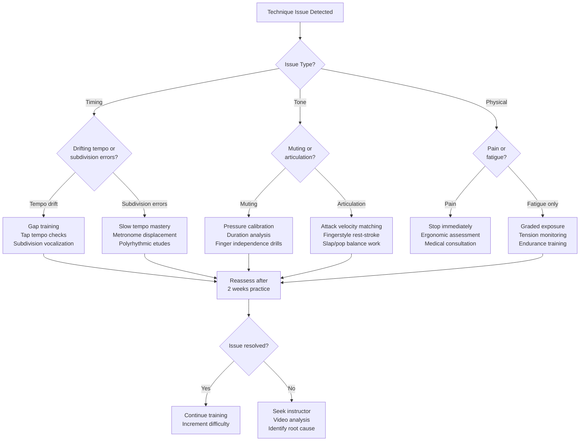

# Lesson 1: Bass Guitar Rhythm Techniques

## 1. First-Principles Intuition & Invariants

The bass guitar occupies a unique acoustic and musical position: it bridges the harmonic foundation (traditionally the role of the root note) with rhythmic propulsion (the domain of percussion). This dual function arises from the instrument's physical properties—strings of sufficient mass and length to produce fundamental frequencies in the 41 Hz (low E) to 196 Hz (high G) range, coupled with the capacity for precise rhythmic articulation through mechanical damping and attack variations.

### Physical Foundations of Bass Tone Production

String vibration on a bass guitar follows the wave equation for a tensioned string:

$$f = \frac{1}{2L}\sqrt{\frac{T}{\mu}}$$

where:
- *f* = fundamental frequency
- *L* = vibrating length of the string
- *T* = string tension
- *μ* = linear mass density (mass per unit length)

Standard bass strings exhibit significantly higher linear mass density than guitar strings (typically 0.0005–0.003 kg/m for bass versus 0.0001–0.0005 kg/m for guitar). This physical property, combined with longer scale lengths (34" standard, 35"–36" for extended-range instruments), produces the characteristic low-frequency response. However, the same mass that generates depth also creates mechanical inertia—strings continue vibrating longer after excitation, requiring active damping techniques to achieve rhythmic precision.

### The Muting Imperative: Controlling Harmonic Decay

When a bass string is plucked, it vibrates not only at its fundamental frequency but also at integer multiples (harmonics). The amplitude envelope of each harmonic follows an exponential decay governed by:

$$A(t) = A_0 e^{-\gamma t}$$

where *γ* is the damping coefficient, determined by string material, tension, and environmental factors. For unwound steel strings, decay times can exceed 5–8 seconds for low frequencies—far longer than rhythmic note durations in most musical contexts (a sixteenth note at 120 bpm lasts only 125 ms).

Muting techniques serve as active damping mechanisms, artificially increasing *γ* to terminate vibration on demand. This control separates rhythm bass playing from melodic approaches: every note becomes a deliberate event with defined start and stop boundaries, enabling the articulation of complex rhythmic figures without harmonic smearing.

### Mechanical Muting Techniques: Finger and Palm Damping

**Finger muting** involves placing the fretting-hand fingers lightly on the strings immediately after or during note articulation. The contact point creates a node that suppresses vibration through friction and mass loading. The effectiveness depends on:

1. **Contact pressure**: Sufficient to halt vibration without pressing the string to the fretboard (which would produce a harmonic)
2. **Timing**: Applied within 10–50 ms of the attack to prevent audible ringing while preserving the initial transient
3. **Position**: Typically near the bridge pickup for maximum damping efficiency

**Palm muting** employs the heel of the plucking hand (right hand for right-handed players) resting on the strings near the bridge. This technique reduces sustain while maintaining the attack transient, producing a characteristic "thud" sound. The bridge proximity is critical: positioned 1–3 cm from the bridge, the palm intercepts the portion of the string with maximum vibrational amplitude, achieving efficient damping without completely deadening the string.

### Slap and Pop: Percussive Energy Transfer

Slapping and popping transform the bass into a quasi-percussive instrument through high-energy, brief-contact string excitation. The slap technique involves striking the string with the bony portion of the thumb near the last fingerboard fret, driving the string downward into the frets with sufficient force to produce a metallic "clank" as the string rebounds against the fretboard.

The physics involves impulse momentum transfer:

$$J = \int F \, dt = \Delta p$$

A brief, high-force impact (10–50 ms contact time, 5–20 N force) transfers momentum to the string, setting it into violent oscillation. The string's impact with the fretboard adds inharmonic frequency components (non-integer multiples of the fundamental), creating the characteristic metallic timbre.

Popping complements slapping: after striking with the thumb, the index or middle finger hooks under the string and pulls it perpendicular to the fingerboard plane before releasing. This generates a sharp transient with pronounced high-frequency content (2–6 kHz), cutting through dense musical arrangements. The technique requires precise finger positioning—too close to the neck produces a weak sound; too close to the bridge reduces string displacement.

### Fingerstyle: Dynamic Control Through Plucking Mechanics

Fingerstyle bass playing employs the index and middle fingers (and sometimes ring finger) of the plucking hand to excite the strings through controlled pulling motions. Unlike pick playing, which produces a relatively uniform attack profile, fingerstyle allows independent dynamic control of each note through variations in:

1. **Plucking angle**: Perpendicular plucking (90° to string plane) maximizes fundamental frequency; tangential plucking (15–30°) emphasizes harmonics
2. **Contact point**: Bridge-ward plucking produces bright, harmonic-rich tones; neck-ward plucking yields warmer, fundamental-heavy tones
3. **Flesh-to-nail ratio**: Pure flesh contact produces round, smooth attacks; nail involvement adds high-frequency transients

The biomechanics of alternating index-middle finger technique ("walking fingers") enable rapid note sequences (up to 8–10 notes per second for advanced players) while maintaining rhythmic evenness. This requires neuromuscular independence: each finger must execute identical movements with minimal timing variance (<10 ms deviation between fingers).

### Rhythmic Subdivision and Temporal Precision

Rhythm, at its core, is the partitioning of time into perceptually discrete events. In Western music notation, the quarter note serves as the primary temporal unit, with the time signature indicating both the number of beats per measure and which note value receives the beat.

In 4/4 time (four quarter notes per measure), the hierarchy of subdivisions follows binary relationships:

- 1 whole note = 2 half notes = 4 quarter notes = 8 eighth notes = 16 sixteenth notes = 32 thirty-second notes

A bassist must internalize these subdivisions to execute complex rhythmic figures. At 120 bpm, one beat (quarter note) equals 500 ms. Sixteenth-note subdivisions thus occur every 125 ms—approaching the temporal resolution threshold of human rhythmic perception (approximately 100 ms for trained musicians).

Groove, the stylistic manifestation of rhythm, arises from systematic microtiming deviations: notes played slightly ahead of (pushing) or behind (laying back) the mathematical beat position. These deviations, typically 10–30 ms, create tension and release that drives musical forward motion. Master bassists develop precise temporal control to place notes within this narrow window, coordinating with the drummer's kick drum and snare to lock in the pocket.

## 2. Core Architecture & Mechanics

### Instrument Construction and Acoustic Properties

The electric bass guitar comprises several acoustically and mechanically coupled systems:

**Neck and Fingerboard Assembly**: The neck, typically constructed from maple, mahogany, or laminated combinations, provides structural rigidity against string tension (approximately 80–100 kg total for standard tuning). The fingerboard (commonly rosewood, maple, or ebony) hosts 20–24 frets—metal bars positioned according to the equal-temperament frequency ratio:

$$f_n = f_0 \cdot 2^{n/12}$$

where *f₀* is the open string frequency and *n* is the fret number. Each fret represents one semitone, dividing the octave into twelve equal logarithmic steps.

**String Configuration**: Standard four-string basses employ the E-A-D-G tuning (E1 at 41.2 Hz, A1 at 55 Hz, D2 at 73.4 Hz, G2 at 98 Hz). String gauges typically range from .045" (G string) to .105" (E string), with heavier gauges providing increased fundamental response at the cost of higher tension and reduced playability.

**Pickup Systems**: Electromagnetic pickups convert string vibration into electrical signals through Faraday's law of induction. As the ferromagnetic string vibrates in the pickup's magnetic field, it induces a time-varying voltage proportional to the string's velocity:

$$V(t) = -N \frac{d\Phi_B}{dt}$$

where *N* is the number of coil turns and *Φ_B* is the magnetic flux. Single-coil pickups (e.g., Fender Jazz Bass) produce bright, detailed tones with pronounced high frequencies but are susceptible to electromagnetic interference. Humbucker pickups (e.g., Music Man StingRay) employ dual coils in opposite polarity to cancel hum while producing thicker, warmer tones.

**Bridge and Saddle System**: The bridge anchors the strings and provides intonation adjustment through movable saddles. Proper intonation ensures that fretted notes maintain accurate pitch across the fingerboard. Each string's saddle position is adjusted so that the 12th fret harmonic (exactly half the string length) matches the 12th fret fretted note.

### Biomechanics of Rhythm Technique Execution

#### Finger Muting Mechanics

Executing precise finger muting requires coordinated action of the fretting hand:

1. **Initial Note Articulation**: The fingertip presses the string firmly against the fret, requiring approximately 2–4 N of force (lighter pressure causes buzzing; excessive pressure induces sharp tuning and finger fatigue)

2. **Muting Application**: Within 10–100 ms of plucking (depending on desired sustain), the fretting finger releases pressure while maintaining light contact with the string. This transition demands fine motor control—the finger must shift from full pressure to feather-light touch without losing contact

3. **Multiple String Coordination**: For chordal playing or rapid position shifts, unused fingers rest lightly on adjacent strings to prevent sympathetic vibration. The unused strings of a bass guitar readily vibrate in response to played notes (particularly at harmonic intervals), creating unwanted noise without active damping

#### Palm Muting Biomechanics

Palm muting positioning follows a spatial optimization problem: maximize damping efficiency while maintaining plucking hand mobility. The optimal contact zone lies 1–4 cm from the bridge, where:

- **Closer to bridge** (<1 cm): Maximum damping but excessive tonal deadening; produces almost purely percussive sound with minimal pitch definition
- **Sweet spot** (1–3 cm): Balanced damping that retains fundamental while suppressing high harmonics; produces the characteristic "thumpy" bass sound favored in funk, reggae, and old-school R&B
- **Further from bridge** (>4 cm): Insufficient damping; excessive sustain remains

The heel of the palm (hypothenar eminence) rests on the strings with approximately 0.5–2 N of contact force. Heavier pressure increases damping but reduces tonal warmth; lighter pressure may allow unwanted ringing.

#### Slap Technique Kinematics

The slap motion involves a rapid wrist rotation (40–60 degrees) combined with thumb extension. The movement sequence:

1. **Preparation**: Wrist rotated inward (pronation), thumb positioned perpendicular to strings
2. **Strike**: Rapid wrist supination drives the thumb's bony lateral edge into the string (5–15 ms contact time)
3. **Rebound**: Thumb bounces off the string due to elastic recoil, ready for next strike
4. **Follow-through**: Wrist continues rotating to neutral position

The contact point—typically the junction between the neck and body (20th–24th fret area)—represents a compromise: closer to the nut produces warmer tone but requires greater force; closer to the bridge produces brighter tone but higher risk of string breakage.

Advanced slap technique incorporates "double-thumbing": after the initial downward slap, the thumb rebounds and strikes the string on the upward motion, effectively doubling the rhythmic density without alternating to the fingers.

#### Pop Technique Dynamics

The pop motion begins with the finger (typically index or middle) hooking under the string from beneath:

1. **Engagement**: Fingertip slides under the string (0.5–1 cm displacement)
2. **Tension**: Finger pulls the string perpendicular to the fingerboard plane, storing elastic potential energy: $E = \frac{1}{2}k x^2$, where *k* is string stiffness and *x* is displacement
3. **Release**: Finger releases, allowing the string to snap back and strike the fretboard/frets, converting potential energy to kinetic energy and sound
4. **Recovery**: Finger returns to rest position above the strings

The optimal displacement (1–2 cm for standard gauge strings) balances tonal brightness against risk of string breakage. Excessive pulling (>3 cm) can exceed the string's elastic limit, causing permanent deformation or breakage.

### Fingerstyle Technique Architecture

Professional fingerstyle technique employs a rest-stroke (apoyando) approach: after plucking a string, the finger comes to rest against the adjacent string. This technique provides:

1. **Tonal consistency**: The finger-string contact produces a repeatable attack profile
2. **Dynamic power**: The mechanical advantage of pushing through to a rest position allows greater force generation
3. **Rhythmic precision**: The tactile feedback of contacting the adjacent string provides timing reference

The alternating index-middle (i-m) finger pattern creates a continuous, flowing motion similar to walking:

```
String 1: i - - - m - - - i - - - m
Time:     1   2   3   4   5   6   7   8
```

At advanced tempos (eighth notes at 160+ bpm, yielding 5.3 notes per second), this pattern demands exceptional neuromuscular coordination. Electromyographic (EMG) studies of professional bassists reveal muscle activation patterns with <5% timing variance between fingers—a level of motor control comparable to trained classical pianists.

Three-finger technique (i-m-a: index-middle-ring) extends this capability, enabling even faster passages:

```
String 1: i - m - a - i - m - a - i - m
Time:     1   2   3   4   5   6   7   8   9
```

However, the ring finger (a) typically exhibits 10–15% less force production than the index, requiring dedicated training to achieve timbral evenness.

## 3. High-Performance Optimization & Failure Modes

### Training Methodologies for Technical Mastery

**Progressive Overload and Specificity**: Analogous to athletic training, bass technique development follows the principle of progressive overload—systematically increasing the difficulty of exercises to drive neuromuscular adaptation. Effective practice routines structure challenges along multiple dimensions:

1. **Temporal density**: Increasing note subdivision (quarter → eighth → sixteenth notes)
2. **Velocity**: Incrementing metronome tempo by 2–5 bpm per session
3. **Coordination complexity**: Introducing syncopation, polyrhythm, and asymmetric groupings
4. **Duration**: Extending uninterrupted playing time to build muscular endurance

**Deliberate Practice Protocol**: Research in skill acquisition demonstrates that expertise develops through deliberate practice—focused, goal-directed repetition with immediate feedback. For bass technique:

1. **Isolation**: Practice technique components individually (muting only, slap only, timing only) before integration
2. **Slow-tempo mastery**: Execute patterns at 40–60% target tempo with metronomic precision before acceleration
3. **Error detection**: Record practice sessions and analyze for timing deviations, tonal inconsistencies, and mechanical inefficiencies
4. **Variability training**: Practice patterns in all keys, positions, and rhythmic displacements to develop generalizable skill

**Finger Independence Development**: The human hand evolved for power grip and precision manipulation, not the individuated finger movements required for advanced bass playing. Developing true finger independence requires targeted exercises that activate individual finger flexors while minimizing co-activation:

```
Exercise 1: Finger permutations (Frets 5-8, one string)
Pattern:   1-2-3-4, 1-2-4-3, 1-3-2-4, 1-3-4-2, 1-4-2-3, 1-4-3-2, ...
Total:     24 permutations
Tempo:     Start 60 bpm (sixteenth notes), increment by 2 bpm per week
```

This exercise forces the brain to generate novel motor commands for each permutation, weakening the neural tendency toward synchronized finger movements.

### Rhythmic Precision and Groove Development

**Subdivision Internalization**: Elite bassists possess the ability to subdivide the beat into increasingly fine divisions while maintaining phase-lock with external tempo references. This skill develops through:

1. **Metronome displacement**: Practice with metronome clicks on progressively weaker beat subdivisions (quarter notes → eighth notes → eighth-note triplets → sixteenth notes → only beat 4 of each measure)

2. **Polyrhythmic superimposition**: Play one subdivision (e.g., triplets) against a metronome generating a different subdivision (e.g., sixteenth notes), developing the ability to maintain independent temporal grids

3. **Gap-click training**: Use metronomes that randomly omit clicks, forcing internalization of tempo without continuous external reference

**Microtiming Control**: Groove arises from controlled deviations from quantized timing. Developing this control requires awareness of placement options:

```
Quantized:     |----|----|----|----|
Laid back:     |----|----|----|----|
                    ◦    ◦    ◦    ◦  (10-20ms delay)
Pushed:        |----|----|----|----|
              ◦    ◦    ◦    ◦        (10-20ms early)
```

Practice method: Record a simple bass line three times—quantized (with metronome), pushed, and laid back. Analyze waveforms in a digital audio workstation (DAW) to visualize timing differences and develop proprioceptive awareness of temporal placement.

### Common Failure Modes and Remediation Strategies

#### Failure Mode 1: Inconsistent Muting Pressure

**Symptom**: Erratic note durations, with some notes sustaining longer than intended and others terminating prematurely.

**Root Cause**: Insufficient proprioceptive calibration of finger pressure. The fretting hand lacks a reliable internal model for the force required to damp strings without deadening them completely.

**Remediation**:
1. Practice muting with amplifier volume at low levels, using only auditory feedback to assess damping effectiveness
2. Employ high-gain compression to make tonal inconsistencies more audible
3. Execute slow-tempo chromatic scales (40 bpm quarter notes) with exaggerated muting, focusing on identical note durations
4. Record and analyze waveforms to identify duration variance; target <10% coefficient of variation

#### Failure Mode 2: Slap-Pop Timbral Imbalance

**Symptom**: Slapped notes produce significantly different volume or tone than popped notes, creating a non-uniform rhythmic texture.

**Root Cause**: Asymmetric energy transfer between thumb (slap) and finger (pop) techniques. The thumb, being stronger, naturally generates higher amplitude unless consciously controlled.

**Remediation**:
1. Practice slap and pop patterns at matched dynamic levels, using a tuner's VU meter or DAW input meter to monitor amplitude consistency
2. Reduce thumb slap force by 20–30% while increasing pop finger displacement
3. Apply compression (4:1 ratio, medium attack/release) during practice to reduce dynamic range and expose timbral differences
4. Execute alternating slap-pop patterns (T-p-T-p-T-p) at slow tempos, incrementing speed only after achieving <3 dB amplitude variance

#### Failure Mode 3: Rhythmic Drift and Subdivision Instability

**Symptom**: Gradual acceleration or deceleration during unaccompanied playing; inability to maintain precise placement of sixteenth-note subdivisions.

**Root Cause**: Underdeveloped internal pulse generator. The brain's temporal prediction mechanisms (cerebellum, basal ganglia) lack sufficient calibration to maintain stable tempo without continuous external reference.

**Remediation**:
1. **Gap training**: Practice with metronome set to quarter notes, playing sixteenth-note patterns. Gradually reduce metronome to beat 1 only, then 1 and 3, then 1 only, then beat 1 of alternating measures
2. **Tap tempo verification**: Record practice sessions with periodic tap tempo checks (tap foot or hand on beat), comparing internal tempo to reference; target <2% tempo deviation over 30-second intervals
3. **Subdivision vocalizations**: Simultaneously vocalize subdivisions while playing (e.g., "1-e-and-a-2-e-and-a"), forcing conscious awareness of temporal grid
4. **Polyrhythmic etudes**: Practice three-against-four and five-against-four patterns to develop flexible subdivision sense

#### Failure Mode 4: Muscular Fatigue and Endurance Limitations

**Symptom**: Technique degradation after 10–15 minutes of continuous playing; onset of forearm, wrist, or hand pain.

**Root Cause**: Excessive muscle tension, inefficient biomechanics, or insufficient muscular endurance for the required workload.

**Remediation**:
1. **Ergonomic assessment**: Verify instrument positioning (strap height, bass angle) to minimize wrist deviation and shoulder elevation
2. **Tension monitoring**: Periodically check for unnecessary tension in non-playing muscles (jaw, shoulders, abdomen); tension anywhere propagates throughout the kinetic chain
3. **Graded exposure**: Incrementally extend continuous playing duration by 1–2 minutes per week, allowing progressive adaptation
4. **Active recovery**: Incorporate 30-second rest intervals every 10 minutes during practice, using gentle stretching and finger flexion/extension to maintain blood flow
5. **Eccentric strengthening**: Employ hand grip strengtheners and finger exercisers to build muscular endurance in the flexor digitorum profundus and flexor pollicis longus

#### Failure Mode 5: Fret Buzz and Intonation Issues

**Symptom**: Unwanted buzzing sounds during note articulation; fretted notes sound sharp or flat relative to open strings or harmonics.

**Root Cause**: Insufficient fretting pressure, improper finger placement behind the fret, or structural instrument issues (relief, saddle height, fret levelness).

**Remediation**:
1. **Finger placement precision**: Position fretting fingers 1–2 mm behind (toward the nut) the target fret, in the "sweet spot" where minimal pressure produces clear tone
2. **Pressure calibration**: Use a force-sensing resistor or kitchen scale to measure fretting pressure; target 2–4 N (200–400 g) for standard gauge strings
3. **Instrument setup verification**: Check neck relief (0.010"–0.015" at 7th–9th fret with capo at 1st and finger at last fret), saddle height (1.5–2.5 mm at 12th fret), and intonation (12th fret harmonic matches 12th fret fretted note within ±2 cents)
4. **Fret levelness assessment**: If buzzing persists after technique correction, consult a luthier to assess fret height variance (should be within 0.001"–0.002")

### Advanced Performance Concepts

**Harmonic Anticipation**: In ensemble contexts, skilled bassists anticipate chord changes by playing the upcoming root note slightly early (10–30 ms before the downbeat). This creates forward momentum and helps anchor the ensemble's transition. The technique requires intimate knowledge of the harmonic progression and precise temporal control.

**Ghost Notes and Rhythmic Articulation**: Ghost notes—muted, percussive attacks that produce pitch-indeterminate "thuds"—serve as rhythmic punctuation. Executed by lightly touching the string without pressing it to the fret while maintaining right-hand attack, ghost notes fill rhythmic space without cluttering the harmonic texture:

```
Pattern:  |  o  .  o  .  o  .  o  .  |
Beat:     1  &  2  &  3  &  4  &
          P  G  P  G  P  G  P  G

P = pitched note (normal fret pressure)
G = ghost note (light touch only)
```

This technique, prevalent in funk and R&B, requires independent control of fretting hand pressure while maintaining consistent right-hand attack velocity.

**String Raking**: A timbral efficiency technique where the right hand plucks through multiple strings in a single motion, allowing unplayed strings to sound briefly as muted percussive attacks. This creates a fluid, harp-like articulation while maintaining rhythmic drive. Effective raking demands precise left-hand muting of non-target strings to prevent harmonic clutter.

### Mental Models for Rhythm Mastery

Cognitive research reveals that expert musicians develop rich mental models—internal representations of music structure that guide real-time performance decisions. For rhythm bass playing:

1. **Temporal Grid Model**: A multi-resolution representation of beat subdivisions (quarter, eighth, sixteenth, triplet) that persists independently of note articulations, allowing the player to "feel" subdivisions they are not actively playing

2. **Harmonic Anchor Model**: A representation of root note positions and chord tones across the fingerboard, enabling rapid navigation and position shifts without conscious calculation

3. **Groove Template Model**: Internalized rhythmic patterns for specific styles (Motown, reggae, funk, Latin), stored as motor programs that can be retrieved and instantiated with minimal cognitive load

4. **Dynamic Contour Model**: A sense of how note intensity should vary across time to create musical phrasing—louder on strong beats, softer on weak beats, with crescendos and diminuendos shaped to the music's narrative arc

Developing these models requires extensive listening, transcription, and imitation of master bass players, gradually abstracting from specific performances to generalizable stylistic principles.

### Diagnostic Flowchart for Technique Troubleshooting



### Integration with Musical Context

Technical mastery serves musical expression, not the reverse. The ultimate goal of rhythm technique development is unconscious competence—the ability to execute complex patterns without conscious attention, freeing cognitive resources for musical decision-making. This state, termed "flow" in psychology research, emerges when:

1. **Challenge matches skill**: Tasks are difficult enough to engage full attention but not so difficult as to induce anxiety
2. **Clear goals exist**: The player knows what to play and why
3. **Immediate feedback available**: Auditory, kinesthetic, and social feedback confirm correct execution
4. **Action and awareness merge**: The distinction between intention and execution dissolves

Achieving this state requires thousands of hours of deliberate practice, but the result—effortless, expressive, groove-locked bass playing that serves the music—justifies the investment. The bass guitar, when mastered, becomes not just an instrument but an extension of the player's musical consciousness, capable of articulating rhythm and harmony with precision, nuance, and soul.
