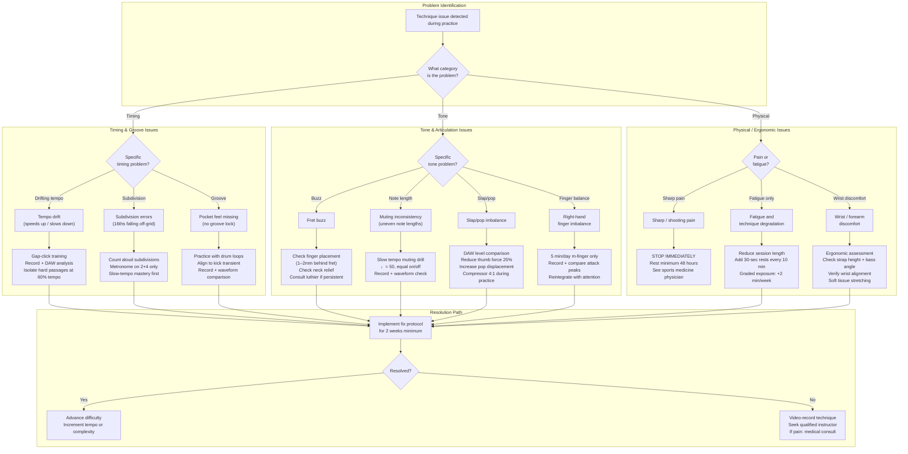

# Bass Guitar Masterclass: Rhythm Techniques, Groove Architecture & Performance Mastery

## Table of Contents

1. [First-Principles Intuition](#1-first-principles-intuition)
2. [Right-Hand Technique Arsenal](#2-right-hand-technique-arsenal)
3. [Left-Hand Muting & Fretting Mechanics](#3-left-hand-muting--fretting-mechanics)
4. [Fretboard Geography & Movable Box Patterns](#4-fretboard-geography--movable-box-patterns)
5. [Groove Architecture & Rhythmic Precision](#5-groove-architecture--rhythmic-precision)
6. [Slap & Pop Technique](#6-slap--pop-technique)
7. [Walking Bass & Harmonic Navigation](#7-walking-bass--harmonic-navigation)
8. [Practice Drills & Progressive Protocols](#8-practice-drills--progressive-protocols)
9. [Failure Modes & Remediation](#9-failure-modes--remediation)
10. [Diagnostic Flowchart](#10-diagnostic-flowchart)

---

## 1. First-Principles Intuition

### What Makes Bass Unique: The Rhythmic-Harmonic Bridge

The bass guitar occupies a singular role in any ensemble: it simultaneously defines **where the chord is** (harmonic root) and **when the beat lands** (rhythmic anchor). No other instrument does both at that intensity level. Understanding this dual function shapes every technical decision you make—which note to play, how long to sustain it, and exactly when to release it.

Standard four-string tuning is **E1–A1–D2–G2** (41 Hz, 55 Hz, 73 Hz, 98 Hz). These low frequencies have naturally long decay times—an open low E can ring for 5–8 seconds unpedaled. At 120 BPM, a sixteenth note lasts only 125 ms. That gap is your central technical challenge: **you must actively stop notes** as precisely as you start them. Muting is not an optional refinement—it is the foundation of rhythmic clarity.

One paragraph of physics worth knowing: string pitch is determined by length, tension, and mass per unit length. Heavier strings (the E string at ~.105" gauge is roughly twice the mass of a guitar's low E) produce deep fundamentals but carry more inertia—they keep vibrating unless you stop them. This inertia is why bass muting demands more deliberate physical commitment than on guitar.

### The Pocket: Kick Drum Relationship

The bass and kick drum form a single rhythmic organism. Lock the attack of your notes to land **with or just behind** the kick drum's transient. When kick and bass align, the low end feels solid and powerful. When they drift, the low end sounds muddy and undefined. Every practice session should include drum playback—a metronome alone does not develop kick-drum synchronization.

---

## 2. Right-Hand Technique Arsenal

### 2.1 Fingerstyle: The Foundation

**Hand position:** Anchor your thumb on the pickup housing (or the string above the one you're playing—floating thumb, discussed below). Fingers curve naturally downward at roughly 45° to the string plane. Your wrist should be nearly flat—no dramatic upward bend.

**Rest stroke (apoyando):** After plucking a string, let your finger come to rest against the string immediately below it. This delivers maximum tone, consistency, and volume. It is the professional standard for most bass playing.

```
Rest stroke path (index finger on D string):
  D string ──→ pluck ──→ finger lands on A string
  A string ──→ pluck ──→ finger lands on E string
```

**Free stroke:** Finger pulls away from the instrument after the pluck, clearing all adjacent strings. Use this when moving between non-adjacent strings rapidly.

**Alternating i-m pattern — the essential drill:**

```
String:    G  D  A  E  G  D  A  E
Finger:    i  m  i  m  i  m  i  m

BPM targets:
  Week 1–2:  ♩= 60  (eighth notes)
  Week 3–4:  ♩= 80
  Week 5–6:  ♩= 100
  Week 7–8:  ♩= 120
  Month 3+:  ♩= 140+ (sixteenth notes at 120 = eighth notes at 240)
```

**Plucking contact point:**

| Position | Tone Character | Use Case |
|---|---|---|
| Over neck pickup | Warm, round, fundamental-heavy | Motown, ballads, reggae |
| Between pickups | Balanced, versatile | Pop, rock, R&B |
| Over bridge pickup | Bright, cutting, harmonic-rich | Funk, slap, solo lines |
| Palm-muted near bridge | Percussive, short decay | Reggae, gospel, country |

### 2.2 Floating Thumb Technique

The floating thumb solves the most common beginner problem: **sympathetic string ringing**. Instead of anchoring your thumb statically on the pickup, your thumb rests on the string immediately below the string you're playing. As you move to lower strings, the thumb rolls down with you, muting every string above your current position.

```
Playing the A string:
  Thumb rests on E string (muting it)
  i and m fingers pluck A string

Playing the D string:
  Thumb rests on A string (muting it)
  E string muted by left-hand finger draping
  i and m fingers pluck D string

Playing the G string:
  Thumb rests on D string (muting it)
  A and E strings muted by left-hand and thumb
```

Practice this slowly on a single string pattern before integrating across strings. It feels awkward for approximately two weeks, then becomes automatic.

### 2.3 Palm Muting

Rest the **hypothenar eminence** (the fleshy heel of your palm, pinky side) on the strings directly above the bridge saddles. The closer to the bridge, the lighter the muting effect. Find your sweet spots:

```
Contact zone (distance from bridge saddles):
  < 1 cm    →  Near-dead thud, almost no pitch
  1–3 cm    →  "Thumpy" muted tone — funk, reggae, old-school R&B ✓
  3–5 cm    →  Light muting, slight warmth reduction
  > 5 cm    →  Negligible muting effect
```

**Palm mute drill — reggae one-drop pattern:**

```
Tempo: ♩= 70 BPM
Time:  4/4

E: |–––2–––2–––2–––2–|  (all notes palm-muted)
A: |–––––––––––––––––|
D: |–––––––––––––––––|
G: |–––––––––––––––––|

Beats: 1   2   3   4
       PM  PM  PM  PM
```

Progressive lift: After mastering with full palm mute, gradually reduce contact pressure until you find the "just barely muted" zone. This earns you the reggae pocket.

---

## 3. Left-Hand Muting & Fretting Mechanics

### 3.1 Simandl 1-2-4 vs. One-Finger-Per-Fret

Your fretting-hand finger assignment depends on your position on the neck:

**Frets 1–5 (Simandl 1-2-4 system):**

The human hand cannot comfortably spread four fingers across four consecutive frets in this low register without dangerous tendon strain. Use the Simandl system, borrowed from upright bass:

```
Finger 1 (index)   = covers fret n
Finger 2 (middle)  = covers fret n+1
Finger 4 (pinky)   = covers fret n+2 or n+3

Example — E string, Simandl in first position:
  Fret 1 (F)  → finger 1
  Fret 2 (F#) → finger 2
  Fret 3 (G)  → finger 2 (stretch from fret 2, or shift)
  Fret 4 (G#) → finger 4
  Fret 5 (A)  → finger 4
```

Ring finger (3) acts as a support brace behind the pinky, never fretting independently in this zone.

**Frets 7+ (One-Finger-Per-Fret, OFPF):**

The neck narrows enough here that all four fingers cover four consecutive frets without strain. Standard guitar-style fingering applies: finger 1 = lowest fret, finger 4 = highest.

### 3.2 Thumb Placement on the Back of the Neck

Thumb lives on the **back of the neck**, opposite the middle finger (finger 2), pointing roughly toward the headstock at a slight angle. Never hook the thumb over the top of the neck—this collapses your arch, kills your reach, and stresses the wrist.

```
Correct geometry:
  Side view of neck:
    ┌─────────────────────┐  ← fretboard
    │   ●  ●  ●  ●        │  ← fingers 1-2-4 arched
    └─────────────────────┘
              ↑
         thumb (back of neck, behind finger 2)
         pointing ~30° toward headstock
```

**Wrist position:** Keep the wrist reasonably straight—mild inward rotation is fine, but avoid bending the wrist sharply upward or downward. The forearm transmits force into the fingertips; a kinked wrist disrupts that chain and leads to repetitive strain injury.

### 3.3 Fretting Efficiency

- **Finger placement:** Land your fingertip **1–2 mm behind the fret** (toward the nut), in the small zone where minimum pressure produces a clean note. Pressing in the middle of the fret space requires 2–3× more force for the same result.
- **Minimum pressure:** Use only enough pressure to stop the buzz. Excess pressure causes sharp tuning, fatigue, and mutes overtones.
- **Finger arch:** Keep fingers curved so each fingertip contacts the string independently. Flat fingers accidentally mute adjacent strings.

---

## 4. Fretboard Geography & Movable Box Patterns

### 4.1 The Root-Fifth-Octave Power Framework

Every bass line begins with knowing where your root, fifth, and octave live relative to any given note. These three shapes work at any position on any string.

**Shape 1 — Root on E string:**

```
E: |–––R–––––|
A: |–––––5–––|  (same fret + 2 strings up)
D: |–––––R–––|  (octave — 2 frets up from 5th, same string as 5th)
G: |–––––––––|

Example: Root = G (fret 3, E string)
E: |–3–––|  G (root)
A: |–––5–|  D (fifth)  ← fret 5
D: |–––5–|  G (octave) ← fret 5
G: |–––––|
```

**Shape 2 — Root on A string:**

```
A: |–––R–––––|
D: |–––––5–––|
G: |–––––R–––|  (octave)

Example: Root = C (fret 3, A string)
A: |–3–––|  C (root)
D: |–––5–|  G (fifth)  ← fret 5
G: |–––5–|  C (octave) ← fret 5
```

**Shape 3 — Adding the minor/major 3rd:**

```
Minor box (movable, root on E string):
E: |–R–––––––m3–|
A: |–––––5–––––|
D: |–––––R–––––|  (octave)

Major box (movable, root on E string):
E: |–R–––––M3–––|
A: |–––––5–––––|
D: |–––5–R–––––|  (octave)
```

Memorize these three shapes. They cover 90% of bass playing across all genres. The remaining 10% is chromatic approach notes and style-specific runs built on this foundation.

### 4.2 Position Map: Notes on E and A Strings

Knowing your root positions across E and A strings unlocks the entire neck.

```
E string natural notes:
Fret:  0    2    3    5    7    8    10   12
Note:  E    F#   G    A    B    C    D    E

A string natural notes:
Fret:  0    2    3    5    7    8    10   12
Note:  A    B    C    D    E    F    G    A

D string natural notes:
Fret:  0    2    3    5    7    8    10   12
Note:  D    E    F    G    A    Bb   C    D

G string natural notes:
Fret:  0    2    3    5    7    8    10   12
Note:  G    A    Bb   C    D    Eb   F    G
```

**Drill — Root finder:** Set a metronome to ♩= 60. Call out a random note name every 4 beats. Find it on both the E and A strings before the next 4 beats expire. Increase to 2 beats per note as you improve. This drill alone transforms fretboard navigation.

### 4.3 The ii–V–I Bass Line Framework

The most universal harmonic motion in Western music. Here it is in C major with practical fingering:

```
Key of C major: Dm7 – G7 – Cmaj7
Tempo: ♩= 80 BPM

Dm7 (root D, fret 5 / A string):
A: |–5–5–7–8–|  D–D–E–F
D: |–––––––––|

G7 (root G, fret 10 / A string or fret 3 / E string):
A: |–10–10–9–8–|  G–G–F#–F (chromatic approach)
   OR
E: |–3–3–2–1–|

Cmaj7 (root C, fret 8 / A string or fret 3 / A string):
A: |–8–8–8–8–|  C sustained / rhythmic

Combined — 2-beat roots + chromatic approach:
Bar 1 (Dm7): D on beat 1, chromatic up to E (fret 7) on beat 4
Bar 2 (G7):  G on beat 1, chromatic down to F (fret 8) on beat 4
Bar 3 (Cmaj7): C on beat 1, hold or add octave C
```

---

## 5. Groove Architecture & Rhythmic Precision

### 5.1 Subdivision Hierarchy

At ♩= 120 BPM, understand the time grid you're working within:

```
1 beat (quarter note)     = 500 ms
1 eighth note             = 250 ms
1 sixteenth note          = 125 ms
1 thirty-second note      = 62.5 ms
1 eighth-note triplet     = 167 ms
1 sixteenth-note triplet  = 83 ms
```

Your groove lives in the relationship between your note attacks and this grid. Sixteenth notes at 125 ms intervals approach the outer edge of rhythmic perception for most listeners (~80–100 ms). This is why perfectly quantized bass lines can feel robotic—the grid is so tight that microscopic variations stand out.

### 5.2 Pocket Placement: Push, Center, Lay Back

Every note you play lands somewhere in a ~40 ms window around the beat:

```
|<–––– 20ms ––––>|<–––– 20ms ––––>|
     PUSH         CENTER      LAY BACK
  (anticipate)    (on beat)   (behind beat)

Funk pocket:   slight push — urgency, forward motion
Jazz pocket:   slight lay back — spaciousness, weight
Rock/metal:    center — precision, power
Reggae:        heavy lay back — languid, meditative feel
Gospel:        varies — often push on anticipations, lay back on
                "2 and 4" feel
```

**Pocket drill:**

1. Record a simple one-bar pattern (root on beat 1 and 3) with a click at ♩= 90.
2. Listen back and import into a DAW (GarageBand, Reaper, Audacity).
3. Zoom into the waveform. Measure the distance from your note transient to the click transient.
4. Intentionally push by 15 ms, record again. Listen to the difference.
5. Intentionally lay back by 15 ms, record again.
6. You now have proprioceptive awareness of these three feels. Practice each deliberately.

### 5.3 Locking with the Kick Drum

The bass note attack should **align with or slightly after** the kick drum's initial transient, not before. The kick drum's attack is percussive and brief; the bass note fills in the sustained low frequency underneath it.

**Practical exercise — Kick lock drill:**

```
Use any drum loop at ♩= 90–100 BPM with a prominent kick on beats 1 and 3.

Bar 1 target:
  Beat 1: Bass note lands WITH kick (within 10 ms)
  Beat 2: Ghost note (muted thump) or rest
  Beat 3: Bass note lands WITH kick
  Beat 4: Chromatic approach note (anticipation of bar 2 root)

Verification: Record your bass over the loop, then view both
waveforms stacked in a DAW. Adjust until kick and bass transients
are visually aligned.
```

### 5.4 Ghost Notes: Rhythmic Punctuation

Ghost notes are muted, percussive attacks that occupy rhythmic space without contributing harmonic content. They are the difference between a bass line that sits in the pocket and one that drives and breathes.

**Ghost note mechanics:**

- Fretting hand: lay fingers across strings with **zero fret pressure** — just enough contact to mute
- Plucking hand: attack is identical to a normal note in force and angle
- Result: a brief "thk" or "pft" sound with no discernible pitch

```
Notation: lowercase x = ghost note, uppercase O = pitched note

Classic funk ghost note pattern (G string root = G):
G: |–O–x–x–O–|–x–O–x–x–|
   Beat: 1 e + a   2 e + a

Extended groove pattern (root on A string, fret 5 = D):
A: |–O–x–O–x–|–x–O–x–O–|
D: |–––––––––|–––––––––|
Beat: 1 e + a   2 e + a
```

**Ghost note drill:**

```
Tempo: ♩= 70 BPM — 4/4

A string only:
Beat: 1  e  +  a  2  e  +  a  3  e  +  a  4  e  +  a
      O  x  x  O  x  x  O  x  O  x  x  O  x  x  O  x

Where O = fret 5 (D), x = ghost note same string

Week 1: ♩= 70, focus on identical right-hand attack velocity
Week 2: ♩= 80, add floating thumb muting
Week 3: ♩= 90, integrate into 2-chord vamp (D–G)
```

---

## 6. Slap & Pop Technique

### 6.1 Slap Mechanics: Thumb Bounce

The slap is a **rotational wrist motion**, not an arm swing. The thumb acts as a hammer that bounces off the string immediately.

**Setup:**
- Right hand held with thumb pointing roughly upward, parallel to strings
- Wrist neutral or slightly pronated
- Thumb extended slightly away from the palm

**Strike sequence:**

```
1. PREP:    Wrist pronated (rotated inward), thumb above string
2. STRIKE:  Rapid wrist supination (outward rotation, 40–60°)
            Thumb's bony outer edge hits string at the
            last fret (20th–22nd fret area, neck/body joint)
3. REBOUND: Thumb bounces OFF immediately — contact time 10–20 ms
            Longer contact = "clunk" not "click"
4. RESET:   Wrist returns to neutral ready for next strike

The bounce is non-negotiable. If your thumb stays on the string,
you are damping it, not hitting it.
```

**Common mistake:** Striking with the pad/flesh of the thumb instead of the bone. The pad absorbs the impact. Find the bony knuckle on the side of your thumb — that is your striking surface.

### 6.2 Pop Mechanics: Hook and Snap

Pop targets the G or D string (occasionally A). Index finger is standard; middle finger gives a slightly different tonal character.

```
1. HOOK:    Slide fingertip under the target string from below
            Displacement: 1–1.5 cm perpendicular to fretboard
2. PULL:    Lift string directly up (perpendicular to body)
            Do NOT pull at an angle toward the floor
3. RELEASE: Let the string snap back — it strikes the frets
            on return for that characteristic "crack"
4. RESET:   Finger clears the string immediately after release
```

**Too close to neck** = weak, dull pop. **Too close to bridge** = thin, brittle pop. The sweet spot for pop position is typically over or just behind the neck pickup.

### 6.3 Slap-Pop Coordination Patterns

**Level 1 — Thumb only, single string:**

```
E string, fret 5 (A note):
Tempo: ♩= 60 BPM

T = thumb slap, . = rest
|–T–.–T–.–|–T–.–T–.–|
Beat: 1   2   3   4

Advance to: ♩= 80 → 100 → 120
```

**Level 2 — T and Pop alternating:**

```
E string slap (A, fret 5), G string pop (open G or fret 2 = A)
Tempo: ♩= 60 BPM

T = thumb slap on E string
P = pop on G string
|–T–P–T–P–|–T–P–T–P–|
Beat: 1  +  2  +  3  +  4  +

Target tempo progression:
  ♩= 60 → 70 → 80 → 90 → 100 → 110
```

**Level 3 — The classic funk slap pattern:**

```
Key of D. E string slap (open E and fret 5=A approach),
G string pop (fret 7=D octave).

Tab:
G: |–––––––––7–––––––7–|  (pop on &-of-2 and &-of-4)
D: |–––––––––––––––––––|
A: |–––5–––––––5–––––––|  (thumb: &-of-1, beat 3)
E: |–0–––0–––––––0–––––|  (thumb: beats 1, +of-1, beat 2)

Beat: 1  e  +  a  2  e  +  a
      T  .  T  .  T  .  P  .
      .  .  .  .  T  .  T  .

Tempo: Start ♩= 65, work to ♩= 100
```

**Level 4 — Double thumbing:**

After the downward slap, allow the thumb to continue through the string and strike it on the **upstroke** as well. This doubles your note density without adding fingers:

```
T↓ = downstroke thumb slap
T↑ = upstroke thumb slap
P  = pop

|–T↓–T↑–P–T↓–|–T↑–P–T↓–T↑–|
 16th notes at ♩= 80 target
```

### 6.4 Slap-Pop Balance

Thumb slap is naturally louder than a pop because the thumb is heavier and strikes more forcefully. Consciously:
- **Reduce thumb force by ~25%** from your instinctive "full power"
- **Increase pop displacement** (pull string slightly higher than feels natural)
- **Measure with a DAW input meter**: target <3 dB difference between T and P peaks

---

## 7. Walking Bass & Harmonic Navigation

### 7.1 The Four Rules of Walking Bass

Walking bass lines move primarily in quarter notes, covering the chord changes of a harmonic progression. Four guiding principles:

1. **Land on the root (or strong chord tone) on beat 1** of each new chord
2. **Use chord tones** (1, 3, 5, 7) on beats 1 and 3
3. **Use passing tones and approach notes** on beats 2 and 4
4. **Approach each new root by half-step or whole-step** from above or below

### 7.2 Chromatic Approach Note Rules

```
Approaching a TARGET note:
  From BELOW:  target – 1 semitone (play the note one fret lower)
  From ABOVE:  target + 1 semitone (play the note one fret higher)
  Encirclement: play one fret above, then one fret below, then target

Example — approaching G (fret 10 / A string) from below:
  F# (fret 9) → G (fret 10)   [half step below]

Example — approaching G from above:
  Ab (fret 11) → G (fret 10)  [half step above]

Example — encirclement:
  Ab → F# → G   [above → below → target]
```

### 7.3 Walking Bass Over a 12-Bar Blues (Key of G)

```
Tempo: ♩= 90 BPM — Swing eighth notes

Bar:  Chord:  Walking line (A string unless noted):
1     G7      5–7–8–9        G–A–Bb–B  (chromatic up to 3rd)
2     G7      10–9–8–7       D–C#–C–B  (descending chromatic)
3     G7      5–7–8–10       G–A–Bb–D  (chord tones)
4     G7      10–9–8–7       (same as bar 2)
5     C7      8–10–9–8       C–D–C#–C  (C on A string fret 3,
                              or use E string fret 8)
6     C7      3–5–4–3        C–D–Db–C
7     G7      5–7–8–9        back to G
8     G7      10–8–7–5       turnaround descent
9     D7      10–9–8–7       D–C#–C–B  (D on A string fret 5,
                              or E string fret 10)
10    C7      8–7–5–3        C–B–A–G approach line
11    G7      5–7–8–9
12    D7      10–9–8–7       (turnaround, sets up bar 1 repeat)

All quarter notes, swing feel — lay back slightly on beats 2 and 4.
```

### 7.4 Anticipation Notes

Anticipations are notes played **on the "&" of beat 4** (the upbeat) that "pre-sound" the upcoming chord. This creates forward harmonic momentum, particularly important in jazz and R&B.

```
Without anticipation:
Bar 1: G7 bass notes | Bar 2: C7 bass notes (C lands on beat 1)

With anticipation:
Bar 1: G7 bass notes | "& of 4" = C (early!) | Bar 2: C held/restruck

The C note is played 500 ms (at ♩= 60) early.
Effect: Harmonic tension that "pulls" the listener into the next chord.
```

---

## 8. Practice Drills & Progressive Protocols

### 8.1 The 4-Week Foundation Builder

**Week 1 — Single-String Muting & Timing**

```
Exercise 1A: Muted quarter notes (E string, open)
  - Pluck with rest stroke
  - Mute exactly on the next beat (not before, not after)
  - Each note sounds for EXACTLY one beat and no more
  Tempo: ♩= 60, 4/4, 2 minutes straight

Exercise 1B: Eighth note alternation (open E, all muted)
  - Alternate i-m fingers, rest stroke
  - Metronome on beats 1–4 (later: beats 2 and 4 only)
  Tempo: ♩= 60 → 70 → 80 over the week

Exercise 1C: Root–Fifth–Octave (G major box, E string)
  E: |–3–3–3–3–|  G quarter notes (root)
  A: |–5–5–5–5–|  D quarter notes (fifth)
  D: |–5–5–5–5–|  G quarter notes (octave)
  Play each for 4 bars, switch on bar 5 without stopping.
  Tempo: ♩= 70
```

**Week 2 — Floating Thumb & String Crossing**

```
Exercise 2A: Cross-string alternation (E → A → D → G and back)
  One note per string, i-m alternating, floating thumb active
  Tempo: ♩= 60 (start), ♩= 80 (end of week)
  Focus: Thumb mutes previous string the moment you leave it

Exercise 2B: Root–5th groove pattern
  A: |–5–.–5–8–|  D . D G  (D major box)
  Beat: 1   2  3   4
  Tempo: ♩= 80 → 95 over the week
```

**Week 3 — Ghost Notes & Sixteenth-Note Feel**

```
Exercise 3A: Ghost note integration
  One string, alternating pitched and ghost notes:
  G: |–O–x–O–x–|–O–x–x–O–|
  Tempo: ♩= 70 → 85

Exercise 3B: Sixteenth-note subdivision
  E string, open, all notes:
  |–O–O–O–O–|–O–O–O–O–|
  16th notes at ♩= 80 (= 8th notes at ♩= 160)
  Count aloud: "1-e-and-a 2-e-and-a 3-e-and-a 4-e-and-a"
```

**Week 4 — Chord Tone Navigation & ii–V–I**

```
Exercise 4A: ii–V–I in C (A string roots)
  Am7 (fret 12): |–12–12–12–14–|
  D7  (fret 5):  |–5–5–7–9–|
  Gmaj7 (fret 10):|–10–10–10–10–|
  Tempo: ♩= 75 (8th notes)

Exercise 4B: Same ii–V–I with chromatic approaches
  Am7: 12–12–12–11 (approach G7 from above)
  D7:  5–5–7–8   (approach Gmaj7 root from below)
  Gmaj7: 10–10–10–10
  Tempo: ♩= 75 → 90
```

### 8.2 Metronome Displacement Protocol

This is the single most effective groove training tool available:

```
Stage 1 (Week 1):   Click on all 4 beats — straightforward
Stage 2 (Week 2):   Click only on beats 2 and 4 (backbeats)
Stage 3 (Week 3):   Click only on beat 1 of each bar
Stage 4 (Week 4):   Click only on beat 1 of every other bar
Stage 5 (Month 2):  Click on the "&" of beat 2 only (most difficult)

Each stage: 10 minutes/day on a single bass line pattern.
If you lose the tempo, restart the stage — do not advance until
you can play 2 minutes without tempo drift at each stage.
```

### 8.3 Simandl Chromatic Crawl (Injury Prevention + Fingerboard Mapping)

```
Using Simandl 1-2-4 fingering, play chromatically up all 4 strings:

E: |–1–2–4–|
A: |–1–2–4–|
D: |–1–2–4–|
G: |–1–2–4–|
   Then descend:
G: |–4–2–1–|
D: |–4–2–1–|
A: |–4–2–1–|
E: |–4–2–1–|

Start at fret 1. After completing one round, shift up 1 fret.
Repeat through fret 5. Then switch to OFPF (1-2-3-4) for frets 7+.

Tempo: ♩= 50 (triplets) → ♩= 60 → 70 over 4 weeks
Time: 5 minutes at the start of every practice session
Purpose: Builds finger independence, maps the neck, warms tendons safely
```

### 8.4 Slap Endurance Builder

```
Week 1: 30 seconds thumb-only slap on E string (open), rest 30 sec
        Repeat 4 sets. Tempo: ♩= 80
Week 2: 45 seconds T-P alternation. 4 sets. Tempo: ♩= 80
Week 3: 60 seconds full slap groove pattern. 4 sets. Tempo: ♩= 90
Week 4: 90 seconds. Add double-thumbing in second half. ♩= 90
Month 2: 2-minute uninterrupted slap groove. ♩= 100

Rule: If your thumb contact becomes imprecise (hitting wrong strings,
      tone degrades), stop and rest. Endurance through degraded
      technique builds bad habits, not strength.
```

---

## 9. Failure Modes & Remediation

### 9.1 Fret Buzz

**Symptom:** A metallic rattle on certain notes.

**Root causes and fixes (check in this order):**

1. **Finger placement:** Are you landing behind the fret (1–2 mm toward nut)? Landing in the middle of the fret space requires much more pressure to prevent buzz.
2. **Insufficient pressure:** Apply just enough to stop the buzz — no more.
3. **Collapsed arch:** Flat fingers accidentally touch adjacent strings. Curl your fingers so only the fingertip contacts the string.
4. **Neck relief:** If buzz appears only on frets 1–5, the neck may have too little relief (backbow). A trained luthier adjustment — not a DIY fix.
5. **High frets:** If buzz appears only at specific frets regardless of technique, the fret itself may be high. Luthier territory.

### 9.2 Inconsistent Note Duration (Sloppy Muting)

**Symptom:** Some notes ring too long, others cut off too short — the rhythm sounds uneven even when note timing is accurate.

**Fix protocol:**

1. Set a metronome to ♩= 50.
2. Play quarter notes on one string. Each note must sound for EXACTLY one beat and silence for EXACTLY one beat.
3. Record it. Zoom into the waveform. All note-on windows should be visually equal, all silences equal.
4. If notes vary: practice "counting the note" — internally say "one" for the duration of the note, "stop" on the mute. This externalizes the timing of the mute action.
5. Progress to eighth notes only after quarter notes are consistent.

### 9.3 Tempo Drift

**Symptom:** Playing slows down during technically difficult passages, speeds up during simpler ones.

**Diagnostic:** Record yourself playing a 2-minute bass line alone. Import to any DAW and lay a grid over it. Drift will be visible where your transients shift from the grid lines.

**Fix:**

1. Practice the difficult passage in isolation at 60% target tempo until it matches the easy passages in accuracy.
2. Use gap-click training (see Section 5.2 drill) — the internalized pulse must be strong enough to survive technical demands.
3. Practice with a drum loop, not just a metronome. A drum loop has a consistent rhythmic "pull" that reveals drift more immediately than a click.

### 9.4 Slap-Pop Tonal Imbalance

**Symptom:** Thumb slaps dominate; pops are weak, or vice versa.

**Fix:**
- Record T-P alternation and check peak levels in DAW.
- Target: T and P peaks within 2–3 dB of each other.
- Reduce thumb force (consciously play the slap at ~70% of instinctive power).
- Increase pop string displacement slightly.
- Use a mild compressor (4:1 ratio, medium attack ~10 ms, release ~100 ms) during practice to hear tonal differences that dynamics obscure.

### 9.5 Forearm / Wrist Pain

**Stop playing immediately if you feel sharp pain.** Dull fatigue after extended playing is normal during early technique development; sharp, shooting, or persistent pain is not.

**Ergonomic checklist:**

```
Strap height:  Bass body should sit at or slightly above hip level
               when standing. Too low = severe wrist angle.
               Too high = shoulder elevation, neck strain.

Bass angle:    Headstock angled slightly upward (30–45°), not
               parallel to the floor. This reduces wrist deviation
               on the fretting hand.

Plucking wrist: Nearly flat. If your wrist is bent sharply
               upward to reach the strings, raise the strap or
               tilt the bass.

Fretting wrist: Check from above — wrist should not collapse
               inward (ulnar deviation). Rotate the neck slightly
               toward you if needed.

Shoulder/jaw:  Periodically scan for tension. Tight shoulders
               and jaw propagate tension through the entire
               kinetic chain into your hands.
```

If pain persists after ergonomic correction, see a sports medicine physician or occupational therapist before resuming intensive practice.

### 9.6 Right-Hand Finger Imbalance (Index Dominates)

**Symptom:** Notes played by the index finger are noticeably louder or harder-sounding than middle finger notes — the groove sounds uneven at the 16th-note level.

**Fix:**
1. Practice exclusively with the middle finger (m) for 5 minutes/session for two weeks.
2. Practice exclusively with the ring finger (a) if using three-finger technique.
3. Reintegrate alternation, paying attention to tonal matching.
4. Record at close quarters (DI signal preferred) and zoom into waveforms to compare attack peaks finger-by-finger.

---

## 10. Diagnostic Flowchart



---

## Quick Reference Card

```
SIMANDL ZONES:
  Frets 1–5:   Use 1-2-4  (index, middle, pinky)
  Frets 7+:    Use 1-2-3-4 (OFPF)

THUMB POSITION: Back of neck, opposite middle finger, angled toward headstock

FINGER PLACEMENT: 1–2mm behind target fret (toward nut)

FLOATING THUMB: Rests on the string directly above the one you're playing

PALM MUTE ZONE: 1–3 cm from bridge saddles for the classic thud

SLAP CONTACT: Bony outer edge of thumb, at neck/body joint, BOUNCE off

POP POSITION:  Hook under string over neck pickup, pull PERPENDICULAR to body

POCKET TARGETS:
  Funk: slight push     Jazz: slight lay back
  Rock: center          Reggae: heavy lay back

PRACTICE ORDER:
  1. Chromatic crawl warmup (5 min, Simandl)
  2. Single-string muting drill (5 min)
  3. Main technique focus (20 min)
  4. Musical context — play with drums/backing (15 min)
  5. Cool down — slow root-fifth-octave patterns (5 min)

WEEKLY TEMPO INCREMENT: +2–5 BPM per session, only after clean execution
