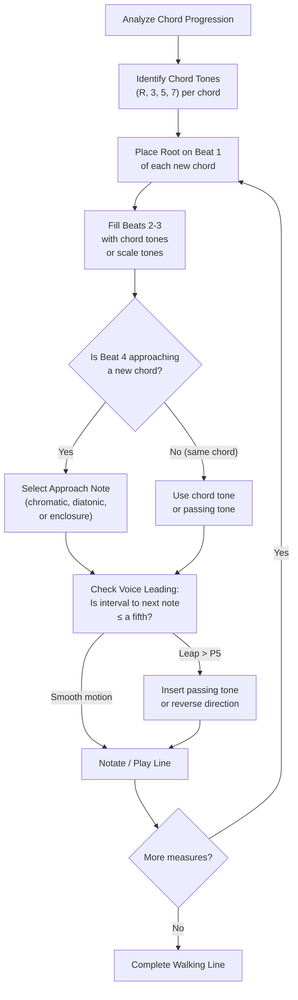
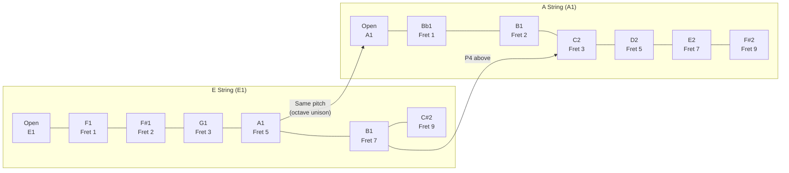
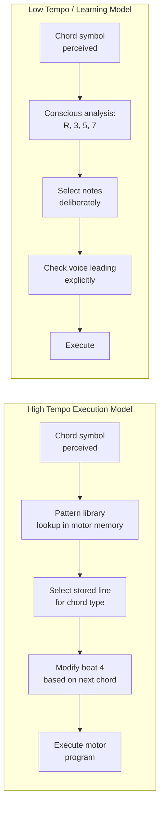

# Lesson 1: Understanding Walking Bass Lines

## 1. First-Principles Intuition & Invariants

### The Physics of Pitch and the Fretboard as a Logarithmic Instrument

The electric bass guitar is fundamentally an acoustic system whose physics determine every constraint a bassist works within. A vibrating string of length *L*, linear mass density *μ*, and tension *T* produces a fundamental frequency governed by Mersenne's law:

$$f = \frac{1}{2L}\sqrt{\frac{T}{\mu}}$$

Pressing a string against a fret shortens the vibrating length. Because the equal-temperament system divides the octave into 12 equal semitones, each fret shortens the string by a factor of $2^{-1/12} \approx 0.9439$. This means fret spacing is geometrically compressed toward the bridge — the fretboard is a physical realization of a logarithmic scale where equal perceptual intervals (semitones) correspond to equal *ratios* of string length, not equal absolute distances. The 12th fret halves the string length exactly, doubling the frequency and producing the octave.

This geometry has a direct implication for walking lines: a bassist navigating the fretboard is navigating a logarithmic pitch space. Intervallic distance (in semitones) is uniform regardless of register, but the *physical* finger movement required contracts as you move up the neck. Efficient walking-line fingerings exploit this by keeping position shifts minimal while covering a wide harmonic range.

### What a Walking Line Actually Is

A walking line is a predominantly quarter-note bassline — one note per beat in common time — that moves through chord tones and passing tones to delineate a harmonic progression while simultaneously generating rhythmic momentum. The term "walking" is literal: the line proceeds at a steady, legato pace, like footsteps, rather than the locked-to-the-kick rhythmic figures of rock or funk bass.

Three invariants hold for any well-constructed walking line:

**Harmonic invariant.** Each note must be interpretable as a chord tone, scale tone, diatonic passing tone, or chromatic approach tone relative to the current or immediately forthcoming chord. Notes that cannot be explained by one of these functions create unintended dissonance.

**Voice-leading invariant.** Consecutive notes should form intervals that imply smooth motion. Stepwise motion (semitones and whole tones) is maximally smooth. Thirds and fourths are common and stylistically appropriate. Leaps larger than a fifth demand resolution — typically stepwise motion in the opposite direction — or they sound arbitrary rather than melodic.

**Metric invariant.** Beat 1 of each new chord must be a chord tone (almost always the root or fifth at a minimum). Beat 4 of the preceding measure must function as a leading or approach tone into beat 1 of the next chord. This creates the characteristic sense of harmonic "arrival" that makes jazz feel propulsive.

### Harmonic Series and Chord Tone Hierarchy

The harmonic series — the overtone structure produced by any vibrating string — is the acoustic basis for why certain intervals sound stable and others create tension. The first several harmonics of a fundamental C2 are:

| Harmonic | Frequency Ratio | Interval | Perceived stability |
|----------|----------------|----------|---------------------|
| 1st (fundamental) | 1:1 | Unison | Root |
| 2nd | 2:1 | Octave | Maximum stability |
| 3rd | 3:2 | Perfect fifth | High stability |
| 4th | 4:3 | Perfect fourth | Stable in context |
| 5th | 5:4 | Major third | Consonant |
| 6th | 6:5 | Minor third | Consonant |
| 7th | 7:4 | Harmonic seventh (~Bb) | Mildly dissonant — the "blues seventh" |

The closer a chord tone is to a low-numbered harmonic, the more acoustically stable it is. This is why the root and fifth are the most harmonically secure notes in a walking line, the third defines chord quality (major vs. minor), and the seventh introduces the tension that drives resolution to the next chord. This hierarchy is not an arbitrary stylistic rule — it is a direct consequence of the physics of string vibration.

---

## 2. Core Architecture & Mechanics

### Chord Tone Framework

The structural skeleton of any walking line consists of the root (R), third (3), fifth (5), and seventh (7) of each chord. For a dominant seventh chord — the most common chord type in blues and jazz walking-line contexts — these tones are:

| Chord | R | 3 | 5 | 7 |
|-------|---|---|---|---|
| C7 | C | E | G | B♭ |
| F7 | F | A | C | E♭ |
| G7 | G | B | D | F |
| Dm7 | D | F | A | C |
| G7 | G | B | D | F |
| Cmaj7 | C | E | G | B |

Each measure of a walking line in 4/4 has four beats. A minimal but complete walking line assigns a chord tone or controlled passing tone to each beat.

### Approach Notes: Chromatic and Diatonic

Beat 4 of each measure deserves special analytical attention. This "approach beat" functions as a leading tone into beat 1 of the following chord. There are three canonical approach strategies:

**Half-step below.** Place a note one semitone below the target chord's beat-1 note. This creates a strong chromatic pull — the most tension-laden approach. To walk into F on beat 1, place E on beat 4.

**Half-step above.** Place a note one semitone above the target. To walk into C, place D♭ (or C#) on beat 4. This "enclosure from above" is slightly less common as a standalone approach but very effective.

**Dominant fifth.** Place the fifth of the target chord (or its dominant) on beat 4. This is a diatonic approach that retains harmonic clarity — less chromatic tension but stronger tonal grounding.

**Enclosure.** Place a note one semitone above on beat 3 and one semitone below on beat 4, then resolve to the target on beat 1. This two-beat enclosure is a hallmark of bebop-influenced walking style.

### A Fully Annotated 12-Bar Blues Walking Line in C

The following is a 12-bar blues in C with a complete walking line annotated by function. Standard blues form is I7–IV7–I7–I7–IV7–IV7–I7–I7–V7–IV7–I7–V7.

```
Bar  Beat 1    Beat 2    Beat 3    Beat 4    Chord
---  --------  --------  --------  --------  -----
1    C (R)     E (3)     G (5)     Bb (7)    C7
2    F (R)     A (3)     C (5)     Eb (7)    F7
3    C (R)     G (5)     E (3)     Bb (7)    C7
4    C (R)     E (3)     Bb (7)    B (chr↑)  C7 → F7
5    F (R)     A (3)     C (5)     Eb (7)    F7
6    F (R)     Eb (7)    C (5)     E (chr↑)  F7 → C7
7    C (R)     E (3)     G (5)     Bb (7)    C7
8    C (R)     G (5)     Bb (7)    B (↑F7)   C7 → G7 (turnaround)
9    G (R)     B (3)     D (5)     F (7)     G7
10   F (R)     A (3)     C (5)     E (chr↑)  F7 → C7
11   C (R)     E (3)     G (5)     A (chr↑)  C7 → G7
12   G (R)     D (5)     F (7)     B (chr↑)  G7 → C7 (repeat)
```

Annotations: R=root, 3=third, 5=fifth, 7=seventh, chr=chromatic approach, ↑=half-step below target.

### Architecture Diagram: Walking Line Construction Flow



### Fretboard Geography and Position Logic

A four-string bass in standard tuning (E1–A1–D2–G2, with open strings at MIDI notes 28, 33, 38, 43) covers a range of roughly E1 to G4. The standard low-register walking territory for jazz bass sits between approximately the 1st and 9th frets, centered on the E and A strings.

Interval relationships critical to walking line fingering:

- **Same string, +2 frets** = whole step (major second)
- **Same string, +1 fret** = half step (minor second)
- **A string to E string, same fret** = perfect fourth (5 semitones)
- **A string to D string, same fret** = perfect fourth
- **E string to A string, +5 frets** = perfect fourth (same pitch as open A string)
- **Any string to adjacent string, +7 frets** = perfect fifth

Keeping a walking line within a minimal positional range (shifting the left hand no more than three to four frets per measure) reduces latency between position decisions and execution, which matters at tempos above ♩= 180 BPM. At slower tempos, wider position shifts become viable and can produce more interesting register variety.



---

## 3. Voice Leading: The Deep Principle

Voice leading in the walking-bass context is not merely a matter of avoiding "ugly" intervals. It is the mechanism by which a single-line instrument implies harmonic motion. When the bassist walks from G (fifth of C7) to E (third of C7) to E♭ (seventh of F7) to F (root of F7), the listener hears not just four notes but a line that maps out C7 resolving to F7 with a chromatic passing tone in between. The chromatic descent G → F — bridged by E and E♭ — is what creates the sensation of harmonic "pull."

The classical principle of avoiding parallel fifths applies to walking bass with nuance. In a solo or duo context, parallel fifths in the bass line alone create an audible hollowness. In a full ensemble context, they are less problematic because the harmonic texture above the bass fills in the missing voices. However, consecutive root-fifth patterns (C → G → D → A) are stylistically avoided in jazz walking because they negate the linear, melodic quality that distinguishes a walking line from a simple harmonic reduction.

The practical rules derived from voice-leading principles:

1. Stepwise motion (1–2 semitones) is always harmonically safe.
2. Thirds (3–4 semitones) are common and melodically interesting.
3. Fourths (5 semitones) are strong and common, especially root-to-fifth.
4. Fifths (7 semitones) are acceptable but require contextual justification (e.g., root-down-to-fifth at the start of a phrase).
5. Leaps of a sixth or larger must be followed by motion in the opposite direction to maintain linear coherence.

---

## 4. High-Performance Optimization and Failure Mode Analysis

### Physical Mechanics: Touch, Attack, and Sustain

The tone of a walking bass note is determined by three physical parameters: **where** on the string the plucking finger strikes (closer to the bridge = brighter, more percussive; near the neck = rounder, fuller), **how hard** the finger plucks (amplitude affects both volume and harmonic content — harder plucking adds upper partials), and **how the fretting hand releases** (controlling sustain and muting).

For walking lines at jazz tempos (♩= 120–240 BPM), each note occupies 250–500 milliseconds. A properly executed walking tone should sustain for approximately 60–75% of its duration, then decay slightly before the next attack. This "semi-staccato" articulation — not fully legato, not fully staccato — is the defining touch of a jazz walking line. Legato playing blurs the note-to-note articulation and obscures the harmonic outline; fully staccato playing sounds mechanical and loses the "walk."

The right-hand alternating finger technique (index and middle fingers alternating on each stroke) is not merely a convenience — it is a biomechanical necessity at tempos above ♩= 160. Single-finger plucking at high tempo creates fatigue asymmetry and inconsistent tone. Proper alternation distributes muscle load evenly and produces a more consistent attack amplitude, which is perceptible as a steadier rhythmic feel.

### Tempo Scaling and Cognitive Load

Walking line construction presents a real-time constraint satisfaction problem. At ♩= 120, the bassist has 500 ms per beat to decide the next note, execute the finger movement, and produce the attack. At ♩= 240, that window shrinks to 250 ms — within the range of human motor reaction time for unprepared movements (~180–250 ms). This means that at high tempos, deliberate note-by-note harmonic reasoning becomes impossible. The line must be executed from pre-compiled melodic patterns stored in motor memory.

This is the architectural reason that professional bassists practice walking lines over common progressions (ii–V–I, blues, rhythm changes) until the patterns become automatic. The cognitive goal is to shift walking-line execution from the deliberate prefrontal planning system to the procedural motor system (basal ganglia / cerebellum loop), freeing working memory to focus on ensemble interaction, dynamics, and real-time harmonic variation.



### Common Failure Modes and Corrections

**Failure: Rooting on every beat.** Playing the root on all four beats of each chord is the most common beginner error. It fulfills the harmonic invariant trivially but destroys the linear motion. The fix is to treat beat 1 as the only *required* root landing and treat beats 2–4 as harmonic exploration.

**Failure: Ignoring the approach note on beat 4.** Playing a chord tone on beat 4 that happens to be diatonically correct but harmonically inert (e.g., the third of a chord when moving to a distantly related chord) produces a stumbling, unsatisfying arrival on beat 1. The fix: always determine beat 1 of the *next* chord first, then work backward to choose beat 4.

**Failure: Position-driven note choice.** Choosing notes based on what is physically convenient under the left hand rather than what is harmonically correct. This produces a line that sounds geographically determined rather than musically motivated. The fix: know the chord tones in multiple positions across the entire neck, so harmonic demands drive fingering rather than the reverse.

**Failure: Loss of quarter-note pulse.** Inserting eighth notes, triplets, or rests into the walking line breaks the relentless quarter-note foundation. The ensemble relies on the bassist to maintain this pulse. Embellishments (ghost notes, anticipations, brief eighth-note runs) are acceptable as ornaments but must not disrupt the underlying quarter-note grid.

**Failure: Parallel octaves with the piano left hand.** In a piano-bass-drums trio, the pianist's left hand comping may land on the same pitch as the bass on strong beats. The resulting parallel octave is acoustically muddy and harmonically redundant. The professional response is communication: establish a register division where the bass walks primarily below the staff (open string to roughly the 7th fret) and the pianist avoids sustained low-register voicings during the bassist's walking sections.

### Analyzing a Problematic Line and Its Correction

Below is a flawed walking line over a ii–V–I in C major (Dm7–G7–Cmaj7), annotated with its failure modes, followed by a corrected version.

**Flawed line:**
```
Bar 1 (Dm7): D – D – D – D        ← Root on all four beats
Bar 2 (G7):  G – B – D – G        ← Beat 4 is root of G7, no approach into Cmaj7
Bar 3 (Cmaj7): C – E – G – C     ← Functional but static; beat 4 offers no departure
```

**Corrected line with annotations:**
```
Bar 1 (Dm7): D (R) – F (3) – A (5) – C (7)      ← Full chord tone arpeggiation
Bar 2 (G7):  G (R) – B (3) – D (5) – B (chr↑)   ← B is half-step above C: strong approach
Bar 3 (Cmaj7): C (R) – E (3) – G (5) – A (chr)  ← A approaches returning Dm7 (turnaround)
```

The corrected line uses the full chord tone vocabulary on beats 1–3 of each measure and deploys the approach note on beat 4 of each measure to generate forward motion into the next chord. The result is a line that sounds inevitable — each downbeat feels earned rather than arbitrary.

---

## 5. Extended Techniques and Stylistic Variation

### Bebop-Influenced Walking Lines

Bebop walking lines (associated with bassists such as Oscar Pettiford and Paul Chambers) characteristically use enclosures on beats 3–4, diatonic and chromatic passing tones freely mixed, and occasional brief eighth-note runs (typically two to four notes) that ornament a beat without disrupting the quarter-note pulse felt by the ensemble.

The "Chambers move" — ascending through the chord tones of the target chord over beats 3–4 of the preceding measure — is a signature device: walking into a G7 chord, beats 3–4 of the previous measure might be D–F, the fifth and seventh of G7, creating a dominant preparation.

### Modal and Post-Bop Contexts

In modal contexts (e.g., static Dorian or Mixolydian vamps), the walking line cannot rely on chord-change-driven approach notes because the harmony is static. The technique adapts: the bass creates internal melodic interest by walking through the full modal scale — not just chord tones — and by varying rhythmic displacement (placing notes slightly ahead of or behind the beat) to create tension without harmonic movement.

Over a D Dorian vamp, a walking line might cycle through D–E–F–G–A–B–C–D and its variants, using registral contour (ascending arpeggiation followed by scalar descent) to create phrase-level shape in the absence of harmonic progression.

### Metric Feel: Straight vs. Swing Eighth Notes

Standard jazz walking lines are notated in straight quarter notes but performed with **swing feel**: beat 2 and beat 4 are very subtly displaced late relative to the strict metronomic grid, and the line's rhythmic weight is concentrated on beats 2 and 4. This late-2-and-4 emphasis is the groove anchor that locks the bass with the ride cymbal's "ding-ding-da-ding" pattern and the snare backbeat.

The displacement is not a fixed time offset but a proportional one — it scales with tempo. At ♩= 120, the "late" displacement might be 15–20 ms. At ♩= 240, it shrinks to 7–10 ms. This is perceptually salient (the ensemble feels "in the pocket") but sub-threshold for conscious perception as latency.

---

## 6. Practical Application: Transcription and Analysis Method

The most rigorous way to internalize walking lines is systematic transcription of recorded performances. The following protocol produces the deepest learning:

1. **Isolate the bass.** Use a phase-inversion technique or a tool such as iZotope RX or Spleeter to isolate the bass track from a recording. Listening to the full ensemble simultaneously introduces acoustic masking that obscures low-frequency detail.

2. **Transcribe in chunks of four bars.** Transcribe four bars at a time, slowing playback to 60–70% speed. Identify beat 1 of each measure by aligning with the drummer's kick pattern or the pianist's chord stab.

3. **Annotate chord tones vs. passing tones.** For each transcribed note, classify it: root, third, fifth, seventh (chord tone), diatonic passing tone (in the key/scale), or chromatic approach note. Notes that do not fit any category signal either a transcription error or an advanced device worth investigating further.

4. **Identify the approach strategy on beat 4.** For each bar boundary, classify the approach note as half-step below, half-step above, enclosure, or diatonic fifth. Track which approach strategy the bassist favors — this reveals a core element of their stylistic identity.

5. **Re-perform at pitch.** Transcription without performance is incomplete. Play the transcribed line back at tempo, without looking at the notation, until it is in motor memory.

Recommended recordings for walking-line analysis:

| Recording | Bassist | Why |
|-----------|---------|-----|
| *Kind of Blue* (Miles Davis, 1959) | Paul Chambers | Definitive bebop walking, clear recording, varied approach strategies |
| *Waltz for Debby* (Bill Evans Trio, 1961) | Scott LaFaro | Contrapuntal, melodically inventive; challenges the quarter-note invariant productively |
| *Night Hawk* (Coleman Hawkins, 1960) | Major Holley | Textbook chord-tone walking in a swing-to-bop transitional style |
| *Moanin'* (Art Blakey & the Jazz Messengers, 1958) | Jymie Merritt | Blues-inflected walking with strong chromatic approach language |

---

## Summary

A walking bass line is not an improvised sequence of "bass-sounding notes." It is a real-time solution to a voice-leading constraint satisfaction problem, executed under strict tempo pressure, governed by harmonic invariants derived from the acoustic properties of the harmonic series, and shaped by decades of codified jazz practice. The quarter-note pulse is non-negotiable; the approach note on beat 4 is the mechanism of harmonic motion; chord tone hierarchy (R, 3, 5, 7) is the vocabulary; and voice-leading smoothness is the syntax that transforms individual note choices into a coherent musical line. Mastery requires systematic practice of patterns, ear-training through transcription, and consistent application of the approach-note framework across all common jazz chord progressions.
