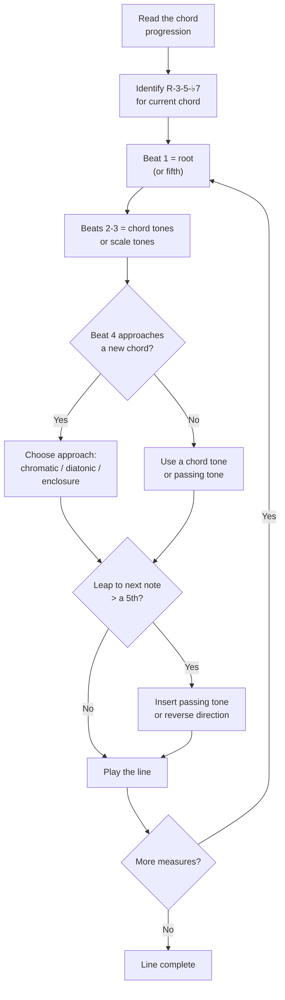
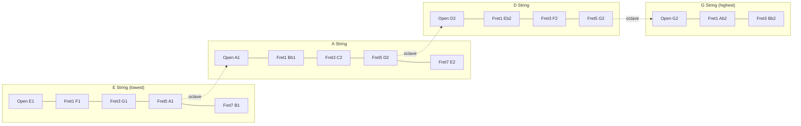
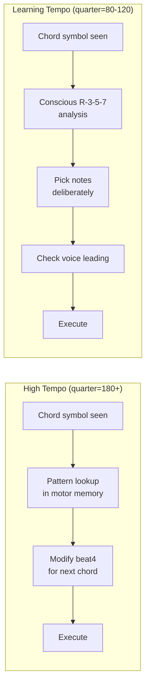

# Lesson 1: Walking Bass Lines — From Fretboard Mechanics to Live Performance

---

## 1. First-Principles Intuition: Why Your Hand Moves the Way It Does

A vibrating string's pitch depends on length, tension, and mass. Pressing a fret shortens the vibrating length and raises the pitch. Because equal temperament divides the octave into 12 equal ratios rather than equal distances, frets crowd together as you move toward the bridge — each fret shortens the remaining string by a factor of about 0.944, compounding geometrically. The 12th fret is the exact midpoint of the string (half the length, double the frequency).

**What this means for your hand:** in frets 1–5, the physical gaps between semitones are wide. Stretching one-finger-per-fret here strains the tendons across a long set. Franz Simandl's 19th-century solution — use fingers 1-2-4 (index, middle, pinky), letting the ring finger ride relaxed behind the pinky — distributes that stretch safely. Past fret 7, the frets are close enough that one-finger-per-fret (1-2-3-4) is safe and more efficient. This is anatomy, not style: ignoring it is how bassists develop tendinitis after a few years of low-register work.

The harmonic series explains why some notes feel "safe" over a chord and others pull toward resolution:

| Harmonic | Ratio | Interval | Role in a Walking Line |
|---|---|---|---|
| 1st | 1:1 | Unison/Root | Maximum grounding |
| 2nd | 2:1 | Octave | Strongest consonance |
| 3rd | 3:2 | Perfect 5th | Safest non-root note |
| 5th | 5:4 | Major 3rd | Defines major quality |
| 6th | 6:5 | Minor 3rd | Defines minor quality |
| 7th | 7:4 | ♭7 | Tension that demands resolution |

Root and fifth are structural. The third tells the ear major or minor. The seventh creates the pull toward the next chord. That's the entire physics behind every note-choice rule below.

---

## 2. What a Walking Line Is, Mechanically

A walking line is quarter notes, one per beat in 4/4, moving through chord tones and approach tones to outline the harmony while driving the time forward. Three rules govern every note:

1. **Harmonic rule** — every note must be a chord tone, scale tone, or approach tone relative to the current or next chord.
2. **Voice-leading rule** — prefer stepwise motion (1–2 semitones); thirds and fourths are natural; leaps bigger than a fifth must resolve by moving back the other way.
3. **Metric rule** — beat 1 of a new chord is almost always the root or fifth; beat 4 of the previous bar is an approach tone pointing at it. Beat 4 is the hinge of the whole line.

### Chord Tone Reference (dominant 7th shapes used throughout this lesson)

| Chord | R | 3 | 5 | ♭7 |
|---|---|---|---|---|
| B♭7 | B♭ | D | F | A♭ |
| E♭7 | E♭ | G | B♭ | D♭ |
| F7 | F | A | C | E♭ |
| Dm7 | D | F | A | C |
| Cmaj7 | C | E | G | B |

### The Four Approach-Note Strategies for Beat 4

1. **Chromatic from below** — one semitone below the next root. B♭7→E♭7: play D on beat 4. Strongest pull.
2. **Chromatic from above** — one semitone above the next root. Into C: play D♭ on beat 4.
3. **Diatonic approach** — a scale step (often the 2nd or 7th degree) that resolves naturally. Gentler, stays inside the key.
4. **Enclosure** — beat 3 is a semitone above the target, beat 4 a semitone below (or vice versa), resolving to the root on beat 1. The classic bebop "sandwich."

### Annotated 12-Bar Blues Walking Line in B♭

B♭ is the standard jam-session blues key (comfortable for horns). Form: B♭7–E♭7–B♭7–B♭7–E♭7–E♭7–B♭7–B♭7–F7–E♭7–B♭7–F7. String order below: E (lowest) – A – D – G.

```
Bar  Beat1        Beat2        Beat3        Beat4           Chord      Fingering (Simandl 1-2-4, low position)
1    B♭ A-str f1  D  A-str f3  F  D-str f3  A♭ D-str f1     B♭7        1-2-1-1
2    B♭ A-str f1  D  A-str f3  F  D-str f3  D  A-str f3     B♭7        repeat shape, beat4 = ♭7 color tone
3    E♭ A-str f1  G  A-str f3  B♭ D-str f3  D♭ D-str f1     E♭7        same shape as Bar1, up a 4th
4    E♭ A-str f1  G  A-str f3  B♭ D-str f1  D  D-str f3     E♭7→B♭7    beat4 chromatic ↓ to B♭
5    B♭ A-str f1  D  A-str f3  F  D-str f3  A♭ D-str f1     B♭7        1-2-1-1
6    B♭ A-str f1  F  D-str f3  A♭ D-str f1  A  D-str f2     B♭7→F7     beat4 chromatic ↓ to F
7    F  E-str f1  A  E-str f5  C  A-str f3  E♭ D-str f1     F7         1-4-2-1
8    E♭ A-str f1  G  A-str f3  B♭ D-str f3  A  D-str f2     E♭7→B♭7    beat4 chromatic ↓ to B♭
9    B♭ A-str f1  D  A-str f3  F  D-str f3  A♭ D-str f1     B♭7        1-2-1-1
10   B♭ A-str f1  G  A-str f3  F  D-str f3  E  D-str f2     B♭7→F7     beat4 chromatic ↓ to F
11   F  E-str f1  C  A-str f3  E♭ D-str f1  A  E-str f5     F7→B♭7    beat4 chromatic ↓ to B♭
12   B♭ A-str f1  D  A-str f3  F  D-str f3  B  D-str f4     B♭7→(turnaround, repeat to Bar 1)
```

R = root, 3 = third, 5 = fifth, ♭7 = flat seventh, ↓ = chromatic approach resolving down to the next root. Bars 1, 3, 5, and 9 use the identical R-3-5-♭7 box, just relocated to a different root — that one movable shape is 90% of this entire chorus.

### Construction Flow



---

## 3. Fretboard Geography: Three Movable Boxes

Master three positional shapes and you can walk any progression in any key without shifting more than two frets.

**Box 1 — Root on A string (frets 1–3 zone, the main walking territory)**

```
E string  |----|----|----|----|
A string  | R  |    |    | 5  |     R = fret 1, 5 = fret 3 (same fret on D string also works)
D string  | ♭7 | 3  |    |    |     ♭7 = one fret below R (same fret, D string), 3 = one fret above R (D string)
G string  |----|----|----|----|
             1    2    3    4   (frets)
```
B♭7 example: R=B♭ (A str f1), 3=D (D str f3 or A str f3), 5=F (D str f3), ♭7=A♭ (D str f1).

**Box 2 — Root on E string (frets 1–5 zone)**

```
E string  | R  |    |    |    |
A string  | 5  | ♭7 |    | 3  |     5 = same fret as R, ♭7 = R+1 fret, 3 = R+3 frets (all on A string)
             1    2    3    4    5   (frets)
```
F7 example: R=F (E str f1), 5=C (A str f1, same fret), ♭7=E♭ (A str f2… actually A str f1 relative +1 = check table below), 3=A (A str f3). Finger with 1-2-4: index on fret 1, middle on fret 2, pinky reaches 3–4 as needed.

**Box 3 — Root on D string (frets 3–7, used for turnarounds and register lift)**

```
D string  | ♭7 | R  |    | 3  |     ♭7 = one fret below R, 3 = R+2 frets
G string  | 5  |    |    |    |     5 = same fret as R, one string up
             1    2    3    4   (frets, relative to the root fret)
```

### Interval Map Across the Neck



Rules of thumb for fingering, derived straight from the map: same string +2 frets = whole step; same string +1 fret = half step; same fret, next string up = perfect fourth; same fret +5, next string up = unison (octave shortcut); same fret +7, next string up = perfect fifth.

---

## 4. Hand Mechanics

**Left hand (fretting):** thumb on the back-center of the neck, opposite the middle finger. Wrist straight. Fingertip presses just behind the fret wire, nearly perpendicular to the strings. Self-check: the back of your hand should form a "C." Flat knuckles mean your thumb is riding too high or your wrist is bent.

**Simandl 1-2-4 drill (frets 1–5).** Index=1, middle=2, pinky=4, ring finger relaxed behind the pinky:

```
E(open) → F(fret1, f1) → F#(fret2, f2) → G(fret3, f4) → G#(fret4, f4 slide) → A(fret5, f4 stretch)
```
Repeat on A, D, G strings. Metronome 60 BPM, one note per click, zero buzz, zero sympathetic ring. Progress 60 → 80 → 110 BPM before moving on.

**OFPF drill (frets 7+):** index→middle→ring→pinky on four consecutive frets:
```
A string: E(f7,f1) → F(f8,f2) → F#(f9,f3) → G(f10,f4)
```
Same 60 → 80 → 110 BPM progression, all four strings.

**Floating thumb mute (right hand):** rest your plucking thumb on the string below the one you're playing — on the E string when plucking A, on the A string when plucking D. It floats up with you. Pair it with the fretting-hand index finger lightly grazing the string below the fretted note, killing sympathetic ring from both ends.

**Right-hand alternation:** strict index/middle (i-m) alternation, every note, no exceptions above ♩=100 — single-finger plucking fatigues asymmetrically and destabilizes time.

```
A string: i  m  i  m   (Bb Bb Bb Bb)
D string: m  i  m  i   (F  F  F  F)
```
The finger starting each new string must be the one *not* last used — this kills "raking" habits. Drill at 60 → 80 → 110 → 140 BPM.

**Tone production — three physical levers:**
- **Pluck location.** Near the neck pickup = round, warm, blends in an ensemble (the walking-bass default). Near the bridge = bright and percussive, used for funk/pop slap tones.
- **Pluck force.** Firm but relaxed — enough for a clean fundamental plus a few overtones, not so much the string clanks the frets.
- **Release direction.** Pull slightly upward and let the string snap back for the rounded, upright-bass-style "thump." Pulling sideways across the fretboard gives a thinner, more guitar-like attack.

**Articulation — semi-staccato.** At ♩=120–240 each note lasts 250–500 ms. A well-articulated walking note sustains roughly 60–75% of its value, then decays slightly before the next attack — not fully legato (which blurs the harmonic outline), not fully staccato (which sounds mechanical). Practice target: repeat B♭ (A string, fret 1) at ♩=100 until each note is distinct but connected, like clearly spoken words in a flowing sentence.

---

## 5. Voice Leading: Making One Note Imply Harmony

When a bassist moves G (5th of C7) → E (3rd of C7) → E♭ (♭7 of F7) → F (root of F7), the listener hears the chromatic line G-F bridged by E-E♭ as the sound of C7 resolving into F7 — one melodic line implying a full harmonic motion.

**Interval rules, from safest to riskiest:**
- 1–2 semitones (step): default choice, always works.
- 3–4 semitones (3rd): natural, connects chord tones well.
- 5 semitones (4th): strong — root-to-fifth and back are staples.
- 7 semitones (5th): fine with context (e.g., phrase-opening root-to-5th), arbitrary mid-line.
- 8+ semitones (6th or bigger): must be answered by stepwise motion in the *opposite* direction for at least two beats, or the line sounds disjointed.

### ii–V–I Voice-Leading Drill in F

```
Bar1 (Gm7):   G(E str f3) → B♭(A str f1) → D(A str f5) → C(A str f3)
Bar2 (C7):    C(A str f3) → E(D str f2) → G(D str f5) → B(D str f4)
Bar3 (Fmaj7): F(E str f1) → A(E str f5) → C(A str f3) → E(D str f2)
```
Bar 1 beat 4 (C, the fifth of Gm7) is a common tone with Bar 2's root — the smoothest possible join. Bar 2 beat 4 (B) resolves up a half step into F by leap, acceptable because it's a phrase-ending cadence, not mid-phrase wandering. Bar 3 ascends the F major scale to close the phrase.

Run this at 60 → 80 → 100 → 120 BPM. Record yourself each pass and check: is every beat 1 a chord tone? Does beat 4 point clearly at the next root? Any unresolved leap over a fifth?

**Contour strategy across a chorus:** don't wander — shape the phrase. Common moves: ascend by arpeggio for two bars then descend by scale for two; build a "wave" that peaks around bars 6–8 of a 12-bar blues then descends home; drop or jump an octave periodically to refresh the register. Register map: low E string (E1–B1) is foundation, A string (A1–E2) is the main walking register, D/G strings handle turnarounds and higher passing tones.

---

## 6. Tempo Scaling: From Thinking to Reflex

At ♩=120 you have 500 ms to choose the next note and execute it. At ♩=240 that's 250 ms — near the floor of human reaction time. Past a certain tempo, note-by-note harmonic reasoning is physically too slow; the line has to run from pre-learned motor patterns instead of live decisions. That's the entire justification for drilling the same shapes repeatedly: you're moving execution from conscious planning to procedural memory so your attention is free for the band.



### Progressive Tempo Protocol

**Phase 1 (♩=80, weeks 1–2) — Root/fifth only.** Metronome clicks on beats 2 and 4 only (simulating the hi-hat). Play 12-bar blues in B♭, F, C using only roots and fifths. Stop after each chorus and name which beat rushed or dragged.

**Phase 2 (♩=100, weeks 3–4) — Add thirds and sevenths.** Memorize the full annotated B♭ blues from Section 2. Play it three times without stopping, record it, check that every beat 1 is a root or fifth.

**Phase 3 (♩=120, weeks 5–6) — Approach notes.** One chorus using only chromatic-from-below approaches, next chorus only chromatic-from-above, next alternating, next using enclosures everywhere. Goal: hear the next root in your head before you play the approach note.

**Phase 4 (♩=140–160, weeks 7–8) — Pattern automation.** Stop thinking note-by-note; think in phrase shapes. Cycle of fifths ii–V–I, one bar per chord:
```
Dm7 → G7 → Cmaj7 → F#m7 → B7 → Emaj7 → Bbm7 → Eb7 → Abmaj7 → Dbm7 → Gb7 → Bmaj7 → (back to Dm7)
```
Each clean pass through all 12 keys earns +10 BPM. Target 140 by end of week 8.

**Phase 5 (♩=180+, week 9+) — Performance tempo.** Lines come from muscle memory; attention shifts to dynamics and interaction with the drummer. Test: play along to a track at ♩=200 for five choruses with zero pre-planning. Any hesitation or wrong beat-1 note means more time in Phase 4.

---

## 7. Common Failure Modes and Fixes

**Rooting every beat.** Technically "safe" but kills forward motion — sounds like a drone. Fix: root on beat 1 only; fill beats 2–3 with 3rd/5th/♭7; beat 4 is always a deliberate approach.

**Ignoring beat 4.** A chord tone that doesn't point at the next root breaks the metric rule — the line becomes disconnected arpeggios. Fix: before playing a progression, silently sing the next root on beat 4 of the current bar, then choose the approach that leads to it. Beat 4 should be the most intentional note in the bar.

**Unresolved leaps.** A big jump followed by continued motion in the same direction sounds angular. Fix: after any leap bigger than a fifth, move stepwise in the opposite direction for at least two beats.

**Inconsistent articulation.** Mixed legato/staccato breaks the walking feel. Fix: play one note for 64 beats at ♩=100 with identical force, release, and sustain each time; then apply the same consistency to a scale, one note per beat.

**Fretting-hand tension.** Squeezed neck, collapsed knuckles, bent wrist — causes fatigue within one chorus and risks injury. Fix: check thumb position every session (back-center of neck, pointing toward the ceiling), wrist straight. Fretting needs roughly 1–2 pounds of pressure, no more — practice playing as lightly as possible while keeping the tone clean.

**Not locking with the drums.** Walking bass is rhythm first, harmony second. Fix: practice exclusively with a backbeat click (beats 2 and 4). Notes on 1 and 3 should land exactly between clicks — record and listen for any note that doesn't sit dead center in the grid.

---

## 8. Lab: Practice Drills

### Drill Set A — Chord Tone Fluency (♩=60 → 120)

**A1: Arpeggio permutations.** On B♭7 (A string root), play every ordering below, four reps each:
```
1. R  3  5  ♭7  → Bb D  F  Ab   (1-2-1-1)
2. R  5  ♭7 3   → Bb F  Ab D    (1-1-1-2)
3. 3  R  5  ♭7  → D  Bb F  Ab   (2-1-1-1)
4. ♭7 5  3  R   → Ab F  D  Bb   (1-1-2-1)
```
Transpose through F7, C7, G7, D7, A7, E7 — one new key per day. Add 10 BPM per week until you reach 120.

**A2: Two-chord connectors.** Walk between every adjacent chord pair in a B♭ blues with a chromatic beat-4 approach:
```
Bb7 -> Eb7:  Bb(R) D(3) F(5) D(down to Eb)  |  Eb(R) G(3) Bb(5) Db(b7)
Eb7 -> Bb7:  Eb(R) G(3) Bb(5) A(down to Bb) |  Bb(R) D(3) F(5) Ab(b7)
Bb7 -> F7:   Bb(R) D(3) F(5) E(down to F)    |  F(R) A(3) C(5) Eb(b7)
F7 -> Bb7:   F(R) A(3) C(5) B(down to Bb)    |  Bb(R) D(3) F(5) Ab(b7)
```

### Drill Set B — Approach Note Mastery (♩=80 → 140)

**B1: Chromatic-from-below only, full 12-bar.** Every beat 4 is the semitone below the *next* chord's root — including repeats of the same chord.

```
Bar  Beat1   Beat2   Beat3   Beat4(approach)   Chord
1    Bb(R)   D(3)    F(5)    A (-> Bb)         Bb7
2    Bb(R)   D(3)    F(5)    A (-> Bb)         Bb7
3    Eb(R)   G(3)    Bb(5)   Db(-> Eb)         Eb7
4    Eb(R)   G(3)    Bb(5)   A (-> Bb)         Eb7->Bb7
5    Bb(R)   D(3)    F(5)    A (-> Bb)         Bb7
6    Bb(R)   F(5)    D(3)    E (-> F)          Bb7->F7
7    F(R)    A(3)    C(5)    E (-> F)          F7
8    Eb(R)   G(3)    Bb(5)   A (-> Bb)         Eb7->Bb7
9    Bb(R)   D(3)    F(5)    A (-> Bb)         Bb7
10   Bb(R)   G(3)    F(5)    E (-> F)          Bb7->F7
11   F(R)    A(3)    C(5)    A (-> Bb)         F7->Bb7
12   Bb(R)   D(3)    F(5)    A (-> Bb, repeat) Bb7
```
This drill isn't meant to be melodically perfect — it trains your hand to automatically find the semitone below any target, so later you can *choose* approach strategies instead of defaulting to whatever's under your fingers.

**B2: Enclosure drill.** Beat 3 = semitone above next root, beat 4 = semitone below it, resolve on beat 1:
```
Eb7 -> Bb7:  Eb(R) G(3) B(above Bb)  A(below Bb)  | Bb(R) ...
Bb7 -> F7:   Bb(R) F(5) Gb(above F)  E(below F)   | F(R) ...
```
Start at 60 BPM — beat 3 no longer being a chord tone takes getting used to.

### Drill Set C — ii–V–I Cycling (♩=80 → 160)

Cycle of fifths, one bar per chord, template: Bar1 (ii) R-3-5-♭7 with beat 4 chromatic into V's root; Bar2 (V) R-3-5-♭7 with beat 4 chromatic into I's root; Bar3 (I) R-3-5-7 (natural 7th) with beat 4 chromatic into the next ii.

```
C: Dm7-G7-Cmaj7 | F: Gm7-C7-Fmaj7 | Bb: Cm7-F7-Bbmaj7 | Eb: Fm7-Bb7-Ebmaj7
Ab: Bbm7-Eb7-Abmaj7 | Db: Ebm7-Ab7-Dbmaj7 | Gb: Abm7-Db7-Gbmaj7 | B: C#m7-F#7-Bmaj7
E: F#m7-B7-Emaj7 | A: Bm7-E7-Amaj7 | D: Em7-A7-Dmaj7 | G: Am7-D7-Gmaj7
```
Start at 80 BPM. Each clean pass through all 12 keys earns +10 BPM, target 140 by week 4 of this drill.

**C2: Two-feel to four-feel.** One chorus in "two" (half notes, root-fifth only), next chorus in "four" (full quarter-note walk), same tempo throughout — mimics the standard ballad-to-swing transition:
```
Two-feel:   Bb --- Eb --- Bb --- Bb ---
Four-feel:  Bb D F Ab | Eb G Bb Db | Bb D F Ab | Bb D F Ab
```

### Drill Set D — Transcription

Pick one recording (Paul Chambers, "So What"; Ron Carter, "Footprints"; Sam Jones, "Blue Bossa"). Transcribe one chorus by ear using the bar/beat/chord annotation format from Section 2. For every note, log: beat position, function (R/3/5/♭7/approach/enclosure), fingering, and why that note over the alternatives. Then play your transcription along with the record, matching articulation and time feel exactly before improvising your own line over the same changes.

---

## 9. Performance Checklist

- [ ] Know the form (12-bar blues, 32-bar AABA, ii–V–I chain)
- [ ] Can name the key and every chord change on sight
- [ ] Play the root of every chord on beat 1 without hesitation
- [ ] Play a chromatic approach into every chord change
- [ ] Practice with the metronome on 2 and 4, not 1 and 3
- [ ] Alternate index/middle on every single note
- [ ] Thumb centered on the back of the neck, wrist straight
- [ ] 1-2-4 fingering below fret 5, 1-2-3-4 above fret 7
- [ ] Thumb floats and mutes the string below the one being played
- [ ] Can play a full chorus without looking at the fretboard

### Approach Note Cheat Sheet

| Target Root | Chromatic Below | Chromatic Above | Enclosure (beat3 → beat4 → target) |
|---|---|---|---|
| B♭ | A | B | B, A → B♭ |
| E♭ | D | E | E, D → E♭ |
| F | E | G♭ | G♭, E → F |
| C | B | D♭ | D♭, B → C |
| G | F♯ | A♭ | A♭, F♯ → G |
| D | C♯ | E♭ | E♭, C♯ → D |
| A | G♯ | B♭ | B♭, G♯ → A |
| E | D♯ | F | F, D♯ → E |
| B | A♯ | C | C, A♯ → B |
| G♭ | F | G | G, F → G♭ |
| D♭ | C | D | D, C → D♭ |
| A♭ | G | A | A, G → A♭ |

Drill this as flashcards: name a root, play chromatic-below, chromatic-above, then the full enclosure — reflexively, with no counting. At gig tempo there's no time to calculate the interval; your hand has to already know it.
