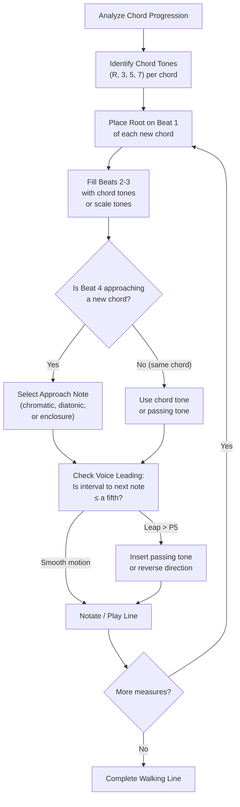
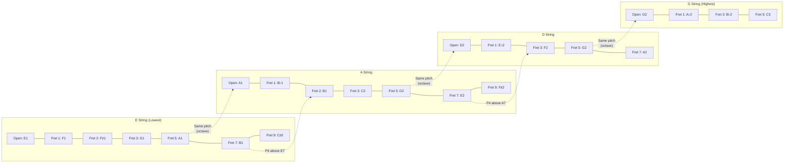
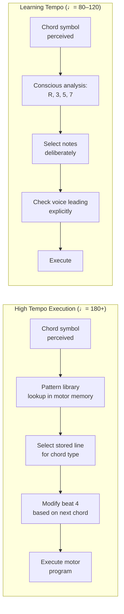

# Lesson 1: Walking Bass Lines — From Fretboard Mechanics to Live Performance

---

## 1. First-Principles Intuition & Fretboard Physics

### Why the Fretboard Is Logarithmic (and What That Means for Your Hand)

A vibrating string produces a fundamental frequency determined by its length, tension, and mass. When you press a string to a fret, you shorten the vibrating length and raise the pitch. The equal-temperament system divides the octave into 12 equal semitones, each corresponding to a fixed *ratio* of string length — not a fixed *distance*. This is why frets crowd closer together as you move toward the bridge: each fret shortens the remaining string by a factor of approximately 0.944, and those multiplicative reductions compound geometrically.

The 12th fret sits at the exact midpoint of the string, halving the length and doubling the frequency. The 24th fret quarters it.

**What this means on the gig:** In the low register (frets 1–5), the physical distance between semitones is large enough that one-finger-per-fret strains the tendons. Franz Simandl solved this in the 19th century: use fingers 1-2-4 (index, middle, pinky) for frets 1–5, leaving the ring finger relaxed. Above fret 7, where the geometric compression tightens, transition to one-finger-per-fret (1-2-3-4) since the stretches become biomechanically safe. This is not a stylistic preference — it is an anatomical necessity for preventing carpal tunnel syndrome and maintaining stamina across a two-hour set.

### What a Walking Line Actually Is

A walking line is a predominantly quarter-note bassline — one note per beat in 4/4 — that moves through chord tones and passing tones to outline a harmonic progression while generating forward rhythmic momentum. The term is literal: the bass walks at a steady, unhurried pace like footsteps, in contrast to the syncopated, kick-drum-locked patterns of funk or the root-pedal anchoring of rock.

Three invariants define a well-constructed walking line:

**Harmonic invariant.** Every note must be interpretable as a chord tone, scale tone, diatonic passing tone, or chromatic approach tone relative to the current or next chord. A note that defies all four categories creates unintended dissonance that undermines the soloist.

**Voice-leading invariant.** Consecutive notes should favor stepwise motion (semitones and whole tones). Thirds and fourths are stylistically natural. Leaps larger than a fifth demand resolution in the opposite direction, or they sound arbitrary.

**Metric invariant.** Beat 1 of each new chord must be a chord tone — almost always the root or fifth. Beat 4 of the preceding measure must function as an approach tone into beat 1 of the next chord. This is the engine of harmonic propulsion.

### Chord Tone Hierarchy from the Harmonic Series

The harmonic series — the overtone structure produced by any vibrating string — explains why certain intervals sound stable and others create tension. The first several harmonics of a low C2:

| Harmonic | Ratio | Interval | Role in Walking Lines |
|----------|-------|----------|----------------------|
| 1st (fundamental) | 1:1 | Unison | Root — maximum grounding |
| 2nd | 2:1 | Octave | Strongest consonance |
| 3rd | 3:2 | Perfect fifth | High stability — safest non-root choice |
| 4th | 4:3 | Perfect fourth | Stable in context |
| 5th | 5:4 | Major third | Defines major quality |
| 6th | 6:5 | Minor third | Defines minor quality |
| 7th | 7:4 | Flat seventh | Mild tension — drives resolution |

The root and fifth are the most harmonically secure notes. The third defines chord quality (major vs. minor). The seventh introduces the tension that pulls toward the next chord. This hierarchy is not arbitrary stylistic convention — it is a direct consequence of the physics of vibrating strings, and it governs every note choice you make.

---

## 2. Core Architecture & Mechanics

### Chord Tone Framework

The structural skeleton of any walking line is the root (R), third (3), fifth (5), and seventh (7) of each chord. For a dominant seventh chord — the most common type in blues and jazz walking contexts:

| Chord | R | 3 | 5 | ♭7 |
|-------|---|---|---|-----|
| C7 | C | E | G | B♭ |
| F7 | F | A | C | E♭ |
| G7 | G | B | D | F |
| Dm7 | D | F | A | C |
| Cmaj7 | C | E | G | B |

Each measure in 4/4 has four beats. A complete walking line assigns a chord tone or controlled passing tone to each beat, with beat 1 anchored to the root (or fifth) and beat 4 functioning as an approach to the next chord.

### Approach Notes: The Four Canonical Strategies

Beat 4 is the most important beat in walking bass. It is the hinge between one chord and the next. Four approach strategies cover virtually all situations:

1. **Chromatic from below (half-step below target).** Place a note one semitone below the next chord's beat-1 note. To walk into F7 on beat 1, place E on beat 4 of the previous measure. This creates maximum chromatic pull — the strongest possible leading tone.

2. **Chromatic from above (half-step above target).** Place a note one semitone above the target. To walk into C, play D♭ on beat 4. Less common as a standalone approach but powerful when used to set up an enclosure.

3. **Diatonic scale approach.** Use a scale tone (typically the second or seventh degree of the current chord's scale) that resolves naturally to the next root. Less tension than chromatic, but maintains harmonic clarity.

4. **Enclosure (two-beat).** On beat 3, play a note one semitone above the target. On beat 4, play a note one semitone below. Resolve to the target on beat 1. This "sandwich" around the target is a hallmark of bebop-influenced walking style and creates sophisticated tension-resolution.

### Fully Annotated 12-Bar Blues Walking Line in B♭

The B♭ blues is the most common key for jazz jam sessions because B♭ is a comfortable register for trumpet and tenor sax. The form is I7–IV7–I7–I7–IV7–IV7–I7–I7–V7–IV7–I7–V7, which in B♭ is B♭7–E♭7–B♭7–B♭7–E♭7–E♭7–B♭7–B♭7–F7–E♭7–B♭7–F7.

Fingerings use Simandl 1-2-4 in the low register (frets 1–5) and OFPF higher up. String names: E (lowest), A, D, G (highest).

```
Bar  Beat 1         Beat 2         Beat 3         Beat 4         Chord     Fingering Notes
---  -------------   -------------  -------------  -------------   --------  -----------------------------------
1    B♭ (A str 1)   D  (A str 3)   F  (D str 3)   A♭ (D str 1)   B♭7       1-2-1-1, stay in 1st position
2    B♭ (A str 1)   D  (A str 3)   F  (D str 3)   A  (D str 2)   B♭7→E♭7   1-2-1-2, chromatic approach ↓ to E♭
3    E♭ (A str 1)   G  (A str 3)   B♭ (D str 3)  D♭ (D str 1)   E♭7       Same shape as Bar 1, up a 4th
4    E♭ (A str 1)   D♭ (D str 1)   B♭ (A str 1)  D  (D str 3)   E♭7→B♭7   1-2-4-2, descending chromatic
5    B♭ (A str 1)   D  (A str 3)   F  (D str 3)   A♭ (D str 1)   B♭7       1-2-1-1
6    B♭ (A str 1)   F  (D str 3)   A♭ (D str 1)  A  (D str 2)   B♭7→F7    1-1-1-2, chromatic approach ↓ to F
7    F  (E str 1)   A  (E str 5)   C  (A str 3)   E  (D str 2)   F7        1-4-2-2, use 1-2-4 on E string
8    E♭ (A str 1)   G  (A str 3)   B♭ (D str 3)  E  (D str 2)   E♭7→B♭7   1-2-1-2, chromatic approach ↓ to B♭
9    B♭ (A str 1)   D  (A str 3)   F  (D str 3)   A♭ (D str 1)   B♭7       1-2-1-1
10   B♭ (A str 1)   G  (A str 3)   F  (D str 3)   G♭ (D str 2)   B♭7→F7   1-2-1-2, chromatic approach ↓ to F
11   F  (E str 1)   C  (A str 3)   E  (D str 2)   A  (E str 5)   F7→B♭7   1-2-2-4, chromatic approach ↓ to B♭
12   B♭ (A str 1)   D  (A str 3)   F  (D str 3)   B  (D str 4)   B♭7      1-2-1-4, turn around to repeat
```

Annotations: R=root, 3=third, 5=fifth, ♭7=flat seventh, ↓=chromatic approach from above resolving down to target root.

Notice the repeating positional pattern: Bars 1, 3, 5, and 9 all use the same R-3-5-♭7 arpeggio shape, just starting from different roots. This is the core movable box pattern you need to internalize.

### Architecture Diagram: Walking Line Construction Flow



---

## 3. Fretboard Geography: Movable Box Patterns

### The Three Essential Position Shapes

Walking bass lines are built from a small number of movable positional shapes. Master these three boxes and you can walk through any progression in any key without shifting more than two frets.

**Box 1: Root on the A String (1st–3rd fret zone)**

This is your primary walking territory. The root sits on the A string, the fifth is two frets up on the same string (or same fret on the D string), the third is one fret up on the D string, and the seventh is one fret below the root on the D string.

```
   E string  |----|----|----|----|----|
   A string  | R  |    |    | 5  |----|     R = fret 1, 5 = fret 3 (or D string same fret)
   D string  | ♭7 | 3  |    |    |----|     ♭7 = fret 0 (open D relative to R), 3 = fret 1 on D
   G string  |----|----|----|----|----|
                1    2    3    4    5  (frets)
```

Example in B♭: R=B♭ (A str fret 1), 3=D (A str fret 3 or D str fret 3), 5=F (D str fret 3), ♭7=A♭ (D str fret 1).

**Box 2: Root on the E String (1st–5th fret zone)**

When the root is on the E string, the fifth sits on the same fret of the A string, the third is two frets up on the A string, and the seventh is one fret up on the A string.

```
   E string  | R  |    |    |    |    |
   A string  | 5  | ♭7 |    | 3  |    |     5 = same fret as R on A, ♭7 = +1 fret, 3 = +3 frets
   D string  |----|----|----|----|----|
   G string  |----|----|----|----|----|
                1    2    3    4    5  (frets)
```

Example in F: R=F (E str fret 1), 5=C (A str fret 3, same fret), ♭7=E♭ (A str fret 1), 3=A (A str fret 5). Use Simandl 1-2-4: finger 1 on fret 1, finger 2 on fret 2, finger 4 on frets 4–5.

**Box 3: Root on the D String (mid-neck, frets 3–7)**

Used for turnarounds and higher-register walking. The fifth is on the same fret of the G string, the third is two frets up on the D string, and the seventh is one fret below the root on the D string.

```
   E string  |----|----|----|----|----|
   A string  |----|----|----|----|----|
   D string  | ♭7 | R  |    | 3  |    |     ♭7 = fret below R, 3 = +2 frets
   G string  | 5  |    |    |    |----|     5 = same fret as R on G
                1    2    3    4    5  (frets, relative to root position)
```

### Fretboard Interval Map



**Key interval relationships for walking fingering:**
- Same string, +2 frets = whole step (major second)
- Same string, +1 fret = half step (minor second)
- Adjacent strings, same fret = perfect fourth (5 semitones up)
- Adjacent string, +5 frets from root = unison (same pitch, different octave)
- Adjacent string, +7 frets from root = perfect fifth

---

## 4. Hand Ergonomics and Physical Technique

### Left Hand Posture

Position your thumb on the back center of the neck, directly opposite your middle finger. Keep your wrist straight — not bent inward or outward. Curved fingers approach the fretboard nearly perpendicular to the strings. Fret with the fingertip, not the pad, pressing just behind the fret wire (not on top of it, not in the middle of the fret space). This minimizes force and maximizes sustain.

A quick self-check: look at your knuckles. If your fretting hand is properly curved, the back of your hand forms a "C" shape. If your knuckles are flat or collapsing inward, your wrist is too bent or your thumb is too high.

### Simandl 1-2-4 Technique (Frets 1–5)

Use index (1), middle (2), and pinky (4). Leave the ring finger relaxed — it supports the pinky tendon but does not fret independently. This distributes the stretch across the stronger index-middle-pinky framework and prevents tendon strain.

Practice drill — E string, frets 0–5, all notes chromatic:

```
E (open) → F (fret 1, finger 1) → F♯ (fret 2, finger 2) → G (fret 3, finger 4)
          → G♯ (fret 4, finger 4, slide) → A (fret 5, finger 4, stretch)
```

Repeat on A, D, and G strings. Metronome at 60 BPM, one note per click. Goal: each finger lands cleanly with no buzz, no sympathetic ring from adjacent strings. Progress to 80 BPM, then 110 BPM.

### One-Finger-Per-Fret (Frets 7+)

Above the 7th fret, where the geometric compression tightens, transition to index (1) → middle (2) → ring (3) → pinky (4), each assigned to consecutive frets. This gives you a four-fret range without shifting position.

Practice drill — A string, frets 7–10:

```
E (fret 7, finger 1) → F (fret 8, finger 2) → F♯ (fret 9, finger 3) → G (fret 10, finger 4)
```

Repeat on all strings. Same tempo progression: 60 → 80 → 110 BPM.

### Floating Thumb Muting (Right Hand)

Rest your plucking-hand thumb on the string below the one you're playing. When playing the A string, your thumb rests on the E string, damping it. When you move to the D string, your thumb floats up to rest on the A string. This eliminates sympathetic vibrations and keeps the walking line clean.

Additionally, your fretting-hand index finger should lightly touch the string below the one being fretted. When you play B♭ on the A string (fret 1), your index fingertip should barely graze the E string, preventing it from ringing.

### Right-Hand Alternation: Non-Negotiable

Alternate index (i) and middle (m) fingers with every pluck. Start every phrase with index to maintain consistency. At tempos above ♩= 160, single-finger plucking creates fatigue asymmetry, inconsistent tone, and uneven timing. This is not optional.

Practice drill — string crossing with alternation:

```
A string: i  m  i  m    (four notes, B♭ B♭ B♭ B♭)
D string: m  i  m  i    (four notes, F  F  F  F)
A string: i  m  i  m    (four notes, B♭ B♭ B♭ B♭)
D string: m  i  m  i    (four notes, F  F  F  F)
```

The finger that plays the first note of each new string is the one that was *not* last used on the previous string. This "raking" avoidance forces true alternation. Metronome: 60 → 80 → 110 → 140 BPM.

### Tone Production: Where and How to Pluck

The character of a walking note is shaped by three physical parameters:

1. **Plucking location.** Closer to the bridge = brighter, more percussive, more articulate. Near the neck pickup = rounder, warmer, fuller. For walking, aim for the area between the neck pickup and the end of the fingerboard — this produces the round, sustained tone that blends with an ensemble.

2. **Plucking force.** Harder plucking adds upper harmonics and increases volume. Walking lines require moderate, consistent force — enough to produce a clear fundamental with a few overtones, not so much that the string clanks against the frets aggressively. Think "firm but relaxed."

3. **Release direction.** Pull the string slightly upward (toward the ceiling if standing) and let it snap back. This produces a percussive "thump" with a rounded body — the upright-bass-like tone jazz bassists seek on electric instruments. Pulling sideways across the fretboard produces a thinner, more guitar-like tone.

### Articulation: The Semi-Staccato Touch

At jazz tempos (♩= 120–240), each note occupies 250–500 milliseconds. A properly executed walking note sustains for roughly 60–75% of its duration, then decays slightly before the next attack. This semi-staccato articulation — not fully legato, not fully staccato — is the defining touch of a jazz walking line.

Legato playing blurs note-to-note articulation and obscures the harmonic outline. Fully staccato playing sounds mechanical and loses the "walk" feel. The sweet spot is a note that speaks clearly, sustains with body, then breathes before the next one arrives.

To practice this: play a single note (B♭ on A string, fret 1) repeatedly at ♩= 100. Listen to the space between notes. If you hear no gap, you're too legato. If the notes sound clipped, you're too staccato. Aim for a sound where each note is distinct but connected — like a spoken sentence where each word is clear but the sentence flows.

---

## 5. Voice Leading: The Deep Principle

Voice leading in walking bass is the mechanism by which a single-line instrument implies complete harmonic motion. When the bassist walks from G (fifth of C7) to E (third of C7) to E♭ (seventh of F7) to F (root of F7), the listener hears not just four isolated notes but a line that maps out C7 resolving to F7 with a chromatic passing tone in between. The chromatic descent G → F — bridged by E and E♭ — creates the sensation of harmonic pull.

### Practical Voice-Leading Rules

1. **Stepwise motion (1–2 semitones)** is always harmonically safe and creates maximum melodic cohesion. This should be your default.
2. **Thirds (3–4 semitones)** are common and melodically interesting, especially connecting chord tones.
3. **Fourths (5 semitones)** are strong and common — root-to-fifth and fifth-to-root movements.
4. **Fifths (7 semitones)** are acceptable but need contextual justification. Root-down-to-fifth at the start of a phrase works; random fifths mid-line sound arbitrary.
5. **Leaps of a sixth or larger** must be followed by motion in the opposite direction to maintain linear coherence. A leap up should be answered by stepwise descent, and vice versa.

### Voice Leading Exercise: ii–V–I in F

The ii–V–I is the most common progression in jazz. Practice this in all twelve keys, but start in F for the comfortable low-register fingering.

Progression: Gm7 → C7 → Fmaj7

```
Bar 1 (Gm7):  G (E str 3, f1) → B♭ (A str 1, f1) → D (A str 5, f4) → C (A str 3, f2)
Bar 2 (C7):   C (A str 3, f2) → E (D str 2, f2) → G (D str 5, f4) → B (D str 4, f4)
Bar 3 (Fmaj7): F (E str 1, f1) → A (E str 5, f4) → C (A str 3, f2) → E (D str 2, f2)
```

Notice: Bar 1 beat 4 is C (the fifth of Gm7), which becomes the root of C7 on Bar 2 beat 1 — a seamless common-tone connection. Bar 2 beat 4 is B, the chromatic approach from below to C, but here it resolves up to F (the root of Fmaj7) via a leap, which is acceptable because it's a phrase-ending resolution. Bar 3 walks up the F major scale to complete the phrase.

Practice this at 60 BPM, then 80, then 100, then 120. At each tempo, record yourself and check:
- Is every beat 1 a chord tone?
- Does beat 4 lead smoothly into the next beat 1?
- Are there any leaps larger than a fifth without a resolution in the opposite direction?

### Melodic Contour Strategy

Professional walking lines exhibit phrase-level contour — they don't wander aimlessly. Common contour shapes:

- **Ascending arpeggiation** (bars 1–2) followed by **descending scale motion** (bars 3–4)
- **Wave contour:** ascend to a peak around bars 6–8 of a 12-bar blues, then descend back to the tonic register
- **Octave displacement:** periodically jump up or down an octave to refresh the register and prevent monotony

The low E string (open to fret 7, covering E1–B1) is the foundation register. The A string (open to fret 7, covering A1–E2) is the melodic middle register where most walking happens. The D and G strings serve for higher passing tones, turnarounds, and register refresh.

---

## 6. Tempo Scaling and Cognitive Architecture

### The Real-Time Constraint Problem

Walking line construction is a real-time constraint satisfaction problem. At ♩= 120, the bassist has 500 ms per beat to decide the next note, execute the finger movement, and produce the attack. At ♩= 240, that window shrinks to 250 ms — within the range of human motor reaction time for unprepared movements (~180–250 ms). At high tempos, deliberate note-by-note harmonic reasoning becomes impossible. The line must execute from pre-compiled melodic patterns stored in motor memory.

This is why professional bassists practice walking lines over common progressions (ii–V–I, blues, rhythm changes) until the patterns become automatic. The cognitive goal is to shift walking-line execution from the deliberate prefrontal planning system to the procedural motor system (basal ganglia and cerebellum loop), freeing working memory for ensemble interaction, dynamics, and real-time harmonic variation.



### Progressive Tempo Development Protocol

**Phase 1 — Foundation (♩= 80 BPM, Weeks 1–2)**

Play 12-bar blues in B♭, F, and C using only root and fifth. Metronome on beats 2 and 4 (simulating the drummer's hi-hat). This forces you to feel the backbeat and lock in with the time.

- B♭ blues: B♭7, E♭7, F7 using Box 1 and Box 2 shapes
- F blues: F7, B♭7, C7 using Box 2 and Box 1 shapes
- C blues: C7, F7, G7 using Box 2 and Box 2 shapes (transpose up)

Drill: play one chorus, stop, identify which beats felt rushed or dragged. Repeat until every beat sits inside the metronome click, not before or after it.

**Phase 2 — Chord Tone Vocabulary (♩= 100 BPM, Weeks 3–4)**

Add thirds and sevenths. Use the annotated 12-bar B♭ blues from Section 2 as your reference. Practice it until you can play it from memory without looking at the chart.

- Play the pre-composed line three times in a row without stopping
- Record yourself and listen back: are the note lengths even? Is the tone consistent?
- Check: does every beat 1 land on a root or fifth?

**Phase 3 — Approach Note Integration (♩= 120 BPM, Weeks 5–6)**

Focus exclusively on beat 4 of each measure. Practice one chorus using only chromatic approaches from below. Next chorus, use only chromatic approaches from above. Third chorus, alternate between the two. Fourth chorus, use enclosures on every bar change.

- This is where you develop the instinct to "look ahead" to the next chord
- The goal is to hear the next root before you play the approach note

**Phase 4 — Pattern Automation (♩= 140–160 BPM, Weeks 7–8)**

Stop thinking about individual notes. Focus on phrase shapes. Play multiple choruses without stopping. Introduce ii–V–I progressions in all twelve keys.

Drill: Cycle of fifths ii–V–I
```
Dm7 → G7 → Cmaj7 → F#m7 → B7 → Emaj7 → B♭m7 → E♭7 → A♭maj7 → ...
```
Play one bar per chord. At ♩= 140, this means 4 notes per chord, 12 chords per cycle. The cycle of fifths ensures every key is covered.

**Phase 5 — Performance Tempo (♩= 180+ BPM, Weeks 9+)**

Lines should emerge automatically from muscle memory. Your conscious attention shifts from note selection to dynamics, interaction with the drummer, and register variation.

Test: put on a play-along track at ♩= 200 and walk for 5 choruses without pre-planning. If you hesitate or play a wrong beat-1 note, you need more time at Phase 4.

---

## 7. Common Failure Modes and Corrections

**Failure: Rooting on every beat.** Playing the root on all four beats is the most common beginner error. It satisfies the harmonic invariant trivially but violates the voice-leading invariant — there is no melodic motion, no forward momentum, and the line sounds like a drone rather than a walk. Listeners and soloists lose the sense of harmonic direction.

Correction: Force yourself to play root only on beat 1. Fill beats 2 and 3 with the third, fifth, or seventh. Beat 4 is always an approach note. Practice this with a stripped-down backing track where you can hear the harmonic emptiness of rooting on every beat.

**Failure: Ignoring beat 4.** Playing a chord tone or root on beat 4 that doesn't lead into the next chord. This breaks the metric invariant and kills the forward motion. The line sounds like a series of disconnected chord arpeggios rather than a continuous walk.

Correction: Before you play any progression, sing the root of the next chord in your head on beat 4 of the current measure. Then play a note that leads to that root — chromatic from below, chromatic from above, or diatonic scale step. Make beat 4 the most intentional note in every bar.

**Failure: Leaps without resolution.** Jumping a seventh or octave on beat 3 or 4, then continuing in the same direction. This violates the voice-leading rule that large leaps must resolve in the opposite direction. The line sounds angular and disoriented.

Correction: After any leap larger than a fifth, immediately play stepwise motion in the opposite direction for at least two beats. If you leap up a sixth, walk down by step for the next two notes.

**Failure: Inconsistent articulation.** Some notes are long and legato, others are clipped and staccato. This breaks the rhythmic flow and sounds amateurish. The walking feel depends on consistent note length and attack.

Correction: Practice playing a single note (e.g., open A string) for 64 beats at ♩= 100. Focus on making every attack identical: same force, same release, same sustain length. Then do the same exercise walking a major scale, one note per beat. The articulation should be identical to the single-note exercise.

**Failure: Tension in the fretting hand.** Squeezing the neck, collapsing the knuckles, or bending the wrist. This causes fatigue within one chorus and can lead to injury over time. It also produces inconsistent intonation and dead notes.

Correction: Check your thumb position before every practice session. It should be on the back center of the neck, pointing toward the ceiling. Your wrist should be straight. If you feel tension in your forearm after 2 minutes of walking, your grip is too tight. The string requires only enough pressure to contact the fret — typically 1–2 pounds of force. Practice playing as lightly as possible while still producing a clean tone.

**Failure: Not listening to the drums.** The walking bass is a rhythmic instrument first and a harmonic instrument second. If you're not locking with the drummer's ride cymbal and hi-hat, the harmonic content doesn't matter — the time feels bad.

Correction: Practice with a metronome on beats 2 and 4 only (backbeat click). This simulates the hi-hat. Your notes on beats 1 and 3 should fall exactly between the clicks. If you rush beat 1, you'll hear it immediately — your note will land before the click on beat 2. Record yourself and listen for any note that doesn't sit perfectly inside the time grid.

---

## 8. Lab: Hands-On Practice Drills

### Drill Set A: Chord Tone Fluency (♩= 60 → 120 BPM)

**A1: Single-chord arpeggio drill.** Pick a chord (start with B♭7). Play R-3-5-♭7 ascending, then descend ♭7-5-3-R. Repeat four times. Then play R-5-♭7-3 (reordered). Then 3-♭7-R-5. The goal is to play every permutation of the four chord tones without hesitation.

```
B♭7 arpeggio permutations (A string root):
1. R  3  5  ♭7   → B♭  D  F  A♭    (fingering: 1-2-1-1)
2. R  5  ♭7 3    → B♭  F  A♭ D     (fingering: 1-1-1-2)
3. 3  R  5  ♭7   → D   B♭ F  A♭    (fingering: 2-1-1-1)
4. ♭7 5  3  R    → A♭  F  D  B♭    (fingering: 1-1-2-1)
```

Transpose to F7, C7, G7, D7, A7, E7. One key per day, all four permutations, at 60 BPM. Add 10 BPM per week until you reach 120.

**A2: Two-chord connector drill.** Walk from B♭7 to E♭7 using the chord tones of each, with a chromatic approach on beat 4. Then E♭7 to B♭7. Then B♭7 to F7. Then F7 to B♭7. This covers all adjacent chord movements in a B♭ blues.

```
B♭7 → E♭7:  B♭(R) D(3) F(5) A(↓)  | E♭(R) G(3) B♭(5) D♭(♭7)
E♭7 → B♭7:  E♭(R) G(3) B♭(5) D(↓) | B♭(R) D(3) F(5) A♭(♭7)
B♭7 → F7:   B♭(R) D(3) F(5) A♭(♭7) | A(↓) would conflict, use E(↑) to F
F7 → B♭7:   F(R) A(3) C(5) E♭(♭7)  | E(↑) would conflict, use B(↓) to B♭
```

Note: when the current chord's ♭7 is already a half-step above the next root (e.g., A♭ is ♭7 of B♭7, and A is the note below B♭), you can use the ♭7 itself as the approach, or use the note above (A) for a different color. Experiment with both.

### Drill Set B: Approach Note Mastery (♩= 80 → 140 BPM)

**B1: Chromatic-from-below only.** Walk a full 12-bar B♭ blues where every beat 4 is a chromatic half-step below the next chord's root. Nothing else changes — beats 1–3 are chord tones as usual.

```
Bar 1 (B♭7): B♭  D  F  A          → A leads down to... wait, A is ♭7, not a chromatic approach.
```

Correction: the chromatic-from-below approach means beat 4 is one semitone below the *next* root. If walking from B♭7 (Bar 1) to B♭7 (Bar 2, same chord), use A on beat 4 (chromatic from below to B♭). If walking from B♭7 (Bar 4) to E♭7 (Bar 5), use D on beat 4 (chromatic from below to E♭).

Full 12-bar with chromatic-from-below on every beat 4:

```
Bar  Beat 1    Beat 2    Beat 3    Beat 4    Chord
1    B♭(R)    D(3)     F(5)     A(↓→B♭)  B♭7
2    B♭(R)    D(3)     F(5)     A(↓→B♭)  B♭7
3    E♭(R)    G(3)     B♭(5)    D♭(↓→E♭) E♭7
4    E♭(R)    G(3)     B♭(5)    D(↓→E♭)  E♭7→B♭7 (wait: D leads to E♭, correct)
5    B♭(R)    D(3)     F(5)     A(↓→B♭)  B♭7
6    B♭(R)    F(5)     D(3)     E(↓→F)   B♭7→F7
7    F(R)     A(3)     C(5)     E(↓→F)    F7
8    E♭(R)    G(3)     B♭(5)    A(↓→B♭)   E♭7→B♭7
9    B♭(R)    D(3)     F(5)     A(↓→B♭)   B♭7
10   B♭(R)    G(3)     F(5)     E(↓→F)    B♭7→F7
11   F(R)     A(3)     C(5)     A(↓→B♭)   F7→B♭7
12   B♭(R)    D(3)     F(5)     E(↓→F)    B♭7→(repeat, F leads to B♭ on repeat? No — E↓F, then repeat Bar 1 is B♭. So E leads to F which is wrong. Use A on beat 4.)
```

Correction for Bar 12: if repeating back to Bar 1 (B♭7), beat 4 should approach B♭. Use A (chromatic from below to B♭). If it's the last chorus (ending on B♭), you might play B♭ on beat 4 or a turnaround.

The point of this drill is not musical perfection — it's to train your hand to automatically find the chromatic approach note below any target root. Once this is automatic, you can choose approach strategies consciously rather than defaulting to whatever falls under your fingers.

**B2: Enclosure drill.** Walk a 12-bar blues using enclosures on every bar change. On beat 3, play one semitone above the next root. On beat 4, play one semitone below. Resolve to the root on beat 1.

```
Bar 4→5 (E♭7→B♭7):  E♭(R)  G(3)   B(↑above B♭)  A(↓below B♭)  | B♭(R) ...
Bar 6→7 (B♭7→F7):   B♭(R)  F(5)   G♭(↑above F)   E(↓below F)    | F(R) ...
```

This is harder because beat 3 is no longer a chord tone — it's an approach from above. Practice slowly at 60 BPM until the enclosure pattern becomes comfortable, then increase tempo.

### Drill Set C: ii–V–I Cycling (♩= 80 → 160 BPM)

**C1: Cycle of fifths ii–V–I.** Walk one bar per chord through the cycle of fifths. This ensures you practice in all twelve keys and confront every fingering position.

```
Key       ii chord      V chord       I chord
C         Dm7           G7            Cmaj7
F         Gm7           C7            Fmaj7
B♭        Cm7           F7            B♭maj7
E♭        Fm7           B♭7           E♭maj7
A♭        B♭m7          E♭7           A♭maj7
D♭        E♭m7          A♭7           D♭maj7
G♭        A♭m7          D♭7           G♭maj7
B         C♯m7          F♯7           Bmaj7
E         F♯m7          B7             Emaj7
A         Bm7           E7             Amaj7
D         Em7           A7             Dmaj7
G         Am7           D7             Gmaj7
```

For each ii–V–I, use this template:
- Bar 1 (ii): R-3-5-♭7, with beat 4 as chromatic approach to V's root
- Bar 2 (V): R-3-5-♭7, with beat 4 as chromatic approach to I's root
- Bar 3 (I): R-3-5-7 (use natural 7 for maj7), with beat 4 as chromatic approach to next ii's root

Start at 80 BPM. Each successful cycle (all 12 keys, no mistakes) earns a 10 BPM increase. Target: 140 BPM by end of Week 4 of this drill.

**C2: Two-feel to four-feel transition.** Practice walking in "two" (half notes, two beats per chord) for one chorus, then switch to "four" (quarter notes, four beats per chord) for the next chorus. This mimics the common jazz performance practice of starting a ballad in two and transitioning to four at the bridge or second chorus.

```
Two-feel (half notes):  B♭  -   E♭  -   B♭  -   B♭  -
Four-feel (quarter):    B♭  D  F  A♭ | E♭  G  B♭  D♭ | B♭  D  F  A♭ | B♭  D  F  A♭
```

The transition should be seamless — same tempo, same feel, just doubled rhythmic density.

### Drill Set D: Transcription and Aural Training

**D1: Transcribe one chorus of walking bass.** Choose a recording (recommended starters: Paul Chambers on "So What," Ron Carter on "Footprints," Sam Jones on "Blue Bossa"). Learn one chorus by ear, note for note. Write it down using the annotation format from Section 2.

For each transcribed note, identify:
- Which beat it falls on
- What function it serves (R, 3, 5, ♭7, chromatic approach, scale tone, enclosure)
- What fingering you use
- Why the bassist chose that note over alternatives

This is the single most effective exercise for developing walking-bass vocabulary. Transcription builds the pattern library that you need at high tempos.

**D2: Play along with the recording.** After transcribing, play your transcription along with the recording. Match the bassist's articulation, dynamics, and time feel exactly. Then play your own line over the same progression, stealing the approach-note strategies and contour shapes from the transcription.

---

## 9. Putting It Together: Performance Checklist

Before you walk on a gig or in a jam session, run through this checklist:

- [ ] Do you know the form? (12-bar blues, 32-bar AABA, ii–V–I chain, etc.)
- [ ] Can you identify the key and all chord changes?
- [ ] Can you play the root of every chord on beat 1 without hesitation?
- [ ] Can you play a chromatic approach to beat 1 of every chord change?
- [ ] Is your metronome on beats 2 and 4 (backbeat) for practice?
- [ ] Are you alternating index and middle fingers on every note?
- [ ] Is your left thumb centered on the back of the neck?
- [ ] Are you using 1-2-4 fingering below fret 5 and 1-2-3-4 above fret 7?
- [ ] Is your thumb muting the string below the one you're playing?
- [ ] Can you play at least one chorus without looking at the fretboard?

If any answer is "no," that's your next practice priority. Walking bass is not about knowing more theory — it's about making the fundamentals automatic so your attention is free for the music happening around you in real time.

### Quick Reference: Approach Note Cheat Sheet

| Target Root | Chromatic Below | Chromatic Above | Enclosure (beat 3, beat 4) |
|-------------|----------------|-----------------|---------------------------|
| B♭ | A | B | B, A → B♭ |
| E♭ | D | E | E, D → E♭ |
| F | E | G♭ | G♭, E → F |
| C | B | D♭ | D♭, B → C |
| G | F♯ | A♭ | A♭, F♯ → G |
| D | C♯ | E♭ | E♭, C♯ → D |
| A | G♯ | B♭ | B♭, G♯ → A |
| E | E♭ | F | F, E♭ → E |
| B | A♯ | C | C, A♯ → B |
| G♭ | F | G | G, F → G♭ |
| D♭ | C | D | D, C → D♭ |
| A♭ | G | A | A, G → A♭ |

Practice this table as a flashcard drill: name a target root, immediately play the chromatic approach from below, then from above, then the full enclosure. At gig tempo, you won't have time to think — the interval from any note to the target root must be a reflexive motor response.
