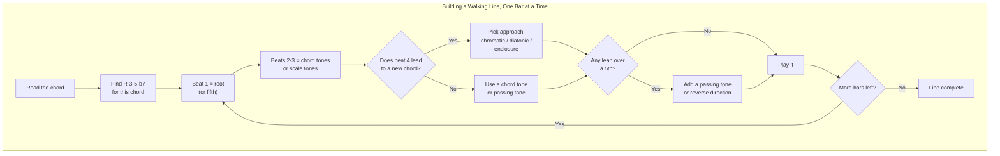
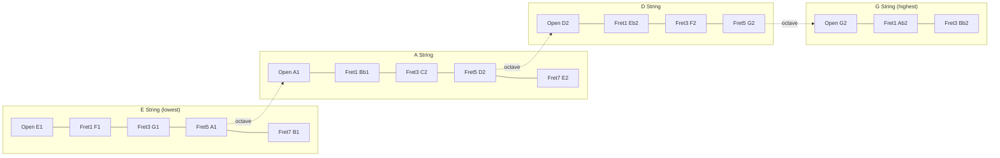
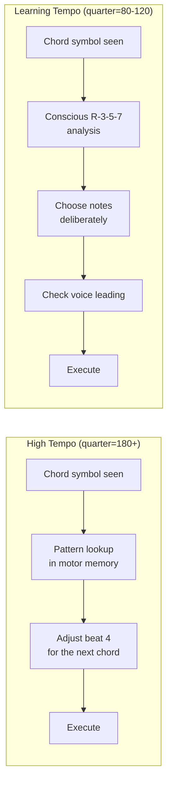

# Lesson 1: Walking Bass Lines — From Fretboard Mechanics to Live Performance

---

## 1. Why Your Hand Moves the Way It Does

A string's pitch depends on its vibrating length — press a fret, you shorten the string, pitch goes up. Because equal temperament divides the octave into 12 equal frequency ratios rather than 12 equal *distances*, frets crowd together as you move up the neck. The 12th fret sits at the exact halfway point of the string length, one octave above open.

**What this means for your hand:** in frets 1–5, the gaps between frets are wide — nearly 2.5x the width of frets 12–17. Stretching one-finger-per-fret down here pulls the ring finger and pinky into awkward, tendon-straining angles for a lot of repeated motion. Franz Simandl's 19th-century fix, built for double bass and ported directly to electric bass: use fingers 1-2-4 (index-middle-pinky) in low position, keeping the ring finger relaxed and tucked behind the pinky instead of stretching it out. Past fret 7, the frets are close enough that 1-2-3-4 one-finger-per-fret is both safe and faster. This isn't a style choice — ignore it and you're the bass player with tendinitis by year three.

The harmonic series is why some notes feel "home" and others pull toward resolution. You don't need the full derivation — just the functional map:

| Harmonic | Interval | Role in a Walking Line |
|---|---|---|
| Root | Unison | Maximum grounding, where the ear rests |
| 2nd partial | Octave | Strongest consonance, register shift |
| 3rd partial | Perfect 5th | The safest non-root note — always works |
| Major 3rd | — | Defines the chord as major |
| Minor 3rd | — | Defines the chord as minor |
| ♭7th | — | Built-in tension, demands resolution |

Root and fifth are structural — they hold the harmony up. The third tells your ear major or minor. The seventh creates the pull toward the next chord. That's the entire physics underlying every rule in this lesson.

---

## 2. What a Walking Line Actually Is

Quarter notes, one per beat in 4/4, moving through chord tones and approach tones. Three rules govern every note you play:

1. **Harmonic rule** — every note is a chord tone, a scale tone, or an approach tone aimed at the next chord.
2. **Voice-leading rule** — prefer stepwise motion (1–2 semitones). Thirds and fourths are natural. Leaps bigger than a fifth must be answered by stepwise motion back the other way.
3. **Metric rule** — beat 1 of a new chord is almost always the root or fifth. Beat 4 of the previous bar is the approach note pointing straight at it. **Beat 4 is the hinge of the whole line** — get it wrong and the next chord change sounds accidental.

### Chord Tone Reference (dominant 7th shapes used throughout)

| Chord | Root | 3rd | 5th | ♭7 |
|---|---|---|---|---|
| B♭7 | B♭ | D | F | A♭ |
| E♭7 | E♭ | G | B♭ | D♭ |
| F7 | F | A | C | E♭ |
| Dm7 | D | F | A | C |
| Cmaj7 | C | E | G | B |

### The Four Beat-4 Approach Strategies

1. **Chromatic from below** — semitone below the next root. Strongest pull, the bebop default. B♭7 → E♭7: play D on beat 4.
2. **Chromatic from above** — semitone above the next root. Into C: play D♭ on beat 4.
3. **Diatonic approach** — a scale step (often the 2nd or 7th degree). Gentler, stays inside the key.
4. **Enclosure** — beat 3 a semitone above the target, beat 4 a semitone below (or the reverse), sandwiching the root on beat 1. The classic bebop move.

### Annotated 12-Bar Blues Walking Line in B♭

B♭ is the standard jam-session blues key — comfortable range for horns. Form: B♭7–E♭7–B♭7–B♭7–E♭7–E♭7–B♭7–B♭7–F7–E♭7–B♭7–F7.

```text
Bar  Beat1        Beat2        Beat3        Beat4           Chord      Fingering (Simandl 1-2-4)
1    Bb A-str f1  D  A-str f3  F  D-str f3  Ab D-str f1     Bb7        1-2-1-1
2    Bb A-str f1  D  A-str f3  F  D-str f3  D  A-str f3     Bb7        same box, beat4 = color tone
3    Eb A-str f1  G  A-str f3  Bb D-str f3  Db D-str f1     Eb7        same shape as Bar1, up a 4th
4    Eb A-str f1  G  A-str f3  Bb D-str f1  D  D-str f3     Eb7->Bb7   beat4 chromatic down to Bb
5    Bb A-str f1  D  A-str f3  F  D-str f3  Ab D-str f1     Bb7        1-2-1-1
6    Bb A-str f1  F  D-str f3  Ab D-str f1  A  D-str f2     Bb7->F7    beat4 chromatic down to F
7    F  E-str f1  A  E-str f5  C  A-str f3  Eb D-str f1     F7         1-4-2-1
8    Eb A-str f1  G  A-str f3  Bb D-str f3  A  D-str f2     Eb7->Bb7   beat4 chromatic down to Bb
9    Bb A-str f1  D  A-str f3  F  D-str f3  Ab D-str f1     Bb7        1-2-1-1
10   Bb A-str f1  G  A-str f3  F  D-str f3  E  D-str f2     Bb7->F7    beat4 chromatic down to F
11   F  E-str f1  C  A-str f3  Eb D-str f1  A  E-str f5     F7->Bb7    beat4 chromatic down to Bb
12   Bb A-str f1  D  A-str f3  F  D-str f3  B  D-str f4     Bb7        turnaround, repeat to Bar 1
```

Bars 1, 3, 5, and 9 use the identical R-3-5-♭7 box, just relocated to a different root. **That one movable shape is 90% of this entire chorus** — learn it once, move it anywhere.

### Construction Flow



---

## 3. Fretboard Geography: Three Movable Boxes

Learn three positional shapes and you can walk any progression in any key by shifting at most two frets.

**Box 1 — Root on A string (frets 1–3, your main walking territory)**

```text
A string  | R  |    | 5  |      R = fret 1
D string  | b7 | 3  |    |      b7 = same fret as R, 3 = one fret above R (both on D string)
             1    2    3     (frets)
```
B♭7 example: R = B♭ (A str f1), 3 = D (D str f3), 5 = F (A str f3), ♭7 = A♭ (D str f1).

**Box 2 — Root on E string (frets 1–5, used for F7 and low-register color)**

```text
E string  | R  |    |    |    |
A string  | 5  |    |    | 3  |     5 = same fret as R, 3 = R+3 frets
             1    2    3    4    5   (frets)
```
F7 example: R = F (E str f1), 5 = C (A str f1), ♭7 = E♭ (D str f1 at same position), 3 = A (A str f3). Finger 1-2-4 and let the pinky stretch to fret 4–5 only when needed — don't force 1-2-3-4 down here.

**Box 3 — Root on D string (frets 3–7, turnarounds and register lift)**

```text
D string  | b7 | R  |    | 3  |     b7 = one fret below R, 3 = R+2 frets
G string  | 5  |    |    |    |     5 = same fret as R, one string up
             1    2    3    4   (frets, relative to the root fret)
```

### Interval Map Across the Neck



Fingerboard shortcuts, read straight off that map: same string, +2 frets = whole step. Same string, +1 fret = half step. Same fret, next string up = perfect fourth. Same fret +5, next string up = octave (your fastest octave jump). Same fret +7, next string up = perfect fifth.

---

## 4. Hand Mechanics

**Left hand (fretting):** thumb planted on the back-center of the neck, directly opposite the middle finger. Wrist straight, not bent toward either side. Fingertip contacts the string just behind the fret wire, close to perpendicular. Self-check: look at the back of your hand — it should form a relaxed "C" shape. Flat knuckles mean your thumb has crept too high over the top of the neck, or your wrist is bent.

**Simandl 1-2-4 drill (frets 1–5).** Index=1, middle=2, pinky=4. Ring finger stays relaxed, riding just behind the pinky, not stretched out on its own:

```text
E(open) -> F(fret1, finger1) -> F#(fret2, finger2) -> G(fret3, finger4) -> G#(fret4, finger4 slide) -> A(fret5, finger4 stretch)
```
Repeat identically on A, D, G strings. Metronome at 60 BPM, one note per click, zero fret buzz, zero sympathetic ring from neighboring strings. Progress 60 → 80 → 110 BPM before moving to the next drill.

**OFPF drill (frets 7+).** Index→middle→ring→pinky across four consecutive frets:
```text
A string: E(f7, finger1) -> F(f8, finger2) -> F#(f9, finger3) -> G(f10, finger4)
```
Same 60 → 80 → 110 BPM progression, repeated on all four strings.

**Floating thumb mute (right hand).** Rest your plucking thumb on the string *below* the one you're currently playing — thumb sits on the E string while you pluck the A string, moves to the A string while you pluck the D string. It floats up with you as you cross strings. Pair it with your fretting-hand index finger lightly grazing the string below the one you've fretted — muting from both ends kills sympathetic ring completely.

**Right-hand alternation.** Strict index/middle (i-m) alternation on every note, no exceptions above ♩=100. Plucking everything with one finger fatigues it asymmetrically and your time destabilizes as it tires.

```text
A string: i  m  i  m   (Bb Bb Bb Bb)
D string: m  i  m  i   (F  F  F  F)
```
Whichever finger you land on when you cross strings, the next string starts with the *other* finger — this is what kills the "raking" habit where you drag one finger across multiple strings. Drill at 60 → 80 → 110 → 140 BPM.

**Tone production — three physical levers you control every note:**
- **Pluck location.** Near the neck pickup: round, warm, blends into an ensemble mix — the default for walking bass. Near the bridge: brighter, more percussive attack, reserved for funk/pop and slap work.
- **Pluck force.** Firm but relaxed — enough to drive a clean fundamental plus a few overtones, not so much the string slaps against the frets and adds clank.
- **Release direction.** Pull slightly upward off the string and let it snap back toward the fretboard for the rounded, upright-bass-style "thump." Pulling sideways, parallel to the fretboard, gives a thinner, more guitar-like attack.

**Articulation — semi-staccato.** At ♩=120–240, each quarter note lasts 250–500 ms. A well-articulated walking note sustains roughly 60–75% of its written value, then decays slightly before the next attack lands — not fully legato (blurs the harmonic outline into mush) and not fully staccato (sounds robotic and disconnected). Practice target: repeat B♭ on the A string, fret 1, at ♩=100 until every note is distinct but connected — like clearly spoken words in a flowing sentence, not a stutter and not a slur.

---

## 5. Voice Leading: One Note Implying a Whole Chord Change

When a bassist plays G (5th of C7) → E (3rd of C7) → E♭ (♭7 of F7) → F (root of F7), the ear hears the line G–F bridged by E–E♭ as C7 resolving into F7. One melodic line implies a full harmonic motion without any chord being stated.

**Interval rules, safest to riskiest:**
- **1–2 semitones (step):** default choice, always works, always sounds intentional.
- **3–4 semitones (3rd):** natural, connects chord tones cleanly.
- **5 semitones (4th):** strong — root-to-fifth and back are staples of the style.
- **7 semitones (5th):** fine with context — phrase-opening root-to-fifth reads as deliberate, but arbitrary mid-line it sounds like you lost the thread.
- **8+ semitones (6th or larger):** must be answered by stepwise motion in the *opposite* direction for at least two beats, or the line sounds disjointed and accidental.

### ii–V–I Voice-Leading Drill in F

```text
Bar1 (Gm7):   G(E str f3) -> Bb(A str f1) -> D(A str f5) -> C(A str f3)
Bar2 (C7):    C(A str f3) -> E(D str f2)  -> G(D str f5) -> B(D str f4)
Bar3 (Fmaj7): F(E str f1) -> A(E str f5)  -> C(A str f3) -> E(D str f2)
```
Bar 1 beat 4 (C, the fifth of Gm7) is a common tone shared with Bar 2's root — the smoothest join possible in this style. Bar 2 beat 4 (B) leaps up a half step into F — acceptable here because it's a phrase-ending cadence, not aimless mid-phrase motion. Bar 3 climbs the F major scale to close out the phrase.

Run this at 60 → 80 → 100 → 120 BPM. Record every pass and check: is every beat 1 a chord tone? Does beat 4 clearly point at the next root? Any unresolved leap larger than a fifth?

**Shaping a full chorus:** don't let the line wander aimlessly — give it contour. Common moves: ascend by arpeggio for two bars, then descend by scale for two. Build a slow "wave" that peaks around bars 6–8 of a 12-bar blues, then descends home by bar 12. Drop or jump an octave every few bars to refresh the register and avoid monotony. Register map: the low E string (E1–B1) is your foundation, the A string (A1–E2) is the main walking register, the D and G strings handle turnarounds and higher passing color.

---

## 6. Tempo Scaling: From Conscious Choice to Reflex

At ♩=120 you have 500 ms to pick and play the next note. At ♩=240 that's 250 ms — near the floor of human reaction time. Past a certain tempo, note-by-note harmonic reasoning is physically too slow to keep up; the line has to run off pre-learned motor patterns instead of live decisions. That's the entire justification for drilling the same shapes over and over: you're transferring execution from conscious planning to procedural memory, which frees your attention for listening to the band.



### Progressive Tempo Protocol

**Phase 1 (♩=80, weeks 1–2) — Root/fifth only.** Metronome clicks on beats 2 and 4 only, simulating the drummer's hi-hat. Play a 12-bar blues in B♭, F, and C using only roots and fifths. Stop after each chorus and name out loud which beat rushed or dragged.

**Phase 2 (♩=100, weeks 3–4) — Add thirds and sevenths.** Memorize the full annotated B♭ blues from Section 2. Play it three times without stopping, record it, and check that every beat 1 lands on a root or fifth.

**Phase 3 (♩=120, weeks 5–6) — Approach notes.** One chorus using only chromatic-from-below approaches. Next chorus, only chromatic-from-above. Next, alternate between them. Next, use enclosures throughout. Goal: hear the next root in your head *before* you play the approach note.

**Phase 4 (♩=140–160, weeks 7–8) — Pattern automation.** Stop thinking note-by-note; think in phrase shapes instead. Cycle of fifths ii–V–I, one bar per chord:
```text
Dm7 -> G7 -> Cmaj7 -> F#m7 -> B7 -> Emaj7 -> Bbm7 -> Eb7 -> Abmaj7 -> Dbm7 -> Gb7 -> Bmaj7 -> (back to Dm7)
```
Every clean pass through all 12 keys earns +10 BPM. Target 140 BPM by the end of week 8.

**Phase 5 (♩=180+, week 9+) — Performance tempo.** Lines now come from muscle memory; your attention shifts entirely to dynamics and interaction with the drummer. Test: play along to a recording at ♩=200 for five choruses with zero pre-planning. Any hesitation, or any wrong note on beat 1, means more time in Phase 4 before moving on.

---

## 7. Common Failure Modes and Fixes

**Rooting every beat.** Technically "safe," but it kills forward motion and sounds like a drone. Fix: root on beat 1 only; fill beats 2–3 with 3rd/5th/♭7; beat 4 is always a deliberate approach note.

**Ignoring beat 4.** A chord tone that doesn't point at the next root breaks the metric rule — the line turns into disconnected arpeggios instead of one continuous phrase. Fix: before playing a progression, silently sing the next root on beat 4 of the current bar, then choose the approach strategy that leads there. Beat 4 should be the most deliberate note in the bar, not the most casual.

**Unresolved leaps.** A big jump followed by continued motion in the same direction sounds angular and accidental. Fix: after any leap bigger than a fifth, move stepwise in the opposite direction for at least two beats.

**Inconsistent articulation.** Mixing legato and staccato note-to-note breaks the walking feel and sounds amateurish. Fix: play one note for 64 beats at ♩=100 with identical force, release, and sustain every time, then apply that same consistency to a scale, one note per beat.

**Fretting-hand tension.** A squeezed neck, collapsed knuckles, or bent wrist causes fatigue within a single chorus and risks real injury over months. Fix: check thumb position every session — back-center of the neck, pointing toward the ceiling — and keep the wrist straight. Fretting needs roughly 1–2 pounds of pressure, no more. Practice playing as lightly as possible while keeping the tone clean; excess pressure is wasted effort and the first thing that breaks down under fatigue.

**Not locking with the drums.** Walking bass is rhythm first, harmony second. Fix: practice exclusively with a backbeat click on beats 2 and 4. Your notes on 1 and 3 should land exactly between clicks — record yourself and listen for any note that doesn't sit dead center in the grid.

---

## 8. Lab: Practice Drills

### Drill Set A — Chord Tone Fluency (♩=60 → 120)

**A1: Arpeggio permutations.** On B♭7 (A string root), play every ordering below, four reps each:
```text
1. R  3  5  b7  -> Bb D  F  Ab   (finger 1-2-1-1)
2. R  5  b7 3   -> Bb F  Ab D    (finger 1-1-1-2)
3. 3  R  5  b7  -> D  Bb F  Ab   (finger 2-1-1-1)
4. b7 5  3  R   -> Ab F  D  Bb   (finger 1-1-2-1)
```
Transpose through F7, C7, G7, D7, A7, E7 — one new key per day. Add 10 BPM per week until you reach 120.

**A2: Two-chord connectors.** Walk between every adjacent chord pair in a B♭ blues using a chromatic beat-4 approach:
```text
Bb7 -> Eb7:  Bb(R) D(3) F(5) D(down to Eb)  |  Eb(R) G(3) Bb(5) Db(b7)
Eb7 -> Bb7:  Eb(R) G(3) Bb(5) A(down to Bb) |  Bb(R) D(3) F(5) Ab(b7)
Bb7 -> F7:   Bb(R) D(3) F(5) E(down to F)   |  F(R) A(3) C(5) Eb(b7)
F7 -> Bb7:   F(R) A(3) C(5) B(down to Bb)   |  Bb(R) D(3) F(5) Ab(b7)
```

### Drill Set B — Approach Note Mastery (♩=80 → 140)

**B1: Chromatic-from-below only, full 12-bar.** Every beat 4 is the semitone below the *next* chord's root — including repeats of the same chord.

```text
Bar  Beat1   Beat2   Beat3   Beat4(approach)   Chord
1    Bb(R)   D(3)    F(5)    A (-> Bb)         Bb7
2    Bb(R)   D(3)    F(5)    A (-> Bb)         Bb7
3    Eb(R)   G(3)    Bb(5)   Db(-> Eb)         Eb7
4    Eb(R)   G(3)    Bb(5)   A (-> Bb)         Eb7->Bb7
5    Bb(R)   D(3)    F(5)    A (-> Bb)         Bb7
6    Bb(R)   F(5)    D(3)    E (-> F)          Bb7->F7
7    F(R)    A(3)    C(5)    E (-> F)          F7
8    Eb(R)   G(3)    Bb(5)   A (-> Bb)         Eb7->Bb7
9    Bb(R)   D(3)    F(5)    A (-> Bb)         Bb7
10   Bb(R)   G(3)    F(5)    E (-> F)          Bb7->F7
11   F(R)    A(3)    C(5)    A (-> Bb)         F7->Bb7
12   Bb(R)   D(3)    F(5)    A (-> Bb, repeat) Bb7
```
This drill isn't meant to be melodically perfect — it trains your hand to reflexively find the semitone below any target, so later you can *choose* approach strategies instead of defaulting to whatever's under your fingers.

**B2: Enclosure drill.** Beat 3 = semitone above the next root, beat 4 = semitone below it, resolve on beat 1:
```text
Eb7 -> Bb7:  Eb(R) G(3) B(above Bb)  A(below Bb)  | Bb(R) ...
Bb7 -> F7:   Bb(R) F(5) Gb(above F)  E(below F)   | F(R) ...
```
Start at 60 BPM — having beat 3 *not* be a chord tone takes some getting used to.

### Drill Set C — ii–V–I Cycling (♩=80 → 160)

Cycle of fifths, one bar per chord. Template: Bar 1 (ii) plays R-3-5-♭7 with beat 4 chromatic into V's root. Bar 2 (V) plays R-3-5-♭7 with beat 4 chromatic into I's root. Bar 3 (I) plays R-3-5-7 (natural 7th) with beat 4 chromatic into the next ii.

```text
C: Dm7-G7-Cmaj7 | F: Gm7-C7-Fmaj7 | Bb: Cm7-F7-Bbmaj7 | Eb: Fm7-Bb7-Ebmaj7
Ab: Bbm7-Eb7-Abmaj7 | Db: Ebm7-Ab7-Dbmaj7 | Gb: Abm7-Db7-Gbmaj7 | B: C#m7-F#7-Bmaj7
E: F#m7-B7-Emaj7 | A: Bm7-E7-Amaj7 | D: Em7-A7-Dmaj7 | G: Am7-D7-Gmaj7
```
Start at 80 BPM. Each clean pass through all 12 keys earns +10 BPM, target 140 by week 4 of this drill.

**C2: Two-feel to four-feel.** One chorus in "two" (half notes, root-fifth only), next chorus in "four" (full quarter-note walk), same tempo throughout — this mimics the standard ballad-to-swing transition heard on real gigs:
```text
Two-feel:   Bb --- Eb --- Bb --- Bb ---
Four-feel:  Bb D F Ab | Eb G Bb Db | Bb D F Ab | Bb D F Ab
```

### Drill Set D — Transcription

Pick one recording: Paul Chambers on "So What," Ron Carter on "Footprints," or Sam Jones on "Blue Bossa." Transcribe one chorus by ear using the bar/beat/chord annotation format from Section 2. For every note, log: beat position, function (R/3/5/♭7/approach/enclosure), fingering, and why that note over the alternatives. Then play your transcription along with the record, matching articulation and time feel exactly, before improvising your own line over the same changes.

---

## 9. Performance Checklist

- [ ] Know the form (12-bar blues, 32-bar AABA, ii–V–I chain)
- [ ] Can name the key and every chord change on sight
- [ ] Play the root of every chord on beat 1 without hesitation
- [ ] Play a chromatic approach into every chord change
- [ ] Practice with the metronome on 2 and 4, not 1 and 3
- [ ] Alternate index/middle on every single note
- [ ] Thumb centered on the back of the neck, wrist straight
- [ ] 1-2-4 fingering below fret 5, 1-2-3-4 above fret 7
- [ ] Thumb floats and mutes the string below the one being played
- [ ] Can play a full chorus without looking at the fretboard

### Approach Note Cheat Sheet

| Target Root | Chromatic Below | Chromatic Above | Enclosure (beat3 → beat4 → target) |
|---|---|---|---|
| B♭ | A | B | B, A → B♭ |
| E♭ | D | E | E, D → E♭ |
| F | E | G♭ | G♭, E → F |
| C | B | D♭ | D♭, B → C |
| G | F♯ | A♭ | A♭, F♯ → G |
| D | C♯ | E♭ | E♭, C♯ → D |
| A | G♯ | B♭ | B♭, G♯ → A |
| E | D♯ | F | F, D♯ → E |
| B | A♯ | C | C, A♯ → B |
| G♭ | F | G | G, F → G♭ |
| D♭ | C | D | D, C → D♭ |
| A♭ | G | A | A, G → A♭ |

Drill this as flashcards: name a root, play chromatic-below, chromatic-above, then the full enclosure — reflexively, with no counting. At gig tempo there's no time to calculate the interval; your hand has to already know it.
