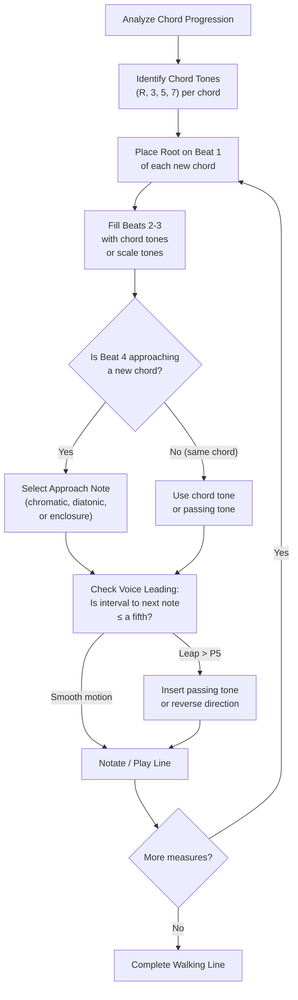
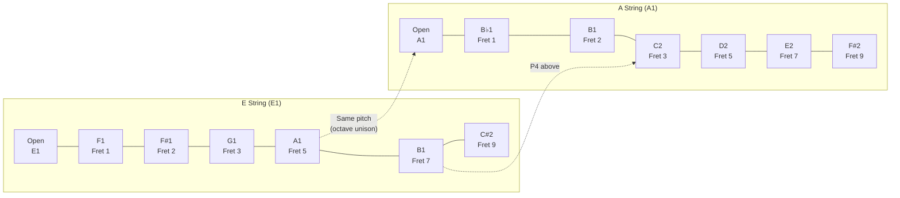
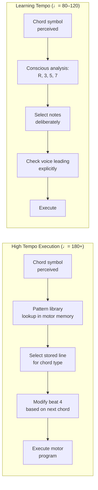

# Lesson 1: Understanding Walking Bass Lines

## 1. First-Principles Intuition & Invariants

### The Physics of Pitch and the Fretboard as a Logarithmic Instrument

The electric bass guitar is fundamentally an acoustic system whose physics determine every constraint a bassist works within. A vibrating string of length *L*, linear mass density *μ*, and tension *T* produces a fundamental frequency governed by Mersenne's law:

$$f = \frac{1}{2L}\sqrt{\frac{T}{\mu}}$$

Pressing a string against a fret shortens the vibrating length. Because the equal-temperament system divides the octave into 12 equal semitones, each fret shortens the string by a factor of $2^{-1/12} \approx 0.9439$. This means fret spacing is geometrically compressed toward the bridge — the fretboard is a physical realization of a logarithmic scale where equal perceptual intervals (semitones) correspond to equal *ratios* of string length, not equal absolute distances. The 12th fret halves the string length exactly, doubling the frequency and producing the octave.

**Practical implication:** A bassist navigating the fretboard is navigating a logarithmic pitch space. Intervallic distance (in semitones) is uniform regardless of register, but the *physical* finger movement required contracts as you move up the neck. Efficient walking-line fingerings exploit this by keeping position shifts minimal while covering a wide harmonic range. In the low register (frets 1–5), one-finger-per-fret is biomechanically inefficient and creates unnecessary hand tension. Use Franz Simandl's 1-2-4 fingering pattern: index, middle, pinky, leaving the ring finger relaxed. Above fret 7, where frets are closer together, you can transition to one-finger-per-fret.

### What a Walking Line Actually Is

A walking line is a predominantly quarter-note bassline — one note per beat in common time — that moves through chord tones and passing tones to delineate a harmonic progression while simultaneously generating rhythmic momentum. The term "walking" is literal: the line proceeds at a steady, legato pace, like footsteps, rather than the locked-to-the-kick rhythmic figures of rock or funk bass.

Three invariants hold for any well-constructed walking line:

**Harmonic invariant.** Each note must be interpretable as a chord tone, scale tone, diatonic passing tone, or chromatic approach tone relative to the current or immediately forthcoming chord. Notes that cannot be explained by one of these functions create unintended dissonance.

**Voice-leading invariant.** Consecutive notes should form intervals that imply smooth motion. Stepwise motion (semitones and whole tones) is maximally smooth. Thirds and fourths are common and stylistically appropriate. Leaps larger than a fifth demand resolution — typically stepwise motion in the opposite direction — or they sound arbitrary rather than melodic.

**Metric invariant.** Beat 1 of each new chord must be a chord tone (almost always the root or fifth at a minimum). Beat 4 of the preceding measure must function as a leading or approach tone into beat 1 of the next chord. This creates the characteristic sense of harmonic "arrival" that makes jazz feel propulsive.

### Harmonic Series and Chord Tone Hierarchy

The harmonic series — the overtone structure produced by any vibrating string — is the acoustic basis for why certain intervals sound stable and others create tension. The first several harmonics of a fundamental C2 are:

| Harmonic | Frequency Ratio | Interval | Perceived stability |
|----------|----------------|----------|---------------------|
| 1st (fundamental) | 1:1 | Unison | Root |
| 2nd | 2:1 | Octave | Maximum stability |
| 3rd | 3:2 | Perfect fifth | High stability |
| 4th | 4:3 | Perfect fourth | Stable in context |
| 5th | 5:4 | Major third | Consonant |
| 6th | 6:5 | Minor third | Consonant |
| 7th | 7:4 | Harmonic seventh (~Bb) | Mildly dissonant — the "blues seventh" |

The closer a chord tone is to a low-numbered harmonic, the more acoustically stable it is. This is why the root and fifth are the most harmonically secure notes in a walking line, the third defines chord quality (major vs. minor), and the seventh introduces the tension that drives resolution to the next chord. This hierarchy is not an arbitrary stylistic rule — it is a direct consequence of the physics of string vibration.

---

## 2. Core Architecture & Mechanics

### Chord Tone Framework

The structural skeleton of any walking line consists of the root (R), third (3), fifth (5), and seventh (7) of each chord. For a dominant seventh chord — the most common chord type in blues and jazz walking-line contexts — these tones are:

| Chord | R | 3 | 5 | 7 |
|-------|---|---|---|---|
| C7 | C | E | G | B♭ |
| F7 | F | A | C | E♭ |
| G7 | G | B | D | F |
| Dm7 | D | F | A | C |
| G7 | G | B | D | F |
| Cmaj7 | C | E | G | B |

Each measure of a walking line in 4/4 has four beats. A minimal but complete walking line assigns a chord tone or controlled passing tone to each beat.

### Approach Notes: Chromatic and Diatonic

Beat 4 of each measure deserves special analytical attention. This "approach beat" functions as a leading tone into beat 1 of the following chord. There are four canonical approach strategies:

**Half-step below.** Place a note one semitone below the target chord's beat-1 note. This creates a strong chromatic pull — the most tension-laden approach. To walk into F on beat 1, place E on beat 4.

**Half-step above.** Place a note one semitone above the target. To walk into C, place D♭ (or C#) on beat 4. This "enclosure from above" is slightly less common as a standalone approach but very effective.

**Dominant fifth.** Place the fifth of the target chord (or its dominant) on beat 4. This is a diatonic approach that retains harmonic clarity — less chromatic tension but stronger tonal grounding.

**Enclosure.** Place a note one semitone above on beat 3 and one semitone below on beat 4, then resolve to the target on beat 1. This two-beat enclosure is a hallmark of bebop-influenced walking style.

### A Fully Annotated 12-Bar Blues Walking Line in C

The following is a 12-bar blues in C with a complete walking line annotated by function. Standard blues form is I7–IV7–I7–I7–IV7–IV7–I7–I7–V7–IV7–I7–V7.

```
Bar  Beat 1    Beat 2    Beat 3    Beat 4    Chord
---  --------  --------  --------  --------  -----
1    C (R)     E (3)     G (5)     B♭ (7)    C7
2    C (R)     E (3)     G (5)     E (chr↑)  C7 → F7
3    F (R)     A (3)     C (5)     E♭ (7)    F7
4    F (R)     E♭ (7)    C (5)     B (chr↑)  F7 → C7
5    C (R)     E (3)     G (5)     B♭ (7)    C7
6    C (R)     G (5)     B♭ (7)    B (chr↑)  C7 → G7
7    G (R)     B (3)     D (5)     F (7)     G7
8    F (R)     A (3)     C (5)     E (chr↑)  F7 → C7
9    C (R)     E (3)     G (5)     B♭ (7)    C7
10   C (R)     A (6)     G (5)     A♭ (chr↑) C7 → G7
11   G (R)     D (5)     F (7)     B (chr↑)  G7 → C7
12   C (R)     E (3)     G (5)     F# (chr↑) C7 → (repeat)
```

Annotations: R=root, 3=third, 5=fifth, 7=seventh, 6=sixth, chr=chromatic approach, ↑=half-step below target.

### Architecture Diagram: Walking Line Construction Flow



### Fretboard Geography and Position Logic

A four-string bass in standard tuning (E1–A1–D2–G2, with open strings at MIDI notes 28, 33, 38, 43) covers a range of roughly E1 to G4. The standard low-register walking territory for jazz bass sits between approximately the 1st and 9th frets, centered on the E and A strings.

Interval relationships critical to walking line fingering:

- **Same string, +2 frets** = whole step (major second)
- **Same string, +1 fret** = half step (minor second)
- **Adjacent strings, same fret** = perfect fourth (5 semitones)
- **Any string to adjacent string, +5 frets** = unison (same pitch, octave displacement)
- **Any string to adjacent string, +7 frets** = perfect fifth

Keeping a walking line within a minimal positional range (shifting the left hand no more than three to four frets per measure) reduces latency between position decisions and execution, which matters at tempos above ♩= 180 BPM. At slower tempos, wider position shifts become viable and can produce more interesting register variety.



### Hand Ergonomics and Fretting Technique

**Left hand posture:** Position your thumb on the back center of the neck, directly opposite your middle finger. Keep your wrist straight — not bent inward or outward. Curved fingers approach the fretboard nearly perpendicular to the strings. Fret with the fingertip, not the pad, and press just behind the fret wire (not on top of it, not in the middle of the fret space). This minimizes the force required and maximizes sustain.

**Simandl 1-2-4 technique (frets 1–5):** Use index (1), middle (2), and pinky (4) fingers. Leave the ring finger relaxed. This distributes the stretch across the stronger index-middle-pinky framework and prevents tendon strain in the weaker ring finger. Example: to play E1 (open) → F1 (fret 1) → G1 (fret 3) → A1 (fret 5) on the E string, use: open → 1 → 2 → 4.

**One-finger-per-fret (frets 7+):** Above the 7th fret, where frets are closer together, transition to index (1) → middle (2) → ring (3) → pinky (4), with each finger assigned to consecutive frets. This gives you a four-fret range without shifting position.

**Floating thumb muting:** Rest your plucking-hand thumb on the string below the one you're playing. When playing the A string, rest your thumb on the E string. This damps sympathetic vibrations and keeps the line clean. As you move to higher strings, your thumb "floats" upward to maintain contact with the adjacent lower string.

---

## 3. Voice Leading: The Deep Principle

Voice leading in the walking-bass context is not merely a matter of avoiding "ugly" intervals. It is the mechanism by which a single-line instrument implies harmonic motion. When the bassist walks from G (fifth of C7) to E (third of C7) to E♭ (seventh of F7) to F (root of F7), the listener hears not just four notes but a line that maps out C7 resolving to F7 with a chromatic passing tone in between. The chromatic descent G → F — bridged by E and E♭ — is what creates the sensation of harmonic "pull."

The classical principle of avoiding parallel fifths applies to walking bass with nuance. In a solo or duo context, parallel fifths in the bass line alone create an audible hollowness. In a full ensemble context, they are less problematic because the harmonic texture above the bass fills in the missing voices. However, consecutive root-fifth patterns (C → G → D → A) are stylistically avoided in jazz walking because they negate the linear, melodic quality that distinguishes a walking line from a simple harmonic reduction.

The practical rules derived from voice-leading principles:

1. **Stepwise motion (1–2 semitones)** is always harmonically safe and creates maximum melodic cohesion.
2. **Thirds (3–4 semitones)** are common and melodically interesting, especially when connecting chord tones.
3. **Fourths (5 semitones)** are strong and common, especially root-to-fifth or fifth-to-root.
4. **Fifths (7 semitones)** are acceptable but require contextual justification (e.g., root-down-to-fifth at the start of a phrase).
5. **Leaps of a sixth or larger** must be followed by motion in the opposite direction to maintain linear coherence.

### Melodic Contour and Register Strategy

Professional walking lines exhibit clear phrase-level contour: they don't wander aimlessly across registers. Common contours include:

- **Ascending arpeggiation** (bars 1–2) followed by **descending scale motion** (bars 3–4)
- **Wave contour:** ascend to a peak around bar 6–8 of a 12-bar blues, then descend back to the tonic register
- **Octave displacement:** periodically jumping up or down an octave to refresh the register and prevent monotony

The low E string (open to fret 7, covering E1–B1) is the foundation register. The A string (open to fret 7, covering A1–E2) is the melodic middle register where most walking happens. The D and G strings are used sparingly for higher passing tones or turnarounds.

---

## 4. High-Performance Optimization and Failure Mode Analysis

### Physical Mechanics: Touch, Attack, and Sustain

The tone of a walking bass note is determined by three physical parameters: **where** on the string the plucking finger strikes (closer to the bridge = brighter, more percussive; near the neck pickup = rounder, fuller), **how hard** the finger plucks (amplitude affects both volume and harmonic content — harder plucking adds upper partials), and **how the fretting hand releases** (controlling sustain and muting).

For walking lines at jazz tempos (♩= 120–240 BPM), each note occupies 250–500 milliseconds. A properly executed walking tone should sustain for approximately 60–75% of its duration, then decay slightly before the next attack. This "semi-staccato" articulation — not fully legato, not fully staccato — is the defining touch of a jazz walking line. Legato playing blurs the note-to-note articulation and obscures the harmonic outline; fully staccato playing sounds mechanical and loses the "walk."

**Right-hand technique:** Rest your thumb on the pickup or on the E string (if playing A string or higher). Alternate index and middle fingers with each pluck — **this is non-negotiable at tempos above ♩= 160**. Single-finger plucking creates fatigue asymmetry and inconsistent tone. Start every phrase with your index finger to maintain alternation consistency.

**Plucking motion:** Pull the string slightly upward and release (toward the ceiling if you're standing), not sideways across the fretboard. The string should snap back against the frets with a percussive "thump." This produces the characteristic upright-bass-like tone that jazz bassists seek on electric instruments.

### Tempo Scaling and Cognitive Load

Walking line construction presents a real-time constraint satisfaction problem. At ♩= 120, the bassist has 500 ms per beat to decide the next note, execute the finger movement, and produce the attack. At ♩= 240, that window shrinks to 250 ms — within the range of human motor reaction time for unprepared movements (~180–250 ms). This means that at high tempos, deliberate note-by-note harmonic reasoning becomes impossible. The line must be executed from pre-compiled melodic patterns stored in motor memory.

This is the architectural reason that professional bassists practice walking lines over common progressions (ii–V–I, blues, rhythm changes) until the patterns become automatic. The cognitive goal is to shift walking-line execution from the deliberate prefrontal planning system to the procedural motor system (basal ganglia / cerebellum loop), freeing working memory to focus on ensemble interaction, dynamics, and real-time harmonic variation.



### Practice Protocol: Progressive Tempo Development

**Week 1–2: Foundation at ♩= 80 BPM**
- Play 12-bar blues in C, F, and B♭ using only root and fifth on alternating beats
- Metronome on beats 2 and 4 (backbeat emphasis)
- Goal: lock into time, establish alternating finger technique

**Week 3–4: Chord tone vocabulary at ♩= 100 BPM**
- Add thirds and sevenths to your lines
- Practice pre-composed lines (use the annotated 12-bar example above)
- Record yourself and listen back for rhythmic inconsistencies

**Week 5–6: Approach note integration at ♩= 120 BPM**
- Focus exclusively on beat 4 of each measure
- Practice chromatic approach from below, then from above
- Alternate approach strategies on consecutive choruses

**Week 7–8: Pattern automation at ♩= 140–160 BPM**
- Stop thinking about individual notes; focus on phrase shapes
- Play multiple choruses without stopping
- Introduce ii–V–I progressions in all keys

**Week 9+: Performance tempo at ♩= 180+ BPM**
- Lines should emerge automatically from muscle memory
- Focus shifts to dynamics, interaction with drummer, and register variation

### Common Failure Modes and Corrections

**Failure: Rooting on every beat.** Playing the root on all four beats of each chord is the most common beginner error. It fulfills the harmonic invariant triv
