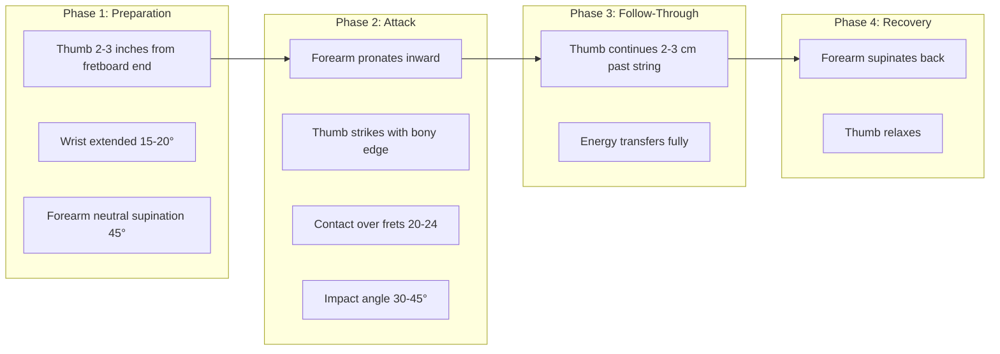
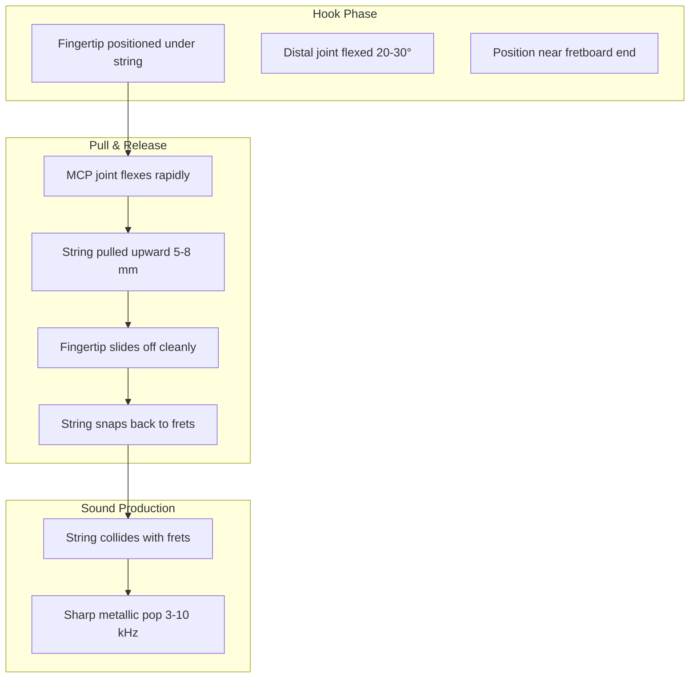

# Lesson 1: Mastering the Slap & Pop Technique

## 1. First-Principles Intuition (15%)

### Why Slap & Pop Sounds Different

When you slap a bass string, you create a **percussive collision** between the string and the fretboard. This generates a bright, aggressive attack rich in high-frequency harmonics (2–8 kHz), fundamentally different from the warm, sustained tone of fingerstyle playing. The pop adds an even sharper transient (3–10 kHz) as the string snaps back and rattles against the frets.

**Three acoustic principles govern the sound:**

1. **Collision energy determines brightness**: A faster thumb strike drives the string harder into the fretboard, exciting more upper harmonics. Impact velocities of 1.5–2.5 m/s produce the characteristic slap attack without overstressing the string.

2. **Strike location shifts tonal balance**: Slapping near the bridge emphasizes treble and cut; slapping near the neck pickup adds warmth and fundamental weight. The harmonic series excited depends on where the string divides during vibration.

3. **String gauge and tension affect response**: Heavier strings (0.105" A, 0.130" E) store more energy and produce louder, punchier attacks. Lower action (2.0–2.5 mm at 17th fret) reduces the force required and improves control, but too low causes fret buzz.

**Biomechanical foundation**: The slap generates force through **forearm rotation** (pronation), not isolated thumb muscle contraction. Your forearm mass (≈1–1.5 kg) rotating at 600–800°/sec transfers kinetic energy to the string via the thumb's bony edge. The pop uses rapid finger flexion at the knuckle joint to hook and release the string perpendicular to the fretboard. These motions must be trained as coordinated, repeatable motor patterns.

---

## 2. Hand Mechanics & Physical Execution (85%)

### Slap Biomechanics: Four-Phase Breakdown

#### Phase 1: Preparation (Rest Position)
- **Thumb position**: Resting 2–3 inches from the end of the fretboard, knuckle joint relaxed.
- **Wrist angle**: Slight extension, 15–20°. Keep wrist straight to avoid carpal tunnel compression.
- **Forearm**: Neutral supination (palm facing inward at 45°).
- **Fingers**: Lightly curled, ready to mute or execute the pop.

#### Phase 2: Attack (The Strike)
1. **Rotate forearm inward** (pronation): This drives the thumb downward in an arc.
2. **Thumb stays rigid**: The lateral bony edge of the thumb (side closest to index finger) strikes the string. Do NOT bend the thumb joint during impact.
3. **Contact point**: Strike the string over the end of the fretboard or just past it (20th–24th fret area for brightness, 18th–20th for warmth).
4. **Impact angle**: Thumb approaches at 30–45° relative to the fretboard plane, depending on string thickness (steeper for low E, shallower for G).
5. **Duration**: Contact lasts 1–5 milliseconds. The string rebounds off the fretboard immediately.

**Critical checkpoint**: The thumb does NOT push through the string. It strikes and bounces, like a drumstick hitting a drumhead.



#### Phase 3: Follow-Through
- **Let the thumb continue past the string** by 2–3 cm. This follow-through maximizes energy transfer.
- **Do NOT stop the thumb at the string**—this chokes the sound and wastes force.

#### Phase 4: Recovery
- **Supinate the forearm** to return to rest position.
- **Relax the thumb** momentarily to allow blood flow and prevent fatigue.

---

### Pop Biomechanics: Hook, Pull, Release

#### Phase 1: Hook
1. **Position the fingertip** (index or middle) **under the target string**.
2. **Use the pad of the fingertip**, not the nail. The distal joint stays slightly flexed (20–30°) for rigidity.
3. **Finger placement**: Hook the string near the end of the fretboard, parallel to where you slap.

#### Phase 2: Pull & Release
1. **Flex the finger rapidly at the knuckle joint** (metacarpophalangeal, or MCP joint), pulling the string upward 5–8 mm.
2. **Release cleanly**: The fingertip slides off the string, allowing it to snap back. Do NOT damp the string with your finger after release.
3. **The string collides with adjacent frets**, producing the sharp metallic "pop" sound.

**Critical checkpoint**: The pop is a **pull perpendicular to the fretboard**, not a lateral pluck. The string must snap back vertically to hit the frets.



---

### String Selection & Muting Protocol

**Thumb strike angle by string**:
- **E (0.130")**: 45° angle, maximum force
- **A (0.105")**: 40° angle, moderate force
- **D (0.085")**: 35° angle, reduced force
- **G (0.065")**: 30° angle, minimal force

**Muting is non-negotiable**:
- **Plucking hand fingers**: Rest lightly on unused strings to kill sympathetic vibration.
- **Fretting hand**: The underside of fretting fingers touches adjacent strings, muting them immediately after they're played.
- **Floating thumb muting**: After slapping the E string, rest your thumb on the A string to mute it. After slapping the A, rest on the D. This technique prevents ringing and tightens rhythmic articulation.

Without aggressive muting, slap playing becomes muddy and indistinct.

---

### Coordination Patterns: Slap-Pop Sequences

#### Pattern 1: Alternating Slap-Pop (Foundation)
```
Thumb (T) → Index (i) → T → i
E string   A string    E    A
```
- Start at **60 BPM, quarter notes**. Focus on even tone and timing.
- Graduate to **8th notes at 70 BPM**, then **16th notes at 80 BPM**.

#### Pattern 2: Double-Pop
```
T → i → m → T → i → m
E   A   A   E   A   A
```
(T = thumb slap, i = index pop, m = middle finger pop)

- The middle finger typically generates 10–15% less force than the index. **Consciously pull harder with the middle finger** to match volume.
- Practice middle finger in isolation: 100 consecutive middle-finger pops, match the index finger's tone.

#### Pattern 3: Triplet Feel (Funk Staple)
```
T  i  T  |  T  i  T  |
1 & a    |  2 & a    |
```
- Slap on downbeats (1, 2), pop on upbeats (&), slap on offbeats (a).
- Start at **80 BPM** with triplet subdivision click.

#### Pattern 4: Syncopated 16ths
```
T  -  i  T  |  -  i  T  i  |
1  e  &  a  |  2  e  &  a  |
```
- Rest on the downbeat, slap on the e, pop on the &, slap on the a.
- Forces conscious subdivision awareness.
- Start at **70 BPM**, progress to **100 BPM**.

---

### Fretboard Integration: Slap with Fretted Notes

**Left-hand technique while slapping**:
1. **Fret notes with fingertips perpendicular to fretboard**, just behind the fret wire (not on top of it).
2. **Mute with fretting hand**: After releasing a fretted note, let the finger flatten slightly to touch adjacent strings.
3. **Hammer-ons and pull-offs**: Execute these with the fretting hand while the plucking hand slaps or pops the open string or a different string.

**Example groove (E minor pentatonic)**:
```
E|---0---0-S-0-P-3-0----|
A|-S---P----------------|
D|----------------------|
G|----------------------|
  1 & 2 & 3 & 4 &
```
(S = slap, P = pop, numbers = frets)

- Slap open E on beat 1.
- Pop open A on the &.
- Slap open E on beat 2.
- Pop fretted 3rd fret E on the &.
- Slap open E on beat 3, etc.

**Finger assignments for E minor pentatonic box (frets 0-5)**:
```
E|--0-----3-5--------|  (open, pinky on 3, pinky on 5)
A|--0---2-3----------|  (open, middle on 2, ring on 3)
D|--0-2-3------------|  (open, middle on 2, ring on 3)
G|--0-2-3------------|  (open, middle on 2, ring on 3)
```

Use **Simandl 1-2-4 fingering** below 5th fret:
- **1st finger**: index (frets 1-2 coverage)
- **2nd finger**: middle (fret 3)
- **4th finger**: pinky (frets 4-5)

---

### Ergonomics & Injury Prevention

**Force distribution**:
- **80% of force from forearm rotation**, 20% from thumb muscles.
- If your thumb hurts after 5 minutes, you're isolating the thumb too much. Engage the larger forearm muscles.

**Practice ratios**:
- **10 minutes playing : 2 minutes rest**. Use the rest interval to shake out your hands and stretch.
- **Warm-up protocol** (15 minutes before slap practice):
  1. Light aerobic (jump rope, arm circles): 5 minutes to elevate tissue temperature.
  2. Dynamic stretching (wrist circles, finger extensions): 5 minutes to increase range of motion.
  3. Slow-tempo slap drills (40 BPM quarter notes): 5 minutes to prime motor patterns.

**Stretching exercises (hold each 15–20 seconds)**:
1. **Wrist flexor stretch**: Extend arm forward, palm up, pull fingers back toward body.
2. **Wrist extensor stretch**: Extend arm forward, palm down, pull fingers down toward floor.
3. **Forearm pronation/supination**: Hold light weight (1 lb), rotate wrist slowly through full range.
4. **Finger extensions**: Place rubber band around all five fingertips, spread fingers against resistance.

**Ice after practice**: If you feel any discomfort, apply ice for 15 minutes immediately after playing to reduce inflammation.

---

## 3. Practice Drills & Progressive Training

### Phase 1: Motor Pattern Acquisition (Weeks 1–4)

**Objective**: Establish clean, consistent slap and pop mechanics.

**Daily routine (20 minutes)**:

1. **Single-string slaps** (5 min)
   - E string only, quarter notes at **60 BPM**.
   - Focus: Thumb bounces off string, clean attack, even tone.
   - Target: 20 consecutive slaps with consistent volume.

2. **Single-string pops** (5 min)
   - A string only, quarter notes at **60 BPM**.
   - Focus: Clean hook and release, no finger damping.
   - Target: 20 consecutive pops with consistent tone.

3. **Alternating slap-pop** (10 min)
   - 8th notes at **60 BPM**: T-i-T-i on E-A-E-A.
   - Increase to **70 BPM** when you can play 1 minute without error.
   - Target: Even tone and timing, no volume difference between slap and pop.

**Daily checklist**:
- [ ] 20 clean E string slaps at 60 BPM
- [ ] 20 clean A string pops at 60 BPM
- [ ] 1 minute alternating slap-pop without error
- [ ] No thumb or wrist pain during or after session
- [ ] All unused strings muted throughout

**Success criteria**: 90% timing accuracy (within 30 ms of the click), consistent attack brightness.

---

### Phase 2: Dynamic Control (Weeks 5–8)

**Objective**: Play at multiple dynamic levels (soft to loud) with control.

**Daily routine (30 minutes)**:

1. **Dynamic scales** (10 min)
   - Play slap-pop pattern at **80 BPM, 16th notes**.
   - Crescendo from *pianissimo* (pp) to *fortissimo* (ff) over 8 bars.
   - Decrescendo back to pp over 8 bars.
   - Target: Smooth gradient, no sudden jumps.

2. **Accent patterns** (10 min)
   - Play at *mezzo-forte* (mf) baseline.
   - Add *forte* (f) accents on beats 1 and 3.
   - Example:
     ```
     T  i  T  i  T  i  T  i
     f  mf mf mf f  mf mf mf
     1  &  2  &  3  &  4  &
     ```
   - Target: 10 dB difference between mf and f.

3. **Ghost notes** (10 min)
   - Full slap-pop pattern with some slaps at *pianissimo* (pp)—barely audible.
   - Ghost notes add rhythmic texture without melodic emphasis.
   - Example:
     ```
     T  i  t  i  T  i  t  i
     f  mf pp mf f  mf pp mf
     ```
     (lowercase t = ghost slap)
   - Target: 15 dB dynamic range (pp to ff).

**Recording protocol**: Use a DAW or smartphone recorder. Analyze waveforms to confirm dynamic range. Ghost notes should peak at -24 to -18 dBFS, accents at -6 to -3 dBFS.

**Daily checklist**:
- [ ] 8-bar crescendo and decrescendo without volume jumps
- [ ] Accent patterns with 10 dB difference confirmed by recording
- [ ] Ghost notes audible but quiet (touch string without full collision)
- [ ] Recorded and analyzed waveform dynamics

**Success criteria**: Record yourself and measure RMS amplitude differences. Aim for >12 dB range.

---

### Phase 3: Speed Building (Weeks 9–16)

**Objective**: Extend technique to performance tempos (120+ BPM 16th notes).

**Daily routine (40 minutes)**:

1. **Tempo pyramid** (20 min)
   - Start at **70 BPM, 16th notes**.
   - Play slap-pop pattern for 2 minutes.
   - Increase by 5 BPM, play for 2 minutes.
   - Continue until you can't maintain 90% accuracy (failure point).
   - Descend back to 70 BPM in 5 BPM decrements.
   - Target: Failure point at **110+ BPM** by week 12, **120+ BPM** by week 16.

2. **Burst training** (15 min)
   - Set metronome to **130 BPM, 16th notes**.
   - Play maximum speed bursts for **15 seconds**.
   - Rest for **45 seconds**.
   - Repeat 10 sets.
   - Target: Clean execution during bursts, no collapse in timing or tone.

3. **Odd meter application** (5 min)
   - Play slap-pop patterns in **5/4** and **7/8** at **90 BPM**.
   - Example (5/4):
     ```
     T i T i T | i T i T i |
     1 & 2 & 3 | & 1 & 2 & |
     ```
   - Example (7/8):
     ```
     T i T | i T i T |
     1 & 2 | & 3 & 4 |
     ```
   - Odd meters force conscious subdivision and prevent autopilot errors.

**Technique checkpoint at 100 BPM**:
- Film yourself from three angles: front, side (fretting hand), side (plucking hand).
- Check for:
  - Forearm rotation visible (not just thumb bending)
  - Wrist angle maintained at 15–20°
  - Thumb bouncing off string, not pushing through
  - Fingers muting unused strings
  - No tension in shoulders or neck

**Daily checklist**:
- [ ] Tempo pyramid completed with failure point recorded
- [ ] 10 burst sets at 130 BPM with rest intervals
- [ ] Odd meter patterns in 5/4 and 7/8
- [ ] Video recorded and technique verified

**Success criteria**: Clean execution at **120 BPM, 16th notes** for 2 consecutive minutes without timing drift or tone inconsistency.

---

### Phase 4: Musical Integration (Weeks 17–24)

**Objective**: Apply slap-pop in real musical contexts, develop improvisational fluency.

**Daily routine (50 minutes)**:

1. **Transcription** (20 min)
   - Learn **3 classic slap bass lines per week**:
     - **Week 17**: "Higher Ground" (Stevie Wonder), "Thank You (Falettinme Be Mice Elf Agin)" (Sly & the Family Stone), "Forget Me Nots" (Patrice Rushen).
     - **Week 18**: "Hair" (Larry Graham), "What Is Hip?" (Tower of Power), "Can't Stop" (Red Hot Chili Peppers).
     - **Week 19**: "Tommy the Cat" (Primus), "Too High" (Stevie Wonder), "Give It Away" (Red Hot Chili Peppers).
     - **Week 20**: "Classical Thump" (Victor Wooten), "Power" (Marcus Miller), "Jerry Was a Race Car Driver" (Primus).
   - Analyze: Where do they slap vs. pop? What rhythmic subdivisions? How do they use ghost notes and accents?

2. **Improvisation over changes** (20 min)
   - Play slap-pop bass lines over backing tracks:
     - **12-bar blues in E** (I7–IV7–V7 changes).
     - **ii–V–I progressions** (Dm7–G7–Cmaj7).
     - **Modal vamps** (Dorian, Mixolydian).
     - **Funk grooves** (one-chord vamps with extended harmony).
   - Use only slap-pop articulation—no fingerstyle.
   - Target: Fluid, musical lines that lock with the harmony and rhythm.

3. **Composition** (10 min)
   - Write an **original 8- or 16-bar bass line** featuring slap-pop.
   - Record it, listen back, critique: Is the rhythm locked? Does the line support the harmony? Is the tone consistent?
   - Transcribe your own line to standard notation or tablature.

**Weekly performance checkpoint**:
- Record yourself playing one transcribed line and one original composition.
- Self-evaluate:
  - Timing locked to grid (±20 ms)?
  - Dynamic range exploited (ghost notes, accents)?
  - Muting clean (no sympathetic ringing)?
  - Tone consistent across all slaps and pops?
- Share recording with instructor or peer for feedback.

**Daily checklist**:
- [ ] One transcribed line practiced to tempo
- [ ] 20 minutes improvisation over backing tracks
- [ ] Original 8-bar composition written and recorded
- [ ] Self-evaluation completed

**Success criteria**: You can perform slap-pop grooves in a live or recording context without consciously monitoring technique. The focus shifts from "how do I slap?" to "what do I play?"

---

## 4. Troubleshooting & Failure Modes

### Problem 1: Muddy, Indistinct Attacks

**Symptoms**: Slaps and pops lack brightness and definition. Attacks blend together.

**Root causes**:
- Thumb strike velocity too low (<1.5 m/s).
- Strike angle too steep (>50°) or too shallow (<25°).
- Inadequate muting—sympathetic vibration muddies the sound.
- Worn strings with flattened windings.
- Striking too far from fretboard (over neck pickup instead of fretboard end).

**Diagnostic test**:
1. Slap the E string at 60 BPM, quarter notes.
2. Record and analyze frequency spectrum in a DAW or spectrum analyzer.
3. Check for presence of harmonics above 3 kHz. If energy is concentrated below 2 kHz, attacks are too soft or angle is wrong.

**Fixes**:
1. **Increase forearm rotation speed**: Practice slow-motion slaps with exaggerated pronation. Gradually increase tempo.
2. **Adjust wrist position**: Maintain 15–20° extension. Film yourself from the side and check wrist angle.
3. **Aggressive muting drill**: Slap the E string while actively muting A, D, G with plucking-hand fingers and fretting-hand palm. The only sound should be the slapped string.
4. **Replace strings**: Fresh nickel or stainless steel roundwounds every 20–30 hours of playing. Stainless steel provides 20% brighter attacks than nickel.
5. **Move strike position**: Slap over the 20th–24th fret area, not over the neck pickup (12th–17th fret).

---

### Problem 2: Timing Drift (Groove Instability)

**Symptoms**: Slaps and pops drift off the grid, especially at faster tempos. 16th notes feel uneven.

**Root causes**:
- Motor patterns not fully automated—conscious monitoring slows execution.
- Fatigue accumulation causes timing errors.
- Tempo-dependent technique changes (different muscle recruitment at different speeds).
- Insufficient subdivision awareness.

**Diagnostic test**:
1. Record 1 minute of slap-pop 16th notes at 100 BPM.
2. Import into DAW and enable grid overlay.
3. Measure timing deviation for each attack. Calculate mean absolute error (MAE).
4. If MAE > 30 ms, timing is unstable.

**Fixes**:
1. **Metronome subdivision**: Use a click that plays 16th notes, not just quarter notes. This exposes timing errors immediately.
2. **Record and analyze**: Measure mean absolute error (MAE) between your attacks and the grid. Target: <20 ms MAE.
3. **Tempo graduation**: Master the pattern at **80 BPM** before moving to **85 BPM**. Do NOT skip increments. Increase tempo only after 5 consecutive error-free repetitions.
4. **Polyrhythmic training**: Play slap-pop triplets against a quarter-note click, or 16th notes against a dotted-8th click. This forces internal subdivision accuracy.
5. **Slow-motion practice**: Play at 50% target tempo with exaggerated focus on each attack's placement. Gradually increase tempo in 5% increments.

---

### Problem 3: Inconsistent Pop Execution (Index vs. Middle Finger)

**Symptoms**: Index finger pops sound different (louder, brighter, or earlier) than middle finger pops.

**Root causes**:
- Anatomical differences: middle finger is slightly weaker and longer.
- Index finger gets more training volume in daily playing.
- Insufficient middle finger isolation during practice.

**Diagnostic test**:
1. Record 20 consecutive index finger pops, then 20 consecutive middle finger pops, at 60 BPM.
2. Measure peak amplitude for each pop.
3. If middle finger pops are >3 dB quieter than index, strength imbalance exists.

**Fixes**:
1. **Isolate the middle finger**: Play 100 consecutive middle-finger pops at **60 BPM, quarter notes**. Match the index finger's reference tone.
2. **Resistance training**: Use finger putty or a grip strengthener. 3 sets of 20 reps per finger, daily.
3. **High-speed video analysis**: Film both fingers at 240 fps. Compare hook depth, release timing, and pull angle. Adjust middle finger technique to compensate.
4. **Blindfolded practice**: Play slap-pop patterns without looking. Rely on kinesthetic feedback to equalize execution.
5. **Middle finger-heavy drills**: Practice Pattern 2 (Double-Pop) with emphasis on middle finger. Force yourself to use middle finger for 70% of pops.

---

### Problem 4: Thumb or Wrist Pain (Repetitive Strain Injury)

**Symptoms**: Pain, inflammation, or numbness in thumb, wrist, or forearm after playing. Reduced strength and control.

**Root causes**:
- Excessive thumb muscle isolation rather than forearm rotation.
- Chronic tension from poor ergonomic positioning.
- Inadequate rest intervals between sessions.
- Playing through pain instead of stopping.

**Diagnostic test**:
1. Film yourself slapping at 80 BPM, 16th notes, for 30 seconds.
2. Analyze forearm movement. Is pronation/supination visible, or is the forearm static?
3. If forearm is static and only thumb is moving, you're isolating the thumb too much.

**Fixes**:
1. **Technique audit**: Film yourself. Is your forearm rotating, or are you just bending your thumb? Shift to 80% forearm rotation, 20% thumb.
2. **10:2 practice ratio**: 10 minutes playing, 2 minutes complete rest. Shake out hands, stretch wrists.
3. **Dynamic warm-up**: 15 minutes before slap practice (see Ergonomics section).
4. **Ice immediately after practice**: 15 minutes on affected area if any discomfort appears.
5. **Reduce daily practice volume**: If pain appears, drop to 50% volume for 1 week. Prioritize quality over quantity.
6. **Consult a hand specialist** if pain persists >7 days. Early intervention prevents chronic injury.

**Prevention protocol**:
- Never play through sharp pain. Stop immediately if pain appears.
- Use hand warmer or heating pad before practice in cold environments.
- Maintain neutral wrist position at all times (no flexion or extension beyond 20°).

---

### Problem 5: Excessive String Breakage

**Symptoms**: Strings break prematurely, typically at the bridge or nut.

**Root causes**:
- Impact forces exceeding string elastic limit (>80% of breaking tension).
- Sharp burrs on frets or bridge saddles.
- Slapping too close to the bridge where tension is highest.
- Old strings with corrosion or metal fatigue.

**Diagnostic test**:
1. Inspect bridge saddles and nut for sharp edges or burrs. Run a cotton swab across contact points—if cotton snags, edges are sharp.
2. Measure string breakage location. If strings consistently break at the same point, that location has a sharp edge.

**Fixes**:
1. **Reduce strike velocity**: String breaking indicates excessive force. You don't need to hit harder than 2.5 m/s.
2. **Inspect frets and bridge**: File down any sharp edges with 600-grit sandpaper or a fret file. Polish with 1000-grit.
3. **Use hex-core strings**: These provide 15–20% greater tensile strength than round-core.
4. **Shift slap position toward the neck**: Slap over the 20th fret area, not directly over the bridge pickup.
5. **Replace strings proactively**: Change strings every 20–30 hours of slap playing, before they develop metal fatigue.

---

### Problem 6: Ghost Notes Too Loud or Inaudible

**Symptoms**: Ghost notes are either as loud as main notes (no dynamic distinction) or completely inaudible.

**Root causes**:
- Insufficient control over strike velocity.
- Thumb contact point or angle not adjusted for ghost notes.
- Lack of tactile feedback awareness.

**Diagnostic test**:
1. Record a pattern with ghost notes: T i t i T i t i (capital = full, lowercase = ghost).
2. Measure peak amplitude. Ghost notes should be 12–18 dB quieter than full notes.
3. If ghost notes are within 6 dB of full notes, control is insufficient.

**Fixes**:
1. **Calibrate ghost note force**: Practice slaps at 25%, 50%, 75%, and 100% force. Memorize the kinesthetic sensation of each level.
2. **Adjust thumb angle for ghosts**: Ghost notes use a shallower angle (20–25°) with minimal forearm rotation. The thumb brushes the string rather than striking it.
3. **Visual feedback**: Use a tuner or VU meter while practicing. Ghost notes should register but not peak.
4. **Tactile drill**: Close your eyes and play ghost note patterns. Rely on touch and sound, not visual cues.

---

## 5. Advanced Techniques & Musical Applications

### Timbral Variation Through Position Shifting

Moving your slap/pop position along the string length changes the harmonic emphasis:

- **Over bridge pickup (22nd–24th fret area)**: Bright, cutting, aggressive. Use for funk, slap solos, and high-energy passages.
- **Between pickups (18th–20th fret area)**: Balanced, full-bodied. Use for groove-oriented playing and chord accompaniment.
- **Over neck pickup (12th–15th fret area)**: Warm, rounded, with more low-mid presence. Use for ballads, R&B, and melodic bass lines.

**Exercise**: Play the same 4-bar slap groove at all three positions. Record and compare frequency spectra. Notice how position shifts tonal balance without changing the notes.

---

### Double-Thumb Technique (Victor Wooten Style)

**Mechanics**: The thumb strikes both downward (slap) and upward (thump) in rapid alternation, doubling the articulation rate.

**Execution**:
1. **Downstroke (slap)**: Standard thumb slap with forearm pronation.
2. **Upstroke (thump)**: As the thumb bounces off the string, reverse the forearm motion (supination) and catch the string on the upward arc. The thumb's underside (nail-side edge) strikes the string.

**Practice drill**:
```
Down  Up   Down  Up
T     t    T     t
1     &    2     &
```
(Capital T = downstroke, lowercase t = upstroke)

- Start at **50 BPM, quarter notes**.
- Progress to **16th notes at 70 BPM**.
- Common mistake: Upstroke too soft. Consciously match upstroke and downstroke volume.

---

### Left-Hand Slap (Dead Note Percussion)

**Mechanics**: The fretting hand strikes the strings against the fretboard, producing a percussive "thud" with no definite pitch.

**Execution**:
1. **Flatten all fretting fingers** across all strings.
2. **Strike downward rapidly**, slamming the strings into the frets.
3. **Do NOT press the strings down to the fretboard**—let them rest on top of the frets to prevent pitch.

**Notation**:
```
X = left-hand slap (dead note)

E|--X---T---X---T---|
A|--X---i---X---i---|
D|--X-------X-------|
G|--X-------X-------|
  1   &   2   &
```

**Application**: Use left-hand slaps as ghost notes or rhythmic fills to add texture without changing the harmonic content.

---

### Harmonics with Slap

**Natural harmonics**: Touch the string lightly at the 12th, 7th, or 5th fret and slap with the thumb. The string produces a bell-like chime.

**Execution**:
1. Rest fretting-hand fingertip lightly on the string directly above the 12th fret wire (do NOT press down).
2. Slap the string as normal.
3. Release fretting-hand finger immediately after the slap to let the harmonic ring.

**Artificial harmonics**: Fret a note with one finger, then touch the string 12 frets higher (one octave) with another finger while slapping. This produces a harmonic two octaves above the fretted note.

**Example**:
- Fret 5th fret E string with index finger (A note).
- Touch 17th fret lightly with pinky.
- Slap with thumb.
- Result: A note two octaves higher (A at 880 Hz).

---

### Chord Slapping (Percussive Chord Hits)

**Mechanics**: Slap multiple strings simultaneously while fretting a chord shape.

**Execution**:
1. Fret a chord (e.g., E minor: E string 7th fret, A string 7th fret, D string 9th fret).
2. Strike all three fretted strings with the side of the thumb in one motion.
3. Mute immediately after the attack by releasing fretting-hand pressure slightly.

**Application**: Use chord slaps as rhythmic punctuation in funk, R&B, and gospel styles. Treat the bass as a harmonic and rhythmic instrument simultaneously.

---

### Slap in Drop Tunings (Drop D, Drop C)

**Drop D tuning** (D-A-D-G):
- The low D string (0.130" or heavier) requires more force than standard E.
- Adjust thumb strike angle to 50° for the D string.
- Use the low D for pedal tones and heavy riffs.

**Drop C tuning** (C-G-C-F):
- String tension is significantly lower. Reduce strike velocity to prevent string slap-out (string hitting pickups or other strings).
- Action may need to be raised 0.5 mm to accommodate the looser strings.

**Exercise**: Play the same slap groove in standard, Drop D, and Drop C tuning. Notice how strike force and angle must adjust to compensate for tension differences.

---

### Integration with Fingerstyle (Hybrid Technique)

**Switching between slap and fingerstyle mid-groove**:
1. Slap on beats 1 and 3.
2. Fingerstyle pluck on beats 2 and 4.
3. This creates a dynamic contrast between aggressive and smooth articulation.

**Example**:
```
E|--S-------P-------S-------P-------|
A|--------f-------f-------f-------f-|
D|---------------------------------|
G|---------------------------------|
  1   &   2   &   3   &   4   &
```
(S = slap, P = pop, f = fingerstyle pluck)

**Technique note**: Keep the thumb ready to slap while using index and middle fingers for fingerstyle. The hand must remain relaxed to switch articulation modes instantly.

---

### Recording & Tone Shaping for Slap Bass

**Mic placement for recording**:
- **Close mic**: Dynamic mic (Shure SM57 or Sennheiser MD421) placed 2–4 inches from the 20th fret area, angled at 45° toward the bridge. Captures bright attack and string noise.
- **Distant mic**: Large-diaphragm condenser (AKG C414 or Neumann U87) placed 12–18 inches from the body, aimed at the midpoint between neck and bridge. Captures low-end weight and room ambiance.
- Blend the two signals 60% close / 40% distant for a balanced tone.

**DI box**: Always record a direct signal through a high-quality active DI (Radial J48, Countryman Type 85). This provides a clean, uncolored signal for re-amping or parallel processing.

**EQ for slap tone**:
- **High-pass filter at 40 Hz**: Removes sub-bass rumble that muddies the mix.
- **Boost at 2.5–4 kHz (+3 to +6 dB)**: Emphasizes string attack and presence.
- **Boost at 6–8 kHz (+2 to +4 dB)**: Adds air and brightness.
- **Cut at 200–400 Hz (-2 to -4 dB)**: Reduces boxiness and mid-range congestion.

**Compression**:
- Use a fast-attack compressor (1176, LA-2A, or plugin emulation) to even out attack transients.
- **Ratio**: 4:1 to 6:1
- **Attack**: 1–5 ms
- **Release**: 50–100 ms
- **Threshold**: Set to achieve 4–8 dB gain reduction on peaks.

**Parallel compression**: Blend heavily compressed signal (10:1 ratio, 10+ dB reduction) with the dry signal to maintain punch while adding sustain and density.

---

## 6. Weekly Practice Schedule (Weeks 1–24)

### Weeks 1–4: Motor Pattern Acquisition
- **Monday**: Single-string slaps and pops (20 min)
- **Tuesday**: Alternating slap-pop pattern (20 min)
- **Wednesday**: Rest day (active recovery: light stretching, no playing)
- **Thursday**: Single-string drills + alternating pattern (20 min)
- **Friday**: Alternating pattern with metronome graduation (20 min)
- **Saturday**: Full 20-minute routine + self-evaluation recording
- **Sunday**: Rest day

### Weeks 5–8: Dynamic Control
- **Monday**: Dynamic scales + accent patterns (30 min)
- **Tuesday**: Ghost notes + dynamic scales (30 min)
- **Wednesday**: Rest day
- **Thursday**: Full dynamic routine + recording analysis (30 min)
- **Friday**: Accent patterns + ghost notes (30 min)
- **Saturday**: Full 30-minute routine + recording + self-evaluation
- **Sunday**: Rest day

### Weeks 9–16: Speed Building
- **Monday**: Tempo pyramid (20 min) + burst training (15 min)
- **Tuesday**: Tempo pyramid (20 min) + odd meter (5 min)
- **Wednesday**: Rest day
- **Thursday**: Burst training (15 min) + odd meter (5 min) + tempo pyramid (20 min)
- **Friday**: Full speed-building routine (40 min)
- **Saturday**: Technique video recording + full routine (40 min)
- **Sunday**: Rest day

### Weeks 17–24: Musical Integration
- **Monday**: Transcription (20 min) + improvisation (20 min)
- **Tuesday**: Transcription (20 min) + composition (10 min)
- **Wednesday**: Rest day
- **Thursday**: Improvisation (20 min) + transcription review (20 min)
- **Friday**: Full musical integration routine (50 min)
- **Saturday**: Performance recording + self-evaluation (50 min)
- **Sunday**: Rest day

---

## 7. Performance Repertoire & Song Recommendations

### Essential Slap Bass Recordings (by difficulty)

**Beginner (Weeks 1–8)**:
1. "Thank You (Falettinme Be Mice Elf Agin)" – Sly & the Family Stone (Larry Graham): Foundational slap groove, straightforward rhythm.
2. "Higher Ground" – Stevie Wonder: Repetitive 16th-note pattern, excellent for endurance building.
3. "Brick House" – Commodores: Syncopated funk groove with clear slap-pop articulation.

**Intermediate (Weeks 9–16)**:
1. "What Is Hip?" – Tower of Power (Francis Rocco Prestia): Fast 16th notes, ghost notes, dynamic accents.
2. "Can't Stop" – Red Hot Chili Peppers (Flea): Drop D tuning, chord slapping, rhythmic complexity.
3. "Forget Me Nots" – Patrice Rushen (Freddie Washington): Smooth R&B groove with melodic slap lines.

**Advanced (Weeks 17–24)**:
1. "Tommy the Cat" – Primus (Les Claypool): Double-thumb technique, odd meters, rapid position shifts.
2. "Classical Thump" – Victor Wooten: Double-thumb mastery, harmonics, left-hand slaps.
3. "Power" – Marcus Miller: Chord slaps, artificial harmonics, 16th-note triplets.

---

## 8. Gear Optimization for Slap Technique

### Bass Setup for Slap

**Action**:
- **E string (12th fret)**: 2.0–2.5 mm
- **G string (12th fret)**: 1.8–2.2 mm
- Lower action reduces effort but increases fret buzz risk. Find the lowest action that allows clean slaps without buzz.

**Neck relief**:
- **Measure relief at 7th fret** (fret the E string at 1st and 17th fret, measure gap at 7th fret).
- **Target**: 0.010"–0.012" (0.25–0.30 mm) relief.
- Too much relief (>0.015") causes high action in the middle of the neck. Too little (<0.008") causes fret buzz.

**String gauge**:
- **Standard for slap**: 0.045"–0.105" or 0.045"–0.110"
- Heavier gauge (0.050"–0.115") provides more punch but requires more force.
- Lighter gauge (0.040"–0.100") is easier to slap but produces less volume and sustain.

**String material**:
- **Stainless steel roundwound**: Brightest, most aggressive. 20% more high-frequency content than nickel. Ideal for funk, rock, and fusion.
- **Nickel-plated roundwound**: Balanced tone, slightly warmer. Easier on frets. Good all-around choice.
- **Coated strings (Elixir, DR Black Beauties)**: Extended lifespan (50+ hours), slightly less bright than uncoated stainless.

**Pickup height**:
- **Bridge pickup**: Raise the bass side (E/A strings) to 3–4 mm from the string when fretted at the last fret. This captures more attack transient.
- **Neck pickup**: Lower slightly to reduce low-mid boominess.

---

### Amplification & EQ

**Amp settings for slap**:
- **Bass**: 50–60% (boost if lacking low-end punch)
- **Mids**: 40–50% (cut excessive boxiness at 200–400 Hz, boost presence at 800 Hz–1.2 kHz)
- **Treble**: 60–70% (boost for slap articulation)
- **Presence or high-mid**: 60–70% (if available, boost at 2.5–4 kHz)

**Compression**:
- Use onboard compression or pedal compressor to even out dynamics.
- **Ratio**: 4:1 to 6:1
- **Attack**: Fast (1–5 ms) to catch transients
- **Release**: Medium (50–100 ms) to avoid pumping
- **Threshold**: Set to achieve 3–6 dB gain reduction on slaps

**Effects**:
- **Chorus**: Adds width and shimmer. Use sparingly (10–20% mix) to avoid muddiness.
- **Envelope filter (auto-wah)**: Emphasizes attack transients. Set sensitivity to trigger on slaps but not fingerstyle.
- **Octaver**: Adds sub-octave for additional low-end weight in drop tunings.

---

### Practice Tools & Accessories

**Metronome apps**:
- **Soundbrenner** (iOS/Android): Programmable subdivisions, accent patterns, haptic feedback via wearable.
- **Pro Metronome** (iOS/Android): Polyrhythmic capabilities, visual flash, customizable sounds.

**Recording/DAW software**:
- **Audacity** (free, cross-platform): Basic recording and waveform analysis.
- **GarageBand** (free, macOS/iOS): Loop recording, EQ, compression, grid alignment.
- **Reaper** (low-cost, cross-platform): Professional DAW with timing analysis plugins.

**Backing track resources**:
- **YouTube**: Search "[key] funk backing track" or "[key] R&B jam track"
- **JamKazam**: Online platform with real-time backing tracks and virtual jamming.
- **iReal Pro** (iOS/Android): Chord chart library with customizable arrangements and backing tracks.

**Physical tools**:
- **Grip strengthener**: Captains of Crush or Gripmaster for finger isolation.
- **Finger putty**: Therapy putty (medium resistance) for daily finger strengthening.
- **Foam roller**: For forearm myofascial release after practice.

---

## 9. Maintenance & Long-Term Development

### String Replacement Schedule
- **Slap-heavy playing**: Every 20–30 hours
- **Signs of wear**: Dull tone, visible pitting or flattening of windings, black residue on fingers, tuning instability
- **Pre-session wipe-down**: Use fast-fret or string cleaner after each session to extend lifespan 20–30%.

### Fret Maintenance
- **Check for wear every 6 months**: Look for grooves or flattening under the strings.
- **Polish frets annually**: Use 0000 steel wool or micromesh pads (2400–12000 grit) to remove oxidation.
- **Crown and level every 2–3 years** (or 500+ playing hours) to restore even fret height.

### Yearly Progression Goals
- **Year 1**: Master all four phases (motor patterns, dynamics, speed, musicality) at 120 BPM 16th notes.
- **Year 2**: Extend tempo to 140 BPM 16th notes, incorporate double-thumb and left-hand slaps.
- **Year 3**: Fluent improvisation over complex harmony (tritone subs, modal interchange), composition of original slap pieces.
- **Year 4+**: Teaching others, performing professionally, developing personal signature techniques.

### Continued Education
- **Private instruction**: Seek an instructor who specializes in slap bass (recommended: study with Wooten, Miller, or Claypool students).
- **Masterclasses**: Attend in-person or online workshops (Victor Wooten Camps, Bass Collective NYC, Scott's Bass Lessons).
- **Transcription library**: Build a collection of 50+ transcribed slap lines across multiple genres.
- **Join a band**: Apply slap technique in live performance contexts. Play funk, fusion, gospel, or rock gigs regularly.

---

## 10. Final Checklist: Slap & Pop Mastery

You have mastered slap-pop technique when you can:

- [ ] Execute clean slaps and pops at 120 BPM 16th notes for 5 consecutive minutes without timing drift or tone inconsistency.
- [ ] Demonstrate 15 dB dynamic range (ghost notes to accents) with conscious control.
- [ ] Play all coordination patterns (alternating, double-pop, triplets, syncopated) at performance tempo.
- [ ] Mute unused strings reflexively without conscious attention.
- [ ] Improvise fluent bass lines over 12-bar blues, ii–V–I, and modal vamps using only slap-pop articulation.
- [ ] Transcribe and perform 10+ classic slap bass lines from memory.
- [ ] Record yourself and self-evaluate timing (MAE <20 ms), tone consistency, and dynamic range.
- [ ] Teach the four-phase slap mechanics to another bassist and diagnose their technique errors.
- [ ] Perform a 3–5 minute slap bass solo or feature in a live or recorded context.
- [ ] Practice 5–7 days per week without pain or injury.

When all items are checked, you have achieved functional mastery. Continue refining, exploring advanced techniques, and applying slap-pop in diverse musical contexts.
